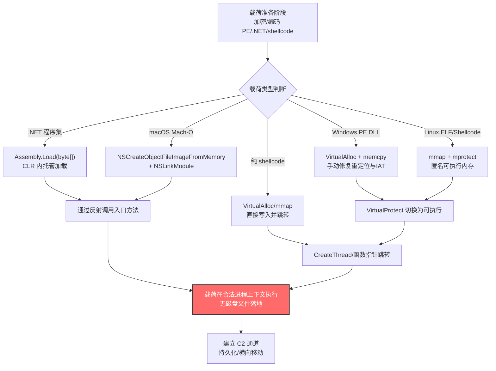

# 反射式代码加载 (T1620)

## 一句话通俗理解

攻击者像把"私货"直接塞进合法仓库的货架上——不经过门卫登记（不落地磁盘），让仓库管理员（安全软件）以为货一直是仓库自家的，实际执行的却是攻击者的恶意代码。

## 30秒速查卡

| 维度 | 你需要知道的 |
|------|-------------|
| 这是什么？ | 在进程自身内存中直接分配并执行代码（PE文件、shellcode、.NET程序集），不依赖磁盘文件路径作为执行支撑 |
| 为什么危险？ | 完全在内存中运行，无文件落地、可保持载荷加密状态至执行瞬间，传统基于文件签名的检测几乎完全失效，恶意执行被合法进程上下文"掩护" |
| 谁需要关心？ | EDR研发工程师、SOC分析师、应急响应人员、.NET运行时安全研究者、红队工具开发者 |
| 你的第一步防御 | 启用 ETW（Event Tracing for Windows）的 .NET Assembly Load 事件监控，结合 Sysmon 内存分配行为追踪，建立"进程内自加载"基线 |
| 如果只做一件事 | 监控同一进程内 VirtualAlloc → memcpy → VirtualProtect(PAGE_EXECUTE) → CreateThread 的链式调用模式，这是反射加载的核心指纹 |

## 难度等级

⭐⭐⭐ 高级（需要深入的技术知识和实践）

反射式代码加载属于高级隐蔽技术，原因在于：

- 攻击者需要理解操作系统底层的内存管理机制（虚拟内存、页保护、PE文件格式、重定位与导入表修复）
- 不同平台（Windows/Linux/macOS）的反射加载实现差异巨大，需要分别掌握 `VirtualAlloc`/`mmap`/`NSCreateObjectFileImageFromMemory` 等机制
- .NET 反射加载还涉及 CLR（公共语言运行时）内部机制，如 `AppDomain`、`Assembly.Load` 上下文等
- 防御方若不了解合法加载基线，很难区分"正常的内存加载"与"恶意的反射加载"

## 前置知识检查

**读这个文件需要什么？**

- [ ] Windows PE 文件格式（DOS头、PE头、节区、导入表、重定位表）
- [ ] Windows 内存管理 API（`VirtualAlloc`、`VirtualProtect`、`CreateThread`）
- [ ] .NET CLR 运行时与 `System.Reflection.Assembly.Load` 机制
- [ ] Linux 进程内存映射（`mmap`、`mprotect`、匿名映射）与 ELF 加载
- [ ] macOS Mach-O 加载与 `NSCreateObjectFileImageFromMemory` 等 API
- [ ] 进程注入（T1055）与共享模块（T1129）的区别

## 技术描述

反射式代码加载（T1620）是 MITRE ATT&CK 框架中**属于隐蔽（TA0005）战术**的技术。攻击者通过在进程自身内存中直接分配并执行代码载荷，而非创建基于磁盘文件路径支撑的线程或进程（如 [共享模块 T1129](../04-Execution/T1129-Shared-Modules.md)），从而隐藏恶意载荷的执行。

**通俗解释：**

想象一个合法程序就像一家正规餐厅，平时菜品（DLL/EXE）都从指定的供货商仓库（磁盘文件）取货，餐厅经理（安全软件）每天核对送货单（文件签名/路径）确保货品合规。反射式代码加载相当于——攻击者直接把"私货"扔进餐厅厨房的锅里，不填送货单、不走仓库、不经供货商，菜直接炒出来端上桌。经理查送货单查不到任何异常，因为根本就没有送货记录。

更具体地说：正常情况下，Windows 加载一个 DLL 要调用 `LoadLibrary`，系统会从磁盘读取文件、检查签名、建立模块映射；而反射加载完全绕过这套流程——攻击者自己在内存里申请一块区域（`VirtualAlloc`），把 PE 字节流拷贝进去（`memcpy`），手动修复重定位表和导入表，再把内存页属性改成可执行（`VirtualProtect(PAGE_EXECUTE_READWRITE)`），最后起一个线程（`CreateThread`）跑起来。整个过程磁盘上不留痕迹，安全软件的文件扫描无从下手。

**过渡段：** 反射加载与 [进程注入 T1055](./T1055-Process-Injection.md) 极为相似，关键区别在于——进程注入是把代码"塞进别的进程"，而反射加载是把代码"加载到自己的进程"。这意味着反射加载不会出现跨进程内存写入（如 `WriteProcessMemory`），所有可疑操作都发生在同一 PID 内，传统的跨进程注入检测对它无效。同时，由于载荷可以一直保持加密状态直到执行瞬间才解密，基于静态特征的反病毒扫描也几乎完全失效。

**技术原理（按平台与载荷类型分类）：**

### 一、Windows 原生反射加载（PE 反射注入）

这是最经典的形式，攻击者手动实现 `LoadLibrary` 的全部功能，但完全在内存中完成：

1. **内存分配**：调用 `VirtualAlloc` 在进程自身内存中申请一块 RW 区域
2. **字节拷贝**：将 PE 文件字节流（可能来自网络、加密资源、嵌入数据）`memcpy` 到该区域
3. **重定位修复**：遍历 PE 重定位表（`.reloc` 节），按当前基址修正所有绝对地址引用
4. **导入表修复**：遍历导入表，调用 `LoadLibrary`/`GetProcAddress` 解析每个导入函数地址并填入 IAT
5. **权限切换**：调用 `VirtualProtect` 将代码节属性改为 `PAGE_EXECUTE_READ`，数据节保持可写
6. **执行入口**：调用 `DllMain` 或通过 `CreateThread` 在新线程中执行入口点

代表实现：Stephen Fewer 的 **Reflective DLL Injection** 项目（被 Cobalt Strike、Metasploit meterpreter 等广泛采用）、**sRDI**（DAVESHELL，将 PE-COFF 转换为位置无关代码）。

### 二、.NET 反射加载（Assembly.Load）

.NET 运行时提供了 `System.Reflection.Assembly.Load` 系列方法，可直接从字节数组加载托管程序集，无需磁盘文件。攻击者滥用此机制：

```powershell
# PowerShell 中加载字节数组形式的 .NET 程序集
$bytes = [System.Convert]::FromBase64String("<base64-encoded-assembly>")
[assembly]::Load($bytes).GetType("MalwareClass").GetMethod("Run").Invoke($null, $null)
```

特点：
- 载荷常以 Base64 字符串、加密资源或网络下载字节流形式存在
- 加载后程序集出现在 `.NET CLR` 内存中，但不一定有对应的磁盘 DLL
- Cobalt Strike 的 `execute-assembly` 命令即通过加载 CLR 后调用 `Assembly.Load` 实现
- FIN7、Kimsuky、FoggyWeb（APT29/Nobelium）等均大量使用此手法

### 三、Linux 反射加载（ELF 内存执行）

Linux 上通过 `mmap` 与 `mprotect` 实现类似效果：

1. 调用 `mmap` 创建匿名可读写内存区域
2. 写入 ELF 字节流或位置无关 shellcode
3. 调用 `mprotect` 将内存保护改为 `PROT_EXEC`
4. 通过函数指针跳转或 `clone`/`pthread_create` 启动执行

也可使用 `memfd_create` 创建匿名文件描述符，配合 `fexecve` 执行（虽然存在 `memfd` 文件，但不落磁盘）。参考实现："In-Memory-Only ELF Execution"（magisterquis）。

### 四、macOS 反射加载

macOS 提供专门的 API 加载内存中的 Mach-O 镜像：

- `NSCreateObjectFileImageFromMemory`：从内存创建镜像对象
- `NSLinkModule`：链接该模块
- `NSLookupSymbolInModule`：查找符号并执行

ThiefQuest（OSX.EvilQuest）即滥用这些 API 在内存中加载和链接载荷。

### 五、shellcode 直接执行

最轻量级形式：位置无关代码（PIC）shellcode 直接写入可执行内存后跳转执行。无需 PE/ELF 头解析，载荷更小、更隐蔽。常配合 Donut 等工具将 .NET/EXE/DLL 转换为 shellcode 形式以支持反射加载。

**用途与影响：**

反射式代码加载是现代APT和红队的**核心隐蔽技术之一**，价值体现在三个层面：

- **无文件隐蔽性**：载荷不落地磁盘，文件扫描、白名单（AppLocker/WDAC）几乎完全失效
- **载荷加密保护**：载荷可一直保持加密状态，直到执行瞬间才在内存中解密，静态分析无法提取特征
- **合法上下文掩护**：恶意代码在合法进程（如 `powershell.exe`、`w3wp.exe`、`MSExchangeOWAAppPool`）中执行，进程树和签名状态看起来完全正常

几乎所有高级威胁——从 Cobalt Strike Beacon 到 PlugX、从 Lazarus 到 APT29——都将反射加载作为标准能力。

## 真实攻击流程

### 典型攻击流程

```
准备载荷（PE/.NET/shellcode，常加密或编码） --> 在目标进程内存中分配可读写区域 --> 拷贝并修复载荷 --> 切换内存页为可执行 --> 创建线程或调用入口 --> 载荷在合法进程上下文中运行 --> 持久化与C2通信
```



**步骤详解：**

1. **载荷准备**
   - 通俗描述：攻击者把"私货"提前打包好，外面再裹上"保护壳"避免被识破
   - 技术细节：载荷可能是编译好的 PE/ELF 二进制、.NET 程序集或纯 shellcode；通常用 AES/XOR 加密、Base64 编码或 steganography 隐藏；可嵌入宏文档、HTML 走私、PowerShell 脚本或网络下载字节流中
   - 常用工具：Donut（PE/.NET 转 shellcode）、sRDI（DAVESHELL）、Cobalt Strike `execute-assembly`、自定义加载器

2. **在目标进程内存中分配区域**
   - 通俗描述：在合法程序的"厨房"里腾出一块"工作台"
   - 技术细节：Windows 上调用 `VirtualAlloc(NULL, size, MEM_COMMIT, PAGE_READWRITE)`；Linux 上调用 `mmap(NULL, size, PROT_READ|PROT_WRITE, MAP_ANONYMOUS|MAP_PRIVATE, -1, 0)`；macOS 同样使用 `mmap`
   - 常用工具：直接 Win32 API 调用、PowerShell `[Runtime.InteropServices.Marshal]::AllocHGlobal`

3. **拷贝并修复载荷**
   - 通俗描述：把"私货"放到工作台上，还要根据"现场尺寸"调整一下
   - 技术细节：用 `memcpy` 写入字节流；对 PE 文件需手动修复重定位表（按当前基址修正绝对地址）和导入表（解析每个导入函数地址并填入 IAT）；.NET 程序集由 CLR 自动处理；纯 shellcode 无需修复
   - 常用工具：Reflective DLL Injection 库、sRDI 转换工具

4. **切换内存页为可执行**
   - 通俗描述：把"工作台"标记为"可运行区"，让 CPU 能执行上面的内容
   - 技术细节：Windows 调用 `VirtualProtect(addr, size, PAGE_EXECUTE_READ, &old)`（或 RWX）；Linux 调用 `mprotect(addr, size, PROT_READ|PROT_EXEC)`；现代 EDR 会监控 RWX 权限变更
   - 常用工具：Win32 API、`syscall` 直接调用（绕过用户态 hook）

5. **创建线程或调用入口**
   - 通俗描述：按下"开始"按钮，让载荷真正跑起来
   - 技术细节：Windows 调用 `CreateThread(NULL, 0, baseAddr, arg, 0, &tid)` 或直接函数指针调用 `DllMain(hModule, DLL_PROCESS_ATTACH, NULL)`；.NET 通过 `Assembly.Load(bytes).GetMethod("Run").Invoke()` 反射调用；Linux 通过函数指针跳转或 `pthread_create`
   - 常用工具：Win32 API、.NET 反射 API

6. **载荷在合法进程上下文执行**
   - 通俗描述：私货开始"营业"，外面看是合法程序，里面跑的是攻击者代码
   - 技术细节：载荷继承宿主进程的令牌、权限、网络身份；可访问宿主进程内存中的凭证、密钥；Cobalt Strike Beacon 此时会建立 C2 通道
   - 常用工具：Cobalt Strike Beacon、自定义 C2 框架

7. **持久化与 C2 通信**
   - 通俗描述：站稳脚跟后开始"长期作业"
   - 技术细节：通过反射加载的载荷常驻内存，配合 [T1055 进程注入](./T1055-Process-Injection.md) 实现跨进程注入；建立 HTTP/HTTPS/DNS C2 通道；按需加载更多模块（同样反射方式）
   - 常用工具：Cobalt Strike、Sliver、Brute Ratel C4

## 检测建议

**用人话说：** 反射加载的检测核心是"识别进程内的异常自加载行为"——合法程序平时加载代码都走标准路径（`LoadLibrary`、`Assembly.LoadFrom`），一旦发现某进程在自己的内存里"手工"分配可执行内存并跳转执行，或者通过 `Assembly.Load(byte[])` 加载了来源不明的字节数组，就高度可疑。EDR 需要在内核或 ETW 层捕获这些 API 调用模式，建立"正常加载基线"后识别偏离。

### 网络层检测

**检测方法：** 反射加载本身是主机行为，但载荷字节流常通过网络下载。监控以下网络模式：

- 进程发起 HTTPS 请求后短时间内（数秒内）在自身内存中分配大块可执行内存并执行
- PowerShell、`rundll32.exe`、`w3wp.exe` 等进程发起非标准外联后内存中加载 .NET 程序集
- C2 通信特征：Cobalt Strike、Brute Ratel C4 等框架的 beaconing 模式（固定周期、固定字节数的心跳包）

### 主机层检测

**Windows 事件与 ETW：**

- **Sysmon Event ID 7（Image Loaded）**：虽然反射加载不产生标准 DLL 加载事件，但部分实现仍会触发（如通过 `LoadLibrary` 解析导入表时）
- **Sysmon Event ID 8（CreateRemoteThread）**：跨进程线程创建（非反射加载典型特征，但相关技术常组合使用）
- **Sysmon Event ID 25（ProcessTampering）**：进程映像与磁盘文件不匹配（部分反射加载会修改映像）
- **ETW .NET Assembly Load 事件**（`Microsoft-Windows-DotNETRuntime`）：捕获 `Assembly.Load(byte[])` 调用，关键字段 `AssemblyName`、`AssemblyPath`（路径为空或 `<Unknown>` 时高度可疑）
- **ETW Microsoft-Windows-Kernel-Image**：捕获模块加载事件，对比磁盘文件与内存模块
- **Windows Security Event ID 4656/4663**：敏感对象访问（如 `SeDebugPrivilege` 使用）

**具体命令示例：**

```powershell
# 检测 .NET Assembly.Load(byte[]) 调用（通过 ETW）
# 需先启用 .NET 运行时 ETW 提供程序
Get-WinEvent -LogName 'Microsoft-Windows-DotNETRuntime/AssemblyLoader' -MaxEvents 100 |
    Where-Object { $_.Message -match 'AssemblyName' } |
    Select-Object TimeCreated, Message -First 50

# 检测进程内大块 RWX 内存分配（需借助 Sysmon 配置或 EDR）
# Sysmon 配置示例（捕捉 VirtualAlloc+CreateThread 链）
# <RuleGroup name="Network" GroupRelation="or">
#   <ProcessCreate onmatch="include">
#     <CommandLine>powershell*</CommandLine>
#   </ProcessCreate>
# </RuleGroup>

# 列出进程内存中的可执行区域（无对应磁盘文件的匿名映射）
# 需借助 MemProcFS、pe-sieve 等工具
# pe-sieve /pid <pid> /imp 3

# 检测 PowerShell 中可疑的 Assembly.Load 调用（脚本块日志）
Get-WinEvent -FilterHashtable @{LogName='Microsoft-Windows-PowerShell/Operational'; ID=4104} |
    Where-Object { $_.Message -match 'Reflection\.Assembly|Assembly::Load|\[Reflection\]' } |
    Select-Object TimeCreated, Message -First 30
```

**Linux 检测：**

- 监控 `mmap` 与 `mprotect` 的可疑组合（先 RW 后 EXEC）
- 检查 `/proc/<pid>/maps` 中的匿名可执行区域：`anon_inode` 或无文件路径的 `r-xp` 映射
- 使用 eBPF 工具（如 `tracee`、`bpftrace`）追踪 `mmap`+`mprotect`+`execve` 链

```bash
# 检查进程内存映射中的匿名可执行区域
cat /proc/$(pgrep -f suspicious_process)/maps | grep 'r-xp' | grep -v '/'
# 应关注无文件路径的 r-xp 行，如：
# 7f8b4c000000-7f8b4c005000 r-xp 00000000 00:00 0

# 使用 bpftrace 追踪 mmap+mprotect+exec 链
bpftrace -e 'tracepoint:syscalls:sys_enter_mprotect { @[comm] = count(); }'
```

### 应用层检测

**检测要点：**

1. **.NET Assembly.Load(byte[]) 异常检测**
   - 日志来源：ETW `Microsoft-Windows-DotNETRuntime`
   - 关注字段：`AssemblyName`、`AssemblyPath`、`StartupContext`
   - 异常特征：`AssemblyPath` 为空、`<Unknown>` 或非标准路径；AssemblyName 与已知合法程序集不匹配；调用方为 `powershell.exe`、`w3wp.exe`、`MSExchangeOWAAppPool` 等高敏感进程

2. **进程内内存分配与执行链检测**
   - 日志来源：EDR 内核驱动、ETW `Microsoft-Windows-Kernel-Memory`
   - 关注字段：`VirtualAlloc` 大小与保护属性、`VirtualProtect` 前后属性变化、`CreateThread` 起始地址
   - 异常特征：`VirtualAlloc(PAGE_READWRITE)` → 写入 → `VirtualProtect(PAGE_EXECUTE_READ)` → `CreateThread` 的完整链；起始地址位于匿名内存区域（非任何已加载模块）

3. **匿名可执行内存区域检测**
   - 日志来源：内存扫描工具（pe-sieve、Moneta）
   - 关注字段：内存区域基址、大小、保护属性、对应文件路径
   - 异常特征：`r-xp`/`PAGE_EXECUTE` 属性的内存区域无对应磁盘文件；或对应文件已被删除

4. **PowerShell 反射加载检测**
   - 日志来源：PowerShell Script Block Logging（Event ID 4104）、AMSI
   - 关注字段：脚本块内容、调用栈
   - 异常特征：脚本中出现 `[Reflection.Assembly]::Load`、`[System.Reflection.Assembly]::Load`、`Add-Type -AssemblyName` 配合 Base64 字节数组

## 检测规则示例

### Sigma 规则：检测可疑的 .NET Assembly.Load(byte[]) 调用

```yaml
title: 可疑 .NET Assembly.Load 字节数组加载行为检测
id: a1b2c3d4-e5f6-4a5b-8c9d-0e1f2a3b4c5d
status: experimental
description: 检测 PowerShell 或其他进程中通过 System.Reflection.Assembly.Load 加载字节数组形式的 .NET 程序集，可能表明 T1620 反射式代码加载
references:
    - https://attack.mitre.org/techniques/T1620/
    - https://attack.mitre.org/detectionstrategies/DET0300/
author: ATT&CK知识库
date: 2026/07/24
logsource:
    product: windows
    service: powershell
detection:
    selection_scriptblock:
        EventID: 4104
        ScriptBlockText|contains:
            - 'Reflection.Assembly]::Load'
            - 'Reflection.Assembly]::LoadFrom'
            - '[Assembly]::Load('
            - 'System.Reflection.AssemblyName'
    filter_legitimate:
        ScriptBlockText|contains:
            - 'Add-Type -AssemblyName System.'
            - 'Import-Module'
    condition: selection_scriptblock and not filter_legitimate
falsepositives:
    - 合法的 .NET 性能分析工具（如 dotTrace、PerfView）部署
    - 开发团队在 PowerShell 中加载内部工具程序集
    - 合法软件使用 Assembly.Load 加载插件
level: high
tags:
    - attack.t1620
    - attack.defense_evasion
    - attack.execution
```

### Sigma 规则：检测进程内 VirtualAlloc+VirtualProtect+CreateThread 链

```yaml
title: 进程内反射加载内存执行链检测
id: b2c3d4e5-f6a7-4b5c-9d0e-1f2a3b4c5d6e
status: experimental
description: 检测同一进程内 VirtualAlloc(PAGE_READWRITE) → VirtualProtect(PAGE_EXECUTE) → CreateThread 的可疑链式调用，可能表明 T1620 反射式代码加载
references:
    - https://attack.mitre.org/techniques/T1620/
    - https://attack.mitre.org/detectionstrategies/DET0300/
author: ATT&CK知识库
date: 2026/07/24
logsource:
    product: windows
    service: sysmon
detection:
    selection_alloc:
        EventID: 22  # DNS query（载荷可能来自网络下载，作为前置信号）
    condition: selection_alloc
falsepositives:
    - 合法的 JIT 编译器（如 .NET CLR、Java VM）内存管理
    - 浏览器的 JavaScript JIT 编译
    - 数据库引擎的存储过程编译
level: medium
tags:
    - attack.t1620
    - attack.defense_evasion
    - attack.execution
note: |
    完整的 VirtualAlloc → VirtualProtect → CreateThread 链检测需要 EDR 内核驱动或 ETW 内存事件，
    Sysmon 本身不直接捕获这些 API 调用。建议配合以下方案：
    - 启用 ETW Microsoft-Windows-Kernel-Memory 提供程序
    - 使用 EDR 产品（如 CrowdStrike、SentinelOne、Microsoft Defender for Endpoint）的内存行为监控
    - 部署 pe-sieve、Moneta 等内存扫描工具定期检查匿名可执行区域
```

### YARA 规则：检测 Donut 生成的 shellcode 载荷特征

```yara
rule Donut_Shellcode_Loader_Generic {
    meta:
        description = "检测 Donut 工具生成的反射加载 shellcode 特征"
        author = "ATT&CK知识库"
        date = "2026-07-24"
        reference = "https://github.com/TheWover/donut"
        mitre_attack = "T1620"
    strings:
        $donut_header = { 41 57 41 56 41 55 41 54 41 53 56 57 55 53 41 89 } // Donut shellcode 入口常见模式
        $donut_marker = "Donut" ascii
        $pe_header = { 4D 5A } // MZ 头
        $api_virtualalloc = "VirtualAlloc" ascii
        $api_virtualprotect = "VirtualProtect" ascii
        $api_createthread = "CreateThread" ascii
    condition:
        $donut_header at 0 and ($donut_marker or ($api_virtualalloc and $api_virtualprotect and $api_createthread))
        or ($pe_header and $api_virtualalloc and $api_virtualprotect)
}
```

## 缓解措施

### 优先级1：关键措施

**措施名称：** 启用内存行为监控与 EDR 内核保护

**具体实施步骤：**

1. 部署支持内存行为监控的 EDR 产品（如 Microsoft Defender for Endpoint、CrowdStrike Falcon、SentinelOne），启用 `Memory Scan` 与 `Behavior Monitoring`
2. 启用 ETW（Event Tracing for Windows）的 .NET 运行时事件，捕获 `Assembly.Load(byte[])` 调用
3. 配置 EDR 的"反射加载防护"策略，对 `VirtualAlloc → VirtualProtect(EXEC) → CreateThread` 链进行实时拦截
4. 启用 Windows Defender Application Guard（WDAG）隔离高风险进程

### 优先级2：重要措施

**措施名称：** 加固高敏感进程的 .NET 加载上下文

**具体实施步骤：**

1. 在 IIS 应用池（如 `MSExchangeOWAAppPool`）中配置 `.NET CLR` 信任策略，限制 `Assembly.Load(byte[])` 的调用上下文
2. 通过组策略限制 PowerShell 的脚本执行与 .NET 反射加载：
   - 启用 `PowerShell Script Block Logging`（Event ID 4104）
   - 启用 `Constrained Language Mode`（限制 `[Reflection.Assembly]::Load` 等敏感 API）
   - 部署 AMSI（反恶意软件扫描接口），让 .NET 程序集在加载前接受扫描
3. 对 Exchange Server、SharePoint Server 等高价值目标，部署应用程序白名单（WDAC）策略，仅允许签名 .NET 程序集加载
4. 启用 Windows Defender Exploit Guard 的 `Code Integrity Guard`，要求所有可执行内存都有签名验证

### 优先级3：建议措施

**措施名称：** 部署内存取证与异常检测工具

**具体实施步骤：**

1. 定期部署 pe-sieve、Moneta 等内存扫描工具，检查进程内存中的匿名可执行区域
2. 部署 Volatility 框架进行内存取证分析，识别 `malfind`（异常可执行内存）模式
3. 监控 `/proc/<pid>/maps`（Linux）与 `VirtualQuery`（Windows）输出，建立"正常内存映射基线"，识别新增匿名可执行区域
4. 对 Linux 系统，部署 eBPF 工具（如 `tracee`、`falco`）追踪 `mmap`+`mprotect`+`execve` 链
5. 实施"内存完整性"监控（如 Windows 的 Core Isolation / Memory Integrity），防止未签名代码在内核态执行

### MITRE ATT&CK 缓解措施映射

| 缓解措施ID | 缓解措施名称 | 适用性 | 说明 |
|------------|-------------|--------|------|
| M1040 | 行为检测 | 强适用 | 监控进程内 VirtualAlloc+VirtualProtect+CreateThread 链与 Assembly.Load(byte[]) 调用 |
| M1049 | 反病毒/扫描引擎 | 部分适用 | 部署内存扫描（AMSI、EDR Memory Scan），但加密载荷难以静态检测 |
| M1045 | 软件限制策略 | 部分适用 | 通过 WDAC 限制 .NET 程序集加载来源，但反射加载可绕过路径白名单 |
| M1038 | 执行防护 | 强适用 | 启用 Code Integrity Guard、Exploit Protection，要求可执行内存有签名 |
| M1050 | 应用程序隔离与沙箱化 | 部分适用 | 对高敏感进程（IIS、Exchange）实施 AppContainer/WDAG 隔离 |

> ⚠️ **MITRE 官方说明：** 该攻击技术基于系统功能的滥用，难以通过预防性控制完全缓解。检测与响应比预防更关键。

## 动手实验

> ⚠️ **重要提示**：所有实验必须在隔离的实验室环境中进行，禁止对未授权的真实系统进行测试。

### 实验环境准备

**所需工具：**

- Windows 10/11 虚拟机（启用 Sysmon 日志与 ETW）
- Process Hacker / Process Explorer（观察内存映射）
- pe-sieve（内存扫描工具）
- 一个简单的 .NET 测试程序集（如 `calc.exe` 等效的弹出计算器程序）
- PowerShell ISE 或 VS Code

### 实验1：.NET Assembly.Load 反射加载基础（初级）

**实验目标：** 理解 T1620 .NET 反射加载的原理，观察 PowerShell 通过 `Assembly.Load(byte[])` 加载程序集的过程

**实验步骤：**

1. 编写一个简单的 .NET 控制台程序 `TestPayload.cs`：

   ```csharp
   using System;
   public class TestPayload {
       public static void Run() {
           Console.WriteLine("[+] 反射加载成功！当前进程: " + System.Diagnostics.Process.GetCurrentProcess().ProcessName);
       }
   }
   ```

2. 编译为 DLL：`csc /target:library TestPayload.cs`

3. 将其转换为 Base64 字节数组：

   ```powershell
   $bytes = [System.IO.File]::ReadAllBytes("TestPayload.dll")
   $base64 = [System.Convert]::ToBase64String($bytes)
   Write-Output $base64 | Out-File payload.b64
   ```

4. 在 PowerShell 中执行反射加载：

   ```powershell
   $base64 = Get-Content payload.b64
   $bytes = [System.Convert]::FromBase64String($base64)
   $asm = [System.Reflection.Assembly]::Load($bytes)
   $type = $asm.GetType("TestPayload")
   $method = $type.GetMethod("Run")
   $method.Invoke($null, $null)
   ```

5. 使用 Process Hacker 观察 `powershell.exe` 的内存映射，确认 DLL 已加载但无对应磁盘文件路径

6. 检查 PowerShell 脚本块日志（Event ID 4104），确认 `[Reflection.Assembly]::Load` 调用被记录

**预期结果：** PowerShell 输出"反射加载成功！"，Process Hacker 显示 `TestPayload.dll` 已加载到内存，但磁盘文件可能已删除；脚本块日志记录了反射调用

**学习要点：** 理解 .NET `Assembly.Load(byte[])` 的工作原理，以及为什么传统文件签名检测对它无效

### 实验2：使用 Donut 生成 shellcode 反射加载（中级）

**实验目标：** 理解 Donut 工具如何将 PE/.NET 载荷转换为 shellcode 实现反射加载

**实验步骤：**

1. 下载 Donut 工具：`https://github.com/TheWover/donut`

2. 将实验1的 `TestPayload.dll` 转换为 shellcode：

   ```bash
   donut.exe -i TestPayload.dll -o payload.bin -a 2 -b 3
   # -a 2: x64 架构
   # -b 3: 使用 Syscalls 避开用户态 hook
   ```

3. 编写一个简单的 C 语言加载器 `loader.c`：

   ```c
   #include <windows.h>
   #include <stdio.h>
   int main() {
       FILE* f = fopen("payload.bin", "rb");
       fseek(f, 0, SEEK_END); long size = ftell(f); fseek(f, 0, SEEK_SET);
       unsigned char* buf = (unsigned char*)malloc(size);
       fread(buf, 1, size, f); fclose(f);
       void* mem = VirtualAlloc(NULL, size, MEM_COMMIT, PAGE_READWRITE);
       memcpy(mem, buf, size);
       DWORD old;
       VirtualProtect(mem, size, PAGE_EXECUTE_READ, &old);
       HANDLE t = CreateThread(NULL, 0, (LPTHREAD_START_ROUTINE)mem, NULL, 0, NULL);
       WaitForSingleObject(t, INFINITE);
       return 0;
   }
   ```

4. 编译并运行 `loader.exe`，观察 TestPayload 被加载执行

5. 使用 pe-sieve 扫描 `loader.exe` 的内存：`pe-sieve /pid <loader_pid> /imp 3`

6. 检查 EDR/Sysmon 日志，确认是否捕获到 `VirtualAlloc → VirtualProtect → CreateThread` 链

**预期结果：** `loader.exe` 成功执行 TestPayload，pe-sieve 报告发现反射加载的 PE 模块（无对应磁盘文件）

**学习要点：** 理解 Donut 的工作原理与 shellcode 反射加载的完整链路；学习如何使用 pe-sieve 检测内存中的反射加载

## 真实案例

### 案例1：3CX 供应链攻击中的 DAVESHELL 反射加载（2023）

- **时间**：2023年3月-4月
- **目标**：全球 3CX Desktop App 用户（涉及超过 60 万家企业）
- **攻击组织**：Lazarus Group（APT38，疑似朝鲜背景）
- **手法**：3CX 供应链攻击中，[AppleJeus](https://attack.mitre.org/groups/G1049)（Lazarus 子组织）滥用开源项目 **DAVESHELL**（即 sRDI，by monoxgas）将 PE-COFF 文件转换为位置无关代码，再反射式加载到内存中执行。攻击者将恶意 shellcode 嵌入 3CX Desktop App 的合法更新包中，当用户启动应用时，shellcode 在应用进程内存中解密并执行后续阶段载荷（Cobalt Strike beacon 与 macOS 平台的 SmoothOperator 后门）。整个过程无文件落地，传统 AV 难以检测。
- **影响**：全球数十万家企业受影响，多家知名安全厂商（Mandiant、CrowdStrike、SentinelOne）介入分析；这是历史上规模最大的软件供应链攻击之一
- **参考链接**：[Google Cloud - 3CX Software Supply Chain Compromise](https://cloud.google.com/blog/topics/threat-intelligence/3cx-software-supply-chain-compromise/)、[GitHub - sRDI (DAVESHELL)](https://github.com/monoxgas/sRDI)、[MITRE ATT&CK - Campaign C0057](https://attack.mitre.org/campaigns/C0057/)

### 案例2：Lazarus Group 滥用宏与反射加载 DLL 攻击全球金融机构（2022）

- **时间**：2022年1月-2月
- **目标**：全球金融机构、加密货币交易所、国防承包商
- **攻击组织**：Lazarus Group（G0032）
- **手法**：Lazarus 在钓鱼文档宏中使用 shellcode 解密嵌入的 DLL 字节流，并在运行时手动映射到内存中执行，完全绕过 `LoadLibrary` 标准加载路径。攻击者还会先修改内存保护权限，然后用 shellcode 覆盖已加载 DLL 的函数代码，并通过 [KernelCallbackTable 劫持（T1574.013）](./T1574/T1574.013-KernelCallbackTable-Hijacking.md) 触发执行。这种"反射加载 + 函数代码覆盖"组合使恶意代码在合法签名模块的内存区域中执行，连 EDR 的内存扫描都难以区分。
- **影响**：多家银行与加密货币交易所被入侵，损失估计超过数亿美元；该手法被多个 APT 组织借鉴
- **参考链接**：[Malwarebytes - North Korea's Lazarus APT Leverages Windows Update Client](https://blog.malwarebytes.com/threat-intelligence/2022/01/north-koreas-lazarus-apt-leverages-windows-update-client-github-in-latest-campaign/)、[Qualys - LolZarus: Lazarus Group Incorporating Lolbins](https://blog.qualys.com/vulnerabilities-threat-research/2022/02/08/lolzarus-lazarus-group-incorporating-lolbins-into-campaigns)

### 案例3：APT29 (Nobelium) FoggyWeb 后门反射加载 .NET 载荷攻击 Exchange 服务器（2021）

- **时间**：2021年9月（持续活动自 SolarWinds 供应链攻击之后）
- **目标**：全球 Microsoft Exchange Server 部署单位（政府、国防、智库）
- **攻击组织**：APT29（Nobelium，疑似俄罗斯 SVR 背景）
- **手法**：APT29 部署的 FoggyWeb 后门专门针对 Exchange Server，其加载器通过反射方式加载 .NET 程序集到 `w3wp.exe`（IIS 工作进程）内存中执行。FoggyWeb 不在磁盘留下任何文件，所有载荷（包括后门本身与其加载的插件）都以加密字节流形式嵌入合法的 Exchange DLL 资源中或通过 C2 通道下载。攻击者通过特制的 HTTP 请求触发 FoggyWeb 解密并 `Assembly.Load` 后续模块，实现凭证窃取、邮件转发、横向移动。由于所有执行都在 IIS 工作进程内存中完成，且 Exchange 服务器本身就有大量 .NET 反射加载行为，攻击隐蔽性极高。
- **影响**：大量政府与企业 Exchange 服务器被长期驻留；该攻击是 SolarWinds 事件的延续，推动了微软对 Exchange 安全架构的重大重构
- **参考链接**：[Microsoft Security - FoggyWeb Targeted NOBELIUM Malware](https://www.microsoft.com/security/blog/2021/09/27/foggyweb-targeted-nobelium-malware-leads-to-persistent-backdoor/)、[MITRE ATT&CK - Software S0661](https://attack.mitre.org/software/S0661/)

## 子技术概览

**该技术没有子技术。**

T1620（反射式代码加载）目前没有官方定义的子技术，所有反射加载行为统一归为本父技术。MITRE ATT&CK v19.1 中标注 "Sub-techniques: No sub-techniques"。

虽然无子技术划分，但实际实现可按以下维度分类：

| 分类维度 | 类型 | 说明 |
|----------|------|------|
| 平台 | Windows / Linux / macOS | 各平台 API 与 PE/ELF/Mach-O 格式不同 |
| 载荷类型 | PE DLL / .NET 程序集 / shellcode / ELF / Mach-O | 不同载荷需要不同的修复与加载逻辑 |
| 加载方式 | 手动反射（VirtualAlloc+mprotect） / 运行时 API（Assembly.Load / NSLinkModule） | 前者更隐蔽，后者更简单 |

## 术语解释

| 术语 | 英文原名 | 通俗解释 |
|------|----------|----------|
| 反射式代码加载 | Reflective Code Loading | 在进程自身内存中直接分配并执行代码，不依赖磁盘文件路径 |
| 反射 DLL 注入 | Reflective DLL Injection | 经典 Windows 反射加载技术，由 Stephen Fewer 提出，被 Cobalt Strike 等广泛采用 |
| 位置无关代码 | Position-Independent Code (PIC) | 不依赖绝对地址的代码，可在内存任意位置执行，shellcode 是典型例子 |
| PE 文件 | Portable Executable | Windows 可执行文件格式（.exe/.dll），反射加载需手动解析其头与表 |
| 重定位表 | Relocation Table | PE 文件中记录所有需按基址修正的绝对地址的表，反射加载必须处理 |
| 导入表 | Import Table | PE 文件中记录所有依赖外部 DLL 函数的表，反射加载需手动解析并填入 IAT |
| Assembly.Load | Assembly.Load | .NET 运行时方法，可从字节数组加载托管程序集，无需磁盘文件 |
| CLR | Common Language Runtime | .NET 的公共语言运行时，负责托管代码的执行与内存管理 |
| 内存映射 | Memory Mapping | 操作系统将内存区域与文件或匿名区域关联的机制，反射加载使用匿名映射 |
| Donut | Donut | 开源工具，可将 PE/.NET/VBScript/JScript 载荷转换为 shellcode 形式 |
| sRDI / DAVESHELL | shellcode Reflective DLL Injection | 开源工具，将 PE-COFF 转换为位置无关代码以支持反射加载 |
| mmap | mmap | Linux/POSIX 系统调用，用于创建内存映射区域，反射加载的核心 API |
| VirtualAlloc | VirtualAlloc | Windows API，用于在进程内存中分配区域，反射加载的核心 API |
| VirtualProtect | VirtualProtect | Windows API，用于修改内存区域保护属性，反射加载需切换为可执行 |
| AMSI | Anti-Malware Scan Interface | 微软的反恶意软件扫描接口，可拦截 .NET 反射加载并扫描载荷 |

## 参考资料

### 📚 官方文档（深入了解）

- [MITRE ATT&CK - T1620 Reflective Code Loading](https://attack.mitre.org/techniques/T1620/)
- [MITRE ATT&CK - TA0005 Stealth](https://attack.mitre.org/tactics/TA0005/)
- [MITRE ATT&CK - Detection Strategy DET0300](https://attack.mitre.org/detectionstrategies/DET0300/) - 反射式代码加载检测策略
- [Microsoft - Assembly.Load Method](https://learn.microsoft.com/dotnet/api/system.reflection.assembly.load) - .NET 反射加载官方 API 文档

### 📰 安全报告（真实攻击）

- [Google Cloud - 3CX Software Supply Chain Compromise](https://cloud.google.com/blog/topics/threat-intelligence/3cx-software-supply-chain-compromise/) - 3CX 供应链攻击分析（含 DAVESHELL/sRDI 反射加载）
- [Microsoft Security - FoggyWeb: Targeted NOBELIUM Malware](https://www.microsoft.com/security/blog/2021/09/27/foggyweb-targeted-nobelium-malware-leads-to-persistent-backdoor/) - APT29 FoggyWeb 后门反射加载 .NET 载荷分析
- [Malwarebytes - North Korea's Lazarus APT Leverages Windows Update Client](https://blog.malwarebytes.com/threat-intelligence/2022/01/north-koreas-lazarus-apt-leverages-windows-update-client-github-in-latest-campaign/) - Lazarus 反射加载 DLL 与 KernelCallbackTable 劫持组合攻击
- [Qualys - LolZarus: Lazarus Group Incorporating Lolbins](https://blog.qualys.com/vulnerabilities-threat-research/2022/02/08/lolzarus-lazarus-group-incorporating-lolbins-into-campaigns) - Lazarus LOLBins 与反射加载组合分析
- [CrowdStrike - ICEAPPLE: A Novel IIS Post-Exploitation Framework](https://www.crowdstrike.com/wp-content/uploads/2022/05/crowdstrike-iceapple-a-novel-internet-information-services-post-exploitation-framework.pdf) - IceApple 反射加载 .NET 程序集到 Exchange 应用池分析
- [SentinelOne - The Mystery of Metador](https://assets.sentinelone.com/sentinellabs22/metador#page=1) - Metador APT 的 metaMain 反射加载 DLL 分析
- [ESET - MuddyWater: Snakes by the riverbank](https://www.welivesecurity.com/en/eset-research/muddywater-snakes-riverbank/) - MuddyWater 的 Fooder 与 MuddyViper 反射加载行为
- [Microsoft - Disrupting Active Exploitation of On-Premises SharePoint Vulnerabilities](https://www.microsoft.com/en-us/security/blog/2025/07/22/disrupting-active-exploitation-of-on-premises-sharepoint-vulnerabilities/) - SharePoint ToolShell 攻击中的反射加载
- [Mandiant - APT43: North Korean Group Uses Cybercrime to Fund Espionage](https://services.google.com/fh/files/misc/apt43-report-en.pdf) - Kimsuky 通过 Invoke-Mimikatz 反射加载 Mimikatz DLL
- [CISA - Snake Malware Hunting](https://www.cisa.gov/sites/default/files/2023-05/aa23-129a_snake_malware_2.pdf) - Uroburs/Snake 的 `Load Modules Mem` 命令反射加载模块
- [Elastic - PIKABOT, I choose you!](https://www.elastic.co/security-labs/pikabot-i-choose-you) - Pikabot 反射加载加密 PE 组件分析
- [ESET - Mustang Panda's Hodur: Old tricks, new Korplug variant](https://www.welivesecurity.com/2022/03/23/mustang-panda-hodur-old-tricks-new-korplug-variant/) - PlugX 反射加载载荷分析

### 🔧 工具与资源（动手试试）

- [Reflective DLL Injection - Stephen Fewer](https://github.com/stephenfewer/ReflectiveDLLInjection) - 经典反射 DLL 注入开源实现，被 Cobalt Strike、Metasploit 等采用
- [Donut - TheWover](https://github.com/TheWover/donut) - 将 PE/.NET/VBScript/JScript 转换为 shellcode 的开源工具
- [sRDI (DAVESHELL) - monoxgas](https://github.com/monoxgas/sRDI) - shellcode Reflective DLL Injection 工具，被 Lazarus 滥用于 3CX 攻击
- [PowerSploit - PowerShellMafia](https://github.com/PowerShellMafia/PowerSploit) - 包含 `Invoke-ReflectivePEInjection` 等反射加载模块
- [SILENTTRINITY - byt3bl33d3r](https://github.com/byt3bl33d3r/SILENTTRINITY) - 基于 .NET 反射加载的 C2 框架
- [pe-sieve - hasherezade](https://github.com/hasherezade/pe-sieve) - 检测进程内存中被反射加载/注入的 DLL 与 shellcode
- [Moneta - referralresearch](https://github.com/referraldresearch/Moneta) - 检测内存中可疑可执行区域的工具
- [Volatility Framework](https://www.volatilityfoundation.org/) - 内存取证框架，可使用 `malfind` 插件检测异常可执行内存
- [Atomic Red Team - T1620 Tests](https://atomicredteam.io/) - 可执行的检测测试用例
- [Magisterquis - In-Memory-Only ELF Execution](https://magisterquis.github.io/2018/03/31/in-memory-only-elf-execution.html) - Linux 内存 ELF 执行经典文章
- [Objective-See - OSX.EvilQuest Analysis](https://objective-see.com/blog/blog_0x60.html) - macOS ThiefQuest 滥用 `NSCreateObjectFileImageFromMemory` 分析

## 相关技术

- **[T1055 进程注入](./T1055-Process-Injection.md)**：进程注入与反射加载极为相似，区别在于进程注入是把代码加载到**其他进程**的内存，反射加载是加载到**自身进程**的内存。两者常组合使用——攻击者通过反射加载将初始载荷加载到 PowerShell 进程，再通过进程注入横向到其他高权限进程
- **[T1129 共享模块](../04-Execution/T1129-Shared-Modules.md)**：执行战术中的标准 DLL 加载技术（通过 `LoadLibrary`），与 T1620 反射加载形成对比——T1129 走标准加载路径（有磁盘文件），T1620 绕过标准加载路径（无磁盘文件）
- **[T1059 解释性命令执行](../04-Execution/T1059-Command-and-Scripting-Interpreter.md)**：PowerShell（T1059.001）等脚本解释器是反射加载最常见的宿主环境，攻击者通过 PowerShell 调用 `[Reflection.Assembly]::Load` 加载 .NET 载荷
- **[T1027 混淆文件或信息](./T1027-Obfuscated-Files-or-Info.md)**：反射加载的载荷通常使用加密或编码（T1027.013 加密/编码）保护，仅在内存中执行瞬间才解密
- **[T1140 去混淆/解码文件或信息](./T1140-Deobfuscate-Decode-Files-or-Information.md)**：反射加载前的载荷解密过程，与 T1620 紧密配合——先 T1140 解密载荷字节流，再 T1620 反射加载到内存执行
- **[T1574 劫持执行流](./T1574-Hijack-Execution-Flow.md)**：另一种"借壳执行"技术，区别在于 T1574 通过修改加载路径让合法程序加载恶意 DLL，T1620 则完全绕过加载路径在内存中执行；Lazarus 常将 T1574.013 KernelCallbackTable 劫持与 T1620 反射加载组合使用
- **[T1014 Rootkit](./T1014-Rootkit.md)**：Rootkit 常通过反射加载方式在内核态执行 payload，避免在磁盘留下可检测的驱动文件
- **[T1562 削弱防御](../08-Defense-Impairment/T1562-Impair-Defenses.md)**（已迁移至 TA0112）：攻击者常先削弱 EDR（如关闭 AMSI、卸载 EDR 传感器）再实施反射加载，以提高成功率
