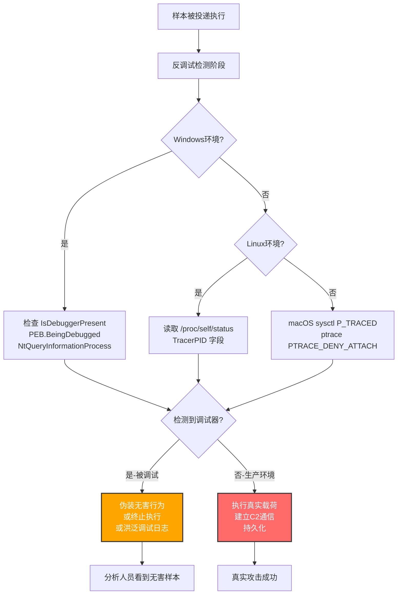

# 调试器规避 (T1622)

## 一句话通俗理解

恶意软件在执行核心逻辑前，先"东张西望"看看有没有调试器盯着自己——一旦发现被分析人员用调试器跟踪，就伪装成无害程序或干脆停止运行，让安全分析师无从下手。

## 30秒速查卡

| 维度 | 你需要知道的 |
|------|-------------|
| 这是什么？ | 恶意代码通过检测自身是否被调试器附加，决定是否暴露真实行为或终止执行的规避技术 |
| 为什么危险？ | 让沙箱、动态分析平台、人工逆向分析全部失效——分析师看到的是"无害样本"，真实载荷却被隐藏不触发 |
| 谁需要关心？ | 恶意软件分析师、SOC检测工程师、EDR研发人员、沙箱平台运维人员 |
| 你的第一步防御 | 在分析环境中使用硬件级调试器、隐藏调试器特征字符串、监控反调试API调用模式 |
| 如果只做一件事 | 部署基于API钩子的检测规则，捕获IsDebuggerPresent、NtQueryInformationProcess、CheckRemoteDebuggerPresent、ZwSetInformationThread(ThreadHideFromDebugger)等关键反调试调用 |

## 难度等级

⭐⭐ 中级（需要操作系统与调试器原理知识）

调试器规避属于中级隐蔽技术，原因在于：
- 攻击者需要理解操作系统进程环境块（PEB）、调试原语、异常处理机制等底层概念
- 不同的反调试技术针对不同的平台（Windows/Linux/macOS）和分析场景，需要针对性选择
- 防御方若不理解调试器如何与目标进程交互，很难识别"无害样本"为何在分析环境中不触发

## 前置知识检查

**读这个文件需要什么？**

- [ ] Windows进程环境块（PEB）结构与`BeingDebugged`标志位
- [ ] Windows Native API（`IsDebuggerPresent`、`NtQueryInformationProcess`、`ZwSetInformationThread`）
- [ ] 结构化异常处理（SEH）与向量化异常处理（VEH）机制
- [ ] Linux `/proc` 文件系统与`ptrace`系统调用
- [ ] macOS `sysctl`与`P_TRACED`标志、`PTRACE_DENY_ATTACH`机制
- [ ] 调试器工作原理（断点、单步执行、异常拦截）

## 技术描述

调试器规避（T1622）是MITRE ATT&CK框架中**同时属于隐蔽（TA0005）与发现（TA0007）两个战术**的技术。攻击者通过检测和规避调试器，阻止防御方追踪和分析恶意载荷的执行。调试器通常被防御方用于追踪或分析潜在恶意载荷的执行过程。

调试器规避可能包括基于调试环境特征检测结果来改变行为。与[虚拟化/沙箱规避](./T1497-Virtualization-Sandbox-Evasion.md)类似，如果攻击者检测到调试器存在，他们可能会修改恶意软件行为，使其从受害者环境中脱离或隐藏植入物的核心功能。他们也可能在投放次要或附加载荷之前搜索调试器特征。

**通俗解释：**

想象你是个间谍，潜入敌方大楼后想做一些秘密行动。但敌方有个"监视员"（调试器）可能正盯着你的一举一动。你怎么判断自己是否被监视？

- 看看门口有没有监视员的工牌（检查`BeingDebugged`标志位）
- 打个内部电话问问"有人在跟踪我吗？"（调用`IsDebuggerPresent` API）
- 故意制造点动静看有没有人来管（抛出异常看是否被调试器拦截）
- 看时间走得准不准（时间检测——调试器会让单步执行变慢）

如果发现被监视了，你就装作没事人一样喝茶看报（伪装成无害程序），或者直接溜走（终止执行）。如果没被监视，再开始真正的行动。

**过渡段：** 调试器规避的精髓在于"反侦察"——不需要主动攻击防御系统，而是先判断"我现在安全不安全"，再决定暴露多少真实能力。这意味着静态分析看到的样本可能是"装睡"的，只有绕过反调试检查后，真实的恶意载荷才会显现。下面我们按检测手段分类，看看攻击者用什么"暗号"识别调试器。

**技术原理（按检测手段分类）：**

### 一、Windows API显式调用类

这是最直接的反调试方式，恶意软件直接调用Windows提供的调试器检测API：

1. **`IsDebuggerPresent()`**：检查当前进程PEB中的`BeingDebugged`标志位，若为`TRUE`则表示存在调试器。代表样本：DRATzarus、Saint Bot、Operation Dream Job中Lazarus Group使用的工具
2. **`CheckRemoteDebuggerPresent()`**：通过进程句柄检查远程调试器是否附加，比`IsDebuggerPresent`适用范围更广。代表样本：AsyncRAT、PlugX、Mustang Panda、PureCrypter
3. **`NtQueryInformationProcess()`**：通过传入不同的`ProcessInformationClass`查询多种调试特征：
   - `ProcessDebugPort (7)`：返回调试端口句柄，非零表示被调试。代表样本：XLoader
   - `ProcessDebugFlags (0x1F)`：返回`NoDebugInherit`标志的反值
   - `ProcessDebugObjectHandle (0x1E)`：返回调试对象句柄
4. **`ZwSetInformationThread()`**：传入`ThreadHideFromDebugger (0x11)`参数，将当前线程从调试器中隐藏，让调试器无法再接收该线程的调试事件。代表样本：ANELLDR、Raspberry Robin

### 二、PEB直接检查类

绕过API直接读取进程环境块中的调试标志位，避免被API钩子拦截：

1. **`BeingDebugged`标志位**：位于PEB偏移0x02（32位）或0x02（64位），直接读取判断。代表样本：DarkGate
2. **`NtGlobalFlag`**：位于PEB偏移0x68（32位）或0xBC（64位），调试器创建的进程此字段通常包含`FLG_HEAP_ENABLE_TAIL_CHECK|FLG_HEAP_ENABLE_FREE_CHECK|FLG_HEAP_VALIDATE_PARAMETERS`（0x70）
3. **堆标志检查**：调试器会修改进程堆的`Flags`和`ForceFlags`字段，如LockBit 3.0即通过检查堆内存参数识别调试器

### 三、异常处理类

利用调试器对异常的拦截行为反推调试器是否存在：

1. **结构化异常处理（SEH）**：恶意代码主动抛出异常。若调试器存在，控制权转移给调试器并暂停执行；若不存在，控制权转移给SEH处理器自动处理并继续执行
2. **向量化异常处理（VEH）**：注册VEH回调捕获调试尝试。代表样本：RustyWater（MuddyWater组织使用）
3. **INT 3断点检测**：扫描代码段是否被调试器插入`0xCC`（INT 3）指令
4. **单步异常检测**：设置陷阱标志（TF）触发单步异常，观察异常处理路径判断调试器

### 四、时间检测类

调试器单步执行或断点会显著拖慢执行速度，恶意软件通过时间差识别：

1. **`rdtsc`时间戳计数器**：读取前后两次CPU时间戳，计算时间差，超过阈值即认为被调试
2. **`GetTickCount()`/`QueryPerformanceCounter()`**：Windows API层面的时间检测
3. **时间差陷阱**：在两个时间点之间执行一段无意义代码，正常执行时间远小于被调试时

### 五、Linux专属类

1. **`/proc/self/status`的`TracerPID`字段**：非零值表示进程正被`ptrace`跟踪。代表样本：P2Pinfect MIPS变体
2. **`ptrace(PTRACE_TRACEME)`**：让进程自己附加自己，若已被调试器附加则会失败

### 六、macOS专属类

1. **`sysctl`查询`P_TRACED`标志**：通过`kinfo_proc.kp_proc.p_flag`的`P_TRACED`位判断。代表样本：ThiefQuest
2. **`ptrace(PTRACE_DENY_ATTACH)`**：让进程拒绝任何调试器附加，附加尝试会导致进程退出。代表样本：ThiefQuest

### 七、调试器特征字符串检测类

通过枚举窗口、进程、文件等查找调试器特征：

1. **窗口标题检测**：调用`GetForegroundWindow`获取前台窗口标题，匹配`x32dbg`、`x64dbg`、`windbg`、`ollydbg`、`dnspy`、`immunity debugger`、`hyperdbg`、`debug`、`debugger`、`cheat engine`、`cheatengine`、`ida`等字符串。代表样本：Lumma Stealer
2. **进程枚举**：遍历进程列表查找`ollydbg.exe`、`windbg.exe`、`ida.exe`等调试器进程
3. **静态分析工具检测**：扫描文件系统查找静态分析工具的存在。代表样本：Bumblebee、Mafalda、ROKRAT

### 八、调试日志洪泛类

通过密集调用`OutputDebugStringW()`/`OutputDebugStringA()`产生大量无意义调试消息，淹没调试器日志，让分析师无法从日志中提取有用信息。代表样本：PUBLOAD（Mustang Panda使用）

**用途与影响：**

调试器规避是现代恶意软件的标配技术。它的价值体现在三个层面：**规避动态分析**（让沙箱抓不到真实行为）、**阻碍逆向工程**（让分析师难以跟踪执行流）、**保护载荷机密**（防止核心C2协议、加密算法被还原）。几乎所有具备一定复杂度的恶意软件家族（如LockBit 3.0、Pikabot、DarkGate、Lumma Stealer、PlugX）都集成了多种反调试技术，APT组织（如Lazarus、Mustang Panda、MuddyWater）更是将其作为标准配置。

## 真实攻击流程

### 典型攻击流程

```
恶意样本被投递到受害者主机 --> 启动时执行反调试检测 --> 检测到调试器特征 --> 伪装无害或终止执行
                                                                |
                                       未检测到调试器（生产环境）--> 执行真实载荷 --> 持久化与C2通信
```



**步骤详解：**

1. **样本被投递执行**
   - 通俗描述：恶意样本通过钓鱼邮件、漏洞利用或LOLBins等方式在受害者主机上启动
   - 技术细节：执行入口通常是DLL的`DllMain`、可执行文件的`main`函数或shellcode起始地址
   - 常用工具：钓鱼邮件附件、恶意文档宏、漏洞利用链

2. **反调试检测阶段**
   - 通俗描述：样本启动后第一件事不是干坏事，而是先"东张西望"看看有没有人在监视
   - 技术细节：调用一组反调试API或直接读取PEB、`/proc`、`sysctl`等检测点
   - 常用工具：直接系统调用、Native API

3. **检测到调试器特征**
   - 通俗描述：发现被监视了——可能是`BeingDebugged`标志位为真，可能是`TracerPID`非零
   - 技术细节：根据检测结果改变后续控制流，常见做法是跳过真实载荷、调用`ExitProcess`、或执行无害代码路径
   - 常用工具：条件分支指令、异常处理

4. **伪装无害或终止执行**
   - 通俗描述：要么装睡不动，要么直接退出，让分析师以为样本没用
   - 技术细节：执行无害操作（如显示假消息）、调用`ExitProcess`、或进入无限循环消耗分析时间
   - 常用工具：`ExitProcess`、`Sleep`、无意义计算循环

5. **执行真实载荷（未检测到调试器时）**
   - 通俗描述：确认环境安全后，开始真正的攻击行动
   - 技术细节：解密真实载荷、建立C2连接、执行持久化、横向移动
   - 常用工具：Cobalt Strike Beacon、自定义后门、Mimikatz

## 子技术

**该技术无子技术（sub_techniques_count: 0）。**

T1622 调试器规避是一个独立的父技术，MITRE ATT&CK v19.1 中未为其定义任何子技术。所有反调试检测手段（API调用、PEB检查、异常处理、时间检测等）均归入此父技术本身。

## 检测建议

**用人话说：** 调试器规避的检测核心是"识别恶意软件的反调试行为模式"。安全软件平时监控进程对调试相关API的调用——一旦发现某进程在执行核心逻辑前密集调用`IsDebuggerPresent`、`NtQueryInformationProcess`、读取PEB的`BeingDebugged`字段，或访问`/proc/self/status`的`TracerPID`字段，就高度可疑。

### 网络层检测

**检测方法：** 网络层难以直接检测调试器规避行为本身，但可结合"沙箱无害、生产环境有害"的行为差异间接发现。如果同一样本在沙箱中不产生C2流量，但在终端EDR上触发C2连接，可反推该样本具备反调试能力。

### 主机层检测

**Windows事件ID：**
- Sysmon Event ID 1：进程创建（关注可疑样本的启动与异常退出模式）
- Sysmon Event ID 8：RemoteThread（关注`CreateRemoteThread`调用反调试API）
- Sysmon Event ID 10：ProcessAccess（关注跨进程读取PEB行为）
- ETW（Event Tracing for Windows）：监控`Microsoft-Windows-Kernel-Process`提供程序，捕获`IsDebuggerPresent`等API调用

**具体命令示例：**
```powershell
# 检测可疑进程对IsDebuggerPresent等反调试API的调用（依赖ETW或API钩子）
Get-WinEvent -FilterHashtable @{LogName='Microsoft-Windows-Sysmon/Operational'; ID=1} |
    Where-Object { $_.Message -match 'IsDebuggerPresent|NtQueryInformationProcess|CheckRemoteDebuggerPresent|ZwSetInformationThread' } |
    Select-Object TimeCreated, Message -First 50

# 检测进程在启动后短时间内退出的可疑模式（可能是反调试后退出）
Get-WinEvent -FilterHashtable @{LogName='Security'; ID=4688} |
    Where-Object { $_.Properties[5].Value -lt 5 } |
    Select-Object TimeCreated, @{N='Process';E={$_.Properties[5].Value}}, @{N='Duration';E={$_.Properties[8].Value}}

# 监控OutputDebugStringW的密集调用（调试日志洪泛）
# 需要通过API Monitor或自定义ETW提供程序捕获
```

### 应用层检测

**检测要点：**

1. **反调试API调用监控**
   - 日志来源：ETW、API钩子（如Frida、Microsoft Detours）
   - 关注API：`IsDebuggerPresent`、`CheckRemoteDebuggerPresent`、`NtQueryInformationProcess`（`ProcessDebugPort`/`ProcessDebugFlags`/`ProcessDebugObjectHandle`）、`ZwSetInformationThread`（`ThreadHideFromDebugger`）
   - 异常特征：进程启动初期密集调用这些API，且调用后行为分叉（不同环境执行不同路径）

2. **PEB直接访问监控**
   - 日志来源：内存访问监控、API钩子
   - 关注字段：`BeingDebugged`（PEB偏移0x02）、`NtGlobalFlag`（PEB偏移0x68/0xBC）
   - 异常特征：进程直接读取PEB的调试相关字段，绕过API层

3. **Linux `/proc/self/status`访问监控**
   - 日志来源：`auditd`、`inotify`
   - 关注字段：`TracerPID`
   - 异常特征：进程读取自己的`/proc/self/status`并解析`TracerPID`字段

4. **异常处理滥用监控**
   - 日志来源：ETW、内核调试事件
   - 关注行为：进程主动抛出异常并在异常处理器中改变控制流
   - 异常特征：高频异常抛出与处理，且异常处理器逻辑包含反调试检查

5. **时间检测行为监控**
   - 日志来源：ETW、API钩子
   - 关注API：`rdtsc`、`GetTickCount`、`QueryPerformanceCounter`
   - 异常特征：进程在短时间内多次读取时间戳，且两次读取之间执行敏感操作

## 检测规则示例

### Sigma规则：检测可疑反调试API调用密集模式

```yaml
title: 可疑反调试API调用密集模式检测
id: a1b2c3d4-e5f6-4a7b-8c9d-0e1f2a3b4c5d
status: experimental
description: 检测进程在启动初期密集调用IsDebuggerPresent、NtQueryInformationProcess等反调试API，可能表明T1622调试器规避行为
references:
    - https://attack.mitre.org/techniques/T1622/
    - https://attack.mitre.org/detectionstrategies/DET0371
author: ATT&CK知识库
date: 2026/07/24
logsource:
    product: windows
    service: sysmon
detection:
    selection_process_access:
        EventID: 10
        GrantedAccess|contains:
            - '0x1010'
            - '0x1f0fff'
        TargetImage|endswith:
            - '.exe'
            - '.dll'
    filter_legitimate:
        SourceImage|startswith:
            - 'C:\Windows\System32\'
            - 'C:\Program Files\'
            - 'C:\Program Files (x86)\'
    condition: selection_process_access and not filter_legitimate
falsepositives:
    - 合法软件的性能分析工具（如Visual Studio Profiler）
    - 反恶意软件引擎的行为扫描
    - 开发调试场景下的合法调试器
level: high
tags:
    - attack.t1622
    - attack.stealth
    - attack.discovery
    - attack.ta0005
    - attack.ta0007
```

### Sigma规则：检测ZwSetInformationThread隐藏线程行为

```yaml
title: ZwSetInformationThread线程隐藏调试器检测
id: b2c3d4e5-f6a7-4b8c-9d0e-1f2a3b4c5d6e
status: experimental
description: 检测进程调用ZwSetInformationThread并传入ThreadHideFromDebugger(0x11)参数隐藏线程，可能表明T1622调试器规避行为
references:
    - https://attack.mitre.org/techniques/T1622/
    - https://www.trendmicro.com/en_us/research/24/k/return-of-anel-in-the-recent-earth-kasha-spearphishing-campaign.html
author: ATT&CK知识库
date: 2026/07/24
logsource:
    product: windows
    service: sysmon
detection:
    selection_api_call:
        EventID: 8
        SourceImage|endswith:
            - '.exe'
            - '.dll'
        StartFunction|contains:
            - 'ZwSetInformationThread'
            - 'NtSetInformationThread'
    filter_system:
        SourceImage|startswith:
            - 'C:\Windows\System32\'
            - 'C:\Windows\SysWOW64\'
    condition: selection_api_call and not filter_system
falsepositives:
    - 合法软件的性能优化（罕见）
    - 反恶意软件的线程保护
level: critical
tags:
    - attack.t1622
    - attack.stealth
    - attack.ta0005
```

### YARA规则：检测反调试API特征字符串

```yara
rule Anti_Debugging_API_Imports {
    meta:
        description = "检测导入表中包含多个反调试API的可疑样本"
        author = "ATT&CK知识库"
        date = "2026-07-24"
        mitre_attack = "T1622"
    
    strings:
        $api1 = "IsDebuggerPresent" ascii
        $api2 = "CheckRemoteDebuggerPresent" ascii
        $api3 = "NtQueryInformationProcess" ascii
        $api4 = "ZwSetInformationThread" ascii
        $api5 = "OutputDebugStringW" ascii
        $api6 = "OutputDebugStringA" ascii
        $peb1 = "BeingDebugged" ascii
        $dbg1 = "x32dbg" ascii nocase
        $dbg2 = "x64dbg" ascii nocase
        $dbg3 = "windbg" ascii nocase
        $dbg4 = "ollydbg" ascii nocase
        $dbg5 = "dnspy" ascii nocase
        $dbg6 = "ida" ascii nocase
        $dbg7 = "immunity debugger" ascii nocase
        $dbg8 = "hyperdbg" ascii nocase
        $dbg9 = "cheat engine" ascii nocase
        $dbg10 = "cheatengine" ascii nocase
    
    condition:
        // 至少2个反调试API + 1个调试器字符串，或3个以上反调试API
        (uint16(0) == 0x5A4D) and (
            (2 of ($api*)) and (1 of ($dbg*)) or
            (3 of ($api*))
        )
}
```

## 缓解措施

### 优先级1：关键措施

**措施名称：** 加固分析环境，隐藏调试器特征

**具体实施步骤：**
1. 在沙箱和分析环境中使用硬件级调试器（如Intel PT、AMD Processor Trace），避免软件调试器留下的特征
2. 修补PEB的`BeingDebugged`标志位与`NtGlobalFlag`字段，使`IsDebuggerPresent`返回`FALSE`
3. 钩住`NtQueryInformationProcess`返回伪造的`ProcessDebugPort=0`、`ProcessDebugFlags=1`值
4. 对Linux分析环境，伪造`/proc/self/status`的`TracerPID`字段返回0
5. 对macOS分析环境，钩住`sysctl`与`ptrace`返回未调试状态

### 优先级2：重要措施

**措施名称：** 部署多环境行为对比检测

**具体实施步骤：**
1. 对同一可疑样本在"标准分析环境"与"反反调试加固环境"中分别执行，对比行为差异
2. 若样本在标准环境中无害但在加固环境中执行真实载荷，标记为具备T1622能力
3. 将具备反调试能力的样本自动升级优先级，触发深度分析

### 优先级3：建议措施

**措施名称：** 监控反调试API调用模式

**具体实施步骤：**
1. 在EDR中部署API钩子，监控进程对`IsDebuggerPresent`、`NtQueryInformationProcess`、`CheckRemoteDebuggerPresent`、`ZwSetInformationThread`等API的调用
2. 建立"反调试API调用模式"基线，对偏离基线的进程生成告警
3. 监控Linux下`/proc/self/status`的访问模式与macOS下`sysctl`/`ptrace`调用
4. 对终端用户机器（非开发环境），将反调试API调用作为可疑指标纳入行为评分

### MITRE ATT&CK 缓解措施映射

| 缹解措施ID | 缓解措施名称 | 适用性 | 说明 |
|------------|-------------|--------|------|
| — | （无专用缓解措施） | — | MITRE官方明确说明：此类攻击技术基于系统功能滥用，难以通过预防性控制轻松缓解 |

> **说明：** MITRE ATT&CK 官方在 T1622 页面明确指出："This type of attack technique cannot be easily mitigated with preventive controls since it is based on the abuse of system features."（此类攻击技术基于系统功能滥用，难以通过预防性控制轻松缓解）。防御重点应放在**检测**与**分析环境加固**上，而非预防。

## 动手实验

> ⚠️ **重要提示**：所有实验必须在隔离的实验室环境中进行，禁止对未授权的真实系统进行测试。

### 实验环境准备

**所需工具：**
- Windows 10/11虚拟机（启用Sysmon日志）
- x64dbg调试器
- Visual Studio或MinGW（用于编译测试代码）
- API Monitor（可选，用于监控API调用）

### 实验1：IsDebuggerPresent基础检测（初级）

**实验目标：** 理解`IsDebuggerPresent`的工作原理，观察调试器附加前后程序行为差异

**实验步骤：**
1. 编写一个简单的C程序，调用`IsDebuggerPresent`并根据结果输出不同信息：
   ```c
   #include <stdio.h>
   #include <windows.h>
   
   int main() {
       if (IsDebuggerPresent()) {
           printf("[!] 检测到调试器，执行无害路径\n");
           // 模拟无害行为
           Sleep(1000);
           return 0;
       } else {
           printf("[+] 未检测到调试器，执行真实载荷\n");
           // 模拟真实载荷
           MessageBoxA(NULL, "真实载荷已执行", "T1622 Demo", MB_OK);
       }
       return 0;
   }
   ```
2. 直接运行（不附加调试器），观察是否弹出"真实载荷已执行"对话框
3. 用x64dbg打开程序并运行，观察是否输出"检测到调试器，执行无害路径"
4. 在x64dbg中修改`IsDebuggerPresent`的返回值为0（绕过反调试），观察是否执行真实载荷

**预期结果：** 直接运行时弹出真实载荷对话框；调试器附加时执行无害路径；绕过后再次执行真实载荷

**学习要点：** 理解`IsDebuggerPresent`基于PEB的`BeingDebugged`标志位的工作原理

### 实验2：Linux /proc/self/status检测（中级）

**实验目标：** 理解Linux下通过`/proc/self/status`的`TracerPID`字段检测调试器

**实验步骤：**
1. 编写一个C程序，读取并解析`/proc/self/status`：
   ```c
   #include <stdio.h>
   #include <string.h>
   #include <stdlib.h>
   
   int check_debugger() {
       FILE *f = fopen("/proc/self/status", "r");
       if (!f) return 0;
       
       char line[256];
       int tracer_pid = 0;
       while (fgets(line, sizeof(line), f)) {
           if (sscanf(line, "TracerPid: %d", &tracer_pid) == 1) {
               break;
           }
       }
       fclose(f);
       return tracer_pid != 0;
   }
   
   int main() {
       if (check_debugger()) {
           printf("[!] 检测到调试器 (TracerPID != 0)\n");
           return 0;
       } else {
           printf("[+] 未检测到调试器，执行真实载荷\n");
           system("echo '真实载荷已执行'");
       }
       return 0;
   }
   ```
2. 编译：`gcc -o anti_debug anti_debug.c`
3. 直接运行：`./anti_debug`，观察输出
4. 用gdb调试：`gdb ./anti_debug`，运行后观察输出

**预期结果：** 直接运行时输出"未检测到调试器"；gdb调试时输出"检测到调试器"

**学习要点：** 理解Linux下`ptrace`跟踪机制与`/proc/self/status`的`TracerPID`字段关系

## 真实案例

### 案例1：Lazarus集团Operation Dream Job反调试规避（2020）

- **时间**：2020年8月
- **目标**：全球国防、航空航天、政府机构人员
- **攻击组织**：Lazarus Group（G0032）
- **手法**：在Operation Dream Job攻击活动中，Lazarus Group使用的工具调用`IsDebuggerPresent`检测调试器。攻击者通过伪装成招聘信息的钓鱼邮件投递恶意文档，文档启动后释放的载荷在执行核心逻辑前进行反调试检测。一旦发现调试器存在，载荷直接退出，让安全分析师无法跟踪后续的C2通信与数据窃取行为。该反调试机制让多家安全厂商的自动化沙箱在初期分析中未能捕获真实行为，直到ClearSky研究团队通过手动绕过反调试后才还原完整攻击链
- **影响**：多名国防与航空航天专家的凭证被盗，部分受害者主机被长期潜伏用于横向移动
- **参考链接**：[MITRE - T1622](https://attack.mitre.org/techniques/T1622/)、[ClearSky - Operation Dream Job Campaign](https://www.clearskysec.com/wp-content/uploads/2020/08/Dream-Job-Campaign.pdf)

### 案例2：Mustang Panda多维度反调试与日志洪泛（2022）

- **时间**：2022年
- **目标**：欧洲政府机构、非政府组织
- **攻击组织**：Mustang Panda（G0129）
- **手法**：Mustang Panda在其PUBLOAD加载器中实现了双重反调试策略。一方面，载荷调用Windows API `CheckRemoteDebuggerPresent`检测调试器，一旦检测到调试器存在立即退出；另一方面，载荷通过`OutputDebugStringW`和`OutputDebugStringA`函数密集输出无意义调试消息，淹没调试器日志，让分析师无法从日志中提取有用的执行流信息。此外，载荷还嵌入虚假的调试字符串消息来分散分析师注意力。这种"检测+洪泛+误导"的三重反调试策略显著增加了逆向分析难度
- **影响**：多个欧洲政府机构被入侵，攻击者窃取大量敏感文档
- **参考链接**：[MITRE - Mustang Panda](https://attack.mitre.org/groups/G0129/)、[TrendMicro - Earth Preta Spear-Phishing](https://www.trendmicro.com/en_us/research/22/k/earth-preta-spear-phishing-governments-worldwide.html)、[Cisco Talos - Mustang Panda Targets Europe](https://blog.talosintelligence.com/mustang-panda-targets-europe/)

### 案例3：LockBit 3.0高级堆内存反调试（2022）

- **时间**：2022年7月
- **目标**：全球企业（勒索软件攻击）
- **攻击组织**：LockBit组织
- **手法**：LockBit 3.0勒索软件集成了多种高级反调试技术。除了常规的API检测外，它通过检查进程堆内存参数来识别调试器——Windows调试器创建的进程堆结构会包含特定标志（如`Flags`和`ForceFlags`字段被修改）。LockBit 3.0读取这些字段并与正常值对比，发现异常即判定为被调试。此外，它还会主动停止向附加的调试器发送事件流，进一步阻碍动态分析。SentinelOne研究团队在分析LockBit 3.0时，需要先修补这些堆检查才能在调试器中跟踪加密与C2逻辑
- **影响**：LockBit 3.0成为2022-2023年最活跃的勒索软件家族之一，造成全球数千家企业损失
- **参考链接**：[MITRE - LockBit 3.0](https://attack.mitre.org/software/S1202/)、[SentinelOne - LockBit 3.0 Anti-Analysis Techniques](https://www.sentinelone.com/labs/lockbit-3-0-update-unpicking-the-ransomwares-latest-anti-analysis-and-evasion-techniques)

## 术语解释

| 术语 | 英文原名 | 通俗解释 |
|------|----------|----------|
| 调试器规避 | Debugger Evasion | 恶意软件检测并规避调试器，阻止防御方追踪和分析 |
| 调试器 | Debugger | 用于追踪和分析程序执行过程的工具，如x64dbg、gdb、WinDbg |
| 进程环境块 | Process Environment Block (PEB) | Windows进程中存储进程信息的内核结构，包含`BeingDebugged`标志位 |
| 结构化异常处理 | Structured Exception Handling (SEH) | Windows的异常处理机制，可被滥用检测调试器 |
| 向量化异常处理 | Vectored Exception Handler (VEH) | Windows的向量化异常处理机制，比SEH更早触发 |
| `BeingDebugged`标志 | BeingDebugged Flag | PEB中的标志位，调试器附加时置为`TRUE` |
| `ThreadHideFromDebugger` | ThreadHideFromDebugger | `ZwSetInformationThread`的参数，将线程从调试器中隐藏 |
| `TracerPID` | TracerPID | Linux `/proc/self/status`中的字段，非零表示被`ptrace`跟踪 |
| `P_TRACED` | P_TRACED | macOS `kinfo_proc`中的标志位，表示进程被跟踪 |
| `PTRACE_DENY_ATTACH` | PTRACE_DENY_ATTACH | macOS的`ptrace`参数，拒绝调试器附加 |
| 单步执行 | Single-Step Execution | 调试器逐指令执行程序的方式，会显著拖慢执行速度 |
| 时间检测 | Timing Check | 通过测量代码执行时间判断是否被调试器拖慢 |

## 参考资料

### 📚 官方文档（深入了解）

- [MITRE ATT&CK - T1622 Debugger Evasion](https://attack.mitre.org/techniques/T1622/)
- [MITRE ATT&CK - TA0005 Stealth](https://attack.mitre.org/tactics/TA0005/)
- [MITRE ATT&CK - TA0007 Discovery](https://attack.mitre.org/tactics/TA0007/)
- [MITRE ATT&CK - DET0371 Detection Strategy for Debugger Evasion](https://attack.mitre.org/detectionstrategies/DET0371)

### 📰 安全报告（真实攻击）

- [ClearSky - Operation Dream Job Campaign](https://www.clearskysec.com/wp-content/uploads/2020/08/Dream-Job-Campaign.pdf) - Lazarus集团反调试技术分析
- [TrendMicro - Earth Preta Spear-Phishing Governments Worldwide](https://www.trendmicro.com/en_us/research/22/k/earth-preta-spear-phishing-governments-worldwide.html) - Mustang Panda PUBLOAD反调试分析
- [Cisco Talos - Mustang Panda Targets Europe](https://blog.talosintelligence.com/mustang-panda-targets-europe/) - PUBLOAD加载器分析
- [SentinelOne - LockBit 3.0 Anti-Analysis Techniques](https://www.sentinelone.com/labs/lockbit-3-0-update-unpicking-the-ransomwares-latest-anti-analysis-and-evasion-techniques) - LockBit 3.0堆内存反调试
- [TrendMicro - Return of ANEL in Earth Kasha Campaign](https://www.trendmicro.com/en_us/research/24/k/return-of-anel-in-the-recent-earth-kasha-spearphishing-campaign.html) - ANELLDR `ZwSetInformationThread`分析
- [Objective-See - OSX.EvilQuest Uncovered](https://objective-see.com/blog/blog_0x60.html) - ThiefQuest macOS `sysctl`与`ptrace`分析
- [Fortinet - Lumma Variant on YouTube](https://www.fortinet.com/blog/threat-research/lumma-variant-on-youtube) - Lumma Stealer窗口标题检测
- [CloudSEK - RustyWater Implant](https://www.cloudsek.com/blog/reborn-in-rust-muddywater-evolves-tooling-with-rustywater-implant) - MuddyWater VEH反调试

### 🔧 工具与资源（动手试试）

- [al-khaser](https://github.com/LordNoteworthy/al-khaser) - 反调试与反虚拟化技术演示工具集
- [VX-API](https://github.com/vxunderground/VX-API) - 恶意软件API集合，包含反调试技术
- [hasherezade malware training](https://github.com/hasherezade/malware_training_vol1) - 恶意软件分析培训材料，含反调试章节
- [ScyllaHide](https://github.com/x64dbg/ScyllaHide) - x64dbg反反调试插件，用于绕过恶意软件的反调试检查
- [API Monitor](http://www.rohitab.com/apimonitor) - Windows API调用监控工具
- [Frida](https://frida.re/) - 动态插桩工具，可用于钩子反调试API

## 相关技术

- **[T1497 虚拟化/沙箱规避](./T1497-Virtualization-Sandbox-Evasion.md)**：与T1622同属"反分析"家族——T1497检测虚拟机/沙箱，T1622检测调试器，攻击者常组合使用形成多层次反分析
- **[T1027 混淆文件或信息](./T1027-Obfuscated-Files-or-Info.md)**：代码混淆与调试器规避互补——混淆阻碍静态分析，反调试阻碍动态分析，组合使用形成"双重保护"
- **[T1140 去混淆/解码文件或信息](./T1140-Deobfuscate-Decode-Files-or-Information.md)**：去混淆常与反调试配合——攻击者在内存中解密载荷后，先做反调试检查再执行，避免解密过程被跟踪
- **[T1106 原生API调用](../04-Execution/T1106-Native-API.md)**：反调试技术大量使用Native API（如`NtQueryInformationProcess`、`ZwSetInformationThread`），与T1106形成技术依赖
- **[T1055 进程注入](./T1055-Process-Injection.md)**：进程注入载荷常集成反调试技术——注入后先做调试器检测，再执行注入的shellcode
- **[T1562 削弱防御](../08-Defense-Impairment/T1685-Impair-Defenses.md)**：与T1622互补——T1562主动破坏防御系统（如禁用EDR），T1622被动规避调试器，攻击者常先削弱防御再做反调试
- **[T1480 执行护栏](./T1480-Execution-Guardrails.md)**：执行护栏中的环境密钥（T1480.001）与调试器规避同属"环境感知"技术——护栏基于环境特征决定是否执行，反调试基于调试特征决定是否暴露
- **[T1057 进程发现](../10-Discovery/T1057-Process-Discovery.md)**：反调试中的进程枚举（查找调试器进程）与T1057技术重叠，但目的不同——T1057用于横向侦察，反调试用于自我保护
