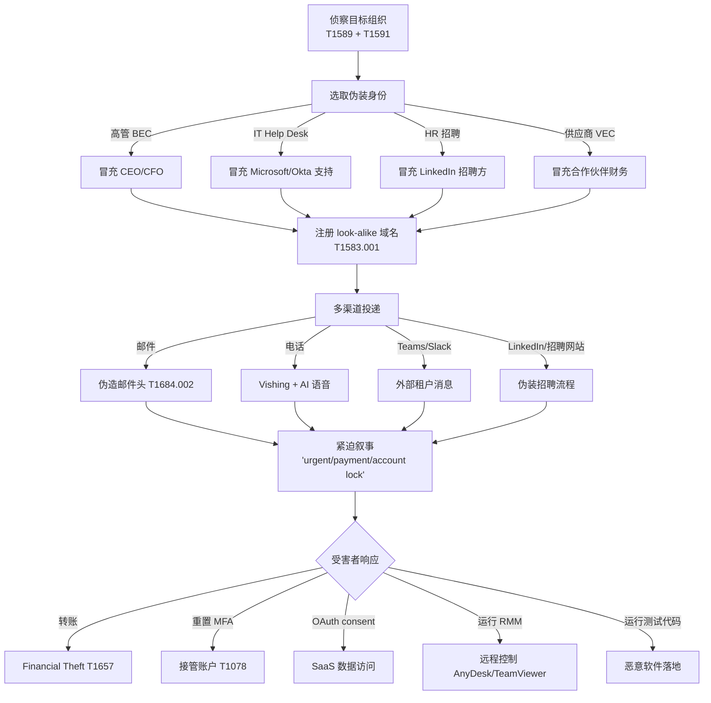

# 伪装身份 (T1684.001)

## 一句话通俗理解

攻击者穿上"高管/同事/IT 帮助台/招聘方"的"戏服"，通过邮件、电话、Teams 消息让你相信他有权要求你做某事，然后你"自愿"重置密码、批准授权或运行脚本——比直接黑系统省事十倍。

## 30秒速查卡

| 维度 | 你需要知道的 |
|------|-------------|
| 这是什么？ | 攻击者冒充一个真实存在的人或可信组织（CEO、Microsoft 帮助台、HR 招聘方、合作伙伴），通过通信渠道诱导受害者执行操作 |
| 为什么危险？ | 检测系统看到的都是"用户主动执行了密码重置"、"用户主动批准了 OAuth"，没有任何技术入侵痕迹；社会工程成功率显著高于传统钓鱼 |
| 谁需要关心？ | IT Help Desk 团队、IAM 管理员、HR 招聘团队、SOC 分析师 |
| 你的第一步防御 | Help Desk 重置凭证必须**反向验证**（回拨到 HR 系统登记的电话，而非来电显示）；新员工入职流程增加"反假冒 HR"培训 |
| 如果只做一件事 | 把所有"密码重置 / MFA 改绑 / OAuth consent / 转账审批"操作改为"独立渠道二次确认"模式 |

## 难度等级

⭐⭐ 中级 - 需要侦察目标和编写可信叙述的能力，技术门槛不高但需要"人对人"的功夫

## 前置知识检查

**读这个文件需要什么？**

- [ ] BEC（商业邮件欺诈）和 VEC（供应商邮件欺诈）的基本概念
- [ ] IT Help Desk 标准业务流程（密码重置、MFA 改绑）
- [ ] OAuth consent 流程和 SaaS 应用授权
- [ ] 招聘流程中的"编程测试"环节

## 技术描述

**伪装身份**（T1684.001）是 **社会工程**（T1684）的子技术之一，属于 **隐蔽** 战术，由 MITRE ATT&CK v19.1 于 2026 年 4 月 14 日新增。

### 通俗解释

攻击者可能冒充一个可信的人或组织，诱导受害者替自己做事。例如攻击者通过 Phishing for Information（T1598）、Phishing（T1566）或 Internal Spearphishing（T1534）等手段，伪装成已知发件人——高管、同事、第三方供应商。一旦建立信任，就能利用这种信任达成攻击者的最终目的，可能针对多个受害者。

在 BEC（商业邮件欺诈）和邮件欺诈活动中，攻击者经常通过伪装身份欺诈受害者——骗他们转账或泄露信息，最终导致 **Financial Theft**（T1657，金融盗窃）。

攻击者常在邮件主题和正文使用操纵性和说服性语言，如 `payment`、`request`、`urgent` 等关键词，逼迫受害者在恶意行为被检测到之前快速行动。这些活动通常专门针对因工作角色和权限能够执行攻击者目标的人。

### 技术原理

1. **目标角色选取**：根据攻击目的选择对应伪装角色
   - 想要转账 → 伪装 CFO 或供应商财务
   - 想要重置 MFA → 伪装 IT Help Desk
   - 想要 OAuth 授权 → 伪装 Microsoft/Google 安全通知
   - 想要落地恶意代码 → 伪装 HR 招聘方
2. **侦察支撑伪装**：通过 T1589（受害者身份信息）和 T1591（受害者组织信息）收集组织架构、汇报关系、内 部术语，让伪装更可信
3. **基础设施匹配**：注册 look-alike 域名（T1583.001 Domains）支撑假身份；克隆品牌 LOGO、邮件签名
4. **多受害者链式利用**：先用 T1078 Valid Accounts 入侵一个组织，再用这个被入侵账户对其他实体进行伪装攻击（VEC 模式）

### 与相邻技术的关系

- **T1684.002 Email Spoofing**：邮件伪造是伪装身份的"配套"技术——通过伪造邮件头让伪装更难识别
- **T1566 Phishing**：钓鱼是伪装身份落地的常见渠道
- **T1534 Internal Spearphishing**：从被入侵的内部账户发起的钓鱼，本质是"最完美的伪装"
- **T1657 Financial Theft**：BEC/VEC 伪装的最终目的之一

## 攻击流程

### 典型攻击流程

```
侦察目标角色 --> 选取伪装身份 --> 注册 look-alike 域名 --> 多渠道投递（邮件/电话/Teams）--> 紧迫叙事 --> 受害者执行操作 --> 攻击者达成目标
```



**步骤详解：**

1. **侦察目标角色**
   - 通俗描述：先弄清楚"谁有权做我想做的事"
   - 技术细节：LinkedIn 搜"CEO/CFO/IT Director"找高管；公司官网找 IT 帮助台联系方式；GitHub/招聘网站找开发工程师
   - 常用工具：LinkedIn、Hunter.io、theHarvester、Shodan

2. **选取伪装身份**
   - 通俗描述：选一个"听起来应该有权"的角色
   - 技术细节：根据目标角色选对应伪装——攻击 CFO 就伪装 CEO；攻击 Help Desk 就伪装 Microsoft 帮助台；攻击开发者就伪装 HR 招聘方
   - 常用工具：克隆品牌 LOGO、注册 look-alike 域名

3. **注册 look-alike 域名**
   - 通俗描述：注册一个看起来差不多的域名，比如 `microsoftonlines[.]com` 冒充 Microsoft
   - 技术细节：常见手法包括同形异义字（rn → m）、加横线（microsoft-support.com）、加国家后缀（microsoft.cc）
   - 常用工具：Domainr、Namecheap、Punycode 转换

4. **多渠道投递**
   - 通俗描述：邮件、电话、Teams、LinkedIn 多管齐下
   - 技术细节：邮件配合 T1684.002 邮件伪造；Teams 通过外部租户发消息；AI 语音克隆模拟高管声音
   - 常用工具：Microsoft Teams、Twilio、ElevenLabs AI Voice

5. **紧迫叙事诱导操作**
   - 通俗描述：用"再不处理就完蛋"逼受害者立刻行动
   - 技术细节：邮件主题用 `urgent`、`payment`、`request`；内容引用当前热点（如"近期数据泄露需要重置凭证"）
   - 常用工具：ClickFix 假验证码页面、社工模板库

## 真实案例

### 案例1：Scattered Spider 冒充 IT 帮助台接管 MGM Resorts（2023年9月）

- **时间**: 2023年9月
- **目标**: 美国 MGM Resorts International
- **攻击组织**: Scattered Spider（G1015，又称 OCTO TEMPEST/UNC3944）
- **手法**: 攻击者通过 LinkedIn 找到 MGM IT 部门员工信息，然后冒充该员工拨打 MGM IT Help Desk 电话，骗取密码重置和 MFA 令牌改绑。Help Desk 在没有反向验证的情况下重置了凭证。攻击者随后通过 Okta 单点登录横向移动，部署 BlackCat 勒索软件。CISA AA23-320A 警报明确指出"Scattered Spider 利用社会工程迫使 IT 帮助台重置密码和 MFA 令牌"。Microsoft 报告也指出 Scattered Spider 还通过 Microsoft Teams 冒充内部 IT 支持人员联系员工
- **影响**: MGM 旗下赌场、酒店、ATM 全面停摆约 10 天，损失估算超 1 亿美元
- **参考链接**: [CISA AA23-320A Scattered Spider](https://www.cisa.gov/news-events/cybersecurity-advisories/aa23-320a)

### 案例2：LAPSUS$ 冒充员工致电 Help Desk 入侵多家巨头（2022年3月）

- **时间**: 2022年3月
- **目标**: NVIDIA、Microsoft、三星、Okta、Ubisoft 等多家科技巨头
- **攻击组织**: LAPSUS$（G1004，又称 DEV-0537）
- **手法**: LAPSUS$ 通过侦察收集目标员工的个人信息（包括姓名、职位、汇报关系），然后致电目标公司的 Help Desk，冒充该员工声称"忘记密码"或"丢失 MFA 设备"，要求重置凭证。Microsoft 安全博客详细描述了 LAPSUS$ "通过电话联系受害者 Help Desk，利用已收集的合法用户信息冒充身份以获取特权账户访问"。LAPSUS$ 还使用了被入侵的内部账户对其他实体发起社会工程攻击（链式利用模式）
- **影响**: 多家科技巨头源代码、内部数据被窃取；Okta 一名支持工程师账户被入侵影响 2.5% 客户
- **参考链接**: [Microsoft - DEV-0537 Criminal Actor Targeting Organizations](https://www.microsoft.com/security/blog/2022/03/22/dev-0537-criminal-actor-targeting-organizations-for-data-exfiltration-and-destruction/)

### 案例3：朝鲜 Contagious Interview 冒充 HR 招聘投放恶意软件（2024-2025 持续活跃）

- **时间**: 2024-2025 年持续活跃
- **目标**: 全球软件开发者（特别是 DevOps 和前端工程师）
- **攻击组织**: Contagious Interview（G1052，朝鲜背景，与 Lazarus Group 关联）
- **手法**: 攻击者在 LinkedIn 和招聘网站（如 Indeed、ZipRecruiter）上伪装成招聘方，通过聊天和视频面试诱导受害者在"编程测试"中下载运行恶意 npm 包或 Node.js 脚本，落地 BeaverTail 和 InvisibleFerret 信息窃取木马。2025 年 6 月该组织一次性投放了 35 个新的恶意 npm 包。攻击者精心准备了与目标技能匹配的"职位描述"和"技术测试题"，让受害者完全相信这是真实招聘流程
- **影响**: 大量开发者凭证（包括加密钱包、SSH 密钥、浏览器密码）被窃取，部分用于进一步入侵雇主公司
- **参考链接**: [Unit42 - North Korean Threat Actors Lure Tech Job Seekers](https://unit42.paloaltonetworks.com/north-korean-threat-actors-lure-tech-job-seekers-as-fake-recruiters/)

### 案例4：APT42 冒充可信人物钓鱼西方官员（2024年8月）

- **时间**: 2024年8月
- **目标**: 美国、以色列的政府官员、记者、学者
- **攻击组织**: APT42（G1044，伊朗 IRGC 关联）
- **手法**: APT42 在钓鱼邮件中冒充真实人物（记者、研究人员、活动家），甚至冒充 Google 自身的安全通知，诱骗受害者访问凭据收集页面。Mandiant 报告《APT42: Crooked Charms, Cons and Compromises》详细描述了该组织的伪装身份模式。Google TAG 在 2024 年 8 月报告中指出 APT42 在以色列-哈马斯冲突期间显著升级了对以色列和美国目标的钓鱼活动
- **影响**: 多个高价值目标的凭据被窃取，部分用于进一步入侵邮箱和云账户
- **参考链接**: [Google TAG - Iranian backed group steps up phishing campaigns](https://blog.google/threat-analysis-group/iranian-backed-group-steps-up-phishing-campaigns-against-israel-us/)

### 案例5：Kimsuky 冒充外交官和智库雇员（2020-2026 持续活跃）

- **时间**: 2020-2026 年持续活跃
- **目标**: 韩国智库、学术机构、政府机构、外国使领馆
- **攻击组织**: Kimsuky（G0094，朝鲜背景）
- **手法**: Kimsuky 长期伪装成多种身份接近目标——日本外交官、外国顾问、使馆雇员、智库研究员。2026 年 1 月 FBI Flash AC-000001-MW 报告指出 Kimsuky 还通过恶意 QR 码发起"QR 码钓鱼"——伪装成密码重置邮件让受害者扫描二维码跳转到凭据收集站点。Proofpoint 报告还指出 Kimsuky 在 ClickFix 活动中也扮演了重要角色
- **影响**: 多个智库和研究机构被入侵，研究资料和联系人被窃取
- **参考链接**: [FBI Flash AC-000001-MW Kimsuky QR Phishing](https://www.ic3.gov/CSA/2026/260108.pdf)

## 红队视角

> ⚠️ **免责声明**：以下内容仅用于合法的安全测试、渗透测试和教育目的。未经授权对他人系统进行测试是违法行为。

### 实战技巧

1. **侦察决定成败**
   红队伪装身份前要花 30% 时间做侦察：LinkedIn 找目标汇报关系、公司官网找 IT 部门联系方式、Slack/Teams 公开频道找内部术语。伪装的细节越准，成功率越高。MGM 事件中 Scattered Spider 之所以能成功，是因为他们通过 LinkedIn 知道了目标员工的姓名和职位

2. **多渠道互证比单渠道邮件强 5 倍**
   先发邮件 → 5 分钟后 Teams 跟进 → 30 分钟后电话催促。三个渠道互相"印证"，受害者几乎不会怀疑。Scattered Spider 经常用这种方式

3. **优先用合法 RMM 工具落地**
   不要投放自定义木马，诱导受害者运行 AnyDesk、TeamViewer、ScreenConnect 等合法 RMM。这些工具默认放行 EDR，是 Scattered Spider 最爱的落地方式

4. **Help Desk 是最易突破点**
   Help Desk 的 KPI 是"快速解决员工问题"，不是"安全审计"。伪装员工打电话求助重置密码，比直接攻击技术防御成功率高得多

### 常用工具

| 工具名称 | 用途 | 平台 | 链接 |
|----------|------|------|------|
| LinkedIn | 侦察目标员工 | SaaS | https://linkedin.com |
| theHarvester | 邮箱和组织信息收集 | 跨平台 | https://github.com/laramies/theHarvester |
| GoPhish | 钓鱼模拟平台 | 跨平台 | https://getgophish.com/ |
| Microsoft Teams | 外部租户到内部消息 | SaaS | 内置 |
| AnyDesk / TeamViewer | 合法 RMM 工具落地 | 跨平台 | 商业产品 |

### 注意事项

- 社会工程测试**必须**有书面授权，否则可能违反《网络安全法》和刑法
- 红队报告里要明确"伪装身份"的合理性，避免目标组织 IT 帮助台流程因测试被过度改动
- AI 语音克隆用于红队时，应在合同中明确禁止用于欺诈

## 蓝队视角

### 检测要点

1. **Help Desk 异常重置请求检测**
   - 日志来源：Azure AD Audit Log、IAM 系统日志
   - 关注字段：密码重置操作、MFA 改绑操作、SourceIp、SourceDevice
   - 异常特征：密码重置请求来自与员工历史登录不符的地理位置；短时间内多个账户被重置；Help Desk 工程师账户被用于批量重置

2. **SendAs/SendOnBehalfOf 异常授权检测**
   - 日志来源：M365 Audit Log、Google Workspace Audit Log
   - 关注字段：`SendAs`、`SendOnBehalfOf`、`Add-MailboxPermission`
   - 异常特征：新授权的 SendAs 权限；非工作时间授权；授权给外部账户

3. **外部 Teams 租户到内部消息检测**
   - 日志来源：Microsoft Teams 管理日志
   - 关注字段：`ExternalUserStartingTeamsCommunication`、`ChannelMessageAdded`
   - 异常特征：外部租户向员工发送消息包含"IT support"、"Help Desk"、"password reset"等关键词

### 监控建议

- Help Desk 重置凭证必须**反向验证**——回拨到 HR 系统登记的电话号码，而非来电显示
- 监控"用户与外部通信后短时间内触发高价值操作"的模式（MITRE DET0286 AN0792-AN0796）
- 部署用户行为分析（UBA）检测异常的 Help Desk 操作模式
- 强制外部 Teams 租户到内部消息必须经过管理员批准

## 避坑指南

常见混淆误区：**把伪装身份等同于钓鱼邮件**。

伪装身份 ≠ 钓鱼邮件。钓鱼是"投递恶意 payload"的渠道之一；伪装身份是**让用户合法地帮你做事**的策略——可能完全不含恶意文件、不含恶意链接，只是打电话让 Help Desk 重置密码。MGM 事件中 Scattered Spider 全程没有投递任何 payload，但造成 1 亿美元损失。

第二个误区：**Help Desk 流程加了密码就能防住**。攻击者通常已经通过 OSINT 拿到了员工工号、入职日期、经理姓名等"看似只有本人知道"的信息。真正有效的防御是**独立渠道反向验证**——回拨到 HR 系统登记的电话号码，而非来电显示的号码。

第三个误区：**只关注邮件渠道**。LinkedIn、Teams、电话、招聘网站都是伪装身份的渠道。安全意识培训必须覆盖所有渠道的"独立二次确认"原则。

## 检测建议

### 网络层检测

**检测方法：** 监控邮件网关日志中发件人显示名与 SMTP 地址不匹配的事件；监控外部 Teams 租户到内部员工的消息流量。

**具体命令示例：**
```bash
# 使用 PowerShell 查询 M365 邮件追踪日志中显示名与 SMTP 地址不匹配的邮件
Get-MessageTrace -StartDate (Get-Date).AddDays(-7) -EndDate (Get-Date) |
  Where-Object { $_.SenderAddress -notmatch $_.FromAddress }
```

### 主机层检测

**Windows / M365 事件：**
- Azure AD Audit Log `Update user` + `Admin registered MFA`（密码重置 + MFA 改绑）
- M365 Audit Log `Add-MailboxPermission`（异常 SendAs 授权）
- Microsoft Teams `ExternalUserStartingTeamsCommunication`（外部租户首次联系）
- Event ID 4724（用户账户密码重置）+ Event ID 4624（登录）短时间内连续出现

### 应用层检测

**Sigma 规则示例（外部 Teams 租户冒充 IT 支持）：**

```yaml
title: T1684.001 - 外部 Teams 租户冒充 IT 支持联系员工
status: experimental
description: 检测外部 Microsoft Teams 租户首次向内部员工发送消息，且消息内容包含 IT 支持相关关键词，可能为 Scattered Spider 式社会工程攻击
logsource:
    product: m365
    service: teams
detection:
    selection_event:
        OperationName|contains:
            - 'ExternalUserStartingTeamsCommunication'
            - 'ChannelMessageAdded'
    selection_keywords:
        MessageText|contains:
            - 'IT 支持'
            - 'IT support'
            - 'Help Desk'
            - '帮助台'
            - '密码重置'
            - 'password reset'
            - 'Microsoft'
            - 'account lock'
    condition: selection_event and selection_keywords
falsepositives:
    - 合法的外部 IT 供应商
    - Microsoft 官方通知
level: high
tags:
    - attack.t1684
    - attack.t1684.001
    - attack.stealth
```

**Sigma 规则示例（Help Desk 异常重置）：**

```yaml
title: T1684.001 - Help Desk 短时间内批量重置密码
status: experimental
description: 检测同一 Help Desk 账户在短时间内重置多个用户密码，可能为攻击者冒充员工骗取重置
logsource:
    product: windows
    service: security
detection:
    selection_reset:
        EventID: 4724
    filter_helpdesk:
        SubjectUserName|contains:
            - 'helpdesk'
            - 'admin'
    timeframe: 10m
    condition: selection_reset and filter_helpdesk | count() by SubjectUserName > 5
falsepositives:
    - 大规模密码过期导致的批量重置
    - 新员工入职高峰
level: medium
tags:
    - attack.t1684
    - attack.t1684.001
    - attack.stealth
```

## 缓解措施

### 优先级1：关键措施

**措施名称：** Help Desk 反向验证 + 带外二次确认

**具体实施步骤：**
1. Help Desk 接到密码重置请求时，必须**回拨到 HR 系统登记的电话号码**（而非来电显示）
2. 重置凭证前要求员工提供至少 2 项"非公开信息"（员工号 + 经理姓名 + 入职日期 + 最近报销单号）
3. 对 MFA 改绑操作启用"24 小时延迟生效"+ 邮件 + 短信双重通知

### 优先级2：重要措施

**措施名称：** 阻止外部 Teams 租户到内部消息

**具体实施步骤：**
1. 在 Teams 管理中心关闭"外部租户可联系内部用户"
2. 配置允许列表仅包含已知合作伙伴租户
3. 部署邮件网关检测发件人显示名与 SMTP 地址不匹配

### 优先级3：建议措施

**措施名称：** 多渠道社会工程意识培训

**具体实施步骤：**
1. 每季度对所有员工进行**多渠道**（邮件、电话、Teams、LinkedIn）社会工程演练
2. Help Desk 团队单独培训"反社工"流程
3. 招聘团队单独培训"反假冒 HR"识别

### MITRE ATT&CK 缓解措施映射

| 缓解措施 ID | 缓解措施名称 | 适用性 | 说明 |
|------------|-------------|--------|------|
| M1019 | 威胁情报计划 | 适用 | 让防御者了解活跃的伪装诱饵和活动 |
| M1017 | 用户培训 | 适用 | 训练用户识别伪装身份套路，通过独立渠道二次确认 |
| M1036 | 账户使用策略 | 适用 | 帮助台重置需要二次验证 |
| M1047 | 审计 | 适用 | 关联邮件/身份/SaaS/端点活动以发现看似合法的可疑操作 |

## 动手实验

> ⚠️ **重要提示**：所有实验必须在隔离的实验室环境中进行，禁止对未授权的真实员工或系统进行测试。社会工程测试**必须**有书面授权。

### 实验环境准备

**所需工具：**
- 授权测试的测试员工群
- GoPhish 钓鱼模拟平台
- 测试用 M365 租户
- 测试电话系统（用于模拟 Help Desk 演练）

### 实验1：Help Desk 反向验证流程设计（初级）

**实验目标：** 设计并验证 Help Desk 反向验证流程，确保攻击者冒充员工也无法重置凭证

**实验步骤：**
1. 梳理现有 Help Desk 重置流程，识别信任假设
2. 设计"回拨 HR 系统登记电话 + 2 项非公开信息验证"流程
3. 在测试环境中模拟攻击者冒充员工拨打电话
4. 验证新流程是否能拒绝攻击者请求

**预期结果：** 新流程成功拒绝攻击者重置请求

**学习要点：** 理解"独立渠道二次确认"是防御社会工程的核心

### 实验2：GoPhish 模拟 Help Desk 伪装钓鱼（中级）

**实验目标：** 模拟 Scattered Spider 式的 Help Desk 伪装攻击，训练员工识别

**实验步骤：**
1. 部署 GoPhish，配置邮件模板伪装成 IT Help Desk："检测到您的账户异常登录，请立即重置密码"
2. 落地页模拟 Okta/Microsoft 365 密码重置页面
3. 对**授权同意的**测试员工群发送演练邮件
4. 在 GoPhish 仪表板观察：邮件打开率、链接点击率、凭据提交率
5. 对点击的员工自动发送"教育页面"提示本次是演练

**预期结果：** 首次演练点击率通常 20-40%，连续 3 次季度演练后下降到 5% 以下

**学习要点：** 掌握社会工程演练的设计与效果度量

### 实验3：多渠道社会工程演练（高级）

**实验目标：** 设计邮件 + Teams + 电话多渠道组合演练，验证多渠道互证的攻击效果

**实验步骤：**
1. 设计演练剧本：邮件伪装 IT 部门 → 10 分钟后 Teams 跟进 → 30 分钟后电话催促
2. 准备测试用 Teams 外部租户和测试电话号码
3. 对**授权同意的**测试员工群执行多渠道演练
4. 对比单渠道和多渠道演练的"成功率"
5. 编写检测规则识别该模式（外部通信后短时间内执行高价值操作）

**预期结果：** 多渠道演练成功率显著高于单渠道；检测规则能告警该模式

**学习要点：** 理解多渠道互证攻击的威胁，掌握基于行为时序关联的检测方法

## 术语解释

| 术语 | 英文原名 | 通俗解释 |
|------|----------|----------|
| 伪装身份 | Impersonation | 攻击者冒充真实存在的人或可信组织 |
| BEC | Business Email Compromise | 商业邮件欺诈——冒充高管/供应商骗转账 |
| VEC | Vendor Email Compromise | 供应商邮件欺诈——BEC 的变种 |
| Vishing | Voice Phishing | 语音钓鱼——通过电话进行社会工程 |
| Help Desk 反向验证 | Help Desk Callback Verification | 重置凭证前回拨到 HR 系统登记的电话 |
| RMM | Remote Monitoring and Management | 远程监控管理工具（如 AnyDesk），常被攻击者滥用 |
| OAuth Consent | OAuth Consent | 用户授权 OAuth 应用访问云数据 |

## 被引用情况

以下父技术文档引用了本子技术：

- [T1684 - 社会工程](../T1684-Social-Engineering.md)

## 参考资料

### 📚 官方文档（深入了解）

- [MITRE ATT&CK - T1684.001 Impersonation](https://attack.mitre.org/techniques/T1684/001/)
- [MITRE ATT&CK - T1684 Social Engineering](https://attack.mitre.org/techniques/T1684/)

### 📰 安全报告（真实攻击）

- [CISA AA23-320A - Scattered Spider](https://www.cisa.gov/news-events/cybersecurity-advisories/aa23-320a)
- [Microsoft - DEV-0537 (LAPSUS$) Help Desk Impersonation](https://www.microsoft.com/security/blog/2022/03/22/dev-0537-criminal-actor-targeting-organizations-for-data-exfiltration-and-destruction/)
- [Unit42 - Contagious Interview](https://unit42.paloaltonetworks.com/north-korean-threat-actors-lure-tech-job-seekers-as-fake-recruiters/)
- [Google TAG - APT42 Phishing Campaigns](https://blog.google/threat-analysis-group/iranian-backed-group-steps-up-phishing-campaigns-against-israel-us/)
- [Mandiant - APT42 Crooked Charms](https://services.google.com/fh/files/misc/apt42-crooked-charms-cons-and-compromises.pdf)
- [FBI Flash AC-000001-MW - Kimsuky QR Phishing](https://www.ic3.gov/CSA/2026/260108.pdf)
- [Microsoft - Star Blizzard Impersonation Phishing](https://www.microsoft.com/en-us/security/blog/2022/08/15/disrupting-seaborgiums-ongoing-phishing-operations/)

### 🔧 工具与资源（动手试试）

- [GoPhish - 钓鱼模拟平台](https://getgophish.com/)
- [Atomic Red Team](https://github.com/redcanaryco/atomic-red-team)
- [CrowdStrike - What is BEC](https://www.crowdstrike.com/en-us/cybersecurity-101/threat-intelligence/business-email-compromise-bec/)
- [Cloudflare - What is VEC](https://www.cloudflare.com/learning/email-security/what-is-vendor-email-compromise/)
