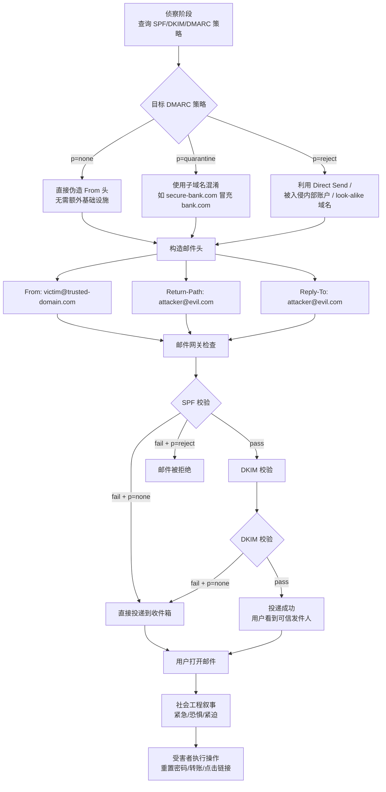

# 邮件伪造 (T1684.002)

## 一句话通俗理解

攻击者把邮件的"寄件人标签"撕下来贴到别人的身上——你看到邮件来自 `ceo@yourcompany.com`，实际上它从攻击者的垃圾邮箱发出，就像小偷穿了件印着你公司 LOGO 的外套走进大楼。

## 30秒速查卡

| 维度 | 你需要知道的 |
|------|-------------|
| 这是什么？ | 修改邮件头信息（FROM、Return-Path、Reply-To 等），让邮件显示为来自可信域名或人员 |
| 为什么危险？ | 用户和邮件网关只看到"熟悉的发件人"，降低警惕；如果目标 DMARC 策略是 `p=none`，几乎所有伪造都能成功投递 |
| 谁需要关心？ | 邮件安全工程师、SOC 分析师、IAM 管理员、IT 帮助台负责人 |
| 你的第一步防御 | 所有自有域名配置 SPF + DKIM + DMARC `p=reject`，并监控 `rua` 报告中的伪造尝试 |
| 如果只做一件事 | 检查所有对外暴露域名的 `_dmarc.<domain>` TXT 记录，确保没有 `p=none` |

## 难度等级

⭐⭐ 中级（需要一定基础）

不需要编写恶意代码，但需要了解 SMTP 协议、DNS 记录和邮件认证机制。门槛在"理解协议"而非"利用漏洞"。

## 前置知识检查

**读这个文件需要什么？**

- [ ] SMTP 邮件传输基本流程（MTA → MDA）
- [ ] DNS TXT 记录查询方法（`nslookup -type=TXT _dmarc.domain.com`）
- [ ] SPF、DKIM、DMARC 三者区别与协作关系
- [ ] Microsoft 365 / Google Workspace 邮件头分析能力

## 技术描述

**邮件伪造**（T1684.002）是 **社会工程**（T1684）的子技术之一，属于 **隐蔽** 战术，由 MITRE ATT&CK v19.1 于 2026 年 4 月 14 日新增。

### 通俗解释

**过渡段：** 不要以为邮件伪造只是"改个发件人名字"——真正的邮件伪造是让整封邮件在协议层面看起来完全合法。SMTP 协议设计之初就没有身份验证机制，任何服务器都可以声称自己是任何域名的发件人。就像邮局没有核实寄件人身份证的制度，你在信封上写"美国总统"它就按"美国总统"投递。

攻击者利用 SMTP 协议的这一先天缺陷，在邮件头中设置虚假的 `From`、`Return-Path`、`Reply-To` 字段，使收件人和邮件网关看到可信的发件域名。配合社会工程学叙事（如"紧急密码重置"、"供应商发票"、"高管转账指令"），伪造邮件可以绕过用户警惕性，甚至绕过部分邮件网关的防伪造检测。

### 技术原理

1. **SMTP 无认证发送**：SMTP 协议本身不验证发件人域名归属，任何 MTA 都可以向目标 MTA 发送 `MAIL FROM:<victim@target.com>` 的邮件
2. **邮件头字段操纵**：攻击者可以同时操纵 `From`（显示发件人）、`Return-Path`（退信地址）、`Reply-To`（回复地址）、`Sender`（实际发送者）等多个字段，制造混乱
3. **SPF 绕过**：通过选择 SPF 记录不包含的第三方邮件服务器发送，或利用 SPF `include` 信任链中的子域名
4. **DKIM 绕过**：不使用目标域名的 DKIM 私钥签名；或使用目标域名下子域的合法 DKIM 签名（如 `mail.phishing-bank.com` 使用 `bank.com` 的 SPF include）
5. **DMARC 弱策略利用**：大多数组织 DMARC 策略为 `p=none`，即使 SPF/DKIM 失败也不会被拒绝，仅生成报告
6. **Microsoft 365 Direct Send 滥用**：利用 M365 Direct Send 连接器无需 SMTP 认证即可发送邮件的特性，从内部设备（打印机、扫描机）伪装为内部员工发件

### 与相邻技术的关系

- **T1684.001 Impersonation**：邮件伪造是伪装身份的核心支撑技术——没有伪造邮件头，冒充 CEO 发内部邮件几乎不可能
- **T1566 Phishing**：钓鱼邮件大量使用邮件伪造来增加可信度
- **T1534 Internal Spearphishing**：从被入侵的内部账户发起的钓鱼本质上是最完美的邮件伪造
- **T1598 Social Engineering via Email**：邮件社工的投递载体
- **T1583.001 Register Domains**：注册 look-alike 域名支撑邮件伪造基础设施

## 子技术列表

该技术没有子技术。

## 攻击流程

### 典型攻击流程

```
侦察目标域名邮件认证策略 --> 选择伪造方式（直接伪造/子域混淆/Direct Send）--> 构造恶意邮件头 --> 投递伪造邮件 --> 用户信任发件人 --> 执行攻击者期望的操作
```



**步骤详解：**

1. **侦察目标域名邮件认证策略**
   - 通俗描述：先看看目标的邮件认证防线有多强
   - 技术细节：查询 `nslookup -type=TXT _dmarc.target.com`、`_spf.target.com`；分析 DMARC `p=` 值、`rua` 报告接收方、`adkim`/`aspf` 对齐模式
   - 常用工具：MXToolbox、DMARC Analyzer、postmark-app

2. **选择伪造方式**
   - 通俗描述：根据目标防线选择最合适的伪造手法
   - 技术细节：`p=none` 时直接伪造；`p=reject` 时用 Direct Send 或被入侵账户；子域名混淆适合 `p=quarantine`
   - 常用工具：look-alike 域名注册、被入侵 SMTP 中继

3. **构造恶意邮件头**
   - 通俗描述：给邮件穿上"合法外衣"
   - 技术细节：`From` 设为可信域名；`Return-Path` 可留空或指向攻击者域名；`Reply-To` 指向攻击者控制的回收地址；添加伪造的 `Authentication-Results` 头（高级手法）
   - 常用工具：swaks、Python smtplib、Mail::SpamAssassin

4. **投递伪造邮件**
   - 通俗描述：把伪造邮件送到受害者收件箱
   - 技术细节：通过开放 SMTP 中继、被入侵的邮件服务器、或云服务商 API 投递
   - 常用工具：Postfix、SendGrid API、Amazon SES

5. **用户信任并执行操作**
   - 通俗描述：受害者看到"熟悉的发件人"后放松警惕
   - 技术细节：配合紧迫叙事（"账户即将锁定"、"紧急转账"），诱导密码重置、链接点击、附件下载
   - 常用工具：ClickFix 假验证码页面、凭据收集页面

## 真实案例

### 案例1：Kimsuky 利用弱 DMARC 政策冒充美国智库域名（2024年5月）

- **时间**: 2024年5月（FBI/国务院/NSA 联合警报）
- **目标**: 美国智库、学术机构、政府机构
- **攻击组织**: Kimsuky（G0094，朝鲜背景）
- **手法**: Kimsuky 系统性扫描目标组织的 DMARC 策略，发现大量机构使用 `p=none`。攻击者伪造来自这些可信域名的邮件，让收件人看到"来自自己机构"的钓鱼邮件。例如伪造 `@csis.org`、`@brookings.edu` 等知名智库域名，邮件内容涉及"安全更新通知"和"凭证重置"。FBI CSA 240502 明确指出该组织"exploited weak DMARC policies to spoof emails from trusted domains"
- **影响**: 多个美国智库和研究机构员工收到伪造邮件，部分凭据被窃取
- **参考链接**: [FBI CSA 240502 - North Korean Actors Exploit Weak DMARC](https://www.ic3.gov/CSA/2024/240502.pdf)

### 案例2：TA427 利用 DMARC 滥用进行社会工程侦察（2021-2023 持续活跃）

- **时间**: 2021-2023 年持续活跃
- **目标**: 全球政府机构、国防承包商、科技公司
- **攻击组织**: TA427（又称 HAFNIUM 关联、Volt Typhoon 前期侦察阶段）
- **手法**: TA427 使用专门开发的 DMARC 滥用工具，批量查询目标组织的 DMARC 记录。当发现 `p=none` 时，攻击者伪造来自目标域名的邮件发送给第三方，作为社会工程侦察的一部分。这些伪造邮件用于建立与目标人员的初始联系，后续再发起更精准的鱼叉式钓鱼。Proofpoint 报告指出 TA427 将 DMARC 滥用作为"信息收集和社会工程准备"的关键环节
- **影响**: 大量政府机构和国防承包商的域名被标记为"弱 DMARC"，为后续攻击铺路
- **参考链接**: [Proofpoint - TA427 DMARC Abuse](https://www.proofpoint.com/us/blog/threat-insight/social-engineering-dmarc-abuse-ta427s-art-information-gathering)

### 案例3：APT42 冒充 Google 安全通知伪造邮件（2024年8月）

- **时间**: 2024年8月
- **目标**: 美国、以色列政府官员、记者、学者
- **攻击组织**: APT42（G1044，伊朗 IRGC 关联）
- **手法**: APT42 不仅伪造普通域名，还直接冒充 Google 自身的安全通知邮件。攻击者使用高度仿真的 Google 品牌元素、邮件头和登录页面，让受害者相信这是 Google 官方的安全提醒。Google TAG 报告指出，这些邮件的 `From` 字段使用经过精心构造的域名来模拟 `security@google.com`，配合 DMARC 弱策略目标实现投递。在以色列-哈马斯冲突期间，APT42 还伪造了联合国和以色列政府机构的邮件
- **影响**: 多个高价值目标的凭据被窃取，部分用于进一步入侵邮箱和云账户
- **参考链接**: [Google TAG - Iranian backed group steps up phishing campaigns](https://blog.google/threat-analysis-group/iranian-backed-group-steps-up-phishing-campaigns-against-israel-us/)

### 案例4：Microsoft 365 Direct Send 滥用——企业内部邮件伪造活动（2025年9月）

- **时间**: 2025年9月（Varonis 披露）
- **目标**: 使用 Microsoft 365 的企业内部用户
- **攻击组织**: 未具名威胁行为者（Varonis 披露）
- **手法**: 攻击者先入侵企业内部的一台打印机或扫描设备（这些设备通常使用 Direct Send 连接器无需 SMTP 认证即可发邮件），然后从该设备发送伪造发件人为内部员工的邮件。由于 Direct Send 邮件在 M365 日志中显示为合法内部发送，SPF/DKIM/DMARC 校验全部通过，邮件网关几乎无法区分。邮件内容通常为"请确认附件中的发票"或"紧急：请重置你的密码"
- **影响**: 多家企业内部员工收到"内部可信"邮件后被诱导到凭据收集页面或点击恶意附件
- **参考链接**: [Varonis - Ongoing Campaign Abuses Microsoft 365's Direct Send](https://www.varonis.com/blog/direct-send-exploit)

### 案例5：Lapsus$ 冒充内部 IT 部门邮件（2022年）

- **时间**: 2022年
- **目标**: NVIDIA、Samsung、Okta 等科技巨头员工
- **攻击组织**: LAPSUS$（G1004，DEV-0537）
- **手法**: LAPSUS$ 在电话冒充 Help Desk 的同时，还辅以伪造的内部 IT 部门邮件。攻击者通过被入侵的员工账户向同事发送伪造的"密码过期通知"和"MFA 重新配置"邮件。这些邮件使用真实的内部域名和邮件签名模板，配合电话施压，形成"邮件+电话"双重社工。Microsoft 安全博客详细记录了 LAPSUS$ 如何利用已入侵账户对其他实体发起链式社会工程攻击
- **影响**: 多家科技巨头内部员工被诱导重置凭证，加速了 LAPSUS$ 的横向移动
- **参考链接**: [Microsoft - DEV-0537 Criminal Actor Targeting Organizations](https://www.microsoft.com/security/blog/2022/03/22/dev-0537-criminal-actor-targeting-organizations-for-data-exfiltration-and-destruction/)

## 红队视角

> ⚠️ **免责声明**：以下内容仅用于合法的安全测试、渗透测试和教育目的。未经授权对他人系统进行测试是违法行为。

### 实战技巧

1. **DMARC 侦察是第一优先级**
   在发起任何邮件伪造之前，先用 `nslookup -type=TXT _dmarc.<target>` 查询目标域名的 DMARC 策略。`p=none` 的目标几乎可以直接伪造；`p=reject` 的目标需要考虑 Direct Send 或被入侵账户替代方案。

2. **多字段混淆比单字段伪造更难检测**
   只改 `From` 字段太明显。高级手法同时操纵 `Reply-To`、`Sender`、`Organization` 等字段，让邮件客户端显示可信信息，但实际路由经过攻击者控制的服务器。

3. **利用子域名混淆绕过 `p=reject`**
   如果目标域名是 `bank.com`，注册 `secure-bank.com` 或 `bank.com.attacker.com`（DNS 子域委托）。前者利用 SPF include 信任链，后者在某些邮件客户端中显示为来自 `bank.com`。

4. **Direct Send 是最隐蔽的路径**
   如果能访问企业内部设备（打印机、扫描机），利用 Direct Send 发伪造邮件可以绕过几乎所有邮件认证检查。这是目前最难检测的邮件伪造路径之一。

### 常用工具

| 工具名称 | 用途 | 平台 | 链接 |
|----------|------|------|------|
| swaks | 命令行 SMTP 邮件发送/伪造 | Linux/跨平台 | https://www.jetmore.org/jon/code/swaks/ |
| MailSniper | PowerShell 邮件侦察与伪造测试 | Windows | https://github.com/dafthack/MailSniper |
| DMARC Analyzer | DMARC 策略侦察与报告分析 | Web/SaaS | https://dmarcian.com/ |
| MXToolbox | SPF/DKIM/DMARC 查询 | Web | https://mxtoolbox.com/ |
| Python smtplib | 自定义邮件伪造脚本 | 跨平台 | 内置 |

### 注意事项

- 邮件伪造测试必须获得书面授权，否则可能违反《网络安全法》和《刑法》中关于计算机信息系统犯罪的相关条款
- 不要在红队报告中包含真实可用的伪造邮件样本，防止被滥用
- DMARC `p=reject` 不是万能的——Direct Send、被入侵账户、子域名混淆仍可绕过

## 蓝队视角

### 检测要点

1. **SPF/DKIM/DMARC 失败但投递事件**
   - 日志来源：邮件网关日志（EOP、Proofpoint、Mimecast）、SMTP 交易日志
   - 关注字段：`Authentication-Results` 头中的 `spf`、`dkim`、`dmarc` 结果
   - 异常特征：`dmarc=fail` 但邮件状态为 `Delivered`，说明 DMARC 策略为 `p=none` 或 `p=quarantine`

2. **From 与 Return-Path 域名不一致**
   - 日志来源：邮件头分析、邮件网关日志
   - 关注字段：`From` 头中的域名 vs `Return-Path` 中的域名
   - 异常特征：两个字段域名完全不同，且不在对方的 SPF 允许列表中

3. **Microsoft 365 Direct Send 异常来源**
   - 日志来源：M365 邮件追踪日志、Exchange 连接器日志
   - 关注字段：`SourceIp`、`ConnectorName`、`Authentication`
   - 异常特征：Direct Send 连接器有非打印机 IP 段的发件；`SendAs` 操作来自非预期设备

4. **外部租户冒充内部域名的 Teams/邮件**
   - 日志来源：Teams 管理日志、M365 Audit Log
   - 关注字段：发件人租户 ID vs 内部租户 ID
   - 异常特征：显示名为内部高管但实际来自外部租户

### 监控建议

- 每周查阅 DMARC `rua` 报告，识别伪造尝试并更新 SPF/DKIM 记录
- 配置邮件网关检测 `From` 与 `Return-Path` 不一致的邮件
- 限制 Direct Send 连接器仅允许打印机/扫描设备 IP 段
- 对来自外部租户但显示为内部域名的邮件强制进入隔离区

## 避坑指南

常见混淆误区：**部署了 SPF 就安全了**。

SPF 只能验证 `MAIL FROM`（信封发件人），不能验证用户看到的 `From` 头。攻击者可以让 SPF 通过的域名（如 Gmail、SendGrid）发送伪造的 `From: ceo@yourcompany.com` 邮件。SPF 通过不等于邮件可信。

第二个误区：**DMARC `p=quarantine` 足够安全**。`quarantine` 只会把邮件放入垃圾箱，用户仍可能打开垃圾箱中的邮件。只有 `p=reject` 才会真正拒绝邮件。此外，`p=reject` 也防不住 Direct Send 和被入侵内部账户。

第三个误区：**只看 `From` 字段就够了**。高级伪造会同时操纵 `From`、`Return-Path`、`Reply-To`、`Sender` 等多个字段。防御者需要检查所有相关头字段的一致性。

## 检测建议

### 网络层检测

**检测方法：** 监控 SMTP 流量中的 SPF/DKIM/DMARC 失败但邮件仍被投递的事件；检测 `From` 头部与 `Return-Path` 域名不一致；监控 Microsoft 365 Direct Send 来源（应限于打印机 IP 段）。

**具体命令/规则示例：**

```bash
# 使用 tcpdump 捕获 SMTP 流量用于事后分析
tcpdump -i eth0 -w /tmp/smtp.pcap 'tcp port 25 or tcp port 587 or tcp port 465'

# 使用 PowerShell 查询 Microsoft 365 邮件追踪日志中失败的 DMARC 记录
Get-MessageTrace -StartDate (Get-Date).AddDays(-7) -EndDate (Get-Date) |
  Where-Object { $_.Status -eq 'Delivered' } |
  ForEach-Object { Get-MessageTraceDetail -MessageTraceId $_.MessageTraceId -RecipientAddress $_.RecipientAddress }
```

**Suricata 规则示例：**

```
# 规则1：检测 SMTP 邮件中 From 头部与 Return-Path 域名不一致（邮件伪造可疑信号）
alert smtp $EXTERNAL_NET any -> $HOME_NET 25 (
    msg:"T1684.002 - From 与 Return-Path 域名不匹配的可疑邮件";
    flow:established,to_server;
    content:"From|3a|"; nocase;
    pcre:"/From:\s*[^\r\n]*@(?<from_domain>[^\s>]+)/i";
    pcre:"/Return-Path:\s*<[^@]*@(?<rp_domain>[^>]+)>/i";
    reference:url,attack.mitre.org/techniques/T1684/002;
    classtype:suspicious-email;
    sid:10168402;
    rev:1;
)

# 规则2：检测 SMTP 邮件中 Authentication-Results 包含 dmarc=fail 但仍投递
alert smtp $EXTERNAL_NET any -> $HOME_NET 25 (
    msg:"T1684.002 - DMARC 失败但邮件仍被投递";
    flow:established,to_server;
    content:"Authentication-Results"; nocase;
    pcre:"/dmarc=fail/i";
    classtype:suspicious-email;
    sid:10168403;
    rev:1;
)

# 规则3：检测 Reply-To 域名与 From 域名不一致（社工邮件常见特征）
alert smtp $EXTERNAL_NET any -> $HOME_NET 25 (
    msg:"T1684.002 - Reply-To 与 From 域名不一致";
    flow:established,to_server;
    content:"Reply-To"; nocase;
    pcre:"/Reply-To:\s*[^\r\n]*@(?<rt_domain>[^\s>]+)/i";
    content:"From"; nocase;
    pcre:"/From:\s*[^\r\n]*@(?<from_domain>[^\s>]+)/i";
    classtype:suspicious-email;
    sid:10168404;
    rev:1;
)
```

**Zeek 检测示例：**

```
event http_request(c: connection, method: string, uri: string)
{
    # 监控通过 HTTP 上传的邮件伪造检测报告
    if (/dmarc.*fail/ in uri && /report/ in uri)
    {
        print fmt("[T1684.002] 检测到 DMARC 失败报告上传: %s -> %s",
                  c$id$orig_h, uri);
    }
}
```

### 主机层检测

**Windows / M365 事件：**

- Azure AD Audit Log `Update user` + `Update StsRefreshTokenValidFrom`（密码重置 + Refresh Token 失效，可能是社工接管）
- M365 Audit Log `Consent to application`（用户授予 OAuth 应用权限）
- Microsoft Teams `ExternalUserStartingTeamsCommunication`（外部租户首次联系内部员工）
- Event ID 4724（用户账户密码重置）+ Event ID 4624（登录）短时间内连续出现

**Linux 日志：**

- `/var/log/mail.log`：Postfix 日志中的 `dmarc=none` 或 `dmarc=softfail` 但 `status=sent`
- `/var/log/exim4/mainlog`：Exim 邮件传输日志中 `From` 与认证用户不匹配

```bash
# 检测 Postfix 日志中 DMARC 失败但仍发送的邮件
grep 'dmarc=none\|dmarc=softfail' /var/log/mail.log | grep 'status=sent'

# 检测 Exim 日志中 From 域名与认证用户域名不一致
grep 'dmarc' /var/log/exim4/mainlog | awk '$0 ~ /dmarc=fail/ && $0 ~ /status=sent/'
```

### 应用层检测

**Sigma 规则示例（DMARC 失败但邮件投递）：**

```yaml
title: T1684.002 - DMARC 验证失败但邮件仍投递
status: experimental
description: 检测 SPF/DKIM/DMARC 验证失败但仍然成功投递的邮件，可能为邮件伪造攻击
logsource:
    product: emailgateway
    service: maillog
detection:
    selection_dmarc_fail:
        AuthenticationResults|contains:
            - 'dmarc=fail'
            - 'dmarc=softfail'
    selection_delivered:
        Status: 'delivered'
    condition: selection_dmarc_fail and selection_delivered
falsepositives:
    - 目标组织主动配置 p=none 策略
    - 合法的邮件转发服务
level: medium
tags:
    - attack.t1684
    - attack.t1684.002
    - attack.stealth
```

**Sigma 规则示例（From 与 Return-Path 域名不一致）：**

```yaml
title: T1684.002 - 邮件 From 与 Return-Path 域名不一致
status: experimental
description: 检测邮件头中 From 域名与 Return-Path 域名不一致的情况，可能为邮件伪造
logsource:
    product: emailgateway
    service: maillog
detection:
    selection_from_external:
        FromDomain:
            - '*.external-partner.com'
            - '*.suspicious-domain.net'
    selection_returnpath_internal:
        ReturnPathDomain:
            - 'internal-company.com'
            - 'trusted-vendor.com'
    condition: selection_from_external and selection_returnpath_internal
falsepositives:
    - 合法的邮件转发服务
    - 邮件列表服务（如 Mailchimp）
level: high
tags:
    - attack.t1684
    - attack.t1684.002
    - attack.stealth
```

**Sigma 规则示例（Microsoft 365 Direct Send 异常来源）：**

```yaml
title: T1684.002 - Microsoft 365 Direct Send 非打印机 IP 段发件
status: experimental
description: 检测通过 Microsoft 365 Direct Send 连接器从非打印机 IP 段发送的邮件，可能为邮件伪造
logsource:
    product: m365
    service: exchangeconnector
detection:
    selection_direct_send:
        ConnectorName: 'Direct Send'
        Authentication: 'None'
    selection_non_printer_ip:
        SourceIp:
            - '10.0.*'
            - '192.168.*'
    condition: selection_direct_send and selection_non_printer_ip
falsepositives:
    - 内部服务器通过 Direct Send 发送邮件
level: high
tags:
    - attack.t1684
    - attack.t1684.002
    - attack.stealth
```

## 缓解措施

### 优先级1：关键措施

**措施名称：** 强制 DMARC `p=reject` + SPF/DKIM 全覆盖

**具体实施步骤：**
1. 列出所有对外暴露的域名（包括主域名、子域名、营销域名、开发域名）
2. 为每个域名配置 SPF（包含所有合法发件 IP 和服务，如 Office 365、SendGrid、Salesforce）
3. 为每个域名配置 DKIM（使用至少 2048 位密钥）
4. 将 DMARC 策略从 `p=none` → `p=quarantine` → `p=reject` 渐进切换（每阶段监控 `rua` 报告 2 周）
5. 配置 `rua` 和 `ruf` 报告接收方，定期审查伪造尝试

### 优先级2：重要措施

**措施名称：** 邮件网关防伪造策略

**具体实施步骤：**
1. 在邮件网关中启用"发件人显示名与 SMTP 地址不匹配"告警
2. 配置 `From` 与 `Return-Path` 域名不一致的邮件进入隔离区
3. 对来自外部租户但显示为内部域名的 Teams 消息进行拦截
4. 限制 Microsoft 365 Direct Send 连接器仅允许打印机/扫描设备 IP 段

### 优先级3：建议措施

**措施名称：** 用户安全意识培训

**具体实施步骤：**
1. 培训员工识别邮件伪造迹象：检查完整发件人地址（不仅是显示名）
2. 教育员工对"紧急密码重置"、"紧急转账"类邮件进行独立渠道验证
3. 定期开展钓鱼演练，包括邮件伪造场景
4. 在邮件客户端中显示完整发件人地址（而非仅显示名）

### MITRE ATT&CK 缓解措施映射

| 缓解措施 ID | 缓解措施名称 | 适用性 | 说明 |
|------------|-------------|--------|------|
| M1054 | 软件配置 | 适用 | 强制 SPF+DKIM+DMARC 配置 |
| M1017 | 用户培训 | 适用 | 训练用户识别邮件伪造迹象 |
| M1047 | 审计 | 适用 | 监控 DMARC 报告和邮件投递日志 |
| M1036 | 账户使用策略 | 适用 | 限制 Direct Send 连接器使用范围 |
| M1019 | 威胁情报计划 | 适用 | 跟踪活跃的邮件伪造攻击活动 |

## 动手实验

> ⚠️ **重要提示**：所有实验必须在隔离的实验室环境中进行，禁止对未授权的真实系统进行测试。

### 实验环境准备

**所需工具：**
- 隔离的测试域名（可用 DuckDNS 或本地 DNS）
- Postfix 或 hMailServer 测试邮件服务器
- Wireshark 抓包工具
- Python3

### 实验1：DMARC 策略效果对比（初级）

**实验目标：** 理解不同 DMARC 策略对邮件伪造的影响

**实验步骤：**
1. 为测试域名 `lab.test` 配置 SPF 记录：`v=spf1 mx -all`
2. 分别设置 DMARC 为 `p=none`、`p=quarantine`、`p=reject`
3. 从外部服务器发送一封 `From: admin@lab.test` 的伪造邮件
4. 观察三种策略下的投递结果差异
5. 用 Wireshark 抓包分析 SPF/DKIM/DMARC 的 DNS 查询过程

**预期结果：** `p=none` 时邮件投递到收件箱，`p=quarantine` 时进入垃圾箱，`p=reject` 时被拒绝

**学习要点：** 理解 DMARC 三种策略的实际效果差异，`p=reject` 是唯一真正阻止伪造的策略

### 实验2：Python 构造伪造邮件头（中级）

**实验目标：** 使用 Python 构造包含多个伪造字段的邮件，理解邮件头的复杂性

**实验步骤：**
1. 编写 Python 脚本，使用 `smtplib` 和 `email` 模块构造邮件
2. 设置 `From: admin@trusted-domain.com`
3. 设置 `Return-Path: attacker@evil.com`
4. 设置 `Reply-To: attacker@evil.com`
5. 通过本地 Postfix 测试服务器发送
6. 用 `mutt` 或 Thunderbird 查看原始邮件头，分析各字段

**预期结果：** 邮件客户端显示来自 `trusted-domain.com`，但原始头显示实际发送路径经过 `evil.com`

**学习要点：** 理解邮件头多字段操纵的原理，掌握邮件伪造的基本技术

### 实验3：DMARC 报告分析实战（高级）

**实验目标：** 分析真实 DMARC `rua` 报告，识别针对本组织的邮件伪造活动

**实验步骤：**
1. 配置 DMARC `rua` 报告接收方为 `dmarc-reports@lab.test`
2. 使用 [dmarcian](https://dmarcian.com/) 或 [Postmark DMARC Analyzer](https://dmarcian.com/free-dmarc-report-viewer/) 查看报告
3. 分析报告中的伪造源 IP、伪造域名、SPF/DKIM 对齐结果
4. 根据报告更新 SPF 记录（添加合法发件方）和 DMARC 策略
5. 编写 KQL/Sigma 规则检测报告中识别出的伪造模式

**预期结果：** 成功识别针对本组织的邮件伪造活动，并根据报告优化邮件认证配置

**学习要点：** 掌握 DMARC 报告的实战分析方法，理解"报告驱动的安全配置"理念

## 术语解释

| 术语 | 英文原名 | 通俗解释 |
|------|----------|----------|
| 邮件伪造 | Email Spoofing | 修改邮件头让邮件看起来来自可信发件人 |
| SPF | Sender Policy Framework | 指定哪些 IP 可以代表域名发邮件的 DNS 记录 |
| DKIM | DomainKeys Identified Mail | 用私钥签名邮件，收件方用公钥验证完整性的机制 |
| DMARC | Domain-based Message Authentication, Reporting & Conformance | 告诉收件方"SPF/DKIM 失败时该怎么处理"的 DNS 策略 |
| Return-Path | Return-Path | 邮件退信时使用的地址，通常由接收方 MTA 自动设置 |
| Direct Send | Direct Send | Microsoft 365 中无需 SMTP 认证即可发送邮件的连接器功能 |
| Look-alike 域名 | Look-alike Domain | 与合法域名相似但不同的域名，如 `microsft.com` |
| 软失败 | Softfail | DMARC 检查结果为 `~all`，邮件可能被接受但标记 |
| 硬失败 | Fail | DMARC 检查结果为 `-all` 或 `p=reject`，邮件应被拒绝 |

## 被引用情况

以下父技术文档引用了本子技术：

- [T1684 - 社会工程](../T1684-Social-Engineering.md)

## 参考资料

### 📚 官方文档（深入了解）

- [MITRE ATT&CK - T1684.002 Email Spoofing](https://attack.mitre.org/techniques/T1684/002/)
- [MITRE ATT&CK - T1684 Social Engineering](https://attack.mitre.org/techniques/T1684/)
- [DMARC.org - Overview](https://dmarc.org/overview/)
- [RFC 7208 - SPF](https://datatracker.ietf.org/doc/html/rfc7208)
- [RFC 6376 - DKIM](https://datatracker.ietf.org/doc/html/rfc6376)
- [RFC 7489 - DMARC](https://datatracker.ietf.org/doc/html/rfc7489)

### 📰 安全报告（真实攻击）

- [FBI CSA 240502 - North Korean Actors Exploit Weak DMARC](https://www.ic3.gov/CSA/2024/240502.pdf)
- [Proofpoint - TA427 DMARC Abuse](https://www.proofpoint.com/us/blog/threat-insight/social-engineering-dmarc-abuse-ta427s-art-information-gathering)
- [Google TAG - Iranian backed group steps up phishing campaigns](https://blog.google/threat-analysis-group/iranian-backed-group-steps-up-phishing-campaigns-against-israel-us/)
- [Varonis - Microsoft 365 Direct Send Abuse](https://www.varonis.com/blog/direct-send-exploit)
- [Microsoft - DEV-0537 (LAPSUS$) Help Desk Impersonation](https://www.microsoft.com/security/blog/2022/03/22/dev-0537-criminal-actor-targeting-organizations-for-data-exfiltration-and-destruction/)
- [CISA - Preventing Business Email Compromise](https://www.cisa.gov/news-events/cybersecurity-advisories/aa23-320a)

### 🔧 工具与资源（动手试试）

- [MXToolbox - DMARC Lookup](https://mxtoolbox.com/DMARC.aspx)
- [Postmark DMARC Analyzer](https://dmarcian.com/free-dmarc-report-viewer/)
- [swaks - Swiss Army Knife for SMTP](https://www.jetmore.org/jon/code/swaks/)
- [MailSniper - PowerShell 邮件侦察工具](https://github.com/dafthack/MailSniper)
- [Atomic Red Team - T1684.002 测试用例](https://github.com/redcanaryco/atomic-red-team)
