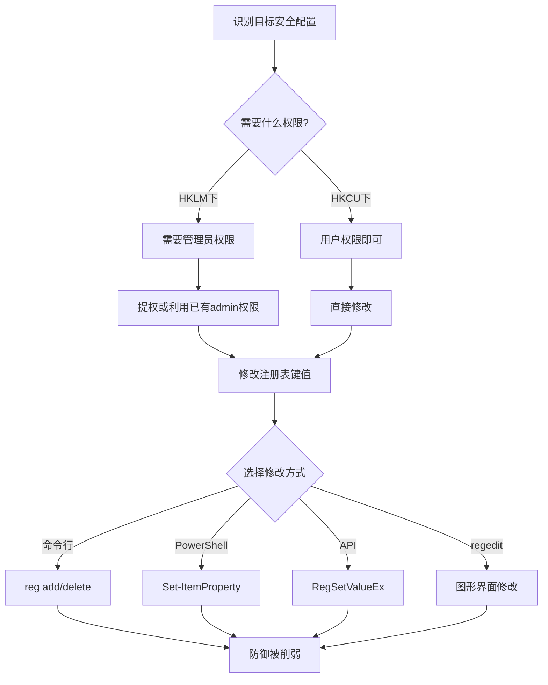

# 修改注册表 (T1112)

> 想象一下：你公司的安全策略写在一张纸上，放在办公室的抽屉里。有一天，有人偷偷打开抽屉，把"禁止外人进入"改成了"禁止外人进入（除非穿红衣服）"。看起来差不多，但其实开了一个大口子。攻击者也是这么干的——Windows的注册表就像系统的"配置文件中心"，攻击者偷偷修改其中的安全配置，把防御措施削弱或关闭，而你可能完全没察觉。

## 30秒速查卡

| 维度 | 你需要知道的 |
|------|--------------|
| 这是什么？ | 修改Windows注册表中的安全配置键值，削弱或关闭系统防御机制 |
| 为什么危险？ | 注册表控制着Windows几乎所有安全设置，修改一个键值就能禁用防火墙、关闭Defender、降低UAC级别 |
| 谁需要关心？ | Windows系统管理员、终端安全团队、安全运维 |
| 你的第一步防御 | 监控关键安全注册表键的变更，部署Sysmon的注册表监控 |
| 如果只做一件事 | 监控`HKLM\SOFTWARE\Microsoft\Windows Defender`下所有键值的修改 |

## 难度等级

⭐⭐ 中级：需要理解Windows注册表结构和常见安全配置键

**前置知识要求**：
- Windows注册表基本结构（HKEY根键、子键、值）
- reg.exe命令行工具的使用
- 常见安全配置键的位置和作用

## 前置知识检查

读这个文件之前，你需要知道：
- **什么是注册表**：Windows的层次化配置数据库，存储系统和应用配置
- **什么是键和值**：键是目录，值是键下的具体配置项（名称+数据类型+数据）
- **什么是HKLM和HKCU**：HKEY_LOCAL_MACHINE（系统级）和HKEY_CURRENT_USER（用户级）
- **什么是reg.exe**：Windows自带的注册表命令行工具

## 技术描述

### 通俗解释

注册表是Windows的"控制中心"——系统启动方式、安全策略、软件配置、用户偏好全都存在里面。正常情况下管理员通过组策略或控制面板修改这些配置，但攻击者直接用reg.exe或PowerShell修改注册表键值，绕过正常的管理界面。他们可以禁用防火墙、关闭杀毒软件、降低UAC级别、修改启动项、篡改日志配置——所有这些只需要改几个注册表值。

### 过渡段

简单来说，注册表就像Windows的"大脑"，所有配置都在里面。攻击者直接"改大脑"——把"开启防火墙"改成"关闭防火墙"，把"启用Defender"改成"禁用Defender"。修改注册表是防御削弱战术中最基础也最常用的技术，几乎所有削弱防御的操作最终都会落到修改注册表上。下面看看具体是怎么操作的。

### 技术原理

修改注册表削弱防御的工作流程：

1. **识别目标键值**：攻击者确定要修改的安全配置注册表键
2. **获取权限**：部分键需要管理员权限（HKLM下的大部分），部分只需用户权限（HKCU）
3. **修改键值**：使用reg.exe、regedit.exe、PowerShell或直接调用Win32 API修改
4. **验证修改**：确认修改生效，防御机制被削弱

### 常见被修改的安全配置键

| 注册表路径 | 作用 | 攻击者修改 |
|------------|------|------------|
| `HKLM\SOFTWARE\Microsoft\Windows Defender\DisableAntiSpyware` | Defender启用状态 | 设为1禁用Defender |
| `HKLM\SOFTWARE\Policies\Microsoft\Windows Defender\DisableAntiSpyware` | 组策略控制Defender | 设为1禁用 |
| `HKLM\SYSTEM\CurrentControlSet\Services\SharedAccess\Parameters\FirewallPolicy\StandardProfile\EnableFirewall` | 防火墙启用状态 | 设为0禁用防火墙 |
| `HKLM\SOFTWARE\Microsoft\Windows\CurrentVersion\Policies\System\ConsentPromptBehaviorAdmin` | UAC提示行为 | 设为0降低UAC级别 |
| `HKLM\SYSTEM\CurrentControlSet\Control\Lsa\restrictanonymoussam` | SAM枚举限制 | 设为0允许匿名枚举 |
| `HKLM\SOFTWARE\Microsoft\Windows\CurrentVersion\Reliability\UserModeDumpEnabled` | 用户模式转储 | 修改以控制崩溃行为 |

### 用途和影响

- **防御规避**：禁用或削弱安全软件、防火墙、UAC
- **持久化**：修改启动项、服务配置
- **权限提升**：降低UAC级别、修改LSA配置
- **信息收集**：修改审计配置减少日志记录
- **执行**：通过注册表触发程序执行（如IFEO）

## 子技术列表

T1112是父技术，目前无子技术。但与以下技术密切相关：
- T1562 削弱防御（常通过修改注册表实现）
- T1547 注册表运行键/文件夹（持久化）
- T1546 事件触发执行（注册表触发器）
- T1574 劫持执行流（注册表DLL搜索路径）

## 攻击流程



### 步骤详解

1. **侦察**：识别目标系统当前的安全配置状态
2. **选择**：确定要修改的注册表键和目标值
3. **获取权限**：确保有足够权限修改目标键
4. **修改**：使用reg.exe、PowerShell或API修改注册表
5. **验证**：确认修改生效
6. **后续**：利用被削弱的防御进行进一步攻击

## 真实案例

### 案例1：BlackCat/ALPHV勒索软件通过注册表禁用Defender

- **时间**：2022-2024年
- **目标**：全球医疗、制造、政府机构
- **攻击组织**：BlackCat/ALPHV（RaaS勒索软件，疑似俄罗斯背景）
- **手法**：BlackCat在加密文件前会系统性地通过修改注册表禁用Windows Defender。攻击者使用批处理脚本执行多条reg.exe命令：`reg add "HKLM\SOFTWARE\Microsoft\Windows Defender" /v DisableAntiSpyware /t REG_DWORD /d 1 /f`禁用Defender的反间谍软件功能；`reg add "HKLM\SOFTWARE\Microsoft\Windows Defender\Real-Time Protection" /v DisableRealtimeMonitoring /t REG_DWORD /d 1 /f`禁用实时保护；`reg add "HKLM\SOFTWARE\Policies\Microsoft\Windows Defender" /v DisableAntiSpyware /t REG_DWORD /d 1 /f`通过组策略路径再次禁用（即使管理员手动启用，组策略会覆盖）。此外，BlackCat还会修改`HKLM\SYSTEM\CurrentControlSet\Services\SharedAccess\Parameters\FirewallPolicy\DomainProfile\EnableFirewall`为0禁用域防火墙，修改`HKLM\SOFTWARE\Microsoft\Windows\CurrentVersion\Policies\System\ConsentPromptBehaviorAdmin`为0降低UAC级别。这些注册表修改为后续的勒索软件加密扫清了障碍，让Defender无法检测和拦截加密行为。
- **影响**：感染数百家组织，赎金总额超过3亿美元
- **参考**：https://www.cisa.gov/news-events/cybersecurity-advisories/aa23-061a

### 案例2：APT29通过注册表禁用Windows事件日志

- **时间**：2020-2021年（SolarWinds供应链攻击）
- **目标**：美国政府机构、科技公司
- **攻击组织**：APT29（Cozy Bear，俄罗斯SVR背景）
- **手法**：在SolarWinds供应链攻击中，APT29通过修改注册表禁用Windows安全事件日志，以隐藏其横向移动和凭据窃取行为。攻击者修改`HKLM\SYSTEM\CurrentControlSet\Services\EventLog\Security`下的配置，将EventLog服务的启动类型改为禁用。更隐蔽的是，攻击者还修改了`HKLM\SOFTWARE\Policies\Microsoft\Windows\EventLog\EventLog-Security`下的最大日志大小和保留策略，将安全日志的最大大小从默认的20MB改为1MB，这样当攻击者产生大量日志事件时（如暴力破解、横向移动），日志会快速填满并自动覆盖旧记录，清除攻击痕迹。此外，APT29还修改了审计策略注册表`HKLM\SYSTEM\CurrentControlSet\Control\Lsa\Audit`下的配置，禁用关键审计类别（如登录审计、对象访问审计），让系统不再记录这些关键安全事件。这些注册表修改让APT29在被感染环境中的活动几乎不留痕迹。
- **影响**：在被感染环境中潜伏数月未被发现
- **参考**：https://www.cisa.gov/news-events/cybersecurity-advisories/aa21-148a

### 案例3：Conti勒索软件通过注册表启用WDigest明文存储

- **时间**：2020-2022年
- **目标**：全球各类组织
- **攻击组织**：Conti（RaaS勒索软件，疑似俄罗斯背景）
- **手法**：Conti勒索软件团伙在攻击中通过修改注册表启用WDigest明文密码存储，以便获取用户的明文密码进行横向移动。默认情况下，Windows 8.1及以上版本禁用了WDigest的明文密码存储（`UseLogonCredential`设为0），但Conti通过`reg add "HKLM\SYSTEM\CurrentControlSet\Control\SecurityProviders\Wdigest" /v UseLogonCredential /t REG_DWORD /d 1 /f`重新启用它。修改后，当用户下次登录时，LSASS会以明文形式在内存中存储密码，攻击者随后使用Mimikatz的`sekurlsa::wdigest`命令从LSASS内存中提取明文密码。除了WDigest，Conti还修改了其他注册表键来辅助凭据窃取：修改`HKLM\SYSTEM\CurrentControlSet\Control\Lsa\RunAsPPL`为0禁用LSASS保护进程（PPL），让Mimikatz可以读取LSASS内存；修改`HKLM\SOFTWARE\Microsoft\Windows\CurrentVersion\Policies\System\Kerberos\Parameters`下的配置以辅助Kerberoasting攻击。这些注册表修改让Conti能够高效地获取凭据并进行横向移动。
- **影响**：攻破上百家组织，造成数十亿美元损失
- **参考**：https://www.cisa.gov/news-events/cybersecurity-advisories/aa21-265a

## 红队视角

### 实战技巧

1. **组策略路径优先**：`HKLM\SOFTWARE\Policies\`下的键优先级高于普通配置，即使管理员手动恢复也会被覆盖
2. **HKCU不需要提权**：修改当前用户的HKCU键值不需要管理员权限
3. **reg.exe比regedit更隐蔽**：命令行工具不弹窗，可嵌入脚本
4. **组合修改**：同时禁用Defender、防火墙、UAC，效果最佳
5. **修改后验证**：用`reg query`确认修改生效

### 常用工具

| 工具 | 用途 | 说明 |
|------|------|------|
| reg.exe | 注册表命令行 | Windows自带，最常用 |
| regedit.exe | 图形界面 | 适合交互式修改 |
| PowerShell | Set-ItemProperty | 脚本化修改 |
| PowerSploit | 注册表操作 | 专注安全相关的注册表修改 |

### 注意事项

- 修改HKLM需要管理员权限
- 某些注册表修改需要重启或服务重启才能生效
- Windows 10/11的Tamper Protection会阻止修改Defender注册表键
- 修改错误的注册表键可能导致系统不稳定

## 蓝队视角

### 检测要点

1. **关键安全键监控**：Defender、防火墙、UAC、LSA相关的注册表键
2. **reg.exe/regedit.exe监控**：监控这些工具的命令行参数
3. **注册表审计**：启用注册表对象的SACL审计
4. **组策略路径监控**：`HKLM\SOFTWARE\Policies\`下的修改
5. **Tamper Protection**：保持Defender的Tamper Protection启用

### 监控建议

- 部署Sysmon监控Event ID 12/13/14（注册表对象/值操作）
- 启用注册表审计（通过组策略或auditpol）
- 监控reg.exe和regedit.exe的执行（Event ID 1）
- 使用Azure ATP/Defender for Identity监控可疑的注册表修改
- 定期导出关键注册表键并对比基线

## 避坑指南

| 坑 | 后果 | 解决方法 |
|----|------|----------|
| 只监控HKLM，忽略HKCU | 漏报用户级修改 | 同时监控HKCU关键键 |
| Tamper Protection已启用，攻击者修改失败 | 误认为安全 | 仍需监控修改尝试 |
| 忽略组策略路径 | 漏报高优先级修改 | 重点监控Policies路径 |
| 注册表监控事件过多 | 告警疲劳 | 只监控关键安全键，过滤已知合法操作 |

## 检测建议

### 网络层

**用人话说**：修改注册表是本地操作，不直接产生网络流量。但攻击者修改注册表后往往会立即进行后续攻击——关注注册表修改后短时间内的异常网络活动。

监控指标：
- 注册表修改后5分钟内的新增网络连接
- reg.exe执行后的C2通信
- 大量reg.exe调用的突发模式（可能是批量修改）

### 主机层

**用人话说**：监控关键安全注册表键的变更和reg.exe的执行——这是注册表修改最直接的信号。任何对Defender、防火墙、UAC配置的修改都应该告警。

```event
事件ID 13（Sysmon）：注册表值设置
TargetObject包含：
  - Windows Defender
  - FirewallPolicy
  - ConsentPromptBehaviorAdmin
  - Wdigest\UseLogonCredential
```

```event
事件ID 1（Sysmon）：进程创建
Image: reg.exe
关注CommandLine中的add/delete/import
```

### 应用层

**用人话说**：监控reg.exe命令和PowerShell注册表操作——攻击者最常使用这两种方式修改注册表。

```yaml
title: 检测通过reg.exe禁用Defender
detection:
    selection:
        EventID: 1
        Image|endswith: 'reg.exe'
        CommandLine|contains:
            - 'Windows Defender'
            - 'DisableAntiSpyware'
    condition: selection
level: critical
```

```yaml
title: 检测启用WDigest明文密码存储
detection:
    selection:
        EventID: 13
        TargetObject|contains: 'Wdigest\UseLogonCredential'
        EventType: 'SetValue'
        Details: 'DWORD (0x00000001)'
    condition: selection
level: critical
```

## 缓解措施

### 高优先级

1. **启用Tamper Protection**：Windows 10/11启用Defender的防篡改保护
2. **限制注册表修改权限**：通过组策略限制谁可以修改关键安全键
3. **启用注册表审计**：对关键键启用SACL审计

### 中优先级

4. **部署Sysmon**：监控注册表操作
5. **使用应用控制**：限制reg.exe/regedit.exe的执行
6. **配置安全基线**：使用CIS/STIG基线并定期检查合规性
7. **监控组策略路径**：`HKLM\SOFTWARE\Policies\`下的修改

### 低优先级

8. **定期备份注册表**：便于恢复
9. **使用注册表权限**：对关键键设置严格的NTFS权限
10. **部署HIDS**：主机入侵检测系统监控注册表修改

## 动手实验

### 实验1：查看关键安全注册表键

```powershell
# 查看Defender配置
Get-ItemProperty -Path "HKLM:\SOFTWARE\Microsoft\Windows Defender" | Select-Object DisableAntiSpyware, DisableRoutinelyTakingAction

# 查看防火墙配置
Get-ItemProperty -Path "HKLM:\SYSTEM\CurrentControlSet\Services\SharedAccess\Parameters\FirewallPolicy\StandardProfile" | Select-Object EnableFirewall

# 查看UAC配置
Get-ItemProperty -Path "HKLM:\SOFTWARE\Microsoft\Windows\CurrentVersion\Policies\System" | Select-Object ConsentPromptBehaviorAdmin, EnableLUA

# 查看WDigest配置
Get-ItemProperty -Path "HKLM:\SYSTEM\CurrentControlSet\Control\SecurityProviders\Wdigest" | Select-Object UseLogonCredential
```

**预期输出**：显示各安全配置的当前值，与安全基线对比

### 实验2：监控注册表修改（实验环境）

```powershell
# 启用对Defender注册表键的审计
auditpol /set /subcategory:"Registry" /success:enable

# 设置SACL（需要管理员权限）
$acl = Get-Acl "HKLM:\SOFTWARE\Microsoft\Windows Defender"
$rule = New-Object System.Security.AccessControl.RegistryAuditRule("Everyone","SetValue","ContainerInherit","None","Success")
$acl.AddAuditRule($rule)
Set-Acl -Path "HKLM:\SOFTWARE\Microsoft\Windows Defender" -AclObject $acl

# 查看安全日志中的注册表审计事件
Get-WinEvent -LogName Security | Where-Object {$_.Id -eq 4657} | Select-Object -First 10
```

**预期输出**：注册表修改操作被记录在安全日志中（事件ID 4657）

## 术语解释

| 术语 | 解释 |
|------|------|
| 注册表 | Windows的层次化配置数据库 |
| HKLM | HKEY_LOCAL_MACHINE，系统级配置根键 |
| HKCU | HKEY_CURRENT_USER，当前用户配置根键 |
| reg.exe | Windows自带的注册表命令行工具 |
| SACL | 系统访问控制列表，定义审计规则 |
| Tamper Protection | Defender的防篡改保护功能 |
| WDigest | Windows摘要认证协议，启用后会明文存储密码 |
| PPL | Protected Process Light，LSASS保护进程 |
| 组策略路径 | `HKLM\SOFTWARE\Policies\`下的配置，优先级高于普通配置 |

## 参考资料

### 📚 深入了解
- [MITRE ATT&CK T1112](https://attack.mitre.org/techniques/T1112/) - 官方技术页面
- [Windows注册表](https://docs.microsoft.com/en-us/windows/win32/sysinfo/registry) - 微软官方文档
- [Tamper Protection](https://docs.microsoft.com/en-us/microsoft-365/security/defender-endpoint/prevent-changes-to-security-settings-with-tamper-protection) - 防篡改保护

### 📰 真实攻击
- [CISA BlackCat通告](https://www.cisa.gov/news-events/cybersecurity-advisories/aa23-061a) - BlackCat禁用Defender
- [CISA SolarWinds通告](https://www.cisa.gov/news-events/cybersecurity-advisories/aa21-148a) - APT29禁用事件日志
- [CISA Conti通告](https://www.cisa.gov/news-events/cybersecurity-advisories/aa21-265a) - Conti启用WDigest

### 🔧 动手试试
- [Sysmon配置](https://github.com/SwiftOnSecurity/sysmon-config) - 注册表监控配置
- [Autoruns](https://docs.microsoft.com/en-us/sysinternals/downloads/autoruns) - 查看注册表启动项
- [RegRipper](https://github.com/keydet89/RegRipper3.0) - 注册表取证工具

## 版本历史

| 版本 | 日期 | 变更 |
|------|------|------|
| 3.1 | 2026-07-10 | 初始版本，完整v3.1模板 |
