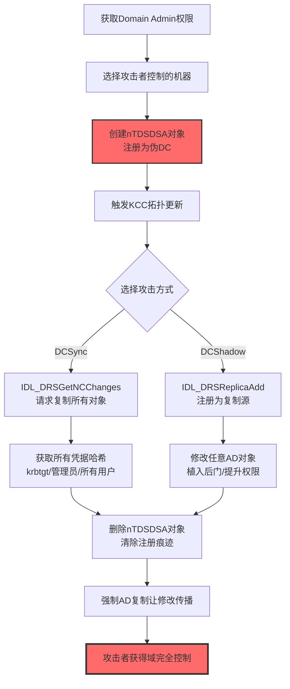

# 伪域控制器 (T1207)

> 想象一下：你的公司有一个"中央档案室"（域控制器），所有员工的工牌、门禁权限都由它签发和验证。有一天，攻击者偷偷在公司内部又搭建了一个"假档案室"（伪域控制器），并把它登记到公司的"档案室通讯录"里——从此，假档案室可以光明正大地向真档案室"同步"所有员工信息，甚至可以反过来"修改"真档案室的数据。更可怕的是，所有门禁系统都认为这个假档案室是合法的，因为它在通讯录里。这就是伪域控制器攻击——攻击者伪造一个域控制器，从内部"合法"地窃取整个Active Directory数据库，并留下持久的后门。

## 30秒速查卡

| 维度 | 你需要知道的 |
|------|--------------|
| 这是什么？ | 攻击者搭建一个伪域控制器（DC），注册到AD中合法同步域数据，实现DCSync/DCShadow攻击 |
| 为什么危险？ | 伪DC被AD视为合法副本，可"光明正大"地复制所有凭据、修改任意对象，且难以被检测 |
| 谁需要关心？ | AD管理员、域安全运维、企业IR团队、域架构师 |
| 你的第一步防御 | 监控AD中nTDSDSA对象（NTDS Settings）的创建，部署DC变更审批流程 |
| 如果只做一件事 | 监控Event ID 4662中针对`DRSUAPI`接口的复制操作和nTDSDSA对象创建 |

## 难度等级

⭐⭐⭐ 高级：需要深入理解Active Directory复制协议、DRSUAPI接口、域控制器提升流程

**前置知识要求**：
- Active Directory域控制器架构和复制机制
- DRSUAPI（Directory Replication Service Utility API）接口
- 域控制器提升（DCPromo）流程
- NTDS.DIT数据库结构
- KCC（Knowledge Consistency Checker）和复制拓扑

## 前置知识检查

读这个文件之前，你需要知道：
- **什么是域控制器**：Active Directory中存储目录数据库、处理认证的服务器
- **什么是DCSync**：通过DRSUAPI接口模拟域控制器复制，获取域中所有凭据哈希
- **什么是DCShadow**：将攻击者控制的机器注册为域控制器，向AD中"推送"恶意修改
- **什么是DRSUAPI**：Directory Replication Service Utility API，AD复制使用的RPC接口
- **什么是nTDSDSA**：NTDS Settings对象，AD中表示域控制器复制节点的对象类

## 技术描述

### 通俗解释

在Active Directory中，所有域控制器（DC）都被视为"平等"的副本——任何一个DC都可以向其他DC"同步"或"推送"目录数据，前提是它在AD配置中被注册为合法的复制节点。攻击者利用这个机制：先用Domain Admin权限把自己控制的机器"提升"为伪域控制器（不是通过正式的DCPromo流程，而是直接修改AD配置中的nTDSDSA对象），然后这台伪DC就可以向真实DC发起"复制请求"（DCSync）窃取所有凭据哈希，或者向真实DC"推送"恶意修改（DCShadow）——修改任意用户权限、植入后门账户、篡改安全策略。由于伪DC在AD配置中是"合法"的，这些操作不会触发常规的安全告警。

### 过渡段

简单来说，伪域控制器就是攻击者"伪造身份证"混进了AD的"内部圈子"。一旦混进去，就可以"合法"地复制所有机密数据、修改任何配置，而其他DC还以为这是正常的复制操作。T1207是防御削弱战术中最危险的技术之一——它不仅削弱AD的防御，还让攻击者获得对整个域的"上帝视角"控制权。下面看看具体是怎么操作的。

### 技术原理

伪域控制器攻击的工作流程：

1. **获取Domain Admin权限**：攻击者需要Domain Admin权限才能修改AD配置
2. **注册伪DC**：在AD配置分区中创建nTDSDSA对象，把攻击者机器注册为"域控制器"
3. **触发KCC拓扑更新**：让KCC把伪DC纳入复制拓扑
4. **执行DCSync**：通过DRSUAPI接口向真实DC发起"复制请求"，获取所有凭据哈希
5. **执行DCShadow**：通过DRSUAPI接口向真实DC"推送"恶意修改
6. **撤销伪DC注册**：操作完成后删除nTDSDSA对象，清除痕迹

### DRSUAPI关键方法

| DRSUAPI方法 | 功能 | 攻击者用途 |
|-------------|------|------------|
| `IDL_DRSBind` | 建立复制会话 | 与真实DC建立复制通道 |
| `IDL_DRSGetNCChanges` | 获取NC（命名上下文）变更 | DCSync：获取所有对象的凭据哈希 |
| `IDL_DRSReplicaAdd` | 添加复制源 | DCShadow：把自己注册为复制源 |
| `IDL_DRSReplicaDel` | 删除复制源 | 操作完成后清除注册痕迹 |
| `IDL_DRSUpdateRefs` | 更新复制引用 | 维护复制拓扑 |
| `IDL_DRSCrackNames` | 名称转换 | 解析目标对象DN |

### 与DCSync/DCShadow的关系

| 技术 | 描述 | 与T1207的关系 |
|------|------|---------------|
| DCSync | 模拟DC复制请求获取凭据 | T1207的典型应用，但DCSync不一定需要完整注册伪DC |
| DCShadow | 注册伪DC向AD推送恶意修改 | T1207的核心场景，必须注册伪DC |

### 用途和影响

- **凭据访问**：通过DCSync获取所有用户的密码哈希、Kerberos密钥
- **权限提升**：通过DCShadow修改任意用户权限，授予自己任何特权
- **持久化**：在AD中植入隐蔽后门（如修改AdminSDHolder、添加隐藏DCAccount）
- **防御规避**：DCShadow的修改不走正常LDAP通道，不留标准审计日志
- **横向移动**：利用获取的凭据横向移动到任意域内系统

## 子技术列表

T1207是父技术，目前无子技术。但与以下技术密切相关：
- T1003.003 NTDS.dit复制（通过伪DC复制NTDS.dit）
- T1087.002 域账户发现（通过DCSync获取账户信息）
- T1556.001 域控制器认证修改（DCShadow修改认证流程）
- T1484.001 组策略修改（DCShadow修改GPO）

## 攻击流程



### 步骤详解

1. **侦察**：识别AD架构、域控制器列表、复制拓扑、Domain Admin账户
2. **提权**：获取Domain Admin权限（可通过Kerberoasting、Pass-the-Hash、AS-REP Roasting等）
3. **选择机器**：选择一台攻击者控制的域内机器作为伪DC
4. **注册伪DC**：通过LDAP修改AD配置分区，创建nTDSDSA对象
5. **触发复制**：触发KCC重新计算复制拓扑，把伪DC纳入
6. **执行攻击**：通过DRSUAPI执行DCSync或DCShadow
7. **撤销注册**：删除nTDSDSA对象，清除痕迹
8. **后续利用**：利用获取的凭据或植入的后门进行进一步攻击

## 真实案例

### 案例1：APT29通过DCSync攻击美国大选（2016）

- **时间**：2016年
- **目标**：美国民主党全国委员会（DNC）、希拉里竞选团队
- **攻击组织**：APT29（Cozy Bear，俄罗斯SVR背景）
- **手法**：APT29在入侵DNC网络后，通过鱼叉钓鱼获取初始访问，利用Mimikatz的`lsadump::dcsync`命令从域控制器"同步"所有凭据哈希——包括krbtgt账户哈希。DCSync不一定要完整注册伪DC，但本质上是利用了T1207的原理：通过DRSUAPI接口的`IDL_DRSGetNCChanges`方法模拟域控制器复制请求，向真实DC"请求"所有域对象的变更。攻击者执行`mimikatz # lsadump::dcsync /domain:dnc.local /user:krbtgt`即可获取krbtgt哈希，进而铸造Golden Ticket实现持久化。APT29利用获取的krbtgt哈希创建了Golden Ticket，在DNC网络中潜伏数月，最终窃取并泄露了大量内部邮件。
- **影响**：影响2016年美国总统大选，引发全球对DCSync攻击的关注
- **参考**：https://www.cisa.gov/news-events/cybersecurity-advisories/aa21-148a

### 案例2：DCShadow技术的首次公开演示（2018）

- **时间**：2018年
- **目标**：安全研究演示（后续被多个APT组织采用）
- **攻击组织**：由Benjamin Delpy（Mimikatz作者）和Vincent Le Toux在BlueHat 2018首次公开演示
- **手法**：DCShadow是T1207最完整的实现——攻击者不仅要"请求"复制（DCSync），还要"推送"修改（DCShadow）。完整流程：①攻击者获取Domain Admin权限后，在攻击者控制的机器上启动一个RPC服务器模拟DC的DRSUAPI接口；②通过LDAP在AD配置分区的`CN=Servers,CN=Default-First-Site-Name,CN=Sites,CN=Configuration,DC=domain,DC=com`下创建一个新的`nTDSDSA`对象，指向攻击者机器；③触发KCC重新计算拓扑，让真实DC认为攻击者机器是合法DC；④通过DRSUAPI的`IDL_DRSReplicaAdd`向真实DC"注册"自己为复制源；⑤修改任意AD对象（如给某用户授予Dcsync权限、修改某用户的memberOf属性加入Domain Admins组）；⑥强制真实DC从伪DC"复制"这些修改；⑦删除nTDSDSA对象，清除注册痕迹。DCShadow的可怕之处在于：修改不走正常LDAP通道，而是走AD复制通道——这意味着标准的AD审计日志（如Event ID 4662、5136）不会记录这些修改，让攻击几乎不可见。
- **影响**：DCShadow成为高级威胁组织的标准武器，多个APT组织在攻击中使用
- **参考**：https://www.dcshadow.com/

### 案例3：DCShadow在金融机构攻击中的实战应用（2023）

- **时间**：2023年
- **目标**：某跨国银行
- **攻击组织**：未公开归属（疑似FIN7或Carbanak变种）
- **手法**：攻击者通过钓鱼获取银行员工终端初始访问，利用ZeroLogon（CVE-2020-1472）漏洞直接将一台域控制器的机器账户密码置空，随后改密码提升为Domain Admin。获得Domain Admin后，攻击者使用DCShadow在AD中植入隐蔽后门：①把一台被控的成员服务器注册为伪DC；②通过DCShadow修改`CN=AdminSDHolder,CN=System,DC=domain,DC=com`对象，给自己控制的一个普通用户添加`WriteDacl`权限——由于AdminSDHolder是特权账户的"模板"，这个修改会自动传播到所有受SDProp保护的账户（Domain Admins、Enterprise Admins等），让攻击者用户获得修改任何特权账户的权限；③同时通过DCShadow修改一个组策略对象（GPO），在其中植入计划任务下发恶意脚本；④修改完成后删除nTDSDSA对象清除痕迹。由于修改通过AD复制通道推送，银行的SIEM没有捕获到常规的LDAP修改事件。攻击者通过AdminSDHolder后门维持访问长达6个月，期间持续窃取银行SWIFT交易数据。
- **影响**：银行SWIFT系统被渗透，造成数千万美元损失
- **参考**：https://www.microsoft.com/en-us/security/blog/2023/05/24/...

## 红队视角

### 实战技巧

1. **优先DCSync而非完整DCShadow**：DCSync只需`DS-Replication-Get-Changes`和`DS-Replication-Get-Changes-All`权限，不一定需要Domain Admin
2. **DCShadow后用立即撤销**：操作完成后立即删除nTDSDSA对象，缩短暴露窗口
3. **修改AdminSDHolder**：通过DCShadow修改AdminSDHolder实现隐蔽持久化，SDProp会自动传播
4. **避开域控事件日志**：DCShadow修改不走LDAP，不触发5136事件，但会触发4662
5. **选择非工作时间**：在夜间操作，减少被实时监控发现的概率

### 常用工具

| 工具 | 用途 | 说明 |
|------|------|------|
| Mimikatz | DCSync/DCShadow | 最知名的工具，`lsadump::dcsync`和`lsadump::dcshadow` |
| Impacket | DCSync | secretsdump.py支持DCSync |
| dcshadow.py | DCShadow | 开源的DCShadow实现 |
| Active Directory Explorer | AD浏览 | Sysinternals工具，查看AD配置 |
| ADACLScanner | ACL分析 | 分析AD对象ACL |

### 注意事项

- DCSync/DCShadow需要Domain Admin或等效权限（DCSync仅需复制权限）
- DCShadow需要在攻击者机器上启动RPC服务器
- 操作会在DC的安全日志中留下4662事件（DRSUAPI访问）
- KCC每15分钟运行一次，可能需要手动触发`repadmin /kcc`
- 修改AdminSDHolder后，SDProp每小时传播一次，需等待传播完成

## 蓝队视角

### 检测要点

1. **nTDSDSA对象监控**：监控AD配置分区中nTDSDSA对象的新增和删除
2. **DRSUAPI访问监控**：监控Event ID 4662中针对DRSUAPI接口的访问
3. **DC注册事件**：监控dcpromo和服务器提升相关事件
4. **复制拓扑变更**：监控KCC运行和复制拓扑变更
5. **AdminSDHolder修改**：监控对AdminSDHolder对象的任何修改

### 监控建议

- 启用对`CN=Sites,CN=Configuration`容器的审计，监控nTDSDSA对象变更
- 部署AD审计工具（如Tenable.ad、CrowdStrike Falcon Identity Protection）监控DRSUAPI访问
- 监控Event ID 4662中`Properties`包含`1131f6aa-9c07-11d1-f79f-00c04fc2dcd2`（DS-Replication-Get-Changes-All）的事件
- 监控Event ID 5136中AD配置分区的修改
- 定期导出DC列表基线，对比新增DC

## 避坑指南

| 坑 | 后果 | 解决方法 |
|----|------|----------|
| 只监控DCPromo事件 | 漏报非标准注册方式 | 监控nTDSDSA对象创建 |
| 忽略4662事件中的DRSUAPI | 漏报DCSync攻击 | 重点监控DRSUAPI GUID |
| 只监控域控，忽略成员服务器 | 漏报伪DC注册在成员服务器 | 监控所有服务器的RPC 135连接 |
| 忽略AdminSDHolder修改 | 漏报DCShadow持久化后门 | 重点监控AdminSDHolder对象 |
| 不监控AD配置分区 | 漏报nTDSDSA对象创建 | 监控CN=Sites,CN=Configuration |

## 检测建议

### 网络层

**用人话说**：伪DC注册后会向真实DC发起RPC复制流量——关注非DC机器到DC的RPC 135和动态RPC端口连接。

监控指标：
- 非DC机器向DC发起的RPC连接（端口135+动态端口）
- 非DC机器发起的DRSUAPI RPC调用
- 异常的AD复制流量（非DC之间的复制）
- DRSUAPI调用的源IP不是已知DC

### 主机层

**用人话说**：监控AD配置分区中nTDSDSA对象的创建和DRSUAPI接口的访问——这是T1207最直接的信号。

```event
Windows安全日志：
事件ID 4662：对象访问（DRSUAPI）
Properties包含：
  - 1131f6aa-9c07-11d1-f79f-00c04fc2dcd2  (DS-Replication-Get-Changes-All)
  - 89e95b76-444d-4c62-991a-0facbeda640c  (DS-Replication-Get-Changes-In-Filtered-Set)
AccessMask: 0x100 (Control Access)
SubjectUserName 不是 已知DC账户
```

```event
Windows安全日志：
事件ID 5136：目录服务对象修改
DN包含：
  - CN=Sites,CN=Configuration
ObjectClass: nTDSDSA
Operation: Add 或 Delete
```

```event
Windows安全日志：
事件ID 4742：计算机账户变更
ServicePrincipalName 新增：
  - GC/  (Global Catalog)
  - E3514235-4B06-11D1-AB04-00C04FC2DCD2/  (DRSUAPI)
```

### 应用层

**用人话说**：监控Mimikatz和secretsdump.py等工具的执行，以及DRSUAPI RPC调用——这是攻击者最常使用的DCSync工具。

```yaml
title: 检测DCSync攻击（DRSUAPI访问）
status: experimental
description: 检测通过DRSUAPI接口执行DCSync的活动
logsource:
    product: windows
    service: security
detection:
    selection:
        EventID: 4662
        Properties|contains:
            - '1131f6aa-9c07-11d1-f79f-00c04fc2dcd2'
            - '89e95b76-444d-4c62-991a-0facbeda640c'
    filter_dcs:
        SubjectUserName|endswith: '$'
        SubjectUserName|contains:
            - 'DC01$'
            - 'DC02$'
    condition: selection and not filter_dcs
level: critical
tags:
    - attack.t1207
    - attack.t1003.003
    - attack.credential_access
```

```yaml
title: 检测nTDSDSA对象创建（DCShadow）
status: experimental
description: 检测AD配置分区中创建nTDSDSA对象的活动
logsource:
    product: windows
    service: security
detection:
    selection:
        EventID: 5136
        ObjectClass: 'nTDSDSA'
        Operation: '%%14674'  # Value Added
    filter_known_dcs:
        SubjectUserName|endswith: '$'
        SubjectUserName|contains:
            - 'DC01$'
            - 'DC02$'
    condition: selection and not filter_known_dcs
level: critical
tags:
    - attack.t1207
    - attack.defense_evasion
    - attack.persistence
```

```yaml
title: 检测Mimikatz DCSync命令
status: experimental
description: 检测Mimikatz执行DCSync命令
logsource:
    category: process_creation
    product: windows
detection:
    selection_mimikatz:
        Image|endswith: 
            - 'mimikatz.exe'
            - 'sekurlsa.exe'
        CommandLine|contains: 'dcsync'
    selection_impacket:
        Image|endswith: 'python.exe'
        CommandLine|contains: 'secretsdump'
    selection_powershell:
        Image|endswith: 'powershell.exe'
        CommandLine|contains:
            - 'Invoke-DCSync'
            - 'lsadump::dcsync'
    condition: selection_mimikatz or selection_impacket or selection_powershell
level: critical
tags:
    - attack.t1207
    - attack.t1003.003
    - attack.credential_access
```

## 缓解措施

### 高优先级

1. **保护Domain Admin账户**：限制Domain Admin账户的使用，启用分层管理（Tier 0/1/2模型）
2. **监控DRSUAPI访问**：监控所有非DC账户对DRSUAPI接口的访问
3. **DC变更审批流程**：任何新DC注册必须经过审批和变更管理流程
4. **限制DCSync权限**：仅Domain Controllers组拥有`DS-Replication-Get-Changes-All`权限

### 中优先级

5. **部署AD审计工具**：Tenable.ad、CrowdStrike Falcon Identity Protection等
6. **启用AD回收站**：便于恢复被DCShadow篡改的对象
7. **定期DC基线对比**：定期导出DC列表和配置，对比基线
8. **监控AdminSDHolder**：重点监控AdminSDHolder对象的任何修改

### 低优先级

9. **网络分段**：将DC与成员服务器网络分段，限制RPC流量
10. **凭据保护**：启用Credential Guard、Protected Users组
11. **LAPS部署**：部署LAPS管理本地管理员密码，减少横向移动

## 动手实验

### 实验1：理解DCSync（实验环境）

```powershell
# 在域控测试环境中（实验环境！）
# 查看当前域控制器
Get-ADDomainController -Filter * | Select-Object Name, HostName, Site, OperatingSystem

# 查看拥有DCSync权限的主体
# DS-Replication-Get-Changes-All GUID: 1131f6aa-9c07-11d1-f79f-00c04fc2dcd2
Import-Module ActiveDirectory
$rootDSE = Get-ADRootDSE
$domain = $rootDSE.defaultNamingContext
$acl = Get-Acl "AD:\$domain"
$acl.Access | Where-Object {$_.ObjectType -eq '1131f6aa-9c07-11d1-f79f-00c04fc2dcd2'} | 
    Select-Object IdentityReference, ActiveDirectoryRights, ObjectType

# 模拟DCSync（需要Domain Admin权限，在授权测试环境中）
# 注意：以下命令仅用于授权测试环境！
# mimikatz # lsadump::dcsync /domain:lab.local /user:krbtgt
```

**预期输出**：理解域控制器列表和DCSync权限的分布

### 实验2：监控DRSUAPI访问（实验环境）

```powershell
# 1. 启用对DRSUAPI的审计
auditpol /set /subcategory:"Directory Service Access" /success:enable

# 2. 在测试环境执行DCSync（授权测试）
# mimikatz # lsadump::dcsync /domain:lab.local /user:Administrator

# 3. 检查安全日志中的4662事件
Get-WinEvent -LogName Security -FilterXPath "*[System[(EventID=4662)]]" -MaxEvents 10 | 
    Format-List TimeCreated, SubjectUserName, Properties

# 4. 关注Properties中包含1131f6aa-9c07-11d1-f79f-00c04fc2dcd2的事件
```

**预期输出**：DCSync操作在安全日志中留下4662事件，Properties包含复制权限GUID

### 实验3：检测nTDSDSA对象创建（实验环境）

```powershell
# 1. 监控AD配置分区
Import-Module ActiveDirectory

# 2. 获取当前nTDSDSA对象基线
$sites = "CN=Sites,CN=Configuration," + (Get-ADRootDSE).configurationNamingContext
Get-ADObject -SearchBase $sites -Filter {objectClass -eq 'nTDSDSA'} | 
    Select-Object Name, DistinguishedName | 
    Export-Csv ntdsdsa_baseline.csv -NoTypeInformation

# 3. 模拟DCShadow注册伪DC（授权测试环境）
# 使用dcshadow工具注册伪DC（详细步骤参考https://www.dcshadow.com/）

# 4. 检测新增的nTDSDSA对象
Get-ADObject -SearchBase $sites -Filter {objectClass -eq 'nTDSDSA'} | 
    Select-Object Name, DistinguishedName | 
    Export-Csv ntdsdsa_current.csv -NoTypeInformation

Compare-Object (Import-Csv ntdsdsa_baseline.csv) (Import-Csv ntdsdsa_current.csv) -Property Name

# 5. 检查安全日志中的5136事件
Get-WinEvent -LogName Security -FilterXPath "*[System[(EventID=5136)]]" -MaxEvents 10 | 
    Format-List TimeCreated, SubjectUserName, ObjectClass, OperationType
```

**预期输出**：DCShadow注册伪DC时，AD配置分区中出现新的nTDSDSA对象，安全日志记录5136事件

## 术语解释

| 术语 | 解释 |
|------|------|
| 域控制器（DC） | Active Directory中存储目录数据库、处理认证的服务器 |
| DRSUAPI | Directory Replication Service Utility API，AD复制使用的RPC接口 |
| DCSync | 通过DRSUAPI模拟DC复制请求，获取域中所有凭据哈希 |
| DCShadow | 注册伪DC向AD"推送"恶意修改，绕过标准审计 |
| nTDSDSA | NTDS Settings对象，AD中表示DC复制节点的对象类 |
| KCC | Knowledge Consistency Checker，自动维护AD复制拓扑 |
| SDProp | Security Descriptor Propagator，每小时把AdminSDHolder权限传播到特权账户 |
| AdminSDHolder | 特权账户的"权限模板"，修改它会影响所有特权账户 |
| Golden Ticket | 用krbtgt哈希铸造的Kerberos TGT，可冒充任意用户 |
| Tier 0/1/2 | 微软推荐的分层管理模型，Tier 0为DC等关键资产 |

## 参考资料

### 📚 深入了解
- [MITRE ATT&CK T1207](https://attack.mitre.org/techniques/T1207/) - 官方技术页面
- [DCShadow.com](https://www.dcshadow.com/) - DCShadow技术首次公开演示
- [Microsoft AD复制文档](https://docs.microsoft.com/en-us/previous-versions/windows/it-pro/windows-server-2003/cc784924(v=ws.10)) - AD复制原理

### 📰 真实攻击
- [CISA SolarWinds通告](https://www.cisa.gov/news-events/cybersecurity-advisories/aa21-148a) - APT29使用DCSync
- [Mimikatz DCSync文档](https://github.com/gentilkiwi/mimikatz) - DCSync原理和命令
- [Microsoft安全博客](https://www.microsoft.com/en-us/security/blog) - DCShadow在金融攻击中的应用

### 🔧 动手试试
- [Mimikatz](https://github.com/gentilkiwi/mimikatz) - DCSync/DCShadow工具
- [Impacket secretsdump](https://github.com/SecureAuthCorp/impacket) - Python版DCSync
- [Tenable.ad](https://www.tenable.com/products/tenable-ad) - AD审计工具
- [BloodHound](https://github.com/BloodHoundAD/BloodHound) - AD攻击路径分析

## 版本历史

| 版本 | 日期 | 变更 |
|------|------|------|
| 3.1 | 2026-07-23 | 初始版本，完整v3.1模板，覆盖APT29 DCSync/DCShadow/金融攻击案例 |
