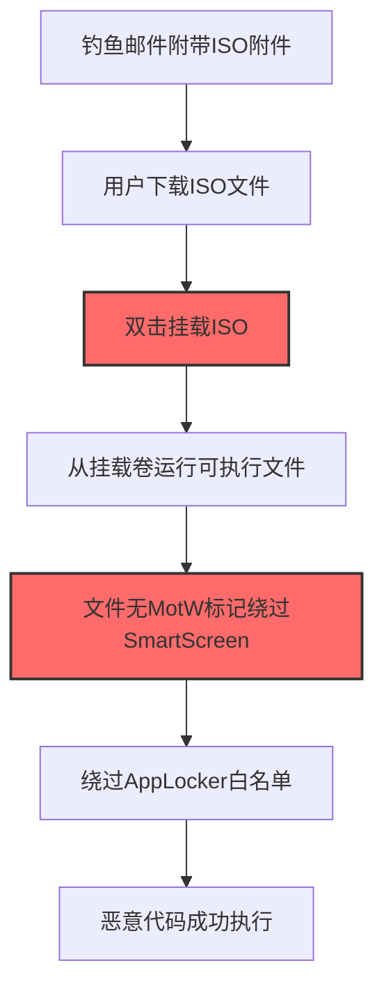
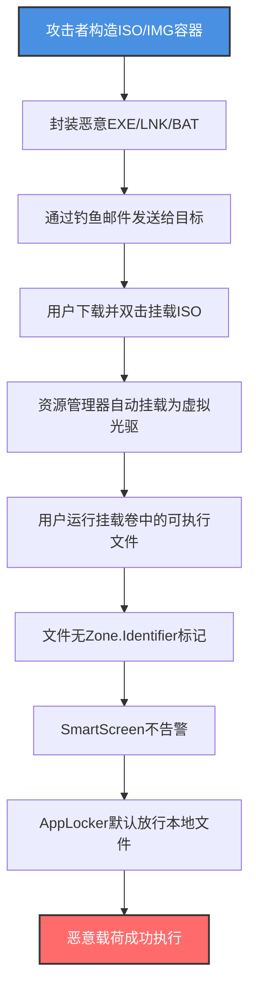

# Mark-of-the-Web绕过 (T1553.005)

## 一句话通俗理解

> **让从网上下载的可执行文件失去"来源不明"的标记，骗过SmartScreen和AppLocker**

## 30秒速查卡

| 维度 | 你需要知道的 |
|------|-------------|
| 这是什么？ | 绕过Windows的Mark-of-the-Web（MotW）标记机制，让下载的文件伪装成本地可信文件 |
| 为什么危险？ | MotW是SmartScreen、AppLocker、Defender Smart Screen的第一道防线，绕过它等于打开了"信任闸门" |
| 谁需要关心？ | Windows安全管理员、EDR运维、邮件网关运维、终端安全团队 |
| 你的第一步防御 | 在邮件网关阻断ISO/IMG/VHD等容器文件附件，并禁用Explorer对挂载介质的自动执行 |
| 如果只做一件事 | 用Sysmon监控Mount-DiskImage调用及从挂载卷启动的可执行进程 |

## 难度等级

⭐⭐⭐ 中级 - 需要理解Windows NTFS备用数据流和容器文件机制

## 前置知识检查

**读这个文件需要什么？**

- [ ] Windows NTFS备用数据流（Alternate Data Streams, ADS）
- [ ] Windows区域安全（Zone Identifier）和SmartScreen工作原理
- [ ] AppLocker / WDAC（Windows Defender Application Control）基础
- [ ] ISO/IMG/VHD等容器文件格式

## 技术描述

**Mark-of-the-Web绕过**（T1553.005）是 **颠覆信任控制**（T1553）的一个具体变体，属于 **防御削弱** 阶段的攻击技术。

> 📚 **打个比方**：想象你开了一家银行，所有从外面送进来的钱箱上都贴着"来源待核实"的红标签（MotW），柜员看到红标签就会额外检查。攻击者做的事情就是把红标签撕掉，或者把钱箱先放进一个"自家仓库"（容器文件）里再拿出来，标签就没了——柜员就当成自家钱箱处理了。

### 具体怎么理解？

Mark-of-the-Web（MotW）是Windows为从互联网下载的文件自动添加的NTFS备用数据流（Zone.Identifier），标记文件来自"互联网区域"（Zone 3）。该标记会触发SmartScreen警告、限制宏执行、并作为AppLocker和WDAC等应用控制策略的判定依据。

攻击者绕过MotW的核心思路是：**让文件在落地到磁盘时不被标记为"互联网来源"**。常见手段包括：

1. **容器文件绕过**：将恶意PE/脚本封装在ISO、IMG、VHD等容器文件中。当用户从邮件下载ISO并双击挂载后，从挂载卷中提取的文件**不会继承MotW标记**，因为Windows资源管理器在处理挂载卷时不会传播Zone.Identifier。
2. **NTFS ADS操作**：直接删除或修改Zone.Identifier备用数据流，让已下载文件"洗白"。
3. **LNK快捷方式利用**：通过快捷方式调用受信任的签名程序加载恶意内容，绕过MotW触发的SmartScreen检查。

### 为什么有效？

这种技术之所以有效，是因为：

1. **信任机制设计缺陷**：MotW依赖于NTFS ADS，仅对"被识别的下载路径"自动打标。容器文件挂载后内部文件不受传播机制覆盖，是Windows设计的固有特性。
2. **应用控制依赖MotW**：AppLocker、WDAC等企业级应用白名单策略默认信任"无MotW标记的本地文件"。一旦绕过MotW，恶意代码即可冒充本地可信程序执行。
3. **用户交互门槛低**：攻击者只需通过钓鱼邮件发送一个ISO附件，用户双击挂载并运行内部文件即可触发，无需利用任何内核漏洞。

**过渡段：** 不要误以为安装了AppLocker就万事大吉——攻击者只要把恶意程序塞进ISO里发邮件，用户挂载后执行就能绕过MotW这道"信任闸门"。

## 真实攻击流程

### 典型场景

攻击者在 **初始访问/防御削弱** 阶段使用 Mark-of-the-Web绕过 技术，以下是典型的攻击步骤：



**步骤详解：**

1. **钓鱼邮件附带ISO附件** - 攻击者将恶意载荷封装在ISO中通过邮件投递
2. **用户下载ISO文件** - 受害者从邮件下载ISO，文件本身带有MotW标记
3. **双击挂载ISO** - Windows资源管理器自动挂载ISO为虚拟光驱
4. **从挂载卷运行可执行文件** - 用户被诱导执行ISO内的EXE/LNK/BAT
5. **文件无MotW标记** - 挂载卷中的文件不会继承Zone.Identifier
6. **绕过AppLocker白名单** - 无MotW标记文件被视作本地可信
7. **恶意代码成功执行** - 载荷在无SmartScreen警告下运行

## 攻击流程

### 典型攻击流程

构造容器文件 --> 通过钓鱼邮件投递 --> 用户挂载ISO/IMG --> 执行无MotW标记的载荷 --> 绕过SmartScreen和AppLocker --> 实现初始访问和代码执行



**步骤详解：**

1. **攻击者构造ISO/IMG容器** - 使用mkisofs、AnyToISO、PowerShell的Mount-DiskImage相关API打包恶意载荷
   - 通俗描述：就像把违禁品藏在一个看似合法的快递箱里
   - 技术细节：使用 `oscdimg.exe` 或 PowerShell `New-Item -ItemType File` 配合 `Mount-DiskImage` 构造ISO，也可使用 `dism /Mount-Image` 操作VHD。容器内通常包含LNK快捷方式调用MSHTA、PowerShell或签名程序加载恶意DLL
   - 常用工具：oscdimg.exe、AnyToISO、mkisofs、PowerShell Mount-DiskImage

2. **封装恶意EXE/LNK/BAT** - 在容器内放置载荷，常使用LNK快捷方式调用合法签名程序实现LOLBins
   - 通俗描述：在快递箱里放了一个看似普通的购物卡，刷一下就能取出违禁品
   - 技术细节：构造 `shortcut.lnk` 指向 `mshta.exe javascript:...` 或 `powershell.exe -w hidden -e <base64>`，配合DLL侧加载（T1574.001）调用受信任签名程序
   - 常用工具：LNK构造脚本、mshta.exe、regsvr32.exe、rundll32.exe

3. **通过钓鱼邮件发送给目标** - 通过钓鱼邮件附件或恶意下载链接投递
   - 通俗描述：把这个"快递箱"伪装成发票或合同邮件寄给目标员工
   - 技术细节：邮件主题伪装成"发票"、"合同"、"汇款单"等业务相关内容，附件名使用 `Invoice_2026.iso`、`Contract_Q3.img` 等。部分攻击会使用 OneDrive/Google Drive 共享链接规避邮件网关附件类型检测
   - 常用工具：Gophish、KingPhisher、合法云盘分享

4. **用户下载并双击挂载ISO** - Windows资源管理器默认支持双击挂载ISO
   - 通俗描述：用户拆快递时不假思索就打开箱子
   - 技术细节：Windows 10/11原生支持ISO双击挂载（无需第三方工具），挂载后 Explorer 自动打开新卷。Windows 11默认配置下用户不需要管理员权限即可挂载ISO
   - 常用工具：Explorer.exe、Mount-DiskImage

5. **资源管理器自动挂载为虚拟光驱** - 挂载操作不会传播Zone.Identifier
   - 通俗描述：箱子一打开，里面的东西立刻就被当成自家仓库的货品
   - 技术细节：Windows资源管理器在挂载ISO/IMG/VHD时，**不会**为容器内的文件创建NTFS ADS Zone.Identifier。这是Windows文件系统的固有行为——MotW传播依赖shell的`IZoneIdentifier`接口，而挂载卷的文件复制路径不走shell的Attachment Execution Service
   - 常用工具：Windows Shell、Attachment Execution Service（不被调用）

6. **用户运行挂载卷中的可执行文件** - 用户被诱导执行ISO内的可执行文件
   - 通俗描述：用户在不知情下点击了"购物卡"，触发了恶意载荷
   - 技术细节：用户双击 `Invoice.lnk` → 触发 `mshta.exe` 执行内嵌HTA → 下载并执行后续载荷（Cobalt Strike beacon、Qakbot、IcedID等）
   - 常用工具：mshta.exe、PowerShell、wscript.exe

7. **文件无Zone.Identifier标记** - 文件被识别为"本地可信"
   - 通俗描述：因为快递箱里的货品没有"来源待核实"标签，柜员直接放行
   - 技术细节：使用 `Get-Item -Stream Zone.Identifier` 检查会返回"找不到流"错误。SmartScreen基于MotW决策，无标记则跳过信誉检查
   - 常用工具：PowerShell Get-Item -Stream、streams.exe

8. **SmartScreen不告警** - SmartScreen仅对带MotW的未知文件弹窗
   - 通俗描述：保安看到没标签的人就不查身份证
   - 技术细节：SmartScreen在文件执行前查询文件MotW状态和文件信誉。无MotW标记的文件不会触发"Windows保护了你的电脑"警告对话框
   - 常用工具：SmartScreen服务

9. **AppLocker默认放行本地文件** - 默认AppLocker规则信任无MotW本地文件
   - 通俗描述：通行证黑名单系统看到没"外地"标签的人就默认是本地员工
   - 技术细节：默认AppLocker规则 `Path %OSDRIVE%\*` 默认允许Windows目录；仅当规则显式配置 `Block files with MotW` 时才会检查MotW。WDAC同样依赖MotW作为补充信任来源
   - 常用工具：AppLocker、WDAC

10. **恶意载荷成功执行** - 后门、勒索软件或信息窃取程序落地运行
    - 通俗描述：违禁品顺利被取出并使用
    - 技术细节：常见后续载荷包括 Cobalt Strike Beacon、Qakbot、IcedID、BumbleBee、Cobalt Strike、Emotet等。载荷通过进程注入（T1055）或计划任务（T1053）建立持久化
    - 常用工具：Cobalt Strike、Qakbot loader、IcedID

## 真实案例

### 案例1：BumbleBee Loader通过ISO钓鱼投递（2022-2023）

- **时间**: 2022年4月-2023年
- **目标**: 多个行业组织（制造、零售、医疗）
- **攻击组织**: BumbleBee运营团伙（疑似前TrickBot/Conti成员）
- **手法**: 攻击者通过钓鱼邮件附带ISO文件，邮件主题伪装为"发票"、"合同"。用户双击挂载ISO后，运行其中的LNK快捷方式调用 `rundll32.exe` 加载BumbleBee DLL。由于ISO内文件无MotW标记，绕过了SmartScreen和企业AppLocker策略
- **影响**: 后续投递Cobalt Strike Beacon、Conti勒索软件，造成多个组织数据泄露
- **参考链接**: [Proofpoint BumbleBee分析](https://www.proofpoint.com/us/blog/threat-insight/bumblebee-is-still-buzzing)

### 案例2：Qakbot通过ISO/IMG绕过MotW（2022-2023）

- **时间**: 2022年下半年-2023年
- **目标**: 全球企业用户
- **攻击组织**: Qakbot运营团伙（TA577）
- **手法**: Qakbot放弃传统的ZIP+VBS宏投递方式，改用ISO和IMG容器文件附件。容器内包含LNK快捷方式调用PowerShell下载Qakbot DLL。ISO挂载后的文件无MotW标记，绕过了Microsoft对Office宏的默认阻止（Mark-of-the-Web block）和SmartScreen
- **影响**: Qakbot感染作为初始访问入口，后续投递Cobalt Strike、Black Basta勒索软件
- **参考链接**: [Cisco Talos Qakbot分析](https://blog.talosintelligence.com/qakbot-replication/)

### 案例3：IcedID通过ISO钓鱼攻击（2022）

- **时间**: 2022年
- **目标**: 北美制造业和医疗行业
- **攻击组织**: IcedID（BokBot）运营团伙
- **手法**: 钓鱼邮件附带ISO文件，邮件伪装成税单提醒。ISO内含LNK快捷方式调用 `mshta.exe` 执行远程HTA载荷。绕过MotW标记后，AppLocker默认策略放行
- **影响**: IcedID银行木马感染，后续投递Conti勒索软件
- **参考链接**: [IBM Security IcedID分析](https://securityintelligence.com/posts/icedid-trojan-campaigns/)

### 案例4：APT29通过容器文件绕过MotW（2022）

- **时间**: 2022年
- **目标**: 欧洲外交机构
- **攻击组织**: APT29（Cozy Bear，NOBELIUM）
- **手法**: 通过钓鱼邮件附带ISO文件，利用"外交招待会邀请函"主题。ISO内含LNK快捷方式调用PowerShell，绕过MotW后加载Cobalt Strike Beacon
- **影响**: 多个外交机构被入侵，敏感外交信息泄露
- **参考链接**: [Mandiant APT29报告](https://www.mandiant.com/resources/blog/unc2452-nobelium)

## 红队视角

> ⚠️ **免责声明**：以下内容仅用于合法的安全测试、渗透测试和教育目的。未经授权对他人系统进行测试是违法行为。

### 实战技巧

1. **优先使用ISO而非ZIP**：ZIP中的文件会继承MotW，但ISO挂载后的文件不会。在授权测试中优先选择ISO容器
2. **配合LNK快捷方式**：直接在ISO内放EXE会触发Defender静态扫描，使用LNK调用LOLBins（mshta、regsvr32）更隐蔽
3. **DLL侧加载组合**：将恶意DLL和签名EXE一起放入ISO，利用DLL搜索顺序劫持执行
4. **规避Defender扫描**：ISO内的恶意DLL仍会被Defender扫描，需配合打包工具混淆或使用.NET反射加载

### 常用工具

| 工具名称 | 用途 | 平台 | 链接 |
| -------- | ---- | ---- | ---- |
| oscdimg.exe | Windows官方ISO创建工具 | Windows | Windows ADK内置 |
| AnyToISO | 图形化ISO创建工具 | Windows/macOS | [AnyToISO](https://anytoiso.com/) |
| mkisofs | 跨平台ISO创建工具 | Linux/Windows | Cygwin内置 |
| Mount-DiskImage | PowerShell挂载ISO | Windows | Windows内置 |
| lnkbomb | LNK快捷方式构造工具 | 跨平台 | [lnkbomb](https://github.com/dievus/lnkbomb) |

### 注意事项

- 在授权的测试环境中使用这些技术
- 注意Defender对ISO内文件的静态扫描，需要混淆或加密载荷
- Windows 11 22H2+开始对部分场景增加MotW传播，需要测试目标系统版本

## 蓝队视角

### 检测要点

1. **监控ISO/IMG挂载事件**：使用Sysmon Event ID 9（CreateRemoteThread）或自定义磁盘挂载监控
2. **追踪从挂载卷启动的进程**：关注父进程为explorer.exe且可执行文件路径在 `\Device\CdRom0\` 或类似虚拟光驱路径
3. **Zone.Identifier删除监控**：监控使用 `Remove-Item -Stream` 或 `streams.exe -d` 删除MotW的可疑操作
4. **邮件网关附件类型阻断**：在邮件网关层阻断ISO、IMG、VHD、VHDX等容器文件附件

### 监控建议

- 部署Sysmon配置，监控Event ID 1（进程创建）中ImagePath包含 `:\\` 挂载卷路径的进程
- 配置EDR规则，检测从挂载卷执行的可执行文件
- 邮件网关默认阻断ISO/IMG/VHD/VHDX附件，业务需要时单独白名单
- Windows 11启用"对来自Web的文件应用MotW传播到容器内文件"策略（如有）

## 避坑指南

防御监测盲区：仅监控Office宏和ZIP文件，忽视了ISO/IMG/VHD等容器文件作为MotW绕过通道的威胁。

## 检测建议

### 检测思路

检测 Mark-of-the-Web绕过 的关键是识别容器文件挂载和从挂载卷执行进程的异常行为。以下是三个层面的检测方法：

### 网络层检测

**方法**：监控可疑的ISO/IMG/VHD文件下载行为

```bash
# 检测HTTP/HTTPS下载ISO/IMG文件
# 邮件网关日志中过滤附件类型
Get-MessageTrace -StartDate (Get-Date).AddDays(-7) -EndDate (Get-Date) | 
    Where-Object { $_.FileName -match '\.(iso|img|vhd|vhdx)$' }
```

### 主机层检测

**Sysmon事件ID**：
- 事件ID 1：进程创建（监控ImagePath在虚拟光驱路径）
- 事件ID 9：CreateRemoteThread
- 事件ID 11：文件创建（监控Zone.Identifier删除）

**Windows事件ID**：
- 事件ID 4688：进程创建，监控父进程为explorer.exe且路径在挂载卷
- 事件ID 4663：对象访问，监控Zone.Identifier ADS删除

**Sigma规则示例**：

```yaml
title: 检测从挂载ISO/IMG卷启动的可执行文件
status: experimental
description: 检测从挂载的ISO/IMG/VHD卷中执行的可执行文件，可能是Mark-of-the-Web绕过攻击
references:
    - https://attack.mitre.org/techniques/T1553/005/
    - https://www.proofpoint.com/us/blog/threat-insight/bumblebee-is-still-buzzing
logsource:
    category: process_creation
    product: windows
detection:
    selection_path:
        Image|contains:
            - ':\'  # 挂载卷盘符路径
    selection_mounted_volume:
        Image|startswith:
            - 'D:\'
            - 'E:\'
            - 'F:\'
            - 'G:\'
    filter_legitimate:
        Image|contains:
            - ':\Windows\'
            - ':\Program Files\'
            - ':\Program Files (x86)\'
    condition: selection_mounted_volume and not filter_legitimate
fields:
    - Image
    - CommandLine
    - ParentImage
    - User
falsepositives:
    - 合法的软件安装介质挂载运行
    - 系统管理员从挂载卷运行工具
level: high
tags:
    - attack.defense_evasion
    - attack.t1553.005
    - attack.initial_access
```

**Sigma规则示例 - 检测ISO挂载**：

```yaml
title: 检测Mount-DiskImage调用
status: experimental
description: 检测使用Mount-DiskImage或explorer.exe挂载ISO/IMG文件
logsource:
    category: process_creation
    product: windows
detection:
    selection_powershell:
        CommandLine|contains|all:
            - 'Mount-DiskImage'
            - '.iso'
    selection_explorer:
        Image|endswith: '\explorer.exe'
        CommandLine|contains:
            - '.iso'
            - '.img'
            - '.vhd'
            - '.vhdx'
    condition: selection_powershell or selection_explorer
fields:
    - Image
    - CommandLine
    - User
level: medium
tags:
    - attack.defense_evasion
    - attack.t1553.005
```

### 应用层检测

**用人话说：** 攻击者把恶意程序塞进ISO或IMG文件里通过钓鱼邮件投递。当用户双击挂载ISO后，从挂载卷里运行的文件**不会**带有Mark-of-the-Web标记，所以SmartScreen不会告警、AppLocker默认放行。如果发现explorer.exe启动了一个位于 D:\ 或 E:\ 等挂载卷路径的可执行文件，或者看到Mount-DiskImage命令调用，就要警惕——这可能是攻击者在用ISO绕过MotW。

## 缓解措施

### 优先级1：关键措施

**阻断容器文件附件**：在邮件网关层阻断ISO/IMG/VHD/VHDX等容器文件附件

```powershell
# Exchange传输规则示例：阻断ISO/IMG附件
New-TransportRule -Name "Block ISO IMG VHD Attachments" `
    -AttachmentNameMatchesPatterns ".*\.(iso|img|vhd|vhdx)$" `
    -RejectMessageReasonText "容器文件附件被安全策略阻止"
```

### 优先级2：重要措施

**配置AppLocker强制MotW检查**：在AppLocker规则中显式启用"阻止带MotW的文件"选项

```powershell
# 启用AppLocker阻止带MotW的文件
Set-AppLockerPolicy -XmlPolicy @"
<RuleCollection Type="Exe" EnforcementMode="Enabled">
    <FilePublisherRule ... />
    <!-- 显式阻止带MotW的文件 -->
</RuleCollection>
"@
```

### 优先级3：建议措施

**Windows 11启用MotW传播**：在最新版Windows 11中启用对Web下载容器文件的MotW传播策略

```powershell
# 通过注册表启用MotW传播（Windows 11 22H2+）
New-ItemProperty -Path "HKLM:\SOFTWARE\Microsoft\Windows\CurrentVersion\Policies\Attachments" `
    -Name "SaveZoneInformation" -Value 1 -PropertyType DWord -Force
```

## 动手实验

> ⚠️ **所有实验必须在隔离的实验室环境中进行**

### 实验1：理解MotW机制（初级）

**目标**：理解 Mark-of-the-Web 的工作机制和Zone.Identifier

**步骤**：
1. 在隔离的Windows 10/11虚拟机中，使用Edge浏览器下载一个测试EXE
2. 使用 PowerShell 检查 Zone.Identifier：
   ```powershell
   Get-Item -Path "C:\Users\Public\Downloads\test.exe" -Stream Zone.Identifier
   ```
3. 查看Zone ID（应为3=Internet）
4. 手动删除Zone.Identifier：
   ```powershell
   Remove-Item -Path "C:\Users\Public\Downloads\test.exe" -Stream Zone.Identifier
   ```
5. 重新检查，验证MotW已被删除

**学习要点**：理解MotW就是NTFS备用数据流Zone.Identifier

### 实验2：构造ISO并验证MotW绕过（中级）

**目标**：验证ISO挂载后内部文件不继承MotW

**步骤**：
1. 在测试虚拟机中使用PowerShell创建测试ISO：
   ```powershell
   # 创建临时目录
   New-Item -Path "C:\iso_test\payload" -ItemType Directory -Force
   # 放入测试EXE（如plink.exe）
   Copy-Item "C:\tools\plink.exe" "C:\iso_test\payload\"
   # 使用oscdimg创建ISO
   & oscdimg.exe -n "C:\iso_test\payload" "C:\iso_test\test.iso"
   ```
2. 从Web下载这个ISO（先放到Web服务器），验证ISO本身有MotW
3. 双击挂载ISO，检查挂载卷内plink.exe的Zone.Identifier：
   ```powershell
   Get-Item -Path "D:\plink.exe" -Stream Zone.Identifier
   # 应返回"找不到流"
   ```
4. 直接运行挂载卷内的plink.exe，观察SmartScreen是否弹窗

**学习要点**：验证ISO挂载后内部文件无MotW，绕过SmartScreen

### 实验3：模拟BumbleBee攻击链（高级）

**目标**：完整复现BumbleBee式ISO钓鱼攻击链

**步骤**：
1. 构造LNK快捷方式调用PowerShell：
   ```powershell
   $ws = New-Object -ComObject WScript.Shell
   $shortcut = $ws.CreateShortcut("C:\iso_test\payload\Invoice.lnk")
   $shortcut.TargetPath = "C:\Windows\System32\mshta.exe"
   $shortcut.Arguments = "javascript:alert('Demo - 实际攻击会下载Beacon')"
   $shortcut.Save()
   ```
2. 打包为ISO
3. 在启用AppLocker的环境中测试执行
4. 部署Sigma检测规则，验证检测效果

**学习要点**：理解完整攻击链和检测方法

## 术语解释

| 术语 | 通俗解释 |
|------|---------|
| **Mark-of-the-Web (MotW)** | Windows为互联网下载文件添加的NTFS备用数据流标记，类似"外地货品"标签 |
| **Zone.Identifier** | MotW的实际存储形式，NTFS备用数据流名称，记录文件来源Zone ID |
| **SmartScreen** | Windows的信誉检查服务，基于MotW和文件哈希信誉决定是否告警 |
| **AppLocker** | Windows应用白名单功能，可基于路径、发布者、哈希规则控制应用执行 |
| **WDAC** | Windows Defender Application Control，比AppLocker更严格的代码完整性策略 |
| **ISO/IMG** | 光盘镜像文件格式，Windows原生支持双击挂载 |
| **NTFS ADS** | NTFS备用数据流，允许文件附加额外数据（如Zone.Identifier） |
| **LOLBins** | Living Off The Land Binaries，被攻击者滥用的合法系统程序 |

## 被引用情况

以下父技术文档引用了本子技术：

- [T1553 - 颠覆信任控制](../T1553-Subvert-Trust-Controls.md)

## 参考资料

### 官方文档

- [MITRE ATT&CK - Mark-of-the-Web Bypass (T1553.005)](https://attack.mitre.org/techniques/T1553/005/)
- [MITRE ATT&CK - Subvert Trust Controls (T1553)](https://attack.mitre.org/techniques/T1553/)
- [Microsoft - Mark of the Web and Windows Defender](https://learn.microsoft.com/en-us/windows/security/threat-protection/windows-defender-security-center/wdsc-app-protection)

### 安全报告

- [Proofpoint - BumbleBee Still Buzzing](https://www.proofpoint.com/us/blog/threat-insight/bumblebee-is-still-buzzing) - BumbleBee使用ISO绕过MotW分析
- [Cisco Talos - Qakbot Replication](https://blog.talosintelligence.com/qakbot-replication/) - Qakbot ISO投递分析
- [Mandiant - UNC2452 NOBELIUM](https://www.mandiant.com/resources/blog/unc2452-nobelium) - APT29 ISO钓鱼分析

### 工具与资源

- [oscdimg.exe - Microsoft Docs](https://learn.microsoft.com/en-us/windows-hardware/manufacture/desktop/oscdimg-command-line-options) - Windows ISO创建工具
- [Atomic Red Team T1553.005](https://github.com/redcanaryco/atomic-red-team/blob/master/atomics/T1553.005/T1553.005.yaml) - 检测规则测试
- [MITRE ATT&CK Navigator](https://mitre-attack.github.io/attack-navigator/) - ATT&CK可视化工具

### 学习资料

- [Bypassing Mark of the Web -ired.team](https://www.ired.team/offensive-security/initial-access/bypassing-mark-of-the-web-motw) - MotW绕过技术详解
- [LOLBAS Project](https://lolbas-project.github.io/) - Windows LOLBins参考
