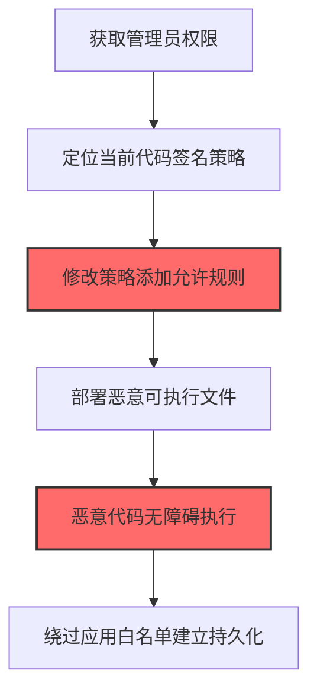
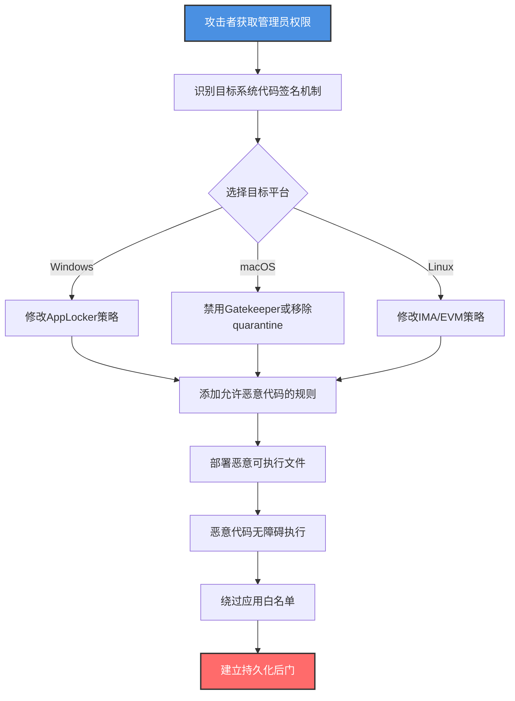

# 代码签名策略修改 (T1553.006)

## 一句话通俗理解

> **篡改Windows AppLocker/macOS Gatekeeper/Linux IMA等代码签名策略，让未经签名或攻击者签名的恶意代码畅通执行**

## 30秒速查卡

| 维度 | 你需要知道的 |
|------|-------------|
| 这是什么？ | 修改操作系统代码签名和应用白名单策略，绕过执行控制让恶意代码运行 |
| 为什么危险？ | 代码签名策略是企业应用控制的最后防线，篡改后等于关闭了"软件身份证检查站" |
| 谁需要关心？ | 终端安全团队、Windows/macOS系统管理员、合规审计员、SOC分析师 |
| 你的第一步防御 | 对AppLocker/WDAC/Gatekeeper策略文件启用完整性监控和版本控制 |
| 如果只做一件事 | 监控Set-AppLockerPolicy和spctl --disable命令调用 |

## 难度等级

⭐⭐⭐ 中级 - 需要理解各操作系统的代码签名和执行控制机制

## 前置知识检查

**读这个文件需要什么？**

- [ ] Windows AppLocker和WDAC（Windows Defender Application Control）工作原理
- [ ] macOS Gatekeeper、SIP（System Integrity Protection）和spctl工具
- [ ] Linux IMA（Integrity Measurement Architecture）和EVM（Extended Verification Module）
- [ ] 代码签名证书链和PKI基础

## 技术描述

**代码签名策略修改**（T1553.006）是 **颠覆信任控制**（T1553）的一个具体变体，属于 **防御削弱** 阶段的攻击技术。

> 📚 **打个比方**：想象机场的安检门只允许"持有效身份证"的人通过（代码签名策略）。攻击者做的事情是直接修改安检门的程序——让"任何身份证"都通过，或者把自己伪造的身份证加进白名单。这样一来，原本应当被拦截的"可疑物品"（恶意代码）就能畅通无阻地登机。

### 具体怎么理解？

各操作系统都提供代码签名和执行控制机制：

- **Windows**：AppLocker（基于路径/发布者/哈希的应用白名单）、WDAC（基于代码完整性的更强策略）
- **macOS**：Gatekeeper（基于Notarization和Developer ID的执行控制）、SIP（系统完整性保护）
- **Linux**：IMA/EVM（基于文件签名和扩展属性的完整性验证）

攻击者修改代码签名策略的方式包括：

1. **Windows AppLocker策略修改**：通过GPO或本地策略修改AppLocker规则，添加允许恶意代码执行的路径或哈希规则
2. **WDAC策略篡改**：修改WDAC的CIPolicy文件，添加恶意签名者或允许未签名代码
3. **macOS Gatekeeper绕过**：使用 `spctl --master-disable` 禁用Gatekeeper，或使用 `xattr -d com.apple.quarantine` 移除隔离标志
4. **Linux IMA/EVM策略修改**：修改 `/etc/ima/ima-policy` 文件，禁用签名验证或添加允许规则

### 为什么有效？

这种技术之所以有效，是因为：

1. **直接绕过应用白名单**：修改策略后，恶意代码不再被拦截，攻击者无需使用LOLBins或代码注入等绕过技术
2. **影响范围广**：通过GPO修改的AppLocker策略影响整个域的所有Windows主机
3. **隐蔽性强**：策略修改是合法管理操作，需要主动审计才能发现
4. **持久化效果**：修改后的策略在系统重启后依然生效，是一种隐蔽的持久化机制

**过渡段：** 不要误以为部署了AppLocker或WDAC就万事大吉——攻击者获取管理员权限后可以直接修改策略文件，把自己的恶意代码加进白名单。

## 真实攻击流程

### 典型场景

攻击者在 **防御削弱/执行** 阶段使用 代码签名策略修改 技术，以下是典型的攻击步骤：



**步骤详解：**

1. **获取管理员权限** - 攻击者通过提权或凭据窃取获得本地管理员或域管理员权限
2. **定位当前代码签名策略** - 查找AppLocker/WDAC/Gatekeeper策略文件位置
3. **修改策略添加允许规则** - 添加允许恶意代码执行的规则
4. **部署恶意可执行文件** - 将恶意EXE/DLL部署到允许路径
5. **恶意代码无障碍执行** - 由于策略允许，恶意代码不被拦截
6. **绕过应用白名单建立持久化** - 实现长期持久访问

## 攻击流程

### 典型攻击流程

获取管理员权限 --> 定位代码签名策略文件 --> 修改策略添加允许规则 --> 部署恶意代码到允许路径 --> 恶意代码无障碍执行 --> 实现持久化



**步骤详解：**

1. **攻击者获取管理员权限** - 通过提权漏洞或凭据窃取获得管理员
   - 通俗描述：先要拿到安检门的"管理员钥匙"
   - 技术细节：利用UAC绕过（T1548.002）、Pass-the-Hash、域管理员凭据窃取获得本地管理员或域管理员权限。修改AppLocker策略需要本地管理员，修改WDAC策略需要管理员+签名策略的更新权限
   - 常用工具：Mimikatz、Cobalt Strike、JuicyPotato

2. **识别目标系统代码签名机制** - 确定目标系统启用的应用控制
   - 通俗描述：搞清楚安检门是国产品牌还是进口品牌，型号是什么
   - 技术细节：检查 `Get-AppLockerPolicy -Effective -Xml` 获取当前AppLocker策略；检查 `C:\Windows\System32\CodeIntegrity\CiPolicies\Active\` 目录下的CIPolicy文件；在macOS执行 `spctl --status` 检查Gatekeeper状态；在Linux检查 `/etc/ima/ima-policy` 文件存在性
   - 常用工具：PowerShell AppLocker模块、spctl、ima-evm-utils

3. **修改AppLocker策略** - Windows环境下修改AppLocker规则
   - 通俗描述：在安检门的白名单里加上"凡是带XX标签的人都放行"
   - 技术细节：使用 `Set-AppLockerPolicy -XmlPolicy policy.xml` 修改策略，在 `<RuleCollection Type="Exe">` 中添加 `<FileHashRule>` 允许恶意EXE的哈希，或添加 `<FilePathRule Path="%SystemDrive%\Temp\*"/>` 允许Temp目录执行。也可修改GPO中的AppLocker策略影响整个域
   - 常用工具：Set-AppLockerPolicy、GPMC、New-AppLockerPolicy

4. **禁用Gatekeeper或移除quarantine** - macOS环境下绕过Gatekeeper
   - 通俗描述：直接把安检门的电源拔了，或者把每个旅客身上的"待检"标签撕掉
   - 技术细节：执行 `sudo spctl --master-disable` 全局禁用Gatekeeper；或对单个文件使用 `xattr -d com.apple.quarantine /path/to/app` 移除隔离属性；或修改 `/Library/Preferences/com.apple.security.GKApproval` 配置
   - 常用工具：spctl、xattr

5. **修改IMA/EVM策略** - Linux环境下修改IMA策略
   - 通俗描述：修改Linux系统的"完整性检查清单"，让可疑文件不被验证
   - 技术细节：修改 `/etc/ima/ima-policy` 文件，注释掉 `measure func=FILE_CHECK` 规则，或添加 `dont_measure fsmagic=0x9fa0` 跳过特定文件系统的测量。重新加载IMA策略需要重启或使用 `cat /etc/ima/ima-policy > /sys/kernel/security/ima/policy`
   - 常用工具：cat、evmctl

6. **添加允许恶意代码的规则** - 在策略中添加允许规则
   - 通俗描述：把恶意代码的"身份证号"加到白名单
   - 技术细节：例如在AppLocker中添加 `<FilePublisherRule>` 允许攻击者自签证书签发的代码，或添加 `<FilePathRule Path="%OSDRIVE%\Windows\Temp\payload.exe"/>` 允许特定路径
   - 常用工具：PowerShell、文本编辑器

7. **部署恶意可执行文件** - 将恶意代码放到允许路径
   - 通俗描述：把"违禁品"贴上白名单标签放到指定区域
   - 技术细节：将恶意EXE复制到AppLocker允许的路径如 `C:\Windows\Temp\` 或策略中允许的目录；在macOS将恶意app放到 `/Applications/` 后移除quarantine
   - 常用工具：Copy-Item、cp

8. **恶意代码无障碍执行** - 由于策略允许，执行不被拦截
   - 通俗描述：贴好标签的违禁品顺利通过安检
   - 技术细节：AppLocker对策略允许的路径/哈希直接放行，不再触发"被组策略阻止"事件（事件ID 8004）。WDAC对CIPolicy允许的签名者也直接放行
   - 常用工具：直接执行

9. **绕过应用白名单** - 实现原本被禁止的代码执行
   - 通俗描述：原本过不去的安检门，现在畅通无阻
   - 技术细节：策略修改后，攻击者可以运行任意EXE/PS1/DLL，无需依赖LOLBins或内存注入。后续载荷（如Cobalt Strike Beacon）可以直接以EXE形式运行
   - 常用工具：Cobalt Strike、自定义EXE

10. **建立持久化后门** - 利用宽松策略建立持久化
    - 通俗描述：在安检门里安了一个永远开启的"绿色通道"
    - 技术细节：在允许路径部署启动项（Run键、计划任务、服务），策略修改后这些持久化机制不再被拦截。即使被发现，由于策略已修改，蓝队清理后攻击者仍可重新植入
    - 常用工具：schtasks、sc.exe、reg.exe

## 真实案例

### 案例1：FIN7修改AppLocker策略部署后门（2020-2022）

- **时间**: 2020-2022年
- **目标**: 美国零售和餐饮企业
- **攻击组织**: FIN7（Carbanak Group）
- **手法**: 攻击者获取域管理员权限后，通过GPO修改AppLocker策略，在 `<RuleCollection Type="Exe">` 中添加 `<FilePathRule Path="%SystemDrive%\ProgramData\Updates\*"/>` 允许规则。随后将自定义后门EXE部署到 `C:\ProgramData\Updates\` 目录，绕过原本严格的AppLocker白名单
- **影响**: 后门持续运行超过8个月未被发现，窃取大量POS系统凭据
- **参考链接**: [US DoJ FIN7 Cases](https://www.justice.gov/opa/pr/seven-f7-hackers-charged)

### 案例2：Mac恶意软件绕过Gatekeeper（2021-2023）

- **时间**: 2021-2023年
- **目标**: macOS用户
- **攻击组织**: 多个macOS恶意软件开发者（Shlayer、Bundlore）
- **手法**: 攻击者通过伪造的Adobe Flash Player更新分发自签名的macOS应用。用户被诱导执行 `sudo spctl --master-disable` 禁用Gatekeeper，或攻击者利用 `xattr -d com.apple.quarantine` 移除隔离属性绕过Notarization检查
- **影响**: 大量macOS设备被植入广告软件和信息窃取程序
- **参考链接**: [Jamf Threat Labs Shlayer Analysis](https://www.jamf.com/blog/shlayer-malware-analysis/)

### 案例3：勒索软件组织篡改WDAC策略（2023）

- **时间**: 2023年
- **目标**: 制造业和医疗行业
- **攻击组织**: BlackCat/ALPHV勒索软件团伙
- **手法**: 攻击者获取管理员权限后，修改WDAC CIPolicy文件 `C:\Windows\System32\CodeIntegrity\CiPolicies\Active\{GUID}.cip`，在 `<SigningScenario>` 中添加 `<Allow ID="ALLOW_BACKDOOR" FriendlyName="Maintenance Tool" Hash="..."/>` 规则，允许勒索软件EXE执行。绕过原本阻止未签名代码的WDAC策略
- **影响**: 勒索软件成功执行，加密数千台服务器
- **参考链接**: [Microsoft BlackCat Analysis](https://www.microsoft.com/en-us/security/blog/2023/05/09/blackcat-ransomware/)

### 案例4：APT29修改Linux IMA策略（2022）

- **时间**: 2022年
- **目标**: 欧洲政府机构Linux服务器
- **攻击组织**: APT29（Cozy Bear）
- **手法**: 攻击者通过零日漏洞获取root权限后，修改 `/etc/ima/ima-policy` 文件注释掉 `appraise func=FILE_CHECK` 规则，禁用IMA文件完整性验证。随后部署自定义rootkit和后门，绕过原本的IMA完整性检查
- **影响**: 多个政府机构Linux服务器被长期控制
- **参考链接**: [Mandiant APT29 Report](https://www.mandiant.com/resources/blog/unc2452-nobelium)

## 红队视角

> ⚠️ **免责声明**：以下内容仅用于合法的安全测试、渗透测试和教育目的。未经授权对他人系统进行测试是违法行为。

### 实战技巧

1. **优先修改GPO而非本地策略**：通过GPO修改的AppLocker策略影响整个域，可在多台主机上同时绕过
2. **使用文件路径规则而非哈希规则**：哈希规则需要每个新版本更新策略，路径规则一劳永逸
3. **添加到合法路径**：在AppLocker中添加 `C:\Windows\*` 等合法路径规则，避免被审计发现异常路径
4. **macOS组合使用xattr**：相比 `spctl --master-disable`，对单个文件使用 `xattr -d com.apple.quarantine` 更隐蔽

### 常用工具

| 工具名称 | 用途 | 平台 | 链接 |
| -------- | ---- | ---- | ---- |
| Set-AppLockerPolicy | PowerShell AppLocker策略管理 | Windows | Windows内置 |
| GPMC | Group Policy Management Console | Windows | RSAT内置 |
| WDAC Policy Wizard | WDAC策略图形化工具 | Windows | [WDAC Wizard](https://webapp-wdac-wizard.azurewebsites.net/) |
| spctl | macOS Gatekeeper控制 | macOS | macOS内置 |
| xattr | macOS扩展属性管理 | macOS | macOS内置 |
| evmctl | Linux IMA/EVM管理 | Linux | [ima-evm-utils](https://sourceforge.net/projects/linux-ima/) |

### 注意事项

- 在授权的测试环境中使用这些技术
- 修改GPO后立即恢复，避免影响生产环境
- 注意Windows 11对WDAC策略修改的额外保护（CI Policy签名）
- macOS修改SIP保护路径需要先禁用SIP（恢复模式）

## 蓝队视角

### 检测要点

1. **策略文件完整性监控**：使用AIDE或Sysmon监控AppLocker/WDAC策略文件修改
2. **PowerShell命令监控**：监控 `Set-AppLockerPolicy`、`New-AppLockerPolicy` 命令调用
3. **macOS Gatekeeper状态监控**：定期检查 `spctl --status` 输出，告警禁用状态
4. **Linux IMA策略监控**：监控 `/etc/ima/ima-policy` 文件修改

### 监控建议

- 部署Sysmon Event ID 11（文件创建）监控 `C:\Windows\System32\AppLocker\` 和 `C:\Windows\System32\CodeIntegrity\` 目录
- 配置PowerShell Script Block Logging，监控 `Set-AppLockerPolicy` 和 `Set-RuleOption` 命令
- macOS使用jamf或MDM监控Gatekeeper状态
- Linux使用auditd监控 `/etc/ima/` 目录修改

## 避坑指南

防御监测盲区：仅关注应用白名单拦截事件（事件ID 8004），忽视了策略文件本身的修改。

## 检测建议

### 检测思路

检测 代码签名策略修改 的关键是监控策略文件修改和管理命令调用。以下是三个层面的检测方法：

### 网络层检测

**方法**：监控域控GPO更新和macOS MDM通信

```powershell
# 检测GPO更新传播
Get-WinEvent -FilterHashtable @{LogName='Security'; Id=5136} | 
    Where-Object { $_.Message -match 'AppLocker' }
```

### 主机层检测

**Windows事件ID**：
- 事件ID 4663：对象访问（监控策略文件修改）
- 事件ID 4688：进程创建（监控Set-AppLockerPolicy调用）
- 事件ID 4104：PowerShell脚本执行（监控策略管理命令）
- 事件ID 8004：AppLocker拦截事件（监控拦截是否消失）

**Sysmon事件ID**：
- 事件ID 11：文件创建（监控AppLocker/WDAC策略目录）

**Sigma规则示例**：

```yaml
title: 检测AppLocker策略修改
status: experimental
description: 检测AppLocker策略文件修改或Set-AppLockerPolicy命令调用，可能是攻击者篡改策略
references:
    - https://attack.mitre.org/techniques/T1553/006/
    - https://attack.stealthbits.com/modify-applocker-policy
logsource:
    product: windows
    service: security
detection:
    selection_file_modify:
        EventID: 4663
        ObjectName|contains:
            - '\AppLocker\'
            - '\CodeIntegrity\CiPolicies\Active\'
    selection_powershell:
        EventID: 4104
        ScriptBlock|contains:
            - 'Set-AppLockerPolicy'
            - 'New-AppLockerPolicy'
            - 'Set-RuleOption'
    selection_process:
        EventID: 4688
        CommandLine|contains:
            - 'Set-AppLockerPolicy'
            - 'CiTool.exe'
    condition: selection_file_modify or selection_powershell or selection_process
fields:
    - SubjectUserName
    - ObjectName
    - ScriptBlock
    - CommandLine
falsepositives:
    - 合法的AppLocker策略更新（应严格审批）
    - 系统管理员调整WDAC策略
level: high
tags:
    - attack.defense_evasion
    - attack.t1553.006
```

**Sigma规则示例 - 检测macOS Gatekeeper禁用**：

```yaml
title: 检测macOS Gatekeeper禁用
status: experimental
description: 检测spctl --master-disable或xattr移除quarantine属性
logsource:
    product: macos
    service: process_creation
detection:
    selection_spctl:
        ProcessName|endswith: '/spctl'
        CommandLine|contains: 'master-disable'
    selection_xattr:
        ProcessName|endswith: '/xattr'
        CommandLine|contains:
            - 'com.apple.quarantine'
            - '-d'
    condition: selection_spctl or selection_xattr
fields:
    - ProcessName
    - CommandLine
    - User
level: medium
tags:
    - attack.defense_evasion
    - attack.t1553.006
```

### 应用层检测

**用人话说：** 攻击者获取管理员权限后，修改Windows的AppLocker或WDAC策略文件，添加允许恶意代码执行的规则。这样原本被白名单拦截的恶意EXE就能畅通执行。在macOS上，攻击者会用 `spctl --master-disable` 禁用Gatekeeper，或用 `xattr -d com.apple.quarantine` 移除文件的隔离属性。如果发现AppLocker策略文件被修改、PowerShell `Set-AppLockerPolicy` 命令调用，或macOS Gatekeeper被禁用，就要警惕——可能是攻击者在篡改代码签名策略。

## 缓解措施

### 优先级1：关键措施

**启用WDAC策略签名**：使用签名策略保护WDAC CIPolicy文件，防止未授权修改

```powershell
# 创建签名要求策略
$signedPolicy = New-CIPolicy -Level Publisher -FilePath C:\temp\signed.xml -UserPEs
ConvertFrom-CIPolicy -XmlFilePath C:\temp\signed.xml -BinaryFilePath C:\temp\signed.cip
# 使用代码签名证书签名策略
signtool.exe sign /a /fd SHA256 /v C:\temp\signed.cip
```

### 优先级2：重要措施

**部署策略文件完整性监控**：

```powershell
# AIDE配置示例 - 监控AppLocker和WDAC策略文件
$AideConfig = @"
C:\Windows\System32\AppLocker  p+i+n+u+g+s+m+sha256
C:\Windows\System32\CodeIntegrity  p+i+n+u+g+s+m+sha256
"@
Set-Content -Path "C:\Program Files\Aide\etc\aide.conf" -Value $AideConfig -Append
```

### 优先级3：建议措施

**macOS启用MDM管理Gatekeeper**：

```bash
# 通过MDM部署Gatekeeper强制启用配置
# Configuration Profile:
# com.apple.security.GKApproval = 1
# com.apple.security.GKAutoRearm = 0
```

## 动手实验

> ⚠️ **所有实验必须在隔离的实验室环境中进行**

### 实验1：理解AppLocker策略（初级）

**目标**：理解Windows AppLocker策略文件结构和规则

**步骤**：
1. 在隔离的Windows 10/11虚拟机中查看当前AppLocker策略：
   ```powershell
   Get-AppLockerPolicy -Effective -Xml | Out-File C:\temp\current_policy.xml
   notepad C:\temp\current_policy.xml
   ```
2. 分析 `<RuleCollection Type="Exe">` 中的规则类型（FilePathRule、FilePublisherRule、FileHashRule）
3. 查看AppLocker策略文件位置：
   ```powershell
   Get-ChildItem C:\Windows\System32\AppLocker\
   ```

**学习要点**：理解AppLocker策略文件格式

### 实验2：修改AppLocker策略绕过白名单（中级）

**目标**：模拟攻击者修改AppLocker策略允许恶意代码

**步骤**：
1. 启用AppLocker严格策略阻止Temp目录执行：
   ```powershell
   $policy = @"
   <RuleCollection Type="Exe" EnforcementMode="Enabled">
       <FilePathRule Path="C:\Windows\Temp\*" Action="Deny" />
       <FilePathRule Path="*" Action="Allow" />
   </RuleCollection>
   "@
   Set-AppLockerPolicy -XmlPolicy $policy
   ```
2. 验证Temp目录EXE被阻止：
   ```powershell
   Copy-Item C:\Windows\System32\cmd.exe C:\Windows\Temp\test.exe
   C:\Windows\Temp\test.exe  # 应被阻止
   ```
3. 修改策略添加允许规则：
   ```powershell
   $modifiedPolicy = @"
   <RuleCollection Type="Exe" EnforcementMode="Enabled">
       <FilePathRule Path="C:\Windows\Temp\*" Action="Allow" />
       <FilePathRule Path="*" Action="Allow" />
   </RuleCollection>
   "@
   Set-AppLockerPolicy -XmlPolicy $modifiedPolicy
   ```
4. 验证Temp目录EXE现在可以执行

**学习要点**：掌握AppLocker策略修改方法

### 实验3：部署策略完整性监控（高级）

**目标**：部署检测规则监控AppLocker策略修改

**步骤**：
1. 配置Sysmon监控AppLocker目录：
   ```xml
   <!-- Sysmon配置 -->
   <RuleGroup name="AppLocker Policy Monitoring" groupRelation="or">
       <FileCreate onmatch="include">
           <TargetFilename condition="contains">\AppLocker\</TargetFilename>
       </FileCreate>
   </RuleGroup>
   ```
2. 部署Sigma规则到SIEM
3. 模拟攻击：修改AppLocker策略
4. 验证告警触发

**学习要点**：掌握策略修改检测方法

## 术语解释

| 术语 | 通俗解释 |
|------|---------|
| **AppLocker** | Windows应用白名单功能，基于路径/发布者/哈希控制应用执行 |
| **WDAC** | Windows Defender Application Control，基于代码完整性的更强策略 |
| **CIPolicy** | WDAC策略文件，.cip格式，存储在CodeIntegrity目录 |
| **Gatekeeper** | macOS的应用执行控制，基于Notarization和Developer ID |
| **SIP** | System Integrity Protection，macOS系统完整性保护 |
| **spctl** | macOS Gatekeeper控制命令行工具 |
| **IMA** | Integrity Measurement Architecture，Linux完整性测量架构 |
| **EVM** | Extended Verification Module，Linux扩展验证模块 |

## 被引用情况

以下父技术文档引用了本子技术：

- [T1553 - 颠覆信任控制](../T1553-Subvert-Trust-Controls.md)

## 参考资料

### 官方文档

- [MITRE ATT&CK - Code Signing Policy Modification (T1553.006)](https://attack.mitre.org/techniques/T1553/006/)
- [MITRE ATT&CK - Subvert Trust Controls (T1553)](https://attack.mitre.org/techniques/T1553/)
- [Microsoft - AppLocker Overview](https://learn.microsoft.com/en-us/windows/security/threat-protection/windows-defender-application-control/applocker/applocker-overview)
- [Apple - Gatekeeper and Runtime Protection](https://support.apple.com/en-us/HT202491)

### 安全报告

- [Stealthbits - Modify AppLocker Policy](https://attack.stealthbits.com/modify-applocker-policy) - AppLocker策略篡改分析
- [Microsoft - BlackCat Ransomware](https://www.microsoft.com/en-us/security/blog/2023/05/09/blackcat-ransomware/) - BlackCat篡改WDAC分析
- [Jamf - Shlayer Malware Analysis](https://www.jamf.com/blog/shlayer-malware-analysis/) - macOS Gatekeeper绕过

### 工具与资源

- [WDAC Policy Wizard](https://webapp-wdac-wizard.azurewebsites.net/) - WDAC策略图形化工具
- [Atomic Red Team T1553.006](https://github.com/redcanaryco/atomic-red-team/blob/master/atomics/T1553.006/T1553.006.yaml) - 检测规则测试
- [MITRE ATT&CK Navigator](https://mitre-attack.github.io/attack-navigator/) - ATT&CK可视化工具

### 学习资料

- [Microsoft WDAC Documentation](https://learn.microsoft.com/en-us/windows/security/threat-protection/windows-defender-application-control/) - WDAC官方文档
- [Apple Platform Security Guide](https://support.apple.com/guide/security/welcome/web) - macOS安全指南
