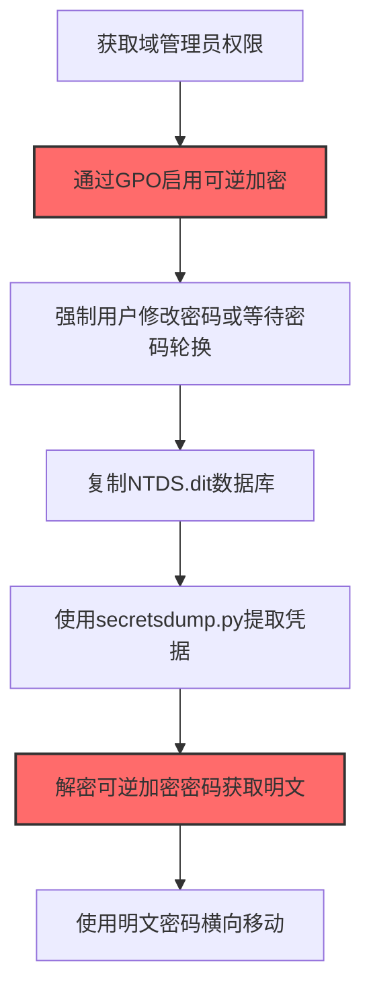
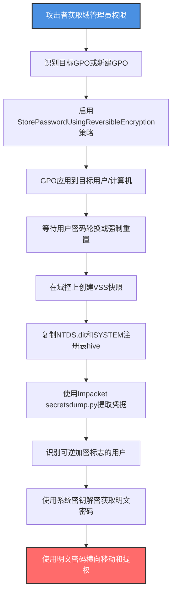

# 可逆加密 (T1556.005)

## 一句话通俗理解

> **修改Windows组策略启用密码可逆加密，把存储的密码哈希变成可逆原文，轻松还原明文密码**

## 30秒速查卡

| 维度 | 你需要知道的 |
|------|-------------|
| 这是什么？ | 修改Windows组策略启用"使用可逆加密存储密码"，将密码哈希变为可解密的密文 |
| 为什么危险？ | 一旦启用，攻击者可以从AD/本地SAM中直接解密出明文密码，无需破解哈希 |
| 谁需要关心？ | Active Directory管理员、域安全审计员、合规检查员、蓝队分析师 |
| 你的第一步防御 | 定期审计Group Policy和用户UserAccountControl标志，检测可逆加密启用 |
| 如果只做一件事 | 在域控上定期扫描Get-ADUser -Filter {UserAccountControl -band 0x20000}检测启用账户 |

## 难度等级

⭐⭐⭐ 中级 - 需要理解Windows密码存储机制和Active Directory管理

## 前置知识检查

**读这个文件需要什么？**

- [ ] Windows密码存储机制（NTLM哈希、可逆加密）
- [ ] Active Directory用户属性（UserAccountControl标志位）
- [ ] Group Policy工作原理和密码策略配置
- [ ] PowerShell AD模块（Get-ADUser、Set-ADAccountControl）

## 技术描述

**可逆加密**（T1556.005）是 **修改认证流程**（T1556）的一个具体变体，属于 **防御削弱** 阶段的攻击技术。

> 📚 **打个比方**：想象银行保险柜的密码锁原本是把客户密码用单向函数"打碎"存储——即使保险柜被撬开，也只能看到打碎后的"碎渣"无法还原原密码。可逆加密就相当于让银行换了一种锁——密码用"可还原"的方式加密，谁拿到保险柜里的密文，配上银行的"万能钥匙"就能还原成原密码。攻击者做的事情就是偷偷把银行的锁换成"可逆加密"版，然后撬开保险柜把所有客户密码原文取出。

### 具体怎么理解？

Windows默认使用单向哈希（NTLM哈希）存储用户密码——这是一种"无法从哈希反推密码"的设计。但Windows也提供一种"可逆加密"选项（StorePasswordUsingReversibleEncryption），将密码用RC4加密存储，系统持有解密密钥。

攻击者修改可逆加密的方式包括：

1. **修改组策略启用全局可逆加密**：通过Group Policy Object（GPO）启用"密码必须使用可逆加密存储"策略，影响所有受该GPO管理的用户
2. **针对特定用户启用可逆加密**：通过 `Set-ADAccountControl -AllowReversiblePasswordEncryption $true` 为特定用户启用可逆加密
3. **修改注册表启用可逆加密**：通过修改 `HKLM\SYSTEM\CurrentControlSet\Control\Lsa` 下的相关键值启用

启用后，攻击者通过以下方式获取明文密码：
- 从NTDS.dit（域控数据库）提取启用可逆加密的用户凭据
- 使用 `ntdsutil` 或 `Impacket secretsdump.py` 解密可逆加密的密码
- 从本地SAM数据库提取并解密

### 为什么有效？

这种技术之所以有效，是因为：

1. **绕过哈希破解**：可逆加密的密码无需破解，使用系统持有的密钥即可直接解密为明文，大幅缩短攻击时间
2. **影响范围广**：通过GPO修改可影响整个域的所有用户
3. **隐蔽性强**：默认情况下Windows不会告警，需要主动审计才能发现
4. **持久化效果**：修改后所有新密码和密码修改都会以可逆方式存储，攻击者后续随时可解密

**过渡段：** 不要误以为NTLM哈希不可逆就安全——攻击者只要启用"可逆加密"选项，密码哈希就会变成可解密的密文，配合从NTDS.dit提取的数据，所有用户明文密码唾手可得。

## 真实攻击流程

### 典型场景

攻击者在 **防御削弱/凭据访问** 阶段使用 可逆加密 技术，以下是典型的攻击步骤：



**步骤详解：**

1. **获取域管理员权限** - 攻击者通过Kerberoasting、Pass-the-Hash等获得DA权限
2. **通过GPO启用可逆加密** - 修改组策略启用"使用可逆加密存储密码"
3. **强制用户修改密码或等待密码轮换** - 触发密码以可逆方式重新存储
4. **复制NTDS.dit数据库** - 使用ntdsutil或vssadmin提取域数据库
5. **使用secretsdump.py提取凭据** - 使用Impacket工具解析NTDS.dit
6. **解密可逆加密密码获取明文** - 利用系统密钥解密
7. **使用明文密码横向移动** - 用明文密码访问其他系统

## 攻击流程

### 典型攻击流程

获取域管理员权限 --> 修改GPO启用可逆加密 --> 等待密码轮换或强制重置 --> 提取NTDS.dit --> 使用Impacket解密 --> 获取所有用户明文密码



**步骤详解：**

1. **攻击者获取域管理员权限** - 通过Kerberoasting、AS-REP Roasting、Pass-the-Hash、黄金票据等攻击获得DA
   - 通俗描述：先要拿到银行"分行长"权限才能改保险柜锁
   - 技术细节：使用Rubeus执行Kerberoasting提取服务账户TGS票据，离线破解获取明文密码；或使用Mimikatz执行DCSync（`lsadump::dcsync /user:krbtgt`）获取krbtgt哈希，构造黄金票据
   - 常用工具：Rubeus、Mimikatz、Impacket、CrackMapExec

2. **识别目标GPO或新建GPO** - 找到合适的GPO或创建新GPO
   - 通俗描述：找到银行规定密码锁类型的"规章制度"，或者新拟一份
   - 技术细节：使用 `Get-GPO -All` 查看现有GPO，或使用 `New-GPO -Name "Security Baseline Update"` 创建新GPO。链接到Domain级别（`New-GPLink -Target "DC=corp,DC=local"`）影响所有用户
   - 常用工具：Group Policy Management Console (GPMC)、PowerShell GPO模块

3. **启用StorePasswordUsingReversibleEncryption策略** - 修改GPO启用可逆加密
   - 通俗描述：在规章制度里加一条"所有密码锁必须用可还原加密版"
   - 技术细节：通过GPO路径 `Computer Configuration > Windows Settings > Security Settings > Account Policies > Password Policy > Store passwords using reversible encryption` 启用，或直接修改 `\\<domain>\SysVol\<domain>\Policies\{GUID}\Machine\Microsoft\Windows NT\SecEdit\GptTmpl.inf` 中的 `PasswordComplexity=1` 改为 `ClearTextPassword=1`
   - 常用工具：GPMC、PowerShell Set-GPRegistryValue

4. **GPO应用到目标用户/计算机** - 等待GPO刷新或手动刷新
   - 通俗描述：规章制度下发到各分行，新锁开始安装
   - 技术细节：GPO默认每90分钟刷新一次，可使用 `gpupdate /force` 立即刷新。域控上的GPO默认5分钟刷新一次
   - 常用工具：gpupdate

5. **等待用户密码轮换或强制重置** - 已有密码仍以NTLM哈希存储，需密码修改后才会以可逆方式重新存储
   - 通俗描述：旧密码还是用旧锁存的，要等员工换密码才会用新锁
   - 技术细节：可通过修改密码策略"最长密码寿命"为1天强制用户次日修改密码，或对特定用户执行 `Set-ADAccountPassword -Identity user -Reset` 强制重置。用户修改密码后，新密码将以可逆方式加密存储在NTDS.dit
   - 常用工具：Set-ADAccountPassword、net user

6. **在域控上创建VSS快照** - 使用卷影拷贝绕过NTDS.dit文件锁
   - 通俗描述：趁夜深把保险柜整体复印一份，避免直接撬动被察觉
   - 技术细节：使用 `vssadmin create shadow /for=C:` 创建VSS快照，从 `\\?\GLOBALROOT\Device\HarddiskVolumeShadowCopy1\Windows\NTDS\NTDS.dit` 复制NTDS.dit，同时复制 `\\?\GLOBALROOT\Device\HarddiskVolumeShadowCopy1\Windows\System32\config\SYSTEM` 用于获取解密密钥
   - 常用工具：vssadmin、ntdsutil、Invoke-NinjaCopy

7. **复制NTDS.dit和SYSTEM注册表hive** - 提取域数据库和系统密钥
   - 通俗描述：把保险柜和"万能钥匙"一起搬走
   - 技术细节：NTDS.dit包含所有域用户凭据哈希和可逆加密密码，SYSTEM hive包含用于解密的BootKey（syskey）。两者结合才能解密NTDS.dit
   - 常用工具：copy、Copy-Item

8. **使用Impacket secretsdump.py提取凭据** - 解析NTDS.dit获取所有凭据
   - 通俗描述：用万能钥匙打开保险柜，把所有客户密码拿出来
   - 技术细节：执行 `secretsdump.py -ntds NTDS.dit -system SYSTEM LOCAL` 提取所有用户凭据。输出包括NTLM哈希、Kerberos密钥、可逆加密密码（如有）
   - 常用工具：Impacket secretsdump.py、DSInternals

9. **识别可逆加密标志的用户** - 筛选启用可逆加密的用户
   - 通俗描述：找出哪些客户的密码用了"可还原锁"
   - 技术细节：secretsdump.py输出中可逆加密密码会单独列出，标记为" reversible encryption"。也可使用 `Get-ADUser -Filter {UserAccountControl -band 0x20000}` 查询启用用户。UserAccountControl标志0x20000 = ADS_UF_ENCRYPTED_TEXT_PASSWORD_ALLOWED
   - 常用工具：PowerShell AD模块、Impacket

10. **使用系统密钥解密获取明文密码** - 使用BootKey解密可逆加密的密码
    - 通俗描述：用万能钥匙把"可还原锁"打开，拿到原始密码
    - 技术细节：Windows可逆加密使用RC4算法，密钥为用户的RID（相对ID）+ BootKey派生。secretsdump.py自动完成解密，输出明文密码
    - 常用工具：Impacket、Mimikatz

11. **使用明文密码横向移动和提权** - 利用明文密码访问其他系统
    - 通俗描述：拿着客户原密码可以畅通无阻地访问其他分行系统
    - 技术细节：明文密码可用于：直接登录其他系统（避免Pass-the-Hash痕迹）、访问加密文件（EFS）、VPN/Exchange等需要明文密码的服务、绕过NTLMv2会话签名限制
    - 常用工具：CrackMapExec、Rubeus、Mimikatz

## 真实案例

### 案例1：FIN7攻击零售商启用可逆加密（2020-2021）

- **时间**: 2020-2021年
- **目标**: 美国零售商和餐饮企业
- **攻击组织**: FIN7（Carbanak Group）
- **手法**: 攻击者通过钓鱼邮件获取初始访问，利用ZeroLogon（CVE-2020-1472）提权到域管理员。随后修改GPO启用"使用可逆加密存储密码"，强制用户密码轮换。一周后通过VSS快照提取NTDS.dit，使用secretsdump.py解密获取所有用户明文密码
- **影响**: 攻击者获取企业所有员工明文密码，横向移动到POS系统窃取数百万张信用卡数据
- **参考链接**: [US DoJ FIN7 Indictment](https://www.justice.gov/opa/pr/seven-f7-hackers-charged)

### 案例2：SUNBURST后可逆加密滥用（2021 SolarWinds事件后续）

- **时间**: 2021年
- **目标**: SolarWinds供应链攻击受害者
- **攻击组织**: NOBELIUM（APT29，Cozy Bear）
- **手法**: 攻击者通过SUNBURST后门获取初始访问，在横向移动到域控后，对特定高价值账户（IT管理员、C级别高管）单独启用可逆加密（`Set-ADAccountControl -AllowReversiblePasswordEncryption $true`），避免全局修改GPO引起注意。等待密码轮换后提取明文密码用于访问Azure AD和O365
- **影响**: 多个政府机构和财富500强企业的高管邮箱被入侵
- **参考链接**: [CISA Emergency Directive 21-01](https://www.cisa.gov/news-events/directives/emergency-directive-21-01)

### 案例3：Ryuk勒索软件启用可逆加密加速横向移动（2020）

- **时间**: 2020年
- **目标**: 医疗和制造业组织
- **攻击组织**: Ryuk/Conti运营团伙
- **手法**: 攻击者获取域管理员权限后，通过GPO启用可逆加密策略，并强制所有用户在下次登录时修改密码。攻击者快速提取NTDS.dit解密获取大量明文密码，加速横向移动
- **影响**: 多家医院因勒索攻击被迫关闭急诊服务
- **参考链接**: [CISA Ryuk Ransomware Report](https://www.cisa.gov/news-events/cybersecurity-advisories/aa20-302a)

### 案例4：Red Team评估中发现可逆加密启用（2023）

- **时间**: 2023年
- **目标**: 金融机构红队评估
- **攻击组织**: 红队
- **手法**: 红队获取DA权限后，模拟FIN7攻击链：修改GPO启用可逆加密，强制密码轮换，48小时后提取NTDS.dit解密获取所有用户明文密码
- **影响**: 验证了组织对可逆加密滥用的检测盲点，推动部署GPO审计
- **参考链接**: [SpecterOps Active Directory Attacks](https://posts.specterops.io/)

## 红队视角

> ⚠️ **免责声明**：以下内容仅用于合法的安全测试、渗透测试和教育目的。未经授权对他人系统进行测试是违法行为。

### 实战技巧

1. **优先对特定用户启用而非全局GPO**：全局GPO修改易被审计发现，针对高价值账户单独启用 `Set-ADAccountControl -AllowReversiblePasswordEncryption $true` 更隐蔽
2. **配合密码轮换策略**：已有密码仍以NTLM哈希存储，需要修改密码后才会以可逆方式存储。可修改"最长密码寿命"为1天强制用户改密码
3. **快速提取NTDS.dit**：使用 `Invoke-NinjaCopy` 绕过文件锁，或使用 `ntdsutil "ac i ntds" ifm "create full C:\temp" q q` 创建IFM媒体
4. **避免触发告警**：在域控上创建VSS快照会触发Event ID 4662（对象访问），可在低峰期操作或使用DCSync替代（`lsadump::dcsync /domain:corp.local /all`）

### 常用工具

| 工具名称 | 用途 | 平台 | 链接 |
| -------- | ---- | ---- | ---- |
| Impacket secretsdump.py | NTDS.dit解析和密码解密 | 跨平台 | [Impacket](https://github.com/fortra/impacket) |
| Mimikatz | Windows凭据提取 | Windows | [Mimikatz](https://github.com/gentilkiwi/mimikatz) |
| DSInternals | PowerShell AD凭据操作 | Windows | [DSInternals](https://github.com/MichaelGrafnetter/DSInternals) |
| ntdsutil | Windows内置NTDS.dit管理工具 | Windows | 系统内置 |
| Invoke-NinjaCopy | 绕过文件锁复制NTDS.dit | Windows | [PowerSploit](https://github.com/PowerShellMafia/PowerSploit) |
| Group Policy Management Console | GPO管理 | Windows | RSAT内置 |

### 注意事项

- 在授权的测试环境中使用这些技术
- 修改GPO后立即恢复，避免影响生产环境密码策略
- 提取NTDS.dit时注意触发4662事件
- 注意某些合规要求（PCI-DSS、HIPAA）禁止启用可逆加密

## 蓝队视角

### 检测要点

1. **GPO审计**：监控Group Policy中"密码策略"的修改，特别是StorePasswordUsingReversibleEncryption启用
2. **UserAccountControl标志审计**：定期扫描启用0x20000标志（ADS_UF_ENCRYPTED_TEXT_PASSWORD_ALLOWED）的用户
3. **VSS快照监控**：监控域控上 `vssadmin create shadow` 命令调用
4. **NTDS.dit访问监控**：监控域控上对NTDS.dit文件的异常读取

### 监控建议

- 部署AD审计工具（如BloodHound、ManageEngine ADAudit Plus），实时告警GPO修改
- 配置PowerShell脚本定期扫描可逆加密用户：
  ```powershell
  Get-ADUser -Filter {UserAccountControl -band 0x20000} -Properties UserAccountControl
  ```
- 监控域控上Event ID 4662（对象访问）和4670（权限修改）
- 监控 `vssadmin create shadow` 和 `ntdsutil` 调用

## 避坑指南

防御监测盲区：仅关注NTLM哈希提取和Pass-the-Hash，忽视了可逆加密启用后密码可直接解密的攻击路径。

## 检测建议

### 检测思路

检测 可逆加密滥用 的关键是监控GPO修改和UserAccountControl标志变化。以下是三个层面的检测方法：

### 网络层检测

**方法**：监控域控RPC/SMB异常访问

```bash
# 检测从非域控主机到域控的NTDS.dit访问
# 使用Wireshark或Zeek监控SMB流量
# 关注大量文件读取模式的SMB请求
```

### 主机层检测

**Windows事件ID**：
- 事件ID 5136：目录服务对象修改（监控GPO修改）
- 事件ID 4662：对象访问（监控NTDS.dit读取）
- 事件ID 4723：尝试修改密码（监控密码轮换）
- 事件ID 4688：进程创建（监控vssadmin、ntdsutil调用）

**PowerShell检测**：

```powershell
# 检测启用可逆加密的用户
Get-ADUser -Filter {UserAccountControl -band 0x20000} -Properties UserAccountControl,LastLogonDate | 
    Select-Object Name,SamAccountName,UserAccountControl,LastLogonDate

# 检测GPO中可逆加密策略
Get-GPOReport -All -ReportType Xml | Select-String "ClearTextPassword"

# 检测最近修改的GPO
Get-GPO -All | Where-Object { $_.ModificationTime -gt (Get-Date).AddDays(-7) } | 
    Select-Object DisplayName,ModificationTime
```

### 应用层检测

**用人话说：** 攻击者获取域管理员权限后，修改Group Policy启用"使用可逆加密存储密码"策略。这样用户修改密码后，新密码会用RC4加密存储（而不是单向哈希），攻击者从NTDS.dit提取后可以直接解密出明文密码，无需破解。如果发现GPO中"StorePasswordUsingReversibleEncryption"被启用，或者某些用户的UserAccountControl标志包含0x20000（可逆加密允许），就要警惕——可能攻击者在准备提取明文密码。

**Sigma规则示例**：

```yaml
title: 检测启用可逆加密存储密码的GPO修改
status: experimental
description: 检测Group Policy中StorePasswordUsingReversibleEncryption策略启用，可能是攻击者准备提取明文密码
references:
    - https://attack.mitre.org/techniques/T1556/005/
    - https://attack.stealthbits.com/manipulate-user-password-behavior
logsource:
    product: windows
    service: security
detection:
    selection_gpo_modify:
        EventID: 5136
        AttributeValue: 'ClearTextPassword=1'
    selection_vssadmin:
        EventID: 4688
        NewProcessName|endswith: '\vssadmin.exe'
        CommandLine|contains: 'create shadow'
    selection_ntdsutil:
        EventID: 4688
        NewProcessName|endswith: '\ntdsutil.exe'
    condition: selection_gpo_modify or selection_vssadmin or selection_ntdsutil
fields:
    - SubjectUserName
    - SubjectUserSid
    - CommandLine
    - ObjectDN
falsepositives:
    - 合法的密码策略调整（应严格审批）
    - 系统管理员使用ntdsutil创建IFM
level: high
tags:
    - attack.credential_access
    - attack.t1556.005
    - attack.defense_evasion
```

**Sigma规则示例 - 检测特定用户启用可逆加密**：

```yaml
title: 检测用户账户启用可逆加密标志
status: experimental
description: 检测UserAccountControl标志被修改为包含ADS_UF_ENCRYPTED_TEXT_PASSWORD_ALLOWED(0x20000)
logsource:
    product: windows
    service: security
detection:
    selection_uac_modify:
        EventID: 4720  # 用户账户创建
        UserAccountControl|contains: '0x20000'
    selection_uac_change:
        EventID: 4738  # 用户账户修改
        UserAccountControl|contains: '0x20000'
    selection_powershell:
        EventID: 4104
        ScriptBlock|contains|all:
            - 'Set-ADAccountControl'
            - 'AllowReversiblePasswordEncryption'
            - '$true'
    condition: selection_uac_modify or selection_uac_change or selection_powershell
fields:
    - SubjectUserName
    - TargetUserName
    - UserAccountControl
    - ScriptBlock
level: high
tags:
    - attack.credential_access
    - attack.t1556.005
```

## 缓解措施

### 优先级1：关键措施

**禁用并审计可逆加密**：禁用GPO中的可逆加密策略，定期审计启用用户

```powershell
# 检查并禁用GPO中的可逆加密
$gpo = Get-GPO -Name "Default Domain Policy"
Set-GPRegistryValue -Guid $gpo.Id -Key "HKLM\Software\Policies\Microsoft\Windows\System" -ValueName "AllowReversiblePasswordEncryption" -Type DWord -Value 0

# 批量禁用所有启用可逆加密的用户
Get-ADUser -Filter {UserAccountControl -band 0x20000} | ForEach-Object {
    Set-ADAccountControl -Identity $_ -AllowReversiblePasswordEncryption $false
}
```

### 优先级2：重要措施

**部署AD审计工具**：使用BloodHound或ADAudit Plus监控GPO和用户属性变更

```powershell
# 定期扫描启用可逆加密的用户（建议每天运行）
$scheduledScript = @'
Get-ADUser -Filter {UserAccountControl -band 0x20000} -Properties UserAccountControl |
    Export-Csv "C:\Audit\ReversibleEncryption_$(Get-Date -Format 'yyyyMMdd').csv"
'@
Register-ScheduledTask -TaskName "Audit Reversible Encryption" -Trigger (New-ScheduledTaskTrigger -Daily -At 3am) -Action (New-ScheduledTaskAction -Execute "powershell.exe" -Argument "-Command $scheduledScript")
```

### 优先级3：建议措施

**加强域控监控**：监控NTDS.dit访问和VSS快照操作

```powershell
# 启用域控高级审计
auditpol /set /subcategory:"Directory Service Access" /success:enable /failure:enable
auditpol /set /subcategory:"Detailed Directory Service Replication" /success:enable /failure:enable
```

## 动手实验

> ⚠️ **所有实验必须在隔离的实验室环境中进行**

### 实验1：理解可逆加密原理（初级）

**目标**：理解Windows可逆加密存储机制和UserAccountControl标志

**步骤**：
1. 在隔离的AD实验室中，检查当前可逆加密状态：
   ```powershell
   Get-ADUser -Filter {UserAccountControl -band 0x20000} -Properties UserAccountControl
   ```
2. 对测试用户启用可逆加密：
   ```powershell
   Set-ADAccountControl -Identity testuser -AllowReversiblePasswordEncryption $true
   ```
3. 重置测试用户密码：
   ```powershell
   Set-ADAccountPassword -Identity testuser -Reset -NewPassword (ConvertTo-SecureString "P@ssw0rd2026!" -AsPlainText -Force)
   ```
4. 验证UserAccountControl标志变化：
   ```powershell
   Get-ADUser -Identity testuser -Properties UserAccountControl | Select-Object UserAccountControl
   # 应包含0x20000标志
   ```

**学习要点**：理解可逆加密标志和启用方式

### 实验2：提取并解密可逆加密密码（中级）

**目标**：使用Impacket提取NTDS.dit并解密可逆加密密码

**步骤**：
1. 在域控上创建VSS快照（实验环境）：
   ```powershell
   vssadmin create shadow /for=C:
   ```
2. 复制NTDS.dit和SYSTEM hive：
   ```powershell
   copy \\?\GLOBALROOT\Device\HarddiskVolumeShadowCopy1\Windows\NTDS\NTDS.dit C:\temp\
   copy \\?\GLOBALROOT\Device\HarddiskVolumeShadowCopy1\Windows\System32\config\SYSTEM C:\temp\
   ```
3. 使用Impacket secretsdump.py提取凭据：
   ```bash
   secretsdump.py -ntds NTDS.dit -system SYSTEM LOCAL
   ```
4. 在输出中查找可逆加密密码（标记为"reversible encryption"）

**学习要点**：掌握NTDS.dit提取和密码解密流程

### 实验3：部署可逆加密审计（高级）

**目标**：部署Sigma规则和PowerShell审计脚本检测可逆加密滥用

**步骤**：
1. 创建定期审计脚本：
   ```powershell
   $script = @'
   $enabled = Get-ADUser -Filter {UserAccountControl -band 0x20000} -Properties UserAccountControl
   if ($enabled) {
       Send-MailMessage -To "soc@corp.local" -Subject "ALERT: Users with Reversible Encryption Enabled" -Body ($enabled | Format-Table | Out-String)
   }
   '@
   ```
2. 部署Sigma规则到SIEM（如elastic detection engine）
3. 模拟攻击：启用测试用户的可逆加密
4. 验证告警触发

**学习要点**：掌握可逆加密检测和告警部署

## 术语解释

| 术语 | 通俗解释 |
|------|---------|
| **可逆加密** | Windows密码存储选项，将密码用RC4加密存储，可被解密还原明文 |
| **NTLM哈希** | Windows默认单向密码哈希，无法直接反推密码 |
| **UserAccountControl (UAC)** | AD用户属性标志位，0x20000表示启用可逆加密 |
| **NTDS.dit** | Active Directory数据库文件，存储所有域用户凭据 |
| **GPO** | Group Policy Object，组策略对象，用于集中管理Windows配置 |
| **BootKey (syskey)** | 系统启动密钥，存储在SYSTEM hive中，用于加密NTDS.dit中的凭据 |
| **VSS** | Volume Shadow Copy Service，卷影拷贝服务，可绕过文件锁复制文件 |
| **DCSync** | Mimikatz功能，模拟域控同步提取凭据，无需直接访问NTDS.dit |

## 被引用情况

以下父技术文档引用了本子技术：

- [T1556 - 修改认证流程](../T1556-Modify-Authentication-Process.md)

## 参考资料

### 官方文档

- [MITRE ATT&CK - Reversible Encryption (T1556.005)](https://attack.mitre.org/techniques/T1556/005/)
- [MITRE ATT&CK - Modify Authentication Process (T1556)](https://attack.mitre.org/techniques/T1556/)
- [Microsoft - Store passwords using reversible encryption](https://learn.microsoft.com/en-us/windows/security/threat-protection/security-policy-settings/store-passwords-using-reversible-encryption)

### 安全报告

- [CISA AA20-302A - Ryuk Ransomware](https://www.cisa.gov/news-events/cybersecurity-advisories/aa20-302a) - Ryuk滥用可逆加密
- [SpecterOps - Active Directory Attacks](https://posts.specterops.io/) - AD攻击技术
- [Stealthbits - Manipulate User Password Behavior](https://attack.stealthbits.com/manipulate-user-password-behavior) - 可逆加密滥用分析

### 工具与资源

- [Impacket secretsdump.py](https://github.com/fortra/impacket) - NTDS.dit解析工具
- [DSInternals](https://github.com/MichaelGrafnetter/DSInternals) - PowerShell AD凭据操作
- [Atomic Red Team T1556.005](https://github.com/redcanaryco/atomic-red-team/blob/master/atomics/T1556.005/T1556.005.yaml) - 检测规则测试

### 学习资料

- [Active Directory Security - ADSecurity.org](https://adsecurity.org/) - AD安全权威资源
- [MITRE ATT&CK Navigator](https://mitre-attack.github.io/attack-navigator/) - ATT&CK可视化工具
