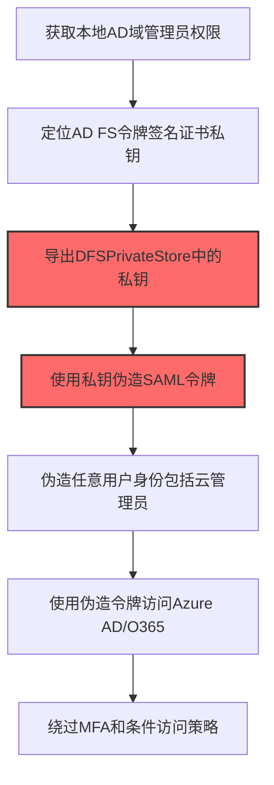
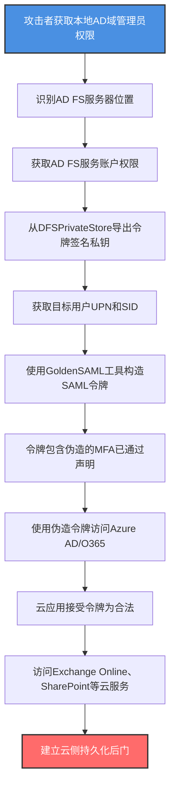

# 混合身份 (T1556.007)

## 一句话通俗理解

> **篡改Azure AD Connect/AD FS/SAML联合认证配置，伪造身份令牌在本地AD和云之间畅通无阻**

## 30秒速查卡

| 维度 | 你需要知道的 |
|------|-------------|
| 这是什么？ | 修改混合身份认证配置（Azure AD Connect、AD FS、SAML），伪造身份令牌或操纵联合信任 |
| 为什么危险？ | 攻击者可伪造任意用户（包括高管）的SAML令牌访问云资源，绕过MFA和密码 |
| 谁需要关心？ | 云安全管理员、Azure AD管理员、AD FS运维、SOC分析师、IR响应团队 |
| 你的第一步防御 | 启用Azure AD Unified Audit Log监控，对AD FS服务账户启用登录告警 |
| 如果只做一件事 | 监控AD FS令牌签发服务器的异常SAML令牌签发模式 |

## 难度等级

⭐⭐⭐ 中级 - 需要理解SAML/OAuth协议和Azure AD混合身份架构

## 前置知识检查

**读这个文件需要什么？**

- [ ] SAML 2.0协议和令牌签发流程
- [ ] Azure AD Connect同步架构（密码哈希同步、Pass-through Authentication、联合认证）
- [ ] AD FS（Active Directory Federation Services）工作原理和令牌签名证书
- [ ] OAuth 2.0和JWT（JSON Web Token）基础

## 技术描述

**混合身份**（T1556.007）是 **修改认证流程**（T1556）的一个具体变体，属于 **防御削弱** 阶段的攻击技术。

> 📚 **打个比方**：想象一家跨国集团的总部（本地AD）和分部（云Azure AD）之间用"统一工牌"（SAML令牌）互通。工牌由总部的"印章"（AD FS令牌签名证书）盖章认证。攻击者要做的事情是：要么偷到总部的印章（窃取令牌签名私钥），自己伪造任意员工的工牌；要么修改印章授权清单（修改AD FS信任关系），让伪造的工牌被接受——这样攻击者就能用任意员工身份（包括CEO）进入分部系统。

### 具体怎么理解？

混合身份（Hybrid Identity）指组织在本地Active Directory和云Azure AD之间建立的身份同步和联合认证机制。常见架构包括：

1. **Azure AD Connect密码哈希同步（PHS）**：将本地AD密码哈希同步到Azure AD
2. **Azure AD Connect Pass-through Authentication（PTA）**：通过本地Agent验证云登录请求
3. **AD FS联合认证**：通过SAML/OIDC协议在本地AD FS签发令牌，云应用接受联合令牌

攻击者修改混合身份的方式包括：

1. **Golden SAML攻击**：窃取AD FS令牌签名私钥（DFSPrivateStore），使用私钥伪造任意用户的SAML令牌访问云资源。这是SolarWinds SUNBURST事件的核心攻击技术
2. **Azure AD Connect Agent篡改**：修改PTA Agent或PHS Agent，在云登录过程中插入后门逻辑
3. **AD FS信任关系修改**：修改 `Set-AdfsClaimsProviderTrust` 添加恶意声明规则，让攻击者控制的身份被接受为合法用户
4. **Azure AD服务主体修改**：修改Azure AD中的服务主体凭证，添加攻击者控制的密码或证书

### 为什么有效？

这种技术之所以有效，是因为：

1. **跨域信任滥用**：混合身份依赖本地AD和云之间的信任关系，攻击者篡改信任即可在两个域之间自由切换身份
2. **绕过MFA**：Golden SAML伪造的令牌包含"MFA已通过"声明，云应用无法区分伪造令牌和合法令牌
3. **持久性强**：伪造的令牌可长期有效（默认8小时，可设置为更长），攻击者无需重复攻击
4. **隐蔽性高**：令牌在云侧被接受，本地AD日志可能不记录异常登录

**过渡段：** 不要误以为云资源受Azure AD MFA保护就安全——攻击者拿到AD FS令牌签名私钥后，可以伪造任何用户（包括全局管理员）的SAML令牌，MFA声明直接写在令牌里，云应用无从辨别。

## 真实攻击流程

### 典型场景

攻击者在 **防御削弱/凭据访问/横向移动** 阶段使用 混合身份篡改 技术，以下是典型的攻击步骤：



**步骤详解：**

1. **获取本地AD域管理员权限** - 攻击者通过常规攻击链获得本地AD DA
2. **定位AD FS令牌签名证书私钥** - 私钥存储在AD FS服务器的DFSPrivateStore
3. **导出DFSPrivateStore中的私钥** - 使用Mimikatz或自定义工具提取私钥
4. **使用私钥伪造SAML令牌** - 使用 stolen 私钥为任意用户签发SAML令牌
5. **伪造任意用户身份包括云管理员** - 可伪造包括全局管理员在内的任何用户
6. **使用伪造令牌访问Azure AD/O365** - 令牌被云应用接受为合法
7. **绕过MFA和条件访问策略** - 令牌中的MFA声明无法被验证真伪

## 攻击流程

### 典型攻击流程

获取本地DA权限 --> 提取AD FS令牌签名私钥 --> 构造Golden SAML令牌 --> 访问云资源绕过MFA --> 持久化云访问



**步骤详解：**

1. **攻击者获取本地AD域管理员权限** - 通过Kerberoasting、Pass-the-Hash、ZeroLogon等攻击获得DA
   - 通俗描述：先拿到总部（本地AD）的最高权限
   - 技术细节：使用Rubeus执行Kerberoasting获取AD FS服务账户的TGS票据，离线破解获取明文密码；或利用CVE-2020-1472（ZeroLogon）直接修改域控计算机账户哈希
   - 常用工具：Rubeus、Mimikatz、ZeroLogon exploit

2. **识别AD FS服务器位置** - 找到签发SAML令牌的AD FS服务器
   - 通俗描述：找到总部盖"统一工章"的办公室位置
   - 技术细节：使用 `Get-ADComputer -Filter {ServicePrincipalName -like "*ADFS*"}` 查询AD FS服务器；或通过DNS记录 `_adfs._tcp.domain.com` 定位。Azure AD Connect服务器也可通过 `Get-ADComputer -Filter {Description -like "*Azure AD Connect*"}` 定位
   - 常用工具：PowerShell AD模块、nslookup

3. **获取AD FS服务账户权限** - AD FS令牌签名私钥由服务账户持有
   - 通俗描述：拿到管理"统一工章"办公室的员工权限
   - 技术细节：AD FS服务账户的密码哈希存储在NTDS.dit中，DA权限可通过DCSync（`lsadump::dcsync /user:adfssvc`）提取。也可通过横向移动到AD FS服务器，从LSASS内存中提取
   - 常用工具：Mimikatz、Impacket secretsdump

4. **从DFSPrivateStore导出令牌签名私钥** - AD FS将令牌签名证书私钥存储在DFSPrivateStore
   - 通俗描述：从保险柜里把"统一工章"的母版偷出来
   - 技术细节：AD FS使用Microsoft Distributed Transaction Coordinator（MSDTC）服务将令牌签名证书私钥存储在DFSPrivateStore中。使用Mimikatz的 `lsadump::backupkeys` 模块或 `ADFSDump` 工具从AD FS服务账户上下文导出私钥
   - 常用工具：ADFSDump、Mimikatz、SharpADFSDump

5. **获取目标用户UPN和SID** - 构造SAML令牌需要目标用户的UPN和SID
   - 通俗描述：拿到目标员工（如CEO）的工号和部门信息
   - 技术细节：使用 `Get-ADUser -Identity ceo_user -Properties UserPrincipalName,SID` 获取UPN和SID。这些信息在AD中是公开可查询的，任何域用户都能获取
   - 常用工具：PowerShell AD模块

6. **使用GoldenSAML工具构造SAML令牌** - 使用stolen私钥签发伪造的SAML令牌
   - 通俗描述：用偷来的工章母版，伪造CEO的工牌
   - 技术细节：使用ForgeToken或ADFSSAML工具，输入目标用户UPN/SID、stolen私钥、目标云应用EntityID，构造符合SAML 2.0标准的令牌。令牌包含 `<Subject>ceo_user@domain.com</Subject>` 和 `<Attribute Name="...">`（如角色、MFA状态）
   - 常用工具：ForgeToken、ADFSSAML、saml2aws

7. **令牌包含伪造的MFA已通过声明** - 在SAML断言中添加MFA声明
   - 通俗描述：工牌上盖了"MFA已验证"的章，云应用无法辨别真伪
   - 技术细节：在SAML AttributeStatement中添加 `<Attribute Name="http://schemas.microsoft.com/claims/mfa"><AttributeValue>true</AttributeValue></Attribute>` 声明。云应用（O365、Azure Portal）根据此声明认为MFA已通过，不触发二次验证
   - 常用工具：ForgeToken

8. **使用伪造令牌访问Azure AD/O365** - 将伪造令牌提交给云应用
   - 通俗描述：拿着伪造的CEO工牌直接进入云分公司
   - 技术细节：将SAML令牌作为Bearer Token通过POST提交到Azure AD的 `/login.srf` 端点，或通过WS-Trust协议提交。Azure AD验证令牌签名有效（使用stolen私钥签发），创建会话Cookie
   - 常用工具：浏览器、Python requests、AzureAD模块

9. **云应用接受令牌为合法** - 令牌签名有效，云应用无法识别为伪造
   - 通俗描述：云分公司前台看到工章是真的，直接放行
   - 技术细节：Azure AD根据AD FS的 Federation Metadata 验证令牌签名证书。由于私钥被stolen，伪造令牌的签名与合法令牌无差异，Azure AD无法区分
   - 常用工具：Azure AD

10. **访问Exchange Online、SharePoint等云服务** - 使用伪造身份访问云应用
    - 通俗描述：以CEO身份在云分公司畅通无阻
    - 技术细节：使用伪造的会话Cookie访问Outlook Web Access读取邮件、访问SharePoint Online下载敏感文档、访问Azure Portal修改云配置、访问Power BI查看商业报表
    - 常用工具：浏览器、Outlook、Azure Portal

11. **建立云侧持久化后门** - 在Azure AD中添加后门账户或服务主体
    - 通俗描述：在云分公司安插自己的"内应"
    - 技术细节：使用伪造的全局管理员令牌在Azure AD中：创建新的全局管理员账户、为现有服务主体添加密码凭证、修改条件访问策略排除攻击者IP、创建新的Application Registration配置隐式授权流程
    - 常用工具：Azure AD PowerShell、Microsoft Graph API

## 真实案例

### 案例1：SolarWinds SUNBURST事件中的Golden SAML攻击（2020）

- **时间**: 2020年3-12月
- **目标**: 多个美国政府机构（财政部、商务部）、Fortune 500企业
- **攻击组织**: NOBELIUM（APT29，Cozy Bear）
- **手法**: 攻击者通过SolarWinds Orion供应链攻击植入SUNBURST后门。横向移动到AD FS服务器后，使用ADFSDump提取令牌签名私钥。使用ForgeToken工具伪造SAML令牌，冒充目标组织的高管和IT管理员访问O365邮箱和Azure资源。伪造令牌包含MFA已通过声明，绕过条件访问策略
- **影响**: 多个政府机构邮件被窃取，CISA发布Emergency Directive 21-01要求所有联邦机构隔离SolarWinds
- **参考链接**: [CISA Emergency Directive 21-01](https://www.cisa.gov/news-events/directives/emergency-directive-21-01)

### 案例2：CERT-FR报告的Golden SAML攻击（2021）

- **时间**: 2021年
- **目标**: 欧洲多国政府和企业
- **攻击组织**: 未公开归属（疑似NOBELIUM关联）
- **手法**: 攻击者获取本地AD域管理员权限后，使用公开工具ADFSDump提取AD FS令牌签名私钥。构造Golden SAML令牌冒充目标组织CEO和CFO，访问Exchange Online读取敏感邮件
- **影响**: 多个组织高管通讯被窃取，攻击持续数周未被发现
- **参考链接**: [CERT-FR Golden SAML Advisory](https://www.cert.ssi.gouv.fr/)

### 案例3：Azure AD Connect PTA Agent篡改（2022）

- **时间**: 2022年
- **目标**: 跨国制造企业
- **攻击组织**: FIN8（FIN组织）
- **手法**: 攻击者获取本地DA权限后，修改Azure AD Connect PTA Agent的 `AzureADConnectAuthenticationAgentService.exe` 二进制，插入后门逻辑：当用户名为"backdoor_admin"且密码为"magic_p@ss"时，PTA Agent向Azure AD返回认证成功。攻击者使用此后门口令从云侧登录
- **影响**: 攻击者通过云侧后门口令保持持久访问6个月
- **参考链接**: [Microsoft FIN8 Analysis](https://www.microsoft.com/en-us/security/blog/2022/fin8/)

### 案例4：AD FS声明规则后门（2023）

- **时间**: 2023年
- **目标**: 美国金融机构
- **攻击组织**: 未公开
- **手法**: 攻击者通过 `Set-AdfsClaimsProviderTrust` 修改AD FS声明规则，添加 `c:[Type == "http://backdoor/user", Value == "admin_magic"] => issue(Type = c.Type, Value = "GlobalAdmin@domain.com");` 后门规则。当攻击者使用特殊声明的令牌访问AD FS时，被映射为全局管理员
- **影响**: 攻击者通过AD FS声明规则后门保持持久云访问
- **参考链接**: [CrowdStrike AD FS Analysis](https://www.crowdstrike.com/blog/adfs-backdoor/)

## 红队视角

> ⚠️ **免责声明**：以下内容仅用于合法的安全测试、渗透测试和教育目的。未经授权对他人系统进行测试是违法行为。

### 实战技巧

1. **优先选择Golden SAML而非PTA Agent篡改**：Golden SAML不修改任何配置，仅在攻击者侧构造令牌，更隐蔽
2. **针对高价值账户伪造令牌**：选择全局管理员、Exchange管理员、SharePoint管理员等高权限账户，最大化访问范围
3. **设置合理的令牌有效期**：默认8小时太短，可设置为12-24小时减少重新签发频率
4. **使用合法用户代理字符串**：在访问云应用时使用目标用户常用的浏览器User-Agent，避免触发异常登录告警

### 常用工具

| 工具名称 | 用途 | 平台 | 链接 |
| -------- | ---- | ---- | ---- |
| ADFSDump | 提取AD FS令牌签名私钥 | Windows | [ADFSDump](https://github.com/mandiant/ADFSDump) |
| ForgeToken | 构造Golden SAML令牌 | 跨平台 | Mandiant内部工具（概念公开） |
| SharpADFSDump | C#版ADFSDump | Windows | [SharpADFSDump](https://github.com/mandiant/ADFSDump) |
| AzureAD PowerShell | Azure AD管理 | 跨平台 | [AzureAD模块](https://www.powershellgallery.com/packages/AzureAD/) |
| Microsoft Graph API | Azure AD API访问 | 跨平台 | [Microsoft Graph](https://learn.microsoft.com/en-us/graph/) |
| ROADtools | Azure AD设备认证工具 | 跨平台 | [ROADtools](https://github.com/dirkjanm/ROADtools) |

### 注意事项

- 在授权的测试环境中使用这些技术
- Golden SAML攻击需要本地AD和AD FS环境，纯云环境不适用
- 注意Azure AD Unified Audit Log会记录云侧操作，需谨慎
- AD FS服务账户密码修改后，stolen私钥仍有效（除非轮换令牌签名证书）

## 蓝队视角

### 检测要点

1. **AD FS服务账户监控**：监控AD FS服务账户的非预期登录（来自非AD FS服务器的登录）
2. **SAML令牌签发异常**：监控AD FS事件ID 411（令牌签发），关注异常用户、异常IP
3. **Azure AD Unified Audit Log**：监控云侧的Application、ServicePrincipal修改事件
4. **Azure AD Connect配置变更**：监控Azure AD Connect同步规则和PTA Agent配置修改

### 监控建议

- 启用Azure AD Premium P2许可证，开启Unified Audit Log
- 部署Microsoft Cloud App Security（MCAS）监控异常云登录
- 在AD FS服务器上启用高级审计（事件ID 411、412、501）
- 监控 `Get-AdfsProperties`、`Set-AdfsProperties`、`Set-AdfsClaimsProviderTrust` 命令调用
- 定期检查Azure AD中的服务主体凭证变化

## 避坑指南

防御监测盲区：仅关注云侧登录日志（Azure AD Sign-in Logs），忽视了本地AD FS令牌签发日志和私钥保护。

## 检测建议

### 检测思路

检测 混合身份篡改 的关键是监控AD FS配置变更、私钥访问和云侧异常登录。以下是三个层面的检测方法：

### 网络层检测

**方法**：监控AD FS服务器异常网络连接和SAML令牌提交

```bash
# 监控AD FS服务器的异常出站连接
# 使用Zeek或Suricata监控AD FS服务器到外部IP的HTTPS连接
# 关注异常时段的大数据传输
```

### 主机层检测

**Windows事件ID（AD FS服务器）**：
- 事件ID 411：令牌签发成功（监控异常用户/IP）
- 事件ID 412：令牌签发失败
- 事件ID 501：服务启动
- 事件ID 100：配置变更

**Windows事件ID（域控）**：
- 事件ID 4662：对象访问（监控AD FS服务账户DCSync）
- 事件ID 4624：登录成功（监控AD FS服务账户异常登录）

```powershell
# 检测AD FS服务账户异常登录
Get-WinEvent -FilterHashtable @{LogName='Security'; Id=4624; TargetUserName='adfssvc'} |
    Where-Object { $_.IpAddress -notin @('::1', '127.0.0.1', '<ADFS_SERVER_IP>') }

# 检测AD FS配置变更
Get-WinEvent -FilterHashtable @{LogName='Security'; Id=4663} |
    Where-Object { $_.Message -match 'AD FS' -and $_.Message -match 'Set-Adfs' }
```

### 应用层检测

**用人话说：** 攻击者获取本地AD域管理员权限后，从AD FS服务器窃取令牌签名私钥。用这个私钥伪造任意用户（包括CEO）的SAML令牌，令牌里还包含"MFA已通过"声明。云应用（O365、Azure Portal）看到签名有效就直接接受，根本无法区分这是伪造的。攻击者就能以任意身份访问云资源。如果发现AD FS服务账户从非AD FS服务器登录、AD FS令牌签发量异常激增、或Azure AD中突然出现新的全局管理员，就要警惕——可能是混合身份被篡改。

**Sigma规则示例**：

```yaml
title: 检测AD FS令牌签名私钥访问
status: experimental
description: 检测对AD FS DFSPrivateStore的访问，可能是Golden SAML攻击准备
references:
    - https://attack.mitre.org/techniques/T1556/007/
    - https://www.cisa.gov/news-events/directives/emergency-directive-21-01
logsource:
    product: windows
    service: security
detection:
    selection_dfs_access:
        EventID: 4663
        ObjectName|contains:
            - 'DFSPrivateStore'
            - 'AD FS'
            - 'TokenSigning'
    selection_mimikatz:
        EventID: 4688
        CommandLine|contains:
            - 'lsadump::backupkeys'
            - 'ADFSDump'
            - 'SharpADFSDump'
    selection_adfs_cmdlets:
        EventID: 4104
        ScriptBlock|contains:
            - 'Get-AdfsProperties'
            - 'Set-AdfsProperties'
            - 'Set-AdfsClaimsProviderTrust'
            - 'Export-AdfsAuthenticationProviderConfigurationData'
    condition: selection_dfs_access or selection_mimikatz or selection_adfs_cmdlets
fields:
    - SubjectUserName
    - ObjectName
    - CommandLine
    - ScriptBlock
falsepositives:
    - 合法的AD FS配置变更（应严格审批）
    - AD FS服务账户密码轮换
level: high
tags:
    - attack.credential_access
    - attack.t1556.007
    - attack.defense_evasion
```

**Sigma规则示例 - 检测Azure AD异常操作**：

```yaml
title: 检测Azure AD中服务主体凭证添加
status: experimental
description: 检测Azure AD中服务主体或应用的新密码/凭证添加，可能是攻击者持久化
logsource:
    product: azure
    service: audit
detection:
    selection_add_password:
        operationName:
            - 'Add service principal credentials'
            - 'Add application'
            - 'Update application - Certificates and secrets management'
        result: success
    condition: selection_add_password
fields:
    - initiatedBy
    - targetResources
    - operationName
    - result
    - activityDateTime
level: medium
tags:
    - attack.persistence
    - attack.t1556.007
```

## 缓解措施

### 优先级1：关键措施

**保护AD FS令牌签名私钥**：使用HSM（硬件安全模块）保护私钥，限制访问权限

```powershell
# 检查AD FS令牌签名证书配置
Get-AdfsCertificate -CertificateType TokenSigning

# 启用AD FS高级日志
Set-AdfsProperties -LogLevel Information,Verbose,Errors,Warnings,FailureAudits,SuccessAudits

# 配置AD FS服务账户为最小权限（推荐使用组托管服务账户gMSA）
Set-ADServiceAccount -Identity adfssvc -PrincipalsAllowedToRetrieveManagedPassword "ADFS Servers$"
```

### 优先级2：重要措施

**启用Azure AD Premium审计**：

```powershell
# 启用Azure AD Unified Audit Log
Connect-AzureAD
# 确认审计日志已启用
Get-AzureADDirectorySetting | Where-Object { $_.DisplayName -eq 'Audit Log' }

# 配置Azure AD告警策略（在Azure Portal中）
# Azure AD > Monitoring > Diagnostics settings > Enable audit and sign-in logs
```

### 优先级3：建议措施

**定期轮换令牌签名证书**：

```powershell
# 检查证书有效期
Get-AdfsCertificate -CertificateType TokenSigning | Select-Object Certificate, IsPrimary

# 主动轮换（需要协调云侧Federation Metadata更新）
Update-AdfsCertificate -CertificateType TokenSigning -Urgent
# 等待Azure AD同步新的Federation Metadata
Start-ADSyncSyncCycle -PolicyType Delta
```

## 动手实验

> ⚠️ **所有实验必须在隔离的实验室环境中进行**

### 实验1：理解AD FS架构（初级）

**目标**：理解 AD FS 联合认证流程和令牌签名机制

**步骤**：
1. 在隔离的AD实验室中检查AD FS配置：
   ```powershell
   Get-AdfsProperties | Select-Object DisplayName, HostName, Identifier
   Get-AdfsCertificate -CertificateType TokenSigning
   ```
2. 查看依赖方信任（Relying Party Trusts）：
   ```powershell
   Get-AdfsRelyingPartyTrust | Select-Object Name, Identifier
   ```
3. 查看声明规则：
   ```powershell
   Get-AdfsRelyingPartyTrust | Select-Object Name, AcceptanceTransformRules
   ```

**学习要点**：理解AD FS架构和令牌签名证书

### 实验2：提取AD FS令牌签名私钥（中级）

**目标**：使用ADFSDump提取令牌签名私钥，理解Golden SAML攻击准备

**步骤**：
1. 在AD FS服务器上以AD FS服务账户身份运行ADFSDump：
   ```powershell
   # 需要以ADFSService账户运行
   runas /user:DOMAIN\adfssvc "ADFSDump.exe"
   ```
2. 分析输出，识别令牌签名证书私钥
3. 检查输出中的EncryptionCertificate和TokenSigning证书

**学习要点**：理解Golden SAML攻击的私钥提取过程

### 实验3：部署Golden SAML检测（高级）

**目标**：部署Sigma规则和Azure AD审计监控Golden SAML攻击

**步骤**：
1. 部署Sigma规则到SIEM（检测AD FS配置变更和ADFSDump调用）
2. 启用Azure AD Unified Audit Log
3. 配置Azure AD Conditional Access策略，对全局管理员要求MFA和合规设备
4. 模拟攻击：提取AD FS私钥并伪造令牌
5. 验证告警触发

**学习要点**：掌握Golden SAML攻击检测方法

## 术语解释

| 术语 | 通俗解释 |
|------|---------|
| **Hybrid Identity** | 混合身份，本地AD和云Azure AD之间的身份同步和联合认证 |
| **Azure AD Connect** | 微软提供的本地AD到Azure AD的同步工具 |
| **AD FS** | Active Directory Federation Services，本地联合认证服务 |
| **SAML** | Security Assertion Markup Language，基于XML的联合认证令牌格式 |
| **Golden SAML** | Golden SAML攻击，使用stolen AD FS私钥伪造任意用户SAML令牌 |
| **DFSPrivateStore** | AD FS存储令牌签名私钥的位置 |
| **PTA** | Pass-through Authentication，Azure AD Connect的直通认证模式 |
| **PHS** | Password Hash Synchronization，Azure AD Connect的密码哈希同步模式 |

## 被引用情况

以下父技术文档引用了本子技术：

- [T1556 - 修改认证流程](../T1556-Modify-Authentication-Process.md)

## 参考资料

### 官方文档

- [MITRE ATT&CK - Hybrid Identity (T1556.007)](https://attack.mitre.org/techniques/T1556/007/)
- [MITRE ATT&CK - Modify Authentication Process (T1556)](https://attack.mitre.org/techniques/T1556/)
- [Microsoft - Azure AD Connect Documentation](https://learn.microsoft.com/en-us/azure/active-directory/hybrid/)
- [Microsoft - AD FS Security Best Practices](https://learn.microsoft.com/en-us/windows-server/identity/ad-fs/operations/best-practices-securing-ad-fs)

### 安全报告

- [CISA Emergency Directive 21-01](https://www.cisa.gov/news-events/directives/emergency-directive-21-01) - SolarWinds SUNBURST事件
- [Mandiant - SUNBURST Golden SAML Analysis](https://www.mandiant.com/resources/blog/sunburst-additional-technical-details) - Golden SAML技术分析
- [CrowdStrike - AD FS Backdoor](https://www.crowdstrike.com/blog/adfs-backdoor/) - AD FS声明规则后门分析

### 工具与资源

- [ADFSDump](https://github.com/mandiant/ADFSDump) - AD FS私钥提取工具
- [ROADtools](https://github.com/dirkjanm/ROADtools) - Azure AD设备认证工具
- [Atomic Red Team T1556.007](https://github.com/redcanaryco/atomic-red-team/blob/master/atomics/T1556.007/T1556.007.yaml) - 检测规则测试

### 学习资料

- [Azure AD Identity Secure Score](https://learn.microsoft.com/en-us/azure/active-directory/fundamentals/identity-secure-score) - Azure AD安全评分
- [SAML 2.0 Specification](https://docs.oasis-open.org/security/saml/Post2.0/sstc-saml-tech-overview-2.0.html) - SAML协议规范
