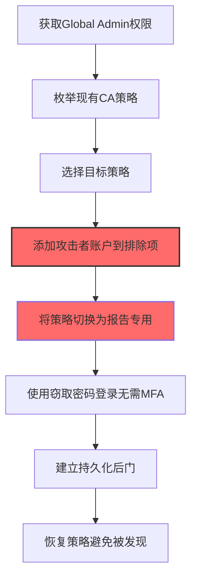
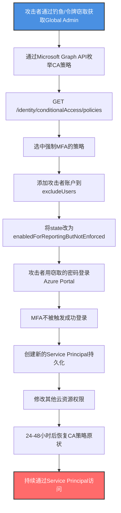

# 条件访问策略 (T1556.009)

## 一句话通俗理解

> **篡改云身份提供商的条件访问策略（如Azure AD CA Policy、AWS IAM Trust Policy），悄悄为攻击者打开一条绕过MFA的"VIP通道"**

## 30秒速查卡

| 维度 | 你需要知道的 |
|------|-------------|
| 这是什么？ | 修改云身份提供商中的条件访问策略或IAM策略，为特定账户/IP/应用豁免MFA要求 |
| 为什么危险？ | 条件访问是云身份安全的"门神"，篡改后攻击者可绕过MFA直接使用窃取的密码登录 |
| 谁需要关心？ | 云安全管理员、Identity团队、SecOps、SOC分析师、Azure/AWS/GCP租户管理员 |
| 你的第一步防御 | 监控CA Policy的任何修改事件（Azure Audit Log category "Policy"），重点关注排除项和报告专用模式切换 |
| 如果只做一件事 | 配置告警：任何CA Policy修改立即通知Identity团队，并要求工单关联 |

## 难度等级

⭐⭐⭐ 中级 - 需要理解云身份模型、OAuth/OIDC、条件访问策略语法

## 前置知识检查

**读这个文件需要什么？**

- [ ] Azure AD条件访问策略（Conditional Access Policy）工作原理
- [ ] AWS IAM Trust Policy（信任策略）和Permission Boundary
- [ ] GCP IAM Conditions和Organization Policy
- [ ] OAuth 2.0 / OIDC协议和Token Claim
- [ ] Microsoft Graph API（Policy endpoints）
- [ ] MFA（多因素认证）和FIDO2、TOTP、Push通知

## 技术描述

**条件访问策略**（T1556.009）是 **修改认证流程**（T1556）的一个具体变体，属于 **防御削弱** 阶段的攻击技术。

> 📚 **打个比方**：想象一家银行的金库门禁系统，原本规定"任何人进入金库都需要刷卡+刷脸+输入密码三重验证"。但银行经理有一项特权——可以为VIP客户发"特别通行证"，凭此证只需刷卡即可进入。攻击者要做的事情是：偷偷篡改门禁系统记录，给自己发一张"VIP特别通行证"，从此无需刷脸和密码就能进入金库。条件访问策略就是云租户里的"门禁规则表"，攻击者篡改它来为自己开后门。

### 具体怎么理解？

云身份提供商（Azure AD、AWS IAM、GCP IAM、Okta）通过条件访问策略实现"零信任"身份验证。策略定义了"如果用户/设备/位置/应用满足X条件，则要求Y控制（如MFA、合规设备、密码+Token）"。

**Azure AD Conditional Access** 的典型策略结构：

```json
{
  "displayName": "Require MFA for all users",
  "state": "enabled",
  "conditions": {
    "users": {
      "includeUsers": ["All"],
      "excludeUsers": ["break-glass-admin@contoso.com"]
    },
    "applications": {
      "includeApplications": ["All"]
    },
    "locations": {
      "includeLocations": ["All"],
      "excludeLocations": ["trusted-ip-block"]
    }
  },
  "grantControls": {
    "operator": "OR",
    "builtInControls": ["mfa"]
  }
}
```

攻击者篡改策略的方式：

1. **添加排除项**：将攻击者控制的账户加入 `excludeUsers`，绕过MFA
2. **修改grantControls**：将 `mfa` 改为空数组或添加 `orasResult`，使策略实际不强制MFA
3. **将策略切换为"报告专用"**（`state: "enabledForReportingButNotEnforced"`）：策略只记录日志但不强制执行
4. **禁用策略**：将 `state` 改为 `disabled`
5. **修改位置排除**：将攻击者IP段加入 `excludeLocations`
6. **AWS IAM Trust Policy篡改**：修改Role信任策略允许外部账户AssumeRole
7. **GCP IAM Conditions篡改**：修改Binding的Condition表达式绕过资源访问限制

### 为什么有效？

这种技术之所以有效，是因为：

1. **云原生控制台操作**：通过Microsoft Graph API或Azure Portal操作，无需在终端留痕
2. **权限即后门**：修改后的策略持续生效，攻击者可反复使用绕过路径
3. **隐蔽性强**：CA策略修改在审计日志中是常规事件，易被忽略
4. **影响范围广**：一条CA策略可影响整个租户的所有用户
5. **报告专用模式陷阱**：将策略切换为"报告专用"会让防御失效但日志看似正常
6. **跨平台一致性**：AWS、GCP、Okta都有类似的条件策略机制，攻击手法可移植

**过渡段：** 不要误以为启用了MFA就万事大吉——攻击者篡改CA策略后，可以使用窃取的明文密码直接登录云控制台，MFA形同虚设。MFA的有效性依赖于CA策略的正确配置和未被篡改。

## 真实攻击流程

### 典型场景

攻击者在 **防御削弱/初始访问/权限维持** 阶段使用条件访问策略篡改技术，以下是典型的攻击步骤：



**步骤详解：**

1. **获取Global Admin权限** - 攻击者通过钓鱼、密码喷洒、令牌窃取获取Global Admin
2. **枚举现有CA策略** - 通过Graph API列出所有CA策略
3. **选择目标策略** - 选中"MFA强制"策略作为篡改目标
4. **添加攻击者账户到排除项** - 修改 `excludeUsers` 加入攻击者账户
5. **将策略切换为报告专用** - 改为 `enabledForReportingButNotEnforced`
6. **使用窃取密码登录无需MFA** - 攻击者用密码登录绕过MFA
7. **建立持久化后门** - 创建新管理员、修改Service Principal
8. **恢复策略避免被发现** - 一定时间后恢复策略原状

## 攻击流程

### 典型攻击流程

获取Global Admin权限 --> 枚举现有CA策略 --> 修改策略排除项或状态 --> 使用窃取密码绕过MFA登录 --> 建立持久化 --> 恢复策略



**步骤详解：**

1. **攻击者通过钓鱼/令牌窃取获取Global Admin** - 通过钓鱼邮件、令牌窃取、密码喷洒获得Global Admin权限
   - 通俗描述：先要拿到门禁系统管理员钥匙
   - 技术细节：通过钓鱼获取管理员凭据（T1566）、窃取Primary Refresh Token（T1528）、利用Pass-the-Cloud或密码喷洒获得初始访问。需要至少Conditional Access Administrator或Global Admin角色修改CA策略
   - 常用工具：ModDirty、TokenTactics、Microsoft Graph PowerShell

2. **通过Microsoft Graph API枚举CA策略** - 调用Graph API列出所有CA策略
   - 通俗描述：查阅当前门禁规则表
   - 技术细节：使用Microsoft Graph PowerShell SDK：
     ```powershell
     Connect-MgGraph -Scopes "Policy.Read.All"
     Get-MgIdentityConditionalAccessPolicy | Format-Table DisplayName, State, Id
     ```
     或REST API：`GET https://graph.microsoft.com/v1.0/identity/conditionalAccess/policies`
   - 常用工具：Microsoft Graph PowerShell、AzureAD PowerShell、Portal

3. **GET /identity/conditionalAccess/policies** - 获取策略详细内容
   - 通俗描述：查看每条规则的详细条款
   - 技术细节：API返回JSON包含 `conditions`、`grantControls`、`state` 等字段。重点关注：
     - `state`：enabled / disabled / enabledForReportingButNotEnforced
     - `conditions.users.excludeUsers`：排除用户列表
     - `grantControls.builtInControls`：授权控制（mfa / compliantDevice / domainJoinedDevice）
   - 常用工具：Graph Explorer、Postman

4. **选中强制MFA的策略** - 选择目标策略
   - 通俗描述：选定要篡改的那条规则
   - 技术细节：通常选择 `displayName` 包含"MFA"或"Require MFA"的策略。注意：Azure AD安全默认值（Security Defaults）会强制MFA但不在CA策略中，需要单独禁用
   - 常用工具：无

5. **添加攻击者账户到excludeUsers** - 修改策略排除项
   - 通俗描述：在门禁规则里加一行"VVIP客户免刷脸"
   - 技术细节：使用Graph API PATCH：
     ```powershell
     $policy = Get-MgIdentityConditionalAccessPolicy -ConditionalAccessPolicyId $id
     $body = @{
         conditions = @{
             users = @{
                 excludeUsers = @($policy.Conditions.Users.ExcludeUsers + "attack-account-id")
             }
         }
     }
     Update-MgIdentityConditionalAccessPolicy -ConditionalAccessPolicyId $id -BodyParameter $body
     ```
   - 常用工具：Microsoft Graph PowerShell、Graph Explorer

6. **将state改为enabledForReportingButNotEnforced** - 切换为报告专用模式
   - 通俗描述：把规则改成"只记录不执行"
   - 技术细节：
     ```powershell
     Update-MgIdentityConditionalAccessPolicy -ConditionalAccessPolicyId $id -BodyParameter @{ state = "enabledForReportingButNotEnforced" }
     ```
     报告专用模式下，策略不强制执行控制，只在登录日志中标记"would have been blocked"。攻击者登录不会被拦截，但日志看似正常
   - 常用工具：Microsoft Graph PowerShell

7. **攻击者用窃取的密码登录Azure Portal** - 使用密码登录绕过MFA
   - 通俗描述：用偷来的密码直接进入金库
   - 技术细节：访问 `https://portal.azure.com`，输入攻击者账户的用户名和密码。由于CA策略已被篡改，MFA提示不出现
   - 常用工具：浏览器

8. **MFA不被触发成功登录** - 顺利登录
   - 通俗描述：成功进入金库
   - 技术细节：登录成功后获取Primary Refresh Token（PRT）和访问令牌，可在后续24小时内免再次认证访问云资源
   - 常用工具：无

9. **创建新的Service Principal持久化** - 创建后门服务主体
   - 通俗描述：在金库里再装一道只有自己知道的暗门
   - 技术细节：创建新的App Registration并赋予Global Admin角色：
     ```powershell
     New-MgApplication -DisplayName "Legit-Sync-Service"
     New-MgServicePrincipal -AppId $appId
     New-MgDirectoryRoleMember -DirectoryRoleId (Get-MgDirectoryRole -Filter "displayName eq 'Global Administrator'").Id -DirectoryObjectId $spId
     ```
   - 常用工具：Microsoft Graph PowerShell

10. **修改其他云资源权限** - 横向扩展到其他云资源
    - 通俗描述：把金库连接到其他保险柜
    - 技术细节：通过Service Principal访问Azure Key Vault、AWS IAM Role、Microsoft 365邮箱、SharePoint站点等
    - 常用工具：Azure CLI、AWS CLI

11. **24-48小时后恢复CA策略原状** - 恢复策略避免被发现
    - 通俗描述：把门禁规则改回去，让人以为没事
    - 技术细节：
    ```powershell
    Update-MgIdentityConditionalAccessPolicy -ConditionalAccessPolicyId $id -BodyParameter @{
        state = "enabled"
        conditions = @{ users = @{ excludeUsers = @() } }
    }
    ```
    恢复后蓝队查看策略配置似乎正常，但攻击者已通过Service Principal建立持久化
    - 常用工具：Microsoft Graph PowerShell

12. **持续通过Service Principal访问** - 通过后门持续访问
    - 通俗描述：通过暗门长期进出金库
    - 技术细节：使用Service Principal的client credentials flow获取访问令牌，不依赖用户凭据和MFA
    - 常用工具：Azure CLI、Postman

## 真实案例

### 案例1：NOBELIUM/SUNBURST篡改Azure AD CA策略（2020-2021）

- **时间**: 2020年12月-2021年3月
- **目标**: 美国政府机构、IT服务商（SolarWinds供应链攻击后续）
- **攻击组织**: NOBELIUM（APT29，Cozy Bear）
- **手法**: 攻击者通过窃取的SolarWinds Orion凭据横向移动到Azure AD Connect服务器，获取Global Admin权限后篡改CA策略，添加攻击者控制的Service Principal到排除项，并禁用了部分MFA策略。随后使用窃取的Golden SAML令牌和密码直接登录Azure AD，绕过MFA
- **影响**: 攻击者长期访问多个美国政府机构的Microsoft 365邮箱，窃取数千份敏感邮件。CA策略篡改使MFA失效，攻击持续数月未被发现
- **参考链接**: [CISA Alert AA21-008A](https://www.cisa.gov/news-events/cybersecurity-advisories/aa21-008a) | [Microsoft NOBELIUM Analysis](https://www.microsoft.com/security/blog/2021/03/04/goldensaml/)

### 案例2：LAPSUS$篡改Azure AD CA策略绕过MFA（2022）

- **时间**: 2022年1-3月
- **目标**: Microsoft、NVIDIA、Samsung、Okta、Uber等大型科技公司
- **攻击组织**: LAPSUS$（Scattered Spider）
- **手法**: 攻击者通过社交工程（电话钓鱼）诱导员工接受MFA推送，获取访问后立即篡改CA策略，将自身账户加入排除项，并将策略切换为"报告专用"模式。修改后用窃取的密码反复登录，避免触发MFA。还通过修改User Password Reset Policy重置其他管理员密码
- **影响**: 攻击者成功渗透多家科技巨头内部系统，泄露源代码和员工数据。CA策略篡改使蓝队无法及时发现异常登录
- **参考链接**: [Microsoft LAPSUS$ Analysis](https://www.microsoft.com/security/blog/2022/03/22/dev-0537-criminal-actor-targeting-organizations-for-data-exfiltration-and-destruction/) | [Okta LAPSUS$ Incident](https://www.okta.com/blog/2022/03/okta-summary/)

### 案例3：Mandrill Report - CA策略报告专用模式滥用（2023）

- **时间**: 2023年
- **目标**: 多个Azure AD租户
- **攻击组织**: 多个未归因组织
- **手法**: 攻击者获取Conditional Access Administrator权限后，将关键MFA策略从"启用"切换为"报告专用"模式。在报告专用模式下，攻击者使用窃取的密码登录不会被MFA拦截，但Azure Sign-In Logs中显示状态正常。攻击者还在策略中添加"trusted location"排除项，将攻击IP标记为可信
- **影响**: 多个租户的MFA被绕过数周未被发现。安全团队误以为策略仍在执行，导致横向移动持续
- **参考链接**: [Mandiant Azure AD Post-Compromise](https://www.mandiant.com/resources/azure-ad-post-compromise) | [Azure AD Identity Security](https://learn.microsoft.com/en-us/azure/active-directory/conditional-access/)

### 案例4：AWS IAM Trust Policy篡改（RedLotus 2022）

- **时间**: 2022年
- **目标**: AWS云环境
- **攻击组织**: RedLotus（红队演练）
- **手法**: 攻击者获取IAM管理员权限后，修改关键IAM Role的信任策略，允许攻击者控制的外部AWS账户AssumeRole。还修改了IAM Policy的Condition表达式，移除"aws:MultiFactorAuthPresent": true条件，使Role可以在无MFA情况下被Assume
- **影响**: 红队通过篡改的Role访问了S3存储桶和RDS数据库，绕过了原本的MFA要求
- **参考链接**: [Rhino Security AWS Post-Exploitation](https://rhinosecuritylabs.com/aws/aws-iam-privilege-escalation/) | [AWS IAM Trust Policy Best Practices](https://docs.aws.amazon.com/IAM/latest/UserGuide/best-practices.html)

## 红队视角

> ⚠️ **免责声明**：以下内容仅用于合法的安全测试、渗透测试和教育目的。未经授权对他人系统进行测试是违法行为。

### 实战技巧

1. **优先使用报告专用模式**：相比禁用策略，报告专用模式更隐蔽，日志看似正常
2. **添加排除项而非删除策略**：保留策略整体结构，仅添加排除项，最小化变更痕迹
3. **使用Graph API而非Portal**：API操作可在脚本中执行，避免Portal操作的UI痕迹
4. **篡改后及时恢复**：24-48小时内恢复策略，避免长期配置异常被发现
5. **结合Service Principal持久化**：CA策略篡改仅是入口，立即创建Service Principal作为长期后门
6. **AWS场景使用sts:AssumeRoleWithWebIdentity**：通过OIDC联邦身份绕过IAM Trust Policy的MFA要求

### 常用工具

| 工具名称 | 用途 | 平台 | 钓鱼 |
| -------- | ---- | ---- | ---- |
| Microsoft Graph PowerShell | 操作Azure AD CA策略 | 跨平台 | [MgGraph](https://learn.microsoft.com/en-us/powershell/microsoftgraph/) |
| AzureAD PowerShell (deprecated) | 旧版Azure AD操作 | 跨平台 | [AzureAD](https://learn.microsoft.com/en-us/powershell/azuread/) |
| AzureHound | BloodHound的Azure数据收集 | 跨平台 | [AzureHound](https://github.com/BloodHoundAD/AzureHound) |
| ROADtools | Azure AD探索和利用 | 跨平台 | [ROADtools](https://github.com/dirkjanm/ROADtools) |
| AWS CLI | 操作AWS IAM Policy | 跨平台 | [AWS CLI](https://aws.amazon.com/cli/) |
| Pacu | AWS后渗透框架 | 跨平台 | [Pacu](https://github.com/RhinoSecurityLabs/pacu) |
| TokenTactics | Azure AD令牌操作 | Windows | [TokenTactics](https://github.com/rvrsh3ll/TokenTactics) |

### 注意事项

- 在授权的测试环境中使用这些技术
- CA策略修改会立即影响生产用户，谨慎操作
- 修改AWS IAM Trust Policy可能影响应用正常运行
- Okta的Sign-On Policy修改需要Super Administrator权限
- GCP的IAM Conditions需要Organization Policy Administrator权限

## 蓝队视角

### 检测要点

1. **Azure AD审计日志监控**：监控 `Activity DisplayName` 为"Update Conditional Access policy"或"Delete Conditional Access policy"的事件
2. **Graph API操作监控**：监控对 `/identity/conditionalAccess/policies` 的PATCH/POST/DELETE操作
3. **AWS CloudTrail监控**：监控 `UpdateAssumeRolePolicy`、`PutRolePolicy`、`DeleteRolePolicy`事件
4. **GCP Audit Logs监控**：监控 `SetIamPolicy` 事件
5. **策略内容变更检测**：定期导出CA策略配置对比差异
6. **报告专用模式告警**：任何策略切换为"enabledForReportingButNotEnforced"立即告警
7. **排除项变更告警**：CA策略新增excludeUsers立即告警

### 监控建议

- 配置Azure Monitor告警：CA策略修改立即通知Identity团队
- 部署Azure Sentinel规则：检测CA策略的非常规修改
- 使用AWS Config Rules：检测IAM Trust Policy的MFA条件移除
- 使用GCP Security Command Center：检测IAM Policy的Condition修改
- 配置SIEM告警：CA策略修改必须关联工单号，未关联工单的修改视为可疑
- 建立CA策略基线：每周对比策略配置，检测异常变更

## 避坑指南

防御监测盲区：仅监控登录失败和异常IP登录，忽视了CA策略配置本身的篡改。攻击者通过修改策略而非暴力破解来绕过MFA，日志中的登录记录看似合法。

## 检测建议

### 检测思路

检测 条件访问策略篡改 的关键是监控云身份提供商的审计日志中策略修改事件。以下是三个层面的检测方法：

### 网络层检测

**方法**：监控到Microsoft Graph API和AWS IAM API的异常调用

```bash
# 检测异常的Graph API调用模式
# 使用Azure Monitor查询：从非管理员IP发起的CA策略修改
# 使用AWS CloudTrail Insight：检测非常规IAM操作
# 关注来自未知User-Agent的API调用（如非Portal、非PowerShell）
```

### 主机层检测

**Azure AD审计事件**：
- 事件"Update Conditional Access policy"：CA策略修改
- 事件"Delete Conditional Access policy"：CA策略删除
- 事件"Add user" + "Update Conditional Access policy"：用户添加与策略修改同时发生

**AWS CloudTrail事件**：
- `UpdateAssumeRolePolicy`：修改Role信任策略
- `PutRolePolicy`：写入Role内联策略
- `DeleteRolePolicy`：删除Role策略
- `CreatePolicy` + `AttachRolePolicy`：创建并附加新策略

**GCP Audit Logs事件**：
- `SetIamPolicy`：修改IAM Policy
- `iam.serviceAccounts.setIamPolicy`：修改Service Account策略

**PowerShell检测**：

```powershell
# 检查Azure AD最近的CA策略修改记录
Connect-MgGraph -Scopes "AuditLog.Read.All", "Policy.Read.All"
Get-MgAuditLogDirectoryAudit -Filter "activityDisplayName eq 'Update Conditional Access policy'" -Top 50 |
    Select-Object ActivityDateTime, InitiatedBy, TargetResources

# 检查当前所有CA策略状态
Get-MgIdentityConditionalAccessPolicy | 
    Select-Object DisplayName, State, @{N="ExcludeUsers";E={$_.Conditions.Users.ExcludeUsers}}

# 检查处于"报告专用"模式的策略
Get-MgIdentityConditionalAccessPolicy | 
    Where-Object { $_.State -eq "enabledForReportingButNotEnforced" }

# 检查AWS IAM Role的MFA条件
aws iam list-roles --query 'Roles[*].{RoleName:RoleName, AssumeRolePolicyDocument:AssumeRolePolicyDocument}' --output json
```

### 应用层检测

**用人话说：** 攻击者获取Global Admin或Conditional Access Administrator权限后，修改Azure AD的Conditional Access策略，把自己控制的账户加入排除项，或者把策略切换为"报告专用"模式让MFA不强制执行。然后用窃取的密码直接登录Azure Portal，绕过MFA。AWS场景类似，攻击者修改IAM Role的Trust Policy，移除MFA条件。如果发现CA策略被修改、有策略切换为"报告专用"、或AWS Role的信任策略新增外部账户，就要警惕——可能是CA策略篡改攻击。

**Sigma规则示例 - 检测Azure AD CA策略修改**：

```yaml
title: 检测Azure AD条件访问策略修改
status: experimental
description: 检测对Azure AD Conditional Access策略的修改，可能是攻击者篡改绕过MFA
references:
    - https://attack.mitre.org/techniques/T1556/009/
    - https://www.microsoft.com/security/blog/2021/03/04/goldensaml/
logsource:
    product: azure
    service: auditlogs
detection:
    selection_ca_modify:
        activityDisplayName:
            - "Update Conditional Access policy"
            - "Delete Conditional Access policy"
            - "Create Conditional Access policy"
    filter_known_admin:
        initiatedBy.user.userPrincipalName:
            - "ca-admin@contoso.com"
            - "identity-team@contoso.com"
    condition: selection_ca_modify and not filter_known_admin
fields:
    - activityDateTime
    - activityDisplayName
    - initiatedBy
    - targetResources
    - additionalDetails
falsepositives:
    - 合法的Identity团队维护
    - 季度策略评审
level: high
tags:
    - attack.defense_evasion
    - attack.t1556.009
    - attack.credential_access
```

**Sigma规则示例 - 检测CA策略切换为报告专用模式**：

```yaml
title: 检测CA策略切换为报告专用模式
status: experimental
description: 检测将CA策略从enabled切换为enabledForReportingButNotEnforced，可能是攻击者削弱MFA
references:
    - https://learn.microsoft.com/en-us/azure/active-directory/conditional-access/
logsource:
    product: azure
    service: auditlogs
detection:
    selection_report_only:
        activityDisplayName: "Update Conditional Access policy"
        modifiedProperties|contains:
            - "enabledForReportingButNotEnforced"
    condition: selection_report_only
fields:
    - activityDateTime
    - initiatedBy
    - targetResources
    - modifiedProperties
falsepositives:
    - 合法的策略试运行（应关联工单）
level: high
tags:
    - attack.defense_evasion
    - attack.t1556.009
```

**Sigma规则示例 - 检测AWS IAM Trust Policy修改**：

```yaml
title: 检测AWS IAM Trust Policy修改移除MFA
status: experimental
description: 检测修改IAM Role信任策略移除MFA条件，可能是攻击者绕过MFA要求
references:
    - https://attack.mitre.org/techniques/T1556/009/
logsource:
    product: aws
    service: cloudtrail
detection:
    selection_update_policy:
        eventName: "UpdateAssumeRolePolicy"
        eventSource: "iam.amazonaws.com"
    selection_no_mfa:
        requestParameters|contains:
            - "MultiFactorAuthPresent"
        requestParameters|contains|all:
            - "false"
    condition: selection_update_policy or selection_no_mfa
fields:
    - eventTime
    - userIdentity.arn
    - requestParameters
    - sourceIPAddress
falsepositives:
    - 合法的IAM Role重构
    - 应用迁移
level: medium
tags:
    - attack.defense_evasion
    - attack.t1556.009
```

## 缓解措施

### 优先级1：关键措施

**启用Privileged Identity Management (PIM)**：

```powershell
# 为Conditional Access Administrator角色启用PIM
# 用户必须在需要时激活角色，激活需要MFA和审批
# 减少常驻管理员数量，降低攻击面
```

**配置CA策略修改告警**：

```powershell
# 使用Azure Monitor配置告警
# 当CA策略修改事件发生时，立即通知Identity团队
# 告警触发条件：activityDisplayName = "Update Conditional Access policy"
```

### 优先级2：重要措施

**实施Break-Glass账户监控**：

```powershell
# 创建2个Break-Glass账户，从CA策略中排除
# 这些账户必须仅在紧急情况下使用
# 配置告警：任何Break-Glass账户登录立即触发高优先级告警
# 定期检查CA策略的excludeUsers，确保仅包含Break-Glass账户
```

**部署Azure AD身份保护**：

```powershell
# 启用Identity Protection，检测高风险登录
# 配置用户风险策略：高风险用户必须强制密码重置
# 配置登录风险策略：高风险登录必须强制MFA
```

### 优先级3：建议措施

**定期审计CA策略配置**：

```powershell
# 每周导出CA策略配置
$exportPath = "C:\Audit\CA-Policies-$(Get-Date -Format 'yyyy-MM-dd').json"
Get-MgIdentityConditionalAccessPolicy | ConvertTo-Json -Depth 10 | Out-File $exportPath

# 对比上周配置
$current = Get-MgIdentityConditionalAccessPolicy
$baseline = Get-Content "C:\Audit\CA-Policies-baseline.json" | ConvertFrom-Json
Compare-Object $baseline $current -Property DisplayName, State
```

**部署Cloud Security Posture Management (CSPM)**：

```powershell
# 使用Microsoft Defender for Cloud或第三方CSPM工具
# 自动检测CA策略配置异常
# 监控策略偏差和合规性
```

## 动手实验

> ⚠️ **所有实验必须在隔离的实验室环境中进行**

### 实验1：理解Azure AD CA策略架构（初级）

**目标**：理解Conditional Access策略的结构和执行机制

**步骤**：
1. 在测试Azure AD租户中查看现有CA策略：
   ```powershell
   Connect-MgGraph -Scopes "Policy.Read.All"
   Get-MgIdentityConditionalAccessPolicy | Format-List
   ```
2. 创建一个测试策略要求MFA：
   ```powershell
   New-MgIdentityConditionalAccessPolicy -BodyParameter @{
       displayName = "Test MFA Policy"
       state = "enabledForReportingButNotEnforced"
       conditions = @{
           users = @{ includeUsers = @("All") }
           applications = @{ includeApplications = @("All") }
       }
       grantControls = @{
           operator = "OR"
           builtInControls = @("mfa")
       }
   }
   ```
3. 模拟登录并查看Azure Sign-In Logs中的"CA策略评估"字段
4. 将策略切换为"enabled"模式，验证MFA提示
5. 将策略切换为"报告专用"模式，验证MFA不强制但日志标记

**学习要点**：理解CA策略的状态、条件、控制结构

### 实验2：模拟CA策略篡改攻击（中级）

**目标**：在测试租户中模拟CA策略篡改攻击

**步骤**：
1. 创建测试账户 `attacker@tenant.onmicrosoft.com`
2. 创建强制MFA的CA策略
3. 尝试用attacker账户登录，验证MFA被强制
4. 使用Global Admin修改CA策略，将attacker加入excludeUsers：
   ```powershell
   $policy = Get-MgIdentityConditionalAccessPolicy -Filter "displayName eq 'Test MFA Policy'"
   Update-MgIdentityConditionalAccessPolicy -ConditionalAccessPolicyId $policy.Id -BodyParameter @{
       conditions = @{
           users = @{
               includeUsers = @("All")
               excludeUsers = @($attackerUserId)
           }
       }
   }
   ```
5. 再次用attacker账户登录，验证MFA不再触发
6. 检查Azure Audit Logs中的"Update Conditional Access policy"事件

**学习要点**：掌握CA策略篡改攻击流程和检测方法

### 实验3：部署CA策略篡改检测（高级）

**目标**：部署Azure Sentinel规则检测CA策略篡改

**步骤**：
1. 配置Azure AD诊断设置，将Audit Logs发送到Log Analytics
2. 在Azure Sentinel创建分析规则：
   ```kusto
   AuditLogs
   | where ActivityDisplayName in ("Update Conditional Access policy", "Delete Conditional Access policy")
   | where InitiatedBy.user.userPrincipalName !in ("ca-admin@contoso.com")
   | project TimeGenerated, ActivityDisplayName, InitiatedBy, TargetResources
   ```
3. 模拟攻击：修改CA策略
4. 验证告警触发
5. 配置自动响应：发现篡改立即通知Identity团队

**学习要点**：掌握CA策略篡改的SIEM检测规则

## 术语解释

| 术语 | 通俗解释 |
|------|---------|
| **Conditional Access (CA)** | Azure AD条件访问，根据用户/位置/应用等条件强制执行MFA等控制 |
| **CA Policy** | 条件访问策略，定义"如果X条件则Y控制"的规则 |
| **Grant Controls** | 授权控制，如MFA、合规设备、密码+Token |
| **Report-Only Mode** | 报告专用模式，策略只记录日志不强制执行 |
| **excludeUsers** | 策略排除用户列表，被排除的用户不受策略约束 |
| **Microsoft Graph API** | 微软云的统一API端点，包括CA策略管理 |
| **IAM Trust Policy** | AWS IAM Role的信任策略，定义谁可以AssumeRole |
| **IAM Conditions** | AWS/GCP IAM策略中的条件表达式 |
| **PIM** | Privileged Identity Management，Azure AD的特权角色管理 |
| **Break-Glass Account** | 紧急访问账户，从CA策略中排除用于紧急情况 |
| **Security Defaults** | Azure AD安全默认值，启用基础MFA（不在CA策略中） |
| **Primary Refresh Token (PRT)** | Azure AD的主刷新令牌，登录后用于后续访问 |

## 被引用情况

以下父技术文档引用了本子技术：

- [T1556 - 修改认证流程](../T1556-Modify-Authentication-Process.md)

## 参考资料

### 官方文档

- [MITRE ATT&CK - Conditional Access Policies (T1556.009)](https://attack.mitre.org/techniques/T1556/009/)
- [MITRE ATT&CK - Modify Authentication Process (T1556)](https://attack.mitre.org/techniques/T1556/)
- [Microsoft - Conditional Access in Azure AD](https://learn.microsoft.com/en-us/azure/active-directory/conditional-access/)
- [Microsoft - Build a Conditional Access policy](https://learn.microsoft.com/en-us/azure/active-directory/conditional-access/concept-conditional-access-policies)
- [AWS - IAM Trust Policies](https://docs.aws.amazon.com/IAM/latest/UserGuide/id_roles_terms-and-concepts.html)
- [GCP - IAM Conditions](https://cloud.google.com/iam/docs/conditions-overview)

### 安全报告

- [CISA - NOBELIUM Azure AD Compromise](https://www.cisa.gov/news-events/cybersecurity-advisories/aa21-008a) - NOBELIUM篡改Azure AD CA策略
- [Microsoft - LAPSUS$ Techniques](https://www.microsoft.com/security/blog/2022/03/22/dev-0537-criminal-actor-targeting-organizations-for-data-exfiltration-and-destruction/) - LAPSUS$滥用CA策略
- [Mandiant - Azure AD Post-Compromise](https://www.mandiant.com/resources/azure-ad-post-compromise) - Azure AD后渗透分析
- [Rhino Security - AWS IAM Privilege Escalation](https://rhinosecuritylabs.com/aws/aws-iam-privilege-escalation/) - AWS IAM提权

### 工具与资源

- [Microsoft Graph PowerShell](https://learn.microsoft.com/en-us/powershell/microsoftgraph/) - Graph API PowerShell SDK
- [AzureHound](https://github.com/BloodHoundAD/AzureHound) - Azure AD数据收集
- [ROADtools](https://github.com/dirkjanm/ROADtools) - Azure AD探索
- [Pacu](https://github.com/RhinoSecurityLabs/pacu) - AWS后渗透框架
- [Azure Sentinel Detection Rules](https://github.com/Azure/Azure-Sentinel) - 检测规则集

### 学习资料

- [Microsoft Learn - Conditional Access](https://learn.microsoft.com/en-us/training/modules/plan-implement-administer-conditional-access/) - CA策略培训
- [AWS IAM Best Practices](https://docs.aws.amazon.com/IAM/latest/UserGuide/best-practices.html) - IAM最佳实践
- [Cloud Security Alliance - Cloud Identity](https://cloudsecurityalliance.org/) - 云身份安全
