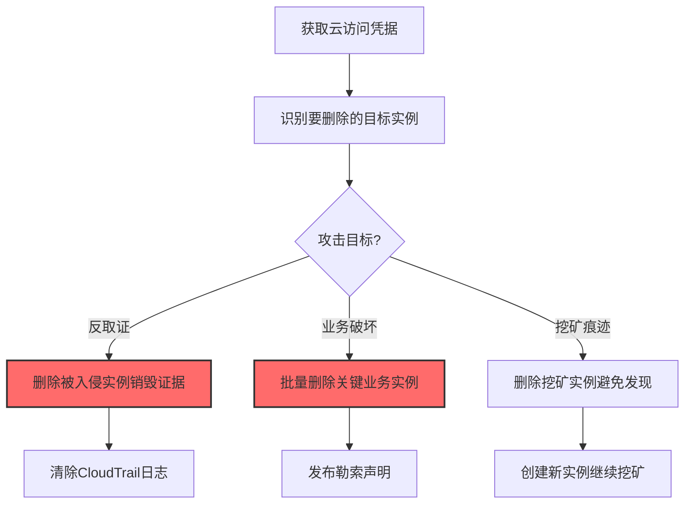
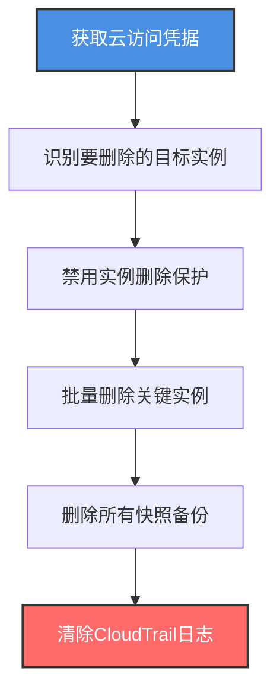

# 删除云实例 (T1578.003)

## 一句话通俗理解

> **攻击者删除云实例销毁证据——把"案发现场"整个抹掉，让取证人员无迹可寻**

## 30秒速查卡

| 维度 | 你需要知道的 |
|------|-------------|
| 这是什么？ | 攻击者使用云 API 删除/终止云实例，用于反取证、破坏业务或清除攻击痕迹 |
| 为什么危险？ | 删除是不可逆操作（除非有快照），可瞬间销毁关键业务系统和数字证据 |
| 谁需要关心？ | 云安全管理员、应急响应团队、业务连续性团队 |
| 你的第一步防御 | 对所有 `TerminateInstances`/`delete instances`/`vm delete` 操作启用删除保护和告警 |
| 如果只做一件事 | 给所有生产实例启用终止保护（termination protection），防误删和恶意删除 |

## 难度等级

⭐⭐⭐ 高级 - 需要理解云实例生命周期、删除保护机制和反取证策略

## 前置知识检查

**读这个文件需要什么？**

- [x] 云实例的生命周期：pending → running → shutting-down → terminated
- [x] 删除保护机制：AWS termination protection、Azure delete lock、GCP deletion protection
- [x] 云审计日志：CloudTrail、Cloud Audit Logs、Activity Log
- [x] 反取证概念：销毁证据、清除日志、绕过取证

## 技术描述

**删除云实例**（T1578.003）是 **修改云计算基础设施**（T1578）的一个具体变体，属于 **防御削弱** 阶段的攻击技术。

> 📚 **打个比方**：就像小偷闯入你家偷东西后，临走时放了一把火把房子烧了——警察来了找不到任何指纹和作案工具。攻击者删除云实例就是为了销毁他们在实例上留下的所有痕迹：恶意程序、C2 客户端、日志文件、内存中的凭据。

### 具体怎么理解？

攻击者通过云 API 删除或终止云实例，主要目的有三种：

1. **反取证**：删除被入侵的实例，销毁恶意程序、日志和内存中的痕迹
2. **业务破坏**：批量删除关键业务实例，造成服务中断和勒索筹码
3. **挖矿痕迹清除**：挖矿实例被检测前主动删除，再创建新实例

云实例删除是**不可逆**操作（除非事先有快照）——实例终止后，EBS 根卷默认会被删除，实例本身无法恢复。攻击者利用这一点进行"焦土政策"，让取证人员无法分析攻击手法。

### 为什么有效？

这种技术之所以有效，是因为：
1. **不可逆性**：实例终止后无法恢复，所有数据丢失
2. **快速批量**：几秒钟可删除数百个实例
3. **绕过主机取证**：实例删除后内存和磁盘数据全部丢失
4. **合法操作**：删除实例是云原生合法功能，难以完全禁用
5. **配合日志清理**：攻击者先删除实例，再删除 CloudTrail 日志

**过渡段：** 不要误以为快照能保护你——如果攻击者在删除实例前先删除了所有快照，你将一无所获。这是云上反取证最强力的技术之一。

## 真实攻击流程

### 典型场景

攻击者在 **防御削弱** 阶段使用 删除云实例 技术，以下是典型的攻击步骤：



**步骤详解：**

1. **获取云访问凭据** - 通过凭据泄露或供应链攻击获得 IAM 凭据
2. **识别目标实例** - 使用 `aws ec2 describe-instances` 列出实例
3. **选择攻击路径** - 根据目标选择反取证、业务破坏或痕迹清除
4. **删除实例** - 使用 `aws ec2 terminate-instances --instance-ids` 删除
5. **后续操作** - 清除日志、发布勒索或创建新实例

## 攻击流程

### 典型攻击流程

获取云访问凭据 --> 识别要删除的目标实例 --> 删除实例（先禁用删除保护） --> 清除 CloudTrail 日志 --> 完成反取证



**步骤详解：**

1. **获取云访问凭据** - 攻击者通过多种途径获取云凭据
   - 通俗描述：就像攻击者偷到了云仓库的"销毁按钮"权限
   - 技术细节：通过钓鱼获取云管理员凭据；通过供应链攻击（如 SolarWinds）获取云管理权限；通过提权漏洞从低权限用户升级到 `ec2:TerminateInstances` 权限
   - 常用工具：Pacu、aws-cli、Metasploit

2. **识别要删除的目标实例** - 攻击者列出所有实例并识别关键目标
   - 通俗描述：就像纵火犯先踩点，确定哪些房间最重要
   - 技术细节：执行 `aws ec2 describe-instances --query 'Reservations[*].Instances[*].{ID:InstanceId,Name:Tags[?Key==`Name`].Value|[0],State:State.Name}'` 列出所有实例和标签；通过标签识别生产实例（`env:prod`、`role:database`、`role:web`）
   - 常用工具：aws-cli、AWS Console、CloudMapper

3. **禁用实例删除保护** - 攻击者先禁用删除保护才能删除受保护实例
   - 通俗描述：就像先拆除保险柜的报警器，再开始撬锁
   - 技术细节：执行 `aws ec2 modify-instance-attribute --instance-id i-xxx --disable-api-termination` 禁用终止保护；在 Azure 中需要先删除资源锁 `az lock delete --ids <lock-id>`；在 GCP 中删除保护是实例属性，需要 `gcloud compute instances update <instance> --no-deletion-protection`
   - 常用工具：aws-cli、az、gcloud

4. **批量删除关键实例** - 攻击者使用 terminate 命令批量删除实例
   - 通俗描述：按下"销毁按钮"，瞬间抹去所有痕迹
   - 技术细节：执行 `aws ec2 terminate-instances --instance-ids i-xxx i-yyy i-zzz` 批量删除实例；在 Azure 中使用 `az vm delete --ids <vm-id-1> <vm-id-2> --yes`；在 GCP 中使用 `gcloud compute instances delete <instance-1> <instance-2> --zone=<zone>`；根卷（EBS）默认随实例删除
   - 常用工具：aws-cli、az、gcloud、Terraform destroy

5. **删除所有快照备份** - 攻击者删除快照以防止从快照恢复
   - 通俗描述：把所有备份也烧掉，让受害者无法恢复
   - 技术细节：执行 `aws ec2 describe-snapshots --owner-ids self` 列出所有快照，然后用 `aws ec2 delete-snapshot --snapshot-id snap-xxx` 逐个删除；在 Azure 中使用 `az snapshot delete --name <snapshot-name> --resource-group <rg>`；在 GCP 中使用 `gcloud compute snapshots delete <snapshot-name>`
   - 常用工具：aws-cli、az、gcloud

6. **清除 CloudTrail 日志** - 攻击者删除审计日志以掩盖删除操作
   - 通俗描述：把监控录像也擦干净
   - 技术细节：如果攻击者有 `cloudtrail:DeleteTrail` 权限，可以执行 `aws cloudtrail delete-trail --name <trail-name>` 删除整个 Trail；更隐蔽的方式是停止日志记录 `aws cloudtrail stop-logging --name <trail-name>`；或者删除 S3 桶中的日志文件 `aws s3 rm s3://cloudtrail-bucket/ --recursive`
   - 常用工具：aws-cli、s3 cmd

## 真实案例

### 案例1：Code Spaces 数据销毁攻击（2014）

- **时间**：2014年6月
- **目标**：Code Spaces，一家代码托管服务商
- **攻击组织**：未知
- **手法**：攻击者获取了 Code Spaces 的 AWS 控制台访问权限后，要求支付赎金。遭到拒绝后，攻击者系统性删除了所有 EC2 实例、EBS 卷、快照和 AMI 镜像。即使 Code Spaces 试图恢复，攻击者已经删除了所有备份，导致数据完全不可恢复。攻击者还删除了 CloudTrail 日志，使取证变得不可能
- **影响**：公司业务完全中断，最终倒闭
- **参考链接**：https://www.wired.com/2014/06/code-spaces-attack/

### 案例2：TeamTNT 反取证行为（2021-2024）

- **时间**：2021年至今
- **目标**：全球云环境
- **攻击组织**：TeamTNT
- **手法**：TeamTNT 在挖矿被检测时使用 `aws ec2 terminate-instances --instance-ids $(aws ec2 describe-instances --filters Name=tag:Name,Values=miner-* --query 'Reservations[*].Instances[*].InstanceId' --output text)` 批量删除挖矿实例。在删除前他们会先收集挖矿收益，然后销毁实例以避免被深入分析。他们还会删除 CloudTrail 中相关的日志条目
- **影响**：难以追踪攻击全貌，造成持续威胁
- **参考链接**：https://unit42.paloaltonetworks.com/teamtnt/

## 红队视角

> ⚠️ **免责声明**：以下内容仅用于合法的安全测试、渗透测试和教育目的。未经授权对他人系统进行测试是违法行为。

### 实战技巧

1. **先禁用删除保护**：`aws ec2 modify-instance-attribute --disable-api-termination` 必须先执行
2. **批量删除快**：使用 `--instance-ids` 列表一次性删除多个实例
3. **删除快照断后路**：先删除快照，受害者无法从快照恢复
4. **清除 CloudTrail**：删除或停止 CloudTrail 日志记录
5. **错峰删除**：在非工作时间删除，避开实时告警

### 常用工具

| 工具名称 | 用途 | 平台 | 链接 |
| -------- | ---- | ---- | ---- |
| aws-cli | AWS 命令行 | 跨平台 | [aws-cli](https://aws.amazon.com/cli/) |
| az | Azure 命令行 | 跨平台 | [Azure CLI](https://docs.microsoft.com/cli/azure/) |
| gcloud | GCP 命令行 | 跨平台 | [gcloud CLI](https://cloud.google.com/sdk/gcloud) |
| Pacu | AWS 攻击框架 | 跨平台 | [Pacu](https://github.com/RhinoSecurityLabs/pacu) |

### 注意事项

- `TerminateInstances` 操作会立即记录在 CloudTrail，需要在删除实例后立即清除日志
- 删除保护（termination protection）需要先禁用才能删除
- EBS 根卷默认随实例删除，但数据卷可能保留
- 实例终止后几小时内 EBS 卷可能仍可恢复（但官方不保证）

## 蓝队视角

### 检测要点

1. **监控 `TerminateInstances` API**：关注非工作时间、新 IP 的删除操作
2. **删除保护禁用监控**：监控 `ModifyInstanceAttribute --disable-api-termination`
3. **批量删除告警**：短时间内删除多个实例立即告警
4. **关键实例保护**：生产实例启用删除保护和资源锁
5. **快照删除监控**：监控 `DeleteSnapshot` 操作

### 监控建议

- 在 CloudTrail 中配置 `TerminateInstances` 事件的实时告警
- 给所有生产实例启用 termination protection
- 使用 AWS Config 规则 `ec2-instance-termination-protection-enabled`
- 在 Azure 中给关键 VM 配置 `Delete` 锁
- 配置 EventBridge 自动响应：检测到批量删除时立即通知

## 避坑指南

只启用 termination protection 而不监控 `ModifyInstanceAttribute`——攻击者会先禁用保护再删除。

## 检测建议

### 检测思路

检测 删除云实例 的关键是识别异常的实例删除模式。以下是三个层面的检测方法：

### 网络层检测

**方法**：监控实例状态变更的网络信号

```bash
# 检测实例状态变更
aws ec2 describe-instance-status --include-all-instances
```

### 主机层检测

**AWS CloudTrail 事件**：
- eventName: TerminateInstances - 实例终止
- eventName: ModifyInstanceAttribute - 实例属性修改（含禁用保护）
- eventName: DeleteSnapshot - 快照删除

```bash
# 查找最近24小时的实例终止事件
aws cloudtrail lookup-events --lookup-attributes AttributeKey=EventName,AttributeValue=TerminateInstances --start-time $(date -d '1 day ago' +%Y-%m-%dT%H:%M:%S) --max-results 50
```

### 应用层检测

**用人话说：** 攻击者用 `aws ec2 terminate-instances` 删除实例销毁证据，先 `aws ec2 modify-instance-attribute --disable-api-termination` 禁用删除保护。监控批量删除操作和删除保护禁用操作，是反取证检测的关键。

**Sigma 规则示例**：

```yaml
title: 检测实例删除保护被禁用
status: experimental
description: 攻击者删除实例前必须先禁用终止保护
logsource:
    product: aws
    service: cloudtrail
detection:
    selection:
        eventName: ModifyInstanceAttribute
        requestParameters.attribute: disableApiTermination
        requestParameters.value: 'false'
    condition: selection
fields:
    - eventName
    - userIdentity.arn
    - sourceIPAddress
    - requestParameters.instanceId
falsepositives:
    - 合法的运维操作（需审批）
level: high
tags:
    - attack.t1578.003
    - attack.defense_evasion
```

```yaml
title: 检测批量实例删除（疑似破坏或反取证）
status: experimental
description: 攻击者批量删除实例销毁证据或破坏业务
logsource:
    product: aws
    service: cloudtrail
detection:
    selection:
        eventName: TerminateInstances
    condition: selection | count() by userIdentity.arn > 5
timeframe: 5m
fields:
    - eventName
    - userIdentity.arn
    - sourceIPAddress
    - requestParameters.instancesSet
falsepositives:
    - 合法的批量缩容（需白名单）
level: critical
tags:
    - attack.t1578.003
    - attack.impact
    - attack.t1485
```

## 缓解措施

### 优先级1：关键措施

**启用删除保护**：所有生产实例启用 termination protection

```bash
# 启用终止保护
aws ec2 modify-instance-attribute --instance-id i-xxx --disable-api-termination

# Azure 资源锁
az lock create --name DeleteLock --lock-type CanNotDelete --resource-group prod-rg --resource myVM --resource-type Microsoft.Compute/virtualMachines
```

### 优先级2：重要措施

**自动备份**：使用 AWS Backup 定期创建快照

```bash
# 启用 AWS Backup 计划
aws backup create-backup-plan --backup-plan file://backup-plan.json
```

### 优先级3：建议措施

**IAM 策略限制**：限制 `ec2:TerminateInstances` 权限

```bash
# IAM 策略示例：禁止删除生产实例
{
    "Version": "2012-10-17",
    "Statement": [{
        "Effect": "Deny",
        "Action": "ec2:TerminateInstances",
        "Resource": "*",
        "Condition": {
            "StringEquals": {
                "aws:ResourceTag/env": "prod"
            }
        }
    }]
}
```

## 动手实验

> ⚠️ **所有实验必须在隔离的实验室环境中进行**

### 实验1：理解删除保护机制（初级）

**目标**：理解 删除云实例 的工作原理

**步骤**：
1. 在自己的 AWS 实验账户中创建一个测试实例
2. 启用 termination protection
3. 尝试终止实例（应该失败）
4. 禁用 protection 后再终止
5. 在 CloudTrail 中查看所有操作

**学习要点**：理解删除保护机制和绕过方法

### 实验2：实际操作（中级）

**目标**：掌握 删除云实例 的反取证模式

**步骤**：
1. 在实验环境中部署多个测试实例
2. 模拟攻击者禁用保护和批量删除
3. 配置 CloudTrail 实时告警
4. 测试自动响应（如自动启用保护）

**学习要点**：掌握攻击链和检测响应

### 实验3：防御验证（高级）

**目标**：验证检测规则和恢复能力

**步骤**：
1. 部署 AWS Backup 定期备份
2. 模拟攻击者删除实例和快照
3. 从备份恢复实例
4. 验证 SCP 策略阻止未授权删除

**学习要点**：理解业务连续性和灾难恢复

## 术语解释

| 术语 | 通俗解释 |
|------|---------|
| **终止保护** | AWS 实例的属性，启用后无法通过 API 终止实例 |
| **资源锁** | Azure 的资源保护机制，防止删除或修改 |
| **CloudTrail** | AWS 的 API 审计日志服务 |
| **AWS Backup** | AWS 的集中备份服务 |
| **SCP** | Service Control Policy，AWS Organizations 的策略 |
| **反取证** | 攻击者销毁证据以阻碍调查的技术 |

## 被引用情况

以下父技术文档引用了本子技术：

- [T1578 - 修改云计算基础设施](../T1578-Modify-Cloud-Compute-Infrastructure.md)

## 参考资料

### 官方文档

- [MITRE ATT&CK - Delete Cloud Instance (T1578.003)](https://attack.mitre.org/techniques/T1578/003/)
- [MITRE ATT&CK - Modify Cloud Compute Infrastructure (T1578)](https://attack.mitre.org/techniques/T1578/)
- [AWS EC2 Termination Protection](https://docs.aws.amazon.com/AWSEC2/latest/UserGuide/terminating-instances.html)

### 安全报告

- [Code Spaces 攻击报道](https://www.wired.com/2014/06/code-spaces-attack/) - 2014 Code Spaces 案件
- [Palo Alto Unit42 TeamTNT 分析](https://unit42.paloaltonetworks.com/teamtnt/) - TeamTNT 反取证

### 工具与资源

- [Pacu](https://github.com/RhinoSecurityLabs/pacu) - AWS 攻击框架
- [AWS Backup](https://aws.amazon.com/backup/) - AWS 集中备份服务
- [Atomic Red Team](https://github.com/redcanaryco/atomic-red-team) - 检测规则测试
