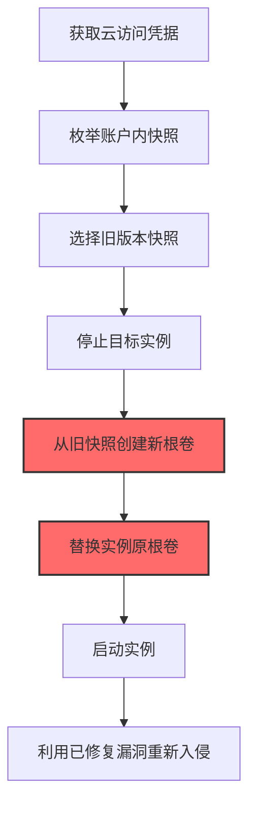
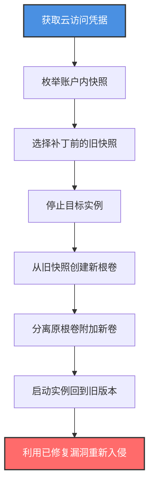

# 回滚云实例 (T1578.004)

## 一句话通俗理解

> **攻击者把云实例回滚到旧版本——撤销最近的安全补丁，让已修复的漏洞重新可用**

## 30秒速查卡

| 维度 | 你需要知道的 |
|------|-------------|
| 这是什么？ | 攻击者从旧快照恢复云实例，使其回到未打补丁或安全配置较弱的状态 |
| 为什么危险？ | 回滚会撤销所有安全补丁和配置变更，让已修复的漏洞重新可被利用 |
| 谁需要关心？ | 云安全管理员、补丁管理团队、SOC 分析师 |
| 你的第一步防御 | 监控所有从快照恢复实例的操作，回滚后立即扫描补丁状态 |
| 如果只做一件事 | 监控 `CreateVolume`（from snapshot）+ `AttachVolume` 组合操作，识别回滚行为 |

## 难度等级

⭐⭐⭐ 高级 - 需要理解云快照恢复流程、补丁管理和漏洞利用

## 前置知识检查

**读这个文件需要什么？**

- [x] 云快照恢复机制：从快照创建新卷并替换原卷
- [x] 补丁管理：操作系统和应用程序的补丁生命周期
- [x] 漏洞利用：已修复的漏洞在旧版本上仍可利用
- [x] 云审计日志：CloudTrail、Cloud Audit Logs、Activity Log

## 技术描述

**回滚云实例**（T1578.004）是 **修改云计算基础设施**（T1578）的一个具体变体，属于 **防御削弱** 阶段的攻击技术。

> 📚 **打个比方**：就像你的手机系统升级修复了所有漏洞，但攻击者偷偷把你的系统恢复到了旧版本——所有刚修复的漏洞又都"复活"了。云实例回滚就是这个概念在云上的实现：攻击者从旧快照恢复实例，撤销所有安全补丁。

### 具体怎么理解？

攻击者通过云 API 将实例回滚到旧版本，主要方式有：

1. **从快照恢复根卷**：停止实例 → 从旧快照创建新根卷 → 替换原根卷 → 启动实例
2. **从 AMI 重新部署**：从旧 AMI 启动新实例替换原实例
3. **从镜像恢复**：在 GCP 中从机器镜像恢复实例

回滚后的实例会缺少最近安装的安全补丁，攻击者可以利用这些已修复但回滚后重新出现的漏洞进行攻击。例如，如果实例在 2024-06 安装了 CVE-2024-3094（xz 后门）的修复补丁，攻击者回滚到 2024-05 的快照，该漏洞就重新可被利用。

### 为什么有效？

这种技术之所以有效，是因为：
1. **撤销防御**：回滚会撤销所有安全补丁和配置变更
2. **漏洞复活**：已修复的漏洞在旧版本上仍可利用
3. **绕过 EDR**：如果旧快照中没有 EDR 代理，回滚后实例无防护
4. **合法操作**：从快照恢复是云原生合法功能
5. **难以检测**：恢复操作看起来像正常的灾难恢复

**过渡段：** 不要误以为打了补丁就万事大吉——攻击者可以通过回滚让所有补丁前功尽弃。这是云环境特有的"时间旅行"攻击。

## 真实攻击流程

### 典型场景

攻击者在 **防御削弱** 阶段使用 回滚云实例 技术，以下是典型的攻击步骤：



**步骤详解：**

1. **获取云访问凭据** - 通过凭据泄露获得 IAM 凭据
2. **枚举账户内快照** - 列出所有可用的快照
3. **选择旧版本快照** - 选择补丁前的快照
4. **停止目标实例** - 使用 `aws ec2 stop-instances` 停止实例
5. **从旧快照创建新根卷** - 使用 `aws ec2 create-volume --snapshot-id`
6. **替换实例原根卷** - 分离原卷并附加新卷
7. **启动实例** - 使用 `aws ec2 start-instances` 启动
8. **利用已修复漏洞** - 重新利用回滚后复活的漏洞

## 攻击流程

### 典型攻击流程

获取云访问凭据 --> 枚举账户内快照 --> 选择旧版本快照 --> 停止实例 --> 从旧快照创建新根卷 --> 替换原根卷 --> 启动实例 --> 利用已修复漏洞



**步骤详解：**

1. **获取云访问凭据** - 攻击者通过多种途径获取云凭据
   - 通俗描述：就像攻击者偷到了云仓库管理员的"时间机器"操作权
   - 技术细节：通过 IMDSv1 SSRF 获取 IAM 凭据；通过钓鱼获取控制台凭据；通过供应链攻击获得云管理员权限
   - 常用工具：Pacu、aws-cli、curl

2. **枚举账户内快照** - 攻击者列出所有可用的快照
   - 通俗描述：就像翻看仓库的备份档案，找最旧的那个版本
   - 技术细节：执行 `aws ec2 describe-snapshots --owner-ids self --query 'Snapshots[*].{ID:SnapshotId,Time:StartTime,Desc:Description}'` 列出所有快照和创建时间；通过描述或标签识别补丁前后的快照
   - 常用工具：aws-cli、AWS Console

3. **选择补丁前的旧快照** - 攻击者选择未打补丁的快照
   - 通俗描述：找到那个还没修复漏洞的旧版本
   - 技术细节：通过快照描述中的日期判断；通过关联实例标签（`patched: false`）识别；通常选择 30 天前的快照，那时补丁还未应用
   - 常用工具：aws-cli、AWS Console

4. **停止目标实例** - 攻击者停止实例以替换根卷
   - 通俗描述：先把机器关机才能换硬盘
   - 技术细节：执行 `aws ec2 stop-instances --instance-ids i-xxx` 停止实例；等待实例状态变为 `stopped`；停止过程通常需要 1-2 分钟
   - 常用工具：aws-cli

5. **从旧快照创建新根卷** - 攻击者从旧快照创建新的 EBS 卷
   - 通俗描述：从旧备份复制一块新硬盘
   - 技术细节：执行 `aws ec2 create-volume --snapshot-id snap-xxx --availability-zone us-east-1a --volume-type gp3` 从旧快照创建新卷；新卷包含旧快照中的所有数据（包括旧版本软件和未修复漏洞）
   - 常用工具：aws-cli

6. **分离原根卷并附加新卷** - 攻击者替换实例的根卷
   - 通俗描述：拆下新硬盘换上旧硬盘
   - 技术细节：执行 `aws ec2 detach-volume --volume-id vol-original` 分离原根卷；然后 `aws ec2 attach-volume --volume-id vol-new --instance-id i-xxx --device /dev/sda1` 附加新卷作为根卷；`/dev/sda1` 是根卷的设备名
   - 常用工具：aws-cli

7. **启动实例回到旧版本** - 攻击者启动实例
   - 通俗描述：开机，系统回到旧版本
   - 技术细节：执行 `aws ec2 start-instances --instance-ids i-xxx` 启动实例；实例从旧根卷启动，操作系统和所有软件都是旧版本；最近的安全补丁都不存在
   - 常用工具：aws-cli

8. **利用已修复漏洞重新入侵** - 攻击者利用回滚后复活的漏洞
   - 通俗描述：用之前已经修复的漏洞再次入侵
   - 技术细节：如果实例在 2024-06 修复了 CVE-2024-1234（如 Log4Shell），回滚到 2024-05 后该漏洞重新可被利用；攻击者使用 Metasploit 模块 `exploit/multi/http/log4shell_header_injection` 重新入侵
   - 常用工具：Metasploit、Cobalt Strike、漏洞利用工具

## 真实案例

### 案例1：UNC2452/SolarWinds 云回滚攻击（2020-2021）

- **时间**：2020年-2021年
- **目标**：美国政府机构的 Azure 环境
- **攻击组织**：APT29（Cozy Bear，俄罗斯 SVR）
- **手法**：APT29 在 SolarWinds 供应链攻击中，对受害者的 Azure VM 进行了回滚操作。他们使用 `az snapshot create` 创建了关键 VM 的快照，等待几天后受害者安装安全补丁。然后攻击者使用 `az vm create --image <old-snapshot>` 从补丁前的快照重新部署 VM，绕过了刚安装的检测代理。回滚后的 VM 缺少 Microsoft Defender for Endpoint 代理，攻击者可以自由活动
- **影响**：多个政府机构被持续入侵数月
- **参考链接**：https://www.cisa.gov/news-events/cybersecurity-advisories/aa21-148a

### 案例2：勒索软件团伙的回滚攻击（2023）

- **时间**：2023年
- **目标**：多家医疗机构
- **攻击组织**：未知勒索软件团伙
- **手法**：攻击者获取 AWS 管理员权限后，先使用 `aws ec2 describe-snapshots` 列出所有快照，识别出补丁前的快照。然后停止目标实例，从旧快照创建新根卷替换原卷，启动实例使其回到未打补丁状态。回滚后，他们利用已修复的 PrintNightmare 漏洞（CVE-2021-34527）重新提权，部署勒索软件
- **影响**：多家医疗机构系统被加密
- **参考链接**：https://www.cisa.gov/stopransomware

## 红队视角

> ⚠️ **免责声明**：以下内容仅用于合法的安全测试、渗透测试和教育目的。未经授权对他人系统进行测试是违法行为。

### 实战技巧

1. **选择补丁前快照**：通过快照创建时间判断补丁前后的版本
2. **保留原卷做对比**：分离原卷但不删除，可用于事后分析
3. **回滚后立即利用**：补丁回滚后立即利用漏洞，避免触发新的检测
4. **多云策略**：在 Azure 中使用 `az snapshot create` + `az disk create` + `az vm update`
5. **隐蔽回滚**：使用 GCP 机器镜像回滚比快照更隐蔽

### 常用工具

| 工具名称 | 用途 | 平台 | 链接 |
| -------- | ---- | ---- | ---- |
| aws-cli | AWS 命令行 | 跨平台 | [aws-cli](https://aws.amazon.com/cli/) |
| az | Azure 命令行 | 跨平台 | [Azure CLI](https://docs.microsoft.com/cli/azure/) |
| gcloud | GCP 命令行 | 跨平台 | [gcloud CLI](https://cloud.google.com/sdk/gcloud) |
| Pacu | AWS 攻击框架 | 跨平台 | [Pacu](https://github.com/RhinoSecurityLabs/pacu) |

### 注意事项

- 实例停止和启动会触发 CloudTrail 告警
- 替换根卷需要正确的设备名（通常是 `/dev/sda1`）
- 回滚后实例的 IAM 角色保持不变，但 EDR 代理可能丢失
- 回滚操作可能影响业务连续性，需要谨慎时机

## 蓝队视角

### 检测要点

1. **监控从快照创建卷**：`CreateVolume` 事件中包含 `SnapshotId`
2. **监控根卷替换**：`DetachVolume` + `AttachVolume` 组合操作
3. **回滚后补丁扫描**：实例启动后立即扫描补丁状态
4. **快照枚举监控**：频繁的 `DescribeSnapshots` 操作可能是侦察
5. **实例停止监控**：非工作时间的 `StopInstances` 操作

### 监控建议

- 在 CloudTrail 中配置 `CreateVolume`（含 SnapshotId）事件的告警
- 使用 AWS Config 规则检测实例配置变更
- 部署自动化补丁扫描：实例启动后自动运行 SSM Patch Manager 扫描
- 监控 EDR 代理状态：实例启动后 EDR 代理应自动启动，缺失则告警
- 配置 EventBridge 规则：检测到根卷替换时自动通知安全团队

## 避坑指南

只监控 `CreateVolume` 而不监控 `AttachVolume`——攻击者可能从快照创建卷后等待一段时间再附加，避开时间窗口关联检测。

## 检测建议

### 检测思路

检测 回滚云实例 的关键是识别从快照恢复实例的操作模式。以下是三个层面的检测方法：

### 网络层检测

**方法**：监控实例启动后的网络活动，识别回滚特征

```bash
# 检测实例启动后立即连接已知恶意IP
aws ec2 describe-network-interfaces --network-interface-ids eni-xxx
```

### 主机层检测

**AWS CloudTrail 事件**：
- eventName: StopInstances - 实例停止
- eventName: CreateVolume（含 SnapshotId）- 从快照创建卷
- eventName: DetachVolume - 卷分离
- eventName: AttachVolume - 卷附加
- eventName: StartInstances - 实例启动

```bash
# 查找从快照创建卷的事件
aws cloudtrail lookup-events --lookup-attributes AttributeKey=EventName,AttributeValue=CreateVolume --start-time $(date -d '1 day ago' +%Y-%m-%dT%H:%M:%S)
```

### 应用层检测

**用人话说：** 攻击者通过 `aws ec2 create-volume --snapshot-id` + `aws ec2 attach-volume` 组合操作将实例回滚到旧版本。监控这组操作的序列是检测回滚的关键。

**Sigma 规则示例**：

```yaml
title: 检测从快照创建卷并附加到实例（疑似回滚）
status: experimental
description: 攻击者从旧快照创建新卷并替换实例根卷以回滚到未打补丁状态
logsource:
    product: aws
    service: cloudtrail
detection:
    selection_create:
        eventName: CreateVolume
        requestParameters.snapshotId|exists: true
    selection_attach:
        eventName: AttachVolume
        requestParameters.device: /dev/sda1
    timeframe: 30m
    condition: selection_create | near selection_attach
fields:
    - eventName
    - userIdentity.arn
    - sourceIPAddress
    - requestParameters.snapshotId
    - requestParameters.instanceId
falsepositives:
    - 合法的灾难恢复操作（需审批）
level: high
tags:
    - attack.t1578.004
    - attack.defense_evasion
```

```yaml
title: 检测实例根卷替换（反取证信号）
status: experimental
description: 攻击者分离原根卷并附加新卷以替换实例操作系统
logsource:
    product: aws
    service: cloudtrail
detection:
    selection_detach:
        eventName: DetachVolume
        requestParameters.device: /dev/sda1
    selection_attach:
        eventName: AttachVolume
        requestParameters.device: /dev/sda1
    timeframe: 30m
    condition: selection_detach | near selection_attach
fields:
    - eventName
    - userIdentity.arn
    - requestParameters.instanceId
    - requestParameters.volumeId
falsepositives:
    - 合法的根卷替换（极少见）
level: critical
tags:
    - attack.t1578.004
    - attack.defense_evasion
    - attack.t1070
```

## 缓解措施

### 优先级1：关键措施

**限制快照恢复权限**：仅授予特定 IAM 角色快照恢复权限

```bash
# IAM 策略示例：禁止从快照创建卷
{
    "Version": "2012-10-17",
    "Statement": [{
        "Effect": "Deny",
        "Action": "ec2:CreateVolume",
        "Resource": "*",
        "Condition": {
            "Null": {
                "ec2:SnapshotId": false
            }
        }
    }]
}
```

### 优先级2：重要措施

**保留快照审计**：所有快照打上不可变标签

```bash
# 启用快照锁定（防止篡改）
aws ec2 lock-snapshot --snapshot-id snap-xxx --lock-mode compliance --lock-duration 365
```

### 优先级3：建议措施

**自动化补丁扫描**：实例启动后立即扫描补丁状态

```bash
# 使用 SSM Patch Manager 扫描
aws ssm send-command --document-name "AWS-RunPatchBaseline" --instance-ids i-xxx --parameters Operation=Scan
```

## 动手实验

> ⚠️ **所有实验必须在隔离的实验室环境中进行**

### 实验1：理解快照恢复流程（初级）

**目标**：理解 回滚云实例 的工作原理

**步骤**：
1. 在自己的 AWS 实验账户中创建一个 EC2 实例并安装测试软件
2. 创建快照
3. 安装新软件或补丁
4. 停止实例，从快照创建新根卷替换原卷
5. 启动实例，验证回滚到旧版本

**学习要点**：理解快照恢复机制和回滚效果

### 实验2：实际操作（中级）

**目标**：掌握 回滚云实例 的实际使用方法

**步骤**：
1. 使用 Pacu 模拟攻击者枚举快照
2. 执行完整的回滚流程
3. 在 CloudTrail 中分析操作痕迹
4. 配置检测规则

**学习要点**：掌握攻击链全流程

### 实验3：防御验证（高级）

**目标**：验证检测规则和恢复能力

**步骤**：
1. 部署 CloudTrail 实时告警
2. 模拟回滚攻击
3. 验证检测规则触发
4. 测试快照锁定对回滚的阻止效果

**学习要点**：理解攻防对抗的实际效果

## 术语解释

| 术语 | 通俗解释 |
|------|---------|
| **快照恢复** | 从快照创建新卷或实例，回到快照创建时的状态 |
| **根卷** | 实例的启动磁盘，包含操作系统 |
| **回滚** | 将系统恢复到之前的状态 |
| **补丁管理** | 操作系统和应用程序的更新管理 |
| **CloudTrail** | AWS 的 API 审计日志服务 |
| **快照锁定** | AWS EBS 快照的不可变保护机制 |

## 被引用情况

以下父技术文档引用了本子技术：

- [T1578 - 修改云计算基础设施](../T1578-Modify-Cloud-Compute-Infrastructure.md)

## 参考资料

### 官方文档

- [MITRE ATT&CK - Revert Cloud Instance (T1578.004)](https://attack.mitre.org/techniques/T1578/004/)
- [MITRE ATT&CK - Modify Cloud Compute Infrastructure (T1578)](https://attack.mitre.org/techniques/T1578/)
- [AWS EBS Snapshot Restore](https://docs.aws.amazon.com/AWSEC2/latest/UserGuide/ebs-restoring-volume.html)

### 安全报告

- [CISA SolarWinds 通告](https://www.cisa.gov/news-events/cybersecurity-advisories/aa21-148a) - APT29 回滚攻击
- [CISA Stop Ransomware](https://www.cisa.gov/stopransomware) - 勒索软件回滚攻击

### 工具与资源

- [Pacu](https://github.com/RhinoSecurityLabs/pacu) - AWS 攻击框架
- [AWS SSM Patch Manager](https://aws.amazon.com/systems-manager/features/patch-manager/) - 补丁管理
- [Atomic Red Team](https://github.com/redcanaryco/atomic-red-team) - 检测规则测试
