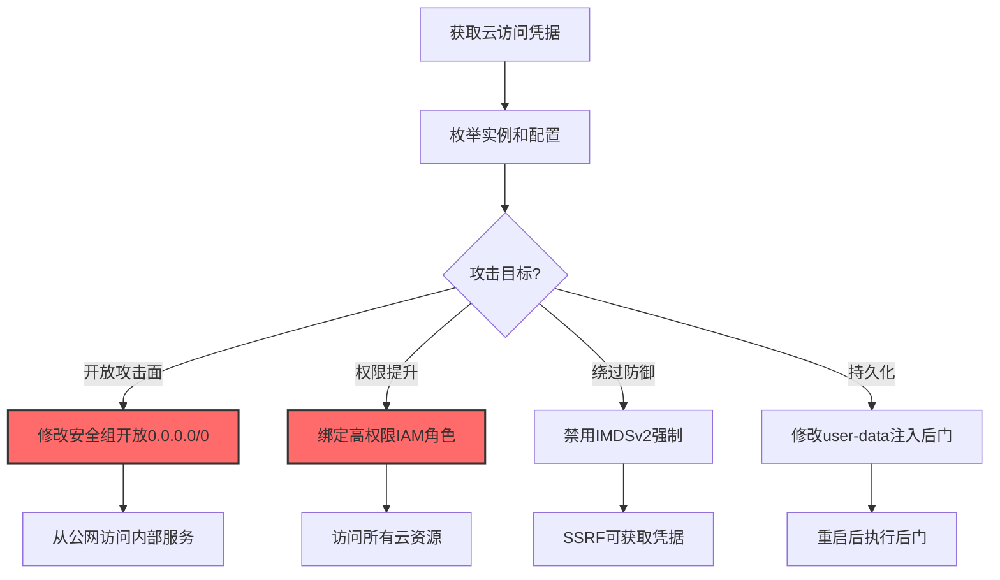
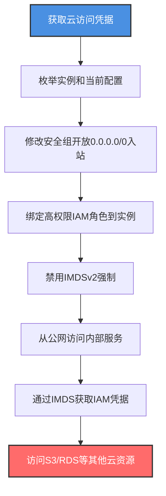

# 修改云计算配置 (T1578.005)

## 一句话通俗理解

> **攻击者修改云实例的安全组、IAM 角色和元数据配置——为后续攻击打开所有门**

## 30秒速查卡

| 维度 | 你需要知道的 |
|------|-------------|
| 这是什么？ | 攻击者通过云 API 修改实例的安全组、IAM 角色、元数据等配置，削弱云安全态势 |
| 为什么危险？ | 修改配置可以开放任意端口、提升权限、绕过检测，是云攻击的"瑞士军刀" |
| 谁需要关心？ | 云安全管理员、CSPM 运营、SOC 分析师 |
| 你的第一步防御 | 监控所有 `ModifyInstanceAttribute`/`az vm update`/`gcloud compute instances update` 操作 |
| 如果只做一件事 | 监控安全组规则变更，特别是开放 0.0.0.0/0 入站的操作 |

## 难度等级

⭐⭐⭐ 高级 - 需要理解云安全组、IAM 角色绑定和元数据服务

## 前置知识检查

**读这个文件需要什么？**

- [x] 云安全组（Security Group）：云防火墙规则，控制实例的入站和出站流量
- [x] IAM 角色绑定：实例可以绑定 IAM 角色，授予访问其他云资源的权限
- [x] 实例元数据服务（IMDS）：提供实例配置和 IAM 凭据
- [x] 云审计日志：CloudTrail、Cloud Audit Logs、Activity Log

## 技术描述

**修改云计算配置**（T1578.005）是 **修改云计算基础设施**（T1578）的一个具体变体，属于 **防御削弱** 阶段的攻击技术。

> 📚 **打个比方**：就像攻击者拿到公司门禁系统管理权限后，把所有门禁规则改成"任何人可进"——既开放了大门（安全组），又给小偷办了张员工卡（IAM 角色），还把保安的对讲机密码改了（元数据）。这是云攻击中最灵活、最危险的技术。

### 具体怎么理解？

攻击者通过云 API 修改实例的多种配置，主要包括：

1. **安全组修改**：开放 0.0.0.0/0 入站规则，让实例暴露在公网
2. **IAM 角色绑定**：给实例绑定高权限角色，使其能访问所有云资源
3. **元数据配置修改**：禁用 IMDSv2 强制，让 SSRF 可以再次获取凭据
4. **网络接口修改**：修改实例的网络接口，绕过网络检测
5. **用户数据修改**：修改 user-data 注入新命令（部分云支持）

这些修改可以单独使用，也可以组合使用。例如，攻击者先开放安全组让外部可以访问，然后绑定高权限角色让实例能访问 S3 和数据库，最后修改元数据服务让其他攻击者也能通过 SSRF 获取凭据。

### 为什么有效？

这种技术之所以有效，是因为：
1. **灵活性**：一个 API 调用就能修改多种配置
2. **持久化**：配置修改后持续生效，无需重新部署
3. **绕过检测**：修改配置看起来像合法运维操作
4. **权限提升**：绑定高权限 IAM 角色可直接提权
5. **开放攻击面**：安全组修改可瞬间暴露内部服务到公网

**过渡段：** 不要误以为只监控实例创建就够了——攻击者可以不动实例，仅修改配置就能完成整个攻击链。这是云攻击中最隐蔽的技术之一。

## 真实攻击流程

### 典型场景

攻击者在 **防御削弱** 阶段使用 修改云计算配置 技术，以下是典型的攻击步骤：



**步骤详解：**

1. **获取云访问凭据** - 通过凭据泄露获得 IAM 凭据
2. **枚举实例和配置** - 列出所有实例和当前配置
3. **选择攻击路径** - 根据目标选择修改方式
4. **执行配置修改** - 调用云 API 修改配置
5. **利用修改后的配置** - 访问服务、提权或绕过防御

## 攻击流程

### 典型攻击流程

获取云访问凭据 --> 枚举实例和配置 --> 修改安全组开放端口 --> 绑定高权限 IAM 角色 --> 禁用 IMDSv2 --> 利用修改后的配置进行后续攻击



**步骤详解：**

1. **获取云访问凭据** - 攻击者通过多种途径获取云凭据
   - 通俗描述：就像攻击者偷到了云仓库管理员的"配置修改"权限
   - 技术细节：通过 IMDSv1 SSRF 获取 IAM 角色凭据；通过钓鱼获取控制台凭据；通过供应链攻击获得云管理员权限；通过提权漏洞从低权限用户升级
   - 常用工具：Pacu、aws-cli、curl

2. **枚举实例和当前配置** - 攻击者列出所有实例和当前配置
   - 通俗描述：先看看哪些门的锁需要换，哪些人需要办卡
   - 技术细节：执行 `aws ec2 describe-instances --query 'Reservations[*].Instances[*].{ID:InstanceId,SG:SecurityGroups,IAMRole:IamInstanceProfile,Metadata:MetadataOptions}'` 列出实例及其安全组、IAM 角色和元数据配置
   - 常用工具：aws-cli、AWS Console

3. **修改安全组开放 0.0.0.0/0 入站** - 攻击者修改安全组规则开放端口
   - 通俗描述：把所有门的锁都拆了，让任何人都能进
   - 技术细节：执行 `aws ec2 authorize-security-group-ingress --group-id sg-xxx --protocol tcp --port 0-65535 --cidr 0.0.0.0/0` 开放所有 TCP 端口；或者更隐蔽地开放特定端口如 `--port 3389`（RDP）或 `--port 22`（SSH）；在 Azure 中使用 `az network nsg rule create --name allow-all --resource-group rg --nsg-name nsg --priority 100 --source-address-prefixes '*' --destination-port-ranges '*' --access Allow`
   - 常用工具：aws-cli、az、gcloud

4. **绑定高权限 IAM 角色到实例** - 攻击者给实例绑定管理员角色
   - 通俗描述：给实例办一张能进所有房间的总卡
   - 技术细节：执行 `aws ec2 associate-iam-instance-profile --instance-id i-xxx --iam-instance-profile Name=admin-role` 绑定 IAM 角色；admin-role 拥有 `AdministratorAccess` 策略或 `s3:*`、`rds:*` 等高权限；实例内的应用可通过 IMDS 获取临时凭据访问其他资源
   - 常用工具：aws-cli、IAM Console

5. **禁用 IMDSv2 强制** - 攻击者降级 IMDS 到 v1 以利用 SSRF
   - 通俗描述：把强制令牌验证改回旧版，让 SSRF 又能偷凭据
   - 技术细节：执行 `aws ec2 modify-instance-metadata-options --instance-id i-xxx --http-tokens optional --http-endpoint enabled` 将 IMDS 从 v2 强制模式降级到 v1 可选模式；这样 SSRF 漏洞可以再次通过 `curl http://169.254.169.254/latest/meta-data/iam/security-credentials/` 获取 IAM 凭据
   - 常用工具：aws-cli

6. **从公网访问内部服务** - 攻击者通过开放的安全组访问内部服务
   - 通俗描述：从外网直接访问原本只能内网访问的服务
   - 技术细节：使用 SSH 连接 `ssh -i key.pem ec2-user@<public-ip>`；或直接访问 Web 服务 `curl http://<public-ip>:8080`；如果开放了 RDP，使用远程桌面连接 Windows 实例
   - 常用工具：SSH、RDP、curl、浏览器

7. **通过 IMDS 获取 IAM 凭据** - 攻击者从实例元数据获取 IAM 凭据
   - 通俗描述：从元数据服务偷取 IAM 角色的临时凭据
   - 技术细节：执行 `curl http://169.254.169.254/latest/meta-data/iam/security-credentials/admin-role` 获取角色的 AccessKey、SecretKey 和 Token；这些凭据可在攻击者环境中使用，访问 S3、RDS 等其他云资源
   - 常用工具：curl、aws-cli

8. **访问 S3/RDS 等其他云资源** - 攻击者利用获取的凭据横向移动
   - 通俗描述：用偷来的总卡打开所有房间
   - 技术细节：使用获取的凭据配置 aws-cli，执行 `aws s3 ls` 列出所有 S3 桶；`aws s3 cp s3://sensitive-bucket/ ./data --recursive` 下载敏感数据；`aws rds describe-db-instances` 列出所有数据库
   - 常用工具：aws-cli、AWS SDK

## 真实案例

### 案例1：Capital One 安全组配置不当（2019）

- **时间**：2019年
- **目标**：Capital One 银行
- **攻击组织**：Paige Thompson
- **手法**：Capital One 的 WAF 实例配置了过于宽松的安全组规则，允许来自任意 IP 的访问。攻击者利用 WAF 的 SSRF 漏洞通过 IMDSv1 获取了 IAM 角色凭据。该角色权限过高（包含 `s3:*`），使攻击者能列出所有 S3 桶并下载敏感数据。攻击者还修改了实例的元数据配置以维持访问
- **影响**：1.06 亿条客户记录泄露
- **参考链接**：https://www.justice.gov/usao-wdwa/pr/former-amazon-software-engineer-sentected-prison-hack-over-100-million-capital-one

### 案例2：Scattered Spider 修改 Azure VM 配置（2023）

- **时间**：2023年9月
- **目标**：MGM Resorts
- **攻击组织**：Scattered Spider
- **手法**：Scattered Spider 进入 Azure 环境后，使用 `az vm update --resource-group prod-rg --name mgm-app-vm --set identity.type=SystemAssigned` 给 VM 添加系统分配的托管身份。然后通过 `az role assignment create --assignee <principal-id> --role "Owner" --scope <subscription-id>` 给该 VM 绑定订阅级别的 Owner 角色。他们还使用 `az network nsg rule create --name allow-all --resource-group prod-rg --nsg-name prod-nsg --priority 100 --source-address-prefixes '*' --destination-port-ranges '*' --access Allow` 开放所有端口，使 VM 可以从公网访问
- **影响**：MGM 损失超过 1 亿美元
- **参考链接**：https://www.cisa.gov/news-events/cybersecurity-advisories/aa23-320a

### 案例3：TeamTNT 修改 IMDS 配置（2021-2024）

- **时间**：2021年至今
- **目标**：全球云环境
- **攻击组织**：TeamTNT
- **手法**：TeamTNT 在入侵 EC2 实例后，会使用 `aws ec2 modify-instance-metadata-options --instance-id i-xxx --http-tokens optional` 将 IMDS 从 v2 强制模式降级到 v1 可选模式，以便后续通过 SSRF 漏洞获取 IAM 凭据。他们还修改安全组开放 2375 端口（Docker API），让其他攻击者可以直接连接受害者的 Docker 服务部署挖矿容器
- **影响**：造成数百万美元损失
- **参考链接**：https://unit42.paloaltonetworks.com/teamtnt/

## 红队视角

> ⚠️ **免责声明**：以下内容仅用于合法的安全测试、渗透测试和教育目的。未经授权对他人系统进行测试是违法行为。

### 实战技巧

1. **安全组开放特定端口更隐蔽**：只开放 22/443/3389 而非全部端口
2. **绑定托管身份更隐蔽**：Azure 中使用系统分配的托管身份比用户分配的更难发现
3. **IMDS 降级是关键**：将 IMDSv2 降级到 v1 让 SSRF 重新可用
4. **角色绑定后立即利用**：绑定角色后立即从 IMDS 获取凭据，避免延迟
5. **修改网络接口绕过检测**：修改网络接口的源/目标检查可绕过网络检测

### 常用工具

| 工具名称 | 用途 | 平台 | 链接 |
| -------- | ---- | ---- | ---- |
| aws-cli | AWS 命令行 | 跨平台 | [aws-cli](https://aws.amazon.com/cli/) |
| az | Azure 命令行 | 跨平台 | [Azure CLI](https://docs.microsoft.com/cli/azure/) |
| gcloud | GCP 命令行 | 跨平台 | [gcloud CLI](https://cloud.google.com/sdk/gcloud) |
| Pacu | AWS 攻击框架 | 跨平台 | [Pacu](https://github.com/RhinoSecurityLabs/pacu) |

### 注意事项

- 配置修改操作都会记录在 CloudTrail，无法清除
- 安全组修改可能触发 GuardDuty 告警
- IAM 角色绑定变更会触发 CSPM 工具告警
- IMDS 降级操作在 Config 中可检测

## 蓝队视角

### 检测要点

1. **安全组变更监控**：监控 `AuthorizeSecurityGroupIngress`，特别是 0.0.0.0/0 入站
2. **IAM 角色绑定监控**：监控 `AssociateIamInstanceProfile` 操作
3. **IMDS 配置变更**：监控 `ModifyInstanceMetadataOptions` 中的 `--http-tokens optional`
4. **网络接口修改**：监控 `ModifyNetworkInterfaceAttribute` 操作
5. **user-data 修改**：监控 `ModifyInstanceAttribute` 中的 userData 字段

### 监控建议

- 在 CloudTrail 中配置安全组变更的实时告警
- 使用 AWS Config 规则检测公开的安全组规则
- 部署 GuardDuty 检测异常 IAM 操作
- 使用 CSPM 工具（Wiz、Prisma Cloud）持续扫描配置合规性
- 配置 EventBridge 自动响应：检测到 0.0.0.0/0 入站规则时自动撤销

## 避坑指南

只监控安全组创建而忽略规则修改——攻击者可以修改现有安全组规则而无需创建新安全组。

## 检测建议

### 检测思路

检测 修改云计算配置 的关键是识别异常的配置变更模式。以下是三个层面的检测方法：

### 网络层检测

**方法**：监控实例的入站流量模式变化

```bash
# 检测从公网IP访问内部服务
aws ec2 describe-security-groups --query 'SecurityGroups[?IpPermissions[?IpRanges[?CidrIp==`0.0.0.0/0`]]]'
```

### 主机层检测

**AWS CloudTrail 事件**：
- eventName: AuthorizeSecurityGroupIngress - 安全组入站规则添加
- eventName: AssociateIamInstanceProfile - IAM 角色绑定
- eventName: ModifyInstanceMetadataOptions - 元数据配置修改
- eventName: ModifyInstanceAttribute - 实例属性修改

```bash
# 查找最近24小时的安全组变更
aws cloudtrail lookup-events --lookup-attributes AttributeKey=EventName,AttributeValue=AuthorizeSecurityGroupIngress --start-time $(date -d '1 day ago' +%Y-%m-%dT%H:%M:%S) --max-results 50
```

### 应用层检测

**用人话说：** 攻击者用 `aws ec2 authorize-security-group-ingress --cidr 0.0.0.0/0` 开放所有端口，用 `aws ec2 associate-iam-instance-profile --iam-instance-profile Name=admin-role` 绑定高权限角色。监控这些操作的组合是检测云配置篡改的关键。

**Sigma 规则示例**：

```yaml
title: 检测安全组开放0.0.0.0/0入站规则
status: experimental
description: 攻击者修改安全组开放所有端口到公网
logsource:
    product: aws
    service: cloudtrail
detection:
    selection:
        eventName: AuthorizeSecurityGroupIngress
        requestParameters.cidrIp: '0.0.0.0/0'
    condition: selection
fields:
    - eventName
    - userIdentity.arn
    - sourceIPAddress
    - requestParameters.groupId
    - requestParameters.fromPort
    - requestParameters.toPort
falsepositives:
    - 合法的公开服务（如Web服务器，需白名单）
level: high
tags:
    - attack.t1578.005
    - attack.defense_evasion
    - attack.t1562
```

```yaml
title: 检测IMDS从v2降级到v1（绕过SSRF防护）
status: experimental
description: 攻击者将IMDS从v2强制模式降级到v1可选模式以利用SSRF
logsource:
    product: aws
    service: cloudtrail
detection:
    selection:
        eventName: ModifyInstanceMetadataOptions
        requestParameters.httpTokens: 'optional'
    condition: selection
fields:
    - eventName
    - userIdentity.arn
    - sourceIPAddress
    - requestParameters.instanceId
falsepositives:
    - 极少（应禁用此操作）
level: critical
tags:
    - attack.t1578.005
    - attack.defense_evasion
```

```yaml
title: 检测给实例绑定高权限IAM角色
status: experimental
description: 攻击者给实例绑定AdministratorAccess角色以提权
logsource:
    product: aws
    service: cloudtrail
detection:
    selection:
        eventName: AssociateIamInstanceProfile
    condition: selection
fields:
    - eventName
    - userIdentity.arn
    - sourceIPAddress
    - requestParameters.instanceId
    - requestParameters.iamInstanceProfile.name
falsepositives:
    - 合法的角色绑定（需审批）
level: medium
tags:
    - attack.t1578.005
    - attack.privilege_escalation
    - attack.t1098
```

## 缓解措施

### 优先级1：关键措施

**强制 IMDSv2**：所有 EC2 实例强制使用 IMDSv2

```bash
# 强制所有新实例使用IMDSv2
aws ec2 modify-instance-metadata-options --instance-id i-xxx --http-tokens required --http-endpoint enabled
```

### 优先级2：重要措施

**限制安全组修改权限**：仅授予特定 IAM 角色安全组修改权限

```bash
# SCP 策略示例：禁止开放0.0.0.0/0入站
{
    "Version": "2012-10-17",
    "Statement": [{
        "Effect": "Deny",
        "Action": "ec2:AuthorizeSecurityGroupIngress",
        "Resource": "*",
        "Condition": {
            "StringEquals": {
                "aws:SourceIp": "0.0.0.0/0"
            }
        }
    }]
}
```

### 优先级3：建议措施

**使用 SCP 限制角色绑定**：禁止给实例绑定 AdministratorAccess 角色

```bash
# SCP 策略示例：禁止绑定AdministratorAccess
{
    "Version": "2012-10-17",
    "Statement": [{
        "Effect": "Deny",
        "Action": "iam:PassRole",
        "Resource": "*",
        "Condition": {
            "StringEquals": {
                "iam:PassedToService": "ec2.amazonaws.com"
            },
            "ArnEquals": {
                "iam:RoleARN": "arn:aws:iam::*:role/AdministratorAccess"
            }
        }
    }]
}
```

## 动手实验

> ⚠️ **所有实验必须在隔离的实验室环境中进行**

### 实验1：理解安全组修改（初级）

**目标**：理解 修改云计算配置 的工作原理

**步骤**：
1. 在自己的 AWS 实验账户中创建一个 EC2 实例
2. 使用 `aws ec2 authorize-security-group-ingress` 开放端口
3. 从外网访问实例验证开放效果
4. 在 CloudTrail 中查看操作记录

**学习要点**：理解安全组修改的影响

### 实验2：实际操作（中级）

**目标**：掌握 修改云计算配置 的实际使用方法

**步骤**：
1. 使用 Pacu 模拟攻击者枚举配置
2. 执行完整配置修改流程（安全组+IAM+IMDS）
3. 在 CloudTrail 中分析操作痕迹
4. 配置 GuardDuty 检测规则

**学习要点**：掌握攻击链全流程

### 实验3：防御验证（高级）

**目标**：验证检测规则和防御效果

**步骤**：
1. 部署 AWS Config 规则检测配置合规性
2. 配置 EventBridge 自动响应（自动撤销违规修改）
3. 测试 SCP 策略阻止未授权修改
4. 验证 IMDSv2 强制对 SSRF 的防护

**学习要点**：理解攻防对抗的实际效果

## 术语解释

| 术语 | 通俗解释 |
|------|---------|
| **安全组 (Security Group)** | 云防火墙规则，控制实例的入站和出站流量 |
| **IAM 角色** | 云身份和访问管理角色，可绑定到实例上授予权限 |
| **IMDS** | Instance Metadata Service，云实例元数据服务 |
| **IMDSv2** | IMDS 的第二版，强制使用令牌验证，防止 SSRF |
| **托管身份** | Azure 的 IAM 角色绑定机制，分系统分配和用户分配 |
| **SCP** | Service Control Policy，AWS Organizations 的策略 |
| **CSPM** | Cloud Security Posture Management，云安全态势管理 |

## 被引用情况

以下父技术文档引用了本子技术：

- [T1578 - 修改云计算基础设施](../T1578-Modify-Cloud-Compute-Infrastructure.md)

## 参考资料

### 官方文档

- [MITRE ATT&CK - Modify Cloud Compute Configurations (T1578.005)](https://attack.mitre.org/techniques/T1578/005/)
- [MITRE ATT&CK - Modify Cloud Compute Infrastructure (T1578)](https://attack.mitre.org/techniques/T1578/)
- [AWS EC2 Security Groups](https://docs.aws.amazon.com/AWSEC2/latest/UserGuide/ec2-security-groups.html)

### 安全报告

- [Capital One 数据泄露司法部公告](https://www.justice.gov/usao-wdwa/pr/former-amazon-software-engineer-sentenced-prison-hack-over-100-million-capital-one)
- [CISA Scattered Spider 通告](https://www.cisa.gov/news-events/cybersecurity-advisories/aa23-320a)
- [Palo Alto Unit42 TeamTNT 分析](https://unit42.paloaltonetworks.com/teamtnt/)

### 工具与资源

- [Pacu](https://github.com/RhinoSecurityLabs/pacu) - AWS 攻击框架
- [Prowler](https://github.com/prowler-cloud/prowler) - AWS 安全扫描
- [CloudGoat](https://github.com/RhinoSecurityLabs/cloudgoat) - AWS 训练环境
