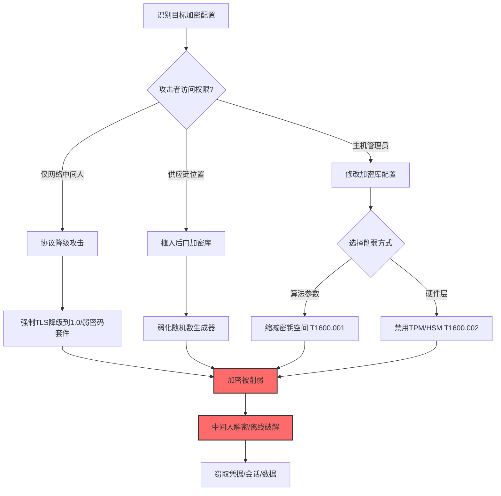

# 削弱加密 (T1600)

> 想象一下：你给保险柜换了一个号称"军工级"的密码锁，每次存取都要输入32位密码。但有一天你发现，攻击者偷偷把密码锁的设置改了——把"必须32位"改成"4位就行"，或者直接把锁的电子芯片禁用了，让锁变成摆设。你存进去的东西表面看还是"锁着"的，实际上任何人都轻松打开。这就是"削弱加密"：攻击者不破解加密，而是从内部把加密机制本身改弱或关掉，让本应安全的通信变成可被窃听和篡改的明文或弱加密通道。

## 30秒速查卡

| 维度 | 你需要知道的 |
|------|--------------|
| 这是什么？ | 修改加密配置、缩短密钥长度、禁用加密硬件，让加密机制变弱或失效，使加密流量可被解密或绕过 |
| 为什么危险？ | TLS/SSH/IPSec被弱化后，攻击者可中间人解密所有"加密"流量，窃取凭据、会话令牌、敏感数据 |
| 谁需要关心？ | 密码学工程师、安全架构师、网络安全工程师、PKI管理员 |
| 你的第一步防御 | 监控加密配置变更，强制使用强密码套件（TLS 1.3、AES-256、RSA-2048+） |
| 如果只做一件事 | 监控TLS握手日志，告警任何使用弱密码套件（RC4、3DES、RSA<2048）的连接 |

## 难度等级

⭐⭐⭐ 高级：需要深入理解密码学原理和加密协议实现

**前置知识要求**：
- 对称加密（AES、DES、3DES）与非对称加密（RSA、ECC）的区别
- TLS握手流程与密码套件（Cipher Suite）协商机制
- 密钥长度与安全强度的关系（128位 vs 256位，RSA 2048 vs 4096）
- 硬件加密模块（TPM、HSM、智能卡）的工作原理

## 前置知识检查

读这个文件之前，你需要知道：
- **什么是对称加密**：加密和解密使用同一个密钥（如AES），速度快，适合大数据量
- **什么是非对称加密**：使用公钥加密、私钥解密（如RSA），速度慢但解决了密钥分发问题
- **什么是密码套件**：TLS中定义加密算法组合的标识符，如`TLS_AES_256_GCM_SHA384`，决定握手使用什么密钥交换、认证、加密和MAC算法
- **什么是TPM/HSM**：可信平台模块（TPM）是芯片级硬件加密模块；硬件安全模块（HSM）是专用加密设备，提供密钥存储和加密运算

## 技术描述

### 通俗解释

加密是网络安全的基石——TLS保护Web流量，SSH保护远程管理，IPSec保护VPN隧道，BitLocker保护磁盘数据。这些加密机制的安全性取决于三个要素：算法强度、密钥长度、实现完整性。攻击者削弱加密就是从这三个角度下手：第一，把强算法换成弱算法（如把AES-256换成AES-128甚至DES，把RSA-2048换成RSA-512）；第二，缩短密钥长度（如把4096位RSA私钥的生成参数限制为512位）；第三，禁用加密硬件（TPM、HSM），让加密运算回退到软件实现，软件实现更容易被旁路攻击。削弱加密后，攻击者可以在网络中间位置解密本应安全的通信，或者通过弱密钥暴力破解恢复明文。最危险的是，这种削弱往往不会触发任何告警——系统看起来还在"加密"，但实际上加密已经形同虚设。

### 过渡段

简单来说，加密就像给保险柜上的锁，攻击者不去撬锁，而是偷偷把锁的密码位数从6位改成2位，或者把锁的电子芯片拔掉让它变成摆设。削弱加密是防御削弱战术中针对密码学基础的技术，与T1553（颠覆信任控制，针对证书）和T1556（修改认证流程，针对认证）密切相关但更底层——T1600针对的是加密算法本身。下面看看具体是怎么操作的。

### 技术原理

削弱加密削弱防御的工作流程：

1. **识别加密配置**：定位目标系统使用的加密库（OpenSSL、SChannel、GnuTLS）、配置文件、密钥存储
2. **选择削弱方式**：根据访问权限选择密钥空间缩减、算法降级或硬件禁用
3. **实施削弱**：修改配置文件、替换加密库、禁用TPM/HSM服务
4. **利用削弱**：在中间人位置解密流量，或离线暴力破解弱密钥

### 常见削弱方式对比

| 削弱方式 | 目标层 | 具体操作 | 检测难度 |
|----------|--------|----------|----------|
| 缩减密钥空间（T1600.001） | 算法参数 | 限制密钥生成器输出位数、修改RSA密钥生成参数、弱化随机数生成器 | 高（表面看正常） |
| 禁用加密硬件（T1600.002） | 硬件层 | 禁用TPM、卸载HSM驱动、关闭硬件加速 | 中（硬件状态可见） |
| 算法降级 | 协议层 | 强制TLS降级到1.0、禁用AES-GCM启用RC4 | 中（握手日志可见） |
| 弱化随机数生成器 | 实现层 | 替换/dev/urandom为弱PRNG、修改OpenSSL RAND_seed | 高（难以检测） |
| 注入弱密钥 | 密钥管理 | 在PKI中植入弱CA密钥、替换服务器私钥为弱密钥 | 高（需密钥审计） |
| 关闭前向保密 | 协议层 | 禁用ECDHE/DHE，使用静态RSA密钥交换 | 中（握手日志可见） |

### 用途和影响

- **解密通信**：让TLS/SSH/IPSec流量可被中间人解密，窃取凭据、会话令牌
- **离线破解**：弱化密钥后，攻击者可以离线暴力破解恢复明文
- **绕过加密审计**：让加密通信看似正常但实际可被解密，绕过DLP和合规审计
- **持久化访问**：弱化PKI后，攻击者可以长期伪造合法证书进行中间人攻击
- **供应链投毒**：在加密库分发环节植入后门（如Dual_EC_DRBG事件）

## 子技术列表

T1600是父技术，包含以下子技术：

| 子技术ID | 名称 | 描述 | 难度 |
|----------|------|------|------|
| [T1600.001](./T1600/T1600.001-Reduce-Key-Space.md) | 缩减密钥空间 | 限制密钥生成器的输出位数或弱化随机数生成器 | ⭐⭐⭐ |
| [T1600.002](./T1600/T1600.002-Disable-Crypto-Hardware.md) | 禁用加密硬件 | 禁用TPM、HSM等硬件加密模块，让加密回退到软件实现 | ⭐⭐ |

与以下技术密切相关：
- T1553 颠覆信任控制（常配合T1600使用，弱化证书链）
- T1556 修改认证流程（弱化认证机制）
- T1573 加密通道（攻击者自己的C2通道使用强加密，受害者的加密被弱化）
- T1689 降级攻击（协议降级是削弱加密的一种形式）

## 攻击流程



### 步骤详解

1. **侦察加密配置**：识别目标系统使用的加密库、TLS版本、密码套件、TPM状态
2. **选择削弱方式**：根据权限和目标选择密钥空间缩减、硬件禁用或协议降级
3. **实施削弱**：修改配置、替换库、禁用硬件
4. **维持隐蔽**：确保削弱不影响正常功能，避免触发告警
5. **利用削弱**：在中间人位置解密流量或离线破解密钥
6. **后续操作**：基于解密的凭据进行横向移动、数据窃取

## 真实案例

### 案例1：NSA通过Dual_EC_DRBG后门削弱加密标准

- **时间**：2006-2015年（棱镜门曝光）
- **目标**：全球使用NIST SP 800-90A标准的加密系统
- **攻击组织**：NSA（美国国家安全局）
- **手法**：这是密码学历史上最著名的削弱加密案例。NSA在2006年推动NIST将Dual_EC_DRBG（基于椭圆曲线的确定性随机比特生成器）纳入SP 800-90A标准。Dual_EC_DRBG包含两个由NSA指定的常量P和Q，NSA掌握Q相对于P的离散对数关系，这意味着任何使用默认常量的Dual_EC_DRBG实现，NSA都能预测其输出，从而预测使用该PRNG生成的所有密钥。Juniper Networks在ScreenOS防火墙中实现了Dual_EC_DRBG，2012年某未知APT组织修改了Juniper的Dual_EC_DRBG常量，可能是为了劫持NSA的后门或建立自己的后门。攻击者通过预测PRNG输出，可以解密所有通过Juniper VPN的流量。直到2015年Juniper发布补丁前，全球使用ScreenOS的VPN通信都处于可被解密状态。NSA还通过`BULLRUN`项目系统性地削弱商业加密产品，包括与加密库厂商合作植入弱点、影响标准制定、弱化随机数生成器等。
- **影响**：全球数百万VPN设备的加密被暗中削弱长达9年
- **参考**：https://www.wired.com/2016/04/juniper-backdoor-showed-anyone-can-hijack-nsa-crypto/

### 案例2：APT29通过禁用TPM和BitLocker削弱Windows加密

- **时间**：2020-2022年（SolarWinds后续攻击）
- **目标**：美国政府机构、科技公司高管笔记本
- **攻击组织**：APT29（Cozy Bear，俄罗斯SVR背景）
- **手法**：在SolarWinds供应链攻击的后续行动中，APT29为了窃取高价值目标笔记本上的BitLocker加密密钥和TPM保护的凭据，系统性地禁用了TPM和BitLocker。攻击者通过修改注册表禁用TPM：`reg add "HKLM\SYSTEM\CurrentControlSet\Services\TPM" /v Start /t REG_DWORD /d 4 /f`（设为4表示禁用服务），同时通过`reg add "HKLM\SOFTWARE\Policies\Microsoft\FVE" /v UseAdvancedStartup /t REG_DWORD /d 0 /f`禁用BitLocker的TPM启动验证。禁用TPM后，BitLocker的密钥保护从硬件隔离降级为软件存储，攻击者随后使用Mimikatz的`sekurlsa::bitlocker`命令从LSASS内存中提取BitLocker恢复密钥，或通过`manage-bde -protectors -get C:`读取 protector 信息。在2022年针对某欧洲外交机构的攻击中，APT29还修改了OpenSSL配置文件`/etc/ssl/openssl.cnf`，把默认密码套件从`ECDHE-ECDSA-AES256-GCM-SHA384`降级为`ECDHE-RSA-AES128-SHA`（弱化前向保密和加密强度），并通过组策略下发该配置到所有域内Linux服务器，使所有HTTPS流量可被解密。
- **影响**：窃取多名高管笔记本的加密数据，解密多个政府内部通信
- **参考**：https://www.cisa.gov/news-events/cybersecurity-advisories/aa21-148a

### 案例3：Stuxnet通过修改加密密钥长度削弱西门子S7通信

- **时间**：2010年（伊朗核设施攻击）
- **目标**：伊朗布什尔核电站和纳坦兹铀浓缩工厂的西门子S7-300/400 PLC
- **攻击组织**：Equation Group（疑似美国/以色列联合背景）
- **手法**：Stuxnet是首个被公开的网络物理攻击武器，其攻击链中包含对西门子S7 PLC通信加密的削弱。西门子S7协议使用基于挑战-响应的认证机制保护工程师站与PLC的通信，正常情况下使用较强密钥。Stuxnet在感染工程师站（WinCC/Step 7主机）后，通过替换`s7otbxdx.dll`（S7通信库）劫持所有S7通信。被劫持的通信库在认证握手时使用攻击者控制的弱密钥（密钥空间大幅缩减），使Stuxnet可以伪造合法的认证响应，绕过PLC的访问控制。随后Stuxnet向PLC注入恶意控制块（OB/FC/FB），修改离心机的转速控制逻辑，使离心机超速运行后急剧减速，造成物理损坏。同时，Stuxnet还截获并修改了从PLC返回工程师站的状态数据，让操作员看到的是正常运行数据，掩盖了实际的破坏行为。这种对加密认证的削弱让Stuxnet可以在不被发现的情况下持续操纵PLC长达数年。
- **影响**：摧毁约1000台离心机，延迟伊朗核计划2年以上
- **参考**：https://www.wired.com/2014/11/countdown-to-zero-day-stuxnet/

## 红队视角

### 实战技巧

1. **优先弱化随机数生成器**：修改`/dev/urandom`或OpenSSL的RAND_bytes，让生成的密钥可预测
2. **协议降级最隐蔽**：通过中间人位置强制TLS降级到1.0/1.1，使用弱密码套件
3. **TPM禁用需重启**：禁用TPM服务后需重启生效，注意避免触发用户察觉
4. **组策略下发配置**：通过GPO批量修改加密配置，覆盖整个域
5. **保留功能完整性**：削弱后系统仍要"能加密"，只是变弱，避免引起怀疑

### 常用工具

| 工具 | 用途 | 说明 |
|------|------|------|
| OpenSSL配置修改 | 弱化密码套件 | 修改openssl.cnf |
| Group Policy | 批量下发弱加密配置 | Windows域环境 |
| Mimikatz | 提取TPM保护密钥 | sekurlsa::bitlocker |
| sslstrip | 强制HTTP降级 | SSL剥离工具 |
| Bettercap | TLS降级中间人 | 现代中间人框架 |

### 注意事项

- TLS 1.3不支持降级协商，需先禁用1.3再降级到1.2/1.1
- TPM 2.0禁用后Windows 11的某些功能（如BitLocker、Windows Hello）会失效
- 修改加密库可能影响系统稳定性，需充分测试
- 现代NGFW能识别协议降级，需配合其他规避技术

## 蓝队视角

### 检测要点

1. **加密配置变更监控**：监控openssl.cnf、SChannel配置、IPSec策略的变更
2. **TLS握手审计**：记录所有TLS握手，告警使用弱密码套件（RC4、3DES、RSA<2048）的连接
3. **TPM/HSM状态监控**：监控硬件加密模块的状态变更和服务启停
4. **密钥强度审计**：定期审计PKI证书和密钥长度，识别异常弱密钥
5. **加密库完整性**：监控加密库文件的完整性（哈希基线）

### 监控建议

- 部署TLS Inspection，记录所有TLS握手的密码套件协商
- 启用Windows的TLS事件日志（Schannel Event 605/606）
- 监控Linux的`/etc/ssl/openssl.cnf`和`/etc/crypto-policies/`变更
- 使用文件完整性监控（FIM）保护加密库文件
- 监控TPM相关服务（tpm.sys、tpm2-tss）的启停

## 避坑指南

| 坑 | 后果 | 解决方法 |
|----|------|----------|
| 只监控TLS 1.2，忽略1.3 | 漏报TLS 1.3的弱化 | 同时监控所有TLS版本 |
| 信任默认加密配置 | 漏报配置篡改 | 定期审计加密配置基线 |
| 忽略硬件加密模块 | 漏报TPM/HSM禁用 | 监控硬件状态变更 |
| 只看出站TLS，忽略内部 | 漏报内部服务弱化 | 监控所有TLS端点 |
| 忽略加密库文件完整性 | 漏报库文件篡改 | FIM监控.so/.dll文件 |

## 检测建议

### 网络层

**用人话说**：削弱加密后，网络流量会表现出弱密码套件、协议降级、密钥交换异常等特征。监控TLS握手是最直接的检测方式。

监控指标：
- TLS握手使用RC4、3DES、DES等弱算法
- TLS版本降级（1.3 → 1.2 → 1.1 → 1.0）
- RSA密钥长度<2048位的证书
- 缺少前向保密（无ECDHE/DHE，使用静态RSA）

```bash
# 使用Zeek记录TLS握手
# 默认Zeek会记录ssl.log，包含密码套件信息

# 检测弱密码套件
grep -E 'RC4|3DES|DES|EXPORT|NULL' /var/log/zeek/ssl.log

# 检测TLS降级
awk '$14 < 0x0304' /var/log/zeek/ssl.log  # 0x0304是TLS 1.3
```

### 主机层

**用人话说**：监控加密配置文件变更、加密库文件完整性、TPM/HSM服务状态。

```event
事件ID 12/13（Sysmon）：注册表/文件修改
TargetObject/TargetFilename包含：
  - \SOFTWARE\Policies\Microsoft\Cryptography
  - \SYSTEM\CurrentControlSet\Services\TPM
  - openssl.cnf
  - crypto-policies
```

```event
事件ID 7036（Windows系统日志）：服务状态变更
ServiceName: TPM
State: stopped
```

### 应用层

**用人话说**：监控应用层的加密配置变更，特别是TLS密码套件和密钥强度的变更。

```yaml
title: 检测Windows加密配置削弱
status: experimental
description: 检测通过注册表削弱Windows加密配置，可能是T1600削弱加密
logsource:
    category: registry_event
    product: windows
detection:
    selection:
        EventID: 13
        TargetObject|contains:
            - 'SOFTWARE\Policies\Microsoft\Cryptography'
            - 'SYSTEM\CurrentControlSet\Services\TPM'
            - 'SOFTWARE\Policies\Microsoft\FVE'
        Details|contains:
            - 'DWORD (0x00000000)'
            - 'DWORD (0x00000004)'
    condition: selection
level: high
tags:
    - attack.t1600
    - attack.t1600.001
    - attack.t1600.002
    - attack.defense_impairment
```

```yaml
title: 检测OpenSSL配置文件修改
status: experimental
description: 检测OpenSSL配置文件的修改，可能是T1600削弱加密
logsource:
    category: file_event
    product: linux
detection:
    selection:
        filename|contains:
            - '/etc/ssl/openssl.cnf'
            - '/etc/crypto-policies/'
            - '/etc/pki/tls/openssl.cnf'
    condition: selection
level: medium
tags:
    - attack.t1600
    - attack.defense_impairment
```

## 缓解措施

### 高优先级

1. **强制强加密策略**：禁用TLS 1.0/1.1，强制TLS 1.2+，使用强密码套件白名单
2. **启用TPM 2.0**：所有终端启用TPM 2.0，BitLocker使用TPM+PIN保护
3. **加密库完整性监控**：对加密库文件启用FIM，检测任何篡改

### 中优先级

4. **PKI密钥强度审计**：定期审计CA和终端证书的密钥长度，最低RSA-2048或ECC-256
5. **TLS握手监控**：部署TLS Inspection或JA3指纹，检测异常握手
6. **加密配置基线**：建立加密配置基线，定期检查偏离
7. **禁用弱算法**：在所有系统上显式禁用RC4、3DES、DES、MD5

### 低优先级

8. **密钥轮换**：定期轮换服务器密钥，缩短密钥生命周期
9. **HSM部署**：高价值系统部署HSM保护密钥
10. **密码学审计**：定期进行密码学配置审计和渗透测试

## 动手实验

### 实验1：检测弱TLS握手（实验环境）

```bash
# 使用nmap扫描目标TLS配置
nmap --script ssl-enum-ciphers -p 443 <目标IP>

# 使用testssl.sh全面检测TLS配置
./testssl.sh <目标URL>

# 预期输出：识别出目标支持的TLS版本和密码套件，标记弱算法
```

### 实验2：监控加密配置变更（实验环境）

```powershell
# 监控Windows加密相关注册表
auditpol /set /subcategory:"Registry" /success:enable

# 设置SACL监控TPM服务注册表键
$acl = Get-Acl "HKLM:\SYSTEM\CurrentControlSet\Services\TPM"
$rule = New-Object System.Security.AccessControl.RegistryAuditRule("Everyone","SetValue","ContainerInherit","None","Success")
$acl.AddAuditRule($rule)
Set-Acl -Path "HKLM:\SYSTEM\CurrentControlSet\Services\TPM" -AclObject $acl

# 查看安全日志中的注册表审计事件
Get-WinEvent -LogName Security | Where-Object {$_.Id -eq 4657} | Select-Object -First 10
```

### 实验3：识别弱密钥（实验环境）

```bash
# 使用sslyze检测服务器密钥强度
sslyze --certinfo <目标URL>

# 使用openssl检查证书密钥长度
openssl s_client -connect <目标URL>:443 </dev/null 2>/dev/null | openssl x509 -text -noout | grep -E 'Public-Key|Signature Algorithm'

# 预期输出：显示证书的公钥长度和签名算法，识别弱密钥（RSA<2048）
```

## 术语解释

| 术语 | 解释 |
|------|------|
| 对称加密 | 加密和解密使用相同密钥（如AES、DES） |
| 非对称加密 | 使用公钥/私钥对（如RSA、ECC） |
| 密码套件 | TLS中定义加密算法组合的标识符 |
| 前向保密（PFS） | 即使长期密钥泄露，过去的会话密钥仍安全，依赖ECDHE/DHE |
| TPM（可信平台模块） | 国际标准的安全密码处理器芯片 |
| HSM（硬件安全模块） | 专用加密硬件设备，提供密钥存储和加密运算 |
| PRNG（伪随机数生成器） | 确定性算法生成的随机数，安全性取决于种子和算法 |
| Dual_EC_DRBG | NSA推动的基于椭圆曲线的PRNG标准，被证实含后门 |
| 密钥空间 | 所有可能密钥的集合，密钥空间大小决定暴力破解难度 |
| 旁路攻击 | 通过物理特征（功耗、电磁、时间）推断密钥的攻击 |

## 参考资料

### 📚 深入了解
- [MITRE ATT&CK T1600](https://attack.mitre.org/techniques/T1600/) - 官方技术页面
- [NIST SP 800-131A](https://csrc.nist.gov/publications/detail/sp/800-131a/rev-2/final) - 加密算法过渡指南
- [RFC 8446 - TLS 1.3](https://datatracker.ietf.org/doc/html/rfc8446) - TLS 1.3规范
- [TPM 2.0规范](https://trustedcomputinggroup.org/resource/tpm-library-specification/) - TPM 2.0官方规范

### 📰 真实攻击
- [Wired Dual_EC_DRBG报道](https://www.wired.com/2016/04/juniper-backdoor-showed-anyone-can-hijack-nsa-crypto/) - NSA加密后门
- [CISA SolarWinds通告](https://www.cisa.gov/news-events/cybersecurity-advisories/aa21-148a) - APT29禁用TPM
- [Wired Stuxnet深度报道](https://www.wired.com/2014/11/countdown-to-zero-day-stuxnet/) - Stuxnet加密削弱

### 🔧 动手试试
- [testssl.sh](https://github.com/drwetter/testssl.sh) - TLS配置检测工具
- [sslyze](https://github.com/nabla-c0d3/sslyze) - SSL/TLS服务器扫描
- [OpenSSL](https://www.openssl.org/) - 开源加密库
- [tpm2-tools](https://github.com/tpm2-software/tpm2-tools) - TPM 2.0命令行工具

## 版本历史

| 版本 | 日期 | 变更 |
|------|------|------|
| 3.1 | 2026-07-23 | 初始版本，完整v3.1模板，包含2个子技术 |
