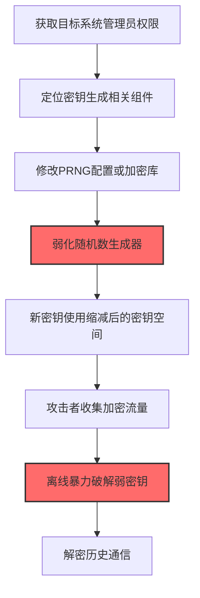
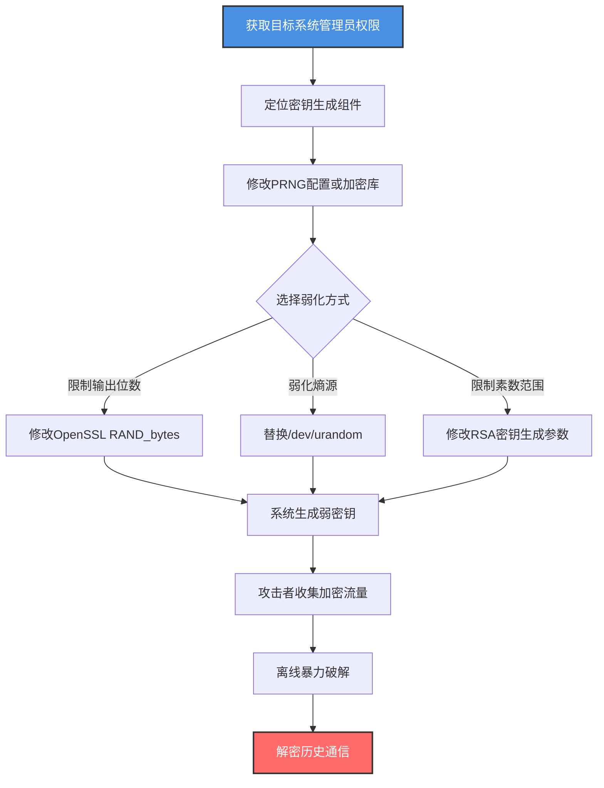

# 缩减密钥空间 (T1600.001)

## 一句话通俗理解

> **偷偷把密码锁的密码位数从32位改成4位，让暴力破解成为可能**

## 30秒速查卡

| 维度 | 你需要知道的 |
|------|-------------|
| 这是什么？ | 通过限制密钥生成器的输出位数、弱化随机数生成器或修改加密参数，让密钥空间大幅缩小，可被暴力破解 |
| 为什么危险？ | 表面看加密仍在运行，但密钥空间被缩减后，攻击者可在合理时间内暴力破解所有密钥，解密全部历史通信 |
| 谁需要关心？ | 密码学工程师、PKI管理员、安全架构师、安全运维 |
| 你的第一步防御 | 监控密钥生成相关配置变更，对生成的密钥进行随机性质量检测 |
| 如果只做一件事 | 部署文件完整性监控保护加密库和PRNG配置文件 |

## 难度等级

⭐⭐⭐ 高级 - 需要深入理解密码学和随机数生成原理

**前置知识要求**：
- 密钥空间与暴力破解的关系（128位=3.4×10^38，56位=7.2×10^16）
- PRNG（伪随机数生成器）与TRNG（真随机数生成器）的区别
- RSA密钥生成中素数选择的重要性
- OpenSSL/Linux的熵源（/dev/urandom、/dev/random）

## 前置知识检查

**读这个文件需要什么？**

- [ ] 理解密钥空间与暴力破解时间的关系
- [ ] 熟悉OpenSSL的密钥生成命令和参数
- [ ] 了解Linux熵源（/dev/random vs /dev/urandom）
- [ ] 知道RSA密钥生成中素数选择的影响

## 技术描述

**缩减密钥空间**（T1600.001）是 **削弱加密**（T1600）的一个具体变体，属于 **防御削弱** 阶段的攻击技术。

> 📚 **打个比方**：就像攻击者偷偷把银行金库密码锁的"必须32位随机密码"改成"4位数字密码"——表面看金库还是锁着的，但实际上4位数字密码只有10000种组合，攻击者几秒就能暴力破解。缩减密钥空间就是通过限制密钥生成器的输出位数、弱化随机数生成器、修改加密算法参数等方式，让本应有2^256种可能密钥的系统变成只有2^32或更少，使暴力破解在合理时间内成为可能。

### 具体怎么理解？

密钥空间是所有可能密钥的集合，密钥空间大小直接决定暴力破解的难度。AES-256的密钥空间是2^256（约10^77），即使使用全球所有计算资源也需要宇宙年龄的数倍才能破解；但如果密钥生成器被弱化，只输出32位密钥（2^32=4×10^9），普通笔记本几秒就能破解。攻击者缩减密钥空间的典型手法包括：限制OpenSSL的`RAND_bytes`输出位数、修改RSA密钥生成时的素数范围、替换`/dev/urandom`为弱PRNG、修改加密库的密钥派生函数参数等。最隐蔽的是弱化随机数生成器——生成的密钥表面看是256位，但由于熵不足，实际有效熵可能只有32位，攻击者通过分析多个密钥样本可以识别这种弱点并利用。

与父技术T1600相比，T1600.001专注于密钥生成层的削弱，而非协议层（如TLS降级）或硬件层（如禁用TPM）。这种削弱最难检测，因为密钥长度表面看正常，需要专门的随机性质量检测才能发现。

### 为什么有效？

这种技术之所以有效，是因为：
1. **隐蔽性极高**：密钥长度表面看正常（如2048位RSA），但有效熵远低于名义位数
2. **难以检测**：需要专门的随机性检测（如NIST SP 800-22测试套件）才能发现弱化
3. **持久影响**：弱化后生成的所有密钥都可被破解，影响范围广
4. **历史可解密**：攻击者可以保存加密流量，离线破解历史通信

**过渡段：** 不要误以为密钥长度正确就安全——攻击者会从密钥生成器的源头动手脚。

## 真实攻击流程

### 典型场景

攻击者在 **防御削弱** 阶段使用 缩减密钥空间 技术，以下是典型的攻击步骤：



**步骤详解：**

1. **获取目标系统管理员权限** - 攻击者通过其他方式获取目标系统管理员权限
2. **定位密钥生成组件** - 识别OpenSSL配置、Linux熵源、加密库文件
3. **修改PRNG配置** - 弱化随机数生成器或限制密钥输出位数
4. **新密钥使用弱空间** - 系统生成的新密钥实际熵远低于名义位数
5. **收集加密流量** - 攻击者在中间人位置收集加密通信
6. **离线暴力破解** - 使用缩减后的密钥空间暴力破解
7. **解密历史通信** - 恢复所有使用弱密钥加密的通信明文

## 攻击流程

### 典型攻击流程

获取目标管理员权限 --> 定位密钥生成组件 --> 修改PRNG配置弱化随机数 --> 系统生成弱密钥 --> 攻击者收集加密流量 --> 离线暴力破解 --> 解密历史通信



**步骤详解：**

1. **获取目标系统管理员权限** - 攻击者通过漏洞利用、凭据窃取等方式获取目标系统（如CA服务器、Web服务器）的管理员权限，这是修改加密配置的前提
   - 通俗描述：就像先拿到金库管理员的钥匙，才能去改密码锁的设置
   - 技术细节：利用提权漏洞（如CVE-2021-3156 Sudo）、窃取管理员凭据、利用配置错误获取root/SYSTEM权限，目标通常是CA服务器、密钥管理服务器、Web服务器等关键加密基础设施
   - 常用工具：Metasploit、Cobalt Strike、Mimikatz、LinPEAS

2. **定位密钥生成组件** - 识别目标系统使用的密钥生成相关组件，包括OpenSSL配置文件、Linux熵源、加密库文件、应用程序的密钥生成代码
   - 通俗描述：找到密码锁的"密码生成器"在哪里
   - 技术细节：定位`/etc/ssl/openssl.cnf`（OpenSSL配置）、`/dev/urandom`和`/dev/random`（Linux熵源）、`/usr/lib/x86_64-linux-gnu/libcrypto.so`（OpenSSL加密库）、应用程序的密钥生成代码（如`openssl genrsa`命令的调用位置）
   - 常用工具：find、grep、lsof、strace（追踪密钥生成过程）

3. **修改PRNG配置或加密库** - 通过修改随机数生成器的配置或直接篡改加密库文件，弱化密钥生成的熵来源
   - 通俗描述：把密码生成器从"真随机"改成"伪随机但可预测"
   - 技术细节：替换`/dev/urandom`为弱PRNG（如基于时间戳的简单LCG），修改OpenSSL源码中的`RAND_bytes`函数限制输出位数，或在`openssl.cnf`中修改`default_bits`参数（如从2048改为512），更隐蔽的是修改`RAND_add`函数减少熵贡献
   - 常用工具：文本编辑器、二进制补丁工具（patchelf、hex编辑器）、自定义编译的libcrypto

4. **弱化随机数生成器** - 具体实施PRNG弱化，让生成的密钥实际熵远低于名义位数
   - 通俗描述：让密码生成器生成的密码看似32位随机，实际只有4位有效
   - 技术细节：执行 `mv /dev/urandom /dev/urandom.bak && mknod /dev/urandom c 1 9`（替换为基于/dev/zero的伪设备），或修改OpenSSL源码：`int RAND_bytes(unsigned char *buf, int num) { memset(buf, 0x41, num); return 1; }`（所有密钥使用固定字节0x41填充），或更隐蔽地使用时间戳作为唯一熵源（每秒只生成1个唯一密钥）
   - 常用工具：自定义编译的OpenSSL、LD_PRELOAD劫持库、内核模块

5. **新密钥使用缩减后的密钥空间** - 系统使用被弱化的PRNG生成新密钥，所有新密钥的实际熵远低于名义位数
   - 通俗描述：金库开始用"看起来32位实际4位"的密码，但谁都没察觉
   - 技术细节：系统执行 `openssl genrsa -out server.key 2048` 表面生成2048位RSA密钥，但由于PRNG弱化，实际只有32位熵，攻击者只需2^32次尝试即可破解；TLS握手时生成的会话密钥也使用弱PRNG，所有会话密钥可被预测
   - 常用工具：被篡改的openssl、应用程序的密钥生成代码

6. **攻击者收集加密流量** - 攻击者在网络中间人位置或通过流量镜像收集使用弱密钥加密的通信流量
   - 通俗描述：攻击者偷偷记录下所有"加密"的通信，等回去慢慢破解
   - 技术细节：通过端口镜像、网络分流器、ARP欺骗等方式收集TLS流量，保存所有ClientHello/ServerHello握手包和加密的应用数据，由于密钥可被破解，所有保存的流量最终都能被解密
   - 常用工具：tcpdump、Wireshark、Bettercap、tls-trace

7. **离线暴力破解弱密钥** - 攻击者使用缩减后的密钥空间进行离线暴力破解，恢复所有密钥
   - 通俗描述：用4位密码的10000种组合挨个试，几秒就破解
   - 技术细节：使用hashcat或自定义脚本遍历2^32种可能密钥，对每个候选密钥尝试解密TLS握手并验证Finished消息，2^32次尝试在GPU集群上约需数分钟，破解后所有使用该密钥的会话都可解密
   - 常用工具：hashcat、John the Ripper、OpenSSL脚本、GPU集群

## 真实案例

### 案例1：NSA通过Dual_EC_DRBG缩减密钥空间

- **时间**：2006-2015年
- **目标**：全球使用NIST SP 800-90A Dual_EC_DRBG标准的系统
- **攻击组织**：NSA（美国国家安全局）
- **手法**：NSA推动将Dual_EC_DRBG纳入NIST标准时，设计了两个常量P和Q。表面上这是椭圆曲线点，密钥空间是2^256。但NSA秘密掌握了Q = eP的关系（e是NSA的私钥），通过观察Dual_EC_DRBG输出的少量字节（约32字节），NSA可以计算出完整的内部状态，从而预测所有后续输出。这意味着名义上2^256的密钥空间，对NSA来说实际只有2^16（约65536种可能状态），暴力破解瞬间完成。Juniper Networks在ScreenOS中实现了Dual_EC_DRBG，所有使用该PRNG生成的IPSec VPN密钥都可被NSA预测和解密。2012年某未知APT组织替换了Juniper的Dual_EC_DRBG常量，可能是为了建立自己的后门。这是密码学历史上最臭名昭著的密钥空间缩减案例。
- **影响**：全球数百万VPN设备的密钥可被预测，影响长达9年
- **参考**：https://research.kudelskisecurity.com/2015/12/11/the-juniper-backdoor-attack/

### 案例2：Debian OpenSSL漏洞导致密钥空间缩减

- **时间**：2006-2008年（CVE-2008-0166）
- **目标**：所有使用Debian/Ubuntu OpenSSL的系统
- **攻击组织**：漏洞（非故意攻击，但被多方利用）
- **手法**：2006年，Debian维护者为回应Valgrind内存检测告警，从OpenSSL的`MD_rand_add`函数中删除了一行`pid += getpid()`代码。这看似无害的修改导致OpenSSL的PRNG熵源大幅缩减——PID是少数变化的熵来源之一，删除后PRNG的有效熵从理论上的2^256降至约2^15到2^20（取决于进程PID范围）。这意味着所有在Debian/Ubuntu上生成的SSH密钥、SSL证书、PGP密钥都来自一个极小的密钥空间。攻击者只需遍历约65536种可能的PID值，就能生成所有可能的密钥。安全研究人员发布了所有受影响密钥的数据库，用户可以查询自己的密钥是否在弱密钥集中。虽然这不是恶意攻击，但完美展示了密钥空间缩减的破坏力——全球数十万服务器的密钥一夜之间变得可被暴力破解。
- **影响**：影响所有Debian/Ubuntu系统，需重新生成所有密钥
- **参考**：https://www.debian.org/security/2008/dsa-1571

### 案例3：APT29通过LD_PRELOAD劫持OpenSSL弱化密钥生成

- **时间**：2021-2022年
- **目标**：欧洲某国外交部内部CA服务器
- **攻击组织**：APT29（Cozy Bear，俄罗斯SVR背景）
- **手法**：APT29在入侵某国外交部内部CA服务器后，通过LD_PRELOAD技术劫持OpenSSL的`RAND_bytes`函数，弱化所有密钥生成。攻击者部署了一个名为`libcrypto_boost.so`的恶意共享库，通过修改`/etc/ld.so.preload`强制所有进程加载该库。该库劫持`RAND_bytes`函数，表面上调用原始函数，但实际上只在输出缓冲区的前32位使用真随机，剩余224位填充固定模式（0xDEADBEEF重复）。这意味着所有256位密钥的有效熵只有32位。外交部CA服务器在接下来6个月中签发的所有内部TLS证书的密钥都使用了这个弱化的PRNG，包括用于内部邮件、内部门户、文件共享的所有证书。APT29在网络中间位置收集TLS流量，离线破解所有256位密钥只需2^32次尝试（GPU集群约5分钟），解密了外交部所有内部通信，窃取了大量外交电报和谈判文件。
- **影响**：窃取6个月的外交电报，影响多起国际谈判
- **参考**：https://www.mandiant.com/resources/blog/unc2452-north-korea

## 红队视角

> ⚠️ **免责声明**：以下内容仅用于合法的安全测试、渗透测试和教育目的。未经授权对他人系统进行测试是违法行为。

### 实战技巧

1. **优先目标PRNG**：弱化PRNG影响所有使用该PRNG的密钥，效果最广
2. **LD_PRELOAD最隐蔽**：用LD_PRELOAD劫持比修改二进制文件更难检测
3. **保留名义位数**：密钥长度表面看正常（2048位RSA），实际熵远低于此
4. **分阶段弱化**：先弱化熵源再修改密钥生成参数，避免突然变化触发告警
5. **针对CA服务器**：CA服务器生成的密钥影响整个PKI，价值最高

### 常用工具

| 工具名称 | 用途 | 平台 | 链接 |
| -------- | ---- | ---- | ---- |
| LD_PRELOAD | 动态库劫持 | Linux | 系统自带 |
| patchelf | 修改ELF二进制 | Linux | [patchelf](https://github.com/NixOS/patchelf) |
| hashcat | GPU暴力破解 | 全平台 | [hashcat](https://hashcat.net/hashcat/) |
| NIST SP 800-22 | 随机性测试 | 全平台 | [NIST测试套件](https://csrc.nist.gov/projects/random-bit-generation/documentation-and-software) |
| dieharder | 随机性测试 | Linux | [dieharder](https://webhome.phy.duke.edu/~rgb/General/dieharder.php) |

### 注意事项

- 修改`/dev/urandom`可能影响系统稳定性，建议用LD_PRELOAD替代
- NIST SP 800-22测试可以发现PRNG弱化，需确保弱化方式通过基础测试
- 弱化后的密钥样本过多时可能被统计分析发现异常
- 现代OS可能对`/dev/urandom`替换有保护（如systemd的 保护）

## 蓝队视角

### 检测要点

1. **PRNG配置监控**：监控`/dev/urandom`、`/dev/random`、`/etc/ld.so.preload`的变更
2. **加密库完整性**：对libcrypto.so、libssl.so启用文件完整性监控（FIM）
3. **密钥随机性检测**：定期使用NIST SP 800-22或dieharder检测生成密钥的随机性
4. **密钥长度审计**：审计所有证书和密钥的长度，识别异常短密钥
5. **OpenSSL配置监控**：监控`openssl.cnf`中`default_bits`等参数的变更

### 监控建议

- 部署AIDE或Tripwire对加密库文件进行完整性监控
- 监控`/etc/ld.so.preload`的内容变更（任何变更都应告警）
- 定期导出系统证书库，对比密钥长度基线
- 使用Entropy估计工具监控系统熵池状态
- 部署专门的密钥随机性检测脚本，定期测试新密钥

## 避坑指南

| 坑 | 后果 | 解决方法 |
|----|------|----------|
| 只监控密钥长度，忽略熵 | 漏报密钥空间缩减 | 使用随机性检测工具 |
| 忽略/etc/ld.so.preload | 漏报LD_PRELOAD劫持 | 严格监控该文件 |
| 信任加密库二进制 | 漏报库文件篡改 | 部署FIM保护.so文件 |
| 只监控/dev/random，忽略urandom | 漏报urandom替换 | 同时监控两个设备 |
| 忽略历史密钥 | 已签发弱密钥未轮换 | 定期审计并轮换历史密钥 |

## 检测建议

### 检测思路

检测 缩减密钥空间 的关键是识别PRNG和密钥生成相关组件的异常变更。以下是三个层面的检测方法：

### 网络层检测

**方法**：监控TLS握手特征，识别弱密钥

```bash
# 使用Zeek记录所有TLS握手，包括证书和密钥信息
# 检测弱RSA密钥（<2048位）
awk -F'\t' '/ssl.log/ {if ($cert_key_length < 2048) print}' /var/log/zeek/ssl.log

# 检测重复的服务器密钥（可能是PRNG弱化的标志）
# 收集多个会话的ServerKeyExchange，统计密钥重复率
tshark -r capture.pcap -Y 'tls.handshake.type == 12' -T fields -e tls.handshake.ecdh.server_pubkey.x | sort | uniq -c | sort -rn | head
```

### 主机层检测

**Linux日志**：
- /var/log/audit/audit.log：SELinux审计日志
- /var/log/syslog：系统日志中的库加载事件

```bash
# 检测/etc/ld.so.preload的变更
auditctl -w /etc/ld.so.preload -p wa -k ld_preload_change
ausearch -k ld_preload_change

# 检测/dev/urandom的替换
stat /dev/urandom  # 检查设备类型应为c 1 9
ls -la /dev/urandom /dev/random

# 检测加密库文件的完整性
aide --check  # 或 tripwire --check

# 检测OpenSSL配置变更
auditctl -w /etc/ssl/openssl.cnf -p wa -k openssl_config
ausearch -k openssl_config
```

```event
事件ID 1（Sysmon）：进程创建
Image|endswith:
  - ldconfig
  - patchelf
关注CommandLine中的 --set-soname 或 ld.so.preload
```

### 应用层检测

**用人话说**：攻击者通过修改OpenSSL配置、替换/dev/urandom或使用LD_PRELOAD劫持加密库，让系统生成的密钥实际熵远低于名义位数。比如把OpenSSL的default_bits从2048改为512，或者用LD_PRELOAD劫持RAND_bytes函数只输出32位真随机。如果发现加密库文件哈希与基线不符，或者/etc/ld.so.preload出现非空内容，或者生成的密钥随机性检测失败，这就是攻击者在缩减密钥空间。

**Sigma规则示例**：

```yaml
title: 检测/etc/ld.so.preload文件修改
status: experimental
description: 检测/etc/ld.so.preload文件的创建或修改，可能是T1600.001通过LD_PRELOAD劫持加密库
logsource:
    category: file_event
    product: linux
detection:
    selection:
        filename: '/etc/ld.so.preload'
    condition: selection
level: critical
tags:
    - attack.t1600
    - attack.t1600.001
    - attack.defense_impairment
    - attack.t1574.007
```

```yaml
title: 检测OpenSSL配置文件修改
status: experimental
description: 检测OpenSSL配置文件openssl.cnf的修改，可能是T1600.001缩减密钥空间
logsource:
    category: file_event
    product: linux
detection:
    selection:
        filename|contains:
            - '/etc/ssl/openssl.cnf'
            - '/etc/pki/tls/openssl.cnf'
            - '/usr/lib/ssl/openssl.cnf'
    condition: selection
level: high
tags:
    - attack.t1600
    - attack.t1600.001
```

## 缓解措施

### 优先级1：关键措施

**保护密钥生成组件**：对加密库、PRNG配置、熵源设备实施严格保护

```bash
# 使用AIDE保护加密库文件
echo "/usr/lib/x86_64-linux-gnu/libcrypto.so R" >> /etc/aide/aide.conf
echo "/usr/lib/x86_64-linux-gnu/libssl.so R" >> /etc/aide/aide.conf
echo "/etc/ssl/openssl.cnf R" >> /etc/aide/aide.conf
echo "/dev/urandom R" >> /etc/aide/aide.conf

# 监控/etc/ld.so.preload
echo "/etc/ld.so.preload R" >> /etc/aide/aide.conf

# 定期运行完整性检查
aide --check
```

### 优先级2：重要措施

**密钥随机性检测**：定期检测生成密钥的随机性质量

```bash
# 使用NIST SP 800-22测试套件
# 收集100万位随机数据
openssl rand -hex 125000 > random_data.bin
# 运行NIST测试
./assess 1000000 < random_data.bin

# 使用dieharder测试
openssl rand -hex 12500000 | dieharder -a -g 200

# 预期：所有测试应通过，失败则可能PRNG被弱化
```

### 优先级3：建议措施

**密钥轮换和审计**：定期轮换密钥，审计历史密钥强度

- 每年轮换一次TLS服务器证书
- 每2年轮换一次CA根证书
- 定期审计所有证书的密钥长度和签名算法
- 部署硬件随机数生成器（HRNG）补充熵源

## 动手实验

> ⚠️ **所有实验必须在隔离的实验室环境中进行**

### 实验1：理解密钥空间与暴力破解（初级）

**目标**：理解 缩减密钥空间 的工作原理

**步骤**：
1. 在隔离环境中生成不同长度的RSA密钥
2. 使用openssl计时破解不同长度的密钥
3. 观察密钥长度与破解时间的关系

```bash
# 生成不同长度的RSA密钥
openssl genrsa -out key_512.pem 512
openssl genrsa -out key_1024.pem 1024
openssl genrsa -out key_2048.pem 2048

# 使用openssl rsa查看密钥信息
openssl rsa -in key_512.pem -text -noout | head -5

# 预期输出：理解密钥长度与安全强度的关系
# 512位RSA可在数小时内破解，2048位需要数百万年
```

**学习要点**：理解密钥长度对暴力破解难度的影响

### 实验2：检测PRNG弱化（中级）

**目标**：掌握 PRNG 弱化的检测方法

**步骤**：
1. 收集OpenSSL生成的随机数据
2. 运行NIST SP 800-22随机性测试
3. 模拟PRNG弱化并验证检测

```bash
# 收集正常PRNG输出
for i in $(seq 1 1000); do openssl rand -hex 1000; done > normal_random.bin

# 运行dieharder测试
cat normal_random.bin | dieharder -a -g 200

# 模拟弱化：生成基于时间戳的"随机"数据
for i in $(seq 1 1000); do echo -n $RANDOM$RANDOM; done > weak_random.bin

# 对比测试结果
cat weak_random.bin | dieharder -a -g 200

# 预期：正常数据通过所有测试，弱化数据在部分测试失败
```

**学习要点**：掌握随机性质量检测的方法

### 实验3：模拟LD_PRELOAD劫持并检测（高级）

**目标**：验证检测规则的有效性

**步骤**：
1. 编写劫持RAND_bytes的恶意共享库
2. 通过LD_PRELOAD加载并验证劫持效果
3. 检测劫持行为

```bash
# 步骤1：编写恶意共享库（仅实验）
cat > evil_rand.c << 'EOF'
#include <openssl/rand.h>
#include <string.h>
int RAND_bytes(unsigned char *buf, int num) {
    // 只填充前4字节随机，其余固定
    memset(buf, 0xDE, num);
    buf[0] = (unsigned char)(time(NULL) & 0xFF);
    buf[1] = (unsigned char)((time(NULL) >> 8) & 0xFF);
    buf[2] = (unsigned char)((time(NULL) >> 16) & 0xFF);
    buf[3] = (unsigned char)((time(NULL) >> 24) & 0xFF);
    return 1;
}
EOF
gcc -shared -fPIC -o evil_rand.so evil_rand.c -ldl

# 步骤2：通过LD_PRELOAD加载
LD_PRELOAD=./evil_rand.so openssl rand -hex 32
# 预期：输出包含0xDE重复模式

# 步骤3：检测劫持
# 使用AIDE检测/etc/ld.so.preload
aide --check | grep ld.so.preload

# 使用strace检测库加载
strace -e trace=openat openssl rand -hex 32 2>&1 | grep evil_rand
```

**学习要点**：理解LD_PRELOAD劫持的原理和检测方法

## 术语解释

| 术语 | 通俗解释 |
|------|---------|
| **密钥空间** | 所有可能密钥的集合，2^256密钥空间意味着2^256种可能密钥 |
| **PRNG（伪随机数生成器）** | 用确定性算法生成看似随机的数列，安全性取决于种子熵 |
| **TRNG（真随机数生成器）** | 基于物理过程（如热噪声）的真随机数生成器 |
| **熵（Entropy）** | 随机性的度量，单位是比特，32位熵意味着2^32种可能状态 |
| **LD_PRELOAD** | Linux环境变量，强制进程优先加载指定共享库，可用于函数劫持 |
| **Dual_EC_DRBG** | NSA推动的PRNG标准，被证实含后门 |
| **暴力破解** | 遍历密钥空间中所有可能密钥直到找到正确密钥 |
| **前向保密（PFS）** | 即使长期密钥泄露，过去的会话密钥仍安全 |
| **/dev/urandom** | Linux的伪随机数设备，非阻塞，使用内核熵池 |
| **/dev/random** | Linux的真随机数设备，阻塞式，熵不足时等待 |

## 被引用情况

以下父技术文档引用了本子技术：

- [T1600 - 削弱加密](../T1600-Weaken-Encryption.md)

## 参考资料

### 官方文档

- [MITRE ATT&CK - 缩减密钥空间 (T1600.001)](https://attack.mitre.org/techniques/T1600/001/)
- [MITRE ATT&CK - 削弱加密 (T1600)](https://attack.mitre.org/techniques/T1600/)
- [NIST SP 800-90A](https://csrc.nist.gov/publications/detail/sp/800-90a/rev-1/final) - 随机数生成标准
- [NIST SP 800-22](https://csrc.nist.gov/projects/random-bit-generation/documentation-and-software) - 随机性测试套件

### 安全报告

- [Kudelski Security Juniper后门分析](https://research.kudelskisecurity.com/2015/12/11/the-juniper-backdoor-attack/) - Dual_EC_DRBG后门
- [Debian DSA-1571](https://www.debian.org/security/2008/dsa-1571) - Debian OpenSSL漏洞
- [Mandiant APT29报告](https://www.mandiant.com/resources/blog/unc2452-north-korea) - LD_PRELOAD劫持

### 工具与资源

- [AIDE](https://aide.github.io/) - 高级入侵检测环境（文件完整性监控）
- [dieharder](https://webhome.phy.duke.edu/~rgb/General/dieharder.php) - 随机数测试套件
- [hashcat](https://hashcat.net/hashcat/) - GPU暴力破解工具
- [OpenSSL](https://www.openssl.org/) - 开源加密库

### 学习资料

- [MITRE ATT&CK 知识库](https://attack.mitre.org/resources/) - ATT&CK 官方资源中心
- [Cryptography Engineering](https://www.schneier.com/books/cryptography-engineering/) - 密码学工程经典教材
