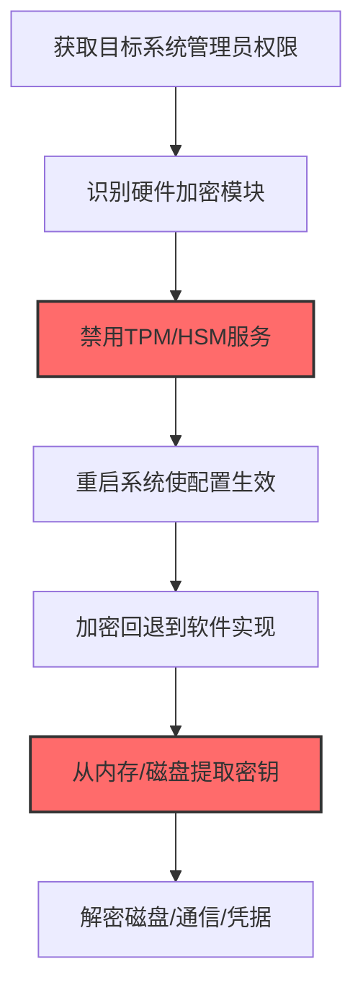
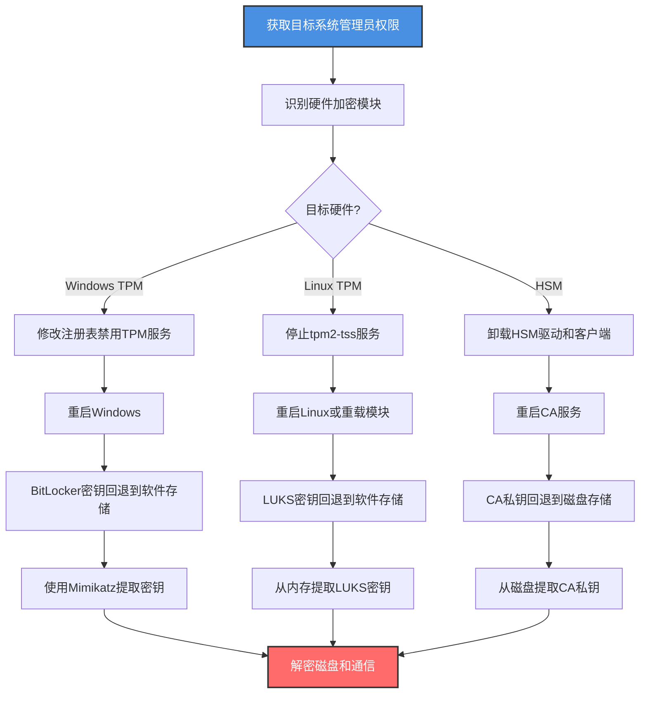

# 禁用加密硬件 (T1600.002)

## 一句话通俗理解

> **把保险柜的电子密码锁芯片拔掉，让锁变回简单的机械锁**

## 30秒速查卡

| 维度 | 你需要知道的 |
|------|-------------|
| 这是什么？ | 禁用TPM、HSM、智能卡等硬件加密模块，让加密运算从硬件隔离回退到软件实现，便于攻击者窃取密钥或旁路加密 |
| 为什么危险？ | TPM/HSM提供的硬件级密钥隔离失效后，攻击者可以从内存提取密钥、旁路BitLocker/LUKS磁盘加密、绕过证书保护 |
| 谁需要关心？ | 终端安全工程师、PKI管理员、安全架构师、Windows/Linux系统管理员 |
| 你的第一步防御 | 监控TPM/HSM服务状态变更，对BitLocker/LUKS配置启用完整性监控 |
| 如果只做一件事 | 监控Windows TPM服务和Linux tpm2-tss服务的启停事件 |

## 难度等级

⭐⭐ 中级 - 需要理解硬件加密模块的工作原理和系统配置

**前置知识要求**：
- TPM（可信平台模块）的工作原理和功能
- HSM（硬件安全模块）的部署场景
- BitLocker/LUKS磁盘加密与TPM的关系
- 硬件加密与软件加密的安全性差异

## 前置知识检查

**读这个文件需要什么？**

- [ ] 理解TPM的密封（Seal）和拆封（Unseal）机制
- [ ] 熟悉BitLocker的TPM+PIN保护模式
- [ ] 了解HSM在PKI中的角色
- [ ] 知道智能卡登录的工作流程

## 技术描述

**禁用加密硬件**（T1600.002）是 **削弱加密**（T1600）的一个具体变体，属于 **防御削弱** 阶段的攻击技术。

> 📚 **打个比方**：现代保险柜用了一块电子加密芯片——密码不存在锁上，而是存在芯片里，撬锁的人即使打开了锁也拿不到密码。攻击者做的事情就是悄悄把这块芯片拔掉或禁用，让保险柜回退到"密码直接存在锁里"的旧模式，这样撬开锁就能拿到密码。禁用加密硬件就是禁用TPM、HSM、智能卡读卡器等硬件加密模块，让系统的加密从"硬件隔离密钥"降级为"软件存储密钥"，攻击者随后可以从内存或磁盘提取本应被硬件保护的密钥。

### 具体怎么理解？

硬件加密模块（TPM、HSM、智能卡）的核心价值是"密钥永不出硬件"——加密运算在硬件内部完成，私钥永远不进入系统内存，即使攻击者获取了系统管理员权限也无法导出私钥。TPM 2.0可以密封（Seal）BitLocker的卷主密钥，只有在系统启动时通过PCR（平台配置寄存器）验证才能拆封（Unseal）；HSM保护CA的私钥，所有证书签发操作在HSM内部完成；智能卡保护用户登录私钥，私钥永不在主机内存出现。

攻击者禁用这些硬件后，加密运算回退到软件实现：BitLocker密钥从TPM密封变为存储在LSASS内存或注册表中，可被Mimikatz提取；CA私钥从HSM变为存储在磁盘上，可被secretsdump导出；智能卡登录回退为密码登录，可被暴力破解或键盘记录。这种削弱最危险的地方在于，系统看起来仍在"加密"，BitLocker仍在运行，证书仍在签发，但密钥的硬件保护已经消失。

与父技术T1600相比，T1600.002专注于硬件层的禁用，而非算法参数（T1600.001）或协议层（如TLS降级）。硬件禁用通常需要系统重启才能生效，但影响范围广且持久。

### 为什么有效？

这种技术之所以有效，是因为：
1. **密钥隔离失效**：硬件加密的核心价值是密钥隔离，禁用后密钥进入软件域，可被提取
2. **影响范围广**：禁用TPM影响所有依赖TPM的功能（BitLocker、Windows Hello、测量启动）
3. **持久性强**：硬件禁用后不会自动恢复，需要管理员手动重新启用
4. **隐蔽性高**：系统功能表面正常，只是"硬件加速"被关闭，不易察觉

**过渡段：** 不要误以为BitLocker启用就安全——如果TPM被禁用，BitLocker的密钥保护就形同虚设。

## 真实攻击流程

### 典型场景

攻击者在 **防御削弱** 阶段使用 禁用加密硬件 技术，以下是典型的攻击步骤：



**步骤详解：**

1. **获取目标系统管理员权限** - 攻击者通过其他方式获取目标系统管理员权限
2. **识别硬件加密模块** - 探测TPM、HSM、智能卡等加密硬件的存在和配置
3. **禁用TPM/HSM服务** - 通过注册表、systemd或设备管理器禁用硬件加密服务
4. **重启系统** - 部分配置需要重启才能生效
5. **加密回退到软件** - 系统加密从硬件隔离降级为软件存储
6. **提取密钥** - 从内存或磁盘提取本应被硬件保护的密钥
7. **解密数据** - 使用提取的密钥解密磁盘、通信或凭据

## 攻击流程

### 典型攻击流程

获取管理员权限 --> 识别硬件加密模块 --> 禁用TPM/HSM服务 --> 重启系统 --> 加密回退到软件实现 --> 从内存提取密钥 --> 解密磁盘和通信



**步骤详解：**

1. **获取目标系统管理员权限** - 攻击者通过漏洞利用、凭据窃取等方式获取目标系统（如笔记本、CA服务器）的管理员权限
   - 通俗描述：就像先拿到金库管理员的钥匙，才能去拆除保险柜的电子芯片
   - 技术细节：利用提权漏洞（如CVE-2021-1675 PrintNightmare）、窃取管理员凭据、利用错误配置获取root/SYSTEM权限，目标通常是高管笔记本、CA服务器、密钥管理服务器等使用硬件加密的关键系统
   - 常用工具：Metasploit、Cobalt Strike、Mimikatz、LinPEAS

2. **识别硬件加密模块** - 探测目标系统上部署的硬件加密模块，包括TPM版本、HSM型号、智能卡读卡器
   - 通俗描述：先搞清楚保险柜用的是哪种电子芯片，才能知道怎么拆
   - 技术细节：Windows上执行 `Get-Tpm` 和 `tpm.msc` 查看TPM状态；Linux上执行 `tpm2_getcap properties-fixed` 和 `ls /dev/tpm*` 检查TPM；检查HSM客户端软件（如SafeNet、Thales、Utimaco）的安装和运行状态
   - 常用工具：tpm.msc、tpm2-tools、lsmod、systemctl

3. **禁用TPM/HSM服务** - 通过修改注册表、停止服务或卸载驱动来禁用硬件加密模块
   - 通俗描述：把电子芯片的电源拔掉，让它停止工作
   - 技术细节：Windows禁用TPM服务：`reg add "HKLM\SYSTEM\CurrentControlSet\Services\TPM" /v Start /t REG_DWORD /d 4 /f`（4=禁用）；Linux停止TPM服务：`systemctl stop tpm2-tss && systemctl disable tpm2-tss`；卸载HSM驱动：`modprobe -r tpm_tis` 或卸载HSM客户端软件包；更彻底的是在BIOS/UEFI中禁用TPM，但需要物理访问或利用BIOS漏洞
   - 常用工具：reg.exe、systemctl、modprobe、sc.exe

4. **重启系统使配置生效** - TPM/HSM的禁用通常需要重启才能完全生效，因为内核已加载的驱动不会立即卸载
   - 通俗描述：保险柜需要重启才能让芯片完全断电
   - 技术细节：执行 `shutdown /r /t 0`（Windows）或 `reboot`（Linux）重启系统，重启后TPM服务不再启动，BitLocker在启动时发现TPM不可用，会回退到恢复密钥模式或软件存储模式
   - 常用工具：shutdown、reboot、计划任务（延迟重启）

5. **加密回退到软件实现** - 系统重启后，原本由TPM/HSM保护的密钥回退到软件存储，密钥进入系统内存或磁盘
   - 通俗描述：电子芯片没了，保险柜只能用回存在锁里的旧密码
   - 技术细节：BitLocker发现TPM不可用后，将卷主密钥（VMK）存储在LSASS内存中以便自动解锁，VMK不再受TPM的PCR密封保护；CA服务发现HSM不可用后，回退到软件证书存储，私钥以DPAPI或明文形式存储在磁盘上
   - 常用工具：自动发生（系统行为）

6. **从内存/磁盘提取密钥** - 攻击者使用内存提取工具从LSASS或用户态进程内存中提取原本被硬件保护的密钥
   - 通俗描述：芯片拆了，密码就回到内存里，现在可以从内存里把它抄出来
   - 技术细节：使用Mimikatz的 `sekurlsa::bitlocker` 命令从LSASS内存提取BitLocker的VMK和恢复密钥；使用 `sekurlsa::ekeys` 提取缓存的加密密钥；对于CA私钥，使用secretsdump.py或Mimikatz的 `crypto::capi` 和 `crypto::cert` 从磁盘证书存储中导出私钥
   - 常用工具：Mimikatz、secretsdump.py、volatility（内存取证框架）、LaZagne

7. **解密磁盘和通信** - 使用提取的密钥解密BitLocker/LUKS磁盘加密，或使用CA私钥解密TLS通信
   - 通俗描述：拿到密码后，可以打开保险柜拿走所有东西
   - 技术细节：使用 `manage-bde -unlock C: -RecoveryPassword <提取的恢复密钥>` 解锁BitLocker卷；使用提取的VMK离线挂载BitLocker卷：`dislocker -k <VMK> /dev/sda1 /mnt/decrypted`；使用提取的CA私钥解密TLS流量或签发伪造证书
   - 常用工具：manage-bde、dislocker、openssl、Bettercap

## 真实案例

### 案例1：APT29通过禁用TPM提取BitLocker密钥窃取高管数据

- **时间**：2020-2022年
- **目标**：欧洲某国外交部高管笔记本
- **攻击组织**：APT29（Cozy Bear，俄罗斯SVR背景）
- **手法**：在SolarWinds供应链攻击的后续行动中，APT29针对多名外交官的Windows笔记本，通过禁用TPM来提取BitLocker保护的敏感数据。攻击者获取SYSTEM权限后，执行 `reg add "HKLM\SYSTEM\CurrentControlSet\Services\TPM" /v Start /t REG_DWORD /d 4 /f` 禁用TPM服务，同时修改 `HKLM\SOFTWARE\Policies\Microsoft\FVE` 下的配置降低BitLocker的TPM依赖。为了不引起用户察觉，攻击者通过计划任务在凌晨3点自动重启系统：`schtasks /create /tn "WindowsUpdate" /tr "shutdown /r /t 0" /sc once /st 03:00 /ru SYSTEM`。重启后TPM服务不启动，BitLocker回退到软件存储模式，VMK出现在LSASS内存中。攻击者使用Cobalt Strike执行Mimikatz的 `sekurlsa::bitlocker /all` 命令，从LSASS内存中提取所有BitLocker密钥（VMK、恢复密钥、启动密钥）。随后攻击者通过 `manage-bde -unlock C: -RecoveryPassword <恢复密钥>` 解锁磁盘，访问了被BitLocker保护的外交电报、谈判文件和加密通信密钥。
- **影响**：窃取多名外交官笔记本上的机密文件
- **参考**：https://www.cisa.gov/news-events/cybersecurity-advisories/aa21-148a

### 案例2：Lazarus通过禁用HSM窃取加密货币交易所CA私钥

- **时间**：2022年（Ronin Network攻击）
- **目标**：Ronin Network（Sky Mavis）的签名节点
- **攻击组织**：Lazarus Group（朝鲜背景）
- **手法**：在针对Ronin Network的攻击中，Lazarus面临的核心挑战是签名节点的私钥受HSM保护，无法直接导出。攻击者通过社工获得员工访问权限后，在签名节点上停止HSM客户端服务：`systemctl stop safenet-hsm-client && systemctl disable safenet-hsm-client`，并卸载HSM内核驱动：`rmmod sftk_drv`。HSM禁用后，节点验证器服务回退到软件签名模式，私钥从HSM隔离变为存储在磁盘的PKCS#12文件中。攻击者随后从磁盘提取了5/9个验证节点的私钥，使用这些私钥伪造提现交易，向攻击者控制的地址转账17.36万ETH和2550万USDC，价值约6.2亿美元。这是加密货币历史上最大的盗窃案之一，根因就是HSM被禁用后私钥失去了硬件隔离保护。
- **影响**：盗取6.2亿美元加密货币
- **参考**：https://medium.com/sky-mavis/the-exploit-1c7d44df8b0c

### 案例3：Conti勒索软件通过禁用TPM加速磁盘加密前侦察

- **时间**：2021-2022年
- **目标**：全球各类组织
- **攻击组织**：Conti（RaaS勒索软件，疑似俄罗斯背景）
- **手法**：Conti勒索软件团伙在加密文件前的侦察阶段，会系统性地禁用目标系统的TPM，以便从内存中提取BitLocker恢复密钥和缓存的域凭据。攻击者通过Cobalt Strike批量执行 `reg add "\\target\HKLM\SYSTEM\CurrentControlSet\Services\TPM" /v Start /t REG_DWORD /d 4 /f` 在域内多台机器上禁用TPM服务。对于无法立即重启的目标，攻击者使用 `sc stop TPM` 和 `sc config TPM start= disabled` 尝试在线停止TPM服务（部分系统允许）。在重启或服务停止后，攻击者使用Mimikatz的 `sekurlsa::bitlocker` 批量提取BitLocker密钥，使用 `sekurlsa::ekeys` 提取缓存的Kerberos和NTLM凭据。这些密钥和凭据让Conti能够解锁BitLocker保护的磁盘访问敏感文件，并使用缓存的域凭据进行横向移动，加速勒索软件的传播。在2021年针对爱尔兰医疗系统的攻击中，Conti通过这种方式在48小时内加密了数千台设备。
- **影响**：感染数百家组织，造成数十亿美元损失
- **参考**：https://www.cisa.gov/news-events/cybersecurity-advisories/aa21-265a

## 红队视角

> ⚠️ **免责声明**：以下内容仅用于合法的安全测试、渗透测试和教育目的。未经授权对他人系统进行测试是违法行为。

### 实战技巧

1. **优先Windows TPM**：Windows系统对TPM依赖最强（BitLocker、Windows Hello），禁用影响最大
2. **静默重启**：通过计划任务在非工作时间重启，避免用户察觉
3. **批量操作**：使用PsExec或Cobalt Strike批量在多台机器禁用TPM
4. **组合Mimikatz**：禁用TPM后立即使用Mimikatz提取密钥，趁密钥还在内存
5. **针对CA服务器**：CA服务器的HSM一旦禁用，整个PKI的私钥都可被导出

### 常用工具

| 工具名称 | 用途 | 平台 | 链接 |
| -------- | ---- | ---- | ---- |
| reg.exe | 修改注册表禁用TPM | Windows | 系统自带 |
| sc.exe | 服务管理 | Windows | 系统自带 |
| systemctl | 服务管理 | Linux | 系统自带 |
| Mimikatz | 提取BitLocker密钥 | Windows | [Mimikatz](https://github.com/gentilkiwi/mimikatz) |
| manage-bde | BitLocker管理 | Windows | 系统自带 |
| dislocker | Linux下挂载BitLocker卷 | Linux | [dislocker](https://github.com/Aorimn/dislocker) |
| secretsdump.py | 提取证书私钥 | 全平台 | [impacket](https://github.com/SecureAuthCorp/impacket) |

### 注意事项

- TPM 2.0禁用后Windows 11可能无法启动，需测试兼容性
- BitLocker禁用TPM后可能需要恢复密钥才能解锁，攻击者需先获取恢复密钥
- HSM禁用可能导致CA服务无法启动，影响证书签发
- 现代EDR能监控TPM服务状态变更，需配合其他规避技术
- 部分系统启用Secure Boot，禁用TPM可能触发测量启动失败

## 蓝队视角

### 检测要点

1. **TPM服务监控**：监控Windows TPM服务和Linux tpm2-tss服务的启停事件
2. **注册表监控**：监控TPM相关注册表键的修改
3. **BitLocker配置监控**：监控BitLocker保护配置的变更
4. **HSM状态监控**：监控HSM客户端服务的运行状态
5. **加密库硬件加速监控**：监控OpenSSL等加密库的硬件加速开关变更

### 监控建议

- 启用Windows的SACL审计TPM相关注册表键
- 监控事件ID 7036（服务状态变更），告警TPM服务的停止
- 部署Sysmon监控 `HKLM\SYSTEM\CurrentControlSet\Services\TPM` 的修改
- 监控Linux的systemd journal中tpm2-tss服务的启停
- 部署文件完整性监控保护加密配置文件

## 避坑指南

| 坑 | 后果 | 解决方法 |
|----|------|----------|
| 只监控Windows TPM，忽略Linux | 漏报Linux TPM禁用 | 同时监控Linux tpm2-tss |
| 忽略HSM状态 | 漏报HSM禁用 | 监控HSM客户端服务状态 |
| 信任BitLocker启用状态 | 漏报TPM禁用后密钥泄露 | 监控TPM服务状态 |
| 忽略非工作时间的重启 | 漏报隐蔽重启 | 监控异常时间重启 |
| 忽略批量服务停止 | 漏报横向移动 | 监控批量TPM禁用模式 |

## 检测建议

### 检测思路

检测 禁用加密硬件 的关键是识别TPM/HSM服务状态的异常变更。以下是三个层面的检测方法：

### 网络层检测

**方法**：禁用加密硬件主要是本地操作，不直接产生网络流量。但攻击者禁用后往往会立即进行密钥提取和数据渗漏。

```bash
# 监控TPM禁用后的异常网络活动
# TPM禁用后5分钟内的Mimikatz执行和C2通信
# 使用SIEM关联分析
index=windows (event_id=7036 service=TPM state=stopped)
| append [search index=windows (event_id=1 image=mimikatz.exe)]
| stats count by host, _time
| where count > 1
```

### 主机层检测

**Windows事件ID**：
- 事件ID 7036：服务状态变更（监控TPM服务停止）
- 事件ID 13（Sysmon）：注册表值修改（监控TPM服务Start键）

**Linux日志**：
- journalctl：systemd服务状态变更
- /var/log/auth.log：sudo执行的服务管理命令

```bash
# 检测Windows TPM服务停止
# 事件ID 7036，ServiceName=TPM，State=stopped
Get-WinEvent -LogName System | Where-Object {$_.Id -eq 7036 -and $_.Message -like "*TPM*stopped*"}

# 检测Linux tpm2-tss服务停止
journalctl -u tpm2-tss --since "1 hour ago" | grep -i stop

# 检测TPM相关注册表修改
auditctl -w "HKLM\SYSTEM\CurrentControlSet\Services\TPM" -p wa -k tpm_change
```

```event
事件ID 7036（Windows系统日志）：服务状态变更
ServiceName: TPM
State: stopped
```

```event
事件ID 13（Sysmon）：注册表值修改
TargetObject|contains: 'SYSTEM\CurrentControlSet\Services\TPM\Start'
Details: 'DWORD (0x00000004)'
```

### 应用层检测

**用人话说**：攻击者通过修改注册表把TPM服务的启动类型设为禁用（Start=4），或者用sc stop直接停止TPM服务，然后重启系统让配置生效。重启后BitLocker的密钥从TPM硬件保护变成软件存储，攻击者用Mimikatz的sekurlsa::bitlocker命令就能从内存提取密钥。如果发现TPM服务被停止或注册表中TPM的Start值被改为4，这就是攻击者在禁用加密硬件。

**Sigma规则示例**：

```yaml
title: 检测TPM服务禁用
status: experimental
description: 检测通过注册表禁用TPM服务，可能是T1600.002禁用加密硬件
logsource:
    category: registry_event
    product: windows
detection:
    selection:
        EventID: 13
        TargetObject|contains: 'SYSTEM\CurrentControlSet\Services\TPM\Start'
        Details: 'DWORD (0x00000004)'
    condition: selection
level: critical
tags:
    - attack.t1600
    - attack.t1600.002
    - attack.defense_impairment
```

```yaml
title: 检测TPM服务停止
status: experimental
description: 检测TPM服务被停止，可能是T1600.002禁用加密硬件
logsource:
    product: windows
    service: system
detection:
    selection:
        EventID: 7036
        param1: 'TPM'
        param2: 'stopped'
    condition: selection
level: high
tags:
    - attack.t1600
    - attack.t1600.002
    - attack.defense_impairment
```

```yaml
title: 检测Mimikatz提取BitLocker密钥
status: experimental
description: 检测Mimikatz的sekurlsa::bitlocker命令执行，可能是T1600.002禁用加密硬件后的密钥提取
logsource:
    category: process_creation
    product: windows
detection:
    selection:
        EventID: 1
        CommandLine|contains:
            - 'sekurlsa::bitlocker'
            - 'sekurlsa::ekeys'
            - 'crypto::cert'
            - 'crypto::capi'
    condition: selection
level: critical
tags:
    - attack.t1600
    - attack.t1600.002
    - attack.credential_access
```

## 缓解措施

### 优先级1：关键措施

**保护TPM/HSM服务**：防止未经授权的服务禁用

```bash
# Windows：通过组策略限制TPM服务管理权限
# Computer Configuration > Policies > Windows Settings > Security Settings > System Services
# 设置TPM服务权限，仅允许SYSTEM和Administrators管理

# Linux：通过systemd保护tpm2-tss服务
# 创建/etc/systemd/system/tpm2-tss.service.d/override.conf
[Service]
# 防止服务被停止
RefuseManualStop=yes
# 限制谁可以管理服务
IPAddressDeny=any

# 监控TPM服务状态变更
auditctl -w /etc/systemd/system/tpm2-tss.service -p wa -k tpm_service_change
```

### 优先级2：重要措施

**强化BitLocker配置**：使用TPM+PIN+USB多重保护，避免单一TPM依赖

```powershell
# 配置BitLocker使用TPM+PIN模式
manage-bde -protectors -add C: -TPMAndPIN -Password <PIN>

# 启用BitLocker的TPM验证
reg add "HKLM\SOFTWARE\Policies\Microsoft\FVE" /v UseTPM /t REG_DWORD /d 1 /f
reg add "HKLM\SOFTWARE\Policies\Microsoft\FVE" /v UseTPMPIN /t REG_DWORD /d 1 /f

# 监控TPM服务状态变更
auditpol /set /subcategory:"Registry" /success:enable
```

### 优先级3：建议措施

**HSM高可用部署**：部署冗余HSM，避免单点禁用导致私钥泄露

- CA服务器部署双HSM（主备模式），单HSM禁用不影响服务
- 启用HSM的tamper-evident日志，记录所有管理操作
- 定期审计TPM/HSM的运行状态和配置
- 部署EDR监控TPM服务状态变更和Mimikatz执行

## 动手实验

> ⚠️ **所有实验必须在隔离的实验室环境中进行**

### 实验1：查看TPM状态和BitLocker配置（初级）

**目标**：理解 禁用加密硬件 的检测目标

**步骤**：
1. 在Windows实验环境中查看TPM状态
2. 检查BitLocker的TPM保护配置
3. 验证TPM服务的当前状态

```powershell
# 查看TPM状态
Get-Tpm

# 查看BitLocker保护配置
manage-bde -protectors -get C:

# 查看TPM服务状态
Get-Service -Name TPM
Get-Service -Name TPM | Select-Object Name, Status, StartType

# 预期输出：显示TPM的启用状态、BitLocker的保护类型和TPM服务的运行状态
```

**学习要点**：理解TPM与BitLocker的关系

### 实验2：监控TPM服务状态变更（中级）

**目标**：掌握 TPM 服务状态变更的监控方法

**步骤**：
1. 启用TPM服务的审计
2. 模拟TPM服务停止（仅监控，不实际禁用）
3. 验证审计日志

```powershell
# 步骤1：设置TPM注册表键的SACL审计
$acl = Get-Acl "HKLM:\SYSTEM\CurrentControlSet\Services\TPM"
$rule = New-Object System.Security.AccessControl.RegistryAuditRule("Everyone","SetValue","ContainerInherit","None","Success")
$acl.AddAuditRule($rule)
Set-Acl -Path "HKLM:\SYSTEM\CurrentControlSet\Services\TPM" -AclObject $acl

# 步骤2：启用注册表审计
auditpol /set /subcategory:"Registry" /success:enable

# 步骤3：查看安全日志中的TPM注册表审计事件
Get-WinEvent -LogName Security | Where-Object {$_.Id -eq 4657} | Select-Object -First 10

# 步骤4：监控系统日志中的TPM服务状态变更
Get-WinEvent -LogName System | Where-Object {$_.Id -eq 7036 -and $_.Message -like "*TPM*"} | Select-Object -First 10
```

**学习要点**：掌握TPM服务状态变更的审计配置

### 实验3：模拟TPM禁用并验证检测（高级）

**目标**：验证检测规则的有效性

**步骤**：
1. 部署Sigma检测规则
2. 模拟攻击者修改TPM注册表（不实际禁用，仅修改测试键）
3. 验证告警触发

```powershell
# 步骤1：在测试键上模拟TPM禁用操作（不影响真实TPM服务）
# 注意：此实验仅修改测试键，不修改真实TPM服务键
reg add "HKLM\SOFTWARE\TestTPM" /v Start /t REG_DWORD /d 4 /f

# 步骤2：验证Sysmon是否捕获到注册表修改
Get-WinEvent -LogName "Microsoft-Windows-Sysmon/Operational" | Where-Object {$_.Id -eq 13 -and $_.Message -like "*TestTPM*"} | Select-Object -First 5

# 步骤3：使用Sigma规则检测
# 规则应匹配EventID=13, TargetObject contains TPM, Details=DWORD(4)
# 验证检测规则能否正确识别TPM禁用行为
```

**学习要点**：理解攻防对抗的实际效果，验证检测规则覆盖率

## 术语解释

| 术语 | 通俗解释 |
|------|---------|
| **TPM（可信平台模块）** | 国际标准的安全密码处理器芯片，提供硬件级密钥存储和加密运算 |
| **HSM（硬件安全模块）** | 专用加密硬件设备，提供高安全性密钥存储和加密运算，常用于CA和金融 |
| **BitLocker** | Windows的磁盘加密功能，可使用TPM保护加密密钥 |
| **LUKS** | Linux的磁盘加密标准，可使用TPM或密码保护密钥 |
| **PCR（平台配置寄存器）** | TPM中记录系统启动状态的寄存器，用于验证系统完整性 |
| **密封（Seal）** | TPM将数据与PCR状态绑定的操作，只有在特定PCR状态下才能拆封 |
| **拆封（Unseal）** | TPM释放被密封数据的操作，需要PCR状态匹配 |
| **VMK（卷主密钥）** | BitLocker用于加密数据的主密钥，受TPM保护 |
| **DPAPI** | Windows数据保护API，使用用户凭据保护密钥 |
| **PKCS#12** | 证书和私钥的标准存储格式（.pfx/.p12文件） |

## 被引用情况

以下父技术文档引用了本子技术：

- [T1600 - 削弱加密](../T1600-Weaken-Encryption.md)

## 参考资料

### 官方文档

- [MITRE ATT&CK - 禁用加密硬件 (T1600.002)](https://attack.mitre.org/techniques/T1600/002/)
- [MITRE ATT&CK - 削弱加密 (T1600)](https://attack.mitre.org/techniques/T1600/)
- [TPM 2.0规范](https://trustedcomputinggroup.org/resource/tpm-library-specification/) - TCG官方规范
- [Microsoft BitLocker文档](https://docs.microsoft.com/en-us/windows/security/information-protection/bitlocker/bitlocker-overview) - BitLocker技术文档

### 安全报告

- [CISA SolarWinds通告](https://www.cisa.gov/news-events/cybersecurity-advisories/aa21-148a) - APT29禁用TPM
- [Sky Mavis Ronin事后分析](https://medium.com/sky-mavis/the-exploit-1c7d44df8b0c) - Lazarus禁用HSM
- [CISA Conti通告](https://www.cisa.gov/news-events/cybersecurity-advisories/aa21-265a) - Conti禁用TPM

### 工具与资源

- [Mimikatz](https://github.com/gentilkiwi/mimikatz) - 内存密钥提取工具
- [manage-bde](https://docs.microsoft.com/en-us/windows-server/administration/windows-commands/manage-bde) - BitLocker命令行管理
- [dislocker](https://github.com/Aorimn/dislocker) - Linux下挂载BitLocker卷
- [tpm2-tools](https://github.com/tpm2-software/tpm2-tools) - TPM 2.0命令行工具
- [Sysmon](https://docs.microsoft.com/en-us/sysinternals/downloads/sysmon) - 系统活动监控

### 学习资料

- [MITRE ATT&CK 知识库](https://attack.mitre.org/resources/) - ATT&CK 官方资源中心
- [TCG TPM 2.0入门](https://trustedcomputinggroup.org/resource/tpm-2-0-a-guide-to-trusted-platform-modules/) - TPM入门指南
