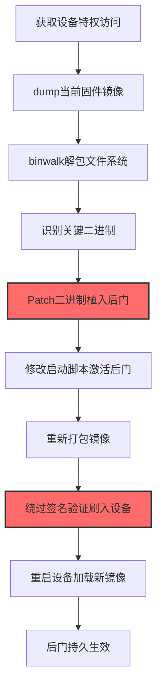
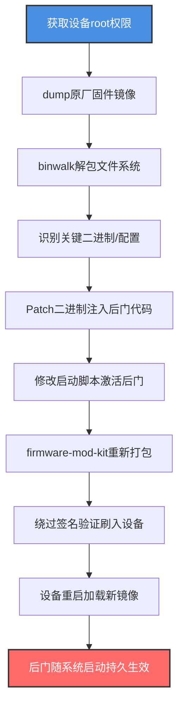

# 修补系统镜像 (T1601.001)

## 一句话通俗理解

> **在原厂固件/镜像基础上"打补丁"注入后门——保留所有原功能，只悄悄改几个二进制和配置文件**

## 30秒速查卡

| 维度 | 你需要知道的 |
|------|-------------|
| 这是什么？ | 在已有系统镜像基础上做最小化修改，植入后门而不破坏原签名验证逻辑（或绕过它） |
| 为什么危险？ | 后门驻留在镜像层，重启不丢失，且因为只做最小化修改，常规差异检测难以发现 |
| 谁需要关心？ | 网络运维、SOC/IR团队、固件安全工程师、容器平台管理员 |
| 你的第一步防御 | 对所有网络设备和关键服务器启用镜像完整性校验，对比SHA-256签名基线 |
| 如果只做一件事 | 每周对比所有边缘设备固件哈希与厂商发布版本，发现偏离立即告警 |

## 难度等级

⭐⭐⭐ 高级 - 需要理解固件结构、签名验证机制、二进制修改技术

## 前置知识检查

**读这个文件需要什么？**

- [x] 父技术T1601（修改系统镜像）的基本概念
- [x] 网络设备固件结构（Cisco IOS、OpenWrt、Junos）
- [x] 镜像签名验证机制（Secure Boot、Cisco Signed Image、dm-verity）
- [x] 二进制Patch技术（hex编辑、ELF/PE文件结构）

## 技术描述

**修补系统镜像**（T1601.001）是 **修改系统镜像**（T1601）的一个具体变体，属于 **防御削弱** 阶段的攻击技术。

> 📚 **打个比方**：就像攻击者把原厂门锁拆下来，用同一个锁体、只换里面的弹簧——外观完全一样，钥匙也照常能开，但攻击者的万能钥匙能打开它。修补系统镜像就是保留原镜像的绝大部分内容，只对几个关键二进制或配置文件做最小化修改，让后门与原功能共存。

### 具体怎么理解？

攻击者使用这种技术时，通常是在防御削弱阶段，已经获取了设备的特权访问，想要达到持久控制的目的。与父技术 T1601 相比，T1601.001 的核心区别在于"修改范围"——T1601 包含所有形式的镜像修改（包括完全替换为攻击者自研的镜像），而 T1601.001 特指在原厂镜像基础上做"外科手术式"的最小化修补，保留原镜像的大部分功能，只改几个关键点。

### 为什么有效？

这种技术之所以有效，是因为：
1. **隐蔽性高**：只改几个文件，整体文件系统结构与原镜像几乎一致，常规差异扫描难以发现
2. **功能完整**：保留原镜像所有功能，设备运行表现正常，管理员难以察觉
3. **签名验证绕过**：通过Patch引导加载器或利用签名验证漏洞，让修改后的镜像仍能通过校验
4. **持久化强**：后门驻留在镜像层，重启、恢复出厂设置都清除不掉

**过渡段：** 不要误以为修补系统镜像只是"修改配置文件"——攻击者会直接Patch系统二进制，让后门代码与合法进程共存于同一个ELF/PE文件中。

## 真实攻击流程

### 典型场景

攻击者在 **防御削弱** 阶段使用 修补系统镜像 技术，以下是典型的攻击步骤：



**步骤详解：**

1. **获取设备特权访问** - 通过漏洞或弱口令获得root权限
2. **dump当前固件** - 从Flash/ROM中提取当前运行的镜像文件
3. **解包文件系统** - 用binwalk/unsquashfs解包镜像
4. **识别关键二进制** - 找到SSH/HTTPD/init等核心二进制
5. **Patch二进制** - 修改二进制注入后门代码或替换为含后门版本
6. **修改启动脚本** - 在init/rc.local中添加后门激活命令
7. **重新打包** - 用firmware-mod-kit重新打包镜像
8. **绕过签名验证** - 通过Secure Boot漏洞或厂商密钥绕过校验
9. **刷入设备** - 通过TFTP/USB/调试接口刷写新镜像
10. **重启加载** - 设备重启加载新镜像，后门随系统启动生效

## 攻击流程

### 典型攻击流程

获取设备root权限 --> dump原厂固件 --> binwalk解包 --> Patch关键二进制注入后门 --> 修改启动脚本 --> 重新打包 --> 绕过签名验证刷入 --> 重启后门持久生效



**步骤详解：**

1. **获取设备root权限** - 攻击者通过CVE漏洞、弱口令或供应链入侵获得设备的root/admin权限
   - 通俗描述：就像先拿到设备机房的钥匙，才能进去换固件芯片
   - 技术细节：利用CVE-2023-20198（Cisco IOS XE Web UI未授权提权）、CVE-2018-9995（路由器凭据提取）、CVE-2024-3080（OpenWrt认证绕过）等漏洞获得特权访问，或通过默认凭证（admin/admin、root/toor）直接登录
   - 常用工具：Metasploit、 routersploit、CVE-specific PoC

2. **dump原厂固件镜像** - 从设备Flash/ROM中提取当前运行的完整镜像，作为修补的基础
   - 通俗描述：先把原厂门锁的"图纸"完整拷贝下来，再在图纸上做修改
   - 技术细节：通过`dd if=/dev/mtd0 of=/tmp/firmware.bin`读取Flash芯片，或通过UART/JTAG调试接口使用flashrom工具直接读取，部分设备支持`copy flash: tftp:`命令备份固件
   - 常用工具：dd、flashrom、OpenOCD、JTAGulator、Bus Pirate

3. **binwalk解包文件系统** - 用binwalk识别固件结构，提取出squashfs/jffs2文件系统
   - 通俗描述：把固件"剥洋葱"一样层层剥开，露出里面的文件系统
   - 技术细节：`binwalk -e firmware.bin`自动识别固件头、内核镜像、文件系统偏移并提取，常用unsquashfs提取squashfs文件系统，jffs2dump提取jffs2，对于加密固件可能需要先用AES密钥解密
   - 常用工具：binwalk、unsquashfs、jffs2dump、firmware-mod-kit

4. **识别关键二进制/配置** - 在解包后的文件系统中找到SSH/HTTPD/init/SNMP等核心二进制和配置文件
   - 通俗描述：找到设备"心脏"——哪些二进制负责认证、哪些负责启动、哪些负责远程管理
   - 技术细节：分析`/usr/sbin/sshd`、`/usr/sbin/httpd`、`/sbin/init`、`/usr/sbin/snmpd`等关键二进制，理解它们的启动流程和认证逻辑，找到合适的Patch点（如认证函数、日志记录函数）
   - 常用工具：Ghidra、IDA Pro、radare2、Binary Ninja

5. **Patch二进制注入后门代码** - 修改关键二进制，植入硬编码账户、Magic Packet激活、命令执行后门
   - 通俗描述：在原厂门锁的认证模块里偷偷塞一个"万能密码"识别逻辑
   - 技术细节：用Ghidra反编译`/usr/sbin/sshd`，找到`auth_password`函数，Patch为"如果密码是`Backdoor!@#123`则认证通过"，同时修改`/usr/sbin/snmpd`添加自定义OID查询触发后门命令，对ELF文件做Patch时需重新计算校验和保持文件大小一致
   - 常用工具：Ghidra、IDA Pro、hex编辑器（hexedit、bless）、patchelf

6. **修改启动脚本激活后门** - 在init脚本/rc.local/inittab中添加后门激活命令
   - 通俗描述：在门锁的"启动流程"里加一句"开机后自动打开后门"
   - 技术细节：修改`/etc/init.d/boot`或`/etc/rc.local`，添加`/usr/sbin/.backdoor --start &`启动后门守护进程，使用`update-rc.d`确保后门随启动加载，修改`/etc/inittab`添加respawn机制保证后门被kill后自动重启
   - 常用工具：vi/nano编辑器、update-rc.d、systemd unit files

7. **firmware-mod-kit重新打包** - 用firmware-mod-kit重新构建可刷写的固件镜像
   - 通俗描述：把改好的"图纸"重新打包成可以烧到芯片里的固件文件
   - 技术细节：使用`./build_firmware.sh /path/to/extracted/`重新构建squashfs文件系统并合并到固件镜像中，需要保持文件系统偏移、内核加载地址与原镜像一致，对Cisco IOS XE镜像使用`pkg build`命令打包
   - 常用工具：firmware-mod-kit、squashfs-tools、mksquashfs、Cisco pkg工具

8. **绕过签名验证刷入设备** - 通过漏洞或厂商密钥绕过镜像签名校验，刷写修改后的镜像
   - 通俗描述：把假固件"伪装"成官方固件骗过设备的签名检查
   - 技术细节：利用CVE-2019-1862（Cisco IOS签名验证绕过）等漏洞，或Patch引导加载器（U-Boot）跳过verify_image_signature函数，对于供应链攻击场景则使用OEM厂商的签名密钥直接签名，刷写通过`copy tftp: flash:`或`sysupgrade`命令完成
   - 常用工具：tftp、sysupgrade、U-Boot console、Cisco ROMMON

9. **设备重启加载新镜像** - 触发设备重启，让修改后的镜像被加载到内存
   - 通俗描述：让门锁重启一次，新的"带后门"系统就生效了
   - 技术细节：执行`reboot`命令或断电重启，设备从Flash加载新镜像，后门代码随`/sbin/init`启动流程自动激活，由于修改在镜像层，重启不会清除
   - 常用工具：reboot命令、Web管理界面重启选项、PoE重启

10. **后门随系统启动持久生效** - 后门在每次设备启动时自动激活，攻击者可随时通过后门访问设备
    - 通俗描述：从今往后，攻击者随时能用万能钥匙开门，且管理员察觉不到
    - 技术细节：后门通过Magic Packet（特定模式网络包）激活，监听非标准端口（如4444），C2通信伪装成SNMP/NTP流量避开NTA检测，硬编码账户`backdoor:Backdoor!@#123`提供SSH访问
    - 常用工具：自定义后门二进制、netcat、socat

## 真实案例

### 案例1：VPNFilter模块化固件后门（2018）

- **时间**: 2018年5月
- **目标**: 全球50万台SOHO路由器（Linksys/Netgear/TP-Link/华硕/D-Link）
- **攻击组织**: APT28（Fancy Bear，俄罗斯GRU）
- **手法**: VPNFilter的第一阶段loader在入侵设备后，会把自己写入设备的非易失性存储（与固件共存）。Loader通过Patch设备的启动脚本，使其在每次启动时从指定位置加载第二阶段payload。最关键的模块`dstr`能在固件层植入"自毁开关"——收到特定指令后清空Flash，让设备变砖。VPNFilter的"修补"特征体现在：它不替换整个固件，而是在原固件文件系统中"长"出自己的目录（如`/var/run/vpnfilter/`），并修改`/etc/init.d/`下的启动脚本，让后门与原系统共存。这种"最小化修改"让VPNFilter在50万台设备上潜伏两年未被发现。
- **影响**: 50万台设备被感染，包括乌克兰关键基础设施
- **参考链接**: https://www.cisa.gov/news-events/cybersecurity-advisories/aa18-144a

### 案例2：Cisco IOS XE后门植入（2023）

- **时间**: 2023年10月
- **目标**: 全球4万+台Cisco IOS XE设备
- **攻击组织**: 未归属（机会主义大规模利用）
- **手法**: 攻击者利用CVE-2023-20198零日漏洞获得Cisco IOS XE设备的特权访问后，通过`install add file`命令向运行中的IOS XE镜像中"打补丁"——在镜像的`pkg`包结构中植入后门二进制，并Patch HTTP Server进程使后门随Web服务启动。后门通过特定HTTP请求头激活（如`Authorization: 0ff...`格式），允许攻击者执行任意命令。Cisco Talos的分析显示，攻击者只修改了镜像中的少数几个文件（约5-10个二进制），整体文件系统结构几乎不变——这就是典型的T1601.001"外科手术式"修补。后门在`show version`、`show platform`等常规检查中不可见，只有通过镜像哈希对比才能发现。
- **影响**: 4万+台设备被植入后门，包括政府、电信、医疗机构
- **参考链接**: https://sec.cloudapps.cisco.com/security/center/content/CiscoSecurityAdvisory/cisco-sa-iosxe-webui-privesc-j22SaA4z

### 案例3：Slingshot平台Patch路由器固件

- **时间**: 2012-2017年（Kaspersky 2018年披露）
- **目标**: 中东、非洲的SOHO路由器（主要是MikroTik RouterOS）
- **攻击组织**: Slingshot（疑似西方情报机构）
- **手法**: Slingshot是一个高度复杂的间谍平台，其感染链的第一步是Patch MikroTik路由器的RouterOS固件——攻击者通过CVE-2007-2007（MikroTik Winbox漏洞）入侵路由器后，向RouterOS镜像中植入一个名为`KernelModeModule`（KMM）的内核模块。这个KMM不是简单的二进制替换，而是直接Patch RouterOS内核镜像，在内核地址空间中分配隐藏内存区域存放后门代码。KMM通过劫持内核系统调用表实现持久化，且由于驻留在镜像层，即使重装RouterOS也无法清除（因为重装用的镜像本身被Patch了）。Slingshot展示了T1601.001的最高水平——攻击者甚至编写了自己的内核级虚拟文件系统来隐藏后门文件。
- **影响**: 数千台路由器被感染，作为跳板攻击Windows终端
- **参考链接**: https://securelist.com/slingshot/84362/

## 红队视角

> ⚠️ **免责声明**：以下内容仅用于合法的安全测试、渗透测试和教育目的。未经授权对他人系统进行测试是违法行为。

### 实战技巧

1. **最小化修改原则**：只改3-5个关键文件，保持文件系统结构不变，降低被发现的概率
2. **隐藏后门二进制**：把后门代码嵌入到合法二进制（如busybox）的资源段，避免新增文件
3. **使用Magic Packet激活**：后门默认不运行，只有收到特定模式的网络包才激活
4. **伪装C2流量**：后门C2伪装成SNMP/NTP/DNS流量，避开NTA检测
5. **保持文件大小一致**：Patch二进制时通过填充NOP保持文件大小，避免大小校验失败

### 常用工具

| 工具名称 | 用途 | 平台 | 链接 |
| -------- | ---- | ---- | ---- |
| binwalk | 固件分析解包 | Linux | [binwalk](https://github.com/ReFirmLabs/binwalk) |
| firmware-mod-kit | 固件修改重打包 | Linux | [fmk](https://github.com/rampageX/firmware-mod-kit) |
| Ghidra | 二进制逆向Patch | 跨平台 | [Ghidra](https://ghidra-sre.org/) |
| flashrom | Flash芯片读写 | Linux | [flashrom](https://www.flashrom.org/) |
| EMBA | 固件安全分析 | Linux | [EMBA](https://github.com/e-m-b-a/emba) |

### 注意事项

- Patch二进制后需重新计算ELF/PE校验和，保持文件大小一致
- 部分设备有TPM/eFuse硬件防篡改，固件层Patch可能失败
- 刷写失败可能变砖，需准备JTAG调试器恢复
- 持续监控会对比固件哈希，需同时修改校验逻辑

## 蓝队视角

### 检测要点

1. **固件哈希基线**：定期对比设备固件SHA-256与厂商发布版本，发现偏离立即告警
2. **签名验证告警**：监控设备日志中签名校验失败的事件
3. **启动日志分析**：分析设备启动日志，发现非预期的二进制加载
4. **网络流量异常**：监控设备发出的非标准端口出站连接
5. **配置基线对比**：对比设备配置文件，发现新增的隐藏目录或脚本

### 监控建议

- 部署固件完整性校验工具（如Cisco ISC、Juniper J-Insight）实时监控
- 使用Oxidized/RANCID定期备份设备配置和镜像哈希
- 部署NTA监控设备异常出站连接，重点关注SNMP/NTP/DNS流量异常增长
- 对关键设备启用TPM远程证明（Remote Attestation）
- 建立固件签名基线库，每周自动化对比

## 避坑指南

只检查配置文件而忽略固件二进制本身——后门可能直接Patch在内核二进制里，配置文件完全正常。

## 检测建议

### 检测思路

检测 修补系统镜像 的关键是固件完整性校验——任何SHA-256哈希与基线不一致的设备都应被怀疑。以下是三个层面的检测方法：

### 网络层检测

**方法**：监控设备出站流量，识别后门C2通信

```bash
# 监控网络设备异常出站连接
# 关注非管理时段的连接、非标准端口、长连接
tcpdump -i eth0 'src host 192.168.1.1 and not dst port 22' -w device_traffic.pcap

# 分析SNMP流量异常（可能伪装C2）
tshark -r device_traffic.pcap -Y 'snmp' -T fields -e snmp.community -e snmp.oid | sort | uniq -c | sort -rn
```

### 主机层检测

**Cisco IOS日志**：
- `%IOSXE-3-PLATFORM: Image integrity check failed`
- `%SIGNATURE-3-NOT_VERIFIED: Image signature not verified`
- `%SYS-2-FILESYSTEM: Unexpected file in /bootflash/`

**Linux系统日志**：
- `kernel: dm-verity verification failed at block X`
- `systemd[1]: /usr hash mismatch detected`

```bash
# 对比设备固件哈希
ssh admin@192.168.1.1 "show platform software status control-processor | include hash" > current_hash.txt
diff baseline_hash.txt current_hash.txt
```

### 应用层检测

**用人话说：** 攻击者用binwalk、firmware-mod-kit、Ghidra等工具解包并Patch设备固件，植入后门二进制或硬编码账户。如果发现设备的固件哈希与厂商发布版本不一致，或者设备发出非标准端口的出站连接，或者启动日志中出现签名验证失败告警，这就是攻击者在修补系统镜像。

**Sigma规则示例**：

```yaml
title: 检测固件镜像完整性偏离
status: experimental
description: 检测设备固件哈希与基线不一致，可能被修补植入后门
logsource:
    category: firmware_integrity
detection:
    selection:
        EventID: 9001
        Status: 'HASH_MISMATCH'
    condition: selection
level: critical
tags:
    - attack.t1601
    - attack.t1601.001
    - attack.persistence
    - attack.defense_evasion
```

```yaml
title: 检测固件分析工具使用
status: experimental
description: 检测主机上使用binwalk/firmware-mod-kit等固件分析工具
logsource:
    category: process_creation
    product: linux
detection:
    selection:
        Image|endswith:
            - '/binwalk'
            - '/unsquashfs'
            - '/flashrom'
        CommandLine|contains:
            - 'firmware'
            - 'mtd0'
            - 'flash:'
    condition: selection
level: high
tags:
    - attack.t1601
    - attack.t1601.001
    - attack.defense_evasion
```

## 缓解措施

### 优先级1：关键措施

**启用镜像签名验证**：所有设备启用Secure Boot、Cisco Signed Image、dm-verity

```bash
# Cisco IOS XE启用镜像签名验证
configure terminal
platform signature verification boot
exit
write memory
```

### 优先级2：重要措施

**固件哈希基线监控**：定期对比设备固件哈希与厂商版本

```bash
# 自动化固件哈希校验脚本
#!/bin/bash
for dev in $(cat devices.txt); do
    hash=$(ssh admin@$dev "show platform software status control-processor | include hash" | awk '{print $NF}')
    baseline=$(grep $dev baseline_hashes.txt | awk '{print $2}')
    if [ "$hash" != "$baseline" ]; then
        echo "ALERT: $dev firmware hash mismatch! Current=$hash Baseline=$baseline"
    fi
done
```

### 优先级3：建议措施

**供应链审计**：对新采购设备抽样做固件哈希校验，验证与厂商发布版本一致

## 动手实验

> ⚠️ **所有实验必须在隔离的实验室环境中进行**

### 实验1：固件解包与文件系统分析（初级）

**目标**：理解 修补系统镜像 的工作原理

**步骤**：
1. 下载OpenWrt固件样本
2. 用binwalk分析固件结构
3. 解包提取文件系统
4. 分析关键二进制和启动脚本

```bash
# 下载OpenWrt固件
wget https://downloads.openwrt.org/releases/22.03.5/targets/ath79/generic/openwrt-22.03.5-ath79-generic-tplink_tl-wr1043nd-v1-squashfs-factory.bin

# 分析固件结构
binwalk openwrt-22.03.5-ath79-generic-tplink_tl-wr1043nd-v1-squashfs-factory.bin

# 提取文件系统
binwalk -e openwrt-22.03.5-ath79-generic-tplink_tl-wr1043nd-v1-squashfs-factory.bin
cd _openwrt-*.extracted/squashfs-root

# 查看关键文件
cat etc/inittab
ls -la sbin/init etc/init.d/
```

**学习要点**：理解固件文件系统结构，识别关键二进制和启动脚本

### 实验2：固件Patch与重打包（中级）

**目标**：掌握 修补系统镜像 的实际操作方法

**步骤**：
1. 在解包的文件系统中做最小化修改
2. 添加后门启动脚本
3. 重新打包固件
4. 验证打包结果

```bash
cd _openwrt-*.extracted/squashfs-root

# 1. 修改启动脚本（仅实验！）
echo '#!/bin/sh' > etc/init.d/backdoor
echo '/usr/sbin/touch /tmp/.backdoor_ready' >> etc/init.d/backdoor
chmod +x etc/init.d/backdoor
ln -s ../init.d/backdoor etc/rc.d/S99backdoor

# 2. 添加后门账户（仅实验！）
echo 'backdoor:\$1\$xyz\$abcdefghijklmnop:0:0:backdoor:/root:/bin/sh' >> etc/passwd

# 3. 重新打包
cd /opt/firmware-mod-kit
./build_firmware.sh /path/to/_openwrt-*.extracted/

# 4. 验证
binwalk new_firmware.bin
```

**学习要点**：掌握固件修改和重打包流程，注意原签名已失效

### 实验3：固件哈希基线校验（高级）

**目标**：验证检测规则的有效性

**步骤**：
1. 建立固件哈希基线
2. 模拟固件被Patch
3. 对比哈希发现偏离
4. 验证告警触发

```bash
# 1. 建立基线
sha256sum openwrt-original.bin > baseline.txt

# 2. Patch固件（用实验2的产物）
sha256sum new_firmware.bin > current.txt

# 3. 对比
diff baseline.txt current.txt
# 输出：< 8a7b6c5d... openwrt-original.bin
#       > 1f2e3d4c... new_firmware.bin
```

**学习要点**：理解哈希基线校验是检测T1601.001最有效的方法

## 术语解释

| 术语 | 通俗解释 |
|------|---------|
| **修补系统镜像** | T1601.001，在原厂镜像基础上做最小化修改注入后门 |
| **修改系统镜像** | T1601，修补系统镜像所属的父技术类别 |
| **binwalk** | 固件分析和逆向工程工具，能识别固件结构并提取文件系统 |
| **firmware-mod-kit** | 固件修改和重打包工具集 |
| **Patch** | 对二进制文件做最小化修改，不重新编译 |
| **Magic Packet** | 特定模式的网络包，用于激活后门 |
| **dm-verity** | Linux内核块设备完整性校验机制 |
| **Secure Boot** | UEFI启动链路签名验证机制 |

## 被引用情况

以下父技术文档引用了本子技术：

- [T1601 - 修改系统镜像](../T1601-Modify-System-Image.md)

## 参考资料

### 官方文档

- [MITRE ATT&CK - 修补系统镜像 (T1601.001)](https://attack.mitre.org/techniques/T1601/001/)
- [MITRE ATT&CK - 修改系统镜像 (T1601)](https://attack.mitre.org/techniques/T1601/)

### 安全报告

- [CISA VPNFilter通告](https://www.cisa.gov/news-events/cybersecurity-advisories/aa18-144a) - APT28路由器固件恶意软件
- [Cisco IOS XE Web UI漏洞通告](https://sec.cloudapps.cisco.com/security/center/content/CiscoSecurityAdvisory/cisco-sa-iosxe-webui-privesc-j22SaA4z) - 2023大规模后门植入
- [Kaspersky Slingshot分析](https://securelist.com/slingshot/84362/) - 路由器固件Patch平台

### 工具与资源

- [binwalk](https://github.com/ReFirmLabs/binwalk) - 固件分析工具
- [firmware-mod-kit](https://github.com/rampageX/firmware-mod-kit) - 固件修改工具
- [EMBA](https://github.com/e-m-b-a/emba) - 固件安全分析框架
- [Atomic Red Team](https://github.com/redcanaryco/atomic-red-team) - 检测规则测试

### 学习资料

- [IoT固件逆向工程](https://www.riverloopsecurity.com/projects/hardware-tools/) - 硬件安全工具
- [firmware-analysis-training](https://github.com/firmware-analysis-training) - 固件分析培训资料
