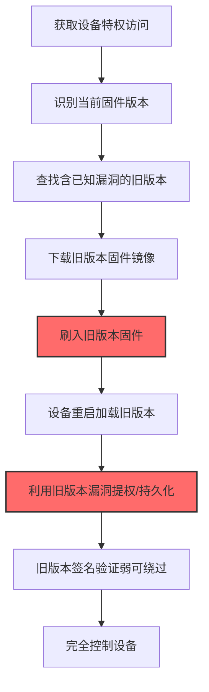
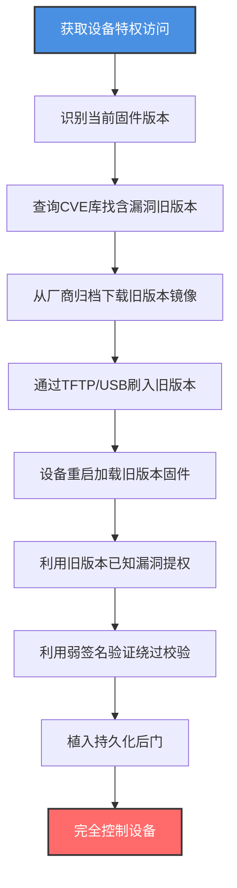

# 降级系统镜像 (T1601.002)

## 一句话通俗理解

> **把设备固件/OS镜像"回退"到有已知漏洞的旧版本——不是为了兼容性，而是为了利用旧版本的漏洞**

## 30秒速查卡

| 维度 | 你需要知道的 |
|------|-------------|
| 这是什么？ | 把设备镜像降级到含已知漏洞的旧版本，再利用旧版本漏洞实现持久化或提权 |
| 为什么危险？ | 旧版本漏洞利用代码成熟、签名验证可能更弱，且管理员通常不会怀疑"版本回退" |
| 谁需要关心？ | 网络运维、SOC/IR团队、补丁管理团队、固件安全工程师 |
| 你的第一步防御 | 在所有设备上启用"最小版本限制"，禁止降级到含已知严重漏洞的版本 |
| 如果只做一件事 | 监控所有固件/OS版本变更，对比新旧版本号，发现降级操作立即告警 |

## 难度等级

⭐⭐⭐ 高级 - 需要理解固件版本兼容性、漏洞利用、签名验证机制

## 前置知识检查

**读这个文件需要什么？**

- [x] 父技术T1601（修改系统镜像）的基本概念
- [x] 网络设备固件版本管理和升级流程
- [x] CVE漏洞数据库和利用代码获取渠道
- [x] 镜像签名验证机制（部分旧版本验证更弱或可绕过）

## 技术描述

**降级系统镜像**（T1601.002）是 **修改系统镜像**（T1601）的一个具体变体，属于 **防御削弱** 阶段的攻击技术。

> 📚 **打个比方**：就像攻击者把你家新装的智能门锁（v3.0，已修复撬锁漏洞）偷偷换回老型号（v1.0，有撬锁漏洞），然后用早已公开的撬锁手法开门——你以为是同一把锁，其实已经被"降级"了。降级系统镜像就是攻击者把设备固件/OS镜像回退到含已知漏洞的旧版本，再利用这些漏洞实现提权、持久化或绕过防御。

### 具体怎么理解？

攻击者使用这种技术时，通常是在防御削弱阶段，已经获取了设备的特权访问。与父技术 T1601 相比，T1601.002 的核心区别在于"修改方向"——T1601 包含所有形式的镜像修改，而 T1601.002 特指把镜像**回退**到旧版本，目的是利用旧版本的已知漏洞，而不是直接在镜像中植入后门代码。

### 为什么有效？

这种技术之所以有效，是因为：
1. **漏洞利用成熟**：旧版本漏洞利用代码（PoC/EXP）通常已公开且稳定
2. **签名验证更弱**：部分设备的旧版本固件签名验证逻辑存在缺陷，更容易绕过
3. **管理员不怀疑**：版本回退在合规环境中也可能发生（如降级到稳定版本），不易引起警觉
4. **持久化强**：降级后的固件驻留在设备中，重启不丢失

**过渡段：** 不要误以为降级系统镜像只是"装旧版软件"——攻击者降级的是设备最底层的固件/OS镜像，让整个设备回到有漏洞的状态。

## 真实攻击流程

### 典型场景

攻击者在 **防御削弱** 阶段使用 降级系统镜像 技术，以下是典型的攻击步骤：



**步骤详解：**

1. **获取设备特权访问** - 通过漏洞或弱口令获得特权访问
2. **识别当前固件版本** - 通过`show version`等命令获取当前版本号
3. **查找含已知漏洞的旧版本** - 在CVE数据库查询含可利用漏洞的版本
4. **下载旧版本固件镜像** - 从厂商归档或第三方站点下载旧版本
5. **刷入旧版本固件** - 通过TFTP/USB刷写旧版本镜像
6. **设备重启加载旧版本** - 重启让旧版本固件生效
7. **利用旧版本漏洞** - 使用公开的EXP提权或植入持久化后门
8. **绕过弱签名验证** - 旧版本签名验证可能有缺陷

## 攻击流程

### 典型攻击流程

获取设备特权访问 --> 识别当前固件版本 --> 查找含已知漏洞的旧版本 --> 下载旧版本镜像 --> 刷入设备 --> 重启加载旧版本 --> 利用旧版本漏洞提权/持久化



**步骤详解：**

1. **获取设备特权访问** - 攻击者通过CVE漏洞、弱口令或供应链入侵获得设备的root/admin权限
   - 通俗描述：先拿到设备机房钥匙，才能进去换固件
   - 技术细节：利用CVE-2023-20198（Cisco IOS XE Web UI未授权提权）、CVE-2019-1653（思科RV320路由器凭据泄露）等漏洞获得特权访问，或通过默认凭证直接登录设备管理界面
   - 常用工具：Metasploit、routersploit、CVE-specific PoC

2. **识别当前固件版本** - 通过设备管理命令获取当前运行的固件版本号
   - 通俗描述：先看看现在装的是哪一年的"门锁型号"
   - 技术细节：执行`show version`（Cisco IOS）、`show version detail`（Juniper Junos）、`cat /etc/openwrt_version`（OpenWrt）获取当前版本号、镜像哈希、构建日期等信息
   - 常用工具：SSH、设备Web管理界面、SNMP查询

3. **查询CVE库找含漏洞旧版本** - 在CVE/NVD数据库查询目标设备型号的已知漏洞及受影响版本
   - 通俗描述：翻阅"门锁漏洞手册"，找到哪个旧型号有公开的撬锁教程
   - 技术细节：在NVD（https://nvd.nist.gov/）搜索目标设备型号的CVE记录，重点关注CVSS 9.0+的RCE/特权提升漏洞，查看受影响版本范围，找到可以降级到的目标版本，例如Cisco IOS XE 16.x存在CVE-2019-1804（RCE），即可降级到该版本利用
   - 常用工具：NVD网站、Exploit-DB、CVE Details、Metasploit搜索

4. **从厂商归档下载旧版本镜像** - 从厂商归档站点或第三方镜像站点下载目标旧版本固件
   - 通俗描述：从网上淘一个老型号门锁回来替换
   - 技术细节：从厂商软件下载中心（如Cisco Software Central、Juniper Support Portal）下载历史版本，部分厂商限制旧版本下载，攻击者可能从第三方镜像站点（如archive.org、firmware.openwrt.org）获取，对加密固件可能需要先获取解密密钥
   - 常用工具：wget、curl、浏览器、archive.org

5. **通过TFTP/USB刷入旧版本** - 通过TFTP服务器或USB存储把旧版本固件刷写到设备
   - 通俗描述：把老门锁装上去替换新门锁
   - 技术细节：通过`copy tftp://server/old_firmware.bin flash:`（Cisco）、`sysupgrade -n /tmp/old_firmware.bin`（OpenWrt）、USB自动加载机制刷写，部分设备需要在ROMMON模式下刷写绕过运行时签名校验，刷写前需备份当前配置避免丢失
   - 常用工具：tftp、sysupgrade、Cisco ROMMON、USB存储

6. **设备重启加载旧版本固件** - 触发设备重启，加载刚刷写的旧版本固件
   - 通俗描述：让门锁重启一次，老型号就装上了
   - 技术细节：执行`reload`（Cisco）、`reboot`（Linux/OpenWrt）命令，设备从Flash加载旧版本镜像，旧版本的引导加载器、内核、文件系统全部生效，旧版本的漏洞也随之存在
   - 常用工具：reload/reboot命令、PoE重启、物理重启

7. **利用旧版本已知漏洞提权** - 使用公开EXP利用旧版本的已知漏洞实现提权或植入后门
   - 通俗描述：用早就公开的撬锁教程开门
   - 技术细节：使用Metasploit中已发布的exploit模块（如`exploit/linux/http/cisco_ios_xe_rce`），或从Exploit-DB下载的PoC脚本，针对旧版本的RCE、特权提升、认证绕过漏洞实施攻击，例如利用CVE-2019-1804实现Cisco IOS XE RCE，或利用CVE-2018-9995提取路由器凭据
   - 常用工具：Metasploit、Exploit-DB PoC、 routersploit、自定义EXP脚本

8. **利用弱签名验证绕过校验** - 旧版本固件签名验证逻辑可能存在缺陷，更容易绕过
   - 通俗描述：老门锁的"防伪标签"做得不如新型号严谨，更容易伪造
   - 技术细节：旧版本可能缺少Secure Boot支持，或签名验证函数有漏洞（如CVE-2019-1862影响Cisco IOS旧版本），或使用的哈希算法弱（MD5/SHA1）易碰撞，攻击者可在旧版本基础上再Patch固件植入后门，由于签名验证弱，Patch后的固件仍能加载
   - 常用工具：固件逆向工具、签名验证绕过PoC

9. **植入持久化后门** - 在利用漏洞后植入持久化后门，确保长期访问
   - 通俗描述：撬开门之后装一个自己的暗锁
   - 技术细节：在旧版本固件基础上添加硬编码账户、修改SSH配置允许root登录、植入Web Shell、修改启动脚本加载后门守护进程，由于旧版本安全机制弱（可能无EDR/AV），后门更难被发现
   - 常用工具：后门二进制、netcat、Web Shell

10. **完全控制设备** - 通过持久化后门实现对设备的完全控制
    - 通俗描述：从今往后，攻击者随时能控制这台设备
    - 技术细节：通过后门SSH/Web Shell随时访问设备，设备作为内网跳板进行横向移动，或作为流量嗅探节点收集凭据，由于降级后的设备安全机制弱，攻击者活动难以被检测
    - 常用工具：SSH客户端、C2框架

## 真实案例

### 案例1：Cisco路由器固件降级利用CVE-2019-1804

- **时间**: 2019-2021年
- **目标**: 多个行业的Cisco路由器用户
- **攻击组织**: 多个APT组织和勒索软件团伙
- **手法**: 攻击者在获取Cisco路由器特权访问后，将设备固件从修复了CVE-2019-1804（CVSS 9.8 RCE）的新版本降级到受影响的旧版本（如IOS XE 16.5.1a）。降级后，攻击者使用公开的Metasploit exploit模块`exploit/linux/http/cisco_ios_xe_rce`实现远程代码执行。由于旧版本固件签名验证逻辑存在缺陷（CVE-2019-1862），攻击者还能在旧版本基础上进一步Patch固件植入后门，且Patch后的固件仍能通过弱签名验证。这种"降级+Patch"组合拳让攻击者既利用了旧版本的RCE漏洞，又通过Patch实现了持久化后门，且整个过程中签名验证从未告警。
- **影响**: 数百台Cisco路由器被植入后门，作为内网横向移动跳板
- **参考链接**: https://sec.cloudapps.cisco.com/security/center/content/CiscoSecurityAdvisory/cisco-sa-iosxe-rce-privesc-jZckFbRk

### 案例2：iPhone jailbreak通过降级利用checkm8

- **时间**: 2019-2024年
- **目标**: A7-A11芯片的iPhone/iPad设备
- **攻击组织**: 越狱社区和高级威胁组织
- **手法**: checkm8漏洞是BootROM（只读引导ROM）级别的漏洞，无法通过软件更新修复。攻击者（或取证机构如Cellebrite、GrayShift）利用checkm8漏洞，通过USB DFU模式将iOS设备"降级"到含可利用漏洞的旧版本iOS——即使设备当前运行的是新版iOS。具体操作是：①让设备进入DFU模式；②利用checkm8漏洞在BootROM阶段执行任意代码；③通过USB加载旧版本iOS的bootchain；④由于旧版本iOS有公开的内核漏洞（如CVE-2021-1782、CVE-2022-22587），攻击者获取内核读写权限；⑤植入持久化越狱环境或取证代理。这种降级攻击的可怕之处在于BootROM漏洞无法修复，且可在不擦除用户数据的情况下进行。
- **影响**: 执法机构和情报机构广泛用于设备取证，多个威胁组织用于植入商业间谍软件（Pegasus等）
- **参考链接**: https://theapplewiki.com/wiki/Checkm8

### 案例3：Cisco IOS XE Web UI攻击中的版本回退

- **时间**: 2023年10月
- **目标**: 4万+台Cisco IOS XE设备
- **攻击组织**: 未归属（机会主义大规模利用）
- **手法**: 在2023年Cisco IOS XE Web UI漏洞（CVE-2023-20198）攻击中，部分攻击者在植入后门后，会将设备固件降级到更早的版本——目的是利用旧版本中更弱的日志记录功能，让溯源更困难。具体操作：攻击者通过已植入的后门执行`install add file`命令刷写旧版本固件（如16.12.x），旧版本的`logging buffered`默认配置只记录少量日志，且不向Syslog服务器转发关键事件（如配置变更、登录失败）。降级后，攻击者清除剩余日志，让IR团队难以重建攻击时间线。Cisco Talos的报告显示，部分被感染设备在2023年10月后固件版本"异常回退"，但管理员直到事后审计才发现。
- **影响**: 攻击溯源困难，部分设备在数周后才被发现异常
- **参考链接**: https://blog.talosintelligence.com/active-exploitation-of-cisco-ios-xe-software/

## 红队视角

> ⚠️ **免责声明**：以下内容仅用于合法的安全测试、渗透测试和教育目的。未经授权对他人系统进行测试是违法行为。

### 实战技巧

1. **优先选择有公开EXP的旧版本**：选择有成熟Metasploit模块的旧版本，降低利用难度
2. **降级前备份当前配置**：避免降级后配置丢失引起管理员注意
3. **利用弱签名验证**：旧版本签名验证弱，可降级后再Patch固件
4. **清除降级痕迹**：删除syslog中的版本变更记录，修改SNMP sysDescr字段
5. **结合T1601.001**：降级后再Patch固件，实现"漏洞利用+持久化后门"双重效果

### 常用工具

| 工具名称 | 用途 | 平台 | 链接 |
| -------- | ---- | ---- | ---- |
| Metasploit | 漏洞利用框架 | 跨平台 | [Metasploit](https://www.metasploit.com/) |
| Exploit-DB | PoC/EXP数据库 | Web | [Exploit-DB](https://www.exploit-db.com/) |
| routersploit | 路由器漏洞利用 | Linux | [routersploit](https://github.com/threat9/routersploit) |
| checkm8 | iPhone BootROM漏洞 | macOS | [checkm8](https://github.com/axi0mX/checkm8) |
| ipwndfu | iOS降级工具 | macOS | [ipwndfu](https://github.com/axi0mX/ipwndfu) |

### 注意事项

- 部分设备有"防回滚"机制（如iPhone的eFuse计数器），降级可能失败
- 降级会触发配置兼容性检查，可能丢失部分配置
- 降级操作会在syslog中留下记录，需事后清理
- 部分旧版本固件已无法从厂商官方渠道获取
- 降级后设备安全机制弱，攻击者自身也可能被其他威胁行动者利用

## 蓝队视角

### 检测要点

1. **版本变更监控**：监控所有设备的固件/OS版本变更，对比新旧版本号
2. **降级操作告警**：发现版本号"回退"（小于当前基线版本）立即告警
3. **签名验证告警**：监控设备日志中签名校验失败或弱算法告警
4. **配置变更审计**：降级操作必然伴随配置变更，审计配置差异
5. **CVE关联分析**：将设备版本与CVE数据库关联，识别暴露于已知漏洞的设备

### 监控建议

- 部署设备配置管理工具（Oxidized、RANCID）记录版本历史
- 启用SNMP sysDescr监控，自动发现版本变更
- 建立固件版本基线，与CVE数据库关联，实时识别暴露设备
- 部署SIEM规则关联版本变更、签名失败、配置变更事件
- 对关键设备启用变更管理流程，任何固件变更需审批

## 避坑指南

只关注固件升级而忽略降级操作——攻击者降级到旧版本利用已知漏洞，比攻击新版本更容易。

## 检测建议

### 检测思路

检测 降级系统镜像 的关键是版本变更监控——任何版本号"回退"的操作都应被怀疑。以下是三个层面的检测方法：

### 网络层检测

**方法**：监控TFTP/SCP等固件下载流量

```bash
# 监控TFTP固件下载流量（默认端口69）
tcpdump -i eth0 'udp port 69' -w tftp_traffic.pcap

# 分析固件下载请求
tshark -r tftp_traffic.pcap -Y 'tftp.opcode == 1' -T fields -e tftp.source_file -e ip.src -e ip.dst | sort -u

# 监控可疑的固件下载站点访问
grep -E "(firmware|image|\.bin|\.img)" /var/log/squid/access.log | grep -v "vendor-official.com"
```

### 主机层检测

**Cisco IOS日志**：
- `%IOSXE-3-PLATFORM: Image downgrade detected: from X.X.X to Y.Y.Y`
- `%SYS-5-RELOAD: Reload requested by user`
- `%SIGNATURE-3-WEAK_ALGO: Weak signature algorithm detected (MD5)`

**Linux系统日志**：
- `systemd[1]: /etc/os-version changed from 22.04 to 18.04`
- `kernel: dm-verity: hash algorithm SHA1 deprecated`

```bash
# 监控Linux系统版本变更
auditctl -w /etc/os-release -p wa -k os_version_change
ausearch -k os_version_change | tail -20

# 监控OpenWrt固件版本变更
uci show system.@system[0] | grep -E "(version|release)"
```

### 应用层检测

**用人话说：** 攻击者通过TFTP/USB把设备固件刷写为含已知漏洞的旧版本，目的是利用旧版本的成熟EXP。如果发现设备固件版本号"回退"（小于当前基线版本），或者设备突然出现CVE数据库中标记为已修复的漏洞告警，或者签名验证日志中出现弱算法告警，这就是攻击者在降级系统镜像。

**Sigma规则示例**：

```yaml
title: 检测固件版本降级操作
status: experimental
description: 检测设备固件版本号回退到旧版本
logsource:
    category: firmware_version_change
detection:
    selection:
        EventID: 9002
        ChangeType: 'DOWNGRADE'
    condition: selection
level: high
tags:
    - attack.t1601
    - attack.t1601.002
    - attack.persistence
    - attack.defense_evasion
```

```yaml
title: 检测Cisco IOS XE固件刷写命令
status: experimental
description: 检测install add/copy tftp等固件刷写命令
logsource:
    product: cisco
    service: ios
detection:
    selection:
        Message|contains:
            - 'install add file'
            - 'copy tftp://'
            - 'copy usb:'
            - 'request platform software package'
    filter_maintenance:
        Message|contains:
            - 'scheduled maintenance'
            - 'approved change ticket'
    condition: selection and not filter_maintenance
level: medium
tags:
    - attack.t1601
    - attack.t1601.002
    - attack.defense_evasion
```

## 缓解措施

### 优先级1：关键措施

**启用防回滚机制**：在所有设备上启用固件防回滚（Anti-Rollback）机制

```bash
# Cisco IOS XE启用镜像防回滚
configure terminal
platform signature verification boot
no platform firmware allow downgrade
exit
write memory
```

### 优先级2：重要措施

**版本变更监控**：部署固件版本基线监控，发现降级操作立即告警

```bash
#!/bin/bash
# 固件版本基线监控脚本
declare -A baseline=(
    ["192.168.1.1"]="17.12.03"
    ["192.168.1.2"]="17.12.03"
    ["192.168.2.1"]="22.03.5"
)

for dev in "${!baseline[@]}"; do
    current=$(ssh admin@$dev "show version | include Version" | awk '{print $NF}' | tr -d ',')
    if [ "$current" != "${baseline[$dev]}" ]; then
        # 比较版本号，判断是否为降级
        if [[ "$current" < "${baseline[$dev]}" ]]; then
            echo "ALERT: $dev firmware DOWNGRADE detected! Current=$current Baseline=${baseline[$dev]}"
        fi
    fi
done
```

### 优先级3：建议措施

**最小版本限制策略**：通过变更管理流程禁止降级到含已知严重漏洞的版本

## 动手实验

> ⚠️ **所有实验必须在隔离的实验室环境中进行**

### 实验1：固件版本查询与CVE关联（初级）

**目标**：理解 降级系统镜像 的工作原理

**步骤**：
1. 查询测试设备当前固件版本
2. 在CVE数据库查询该设备型号的已知漏洞
3. 识别含可利用漏洞的旧版本
4. 理解攻击者为何选择降级

```bash
# 1. 查询设备当前版本
ssh admin@192.168.1.1 "show version"

# 2. 查询CVE（在NVD网站搜索）
# https://nvd.nist.gov/products/cpe/search
# 输入设备型号，查看已知CVE

# 3. 识别含漏洞的旧版本
# 例如查询Cisco IOS XE 16.x的CVE
# CVE-2019-1804影响IOS XE 16.5.1a之前版本
```

**学习要点**：理解设备版本与CVE的关联，识别降级攻击的目标版本

### 实验2：模拟固件降级操作（中级）

**目标**：掌握 降级系统镜像 的实际操作方法

**步骤**：
1. 备份当前固件和配置
2. 下载旧版本固件镜像
3. 通过TFTP刷写旧版本
4. 验证版本回退

```bash
# 1. 备份当前固件和配置（在实验设备上）
ssh admin@192.168.1.1 "copy flash: tftp://192.168.1.100/current-firmware.bin"
ssh admin@192.168.1.1 "copy running-config tftp://192.168.1.100/current-config.txt"

# 2. 在TFTP服务器准备旧版本固件
# 从厂商归档下载旧版本固件（如Cisco IOS XE 16.5.1a）
# 放到TFTP服务器目录

# 3. 刷写旧版本固件
ssh admin@192.168.1.1 "copy tftp://192.168.1.100/old-firmware.bin flash:"
ssh admin@192.168.1.1 "reload"

# 4. 验证版本
ssh admin@192.168.1.1 "show version"
```

**学习要点**：掌握固件降级的完整流程，理解配置兼容性问题

### 实验3：检测规则验证（高级）

**目标**：验证检测规则的有效性

**步骤**：
1. 建立固件版本基线
2. 模拟降级操作
3. 验证告警触发
4. 分析syslog中的降级痕迹

```bash
# 1. 建立基线
echo "192.168.1.1,17.12.03" > baseline.txt

# 2. 执行降级（实验2的步骤）

# 3. 检查syslog告警
grep -E "(downgrade|version change|install add)" /var/log/syslog

# 4. 对比配置差异
ssh admin@192.168.1.1 "show running-config" > after-downgrade.txt
diff current-config.txt after-downgrade.txt
```

**学习要点**：理解降级操作的检测方法，掌握日志分析技巧

## 术语解释

| 术语 | 通俗解释 |
|------|---------|
| **降级系统镜像** | T1601.002，把设备镜像回退到含已知漏洞的旧版本 |
| **修改系统镜像** | T1601，降级系统镜像所属的父技术类别 |
| **防回滚机制** | Anti-Rollback，设备禁止降级到旧版本的硬件/软件机制 |
| **checkm8** | iPhone BootROM级别的不可修复漏洞，可用于降级 |
| **TFTP** | Trivial File Transfer Protocol，常用于固件刷写的简单文件传输协议 |
| **DFU模式** | Device Firmware Upgrade，iOS设备的底层固件升级模式 |
| **弱签名验证** | 旧版本固件签名验证逻辑弱，容易被绕过 |
| **CVE** | Common Vulnerabilities and Exposures，公开漏洞编号 |

## 被引用情况

以下父技术文档引用了本子技术：

- [T1601 - 修改系统镜像](../T1601-Modify-System-Image.md)

## 参考资料

### 官方文档

- [MITRE ATT&CK - 降级系统镜像 (T1601.002)](https://attack.mitre.org/techniques/T1601/002/)
- [MITRE ATT&CK - 修改系统镜像 (T1601)](https://attack.mitre.org/techniques/T1601/)
- [NVD漏洞数据库](https://nvd.nist.gov/)

### 安全报告

- [Cisco IOS XE RCE漏洞通告](https://sec.cloudapps.cisco.com/security/center/content/CiscoSecurityAdvisory/cisco-sa-iosxe-rce-privesc-jZckFbRk) - CVE-2019-1804
- [checkm8漏洞分析](https://axi0mx.github.io/checkm8/) - iPhone BootROM漏洞
- [Cisco Talos IOS XE攻击分析](https://blog.talosintelligence.com/active-exploitation-of-cisco-ios-xe-software/) - 2023大规模攻击

### 工具与资源

- [Exploit-DB](https://www.exploit-db.com/) - PoC/EXP数据库
- [Metasploit](https://www.metasploit.com/) - 漏洞利用框架
- [routersploit](https://github.com/threat9/routersploit) - 路由器漏洞利用
- [Atomic Red Team](https://github.com/redcanaryco/atomic-red-team) - 检测规则测试

### 学习资料

- [固件安全指南](https://github.com/firmware-security-guides) - 固件安全最佳实践
- [CVE关联分析](https://www.cvedetails.com/) - CVE详情查询
