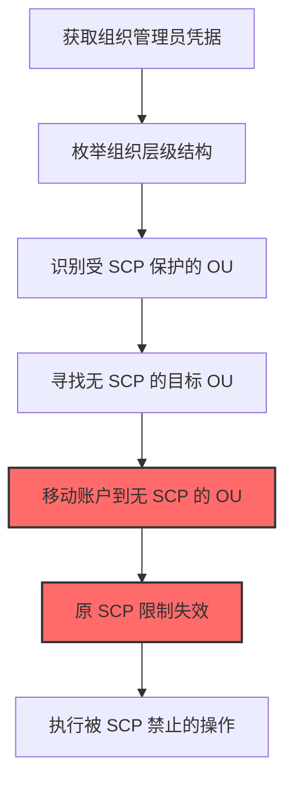
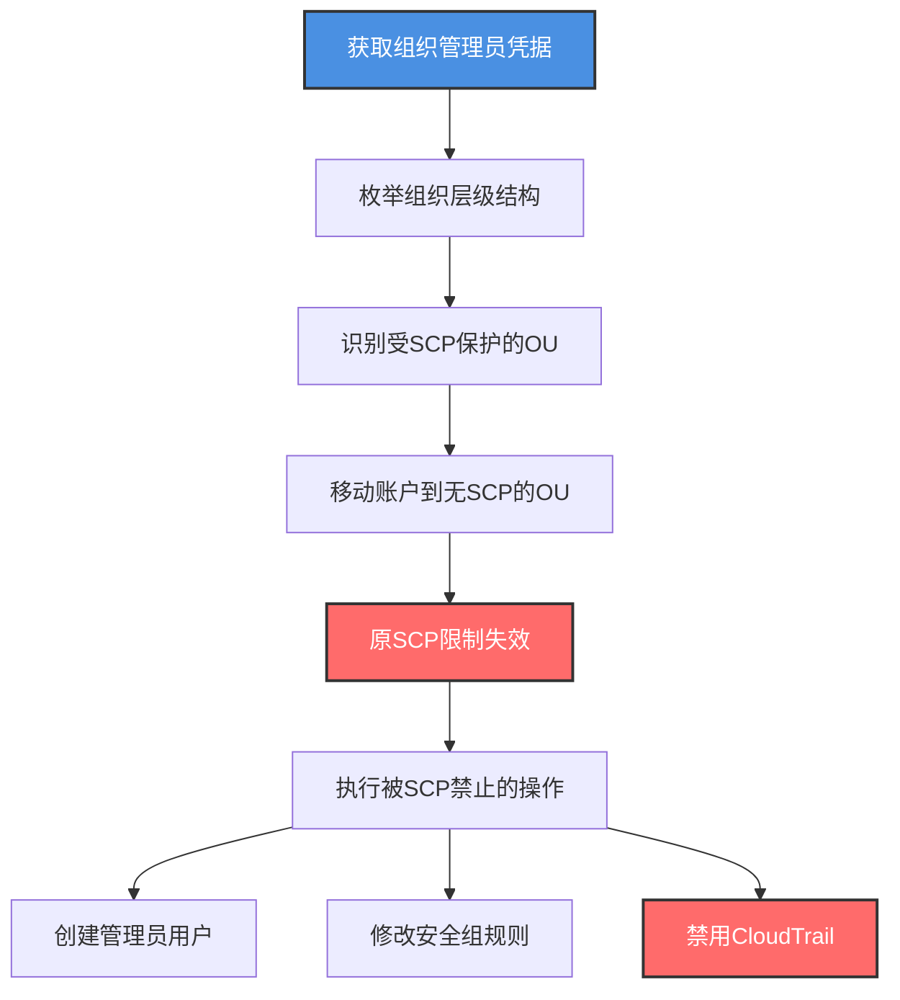

# 修改云资源层级 (T1666)

## 一句话通俗理解

> **攻击者把云资源在不同组织/账户/项目间移动——绕过继承的安全策略，藏匿在审计盲区**

## 30秒速查卡

| 维度 | 你需要知道的 |
|------|-------------|
| 这是什么？ | 攻击者通过云 API 将资源（账户、订阅、项目）在层级结构间移动，绕过继承的安全策略 |
| 为什么危险？ | 移动到不同层级会改变应用的策略继承，可能脱离原安全控制（SCP、策略、审计） |
| 谁需要关心？ | 云平台管理员、云治理团队、CSPM 运营、SOC 分析师 |
| 你的第一步防御 | 监控所有 `MoveAccount`/`az resource move`/`gcloud projects move` 操作 |
| 如果只做一件事 | 监控组织单位（OU）和管理组（Management Group）的账户/订阅移动 |

## 难度等级

⭐⭐⭐ 高级 - 需要理解云层级结构、策略继承和组织治理模型

## 前置知识检查

**读这个文件需要什么？**

- [x] 云层级结构：AWS Organizations（组织→OU→账户）、Azure（管理组→订阅→资源组）、GCP（组织→文件夹→项目）
- [x] 策略继承：安全策略从父层级继承到子层级
- [x] SCP（Service Control Policy）：AWS 组织级别策略
- [x] 管理组策略：Azure 管理组策略继承

## 技术描述

**修改云资源层级**（T1666）属于 **防御削弱**（TA0112）战术，是云平台特有的攻击技术。

> 📚 **打个比方**：想象一个公司有多栋大楼，每栋楼有不同等级的门禁——总部大楼最严，分公司较松。攻击者把员工从总部"调岗"到分公司，他原有的严格门禁失效，可以自由出入。云资源移动就是这个概念：把资源从严格策略的层级移到宽松策略的层级，让所有安全控制瞬间失效。

### 具体怎么理解？

攻击者通过云 API 修改云资源的层级关系，主要方式有：

1. **AWS 账户在 OU 间移动**：使用 `aws organizations move-account` 把账户从受 SCP 保护的 OU 移到无 SCP 的 OU
2. **Azure 订阅在管理组间移动**：使用 `az account management-group subscription add` 把订阅从受策略管理组移到无策略的管理组
3. **GCP 项目在文件夹间移动**：使用 `gcloud projects move` 把项目从受组织策略约束的文件夹移到无约束的文件夹
4. **资源跨订阅/资源组移动**：在 Azure 中使用 `az resource move` 移动资源到不同资源组

移动后，资源会继承目标层级的策略，原层级的 SCP、Azure Policy、组织策略都会失效。攻击者可以借此：
- 绕过 SCP 的权限限制
- 绕过 Azure Policy 的合规要求
- 绕过组织策略的约束
- 脱离审计日志的集中收集

### 为什么有效？

这种技术之所以有效，是因为：
1. **策略继承机制**：子层级的策略来自父层级，移动后策略立即变更
2. **审计盲区**：移动后资源可能脱离原集中审计
3. **合法操作**：资源移动是云原生合法功能
4. **难以检测**：移动操作不常发生，缺乏基线检测
5. **绕过控制**：SCP、Azure Policy 等控制立即失效

**过渡段：** 不要误以为设置了严格的组织策略就万事大吉——攻击者可以通过移动资源让所有策略瞬间失效。这是云治理中最容易被忽视的攻击面。

## 真实攻击流程

### 典型场景

攻击者在 **防御削弱** 阶段使用 修改云资源层级 技术，以下是典型的攻击步骤：



**步骤详解：**

1. **获取组织管理员凭据** - 攻击者获得组织管理权限
2. **枚举组织层级结构** - 列出所有 OU 和 SCP 配置
3. **识别受 SCP 保护的 OU** - 找到有严格策略的 OU
4. **寻找无 SCP 的目标 OU** - 找到无策略约束的 OU
5. **移动账户到无 SCP 的 OU** - 执行移动操作
6. **原 SCP 限制失效** - 账户继承新 OU 的宽松策略
7. **执行被 SCP 禁止的操作** - 利用绕过的策略进行攻击

## 攻击流程

### 典型攻击流程

获取组织管理员凭据 --> 枚举组织层级结构 --> 识别受 SCP 保护的 OU --> 移动账户到无 SCP 的 OU --> 原策略失效 --> 执行被禁止的操作 --> 利用绕过的控制进行后续攻击



**步骤详解：**

1. **获取组织管理员凭据** - 攻击者通过多种途径获取组织管理权限
   - 通俗描述：就像攻击者拿到了公司组织架构调整的"调岗"权限
   - 技术细节：通过钓鱼获取组织管理员凭据；通过提权漏洞从账户管理员升级到组织管理员；通过供应链攻击获得组织管理权限；通过 AssumeRole 链式提权
   - 常用工具：aws-cli、az、gcloud、Pacu

2. **枚举组织层级结构** - 攻击者列出组织层级和策略配置
   - 通俗描述：先看看公司的组织架构图，找到哪些部门管得严，哪些松
   - 技术细节：执行 `aws organizations list-organizational-units-for-parent --parent-id r-xxx` 列出所有 OU；执行 `aws organizations list-policies-for-target --target-id ou-xxx --filter SERVICE_CONTROL_POLICY` 列出 OU 上的 SCP；执行 `az account management-group list` 列出所有管理组；执行 `az account management-group show -n mgmt-group --expand` 查看管理组下的订阅和策略
   - 常用工具：aws-cli、az、gcloud

3. **识别受 SCP 保护的 OU** - 攻击者识别有严格策略的 OU
   - 通俗描述：找到那些门禁最严的部门
   - 技术细节：检查 SCP 内容，识别禁止性策略（如 `Deny` 语句）；常见的严格 SCP 包括：禁止修改 CloudTrail、禁止创建管理员用户、禁止离开区域、禁止修改 IAM；在 Azure 中检查 Azure Policy 的 `deny` 效果；在 GCP 中检查组织策略约束
   - 常用工具：aws-cli、az、gcloud

4. **移动账户到无 SCP 的 OU** - 攻击者执行账户移动
   - 通俗描述：把员工从严管的部门调到松管的部门
   - 技术细节：执行 `aws organizations move-account --account-id 123456789012 --source-parent-id ou-strict --destination-parent-id ou-loose` 把账户从严格 OU 移到宽松 OU；移动后账户立即继承新 OU 的 SCP；在 Azure 中执行 `az account management-group subscription add --name mgmt-loose --subscription sub-xxx`；在 GCP 中执行 `gcloud projects move project-id --folder=folder-loose`
   - 常用工具：aws-cli、az、gcloud

5. **原 SCP 限制失效** - 移动后原策略不再适用
   - 通俗描述：原来严管的规则全部失效
   - 技术细节：账户继承新 OU 的 SCP，原 OU 的 SCP 不再生效；如果新 OU 无 SCP 或 SCP 较宽松，原禁止的操作变为允许；例如原 SCP 禁止 `iam:CreateUser`，移动后该操作变为允许
   - 常用工具：（无，这是策略继承机制）

6. **执行被 SCP 禁止的操作** - 攻击者利用绕过的策略
   - 通俗描述：原来不让做的事现在都能做了
   - 技术细节：执行 `aws iam create-user --user-name backdoor` 创建后门用户（原 SCP 禁止）；执行 `aws ec2 authorize-security-group-ingress --cidr 0.0.0.0/0` 开放安全组（原 SCP 禁止）；执行 `aws cloudtrail delete-trail --name company-trail` 删除审计日志（原 SCP 禁止）
   - 常用工具：aws-cli

7. **利用绕过的控制进行后续攻击** - 攻击者利用绕过的策略
   - 通俗描述：在松管的部门里为所欲为
   - 技术细节：创建后门用户保持持久访问；修改安全组开放内部服务到公网；删除 CloudTrail 隐藏后续操作；部署挖矿或其他恶意软件
   - 常用工具：aws-cli、Metasploit、Cobalt Strike

## 真实案例

### 案例1：UNC2452/SolarWinds Azure 管理组移动（2020-2021）

- **时间**：2020年-2021年
- **目标**：美国政府机构的 Azure 环境
- **攻击组织**：APT29（Cozy Bear，俄罗斯 SVR）
- **手法**：APT29 在 SolarWinds 供应链攻击中，获取了 Azure 全局管理员权限后，使用 `az account management-group subscription add --name mgmt-no-policy --subscription prod-sub` 把关键订阅从有严格 Azure Policy 的管理组移到无策略的管理组。移动后，原 Azure Policy 强制的"必须启用诊断日志"、"必须加密存储账户"等控制失效。攻击者在宽松的订阅中创建新管理员账户、修改网络配置、部署后门 VM
- **影响**：多个政府机构被持续入侵数月
- **参考链接**：https://www.cisa.gov/news-events/cybersecurity-advisories/aa21-148a

### 案例2：AWS OU 移动绕过 SCP（2023）

- **时间**：2023年
- **目标**：某金融机构 AWS 环境
- **攻击组织**：未知
- **手法**：攻击者通过钓鱼获取组织管理员凭据后，使用 `aws organizations move-account --account-id 123456789012 --source-parent-id ou-finance-strict --destination-parent-id ou-sandbox` 把金融业务账户从受严格 SCP 保护的 OU 移到沙箱 OU。沙箱 OU 无 SCP，原 SCP 禁止的 `s3:DeleteBucket`、`iam:CreateRole`、`cloudtrail:DeleteTrail` 等操作变为允许。攻击者删除了 CloudTrail 隐藏后续操作，创建高权限 IAM 角色保持持久访问，并删除了多个 S3 桶中的备份
- **影响**：业务数据和备份被删除
- **参考链接**：https://aws.amazon.com/blogs/security/

### 案例3：GCP 项目移动绕过组织策略（2022）

- **时间**：2022年
- **目标**：某科技公司 GCP 环境
- **攻击组织**：未知
- **手法**：攻击者获取 GCP 组织管理员权限后，使用 `gcloud projects move prod-project --folder=folder-dev` 把生产项目从受组织策略约束的生产文件夹移到约束较少的开发文件夹。原文件夹的组织策略约束包括"禁止创建公网 IP"、"禁止开放防火墙到 0.0.0.0/0"，移动后这些约束失效。攻击者在项目中创建了公网 IP 并开放防火墙，从公网访问内部服务进行数据窃取
- **影响**：内部服务暴露到公网
- **参考链接**：https://cloud.google.com/resource-manager/docs/organization-policy

## 红队视角

> ⚠️ **免责声明**：以下内容仅用于合法的安全测试、渗透测试和教育目的。未经授权对他人系统进行测试是违法行为。

### 实战技巧

1. **选择根 OU 作为目标**：根 OU 通常无 SCP，把账户移到根 OU 可绕过所有 OU 级 SCP
2. **预先创建无策略的 OU**：先创建一个新 OU 且不附加 SCP，再把账户移过去
3. **Azure 管理组移动更隐蔽**：Azure 的管理组移动操作不如 AWS 显眼，但效果类似
4. **移动后立即利用**：移动操作会触发告警，需在告警响应前快速执行后续操作
5. **回滚移动隐藏痕迹**：操作完成后把账户移回原 OU，降低被发现概率

### 常用工具

| 工具名称 | 用途 | 平台 | 链接 |
| -------- | ---- | ---- | ---- |
| aws-cli | AWS 命令行 | 跨平台 | [aws-cli](https://aws.amazon.com/cli/) |
| az | Azure 命令行 | 跨平台 | [Azure CLI](https://docs.microsoft.com/cli/azure/) |
| gcloud | GCP 命令行 | 跨平台 | [gcloud CLI](https://cloud.google.com/sdk/gcloud) |
| Pacu | AWS 攻击框架 | 跨平台 | [Pacu](https://github.com/RhinoSecurityLabs/pacu) |

### 注意事项

- 移动操作会记录在 CloudTrail/Activity Log，无法清除
- AWS 根 OU 默认无 SCP，但可以手动附加
- Azure 管理组移动需要目标管理组的写入权限
- GCP 项目移动需要目标文件夹的 `resourcemanager.projects.move` 权限
- 移动操作可能触发 CSPM 工具告警

## 蓝队视角

### 检测要点

1. **账户移动监控**：监控 `MoveAccount` 操作（AWS）
2. **管理组变更监控**：监控 `Microsoft.Management/managementGroups/subscriptions/write`（Azure）
3. **项目移动监控**：监控 `projects.move` 操作（GCP）
4. **SCP 分离监控**：账户从有 SCP 的 OU 移到无 SCP 的 OU
5. **策略变更监控**：OU 或管理组上策略的附加/分离

### 监控建议

- 在 CloudTrail 中配置 `MoveAccount` 事件的实时告警
- 使用 AWS Config 规则检测账户 OU 归属变更
- 在 Azure Activity Log 中配置管理组订阅变更告警
- 使用 Azure Policy 检测订阅归属变更
- 在 GCP Audit Logs 中配置项目移动告警
- 部署 CSPM 工具监控资源层级变更

## 避坑指南

只监控账户创建而忽略账户移动——攻击者可以不动账户，仅移动 OU 就完成整个绕过。账户移动是比创建更隐蔽的提权手段。

## 检测建议

### 检测思路

检测 修改云资源层级 的关键是识别资源在层级结构间的移动操作。以下是三个层面的检测方法：

### 网络层检测

**方法**：监控移动操作的 API 调用源

```bash
# 检测从异常IP发起的账户移动
aws cloudtrail lookup-events --lookup-attributes AttributeKey=EventName,AttributeValue=MoveAccount
```

### 主机层检测

**AWS CloudTrail 事件**：
- eventName: MoveAccount - 账户在 OU 间移动
- eventName: AttachPolicy - 策略附加到 OU
- eventName: DetachPolicy - 策略从 OU 分离

**Azure Activity Log 事件**：
- operationName: Microsoft.Management/managementGroups/subscriptions/write - 订阅移动
- operationName: Microsoft.Authorization/policyAssignments/write - 策略分配变更

```bash
# 查找AWS账户移动事件
aws cloudtrail lookup-events --lookup-attributes AttributeKey=EventName,AttributeValue=MoveAccount --start-time $(date -d '7 day ago' +%Y-%m-%dT%H:%M:%S)

# 查找Azure订阅移动事件
az monitor activity-log list --filter "eventTimestamp ge '2026-07-16' and operationName/value eq 'Microsoft.Management/managementGroups/subscriptions/write'"
```

### 应用层检测

**用人话说：** 攻击者用 `aws organizations move-account --source-parent-id ou-strict --destination-parent-id ou-loose` 把账户从严格 OU 移到宽松 OU，原 SCP 立即失效。监控账户移动操作是检测此技术的关键。

**Sigma 规则示例**：

```yaml
title: 检测AWS账户在OU间移动
status: experimental
description: 攻击者移动账户绕过SCP策略继承
logsource:
    product: aws
    service: cloudtrail
detection:
    selection:
        eventName: MoveAccount
    condition: selection
fields:
    - eventName
    - userIdentity.arn
    - sourceIPAddress
    - requestParameters.accountId
    - requestParameters.sourceParentId
    - requestParameters.destinationParentId
falsepositives:
    - 合法的组织架构调整（需审批）
level: high
tags:
    - attack.t1666
    - attack.defense_evasion
    - attack.t1562
```

```yaml
title: 检测Azure订阅在管理组间移动
status: experimental
description: 攻击者移动订阅绕过Azure Policy继承
logsource:
    product: azure
    service: activitylogs
detection:
    selection:
        operationName: Microsoft.Management/managementGroups/subscriptions/write
    condition: selection
fields:
    - operationName
    - caller
    - httpRequest.clientIpAddress
    - resourceId
falsepositives:
    - 合法的管理组调整（需审批）
level: high
tags:
    - attack.t1666
    - attack.defense_evasion
```

```yaml
title: 检测SCP从OU分离（策略削弱信号）
status: experimental
description: 攻击者从OU分离SCP以削弱策略控制
logsource:
    product: aws
    service: cloudtrail
detection:
    selection:
        eventName: DetachPolicy
        requestParameters.policyType: SERVICE_CONTROL_POLICY
    condition: selection
fields:
    - eventName
    - userIdentity.arn
    - sourceIPAddress
    - requestParameters.policyId
    - requestParameters.targetId
falsepositives:
    - 合法的策略调整（需审批）
level: critical
tags:
    - attack.t1666
    - attack.defense_evasion
    - attack.t1562
```

## 缓解措施

### 优先级1：关键措施

**在根 OU 附加保护性 SCP**：确保根 OU 有保护性 SCP，防止绕过

```bash
# 在根OU附加保护性SCP（禁止禁用CloudTrail、禁止离开区域等）
aws organizations attach-policy --policy-id p-protect-root --target-id r-xxx
```

### 优先级2：重要措施

**限制账户移动权限**：仅授予特定 IAM 角色账户移动权限

```bash
# SCP策略示例：禁止移动账户（在根OU级别）
{
    "Version": "2012-10-17",
    "Statement": [{
        "Effect": "Deny",
        "Action": "organizations:MoveAccount",
        "Resource": "*"
    }]
}
```

### 优先级3：建议措施

**部署自动化响应**：检测到账户移动时自动告警和响应

```bash
# EventBridge规则：检测到MoveAccount时触发Lambda
aws events put-rule --name "detect-account-move" --event-pattern '{"source":["aws.organizations"],"detail":{"eventName":["MoveAccount"]}}'
```

## 动手实验

> ⚠️ **所有实验必须在隔离的实验室环境中进行**

### 实验1：理解策略继承（初级）

**目标**：理解 修改云资源层级 的工作原理

**步骤**：
1. 在自己的 AWS 实验组织中创建两个 OU：一个有 SCP，一个无 SCP
2. 创建测试账户在严格 OU 下
3. 尝试执行被 SCP 禁止的操作验证拦截
4. 移动账户到宽松 OU
5. 再次尝试操作验证绕过

**学习要点**：理解 SCP 继承和绕过机制

### 实验2：实际操作（中级）

**目标**：掌握 修改云资源层级 的实际使用方法

**步骤**：
1. 使用 aws-cli 枚举组织层级和 SCP
2. 执行完整的账户移动流程
3. 验证 SCP 绕过效果
4. 在 CloudTrail 中分析操作痕迹
5. 配置检测规则

**学习要点**：掌握攻击链全流程

### 实验3：防御验证（高级）

**目标**：验证检测规则和防御效果

**步骤**：
1. 在根 OU 部署保护性 SCP
2. 配置 EventBridge 实时告警
3. 测试 SCP 对移动的阻止效果
4. 部署自动化响应（自动回滚移动）
5. 验证 CSPM 工具的检测能力

**学习要点**：理解攻防对抗的实际效果

## 术语解释

| 术语 | 通俗解释 |
|------|---------|
| **组织单位 (OU)** | AWS Organizations 中的组织单位，用于组织账户层级 |
| **SCP** | Service Control Policy，AWS 组织级别策略，限制账户权限 |
| **管理组 (Management Group)** | Azure 中的管理组，用于组织订阅层级 |
| **Azure Policy** | Azure 的策略服务，类似 AWS SCP |
| **组织策略** | GCP 的组织策略约束，限制项目权限 |
| **策略继承** | 子层级自动继承父层级的安全策略 |
| **CSPM** | Cloud Security Posture Management，云安全态势管理 |

## 子技术

本技术暂无子技术。MITRE ATT&CK 可能会在未来版本中添加子技术。

## 参考资料

### 官方文档

- [MITRE ATT&CK - Modify Cloud Resource Hierarchy (T1666)](https://attack.mitre.org/techniques/T1666/)
- [AWS Organizations SCP](https://docs.aws.amazon.com/organizations/latest/userguide/orgs_manage_policies_scps.html)
- [Azure Management Groups](https://docs.microsoft.com/azure/governance/management-groups/overview)
- [GCP Organization Policy](https://cloud.google.com/resource-manager/docs/organization-policy)

### 安全报告

- [CISA SolarWinds 通告](https://www.cisa.gov/news-events/cybersecurity-advisories/aa21-148a) - APT29 Azure 管理组移动
- [AWS Security Blog](https://aws.amazon.com/blogs/security/) - AWS 安全最佳实践
- [GCP Resource Manager](https://cloud.google.com/resource-manager/docs) - GCP 资源管理

### 工具与资源

- [Pacu](https://github.com/RhinoSecurityLabs/pacu) - AWS 攻击框架
- [Prowler](https://github.com/prowler-cloud/prowler) - AWS 安全扫描
- [CloudGoat](https://github.com/RhinoSecurityLabs/cloudgoat) - AWS 训练环境
- [Azure Security Center](https://azure.microsoft.com/services/security-center/) - Azure 安全中心
