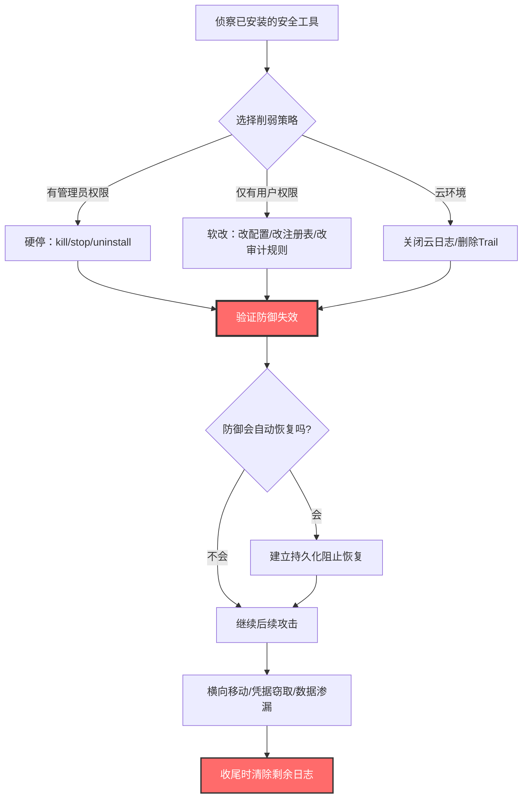

# 禁用或修改工具 (T1685)

> 想象一下：你公司的保安室里有摄像头、门禁报警器、巡更系统，全部联网到监控中心。有一天，小偷在动手前先悄悄溜进保安室——把摄像头的电源拔了、把报警器的开关关掉、把巡更记录本撕掉几页、还给监控软件做了点手脚让它显示"一切正常"。等你回放监控时，什么异常都看不到。攻击者就是这么干的：他们不正面硬闯你的防御体系，而是先把"保安"弄哑、弄瞎、弄糊涂，让后续的入侵无影无踪。T1685 就是这种"让保安失效"的总称。

## 30秒速查卡

| 维度 | 你需要知道的 |
|------|--------------|
| 这是什么？ | 禁用、停止、修改或伪造安全工具与日志机制，让防御体系失效或给出错误信号 |
| 为什么危险？ | 防御一旦被削弱，后续横向移动、凭据窃取、数据渗漏都不会再触发告警，蓝队等于在黑夜里抓瞎 |
| 谁需要关心？ | 终端安全团队、SOC分析师、云安全工程师、Windows/Linux系统管理员、合规审计人员 |
| 你的第一步防御 | 监控安全工具进程/服务的状态变化与卸载事件，对关键审计策略变更启用SACL/auditd告警 |
| 如果只做一件事 | 部署独立通道的完整性监控（不被攻击者关掉的那个），告警"任何安全工具服务状态变为Stopped"的事件 |

## 难度等级

⭐⭐ 中级：需要熟悉目标系统的安全机制、日志路径、安全工具进程名与服务名

**前置知识要求**：
- 操作系统服务/进程管理（Windows services、Linux systemd、launchd）
- 安全产品架构（AV/EDR/XDR/SIEM/CloudTrail 的组件与依赖）
- 日志系统原理（Windows Event Log、auditd、CloudTrail、syslog）
- 注册表与组策略在安全配置中的作用

## 前置知识检查

读这个文件之前，你需要知道：
- **什么是安全工具**：杀毒软件、EDR、防火墙、IDS/IPS、SIEM日志转发器、云审计日志（CloudTrail/Activity Log）
- **什么是审计策略**：操作系统记录哪些事件的配置（Windows Audit Policy、Linux auditd rules）
- **什么是Tamper Protection**：Defender 等安全产品自带的防篡改保护，阻止非授权进程修改其配置
- **什么是 Indicator Blocking**：阻止已知威胁指标（IOCs）被检测系统识别的子类操作

## 技术描述

### 通俗解释

T1685 是 ATT&CK v19.1 中由原 T1562（Impair Defenses）合并升级而来的父级技术，覆盖一切"让安全工具和日志机制失效"的行为。攻击者会停止杀毒进程、卸载 EDR 传感器、关闭 Windows 事件日志、停掉 Linux auditd、关掉 AWS CloudTrail、伪造告警淹没 SOC、篡改安全工具配置文件让其"看起来在跑但其实没在干活"。这一类操作的核心目的不是绕过某个具体的检测规则，而是从根上让整个防御体系"看不到、听不见、说不出"。

### 过渡段

简单来说，T1685 就是攻击链中段的"扫雷"动作——把所有可能暴露自己的眼睛都挖掉。和单个绕过技术不同，T1685 是系统性、批量化的削弱，通常出现在横向移动和凭据访问之前。下面看看它具体包含哪些子技术，以及攻击者是怎么一步步把防御体系拆解的。

### 技术原理

禁用或修改工具的工作流程：

1. **侦察防御现状**：枚举已安装的安全产品、运行中的安全进程、启用的审计策略、云环境中的日志开关
2. **选择削弱手段**：根据权限和环境选择"硬停"（kill/stop/uninstall）或"软改"（改配置/改注册表/改审计规则）
3. **执行削弱**：使用原生工具（sc.exe、systemctl、auditctl、aws cli）或直接调用 API 修改状态
4. **验证与维持**：确认防御确实失效，并通过持久化机制保证防御不会被自动恢复

### 子技术分类

| 子技术ID | 名称 | 一句话理解 | 平台 |
|----------|------|-----------|------|
| T1685.001 | 禁用或修改 Windows 事件日志 | 关掉 Security 日志或缩小其容量让旧记录被覆盖 | Windows |
| T1685.002 | 禁用或修改云日志 | 关闭 CloudTrail / Activity Log 让云操作无痕 | Cloud |
| T1685.003 | 修改或伪造工具 UI | 让安全工具"看起来正常"实际已失效 | 多平台 |
| T1685.004 | 禁用或修改 Linux 审计系统日志 | 停止 auditd 或清空 audit 规则 | Linux |
| T1685.005 | 清除 Windows 事件日志 | wevtutil cl Security 一次性抹掉痕迹 | Windows |
| T1685.006 | 清除 Linux 或 Mac 系统日志 | 清空 /var/log 或 journalctl --vacuum-time=1 | Linux/macOS |

### 用途和影响

- **防御规避**：禁用 AV/EDR、关闭防火墙、停止日志转发，让后续操作不触发告警
- **持久化**：通过禁用审计与监控保证长期不被发现
- **凭据访问**：在关闭日志后安全地 dump 凭据，不留取证痕迹
- **影响**：让应急响应失去"黑匣子"，事后取证极其困难

## 子技术列表

T1685 是父技术，包含 6 个子技术（详见各子技术文档）：
- T1685.001 禁用或修改 Windows 事件日志（原 T1562.002）
- T1685.002 禁用或修改云日志（原 T1562.008）
- T1685.003 修改或伪造工具 UI（原 T1562.011 Spoof Security Alerting）
- T1685.004 禁用或修改 Linux 审计系统日志（原 T1562.012）
- T1685.005 清除 Windows 事件日志（原 T1070.001 扩展并入）
- T1685.006 清除 Linux 或 Mac 系统日志（原 T1070.002 扩展并入）

与之密切相关的技术：
- T1112 修改注册表（多数 Defender 禁用最终落到注册表）
- T1562 削弱防御（已撤销，部分内容合并到 T1685）
- T1070 清除痕迹（与 T1685.005/.006 高度交叉）
- T1620 反射式代码加载（用于绕过 EDR 的另一种思路）

## 攻击流程



### 步骤详解

1. **侦察**：枚举 `Get-Service`、`tasklist /svc`、`systemctl list-units --type=service`、`aws cloudtrail describe-trails`，识别安全产品
2. **选择**：根据权限和环境选择停/改/删三种策略之一
3. **执行**：使用原生工具修改状态，避免引入新二进制
4. **验证**：检查服务状态、生成测试告警确认未触发
5. **持久化**：禁用 Tamper Protection、修改启动项防止服务自愈
6. **后续**：在防御盲区进行横向移动、凭据窃取、数据渗漏
7. **收尾**：使用 T1685.005/.006 清除剩余日志

## 真实案例

### 案例1：BlackCat/ALPHV 勒索软件系统性禁用 Defender 与日志

- **时间**：2022-2024年
- **目标**：全球医疗、制造、政府机构（CISA AA23-061A）
- **攻击组织**：BlackCat/ALPHV（RaaS 勒索软件，疑似俄罗斯背景）
- **手法**：BlackCat 在加密前用 PowerShell 脚本批量禁用防御：执行 `Set-MpPreference -DisableRealtimeMonitoring $true` 关闭 Defender 实时保护；通过 `reg add "HKLM\SOFTWARE\Policies\Microsoft\Windows Defender" /v DisableAntiSpyware /t REG_DWORD /d 1 /f` 从组策略层禁用；用 `sc stop WinDefend` 停止服务；执行 `wevtutil cl Security && wevtutil cl System && wevtutil cl Application` 清空三大日志；并调用 `auditpol /set /category:* /success:disable /failure:disable` 关闭所有审计类别。脚本还会检查是否存在 CrowdStrike、SentinelOne、Veeam 备份服务并尝试停止对应进程（`CSFalconService.exe`、`SentinelAgent.exe`、`VeeamDeploymentSvc.exe`）。
- **影响**：感染数百家组织，赎金总额超过 3 亿美元；多起案件因日志被清导致事后无法完整还原攻击链
- **参考**：https://www.cisa.gov/news-events/cybersecurity-advisories/aa23-061a

### 案例2：Conti 勒索软件停止 EDR 与备份服务

- **时间**：2020-2022年
- **目标**：全球各类组织（CISA AA21-265A）
- **攻击组织**：Conti（RaaS 勒索软件，疑似俄罗斯背景，TrickBot 衍生）
- **手法**：Conti 在勒索部署阶段使用名为 `Cobalt Strike` 的脚本批量停止 200+ 个安全与备份相关服务，包括 `Stop-Service -Name "McAfee*" -Force`、`Stop-Service -Name "Symantec*" -Force`、`taskkill /F /IM MSExchange*`、`sc stop VeeamBackupSvc`。同时通过 `wbadmin delete catalog -quiet` 删除 Windows 备份目录，用 `vssadmin delete shadows /all /quiet` 删除所有卷影副本（同时也属于 T1490 数据销毁）。脚本还会执行 `bcdedit /set {default} recoveryenabled No` 禁用系统恢复，让受害者无法回滚。在停服务前先执行 `wmic /namespace:\\root\SecurityCenter2 path AntiVirusProduct get displayName` 列出所有已安装的 AV 以决定要 kill 哪些进程。
- **影响**：攻破上百家组织，造成数十亿美元损失；HHS 专门发布警告称医疗行业是 Conti 主要目标
- **参考**：https://www.cisa.gov/news-events/cybersecurity-advisories/aa21-265a

### 案例3：APT29 在 SolarWinds 攻击中禁用 Windows 事件日志

- **时间**：2020-2021年
- **目标**：美国政府机构、科技公司（CISA AA21-148A）
- **攻击组织**：APT29（Cozy Bear，俄罗斯 SVR 背景）
- **手法**：在 SolarWinds 供应链攻击的横向移动阶段，APT29 通过修改 `HKLM\SYSTEM\CurrentControlSet\Services\EventLog\Security` 的 Start 值为 4 禁用安全日志服务；并执行 `auditpol /set /category:"Logon" /success:disable /failure:disable` 关闭登录审计。更隐蔽的是，攻击者修改了 `HKLM\SOFTWARE\Policies\Microsoft\Windows\EventLog\EventLog-Security` 下的 `MaxSize` 为 1MB（默认 20MB+），让日志快速填满后被旧记录覆盖，效果等同于"持续擦除"。同时通过 `Set-MpPreference -DisableRealtimeMonitoring $true -DisableBehaviorMonitoring $true -DisableIOAVProtection $true` 三参数一起关闭 Defender 的实时/行为/IOAV 保护。
- **影响**：在被感染环境中潜伏数月未被发现，多家 Fortune 500 公司与 9 个联邦机构受影响
- **参考**：https://www.cisa.gov/news-events/cybersecurity-advisories/aa21-148a

## 红队视角

### 实战技巧

1. **优先软改而非硬停**：硬停 EDR 会触发"防卸载"告警，软改配置（如 `Set-MpPreference -ExclusionPath C:\`）更隐蔽
2. **组策略路径优先**：`HKLM\SOFTWARE\Policies\Microsoft\Windows Defender` 优先级高于普通配置，即使蓝队手动恢复也会被覆盖
3. **缩小日志容量比清空更隐蔽**：把 Security 日志 MaxSize 改成 1MB，让自动覆盖代替手动 `wevtutil cl`
4. **关闭审计而非删日志**：`auditpol /set /category:* /success:disable` 比清空更不容易留下"清除动作"本身的事件
5. **分阶段验证**：每步操作后生成测试告警（如运行 EICAR 文件）确认防御确实失效

### 常用工具

| 工具 | 用途 | 平台 | 说明 |
|------|------|------|------|
| sc.exe / net stop | 停止服务 | Windows | 原生工具最常用 |
| Set-MpPreference | 修改 Defender 配置 | Windows | 无需停进程即可削弱 |
| auditpol | 修改审计策略 | Windows | 关闭审计类别 |
| wevtutil | 操作事件日志 | Windows | 清空/导出/修改大小 |
| systemctl / service | 停止服务 | Linux | 停 auditd、rsyslog |
| auditctl | 修改 auditd 规则 | Linux | 临时清空规则 |
| aws cloudtrail delete-trail | 删除云日志 | AWS | 删除 Trail 停止记录 |
| az monitor activity-log delete | 删除活动日志 | Azure | 删除诊断设置 |
| SDEL / Invoke-ReflectivePEInjection | 卸载 EDR DLL | Windows | 进阶红队工具 |

### 注意事项

- 现代带 Tamper Protection 的 Defender 会拒绝非授权进程修改其注册表键，需先取得 TrustedInstaller 权限或使用 BYOVD
- 云日志关闭操作本身会被 CloudTrail 记录，且部分云（如 AWS）有"日志的日志"机制（CloudTrail Insights、GuardDuty）
- 杀进程会留下 4688/1 进程终止事件，蓝队可据此告警
- Tamper Protection 启用后 `Set-MpPreference` 也会失败，需先Disable再修改

## 蓝队视角

### 检测要点

1. **服务状态监控**：监控关键安全服务的状态变化（WinDefend、Sense、CSFalconService、auditd、rsyslog）
2. **进程终止监控**：监控安全产品进程的异常终止（Event ID 4689/5）
3. **审计策略变更**：监控 `auditpol /set` 和 Event ID 4719（审计策略变更）
4. **日志容量修改**：监控 EventLog 服务的 MaxSize 注册表修改
5. **卸载事件**：监控 EDR 的"卸载"事件（多数 EDR 有专用的 Self-Protection 日志）
6. **云日志关闭**：监控 `DeleteTrail`、`StopLogging`、`DeleteDiagnosticSetting` API 调用

### 监控建议

- 部署独立通道的"心跳监控"：一台独立机器定期查询所有 EDR 的状态 API，发现掉线立即告警（防止攻击者关掉本地告警）
- 启用 Windows 4719/1102 事件转发到独立 SIEM，并设置"日志被清空"立即告警
- 配置 CloudTrail 的"日志文件完整性验证"（S3 bucket-level）并定期验证
- 使用 Sysmon Event ID 1 监控 `sc.exe stop`、`net stop`、`auditpol`、`wevtutil cl`、`systemctl stop auditd` 的命令行
- 启用 auditd 的 `w -p wa /etc/audit/audit.rules` 监控审计规则自身被修改
- 使用 Defender for Cloud / GuardDuty 监控云日志关闭操作

## 避坑指南

| 坑 | 后果 | 解决方法 |
|----|------|----------|
| 只监控"服务停止"事件 | 攻击者用"软改"绕过 | 同时监控配置变更（注册表/auditpol） |
| Tamper Protection 已启用就高枕无忧 | 攻击者用 BYOVD 绕过 | 监控驱动加载、Defender 配置尝试 |
| 告警依赖被关掉的那个工具自己上报 | 工具被关后告警也消失 | 部署独立通道的心跳监控 |
| 只关注本地日志 | 云环境关掉 CloudTrail 不会留本地痕迹 | 监控云控制平面 API 调用 |
| 清空日志留下 1102 但无人告警 | 攻击者清完就走 | 1102 事件必须立即触发告警 |

## 检测建议

### 网络层

**用人话说**：禁用工具本身是本地操作，但攻击者关闭云日志（CloudTrail、Activity Log）会通过云控制平面 API 发起，这些 API 调用必须能被独立监控捕获。

监控指标：
- AWS `DeleteTrail`、`StopLogging`、`UpdateTrail`（关闭日志文件完整性验证）API 调用
- Azure `Microsoft.Insights/diagnosticSettings/delete`、`Microsoft.OperationalInsights/workspaces/delete` 操作
- GCP `organizations.logSinks.delete` 调用
- EDR/SIEM 与云控制台之间的网络心跳中断超过 5 分钟

### 主机层

**用人话说**：监控安全工具进程/服务的状态变化与审计策略变更——这是最直接的"防御被削弱"信号。

```event
事件ID 7036（System日志）：服务状态变化
ServiceName: WinDefend / Sense / CSFalconService / auditd
新状态: 已停止

事件ID 4719（Security日志）：系统审计策略变更
Category: Logon / Object Access / Process Creation
新值: 已禁用

事件ID 1102（Security日志）：安全日志已被清除（必须立即告警）
```

```event
Sysmon Event ID 1：进程创建
Image: sc.exe / net.exe / auditpol.exe / wevtutil.exe / systemctl
关注CommandLine中的 stop / cl / disable / set
```

### 应用层

**用人话说**：监控 sc.exe、auditpol、wevtutil、systemctl 等命令行——攻击者最常使用这些原生工具削弱防御。

```yaml
title: 检测禁用Windows Defender服务
status: experimental
description: 检测通过sc.exe或net.exe停止Defender服务的操作
logsource:
    category: process_creation
    product: windows
detection:
    selection_stop:
        Image|endswith:
            - '\sc.exe'
            - '\net.exe'
        CommandLine|contains:
            - 'stop WinDefend'
            - 'stop Sense'
            - 'stop WinDefNet'
    selection_ps:
        Image|endswith: '\powershell.exe'
        CommandLine|contains:
            - 'Set-MpPreference -DisableRealtimeMonitoring $true'
            - 'Set-MpPreference -DisableBehaviorMonitoring $true'
            - 'Add-MpPreference -ExclusionPath'
    condition: selection_stop or selection_ps
level: critical
tags:
    - attack.defense_evasion
    - attack.t1685
    - attack.t1562.001
```

```yaml
title: 检测审计策略被禁用
status: experimental
description: 检测auditpol /set命令禁用审计类别
logsource:
    category: process_creation
    product: windows
detection:
    selection:
        Image|endswith: '\auditpol.exe'
        CommandLine|contains:
            - '/success:disable'
            - '/failure:disable'
            - '/category:*'
    condition: selection
level: critical
tags:
    - attack.defense_evasion
    - attack.t1685
```

```yaml
title: 检测AWS CloudTrail被禁用或删除
status: experimental
description: 检测CloudTrail停止、删除或更新操作
logsource:
    product: aws
    service: cloudtrail
detection:
    selection:
        eventName:
            - StopLogging
            - DeleteTrail
            - UpdateTrail
        eventSource: cloudtrail.amazonaws.com
    condition: selection
level: critical
tags:
    - attack.defense_evasion
    - attack.t1685
    - attack.t1685.002
```

## 缓解措施

### 高优先级

1. **启用 Tamper Protection**：Windows 10/11 Defender 的防篡改保护，阻止非授权进程修改安全配置
2. **启用 EDR 自保护**：CrowdStrike、SentinelOne 等均支持 Self-Protection 模式，禁止非签名进程 kill/stop
3. **配置 4719/1102 事件转发**：将"审计策略变更"和"日志被清空"事件实时转发到独立 SIEM 并立即告警
4. **启用 CloudTrail 日志文件完整性验证**：定期用 `aws cloudtrail validate-logs` 验证日志未被篡改

### 中优先级

5. **部署独立心跳监控**：一台独立机器定期查询所有 EDR 状态 API，发现掉线立即告警
6. **限制 auditpol / wevtutil / sc 的使用**：通过 AppLocker/WDAC 限制只有授权管理员可执行
7. **配置 CIS 基线**：定期检查审计策略、日志容量、安全服务状态是否偏离基线
8. **云日志多副本**：CloudTrail 同时发到 S3 + CloudWatch Logs + 独立账号，攻击者关一个还有两个

### 低优先级

9. **启用 auditd 的 immutable 模式**：`auditctl -e 2` 让规则在重启前不可修改
10. **日志异地备份**：定期把日志归档到攻击者无法访问的离线存储
11. **部署 HIDS**：OSSEC/Wazuh 监控安全服务配置文件变更

## 动手实验

### 实验1：观察 Defender 被禁用后的事件特征

```powershell
# 在 Windows 10/11 实验机（已装 Sysmon）上执行
# 1. 记录基线状态
Get-MpComputerStatus | Select-Object RealTimeProtectionEnabled, AntivirusEnabled, BehaviorMonitorEnabled

# 2. 触发一次测试告警（应被 Defender 拦截）
Invoke-WebRequest -Uri "https://www.eicar.org/download/eicar_com.zip" -OutFile "$env:TEMP\eicar.zip"

# 3. 在管理员 PowerShell 中关闭实时保护（需先关闭 Tamper Protection）
Set-MpPreference -DisableRealtimeMonitoring $true

# 4. 再次触发测试告警（应不再被拦截）
Invoke-WebRequest -Uri "https://www.eicar.org/download/eicar_com.zip" -OutFile "$env:TEMP\eicar2.zip"

# 5. 查看安全日志中的事件
Get-WinEvent -LogName "Microsoft-Windows-Windows Defender/Operational" -MaxEvents 20 | 
    Where-Object {$_.Id -in 5001, 5012} | Format-List

# 6. 恢复
Set-MpPreference -DisableRealtimeMonitoring $false
```

**预期输出**：能看到 Event ID 5001（实时保护已禁用）和 5012（行为监控已禁用）事件，验证蓝队监控规则。

### 实验2：监控审计策略被禁用

```powershell
# 1. 启用高级安全审计策略
auditpol /set /category:"Logon" /success:enable /failure:enable
auditpol /get /category:"Logon"

# 2. 在另一个终端实时监控 4719 事件
# 然后禁用审计
auditpol /set /category:"Logon" /success:disable /failure:disable

# 3. 查看刚才生成的 4719 事件
Get-WinEvent -LogName Security -FilterXPath "*[System[EventID=4719]]" -MaxEvents 5 |
    Format-List TimeCreated, Message

# 4. 同样实验 wevtutil cl Security，观察 1102 事件
wevtutil cl Security
Get-WinEvent -LogName Security -FilterXPath "*[System[EventID=1102]]" -MaxEvents 1 |
    Format-List TimeCreated, Message
```

**预期输出**：4719 事件记录了"已禁用登录审计"，1102 事件记录了"安全日志已被清除"——这两个事件必须触发实时告警。

## 术语解释

| 术语 | 解释 |
|------|------|
| Tamper Protection | Defender 的防篡改保护，阻止非授权进程修改其配置 |
| EDR | 端点检测与响应，下一代终端安全产品 |
| Self-Protection | EDR 自带的进程保护机制，禁止非签名进程 kill/stop |
| auditd | Linux 内核审计子系统，记录系统调用 |
| CloudTrail | AWS 的云操作审计日志服务 |
| Indicator Blocking | 阻止已知威胁指标被检测系统识别的子技术 |
| BYOVD | Bring Your Own Vulnerable Driver，加载带漏洞的签名驱动获取内核权限 |
| 4719 事件 | 系统审计策略变更事件 |
| 1102 事件 | 安全日志已被清除事件（必须立即告警） |

## 参考资料

### 📚 深入了解
- [MITRE ATT&CK T1685](https://attack.mitre.org/techniques/T1685/) - 官方技术页面
- [MITRE ATT&CK T1562（已撤销）](https://attack.mitre.org/techniques/T1562/) - 原父技术页面
- [Defender Tamper Protection](https://docs.microsoft.com/en-us/microsoft-365/security/defender-endpoint/prevent-changes-to-security-settings-with-tamper-protection) - 防篡改保护官方文档
- [CloudTrail 日志文件完整性验证](https://docs.aws.amazon.com/awscloudtrail/latest/userguide/cloudtrail-log-file-validation-dp.html)

### 📰 真实攻击
- [CISA BlackCat通告 AA23-061A](https://www.cisa.gov/news-events/cybersecurity-advisories/aa23-061a) - BlackCat 禁用 Defender
- [CISA Conti通告 AA21-265A](https://www.cisa.gov/news-events/cybersecurity-advisories/aa21-265a) - Conti 停止 EDR 与备份
- [CISA SolarWinds通告 AA21-148A](https://www.cisa.gov/news-events/cybersecurity-advisories/aa21-148a) - APT29 禁用事件日志

### 🔧 动手试试
- [Atomic Red Team T1685](https://github.com/redcanaryco/atomic-red-team/blob/master/atomics/T1685/T1685.yaml) - 检测规则测试
- [Sysmon配置](https://github.com/SwiftOnSecurity/sysmon-config) - 服务/进程监控配置
- [Sigma规则仓库](https://github.com/SigmaHQ/sigma) - 通用检测规则

## 版本历史

| 版本 | 日期 | 变更 |
|------|------|------|
| 3.1 | 2026-07-23 | 初始版本。基于 ATT&CK v19.1 创建，由原 T1562（Impair Defenses）合并升级而来 |

### T1562 → T1685 映射历史（ATT&CK v19.1 变更）

ATT&CK v19.1 对原 T1562（Impair Defenses）进行了拆分重组，相关变更如下：

| 原技术ID | 原名称 | 新技术ID | 说明 |
|----------|--------|----------|------|
| T1562 | Impair Defenses（父） | T1685 | 父技术重命名合并 |
| T1562.001 | Disable or Modify Tools | T1685 | 子技术内容合并到父级 |
| T1562.002 | Disable Windows Event Logging | T1685.001 | 重命名为 Disable or Modify Windows Event Log |
| T1562.006 | Indicator Blocking | T1685 | 内容合并到父级（含部分拆分到 T1685.003） |
| T1562.008 | Disable or Modify Cloud Logs | T1685.002 | 重命名为 Disable or Modify Cloud Log |
| T1562.011 | Spoof Security Alerting | T1685.003 | 重命名为 Modify or Spoof Tool UI |
| T1562.012 | Disable or Modify Linux Audit System | T1685.004 | 重命名为 Disable or Modify Linux Audit System Log |

> 注：T1562.003（禁用防火墙）、T1562.004（禁用日志转发）、T1562.009（禁用网络流量分析）、T1562.010（禁用启动完整性）等子技术被拆分到其他新父技术（如 T1685 之外的 T1550/T1687 等），不在本文件范围内。
