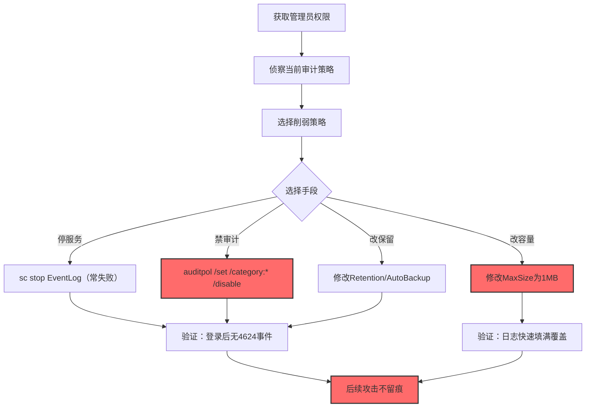
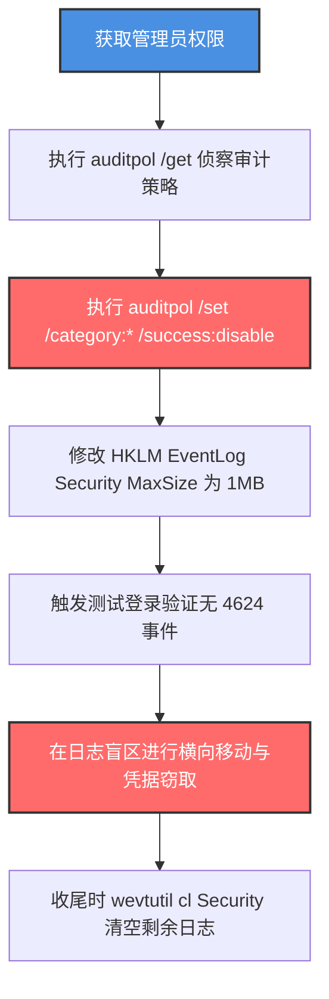

# 禁用或修改Windows事件日志 (T1685.001)

> 想象一下：你公司的门禁系统每天都会在小本子上记下"几点几分谁刷卡进入"。有一天，小偷在动手前先把这个小本子撕了几页、把笔藏起来，还偷偷把"记录本容量"从100页改成5页——这样本子很快写满后就会自动覆盖最旧记录。等你回放时，关键的进出门记录早就没了。Windows事件日志就是系统的"小本子"，攻击者禁用或修改它，让你回放时一无所获。

## 30秒速查卡

| 维度 | 你需要知道的 |
|------|-------------|
| 这是什么？ | 停止Windows EventLog服务、禁用审计策略类别、缩小日志容量或修改日志保留策略，让安全事件不被记录或被快速覆盖 |
| 为什么危险？ | 一旦安全日志失效，后续横向移动、凭据窃取、权限提升都不会留下痕迹，事后取证极其困难 |
| 谁需要关心？ | Windows系统管理员、SOC分析师、应急响应人员、合规审计员 |
| 你的第一步防御 | 监控Event ID 4719（审计策略变更）和1102（日志清空），并将这两类事件实时转发到独立SIEM |
| 如果只做一件事 | 监控`auditpol /set`和`wevtutil sl`命令执行，这是攻击者最常用的两个禁用日志命令 |

## 难度等级

⭐⭐ 中级 - 需要理解Windows事件日志架构、审计策略分类和注册表配置

## 前置知识检查

**读这个文件需要什么？**

- [x] Windows事件日志架构（EventLog服务、频道、发布者）
- [x] 高级安全审计策略（Advanced Audit Policy Configuration）
- [x] Windows注册表基础知识
- [x] auditpol、wevtutil、PowerShell事件日志cmdlet

## 技术描述

**禁用或修改Windows事件日志**（T1685.001）是 **禁用或修改工具**（T1685）的一个具体子技术，属于 **防御削弱** 阶段。其前身为已撤销的 T1562.002（Disable Windows Event Logging）。

> 📚 **打个比方**：就像攻击者溜进监控室，把摄像头的电源线拔了（停EventLog服务）、把录像机设置从"保留30天"改成"保留1天"（修改MaxSize）、把报警器的开关全关掉（auditpol /set /disable）——三种手法效果一致：让监控录像"看不到、留不下、回不去"。

### 具体怎么理解？

Windows 的事件日志系统由 EventLog 服务、审计策略（Advanced Audit Policy）和日志文件（.evtx）三部分组成。攻击者可以：

1. **停服务**：`sc stop EventLog` / `Stop-Service EventLog`——粗暴但显眼，且 EventLog 是受保护服务难以直接停止
2. **禁审计**：`auditpol /set /category:"Logon" /success:disable`——关闭特定审计类别，让该类事件不再被记录
3. **改容量**：修改 `HKLM\SOFTWARE\Policies\Microsoft\Windows\EventLog\EventLog-Security\MaxSize` 为极小值（如 1MB），让日志快速填满后被旧记录覆盖，效果等同于"持续擦除"
4. **改保留**：修改 AutoBackup/Retention 策略，让日志不自动归档

### 为什么有效？

这种技术之所以有效，是因为：

1. **审计策略变更不留"被改"痕迹**：`auditpol /set` 关闭登录审计后，系统就不再记录登录事件，但 auditpol 命令本身可能在系统日志中留下记录（如果 Application 日志审计仍开启），需要主动清理
2. **小容量日志的隐蔽性**：把 Security 日志从默认 20MB 改成 1MB，看起来"日志仍在记录"，但实际上高活跃环境几小时内旧记录就会被覆盖
3. **EventLog 是受保护服务**：直接 `sc stop EventLog` 会失败，但攻击者可以通过修改注册表 Start=4（禁用）然后重启的方式实现，或者使用 undocumented API

**过渡段：** 不要误以为"日志文件还在就代表防御还在"——攻击者可能只是把日志容量改小到自动覆盖，监控室看起来一切正常但关键时段记录早就没了。

## 真实攻击流程

### 典型场景

攻击者在 **防御削弱** 阶段使用禁用或修改Windows事件日志技术，为后续横向移动扫清痕迹：



**步骤详解：**

1. **获取管理员权限** - auditpol 和 wevtutil 都需要管理员权限
2. **侦察当前审计策略** - `auditpol /get /category:*` 查看当前启用了哪些审计类别
3. **选择削弱策略** - 根据目标决定是禁审计还是改容量
4. **执行削弱** - 运行 auditpol /set 或修改注册表
5. **验证生效** - 触发测试事件确认未被记录
6. **后续攻击** - 在日志盲区进行横向移动

## 攻击流程

### 典型攻击流程

获取管理员权限 --> 侦察当前审计策略 --> 执行auditpol禁用审计类别 --> 修改EventLog注册表缩小日志容量 --> 验证日志确实失效 --> 在盲区进行横向移动和凭据窃取



**步骤详解：**

1. **获取管理员权限** - 攻击者通过 UAC 绕过、内核提权漏洞或窃取的管理员凭据获得 Administrator/SYSTEM 权限
   - 通俗描述：先拿到保安室钥匙才能去改录像机
   - 技术细节：auditpol/wevtutil 需要SeSecurityPrivilege权限，UAC过滤后会丢失该权限，需以管理员身份运行或利用Bypass UAC技术（T1548.002）
   - 常用工具：Cobalt Strike、Mimikatz、UACMe、JuicyPotato

2. **侦察当前审计策略** - 攻击者枚举目标系统当前启用了哪些审计类别，决定要关掉哪些
   - 通俗描述：先看看保安室里现在开了几个摄像头，决定关哪些
   - 技术细节：执行 `auditpol /get /category:*` 列出所有审计类别及其启用状态，重点关注 Logon（4624/4625）、Object Access（4663）、Process Creation（4688）、Policy Change（4719）等关键类别
   - 常用工具：auditpol.exe、PowerShell `Get-AuditPolicy`

3. **禁用审计类别** - 使用 auditpol 命令禁用关键审计类别，让系统不再记录对应事件
   - 通俗描述：把监控录像机里几个关键通道关掉
   - 技术细节：执行 `auditpol /set /category:"Logon" /success:disable /failure:disable` 关闭登录审计，关闭后系统不再生成 4624/4625 事件，但 auditpol 命令本身可能在系统日志中留下 4719 事件（如果审计策略变更审计仍开启）
   - 常用工具：auditpol.exe、PowerShell `Set-AuditPolicy`

4. **缩小日志容量** - 修改 EventLog 服务的注册表配置，把 Security 日志的最大容量改到极小值
   - 通俗描述：把录像机的硬盘从 30 天改成 1 小时
   - 技术细节：修改 `HKLM\SOFTWARE\Policies\Microsoft\Windows\EventLog\EventLog-Security\MaxSize` 从默认 20MB（约 200,000 条事件）改为 1MB（约 10,000 条事件），高活跃环境几小时内旧记录会被覆盖；该注册表键等同于组策略 `Computer Configuration > Administrative Templates > Windows Components > Event Log Service > Security > Specify the maximum log size`
   - 常用工具：reg.exe、PowerShell `Set-ItemProperty`、组策略编辑器

5. **验证日志失效** - 触发测试事件确认日志确实不再记录
   - 通俗描述：在监控室门口走一遍，回看录像没看到自己
   - 技术细节：使用 `runas /user:testuser cmd` 触发登录事件，然后 `Get-WinEvent -LogName Security -MaxEvents 10` 查看是否生成 4624 事件，若无则审计已被禁用
   - 常用工具：runas、PowerShell Get-WinEvent

6. **后续攻击** - 在日志盲区进行横向移动、凭据窃取、权限提升
   - 通俗描述：摄像头关了，可以为所欲为
   - 技术细节：使用 PsExec/WMI 横向移动、Mimikatz dump 凭据、Kerberoasting 攻击，由于审计已禁用，这些操作不会在 Security 日志中留下痕迹
   - 常用工具：PsExec、Mimikatz、Rubeus、Impacket

## 真实案例

### 案例1：APT29 在 SolarWinds 供应链攻击中禁用安全日志

- **时间**: 2020-2021年
- **目标**: 美国政府机构、Fortune 500科技公司
- **攻击组织**: APT29（Cozy Bear，俄罗斯 SVR 背景）
- **手法**: 在 SolarWinds 攻击的横向移动阶段，APT29 通过修改注册表禁用 Windows 安全事件日志，以隐藏其横向移动和凭据窃取行为。攻击者修改 `HKLM\SYSTEM\CurrentControlSet\Services\EventLog\Security` 的 Start 值禁用 EventLog 服务，更隐蔽的是修改 `HKLM\SOFTWARE\Policies\Microsoft\Windows\EventLog\EventLog-Security` 下的 MaxSize 从默认 20MB 改为 1MB，让日志快速填满并自动覆盖旧记录。同时还执行 `auditpol /set /category:"Logon" /success:disable /failure:disable` 关闭登录审计类别，让 4624/4625 事件不再被记录。这些操作让 APT29 在被感染环境中的活动几乎不留痕迹。
- **影响**: 在被感染环境中潜伏数月未被发现，9 个联邦机构受影响
- **参考链接**: [CISA AA21-148A](https://www.cisa.gov/news-events/cybersecurity-advisories/aa21-148a)

### 案例2：BlackCat/ALPHV 勒索软件禁用审计并清空日志

- **时间**: 2022-2024年
- **目标**: 全球医疗、制造、政府机构
- **攻击组织**: BlackCat/ALPHV（RaaS 勒索软件）
- **手法**: BlackCat 在加密前会执行批量削弱脚本，其中包含 `auditpol /set /category:* /success:disable /failure:disable` 关闭所有审计类别，并立即执行 `wevtutil cl Security && wevtutil cl System && wevtutil cl Application` 清空三大日志。脚本同时修改 EventLog-Security 的 MaxSize 为 1024KB，确保即使后续蓝队恢复审计策略，攻击期间的旧记录也已被覆盖。这种组合拳让事后取证只能依赖独立的 EDR 心跳和云日志。
- **影响**: 感染数百家组织，多起案件因日志被清导致无法完整还原攻击链
- **参考链接**: [CISA AA23-061A](https://www.cisa.gov/news-events/cybersecurity-advisories/aa23-061a)

### 案例3：Snake 僵尸网络恶意软件（FGAO-100077A）

- **时间**: 2022年披露
- **目标**: 乌克兰政府机构
- **攻击组织**: Sandworm（俄罗斯 GRU 背景）
- **手法**: Snake 恶意软件在部署后会修改 `HKLM\SYSTEM\CurrentControlSet\Control\Lsa\SCENoApplyLegacyAuditPolicy` 启用旧版审计策略，绕过 Advanced Audit Policy Configuration，然后通过 `auditpol /set` 关闭特定审计类别，使审计策略配置混乱无法生效。
- **影响**: 乌克兰多个政府系统被长期渗透
- **参考链接**: [CISA AA22-074A](https://www.cisa.gov/news-events/cybersecurity-advisories/aa22-074a)

## 红队视角

> ⚠️ **免责声明**：以下内容仅用于合法的安全测试、渗透测试和教育目的。未经授权对他人系统进行测试是违法行为。

### 实战技巧

1. **优先 auditpol 而非停服务**：EventLog 是受保护服务，`sc stop EventLog` 会失败，auditpol 命令更可靠
2. **缩小容量比清空更隐蔽**：wevtutil cl 会留下 1102 事件，改 MaxSize 不留痕
3. **保留审计策略变更审计**：先关闭登录审计但保留 4719 审计策略变更审计本身？错误——应该全关，否则 4719 会暴露你
4. **组策略路径优先**：`HKLM\SOFTWARE\Policies\` 下的配置优先级高，即使蓝队手动恢复也会被覆盖
5. **组合使用**：禁审计 + 改容量 + 清空 三管齐下效果最佳

### 常用工具

| 工具名称 | 用途 | 平台 | 链接 |
| -------- | ---- | ---- | ---- |
| auditpol | 修改审计策略 | Windows | 系统自带 |
| wevtutil | 操作事件日志 | Windows | 系统自带 |
| PowerShell | Set-ItemProperty | Windows | 脚本化修改注册表 |
| reg.exe | 修改注册表 | Windows | 系统自带 |
| Atomic Red Team | 检测规则测试 | Windows | [Atomic T1562.002](https://github.com/redcanaryco/atomic-red-team/blob/master/atomics/T1562.002/T1562.002.yaml) |

### 注意事项

- auditpol /set 命令本身可能被 Sysmon Event ID 1 捕获命令行参数，需考虑清理
- 修改 EventLog 注册表后需重启 EventLog 服务或系统才生效
- Windows 10/11 的 Tamper Protection 不直接保护审计策略，但会阻止部分 Defender 相关修改
- 域控的审计策略由 Default Domain Controllers Policy GPO 控制，本地 auditpol 修改会被 GPO 刷新覆盖

## 蓝队视角

### 检测要点

1. **4719 事件监控**：审计策略变更必须立即告警（这是最直接的信号）
2. **1102 事件监控**：安全日志被清空必须立即告警
3. **auditpol /set 命令监控**：Sysmon Event ID 1 捕获 auditpol 命令行
4. **EventLog 注册表监控**：监控 MaxSize/Start/Retention 键值变更
5. **EventLog 服务状态监控**：监控 EventLog 服务异常停止
6. **心跳对账**：定期与SIEM对比，本机Security日志事件率是否突然下降

### 监控建议

- 部署 Sysmon Event ID 1 监控 auditpol.exe、wevtutil.exe、reg.exe 的命令行
- 启用 Sysmon Event ID 12/13 监控 `HKLM\SOFTWARE\Policies\Microsoft\Windows\EventLog\*` 和 `HKLM\SYSTEM\CurrentControlSet\Services\EventLog\*` 注册表键变更
- 将 4719 和 1102 事件实时转发到独立 SIEM 并设置高优先级告警
- 部署"日志心跳监控"：SIEM 每分钟检查每台主机的 Security 日志事件率，若事件率突然下降 90%+ 则告警
- 启用 Windows Event Forwarding (WEF) 把关键日志实时转发到独立服务器，攻击者关掉本机日志仍可从转发服务器取证

## 避坑指南

| 坑 | 后果 | 解决方法 |
|----|------|----------|
| 只监控 1102（日志清空） | 攻击者用 auditpol 静默禁用 | 同时监控 4719 |
| 只看 Security 日志 | 攻击者改了 MaxSize 不留痕 | 监控 EventLog 注册表变更 |
| 告警依赖本机日志转发 | 攻击者关掉 WinRM/WEF 后告警也消失 | 部署独立通道（如 EDR 心跳） |
| 域控审计策略由 GPO 控制 | 本地 auditpol 修改看似无效，实则下次刷新前仍生效 | 监控域控的 auditpol 修改 |
| 仅检查 auditpol /get 输出 | 攻击者可临时启用应付检查 | 同时对比实际事件率 |

## 检测建议

### 检测思路

检测禁用或修改Windows事件日志的关键是识别"审计策略被改变"和"日志容量被改变"这两类异常操作。以下是三个层面的检测方法：

### 网络层检测

**方法**：监控日志转发通道是否中断

```powershell
# 监控 WinRM/WEF 与 SIEM 之间的心跳
# 如果某台主机的 Security 日志事件率突然下降 90%+，告警
# 可通过 SIEM 中的"日志缺失检测"规则实现
```

### 主机层检测

**Windows事件ID**：
- 事件ID 4719：系统审计策略变更（必须立即告警）
- 事件ID 1102：安全日志已被清除（必须立即告警）
- 事件ID 7040：服务启动类型变更（监控 EventLog 服务）
- Sysmon Event ID 12/13：注册表键值修改（监控 EventLog 相关注册表）

```event
事件ID 4719（Security日志）：系统审计策略变更
- 包含变更的类别（Logon/Object Access/Process Creation等）
- 包含新的启用状态（启用/禁用）

事件ID 1102（Security日志）：安全日志已被清除
- 包含操作用户和清空时间
- 必须立即告警

Sysmon Event ID 13（注册表值设置）：
TargetObject包含：
  - EventLog-Security\MaxSize
  - EventLog-Security\Retention
  - Services\EventLog\Security\Start
```

### 应用层检测

**用人话说：** 攻击者用 auditpol 关闭审计类别、用 wevtutil 修改日志配置、用 reg 修改 EventLog 注册表——这三个命令的执行就是最直接的信号。

**Sigma规则示例**：

```yaml
title: 检测审计策略被禁用
status: experimental
description: 检测通过auditpol命令禁用审计类别的操作
author: SOC Team
logsource:
    category: process_creation
    product: windows
detection:
    selection:
        Image|endswith: '\auditpol.exe'
        CommandLine|contains:
            - '/success:disable'
            - '/failure:disable'
            - '/clear'
    condition: selection
level: critical
falsepositives:
    - 合规基线检查工具临时禁用后立即恢复
tags:
    - attack.defense_evasion
    - attack.t1685
    - attack.t1685.001
    - attack.t1562.002
```

```yaml
title: 检测EventLog日志容量被缩小
status: experimental
description: 检测通过reg或wevtutil修改EventLog MaxSize注册表
logsource:
    category: registry_set
    product: windows
detection:
    selection_target:
        TargetObject|contains:
            - 'EventLog\Security\MaxSize'
            - 'EventLog-Security\MaxSize'
            - 'EventLog\System\MaxSize'
    selection_value:
        Details|lt: 0x00200000   # 小于2MB（默认20MB+）
    condition: selection_target and selection_value
level: high
falsepositives:
    - 资源受限环境的小磁盘设备
tags:
    - attack.defense_evasion
    - attack.t1685.001
```

## 缓解措施

### 优先级1：关键措施

**部署独立日志通道**：使用 Windows Event Forwarding (WEF) 或 EDR 把日志实时转发到独立服务器，即使本机日志被禁用也能从转发端取证

```powershell
# 配置 WEF 订阅（在收集器服务器上执行）
wecutil cs security_subscription.xml
# 在客户端启用"转发事件"组策略
```

### 优先级2：重要措施

**启用 4719/1102 告警**：这两类事件必须实时告警，不能仅在日志中记录

```powershell
# 通过SIEM规则实时监控
# 4719事件：审计策略变更 -> 高优先级告警
# 1102事件：安全日志清空 -> 紧急告警
```

### 优先级3：建议措施

**配置 CIS 基线**：定期检查审计策略、EventLog 配置是否偏离 CIS/STIG 基线

**限制 auditpol/wevtutil 权限**：通过 AppLocker/WDAC 限制只有授权管理员可执行

## 动手实验

> ⚠️ **所有实验必须在隔离的实验室环境中进行**

### 实验1：观察 auditpol 禁用审计的痕迹

**目标**：理解 auditpol 命令对系统日志的影响

**步骤**：
```powershell
# 1. 查看当前审计策略基线
auditpol /get /category:"Logon"

# 2. 启用登录审计（如果未启用）
auditpol /set /category:"Logon" /success:enable /failure:enable

# 3. 触发测试登录事件
runas /user:Administrator cmd
# 输入密码后退出

# 4. 查看是否生成 4624 事件
Get-WinEvent -LogName Security -FilterXPath "*[System[EventID=4624]]" -MaxEvents 3 |
    Format-List TimeCreated, Message

# 5. 禁用登录审计
auditpol /set /category:"Logon" /success:disable /failure:disable

# 6. 再次触发测试登录
runas /user:Administrator cmd

# 7. 查看是否还有新的 4624 事件（应没有）
Get-WinEvent -LogName Security -FilterXPath "*[System[EventID=4624]]" -MaxEvents 3 |
    Format-List TimeCreated

# 8. 查看 4719 事件（审计策略变更记录）
Get-WinEvent -LogName Security -FilterXPath "*[System[EventID=4719]]" -MaxEvents 5 |
    Format-List TimeCreated, Message
```

**学习要点**：理解 auditpol 禁用审计的效果，以及 4719 事件为何是关键监控点

### 实验2：观察日志容量被缩小的效果

**目标**：理解缩小 MaxSize 如何导致日志被自动覆盖

**步骤**：
```powershell
# 1. 查看当前 Security 日志配置
wevtutil gl Security

# 2. 记录当前日志事件数
$before = (Get-WinEvent -LogName Security -MaxEvents 10000).Count
Write-Host "Before: $before events in last 10000"

# 3. 缩小 MaxSize 为 1MB（需管理员）
wevtutil sl Security /ms:1048576

# 4. 触发大量事件（如批量创建文件）
1..10000 | ForEach-Object { New-Item -Path "$env:TEMP\test_$_.txt" -Force | Out-Null }
1..10000 | ForEach-Object { Remove-Item -Path "$env:TEMP\test_$_.txt" -Force }

# 5. 查看日志容量是否变小，旧记录是否被覆盖
wevtutil gl Security
$after = (Get-WinEvent -LogName Security -MaxEvents 10000).Count
Write-Host "After: $after events in last 10000"

# 6. 恢复 MaxSize 为 256MB
wevtutil sl Security /ms:268435456
```

**学习要点**：直观感受缩小日志容量如何快速覆盖旧记录

## 术语解释

| 术语 | 通俗解释 |
|------|---------|
| **EventLog 服务** | Windows 系统负责记录和管理事件日志的服务（EventLog） |
| **Advanced Audit Policy** | 高级安全审计策略，比基础审计策略更细粒度 |
| **auditpol** | Windows 自带的审计策略命令行工具 |
| **wevtutil** | Windows 自带的事件日志命令行工具 |
| **4719 事件** | 系统审计策略变更事件，蓝队必须立即告警 |
| **1102 事件** | 安全日志已被清除事件，蓝队必须立即告警 |
| **MaxSize** | 日志文件最大容量，超过后会按 Retention 策略覆盖或归档 |
| **WEF** | Windows Event Forwarding，Windows 日志转发机制 |
| **T1685.001** | 本子技术 ID，前身是 T1562.002 |

## 被引用情况

以下父技术文档引用了本子技术：

- [T1685 - 禁用或修改工具](../T1685-Disable-or-Modify-Tools.md)

## 参考资料

### 官方文档

- [MITRE ATT&CK - 禁用或修改Windows事件日志 (T1685.001)](https://attack.mitre.org/techniques/T1685/001/)
- [MITRE ATT&CK - 禁用或修改工具 (T1685)](https://attack.mitre.org/techniques/T1685/)
- [Microsoft - 高级安全审计策略](https://docs.microsoft.com/en-us/windows/security/threat-protection/auditing/advanced-security-auditing-faq)

### 安全报告

- [CISA AA21-148A - SolarWinds 供应链攻击](https://www.cisa.gov/news-events/cybersecurity-advisories/aa21-148a) - APT29 禁用安全日志
- [CISA AA23-061A - BlackCat 勒索软件](https://www.cisa.gov/news-events/cybersecurity-advisories/aa23-061a) - BlackCat 禁用审计
- [CISA AA22-074A - Sandworm/Snake](https://www.cisa.gov/news-events/cybersecurity-advisories/aa22-074a) - Snake 操纵审计策略

### 工具与资源

- [Atomic Red Team T1562.002](https://github.com/redcanaryco/atomic-red-team/blob/master/atomics/T1562.002/T1562.002.yaml) - 检测规则测试
- [Sysmon配置](https://github.com/SwiftOnSecurity/sysmon-config) - 注册表与进程监控
- [Sigma规则仓库](https://github.com/SigmaHQ/sigma) - 通用检测规则

### 学习资料

- [Windows Event Forwarding 部署指南](https://docs.microsoft.com/en-us/windows/security/threat-protection/use-windows-event-forwarding-to-assist-in-intrusion-detection) - 微软官方 WEF 部署
- [CIS Windows Server 基线](https://www.cisecurity.org/benchmark/windows_server) - 安全基线参考
