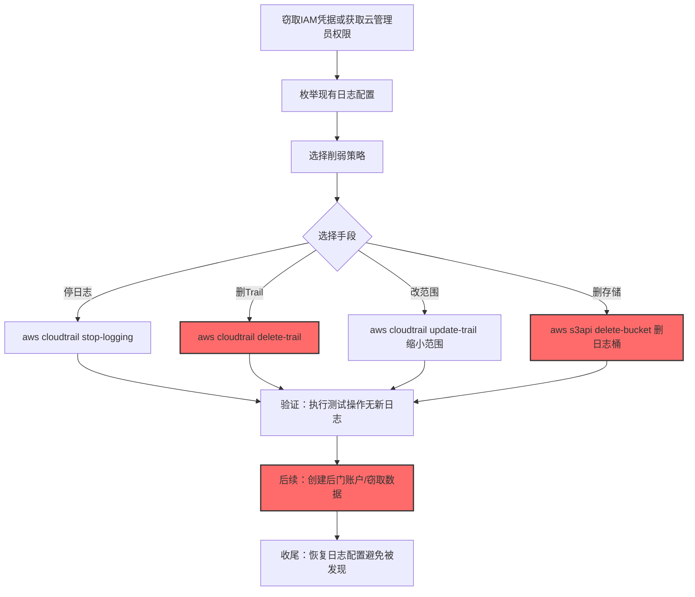

# 禁用或修改云日志 (T1685.002)

> 想象一下：你公司的财务系统每笔交易都会自动生成一张电子凭证存档。有一天，小偷潜入财务室，把"自动存档"功能关了——后续的转账记录全部丢失，等你查账时根本找不到那笔被偷走的钱。云日志就是云平台的"自动存档"，攻击者通过API关闭它，让你后续的云操作无据可查。

## 30秒速查卡

| 维度 | 你需要知道的 |
|------|-------------|
| 这是什么？ | 通过云API停止、删除或修改云审计日志服务（AWS CloudTrail、Azure Activity Log、GCP Cloud Audit Logs），让云操作不被记录 |
| 为什么危险？ | 云环境几乎全靠日志做取证，关掉云日志后攻击者可以创建后门账户、窃取数据、横向移动而不留任何痕迹 |
| 谁需要关心？ | 云架构师、云安全工程师、SOC分析师、云合规审计员 |
| 你的第一步防御 | 监控DeleteTrail/StopLogging/DeleteDiagnosticSetting等API调用，部署独立账号的多副本日志 |
| 如果只做一件事 | 启用AWS CloudTrail日志文件完整性验证，并把日志同步到独立账号的只读S3桶 |

## 难度等级

⭐⭐ 中级 - 需要理解三大云厂商的日志架构、IAM权限模型和API调用方式

## 前置知识检查

**读这个文件需要什么？**

- [x] 云平台日志架构（AWS CloudTrail、Azure Activity Log、GCP Cloud Audit Logs）
- [x] IAM权限模型（角色、策略、服务账户）
- [x] 云控制平面API与数据平面API的区别
- [x] 多账号组织结构（AWS Organizations、Azure Management Group）

## 技术描述

**禁用或修改云日志**（T1685.002）是 **禁用或修改工具**（T1685）的一个具体子技术，属于 **防御削弱** 阶段。其前身为已撤销的 T1562.008（Disable or Modify Cloud Logs）。

> 📚 **打个比方**：就像攻击者溜进监控中心，把监控录像机的电源线拔了（StopLogging）、把所有录像带烧掉（DeleteTrail）、把录像机的"持续录像"改成"按需录像"（UpdateTrail关闭多区域记录）——三种手法效果一致：让云上操作无据可查。

### 具体怎么理解？

各大云厂商的审计日志服务：

| 云厂商 | 日志服务 | 主要API |
|--------|---------|---------|
| AWS | CloudTrail | StopLogging、DeleteTrail、UpdateTrail |
| Azure | Activity Log + Diagnostic Settings | Microsoft.Insights/diagnosticSettings/delete |
| GCP | Cloud Audit Logs + Log Sinks | organizations.logSinks.delete |
| 阿里云 | ActionTrail + SLS | DeleteTrail、DeleteLogStore |

攻击者可以：

1. **停日志**：`aws cloudtrail stop-logging --name <trail>`——最直接，但留下了 StopLogging API 调用记录
2. **删日志配置**：`aws cloudtrail delete-trail --name <trail>`——删除整个 Trail 配置，让后续操作完全无记录
3. **改配置**：`aws cloudtrail update-trail --no-include-global-service-events --no-is-multi-region-trail`——缩小记录范围，让 IAM 变更等全局事件不再记录
4. **删诊断设置**（Azure）：`az monitor diagnostic-settings delete`——停止向 Log Analytics 工作区转发日志
5. **删日志接收器**（GCP）：`gcloud logging sinks delete`——停止向 Pub/Sub 或 BigQuery 转发日志
6. **删日志存储**：`aws s3api delete-bucket`（删除存放 CloudTrail 日志的 S3 桶）

### 为什么有效？

这种技术之所以有效，是因为：

1. **云日志关闭操作本身被记录**：讽刺的是 StopLogging 调用会被 CloudTrail 记录（如果还存在），但攻击者可以同时关闭多个 Trail，或在停日志后立即清空 S3 桶
2. **多账号环境的复杂性**：组织级 Trail 和账号级 Trail 可能分离，攻击者只需关闭账号级 Trail 即可让该账号无日志
3. **日志存储在目标账号**：如果 CloudTrail 日志存放在被攻击账号的 S3 桶中，攻击者可直接删除桶或修改桶策略
4. **依赖 IAM 凭据而非物理访问**：攻击者窃取到具有 logs/cloudtrail 权限的 IAM 凭据即可远程操作

**过渡段：** 不要误以为"云厂商有日志就安全"——攻击者拿到 IAM 凭据后，可以像你一样合法地关闭日志，云厂商不会判断这是不是攻击，只会按权限执行。

## 真实攻击流程

### 典型场景

攻击者在 **防御削弱** 阶段使用禁用或修改云日志技术，为后续云上操作扫清痕迹：



**步骤详解：**

1. **窃取IAM凭据** - 通过钓鱼、SSRF、窃取配置文件中的凭据等方式获取云访问权限
2. **枚举现有日志配置** - `aws cloudtrail describe-trails` 查看所有 Trail
3. **选择削弱策略** - 决定是停、删还是改
4. **执行削弱** - 调用对应 API
5. **验证生效** - 执行测试操作确认日志未记录
6. **后续攻击** - 创建后门 IAM 用户、窃取 S3 数据、启动挖矿实例
7. **收尾恢复** - 部分高级攻击者会恢复日志配置避免被监控发现

## 攻击流程

### 典型攻击流程

窃取IAM凭据 --> 枚举CloudTrail配置 --> 停止或删除Trail --> 删除日志S3桶 --> 创建后门IAM用户 --> 窃取数据 --> 恢复Trail配置避免被发现

```mermaid
graph TD
    A[窃取IAM凭据(SSRF/钓鱼/配置泄露)] --> B[枚举 aws cloudtrail describe-trails]
    B --> C[停止所有Trail: aws cloudtrail stop-logging]
    C --> D[删除日志S3桶: aws s3api delete-bucket]
    D --> E[创建后门IAM用户: aws iam create-user]
    E --> F[授予AdministratorAccess: aws iam attach-user-policy]
    F --> G[启动挖矿实例/窃取数据]
    G --> H[恢复Trail配置避免被发现]

    style A fill:#4a90e2,stroke:#333,stroke-width:2px,color:#fff
    style C fill:#ff6b6b,stroke:#333,stroke-width:2px,color:#fff
    style E fill:#ff6b6b,stroke:#333,stroke-width:2px,color:#fff
    style G fill:#ff6b6b,stroke:#333,stroke-width:2px,color:#fff
```

**步骤详解：**

1. **窃取IAM凭据** - 攻击者通过 SSRF 漏洞读取 EC2 实例元数据（IMDSv1）、从泄露的代码仓库中提取 AKSK、或通过钓鱼获取控制台凭据
   - 通俗描述：先偷到云上的"门禁卡"
   - 技术细节：利用 SSRF 读取 `http://169.254.169.254/latest/meta-data/iam/security-credentials/<role>` 获取临时凭据；从 GitHub 历史提交中 grep AKID；通过钓鱼获取 MFA-fatigue 后的会话令牌
   - 常用工具：pacu、ScoutSuite、CloudSploit、aws-cli

2. **枚举现有日志配置** - 攻击者查看当前云账号启用了哪些审计日志
   - 通俗描述：先看看保安室里有几个摄像头
   - 技术细节：执行 `aws cloudtrail describe-trails` 列出所有 Trail 及其目标 S3 桶，`aws cloudwatch describe-alarms` 查看 CloudWatch 告警，`az monitor activity-log list` 查看 Azure 活动日志
   - 常用工具：aws-cli、az-cli、gcloud、pacu

3. **停止或删除Trail** - 攻击者调用 StopLogging 或 DeleteTrail 关闭日志记录
   - 通俗描述：把摄像头电源线拔了
   - 技术细节：`aws cloudtrail stop-logging --name <trail-name>` 停止日志但保留配置；`aws cloudtrail delete-trail --name <trail-name>` 彻底删除 Trail 配置，需要 `cloudtrail:StopLogging` 或 `cloudtrail:DeleteTrail` IAM 权限
   - 常用工具：aws-cli、Terraform（通过 destroy 资源间接删除）

4. **删除日志S3桶** - 攻击者删除存放历史日志的 S3 桶，抹掉已有证据
   - 通俗描述：把录像带仓库烧了
   - 技术细节：`aws s3api delete-objects` 批量删除日志对象，或 `aws s3 rb --force s3://<bucket-name>` 删除整个桶；如果桶启用了 MFA Delete 或 Object Lock 可阻止删除
   - 常用工具：aws-cli、s3cmd

5. **创建后门IAM用户** - 攻击者在日志盲区创建具有管理员权限的 IAM 用户作为持久化后门
   - 通俗描述：给保安室塞个自己人，以后随时进出
   - 技术细节：`aws iam create-user --user-name backup-admin`，`aws iam create-access-key --user-name backup-admin`，`aws iam attach-user-policy --user-name backup-admin --policy-arn arn:aws:iam::aws:policy/AdministratorAccess`
   - 常用工具：aws-cli

6. **窃取数据或挖矿** - 在日志盲区进行恶意操作
   - 通俗描述：在监控盲区偷东西
   - 技术细节：从 S3 桶下载敏感数据、启动 EC2 实例挖矿、修改 Lambda 函数植入后门、利用 RDS 快照导出数据库
   - 常用工具：aws-cli、自定义脚本

7. **恢复Trail配置** - 高级攻击者会恢复日志配置，让蓝队事后回看时"看起来一切正常"
   - 通俗描述：把摄像头重新插上电源，但你不知道中间断过电
   - 技术细节：`aws cloudtrail start-logging --name <trail-name>` 恢复记录，但中间这段时间的操作无日志
   - 常用工具：aws-cli

## 真实案例

### 案例1：Capital One 数据泄露事件（2019）

- **时间**: 2019年3-7月
- **目标**: Capital One 银行，1.06亿信用卡客户数据
- **攻击组织**: Paige Thompson（前 AWS 员工，单人攻击）
- **手法**: 攻击者通过 SSRF 漏洞读取 Capital One WAF 实例的 IMDSv1 元数据，获取 IAM 角色临时凭据。随后使用该凭据在云上操作，期间尝试关闭 CloudTrail 但因 IAM 权限不足未能完全成功，仍成功删除了部分日志对象。最终从 S3 桶中导出了大量客户数据。本案促使 AWS 推出 IMDSv2 和 CloudTrail Insights 等防护功能。
- **影响**: 1.06亿客户数据泄露，Capital One 被罚 1.9 亿美元
- **参考链接**: [美国司法部起诉书](https://www.justice.gov/usao-wdwa/press-release/file/1188576/download)

### 案例2：TeamTNT 挖矿组织关闭云日志

- **时间**: 2021-2023年
- **目标**: 全球云环境，主要针对配置不当的 Docker/Kubernetes
- **攻击组织**: TeamTNT（加密货币挖矿组织）
- **手法**: TeamTNT 在入侵云实例后，会执行脚本关闭云日志和监控代理：`systemctl stop amazon-cloudwatch-agent` 停止 CloudWatch 代理；`systemctl stop opsagent-agent` 停止 Google Cloud Ops Agent；同时清理 `/var/log/` 和 `~/.bash_history`；如果攻击者获得 IAM 凭据，会调用 `aws cloudtrail delete-trail` 删除 Trail。脚本还会卸载 Datadog Agent、Trend Micro Deep Security Agent 等第三方监控代理。
- **影响**: 全球数千台云实例被感染，挖矿收益估计数百万美元
- **参考链接**: [Trend Micro TeamTNT分析](https://www.trendmicro.com/en_us/research/21/i/teamtnt-now-deploys-crypto-mining-worms-to-mass-infect-dock.html)

### 案例3：SCARLETEEL 攻击云日志服务

- **时间**: 2023年
- **目标**: AWS 环境，主要针对terraform状态文件泄露
- **攻击组织**: SCARLETEEL（疑似俄罗斯背景）
- **手法**: 攻击者通过泄露的terraform state文件获取AWS凭据，进入目标账号后立即执行 `aws cloudtrail stop-logging --name <trail>` 关闭日志，然后利用 `aws s3 sync` 把目标S3桶的数据同步到自己的账号。同时通过 `aws iam create-user` 创建后门用户并授予AdministratorAccess。攻击者还会修改CloudWatch告警，把告警通知邮箱改为自己的，让蓝队的告警失效。
- **影响**: 多家科技公司源代码和敏感数据被窃
- **参考链接**: [Sysdig SCARLETEEL报告](https://sysdig.com/blog/scarleteel-2-0/)

## 红队视角

> ⚠️ **免责声明**：以下内容仅用于合法的安全测试、渗透测试和教育目的。未经授权对他人系统进行测试是违法行为。

### 实战技巧

1. **优先StopLogging而非DeleteTrail**：StopLogging 留下配置便于后续恢复（高级伪装），DeleteTrail 更彻底但更显眼
2. **同时停多个Trail**：组织级Trail和账号级Trail都需停，否则任一仍在记录
3. **删S3桶前先停日志**：如果先删S3桶会触发CloudTrail的"日志投递失败"告警
4. **检查GuardDuty和Security Hub**：停CloudTrail会被GuardDuty检测（Finding类型 UnauthorizedAccess:IAMUser/CloudTrailLoggingStopped），需同时考虑禁用GuardDuty
5. **多副本日志的处理**：如果日志同时发到S3 + CloudWatch Logs + 独立账号，需全部处理
6. **利用冷启动时机**：账号刚开通时可能未启用完整日志，可利用此窗口

### 常用工具

| 工具名称 | 用途 | 平台 | 链接 |
| -------- | ---- | ---- | ---- |
| aws-cli | AWS操作 | AWS | [aws-cli](https://aws.amazon.com/cli/) |
| az-cli | Azure操作 | Azure | [az-cli](https://docs.microsoft.com/en-us/cli/azure/) |
| gcloud | GCP操作 | GCP | [gcloud](https://cloud.google.com/sdk/gcloud) |
| pacu | AWS攻击框架 | AWS | [pacu](https://github.com/RhinoSecurityLabs/pacu) |
| ScoutSuite | 多云审计 | 全平台 | [ScoutSuite](https://github.com/nccgroup/ScoutSuite) |
| Prowler | AWS安全评估 | AWS | [Prowler](https://github.com/toniblyx/prowler) |
| Atomic Red Team | 检测规则测试 | 多云 | [Atomic T1562.008](https://github.com/redcanaryco/atomic-red-team/blob/master/atomics/T1562.008/T1562.008.yaml) |

### 注意事项

- AWS CloudTrail 的 StopLogging API 调用本身会被记录（如果 Trail 还存在），需快速清理
- GuardDuty 的 `UnauthorizedAccess:IAMUser/CloudTrailLoggingStopped` 检测器会专门告警停日志行为
- AWS Organizations 的组织级 Trail 即使账号级 Trail 被停，组织级仍记录，需从管理账号操作
- 日志文件完整性验证（Log File Integrity Validation）启用后，删除日志文件会留下可检测的痕迹

## 蓝队视角

### 检测要点

1. **API调用监控**：监控 `StopLogging`、`DeleteTrail`、`UpdateTrail`、`DeleteDiagnosticSetting`、`logSinks.delete` 等API调用
2. **GuardDuty规则**：启用 GuardDuty 的 `UnauthorizedAccess:IAMUser/CloudTrailLoggingStopped` 检测器
3. **日志事件率监控**：监控 CloudTrail 事件率突降（如某账号事件率下降 90%+）
4. **日志文件完整性验证**：启用 CloudTrail 日志文件完整性验证并定期校验
5. **S3桶监控**：监控 CloudTrail 日志桶的删除操作
6. **多副本对账**：对比 S3 日志和 CloudWatch Logs 是否一致

### 监控建议

- 部署组织级 Trail 投递到独立日志账号的只读 S3 桶（攻击者无法删除）
- 启用 AWS CloudTrail Insights 检测异常 API 调用模式
- 配置 CloudWatch Events（EventBridge）规则：任何 `StopLogging`/`DeleteTrail` 调用立即触发 SNS 告警
- 启用 S3 桶的 MFA Delete 和 Object Lock 防止日志被删
- 使用 AWS Config 规则 `cloud-trail-enabled` 持续监控 Trail 状态
- 部署多云日志聚合（如 Sumo Logic、Splunk）作为独立通道
- 启用 GuardDuty、Security Hub、Defender for Cloud 的"日志被禁用"检测规则

## 避坑指南

| 坑 | 后果 | 解决方法 |
|----|------|----------|
| 只监控CloudTrail事件 | 攻击者关掉Trail后告警也消失 | 部署独立账号的多副本日志 |
| Trail日志和S3在同一账号 | 攻击者删S3桶日志丢失 | 投递到独立日志账号 |
| 仅监控主账号Trail | 组织级Trail被停未发现 | 监控管理账号的所有Trail操作 |
| 没启用GuardDuty | 停日志操作未触发专用告警 | 必须启用GuardDuty |
| CloudWatch告警邮箱可达 | 攻击者改邮箱让告警失效 | 多通道告警（SNS+Slack+PagerDuty） |
| 日志桶无Object Lock | 攻击者删日志后无法恢复 | 启用Object Lock的Compliance模式 |

## 检测建议

### 检测思路

检测禁用或修改云日志的关键是识别"日志相关API被调用"和"日志事件率突降"两类异常。以下是三个层面的检测方法：

### 网络层检测

**方法**：监控云控制平面API调用和外部数据传输

```bash
# 监控云控制平面API调用（AWS CloudTrail示例）
# 关键API：StopLogging、DeleteTrail、UpdateTrail
# 这些API调用必须立即告警

# 监控日志桶的批量数据传输
# 如果出现大量S3 GET/DELETE操作在日志桶上，告警
```

### 主机层检测

**云控制平面日志**：

```json
// AWS CloudTrail事件示例（StopLogging）
{
  "eventSource": "cloudtrail.amazonaws.com",
  "eventName": "StopLogging",
  "userIdentity": {
    "type": "IAMUser",
    "name": "suspicious-user"
  },
  "sourceIPAddress": "1.2.3.4"
}

// AWS CloudTrail事件示例（DeleteTrail）
{
  "eventSource": "cloudtrail.amazonaws.com",
  "eventName": "DeleteTrail",
  "requestParameters": {
    "name": "company-main-trail"
  }
}
```

**Azure Activity Log事件**：

```json
{
  "operationName": "Microsoft.Insights/diagnosticSettings/delete",
  "resourceId": "/subscriptions/xxx/resourceGroups/rg/providers/Microsoft.Network/networkSecurityGroups/nsg"
}
```

### 应用层检测

**用人话说：** 攻击者用 aws-cli 调用 StopLogging/DeleteTrail、用 az-cli 调用 diagnostic-settings delete、用 gcloud 调用 logs sinks delete——这些API调用就是最直接的信号。同时监控日志事件率突降，防止攻击者用其他方式（如停CloudWatch Agent）干扰日志。

**Sigma规则示例（AWS）**：

```yaml
title: 检测AWS CloudTrail被禁用或删除
status: experimental
description: 检测CloudTrail停止、删除或更新操作
author: SOC Team
logsource:
    product: aws
    service: cloudtrail
detection:
    selection_critical:
        eventName:
            - StopLogging
            - DeleteTrail
        eventSource: cloudtrail.amazonaws.com
    selection_update:
        eventName: UpdateTrail
        eventSource: cloudtrail.amazonaws.com
        requestParameters|contains:
            - 'no-include-global-service-events'
            - 'no-is-multi-region-trail'
            - 'no-enable-log-file-validation'
    condition: selection_critical or selection_update
level: critical
falsepositives:
    - 合法运维变更（应通过变更管理流程）
tags:
    - attack.defense_evasion
    - attack.t1685
    - attack.t1685.002
    - attack.t1562.008
```

**Sigma规则示例（Azure）**：

```yaml
title: 检测Azure诊断设置被删除
status: experimental
description: 检测Diagnostic Settings删除操作
logsource:
    product: azure
    service: activitylogs
detection:
    selection:
        operationName: Microsoft.Insights/diagnosticSettings/delete
        properties|contains:
            - 'activityLog'
            - 'security'
    condition: selection
level: critical
tags:
    - attack.defense_evasion
    - attack.t1685.002
```

**Sigma规则示例（事件率突降检测）**：

```yaml
title: 检测AWS账号日志事件率突降
status: experimental
description: 检测某AWS账号的CloudTrail事件率突然下降
logsource:
    product: aws
    service: cloudtrail
detection:
    baseline:
        timeframe: 1h
        condition: count( eventName=* ) > 100
    anomaly:
        timeframe: 1h
        condition: count( eventName=* ) < 10
    condition: baseline # then anomaly in next window
level: high
falsepositives:
    - 业务低谷期
    - 测试账号
tags:
    - attack.defense_evasion
    - attack.t1685.002
```

## 缓解措施

### 优先级1：关键措施

**部署独立账号多副本日志**：把 CloudTrail 投递到独立日志账号的只读 S3 桶，攻击者即使拿到当前账号的 Administrator 权限也无法删除

```bash
# AWS 组织级Trail投递到日志归档账号
aws organizations create-account --email logs@company.com --account-name LogArchive
aws cloudtrail create-trail \
    --name organization-trail \
    --s3-bucket logarchive-cloudtrail-<company> \
    --is-organization-trail \
    --is-multi-region-trail \
    --enable-log-file-validation
```

### 优先级2：重要措施

**启用GuardDuty + CloudTrail Insights**：GuardDuty 专门检测停 CloudTrail 行为，CloudTrail Insights 检测异常 API 模式

```bash
aws guardduty create-detector --enable
aws cloudtrail put-insight-selectors \
    --trail-name organization-trail \
    --insight-selectors '[{"InsightType": "ApiCallRateInsight"}]'
```

**S3桶启用Object Lock**：日志桶启用 Object Lock 的 Compliance 模式，即使是 root 用户也无法在保留期内删除

### 优先级3：建议措施

**配置CloudWatch Events实时告警**：任何 StopLogging/DeleteTrail 调用立即触发 SNS 告警

```bash
aws events put-rule --name "CloudTrailDisableAlert" \
    --event-pattern '{"source":["aws.cloudtrail"],"detail-type":["AWS API Call via CloudTrail"],"detail":{"eventName":["StopLogging","DeleteTrail"]}}'
```

**多云日志聚合**：使用 Sumo Logic、Splunk、Datadog 等聚合多云日志到独立平台

## 动手实验

> ⚠️ **所有实验必须在隔离的云测试账号中进行**

### 实验1：观察CloudTrail停启日志的痕迹

**目标**：理解 StopLogging/DeleteTrail 操作的可检测特征

**步骤**：
```bash
# 1. 确认CloudTrail已启用
aws cloudtrail describe-trails

# 2. 触发测试操作（应被记录）
aws iam list-users

# 3. 等待1-2分钟后查询CloudTrail事件
aws cloudtrail lookup-events --lookup-attributes AttributeKey=EventName,AttributeValue=ListUsers

# 4. 停止Trail日志
aws cloudtrail stop-logging --name <trail-name>

# 5. 立即查询StopLogging事件本身（这个会被记录）
aws cloudtrail lookup-events --lookup-attributes AttributeKey=EventName,AttributeValue=StopLogging

# 6. 再次触发测试操作
aws iam list-users

# 7. 等待几分钟后查询 - 此时ListUsers不再被记录
aws cloudtrail lookup-events --lookup-attributes AttributeKey=EventName,AttributeValue=ListUsers

# 8. 恢复日志
aws cloudtrail start-logging --name <trail-name>
```

**学习要点**：理解 StopLogging 调用本身被记录的特点，以及恢复日志的必要性

### 实验2：测试日志文件完整性验证

**目标**：理解 CloudTrail 日志文件完整性验证如何检测日志篡改

**步骤**：
```bash
# 1. 启用日志文件完整性验证（如果未启用）
aws cloudtrail update-trail --name <trail-name> --enable-log-file-validation

# 2. 验证日志完整性
aws cloudtrail validate-logs --trail-name <trail-name> --start-time 2026-07-23T00:00:00Z --end-time 2026-07-23T12:00:00Z

# 3. 模拟篡改：从S3删除某个日志文件
aws s3 rm s3://<bucket>/AWSLogs/<account-id>/CloudTrail/<region>/2026/07/23/<file>.json.gz

# 4. 再次验证 - 应报告缺失文件
aws cloudtrail validate-logs --trail-name <trail-name> --start-time 2026-07-23T00:00:00Z --end-time 2026-07-23T12:00:00Z
```

**学习要点**：理解日志文件完整性验证如何帮助检测日志被删

## 术语解释

| 术语 | 通俗解释 |
|------|---------|
| **CloudTrail** | AWS的云操作审计日志服务，记录所有AWS API调用 |
| **Activity Log** | Azure的活动日志，记录订阅级操作 |
| **Cloud Audit Logs** | GCP的云审计日志，包括Admin Activity和Data Access两类 |
| **Trail** | CloudTrail的日志配置，定义记录范围和投递目标 |
| **StopLogging API** | 停止CloudTrail日志记录的AWS API |
| **DeleteTrail API** | 删除CloudTrail Trail配置的AWS API |
| **日志文件完整性验证** | CloudTrail提供的日志篡改检测机制 |
| **GuardDuty** | AWS的威胁检测服务，可检测停日志行为 |
| **组织级Trail** | AWS Organizations级别的Trail，覆盖所有成员账号 |
| **Object Lock** | S3的对象锁定功能，防止对象在保留期内被删除 |

## 被引用情况

以下父技术文档引用了本子技术：

- [T1685 - 禁用或修改工具](../T1685-Disable-or-Modify-Tools.md)

## 参考资料

### 官方文档

- [MITRE ATT&CK - 禁用或修改云日志 (T1685.002)](https://attack.mitre.org/techniques/T1685/002/)
- [MITRE ATT&CK - 禁用或修改工具 (T1685)](https://attack.mitre.org/techniques/T1685/)
- [AWS CloudTrail 文档](https://docs.aws.amazon.com/awscloudtrail/latest/userguide/)
- [Azure Activity Log 文档](https://docs.microsoft.com/en-us/azure/azure-monitor/essentials/activity-log)
- [GCP Cloud Audit Logs 文档](https://cloud.google.com/logging/docs/audit)

### 安全报告

- [Capital One 数据泄露起诉书](https://www.justice.gov/usao-wdwa/press-release/file/1188576/download) - SSRF + CloudTrail 攻击案例
- [Trend Micro TeamTNT分析](https://www.trendmicro.com/en_us/research/21/i/teamtnt-now-deploys-crypto-mining-worms-to-mass-infect-dock.html) - TeamTNT 关闭云日志
- [Sysdig SCARLETEEL报告](https://sysdig.com/blog/scarleteel-2-0/) - SCARLETEEL 关闭 CloudTrail

### 工具与资源

- [Atomic Red Team T1562.008](https://github.com/redcanaryco/atomic-red-team/blob/master/atomics/T1562.008/T1562.008.yaml) - 检测规则测试
- [Prowler](https://github.com/toniblyx/prowler) - AWS 安全评估工具
- [ScoutSuite](https://github.com/nccgroup/ScoutSuite) - 多云审计工具

### 学习资料

- [AWS Well-Architected Security Pillar](https://docs.aws.amazon.com/wellarchitected/latest/security-pillar/) - AWS 安全最佳实践
- [CIS AWS Foundations Benchmark](https://www.cisecurity.org/benchmark/aws) - AWS 安全基线
