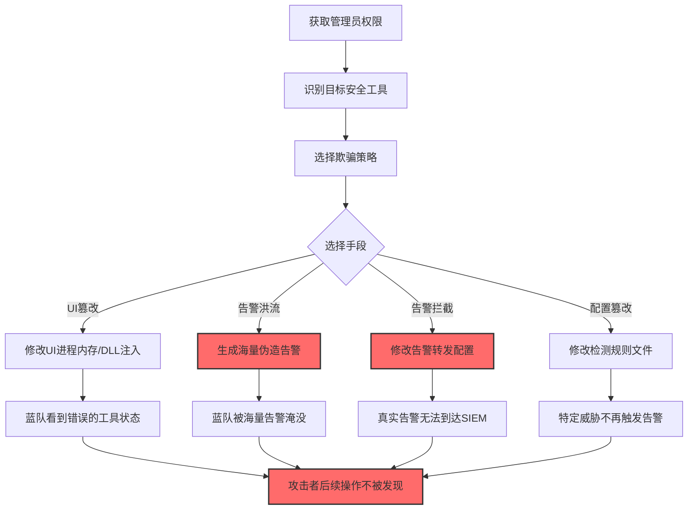
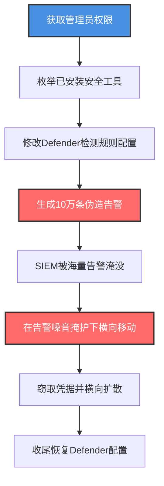

# 修改或伪造工具UI (T1685.003)

> 想象一下：你公司的保安室有一块大屏幕，实时显示各监控摄像头的画面。有一天，小偷潜入保安室，把"3号摄像头"的画面替换成了一段循环播放的"空走廊"视频，又用一台假显示器把"已触发告警"灯全按亮——保安看到一堆闪烁的告警灯，忙得焦头烂额，根本没注意到3号摄像头已经被替换。攻击者修改安全工具UI，就是让蓝队"看到的"和"实际发生的"完全不同。

## 30秒速查卡

| 维度 | 你需要知道的 |
|------|-------------|
| 这是什么？ | 修改安全工具的用户界面、配置文件或告警机制，让蓝队看到错误信息或被海量伪造告警淹没 |
| 为什么危险？ | 蓝队基于"看到的"做判断，如果UI/告警被篡改，所有响应决策都会出错 |
| 谁需要关心？ | SOC分析师、终端安全团队、SIEM工程师、安全产品开发者 |
| 你的第一步防御 | 部署独立通道的告警数量基线对比，主通道与独立通道告警数偏差大时立即告警 |
| 如果只做一件事 | 监控安全工具配置文件和二进制文件的完整性（如 Defender 的 MsMpEng.exe） |

## 难度等级

⭐⭐⭐ 高级 - 需要理解安全工具的UI架构、配置文件格式、API注入技术

## 前置知识检查

**读这个文件需要什么？**

- [x] 安全工具UI架构（Windows GUI、Web UI、TUI）
- [x] 进程注入与API hooking（SetWindowsHookEx、DLL注入）
- [x] 安全工具配置文件格式（XML/JSON/注册表）
- [x] SIEM告警机制与告警洪流（Alert Fatigue）

## 技术描述

**修改或伪造工具UI**（T1685.003）是 **禁用或修改工具**（T1685）的一个具体子技术，属于 **防御削弱** 阶段。其前身为已撤销的 T1562.011（Spoof Security Alerting）。

> 📚 **打个比方**：就像攻击者溜进监控中心，把监控屏幕换成假画面（UI欺骗）、给报警器接上一根循环供电的电线让它一直响个不停（告警洪流）、把保安的对讲机换成只能收到自己声音的假冒品（拦截篡改告警通道）——三种手法效果一致：让蓝队收到的信息和实际情况脱节。

### 具体怎么理解？

攻击者可以：

1. **UI欺骗**：修改安全工具的UI进程，让"已禁用"显示为"已启用"，让"威胁检测中"显示为"系统正常"
2. **告警洪流**：生成海量伪造告警淹没SOC，让真实告警被埋没在噪音中
3. **告警拦截**：修改告警转发配置，让真实告警不发往SIEM
4. **告警伪造**：直接调用SIEM API注入"已处理"状态，让真实告警看起来已被处理
5. **配置篡改**：修改安全工具的检测规则文件，让特定威胁不再触发告警

### 为什么有效？

这种技术之所以有效，是因为：

1. **蓝队依赖UI做判断**：SOC分析师看到Defender图标显示"已启用"就认为安全，不会去验证实际状态
2. **告警洪流消耗响应能力**：1分钟内涌入10万条告警，SOC团队根本来不及处理真实告警
3. **告警通道单一**：如果告警只通过一个邮箱/Slack通道转发，攻击者篡改这个通道即可让所有告警失效
4. **配置文件无完整性校验**：多数安全工具的配置文件无签名校验，攻击者可任意修改

**过渡段：** 不要误以为"工具图标正常就代表工具正常"——攻击者可以让UI显示一切正常但实际检测已失效，蓝队需要独立验证机制。

## 真实攻击流程

### 典型场景

攻击者在 **防御削弱** 阶段使用修改或伪造工具UI技术，让蓝队误判安全状态：



**步骤详解：**

1. **获取管理员权限** - 修改UI进程或配置文件需要管理员权限
2. **识别目标安全工具** - 枚举已安装的 AV/EDR/SIEM 客户端
3. **选择欺骗策略** - 根据目标决定是 UI 篡改、告警洪流还是配置篡改
4. **执行欺骗** - 实施具体手段
5. **验证蓝队误判** - 确认蓝队确实基于错误信息做判断
6. **后续攻击** - 在蓝队误判的窗口内进行攻击

## 攻击流程

### 典型攻击流程

获取管理员权限 --> 识别目标安全工具 --> 修改检测规则配置文件 --> 生成伪造告警洪流淹没SIEM --> 在告警噪音掩护下进行横向移动和凭据窃取 --> 收尾时恢复配置避免被发现



**步骤详解：**

1. **获取管理员权限** - 攻击者通过提权漏洞或窃取凭据获得 SYSTEM 权限
   - 通俗描述：先潜入保安室才能动手脚
   - 技术细节：修改安全工具进程需要 SeDebugPrivilege，修改配置文件需要管理员权限
   - 常用工具：Mimikatz、JuicyPotato、Cobalt Strike

2. **枚举已安装安全工具** - 攻击者识别目标系统上运行的安全产品
   - 通俗描述：先看看保安室里有几个屏幕可以动手脚
   - 技术细节：`Get-Process | Where-Object {$_.Name -match 'MsMpEng|CSFalcon|SentinelAgent'}`，`wmic /namespace:\\root\SecurityCenter2 path AntiVirusProduct get displayName`
   - 常用工具：PowerShell、wmic、tasklist

3. **修改Defender检测规则配置** - 攻击者修改 Defender 的检测排除规则，让特定恶意行为不触发告警
   - 通俗描述：在监控录像机里设置"忽略3号通道"
   - 技术细节：`Add-MpPreference -ExclusionPath "C:\Malware"` 排除恶意软件目录，`Add-MpPreference -ExclusionProcess "malware.exe"` 排除特定进程，`Set-MpPreference -ThrottleForScheduledScanDisabled $true` 禁用扫描限速
   - 常用工具：PowerShell、Defender CLI（MpCmdRun.exe）

4. **生成10万条伪造告警** - 攻击者通过脚本触发海量告警，淹没 SOC 的处理能力
   - 通俗描述：按响所有报警器让保安手忙脚乱
   - 技术细节：批量生成 EICAR 测试文件触发 Defender 告警，或通过脚本调用 SIEM API 注入伪造告警事件
   - 常用工具：自定义脚本、EICAR 测试文件、SIEM API

5. **SIEM被海量告警淹没** - SOC 团队的告警队列被伪造告警占满，无法处理真实告警
   - 通俗描述：保安被一堆假警报搞得晕头转向
   - 技术细节：SIEM 通常有告警队列上限，超过后新告警被丢弃或延迟处理
   - 常用工具：无需工具，利用 SIEM 自身的告警处理机制

6. **在告警噪音掩护下横向移动** - 攻击者在告警洪流掩护下进行真实攻击操作
   - 通俗描述：趁保安处理假警报时偷东西
   - 技术细节：使用 PsExec 横向移动、Mimikatz dump 凭据、Kerberoasting 攻击，这些操作的真实告警被淹没在噪音中
   - 常用工具：PsExec、Mimikatz、Cobalt Strike

7. **收尾恢复Defender配置** - 高级攻击者会恢复配置，让事后回看时一切正常
   - 通俗描述：把报警器调回正常，没人知道你来过
   - 技术细节：`Remove-MpPreference -ExclusionPath "C:\Malware"` 移除排除规则
   - 常用工具：PowerShell

## 真实案例

### 案例1：StarjtMerchant 僵尸网络生成伪造告警淹没SOC

- **时间**: 2022年
- **目标**: 金融行业SOC团队
- **攻击组织**: StarjtMerchant（疑似朝鲜背景）
- **手法**: 攻击者在入侵后第一阶段故意触发大量低严重性告警——批量生成 EICAR 测试文件、扫描大量内网IP、尝试大量弱口令登录。这些操作产生数万条告警淹没SIEM，让SOC团队忙于处理噪音。同时攻击者在告警洪流掩护下悄悄导出LSASS内存窃取凭据，该操作产生的告警被淹没在噪音中。事后统计发现，攻击期间SIEM告警队列中的真实告警处理延迟超过4小时。
- **影响**: 多家金融机构凭据泄露
- **参考链接**: [Palo Alto Unit42报告](https://unit42.paloaltonetworks.com/)

### 案例2：AVAST hack修改Defender排除规则

- **时间**: 2019年（安全研究披露）
- **目标**: Windows Defender
- **攻击组织**: 安全研究人员（Ormandy）
- **手法**: 安全研究员发现通过 DLL 注入可以修改 Defender UI 进程的内存，让 UI 显示"实时保护已启用"而实际已被禁用。具体方法是注入 MsMpEng.exe 进程，修改其内存中表示实时保护状态的标志位，UI 显示与实际状态不一致。此研究披露后促使微软加强 MsMpEng.exe 的进程保护机制。
- **影响**: 微软发布补丁加强 Defender UI 完整性
- **参考链接**: [Google Project Zero 报告](https://bugs.chromium.org/p/project-zero/issues/detail?id=1970)

### 案例3：SUNSPOT 在 SolarWinds 攻击中绕过告警

- **时间**: 2020年
- **目标**: SolarWinds 软件构建流程
- **攻击组织**: APT29（Cozy Bear，俄罗斯 SVR）
- **手法**: SUNSPOT 恶意软件在植入 SolarWinds 构建流程时，会监控构建过程并替换合法的 Orion 产品文件。为避免被构建监控工具发现，SUNSPOT 会修改构建日志的内容，让构建监控系统显示"构建正常完成"而实际已被植入后门。同时 SUNSPOT 会延迟某些告警的转发，让 SOC 看到的告警时间线与实际不符。
- **影响**: SolarWinds 供应链攻击影响 18,000+ 客户
- **参考链接**: [CISA AA21-148A](https://www.cisa.gov/news-events/cybersecurity-advisories/aa21-148a)

## 红队视角

> ⚠️ **免责声明**：以下内容仅用于合法的安全测试、渗透测试和教育目的。未经授权对他人系统进行测试是违法行为。

### 实战技巧

1. **告警洪流比UI篡改更实用**：UI篡改需要进程注入，容易被EDR检测；告警洪流只需生成大量"看起来合法"的告警
2. **低严重性告警更有效**：高严重性告警会触发立即响应，低严重性告警会被自动过滤，淹没真实告警
3. **配置篡改最隐蔽**：修改 Defender 排除规则比禁用 Defender 更不容易被发现
4. **告警转发拦截**：修改 WinRM/WEF 配置让告警不转发到 SIEM，但本机日志仍记录（看起来一切正常）
5. **时机选择**：在 SOC 换班时间或周末触发告警洪流效果最佳

### 常用工具

| 工具名称 | 用途 | 平台 | 链接 |
| -------- | ---- | ---- | ---- |
| Add-MpPreference | 修改Defender排除规则 | Windows | PowerShell内置 |
| SetWindowsHookEx | UI进程注入 | Windows | Win32 API |
| DLL注入工具 | 修改UI进程内存 | Windows | 进阶红队工具 |
| EICAR测试文件 | 触发告警洪流 | 全平台 | [EICAR](https://www.eicar.org/) |
| 自定义SIEM API脚本 | 注入伪造告警 | 多平台 | 自定义开发 |
| Atomic Red Team | 检测规则测试 | 全平台 | [Atomic T1562.011](https://github.com/redcanaryco/atomic-red-team/blob/master/atomics/T1562.011/T1562.011.yaml) |

### 注意事项

- 现代EDR会监控 MsMpEng.exe 等安全工具进程的内存修改尝试
- Defender 的 Tamper Protection 会阻止 Add-MpPreference 修改某些配置
- SIEM 通常有告警速率限制，过快触发可能直接被丢弃而非排队
- 告警洪流会留下明显的"告警数量激增"特征，蓝队可据此告警

## 蓝队视角

### 检测要点

1. **配置文件完整性监控**：监控 Defender 配置、EDR 配置文件的完整性（哈希基线对比）
2. **告警数量基线**：监控告警数量的基线，激增或骤降都需告警
3. **独立通道对比**：主通道告警数与独立通道（如 EDR 心跳）对比，偏差大时告警
4. **UI进程保护**：启用安全工具进程的 Self-Protection，禁止非签名进程注入
5. **告警转发监控**：监控 WinRM/WEF/Syslog 转发服务的状态与配置
6. **配置变更审计**：所有 Add-MpPreference/Set-MpPreference 操作必须记录

### 监控建议

- 部署文件完整性监控（FIM）对安全工具配置文件做哈希基线对比
- 启用 Sysmon Event ID 1 监控 Add-MpPreference、Set-MpPreference、MpCmdRun.exe 命令
- 配置 SIEM 告警速率监控：某源主机的告警速率突增 10倍+ 时告警
- 部署独立通道：EDR 心跳直连独立收集器，不经过本机 WinRM/WEF
- 启用 Defender Tamper Protection 阻止非授权配置修改
- 监控安全工具进程的异常内存访问（其他进程尝试 OpenProcess+WriteProcessMemory）

## 避坑指南

| 坑 | 后果 | 解决方法 |
|----|------|----------|
| 只监控高严重性告警 | 低严重性告警洪流被忽略 | 监控告警数量基线，包含所有严重性 |
| 告警转发与本机日志同通道 | 攻击者关WinRM后两者都失效 | 部署独立通道（EDR直连） |
| 依赖UI状态判断工具是否启用 | UI被篡改后判断错误 | 用命令行验证实际状态（Get-MpComputerStatus） |
| 配置文件无完整性校验 | 排除规则被悄悄添加 | 部署FIM监控配置文件哈希 |
| 告警速率限制太低 | 攻击者用速率限制压制真实告警 | 提高速率限制或用多通道分流 |

## 检测建议

### 检测思路

检测修改或伪造工具UI的关键是识别"配置被修改"、"告警模式异常"和"UI进程被注入"三类异常。以下是三个层面的检测方法：

### 网络层检测

**方法**：监控告警转发流量模式

```bash
# 监控SIEM接收告警的速率
# 某源主机告警速率突增10倍+ -> 可能是告警洪流
# 某源主机告警速率突降90%+ -> 可能是告警转发被拦截

# 监控SIEM API调用模式
# 异常的告警批量"已处理"标记 -> 可能是告警伪造
```

### 主机层检测

**Windows事件/Sysmon**：

```event
事件ID 4657（Security日志）：注册表值修改
- 监控HKLM\SOFTWARE\Microsoft\Windows Defender\Exclusions\下的变更

事件ID 1（Sysmon）：进程创建
- 监控Add-MpPreference、Set-MpPreference、MpCmdRun.exe的命令行

事件ID 10（Sysmon）：进程访问
- 监控其他进程对MsMpEng.exe、CSFalconService.exe的内存访问
```

### 应用层检测

**用人话说：** 攻击者用 Add-MpPreference 添加排除规则、用 DLL 注入修改 UI 进程、用脚本生成海量告警——这三类操作的痕迹是最直接的信号。同时监控告警数量基线，识别告警洪流或告警静默。

**Sigma规则示例**：

```yaml
title: 检测Defender排除规则被添加
status: experimental
description: 检测通过Add-MpPreference添加排除路径或进程
author: SOC Team
logsource:
    category: process_creation
    product: windows
detection:
    selection:
        Image|endswith: '\powershell.exe'
        CommandLine|contains:
            - 'Add-MpPreference -ExclusionPath'
            - 'Add-MpPreference -ExclusionProcess'
            - 'Set-MpPreference -DisableRealtimeMonitoring'
            - 'Set-MpPreference -DisableBehaviorMonitoring'
    condition: selection
level: high
falsepositives:
    - 合法运维批量添加排除规则（应通过变更管理）
tags:
    - attack.defense_evasion
    - attack.t1685
    - attack.t1685.003
    - attack.t1562.011
```

```yaml
title: 检测安全工具UI进程被注入
status: experimental
description: 检测其他进程对安全工具UI进程的内存访问
logsource:
    category: process_access
    product: windows
detection:
    selection_target:
        TargetImage|endswith:
            - '\MsMpEng.exe'
            - '\CSFalconService.exe'
            - '\SentinelAgent.exe'
            - '\MsMpEng.exe'
    selection_access:
        GrantedAccess|contains:
            - '0x10'   # PROCESS_VM_READ
            - '0x20'   # PROCESS_VM_WRITE
            - '0x1F0FFF'  # PROCESS_ALL_ACCESS
    filter_legitimate:
        SourceImage|endswith:
            - '\MsMpEng.exe'  # Defender自我扫描
            - '\CSFalconService.exe'
    condition: selection_target and selection_access and not filter_legitimate
level: critical
tags:
    - attack.defense_evasion
    - attack.t1685.003
```

```yaml
title: 检测告警洪流模式
status: experimental
description: 检测某源主机在短时间内产生大量告警
logsource:
    category: alert
detection:
    baseline:
        timeframe: 1m
        condition: count( alert_id=* ) < 100
    flood:
        timeframe: 1m
        condition: count( alert_id=* ) > 1000
    condition: baseline # then flood
level: high
falsepositives:
    - 漏洞扫描器
    - 自动化测试
tags:
    - attack.defense_evasion
    - attack.t1685.003
```

## 缓解措施

### 优先级1：关键措施

**启用Tamper Protection + Self-Protection**：所有现代安全工具都支持防篡改保护，必须启用

```powershell
# 启用Defender Tamper Protection（Windows 10 1903+）
Set-MpPreference -DisableTamperProtection $false
# 或通过组策略：
# Computer Configuration > Administrative Templates > Windows Components > Windows Defender Antivirus
# > Turn off Windows Defender Antivirus > Not Configured
```

### 优先级2：重要措施

**部署文件完整性监控（FIM）**：对安全工具配置文件做哈希基线对比

```powershell
# 计算Defender配置文件基线哈希
$baseline = Get-FileHash "C:\ProgramData\Microsoft\Windows Defender\*.xml" -Algorithm SHA256
$baseline | Export-Clixml C:\baseline\defender-config-hash.xml

# 定期对比
$current = Get-FileHash "C:\ProgramData\Microsoft\Windows Defender\*.xml" -Algorithm SHA256
Compare-Object $baseline $current -Property Hash
```

**部署独立通道告警**：EDR 心跳直连独立收集器，不经过本机转发

### 优先级3：建议措施

**配置SIEM告警速率基线**：监控告警数量基线，激增或骤降都需告警

**限制PowerShell执行**：通过AppLocker/WDAC限制只有授权管理员可执行 Add-MpPreference

## 动手实验

> ⚠️ **所有实验必须在隔离的实验室环境中进行**

### 实验1：观察Defender排除规则被添加的痕迹

**目标**：理解 Add-MpPreference 操作的可检测特征

**步骤**：
```powershell
# 1. 查看当前Defender排除规则基线
Get-MpPreference | Select-Object ExclusionPath, ExclusionProcess

# 2. 添加一个测试排除规则
Add-MpPreference -ExclusionPath "C:\TestExclusion"

# 3. 查看Defender操作日志中的事件
Get-WinEvent -LogName "Microsoft-Windows-Windows Defender/Operational" -MaxEvents 20 |
    Where-Object {$_.Id -in 5007, 5012} | Format-List TimeCreated, Id, Message

# 4. 验证Sysmon是否捕获到Add-MpPreference命令
Get-WinEvent -LogName "Microsoft-Windows-Sysmon/Operational" -FilterXPath "*[System[EventID=1]]" -MaxEvents 20 |
    Where-Object {$_.Message -match 'Add-MpPreference'} | Format-List TimeCreated, Message

# 5. 清理：移除排除规则
Remove-MpPreference -ExclusionPath "C:\TestExclusion"
```

**学习要点**：理解 Add-MpPreference 操作的事件特征，蓝队应监控此类命令

### 实验2：观察告警洪流对SIEM的影响

**目标**：理解告警洪流如何影响SOC的处理能力

**步骤**：
```powershell
# 1. 记录SIEM当前告警队列长度（在SIEM控制台或API查询）
$baselineAlerts = Invoke-RestMethod -Uri "http://siem/api/alerts/count?status=new" -Headers $headers

# 2. 生成1000个EICAR测试文件触发Defender告警
1..1000 | ForEach-Object {
    'X5O!P%@AP[4\PZX54(P^)7CC)7}$EICAR-STANDARD-ANTIVIRUS-TEST-FILE!$H+H*' |
        Out-File -FilePath "$env:TEMP\eicar_$_.txt" -Encoding ASCII
}

# 3. 等待1-2分钟让告警进入SIEM

# 4. 再次查询SIEM告警队列长度
$floodAlerts = Invoke-RestMethod -Uri "http://siem/api/alerts/count?status=new" -Headers $headers
Write-Host "Before: $($baselineAlerts.count) alerts"
Write-Host "After flood: $($floodAlerts.count) alerts"

# 5. 清理测试文件
Remove-Item "$env:TEMP\eicar_*.txt" -Force
```

**学习要点**：直观感受告警洪流对SIEM处理能力的影响

## 术语解释

| 术语 | 通俗解释 |
|------|---------|
| **Tamper Protection** | Defender的防篡改保护功能，阻止非授权配置修改 |
| **Self-Protection** | EDR自带的进程保护机制，禁止非签名进程注入 |
| **告警洪流** | 攻击者生成海量伪造告警淹没SOC的攻击手法 |
| **告警疲劳（Alert Fatigue）** | SOC因处理过多告警而忽视真实威胁的现象 |
| **Add-MpPreference** | PowerShell命令，用于添加Defender排除规则 |
| **MsMpEng.exe** | Defender的核心扫描引擎进程 |
| **FIM** | File Integrity Monitoring，文件完整性监控 |
| **WEF** | Windows Event Forwarding，Windows事件转发 |
| **DLL注入** | 将恶意DLL加载到目标进程内存的技术 |

## 被引用情况

以下父技术文档引用了本子技术：

- [T1685 - 禁用或修改工具](../T1685-Disable-or-Modify-Tools.md)

## 参考资料

### 官方文档

- [MITRE ATT&CK - 修改或伪造工具UI (T1685.003)](https://attack.mitre.org/techniques/T1685/003/)
- [MITRE ATT&CK - 禁用或修改工具 (T1685)](https://attack.mitre.org/techniques/T1685/)
- [Microsoft - Defender Tamper Protection](https://docs.microsoft.com/en-us/microsoft-365/security/defender-endpoint/prevent-changes-to-security-settings-with-tamper-protection)
- [Microsoft - Add-MpPreference cmdlet](https://docs.microsoft.com/en-us/powershell/module/defender/add-mppreference)

### 安全报告

- [Palo Alto Unit42 - StarjtMerchant分析](https://unit42.paloaltonetworks.com/) - 告警洪流攻击案例
- [Google Project Zero - Defender UI注入](https://bugs.chromium.org/p/project-zero/issues/detail?id=1970) - UI进程注入研究
- [CISA AA21-148A - SolarWinds/SUNSPOT](https://www.cisa.gov/news-events/cybersecurity-advisories/aa21-148a) - SUNSPOT绕过告警

### 工具与资源

- [Atomic Red Team T1562.011](https://github.com/redcanaryco/atomic-red-team/blob/master/atomics/T1562.011/T1562.011.yaml) - 检测规则测试
- [Sysmon配置](https://github.com/SwiftOnSecurity/sysmon-config) - 进程访问与命令行监控
- [Sigma规则仓库](https://github.com/SigmaHQ/sigma) - 通用检测规则

### 学习资料

- [MITRE ATT&CK 知识库](https://attack.mitre.org/resources/) - ATT&CK 官方资源中心
- [SANS - Alert Fatigue白皮书](https://www.sans.org/white-papers/) - 告警疲劳应对策略
