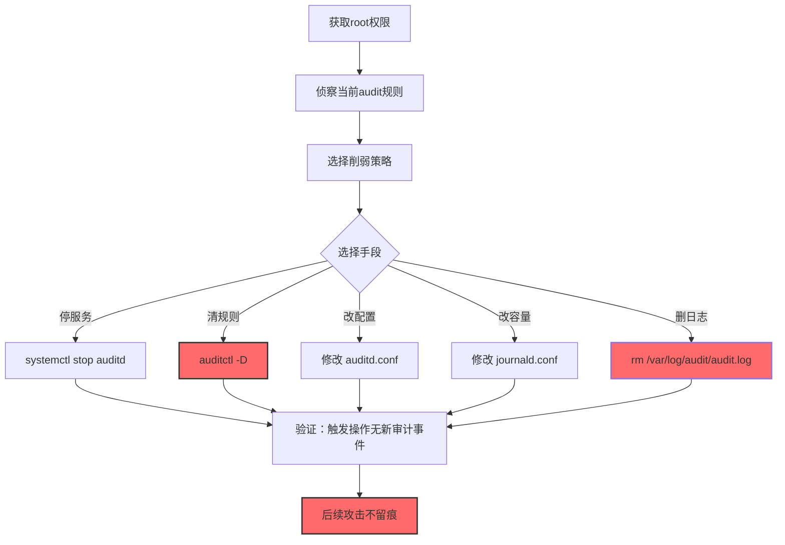
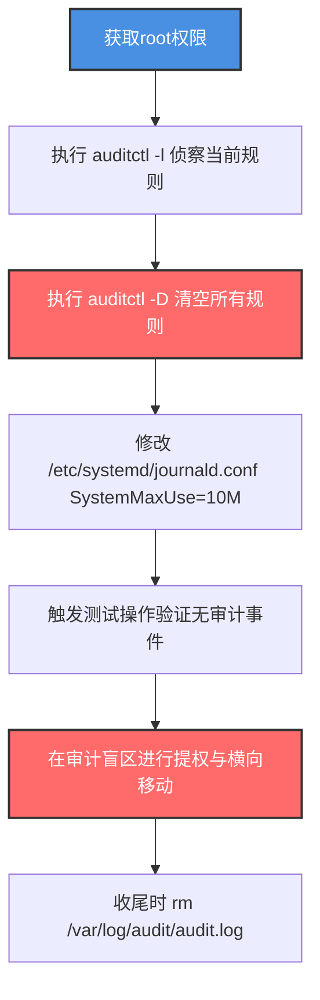

# 禁用或修改Linux审计系统日志 (T1685.004)

> 想象一下：你公司的财务室门口装了一个智能门禁，每次有人进出都会自动记录到云端。有一天，小偷潜入财务室，把门禁的"自动上传"功能关了——门禁还在工作，本地还能看到几个最近记录，但云端再也收不到新记录。等你远程查财务室进出记录时，看到的还是几天前的旧数据。Linux 的 auditd 审计系统就是这套"门禁记录"，攻击者禁用或修改它，让你看不到真实的系统活动。

## 30秒速查卡

| 维度 | 你需要知道的 |
|------|-------------|
| 这是什么？ | 停止 Linux auditd 服务、清空 audit 规则、修改 auditd 配置、禁用 journald 或修改其日志容量，让系统操作不被记录 |
| 为什么危险？ | Linux 服务器几乎全靠 auditd/journald 做取证，关闭后攻击者可以横向移动、提权、窃取数据而不留痕迹 |
| 谁需要关心？ | Linux 系统管理员、SOC分析师、云安全工程师、合规审计员 |
| 你的第一步防御 | 监控 auditctl 命令执行和 auditd 服务状态变更，启用 immutable 模式（auditctl -e 2） |
| 如果只做一件事 | 监控 `systemctl stop auditd` 和 `auditctl -D` 命令执行，这是攻击者最常用的两个禁用命令 |

## 难度等级

⭐⭐ 中级 - 需要理解 Linux auditd 架构、audit 规则语法、journald 配置

## 前置知识检查

**读这个文件需要什么？**

- [x] Linux auditd 审计子系统架构
- [x] auditctl 命令和 audit 规则语法
- [x] systemd 服务管理（systemctl）
- [x] journald 日志系统和 journalctl 命令
- [x] Linux 文件权限和 root 权限

## 技术描述

**禁用或修改Linux审计系统日志**（T1685.004）是 **禁用或修改工具**（T1685）的一个具体子技术，属于 **防御削弱** 阶段。其前身为已撤销的 T1562.012（Disable or Modify Linux Audit System）。

> 📚 **打个比方**：就像攻击者潜入监控中心，把录像机电源线拔了（systemctl stop auditd）、把所有录像带磁条消磁（auditctl -D 清空规则）、把录像机设置从"持续录像"改成"按需录像"（修改 auditd.conf 的 disk_full_action）——三种手法效果一致：让 Linux 系统活动不被记录。

### 具体怎么理解？

Linux 的审计系统主要由两部分组成：

1. **auditd**：内核审计子系统，通过 auditctl 配置规则，记录系统调用（如 open、execve、connect）到 `/var/log/audit/audit.log`
2. **journald**：systemd 的日志服务，记录系统和服务日志到 `/var/log/journal/`（持久化）或 `/run/log/journal/`（易失性）

攻击者可以：

1. **停服务**：`systemctl stop auditd`——粗暴但显眼，auditd 是受保护服务难以直接停止
2. **清规则**：`auditctl -D`——清空所有 audit 规则，让 auditd 不再记录任何系统调用
3. **改配置**：修改 `/etc/audit/auditd.conf` 的 `disk_full_action = ignore`，让磁盘满时停止记录而非报错
4. **禁journald**：`systemctl stop systemd-journald`——停止 journald 服务
5. **改容量**：修改 `/etc/systemd/journald.conf` 的 `SystemMaxUse=10M`，让 journald 日志容量极小，快速覆盖旧记录
6. **删日志文件**：`rm /var/log/audit/audit.log*` 或 `journalctl --vacuum-time=1s`

### 为什么有效？

这种技术之所以有效，是因为：

1. **auditctl -D 不留"被改"痕迹**：清空 audit 规则后，auditd 不再记录系统调用，但 auditctl 命令本身如果 journald 仍开启会被记录，需主动清理
2. **immutable 模式可被绕过**：`auditctl -e 2` 启用 immutable 模式后理论上规则不可修改，但攻击者可通过重启进入单用户模式或加载恶意内核模块绕过
3. **auditd 是受保护服务**：直接 `systemctl stop auditd` 在某些发行版会失败，但攻击者可通过修改 `/etc/audit/auditd.conf` 或杀死 auditd 进程实现
4. **journald 易失性日志**：如果 journald 配置为 `/run/log/journal/`（易失性），重启后日志全部丢失

**过渡段：** 不要误以为"auditd 服务还在运行就代表审计还在生效"——攻击者可能只是清空了规则，auditd 进程正常但已不记录任何事件。

## 真实攻击流程

### 典型场景

攻击者在 **防御削弱** 阶段使用禁用或修改Linux审计系统日志技术，为后续操作扫清痕迹：



**步骤详解：**

1. **获取root权限** - auditctl 和 systemctl 都需要 root 权限
2. **侦察当前audit规则** - `auditctl -l` 查看当前启用了哪些规则
3. **选择削弱策略** - 决定是停服务、清规则还是改配置
4. **执行削弱** - 运行 auditctl -D 或修改配置
5. **验证生效** - 触发测试操作确认未被记录
6. **后续攻击** - 在审计盲区进行提权、横向移动、数据窃取

## 攻击流程

### 典型攻击流程

获取root权限 --> 侦察当前audit规则 --> 执行auditctl -D清空规则 --> 修改journald.conf缩小日志容量 --> 验证审计确实失效 --> 在盲区进行提权和横向移动 --> 收尾时清空剩余日志



**步骤详解：**

1. **获取root权限** - 攻击者通过内核提权漏洞（如 DirtyPipe、DirtyCow）、SUID 二进制滥用、或窃取的 root 凭据获得 root 权限
   - 通俗描述：先拿到服务器"超级管理员"权限
   - 技术细节：利用 CVE-2022-0847（DirtyPipe）提权到 root，或滥用 SUID 的 find/nmap/perl 等二进制，或通过 SSH 密钥窃取获取 root 访问
   - 常用工具：LinPEAS、linux-exploit-suggester、DirtyPipe PoC、Metasploit

2. **侦察当前audit规则** - 攻击者查看目标系统当前启用了哪些审计规则
   - 通俗描述：先看看审计系统现在记了哪些事件
   - 技术细节：执行 `auditctl -l` 列出所有启用的 audit 规则，关注 execve、open、connect 等关键系统调用的监控规则；执行 `systemctl status auditd` 查看 auditd 服务状态；执行 `auditctl -s` 查看审计子系统状态（包含 enabled 标志，2 表示 immutable）
   - 常用工具：auditctl、systemctl、ausearch、aureport

3. **清空所有规则** - 攻击者使用 auditctl -D 清空所有 audit 规则，让 auditd 不再记录任何系统调用
   - 通俗描述：把审计系统的"监控清单"清空
   - 技术细节：执行 `auditctl -D` 删除所有规则，auditd 进程仍在运行但已不记录任何事件；如果系统启用了 immutable 模式（`auditctl -s` 显示 enabled=2），auditctl -D 会失败，攻击者需通过单用户模式或内核模块绕过
   - 常用工具：auditctl

4. **修改journald配置** - 攻击者修改 journald 配置，缩小日志容量让旧记录被快速覆盖
   - 通俗描述：把日志存储空间从30天改成1小时
   - 技术细节：修改 `/etc/systemd/journald.conf` 的 `SystemMaxUse=10M`（默认无限制或几百MB），重启 journald 后旧日志被覆盖；或修改 `Storage=none` 完全禁用持久化日志
   - 常用工具：文本编辑器、systemctl restart systemd-journald

5. **验证审计失效** - 攻击者触发测试事件确认审计确实不再记录
   - 通俗描述：在监控盲区走一圈看看是否被记录
   - 技术细节：执行 `cat /etc/shadow` 触发文件访问事件，然后 `ausearch -ts recent` 查看是否生成审计事件，若无则审计已被禁用
   - 常用工具：ausearch、aureport

6. **后续攻击** - 在审计盲区进行提权、横向移动、数据窃取
   - 通俗描述：审计关了，可以为所欲为
   - 技术细节：使用 SSH 横向移动、利用 CVE 提权、从 /etc/shadow 提取密码哈希、通过 cron 设置持久化，这些操作不会在 audit.log 中留下痕迹
   - 常用工具：ssh、Metasploit、LinPEAS、Impacket

## 真实案例

### 案例1：Rocke 僵尸网络禁用 auditd 隐藏挖矿

- **时间**: 2018-2019年
- **目标**: Linux 服务器、云实例
- **攻击组织**: Rocke（加密货币挖矿组织，疑似中文背景）
- **手法**: Rocke 在入侵 Linux 服务器后会执行脚本禁用审计和监控：`systemctl stop auditd && systemctl disable auditd` 停止并禁用 auditd 服务；`auditctl -D` 清空 audit 规则；`systemctl stop rsyslog && systemctl stop syslog-ng` 停止传统日志服务；同时清理 `/var/log/wtmp`、`/var/log/btmp`、`/var/log/lastlog` 等登录日志；并卸载常见的 EDR 代理（如 Qualys、Trend Micro）。脚本还会修改 `/etc/systemd/journald.conf` 的 `Storage=none` 完全禁用 journald 持久化日志。
- **影响**: 全球数千台 Linux 服务器被感染挖矿
- **参考链接**: [Talos Rocke分析](https://blog.talosintelligence.com/2018/08/rocke-champion-of-unauthorized-cryptominers.html)

### 案例2：TeamTNT 关闭云Linux实例审计

- **时间**: 2021-2023年
- **目标**: AWS、Azure、GCP 上的 Linux 实例
- **攻击组织**: TeamTNT（加密货币挖矿组织）
- **手法**: TeamTNT 在入侵云 Linux 实例后，会执行"清理脚本"关闭审计与监控：`systemctl stop auditd`、`auditctl -D`、`systemctl stop amazon-cloudwatch-agent`、`systemctl stop opsagent-agent`、`systemctl stop datadog-agent`；同时清理 `/var/log/audit/`、`/var/log/secure`、`/var/log/auth.log`、`~/.bash_history`；并修改 `/etc/logrotate.d/` 配置让日志轮转后立即删除。脚本还会删除 `/etc/cron.d/audit` 等审计相关定时任务。
- **影响**: 全球数千台云实例被感染
- **参考链接**: [Trend Micro TeamTNT分析](https://www.trendmicro.com/en_us/research/21/i/teamtnt-now-deploys-crypto-mining-worms-to-mass-infect-dock.html)

### 案例3：Orbit 僵尸网络使用 LD_PRELOAD 劫持审计

- **时间**: 2022年
- **目标**: Linux 服务器
- **攻击组织**: Orbit（疑似与 TeamTNT 关联）
- **手法**: Orbit 采用更隐蔽的手法——通过 LD_PRELOAD 注入恶意共享库到 auditd 进程，劫持 auditd 的日志写入函数，让 auditd 看起来正常运行但实际写入的日志已被篡改。攻击者还会劫持 ausearch、aureport 命令，让蓝队查询时看到的是被篡改的"正常"日志。这种手法不需要停服务或清规则，auditctl -l 显示规则仍在，但实际记录的事件已被过滤。
- **影响**: 难以被传统监控发现，需通过独立通道验证
- **参考链接**: [Microsoft Orbit分析](https://www.microsoft.com/en-us/security/blog/2022/04/12/dark-sea-botnet-adds-orbit-attacks/)

## 红队视角

> ⚠️ **免责声明**：以下内容仅用于合法的安全测试、渗透测试和教育目的。未经授权对他人系统进行测试是违法行为。

### 实战技巧

1. **优先 auditctl -D 而非停服务**：停服务会触发监控告警，清规则更隐蔽
2. **immutable 模式的绕过**：`auditctl -e 2` 启用 immutable 后，需通过单用户模式（`init 1`）、加载恶意内核模块、或修改 GRUB 启动参数 `audit=0` 绕过
3. **LD_PRELOAD 劫持更隐蔽**：注入恶意库到 auditd 进程，让日志看起来正常但实际被过滤
4. **修改 journald.conf 比删日志更隐蔽**：删日志会留下"文件被删"事件（如果 auditd 仍监控），改容量让自动覆盖更隐蔽
5. **同步处理 /var/log/wtmp**：登录记录在 wtmp 中，需同步清理
6. **检查第三方 EDR**：Qualys、Trend Micro、Datadog 等代理需单独停用

### 常用工具

| 工具名称 | 用途 | 平台 | 链接 |
| -------- | ---- | ---- | ---- |
| auditctl | 修改audit规则 | Linux | 系统自带 |
| systemctl | 管理服务 | Linux | systemd自带 |
| journalctl | 操作journald | Linux | systemd自带 |
| rm | 删除日志文件 | Linux | 系统自带 |
| LD_PRELOAD注入 | 劫持auditd | Linux | 自定义共享库 |
| Atomic Red Team | 检测规则测试 | Linux | [Atomic T1562.012](https://github.com/redcanaryco/atomic-red-team/blob/master/atomics/T1562.012/T1562.012.yaml) |

### 注意事项

- 现代 systemd 的 auditd 是受保护服务，`systemctl stop auditd` 可能失败，需通过 `systemctl disable auditd` + 重启实现
- `auditctl -e 2` 启用 immutable 后，规则在重启前不可修改，攻击者必须重启或绕过
- 容器环境（Docker/K8s）通常不运行 auditd，攻击者需关注容器运行时日志（如 Falco）
- SELinux/AppArmor 可能限制 auditctl 操作，需先评估 MAC 状态

## 蓝队视角

### 检测要点

1. **auditctl 命令监控**：监控 auditctl -D/-e/-d 等命令执行
2. **auditd 服务状态监控**：监控 auditd 服务异常停止或禁用
3. **配置文件完整性**：监控 /etc/audit/auditd.conf、/etc/audit/audit.rules、/etc/systemd/journald.conf 的修改
4. **日志文件监控**：监控 /var/log/audit/audit.log 的事件率突降
5. **audit 子系统状态**：定期执行 `auditctl -s` 检查 enabled 标志
6. **独立通道对比**：EDR 心跳直连独立收集器，对比本机 audit 事件率

### 监控建议

- 部署 immutable 模式：`auditctl -e 2` 启用 immutable，重启前规则不可修改
- 监控 auditctl 命令执行：通过 audit 规则自身监控 auditctl（如果还未被清空）
- 配置独立日志服务器：通过 rsyslog 把 audit.log 实时转发到独立服务器
- 部署 Falco 等容器运行时监控工具，作为 auditd 的补充
- 启用 auditd 的 `disk_full_action = halt`，磁盘满时停机而非停止记录
- 监控 systemd-journald 的配置变更和重启事件
- 部署独立 EDR 代理（如 Wazuh、OSSEC），心跳直连独立服务器

## 避坑指南

| 坑 | 后果 | 解决方法 |
|----|------|----------|
| 只监控auditd服务状态 | 攻击者用 auditctl -D 绕过 | 同时监控 auditctl 命令执行 |
| 依赖audit.log自身做监控 | 攻击者清空规则后监控也失效 | 部署独立通道（EDR心跳） |
| immutable模式未启用 | 攻击者随时 auditctl -D | 必须启用 auditctl -e 2 |
| 容器环境忽略auditd | 容器内攻击不被记录 | 部署Falco等容器运行时监控 |
| 仅检查 auditctl -l 输出 | LD_PRELOAD劫持后显示正常规则 | 用独立二进制验证实际记录 |

## 检测建议

### 检测思路

检测禁用或修改Linux审计系统日志的关键是识别"audit规则被清空"、"auditd服务被停止"和"配置文件被修改"三类异常。以下是三个层面的检测方法：

### 网络层检测

**方法**：监控日志转发通道是否中断

```bash
# 监控 rsyslog 与独立日志服务器的心跳
# 如果某主机的 audit.log 事件率突然下降 90%+，告警
# 可通过独立日志服务器的"日志缺失检测"实现

# 监控 EDR 代理心跳
# 如果 EDR 心跳中断，告警（可能是攻击者停用 EDR）
```

### 主机层检测

**Linux审计事件**：

```bash
# 监控 auditctl 命令执行（如果 audit 规则仍生效）
# 添加审计规则监控 auditctl 自身：
auditctl -w /usr/sbin/auditctl -p x -k auditctl_execution
auditctl -w /etc/audit/auditd.conf -p wa -k auditd_config
auditctl -w /etc/audit/audit.rules -p wa -k audit_rules
auditctl -w /etc/systemd/journald.conf -p wa -k journald_config

# 查询相关事件
ausearch -k auditctl_execution -ts recent
ausearch -k auditd_config -ts recent
ausearch -k journald_config -ts recent
```

**systemd日志**：

```bash
# 监控 auditd 服务状态变更
journalctl -u auditd -n 100

# 监控 systemd-journald 服务状态变更
journalctl -u systemd-journald -n 100
```

### 应用层检测

**用人话说：** 攻击者用 auditctl -D 清空规则、用 systemctl stop auditd 停服务、用 rm 删日志、修改 /etc/audit/ 和 /etc/systemd/journald.conf 配置——这些命令执行和文件修改就是最直接的信号。

**Sigma规则示例**：

```yaml
title: 检测auditd审计规则被清空
status: experimental
description: 检测通过auditctl -D清空所有审计规则的操作
author: SOC Team
logsource:
    product: linux
    service: auditd
detection:
    selection:
        type: SYSCALL
        comm: auditctl
        a0|contains: '-D'
    condition: selection
level: critical
falsepositives:
    - 合规基线检查工具临时清空后立即恢复
tags:
    - attack.defense_evasion
    - attack.t1685
    - attack.t1685.004
    - attack.t1562.012
```

```yaml
title: 检测auditd服务被停止或禁用
status: experimental
description: 检测systemctl停止或禁用auditd服务
logsource:
    product: linux
    service: syslog
detection:
    selection_cmd:
        message|contains:
            - 'systemctl stop auditd'
            - 'systemctl disable auditd'
            - 'service auditd stop'
    selection_service:
        message|contains:
            - 'Stopping Security Auditing Service'
            - 'Stopped Security Auditing Service'
    condition: selection_cmd or selection_service
level: critical
tags:
    - attack.defense_evasion
    - attack.t1685.004
```

```yaml
title: 检测journald配置被修改
status: experimental
description: 检测/etc/systemd/journald.conf被修改
logsource:
    product: linux
    service: file_monitor
detection:
    selection:
        file_path: /etc/systemd/journald.conf
        event_type: modify
    filter_package:
        old_content|contains: 'SystemMaxUse='
        new_content|contains: 'SystemMaxUse=10M'
    condition: selection
level: high
falsepositives:
    - 合规基线调整
tags:
    - attack.defense_evasion
    - attack.t1685.004
```

## 缓解措施

### 优先级1：关键措施

**启用 immutable 模式**：`auditctl -e 2` 启用 immutable，重启前规则不可修改

```bash
# 启用 immutable 模式
auditctl -e 2

# 验证状态（enabled 应为 2）
auditctl -s

# 持久化到 /etc/audit/rules.d/audit.rules
echo "-e 2" >> /etc/audit/rules.d/immutable.rules
augenrules --load
```

### 优先级2：重要措施

**部署独立日志转发**：通过 rsyslog 把 audit.log 实时转发到独立日志服务器，攻击者关掉本机日志仍可从转发端取证

```bash
# 配置 rsyslog 转发 audit 日志
echo 'local6.* @@logserver.company.com:514' >> /etc/rsyslog.conf
echo 'local6.debug /var/log/audit/audit.log' >> /etc/rsyslog.d/audit.conf

# 配置 audispd 转发
# /etc/audisp/audisp-remote.conf
```

**部署 Falco 容器运行时监控**：作为 auditd 的补充，监控容器内异常行为

### 优先级3：建议措施

**配置 CIS 基线**：定期检查审计配置是否偏离 CIS/STIG 基线

**限制 auditctl 权限**：通过 SELinux/AppArmor 限制只有 root 可执行 auditctl

**部署 EDR 代理**：Wazuh、OSSEC 等 EDR 心跳直连独立服务器

## 动手实验

> ⚠️ **所有实验必须在隔离的实验室环境中进行**

### 实验1：观察 auditctl -D 清空规则的效果

**目标**：理解 auditctl -D 对审计系统的影响

**步骤**：
```bash
# 1. 查看当前 audit 规则基线
sudo auditctl -l

# 2. 添加测试规则监控 /etc/passwd 访问
sudo auditctl -w /etc/passwd -p wa -k passwd_access

# 3. 触发测试事件
cat /etc/passwd > /dev/null

# 4. 查看是否生成审计事件
sudo ausearch -k passwd_access -ts recent

# 5. 清空所有规则
sudo auditctl -D

# 6. 再次触发测试事件
cat /etc/passwd > /dev/null

# 7. 查看是否还有新事件（应没有）
sudo ausearch -k passwd_access -ts recent

# 8. 查看日志中的 auditctl -D 命令（如果 journald 仍记录）
sudo journalctl -n 100 | grep auditctl

# 9. 恢复测试规则
sudo auditctl -w /etc/passwd -p wa -k passwd_access
```

**学习要点**：理解 auditctl -D 清空规则后 auditd 不再记录事件的效果

### 实验2：测试 immutable 模式的保护

**目标**：理解 immutable 模式如何防止规则被修改

**步骤**：
```bash
# 1. 添加测试规则
sudo auditctl -w /etc/passwd -p wa -k passwd_access

# 2. 启用 immutable 模式
sudo auditctl -e 2

# 3. 验证状态
sudo auditctl -s
# 应显示 enabled=2

# 4. 尝试清空规则（应失败）
sudo auditctl -D
# 应报错：Error - audit rules can not be modified

# 5. 尝试添加规则（应失败）
sudo auditctl -w /etc/shadow -p wa -k shadow_access
# 应报错

# 6. 尝试停服务（部分发行版会失败）
sudo systemctl stop auditd
# 检查 auditd 状态
sudo systemctl status auditd

# 7. （实验后清理）需要重启才能恢复非 immutable 模式
# 或进入单用户模式：init 1
```

**学习要点**：理解 immutable 模式如何保护 audit 规则，以及其绕过的难度

## 术语解释

| 术语 | 通俗解释 |
|------|---------|
| **auditd** | Linux 内核审计子系统守护进程，记录系统调用 |
| **auditctl** | 配置 auditd 规则的命令行工具 |
| **audit 规则** | auditd 监控哪些系统调用和文件的配置 |
| **immutable 模式** | auditctl -e 2 启用的不可变模式，规则在重启前不可修改 |
| **journald** | systemd 的日志服务，记录系统和服务日志 |
| **journalctl** | 查询 journald 日志的命令行工具 |
| **ausearch** | 查询 audit.log 的命令行工具 |
| **aureport** | 生成 audit 报告的命令行工具 |
| **LD_PRELOAD** | 环境变量，可在程序启动前注入共享库 |
| **Falco** | CNCF 的容器运行时安全监控工具 |

## 被引用情况

以下父技术文档引用了本子技术：

- [T1685 - 禁用或修改工具](../T1685-Disable-or-Modify-Tools.md)

## 参考资料

### 官方文档

- [MITRE ATT&CK - 禁用或修改Linux审计系统日志 (T1685.004)](https://attack.mitre.org/techniques/T1685/004/)
- [MITRE ATT&CK - 禁用或修改工具 (T1685)](https://attack.mitre.org/techniques/T1685/)
- [Linux Audit Documentation](https://linux.die.net/man/8/auditd)
- [systemd-journald 文档](https://www.freedesktop.org/software/systemd/man/systemd-journald.service.html)

### 安全报告

- [Talos Rocke分析](https://blog.talosintelligence.com/2018/08/rocke-champion-of-unauthorized-cryptominers.html) - Rocke 禁用 auditd
- [Trend Micro TeamTNT分析](https://www.trendmicro.com/en_us/research/21/i/teamtnt-now-deploys-crypto-mining-worms-to-mass-infect-dock.html) - TeamTNT 关闭云审计
- [Microsoft Orbit分析](https://www.microsoft.com/en-us/security/blog/2022/04/12/dark-sea-botnet-adds-orbit-attacks/) - Orbit LD_PRELOAD 劫持

### 工具与资源

- [Atomic Red Team T1562.012](https://github.com/redcanaryco/atomic-red-team/blob/master/atomics/T1562.012/T1562.012.yaml) - 检测规则测试
- [Falco](https://falco.org/) - 容器运行时监控
- [Wazuh](https://wazuh.com/) - 开源 EDR

### 学习资料

- [CIS Red Hat Enterprise Linux 基线](https://www.cisecurity.org/benchmark/red_hat_linux/) - Linux 安全基线
- [Linux Audit 系统详解](https://access.redhat.com/documentation/en-us/red_hat_enterprise_linux/7/html/security_guide/chap-system_auditing) - Red Hat 官方文档
