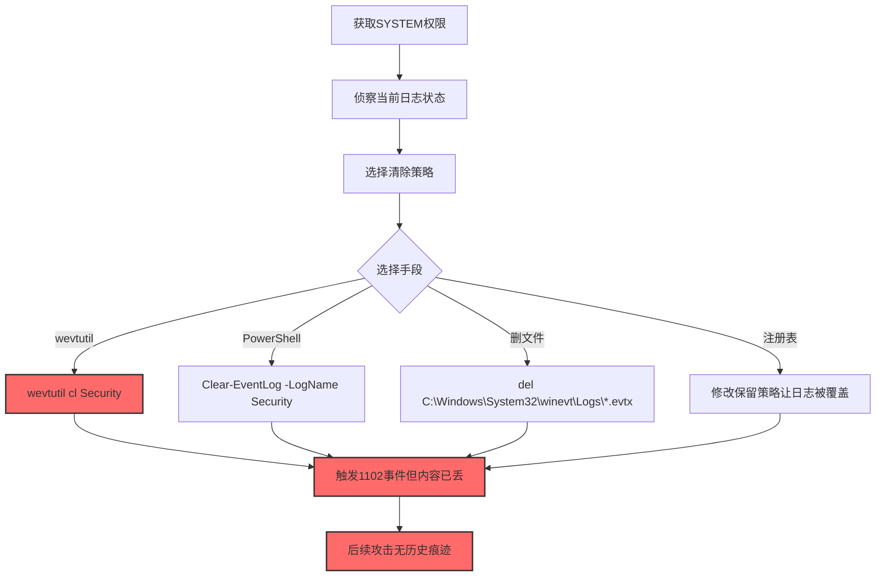
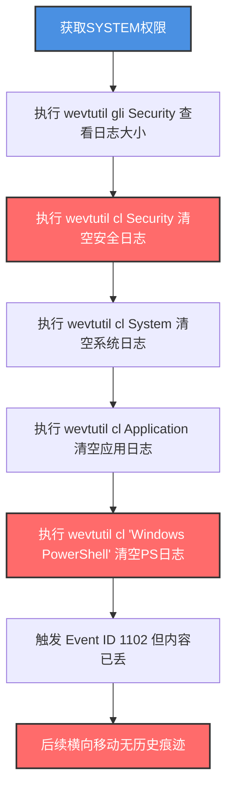

# 清除Windows事件日志 (T1685.005)

> 想象一下：你公司的财务室门口装了智能门禁，每次有人进出都会自动录像保存到监控中心的硬盘。有一天，小偷潜入财务室后做的第一件事不是偷东西，而是先跑到监控中心把所有录像带全部清空——这样即使事后被发现，警方也看不到他的作案过程。Windows 的事件日志（Event Log）就是这套"监控系统"，攻击者清除它，让你看不到入侵痕迹。

## 30秒速查卡

| 维度 | 你需要知道的 |
|------|-------------|
| 这是什么？ | 攻击者使用 wevtutil、PowerShell、COM 接口清空 Windows 安全日志、系统日志、应用日志、PowerShell 日志等，抹除入侵痕迹 |
| 为什么危险？ | Windows 服务器几乎全靠 Event Log 做取证，清除后攻击者可以横向移动、提权、窃取数据而不留痕迹 |
| 谁需要关心？ | Windows 系统管理员、SOC分析师、DFIR取证人员、合规审计员 |
| 你的第一步防御 | 监控 Event ID 1102（审计日志已被清除）和 wevtutil cl 命令执行 |
| 如果只做一件事 | 部署 SIEM 收集日志实时转发到独立服务器，本机清空不影响远程日志 |

## 难度等级

⭐ 简单 - wevtutil cl Security 一行命令即可，无需复杂技术

## 前置知识检查

**读这个文件需要什么？**

- [x] Windows 事件日志架构（System、Security、Application、PowerShell 等日志）
- [x] wevtutil 命令行工具
- [x] PowerShell 事件日志 cmdlet（Clear-EventLog、Limit-EventLog）
- [x] Windows 权限模型（Administrator / SYSTEM）
- [x] Event ID 1102 的含义

## 技术描述

**清除Windows事件日志**（T1685.005）是 **禁用或修改工具**（T1685）的一个具体子技术，属于 **防御削弱** 阶段。其前身为已撤销的 T1562.002（Clear Windows Event Logs）。

> 📚 **打个比方**：就像攻击者潜入监控中心，把所有录像带全部清空——监控设备还在，硬盘还能继续录像，但过去几小时甚至几天的录像都没了。蓝队事后查证时，只能看到"录像带被清空"这一个事件（如果攻击者忘了清这个的话）。

### 具体怎么理解？

Windows 事件日志系统由多个日志文件组成，存储在 `C:\Windows\System32\winevt\Logs\`：

1. **Security.evtx**：安全日志，记录登录、权限使用、对象访问等审计事件
2. **System.evtx**：系统日志，记录系统服务、驱动、硬件事件
3. **Application.evtx**：应用日志，记录应用程序事件
4. **Windows PowerShell.evtx**：PowerShell 脚本执行日志
5. **Microsoft-Windows-PowerShell/Operational.evtx**：PowerShell 操作日志（含脚本块日志）

攻击者可以使用多种方法清除这些日志：

1. **wevtutil**：`wevtutil cl Security`——原生命令行工具，最常用
2. **PowerShell**：`Clear-EventLog -LogName Security`、`Limit-EventLog -LogName Security -Clear`——PowerShell 原生 cmdlet
3. **COM 接口**：通过 COM 调用 EventLog.Clear() 方法——编程方式
4. **直接删文件**：删除 `C:\Windows\System32\winevt\Logs\*.evtx`——粗暴但有效（需停 EventLog 服务）
5. **修改注册表**：修改日志保留策略让旧事件被自动覆盖

### 为什么有效？

这种技术之所以有效，是因为：

1. **wevtutil 是原生工具**：不需要下载任何工具，wevtutil 是 Windows 自带的
2. **清除操作本身可能不被记录**：清安全日志时，"清除"事件本身可能也丢失（除非 SIEM 已转发）
3. **SYSTEM 权限即可**：清除 Security 日志需要 Administrator/SYSTEM 权限，但攻击者提权到 SYSTEM 不算难
4. **Event ID 1102 是"事后"信号**：1102 表示"审计日志已被清除"，但日志内容已经丢了
5. **多日志同时清更隐蔽**：同时清 Security、System、Application、PowerShell 日志，蓝队取证时发现多个日志为空

**过渡段：** 不要误以为"Event ID 1102 触发就代表日志还在"——1102 触发的瞬间日志已经被清空，蓝队看到 1102 时已经丢失了全部历史事件。

## 真实攻击流程

### 典型场景

攻击者在 **防御削弱** 阶段使用清除Windows事件日志技术，抹除横向移动和提权的痕迹：



**步骤详解：**

1. **获取SYSTEM权限** - wevtutil 清安全日志需要 SYSTEM 或 Administrator 权限
2. **侦察当前日志状态** - `wevtutil gli Security` 查看日志大小和事件数
3. **选择清除策略** - 决定是清单个日志还是全部清空
4. **执行清除** - 运行 wevtutil cl 或 Clear-EventLog
5. **触发1102事件** - 清安全日志会触发 Event ID 1102
6. **后续攻击** - 在无历史痕迹情况下进行提权、横向移动

## 攻击流程

### 典型攻击流程

获取SYSTEM权限 --> 侦察当前日志状态 --> 执行wevtutil cl Security清安全日志 --> 同步清System/Application/PowerShell日志 --> 触发Event ID 1102但内容已丢 --> 后续横向移动不留历史痕迹



**步骤详解：**

1. **获取SYSTEM权限** - 攻击者通过漏洞利用、令牌窃取、PsExec 等获得 SYSTEM 权限
   - 通俗描述：先拿到 Windows 最高权限
   - 技术细节：利用 Print Spooler 漏洞、Potato 系列提权（RoguePotato、JuicyPotato）、PsExec -s 以 SYSTEM 启动进程、或滥用服务账户的 SeImpersonatePrivilege
   - 常用工具：PsExec、Metasploit、JuicyPotato、PrintNightmare PoC

2. **侦察当前日志状态** - 攻击者查看各日志文件的事件数和大小
   - 通俗描述：看看每个日志现在有多大
   - 技术细节：执行 `wevtutil gli Security`、`wevtutil gli System`、`wevtutil gli Application` 查看日志文件大小（filesize）、创建时间（creationTime）、最后访问时间（lastAccessTime）、最后写入时间（lastWriteTime）、事件数（numberOfLogRecords）
   - 常用工具：wevtutil、Get-WinEvent、Event Viewer

3. **清空安全日志** - 攻击者使用 wevtutil cl Security 清空安全日志，抹除登录、权限使用、对象访问等审计事件
   - 通俗描述：把审计日志全清空
   - 技术细节：执行 `wevtutil cl Security`，安全日志被清空，会触发 Event ID 1102（审计日志已被清除）；如果 SIEM 已实时转发日志，远程仍保留历史
   - 常用工具：wevtutil、Clear-EventLog

4. **清空系统日志** - 攻击者同步清空系统日志，抹除服务启动、驱动加载、系统错误事件
   - 通俗描述：把系统日志也清了
   - 技术细节：执行 `wevtutil cl System`，系统日志被清空，服务安装（Event ID 7045）、服务启动失败等事件丢失
   - 常用工具：wevtutil

5. **清空应用日志** - 攻击者清空应用日志，抹除应用程序事件
   - 通俗描述：把应用日志也清了
   - 技术细节：执行 `wevtutil cl Application`，应用日志被清空
   - 常用工具：wevtutil

6. **清空PowerShell日志** - 攻击者清空 PowerShell 日志，抹除脚本执行和脚本块日志
   - 通俗描述：把 PowerShell 操作日志也清了
   - 技术细节：执行 `wevtutil cl "Windows PowerShell"` 清传统 PS 日志，执行 `wevtutil cl "Microsoft-Windows-PowerShell/Operational"` 清脚本块日志
   - 常用工具：wevtutil

7. **触发1102事件但内容已丢** - 清安全日志会触发 Event ID 1102，但日志内容已经丢失
   - 通俗描述：1102 是"清空"事件，触发时日志已经空了
   - 技术细节：Event ID 1102 会在 System 日志（不是 Security 日志）中记录，包含清除者账户、清除时间；如果攻击者忘了清 System 日志，1102 仍可见
   - 常用工具：Event Viewer、Get-WinEvent

8. **后续横向移动** - 在无历史痕迹情况下进行提权、横向移动、数据窃取
   - 通俗描述：日志空了，可以为所欲为
   - 技术细节：使用 WMI、PsExec、SMB 横向移动，使用 Mimikatz 抓取凭据，这些操作不会在本机日志中留下历史记录（但 SIEM 远程日志可能仍有记录）
   - 常用工具：Mimikatz、PsExec、Impacket、Cobalt Strike

## 真实案例

### 案例1：APT29 清除事件日志隐藏横向移动

- **时间**: 多次（2020 SolarWinds 事件、2016 美国大选等）
- **目标**: 政府机构、智库、IT 公司
- **攻击组织**: APT29（Cozy Bear，疑似俄罗斯 SVR）
- **手法**: APT29 在 SolarWinds 供应链攻击的横向移动阶段，会执行 `wevtutil cl Security`、`wevtutil cl System`、`wevtutil cl Application` 清空三大日志，并清空 `Microsoft-Windows-PowerShell/Operational` 抹除 PowerShell 脚本块日志。还会清空 `Microsoft-Windows-TerminalServices-LocalSessionManager/Operational` 抹除 RDP 登录记录。在 2020 年 SolarWinds 事件中，APT29 还使用了更隐蔽的手法：通过修改注册表 `HKLM\SOFTWARE\Policies\Microsoft\Windows\EventLog\Security` 的 `Retention` 和 `MaxSize` 让日志快速被覆盖，而非直接清空。
- **影响**: 全球多个政府机构和 IT 公司被入侵，取证困难
- **参考链接**: [CISA SolarWinds 检测](https://www.cisa.gov/news-events/cybersecurity-advisories/aa21-074a)

### 案例2：Conti 勒索软件清日志后加密

- **时间**: 2021-2022年
- **目标**: 医院、制造企业、关键基础设施
- **攻击组织**: Conti（勒索软件即服务，疑似俄罗斯）
- **手法**: Conti 在勒索软件部署前会执行"日志清理脚本"，使用 `wevtutil cl Security`、`wevtutil cl System`、`wevtutil cl Application` 清空 Windows 日志；同时清理 PowerShell 历史记录（`Clear-History`、删除 `(Get-PSReadlineOption).HistorySavePath`）、RDP 登录记录（`wevtutil cl "Microsoft-Windows-TerminalServices-LocalSessionManager/Operational"`）；并清理 SMB 共享日志、Sysmon 日志（如已部署）。Conti 还会执行 `vssadmin delete shadows` 删除卷影副本，防止日志从快照恢复。
- **影响**: 全球数百家机构被勒索，损失数十亿美元
- **参考链接**: [CISA Conti 分析](https://www.cisa.gov/news-events/cybersecurity-advisories/aa21-265a)

### 案例3：Sandworm 破坏性攻击前清日志

- **时间**: 2017 NotPetya、2022 Ukraine 攻击
- **目标**: 乌克兰关键基础设施、全球企业
- **攻击组织**: Sandworm（疑似俄罗斯 GRU）
- **手法**: Sandworm 在 NotPetya 破坏性攻击前会清空事件日志，使用 `wevtutil cl Security /System /Application` 一次性清空多个日志；同时清理 WBEM 日志（`C:\Windows\System32\winevt\Logs\Microsoft-Windows-WMI-Activity/Operational.evtx`）抹除 WMI 操作记录；并通过 `wmic shadowcopy delete` 删除卷影副本。在 2022 年乌克兰攻击中，Sandworm 还使用了 WhisperGate 破坏性恶意软件，在清日志后伪造启动扇区损坏，让蓝队误以为是硬件故障。
- **影响**: NotPetya 造成全球 100 亿美元损失
- **参考链接**: [Mandiant NotPetya 分析](https://www.mandiant.com/resources/blog/notpetya-technical-analysis)

## 红队视角

> ⚠️ **免责声明**：以下内容仅用于合法的安全测试、渗透测试和教育目的。未经授权对他人系统进行测试是违法行为。

### 实战技巧

1. **优先 wevtutil 而非删文件**：删 .evtx 文件需停 EventLog 服务，更显眼
2. **同步清多个日志**：清 Security、System、Application、PowerShell、Sysmon（如已部署）
3. **注意 Event ID 1102**：清 Security 会触发 1102，如果忘了清 System 日志，1102 仍可见
4. **绕过 SIEM 转发**：如果目标已部署 SIEM 实时转发，本机清空无效，需先断网或停转发代理
5. **清理 PowerShell 历史**：清 `(Get-PSReadlineOption).HistorySavePath` 文件
6. **清理 RDP 日志**：清 `Microsoft-Windows-TerminalServices-LocalSessionManager/Operational`
7. **清理 WBEM 日志**：清 `Microsoft-Windows-WMI-Activity/Operational` 抹除 WMI 记录
8. **删除卷影副本**：`vssadmin delete shadows /all` 防止日志从快照恢复

### 常用工具

| 工具名称 | 用途 | 平台 | 链接 |
| -------- | ---- | ---- | ---- |
| wevtutil | 清空事件日志 | Windows | 系统自带 |
| Clear-EventLog | PowerShell清日志 | Windows | PowerShell自带 |
| Limit-EventLog | PowerShell清日志 | Windows | PowerShell自带 |
| vssadmin | 删除卷影副本 | Windows | 系统自带 |
| Atomic Red Team | 检测规则测试 | Windows | [Atomic T1562.002](https://github.com/redcanaryco/atomic-red-team/blob/master/atomics/T1562.002/T1562.002.yaml) |
| Invoke-Phant0m | 停止EventLog线程 | Windows | [GitHub](https://github.com/hlldz/Invoke-Phant0m) |

### 注意事项

- wevtutil cl Security 必须以 Administrator/SYSTEM 权限运行
- 如果目标已部署 Sysmon，需同步清 `Microsoft-Windows-Sysmon/Operational` 日志
- 如果目标已部署 SIEM 转发，本机清空无效，需先停转发代理
- Event ID 1102 是 System 日志中的事件，清 System 日志前 1102 会被记录，清 System 后 1102 丢失
- 删除 .evtx 文件需先停 EventLog 服务，否则文件被占用

## 蓝队视角

### 检测要点

1. **Event ID 1102**：清安全日志会触发 1102，但内容已丢
2. **wevtutil cl 命令监控**：监控命令行中 wevtutil cl 执行
3. **Clear-EventLog 监控**：监控 PowerShell 的 Clear-EventLog 和 Limit-EventLog cmdlet
4. **日志大小突降**：监控日志文件大小突然归零
5. **EventLog 服务异常停止**：监控 EventLog 服务异常停止
6. **独立通道对比**：SIEM 心跳直连独立收集器，对比本机事件率

### 监控建议

- 部署 SIEM 实时转发日志：使用 Windows Event Forwarding（WEF）或 Winlogbeat 把日志实时转发到独立服务器
- 监控 Event ID 1102：在 SIEM 中告警 1102 事件
- 监控 wevtutil 命令：通过 Sysmon Event ID 1（进程创建）监控 wevtutil cl 命令行
- 监控 PowerShell 脚本块日志：启用 `Microsoft-Windows-PowerShell/Operational` 的 ScriptBlock Logging
- 部署 Sysmon：记录进程创建、文件操作等事件
- 启用 Windows Audit Policy：审计"审计策略更改"成功/失败
- 定期备份日志：通过 WEC 把日志归档到不可变存储

## 避坑指南

| 坑 | 后果 | 解决方法 |
|----|------|----------|
| 只依赖本机日志 | 攻击者 wevtutil cl 后丢失 | 部署 SIEM 实时转发 |
| 忽略 System 日志中的 1102 | 错过关键信号 | 1102 在 System 日志中，不是 Security |
| 忽略 PowerShell 日志 | 攻击者清 PS 日志后丢失脚本块 | 部署 SIEM 转发所有日志 |
| 卷影副本未保护 | 攻击者 vssadmin 删除后无法恢复 | 卷影副本独立备份 |
| 仅监控 wevtutil | 攻击者用 Clear-EventLog 绕过 | 监控多个清日志命令 |

## 检测建议

### 检测思路

检测清除Windows事件日志的关键是识别"wevtutil cl 命令执行"、"Clear-EventLog cmdlet"、"Event ID 1102 触发"和"日志大小突降"四类异常。以下是三个层面的检测方法：

### 网络层检测

**方法**：监控日志转发通道是否中断

```powershell
# 监控 WEF（Windows Event Forwarding）转发事件率
# 如果某主机的事件率突然下降 90%+，告警
# 在 WEF 收集服务器执行：
Get-WinEvent -LogName ForwardedEvents | Group-Object -Property ComputerName | 
    Sort-Object Count | Select-Object -First 10

# 监控 Winlogbeat 心跳
# 如果某主机的 Winlogbeat 心跳中断，告警
```

### 主机层检测

**Windows安全事件**：

```powershell
# 监控 Event ID 1102（审计日志已被清除）
Get-WinEvent -FilterHashtable @{LogName='System'; Id=1102} -MaxEvents 10

# 监控 wevtutil cl 命令执行（需启用进程创建审计）
Get-WinEvent -FilterHashtable @{LogName='Security'; Id=4688} -MaxEvents 1000 |
    Where-Object {$_.Message -match 'wevtutil.*cl'}
```

**Sysmon事件**：

```powershell
# 监控 Sysmon Event ID 1（进程创建）中的 wevtutil cl
Get-WinEvent -FilterHashtable @{LogName='Microsoft-Windows-Sysmon/Operational'; Id=1} -MaxEvents 1000 |
    Where-Object {$_.Message -match 'wevtutil.*cl|Clear-EventLog|Limit-EventLog'}
```

### 应用层检测

**用人话说：** 攻击者用 wevtutil cl Security 清安全日志、用 Clear-EventLog 清日志、用 vssadmin 删卷影副本——这些命令执行、Event ID 1102 触发、日志大小突降就是最直接的信号。

**Sigma规则示例**：

```yaml
title: 检测Windows安全日志被清除
status: experimental
description: 检测wevtutil cl Security清空安全日志的操作
author: SOC Team
logsource:
    product: windows
    service: security
detection:
    selection_cmd:
        EventID: 4688
        CommandLine|contains|all:
            - 'wevtutil'
            - 'cl'
    selection_target:
        CommandLine|contains:
            - 'Security'
            - 'System'
            - 'Application'
            - 'Windows PowerShell'
            - 'Microsoft-Windows-PowerShell/Operational'
            - 'Microsoft-Windows-Sysmon/Operational'
    condition: selection_cmd and selection_target
level: critical
falsepositives:
    - 合规基线检查工具清空日志（需审批流程）
tags:
    - attack.defense_evasion
    - attack.t1685
    - attack.t1685.005
    - attack.t1562.002
```

```yaml
title: 检测Event ID 1102审计日志已被清除
status: experimental
description: 检测Event ID 1102触发，表示安全日志已被清空
logsource:
    product: windows
    service: system
detection:
    selection:
        EventID: 1102
    condition: selection
level: critical
falsepositives:
    - 合规基线检查工具清空日志（需审批流程）
tags:
    - attack.defense_evasion
    - attack.t1685.005
    - attack.t1562.002
```

```yaml
title: 检测PowerShell清日志命令
status: experimental
description: 检测Clear-EventLog和Limit-EventLog清空事件日志
logsource:
    product: windows
    service: powershell
detection:
    selection:
        EventID: 4104
        ScriptBlockText|contains:
            - 'Clear-EventLog'
            - 'Limit-EventLog'
            - '-Clear'
    condition: selection
level: critical
falsepositives:
    - 合规基线检查脚本
tags:
    - attack.defense_evasion
    - attack.t1685.005
    - attack.t1562.002
```

## 缓解措施

### 优先级1：关键措施

**部署 SIEM 实时转发**：使用 Windows Event Forwarding（WEF）或 Winlogbeat 把日志实时转发到独立服务器，本机清空不影响远程日志

```powershell
# 配置 WEF 订阅（在收集服务器执行）
$subscription = @{
    Name = "SecurityEvents"
    Channel = "Security"
    Query = "<QueryList><Query Path='Security'>*</Query></QueryList>"
    DeliveryMode = "Push"
}
wecutil create-subscription $subscription

# 或部署 Winlogbeat
# winlogbeat.yml 配置转发所有事件日志
```

### 优先级2：重要措施

**部署 Sysmon**：记录进程创建、文件操作等事件，作为 Event Log 的补充

```xml
<!-- Sysmon 配置示例 -->
<Sysmon schemaversion="4.82">
  <EventFiltering>
    <ProcessCreate onmatch="include">
      <!-- 监控 wevtutil cl 命令 -->
      <CommandLine condition="contains">wevtutil cl</CommandLine>
      <!-- 监控 Clear-EventLog -->
      <CommandLine condition="contains">Clear-EventLog</CommandLine>
    </ProcessCreate>
  </EventFiltering>
</Sysmon>
```

**启用 PowerShell 脚本块日志**：在 GPO 中启用 `Microsoft-Windows-PowerShell/Operational` 的 ScriptBlock Logging

### 优先级3：建议措施

**保护卷影副本**：限制 vssadmin 权限，定期独立备份

**审计"审计策略更改"**：在 Audit Policy 中启用"审计策略更改"成功/失败

**部署 EDR 代理**：CrowdStrike、Defender for Endpoint 等 EDR 心跳直连独立服务器

## 动手实验

> ⚠️ **所有实验必须在隔离的实验室环境中进行**

### 实验1：观察 wevtutil cl Security 的效果

**目标**：理解 wevtutil cl 清空安全日志的效果

**步骤**：
```powershell
# 1. 查看当前 Security 日志事件数
wevtutil gli Security

# 2. 触发测试事件（登录失败会记录到 Security 日志）
# 在另一台机器尝试错误密码登录本机
# 或运行 net use \\localhost\c$ /user:fakeuser fakepass

# 3. 查看是否生成 Event ID 4625（登录失败）
Get-WinEvent -FilterHashtable @{LogName='Security'; Id=4625} -MaxEvents 5

# 4. 清空安全日志
wevtutil cl Security

# 5. 验证日志已被清空
Get-WinEvent -LogName Security -MaxEvents 10
# 应返回"未找到事件"

# 6. 检查 System 日志中的 Event ID 1102
Get-WinEvent -FilterHashtable @{LogName='System'; Id=1102} -MaxEvents 5
# 应看到刚才的清除事件

# 7. 查看日志文件大小变化
wevtutil gli Security
# filesize 应明显减小
```

**学习要点**：理解 wevtutil cl Security 清空日志的效果，以及 Event ID 1102 触发位置

### 实验2：测试 PowerShell Clear-EventLog

**目标**：理解 PowerShell cmdlet 清空日志的效果

**步骤**：
```powershell
# 1. 查看当前 Application 日志事件数
(Get-EventLog -LogName Application).Count

# 2. 使用 Clear-EventLog 清空 Application 日志
Clear-EventLog -LogName Application

# 3. 验证日志已被清空
(Get-EventLog -LogName Application).Count
# 应为 0

# 4. 查看 System 日志是否记录清除事件
Get-WinEvent -FilterHashtable @{LogName='System'; Id=104} -MaxEvents 5
# Event ID 104 表示"事件日志已被清除"，记录清除者账户

# 5. 使用 Limit-EventLog 清空 System 日志
Limit-EventLog -LogName System -Clear

# 6. 验证日志已被清空
Get-WinEvent -LogName System -MaxEvents 10
```

**学习要点**：理解 PowerShell Clear-EventLog 和 Limit-EventLog 清空日志的效果，以及 Event ID 104 触发位置

## 术语解释

| 术语 | 通俗解释 |
|------|---------|
| **Event Log** | Windows 事件日志系统，记录系统、安全、应用等事件 |
| **wevtutil** | Windows 原生命令行工具，用于查询、清空事件日志 |
| **Clear-EventLog** | PowerShell cmdlet，清空事件日志 |
| **Limit-EventLog** | PowerShell cmdlet，限制事件日志大小或清空 |
| **Event ID 1102** | System 日志中的事件，表示"审计日志已被清除" |
| **Event ID 104** | System 日志中的事件，表示"事件日志已被清除" |
| **WEF** | Windows Event Forwarding，Windows 原生日志转发 |
| **Winlogbeat** | Elastic 的 Windows 日志采集代理 |
| **Sysmon** | Sysinternals 的系统监控工具 |
| **WMI** | Windows Management Instrumentation，Windows 管理规范 |

## 被引用情况

以下父技术文档引用了本子技术：

- [T1685 - 禁用或修改工具](../T1685-Disable-or-Modify-Tools.md)

## 参考资料

### 官方文档

- [MITRE ATT&CK - 清除Windows事件日志 (T1685.005)](https://attack.mitre.org/techniques/T1685/005/)
- [MITRE ATT&CK - 禁用或修改工具 (T1685)](https://attack.mitre.org/techniques/T1685/)
- [wevtutil 命令参考](https://learn.microsoft.com/en-us/windows-server/administration/windows-commands/wevtutil)
- [Clear-EventLog 文档](https://learn.microsoft.com/en-us/powershell/module/microsoft.powershell.management/clear-eventlog)

### 安全报告

- [CISA SolarWinds 检测](https://www.cisa.gov/news-events/cybersecurity-advisories/aa21-074a) - APT29 清日志
- [CISA Conti 分析](https://www.cisa.gov/news-events/cybersecurity-advisories/aa21-265a) - Conti 清日志后加密
- [Mandiant NotPetya 分析](https://www.mandiant.com/resources/blog/notpetya-technical-analysis) - Sandworm 破坏性攻击前清日志

### 工具与资源

- [Atomic Red Team T1562.002](https://github.com/redcanaryco/atomic-red-team/blob/master/atomics/T1562.002/T1562.002.yaml) - 检测规则测试
- [Invoke-Phant0m](https://github.com/hlldz/Invoke-Phant0m) - 停止 EventLog 线程
- [Sysmon](https://learn.microsoft.com/en-us/sysinternals/downloads/sysmon) - 系统监控工具

### 学习资料

- [Windows Event Forwarding 部署指南](https://learn.microsoft.com/en-us/windows/security/threat-protection/use-windows-event-forwarding-to-assist-in-intrusion-detection) - WEF 部署
- [Sigma 规则仓库](https://github.com/SigmaHQ/sigma) - 检测规则库
