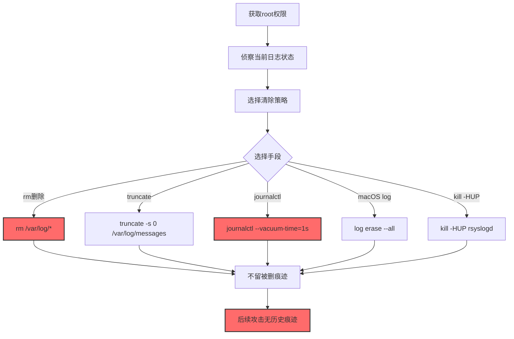
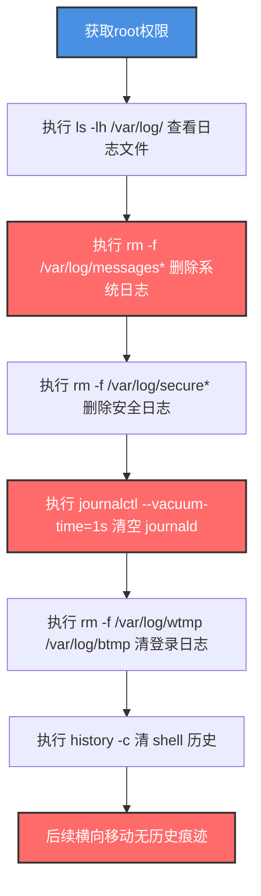

# 清除Linux或Mac系统日志 (T1685.006)

> 想象一下：你公司的财务室门口装了智能门禁，每次有人进出都会自动录像保存到监控中心的硬盘。有一天，小偷潜入财务室后做的第一件事不是偷东西，而是先跑到监控中心把所有录像带全部清空——这样即使事后被发现，警方也看不到他的作案过程。Linux 和 macOS 的系统日志（/var/log/、journalctl）就是这套"监控系统"，攻击者清除它，让你看不到入侵痕迹。

## 30秒速查卡

| 维度 | 你需要知道的 |
|------|-------------|
| 这是什么？ | 攻击者使用 rm、truncate、journalctl --vacuum、log 命令清空 /var/log/ 下的系统日志、journald 日志、macOS unified log，抹除入侵痕迹 |
| 为什么危险？ | Linux/macOS 服务器几乎全靠 /var/log/ 和 journald 做取证，清除后攻击者可以横向移动、提权、窃取数据而不留痕迹 |
| 谁需要关心？ | Linux/macOS 系统管理员、SOC分析师、DFIR取证人员、合规审计员 |
| 你的第一步防御 | 监控 rm /var/log/* 命令和 journalctl --vacuum-time 命令执行，部署独立日志服务器实时转发 |
| 如果只做一件事 | 通过 rsyslog 把日志实时转发到独立服务器，本机清空不影响远程日志 |

## 难度等级

⭐ 简单 - rm /var/log/* 或 journalctl --vacuum-time=1s 一行命令即可，无需复杂技术

## 前置知识检查

**读这个文件需要什么？**

- [x] Linux 系统日志架构（/var/log/、journald、rsyslog）
- [x] macOS 系统日志架构（unified log、/var/log/）
- [x] journalctl 命令和 journald 日志管理
- [x] log 命令（macOS）和 log erase 命令
- [x] logrotate 日志轮转机制

## 技术描述

**清除Linux或Mac系统日志**（T1685.006）是 **禁用或修改工具**（T1685）的一个具体子技术，属于 **防御削弱** 阶段。其前身为已撤销的 T1562.003（Impair Defenses）的相关行为。

> 📚 **打个比方**：就像攻击者潜入监控中心，把所有录像带全部清空——监控设备还在，硬盘还能继续录像，但过去几小时甚至几天的录像都没了。蓝队事后查证时，连"录像带被清空"这个事件都看不到（因为日志系统本身被清了）。

### 具体怎么理解？

Linux 和 macOS 的系统日志主要由以下几部分组成：

1. **/var/log/**：传统日志目录，包含 messages、secure、auth.log、cron、maillog 等
2. **journald**（Linux systemd）：二进制日志，存储在 /var/log/journal/（持久化）或 /run/log/journal/（易失性）
3. **macOS unified log**：macOS 10.12+ 的统一日志系统，通过 log 命令查询
4. **/var/log/audit/audit.log**（Linux auditd）：审计日志，详见 T1685.004

攻击者可以使用多种方法清除这些日志：

1. **rm 删除文件**：`rm /var/log/*` 或 `rm /var/log/messages*`——最直接
2. **truncate 截断**：`truncate -s 0 /var/log/messages`——清空内容但保留文件
3. **> 重定向**：`> /var/log/messages`——shell 重定向清空文件
4. **journalctl --vacuum**：`journalctl --vacuum-time=1s`——清空所有 journald 日志
5. **rm journald 文件**：`rm /var/log/journal/*/*`——直接删除 journald 持久化日志
6. **log erase**（macOS）：`sudo log erase --all`——清空 macOS unified log
7. **kill -HUP rsyslogd**：让 rsyslog 重启并轮转日志，旧日志被覆盖
8. **修改 logrotate**：修改 /etc/logrotate.d/ 让日志轮转后立即删除

### 为什么有效？

这种技术之所以有效，是因为：

1. **rm 是原生工具**：不需要下载任何工具，rm 是 Linux/macOS 自带的
2. **清除操作不留"被改"痕迹**：rm 删除日志后，连"日志被删"事件都看不到
3. **root 权限即可**：清除 /var/log/ 需要 root 权限，但攻击者提权到 root 不算难
4. **journald 易失性日志**：如果 journald 配置为 /run/log/journal/（易失性），重启后日志全部丢失
5. **macOS unified log 难以取证**：macOS unified log 是二进制格式，erase 后无法恢复

**过渡段：** 不要误以为"日志文件还在就代表日志没被清"——攻击者可能用 truncate -s 0 清空了内容但保留文件名，蓝队看到文件存在但大小为 0。

## 真实攻击流程

### 典型场景

攻击者在 **防御削弱** 阶段使用清除Linux或Mac系统日志技术，抹除横向移动和提权的痕迹：



**步骤详解：**

1. **获取root权限** - 清除 /var/log/ 需要 root 权限
2. **侦察当前日志状态** - `ls -lh /var/log/` 查看日志文件大小
3. **选择清除策略** - 决定是 rm 删除、truncate 截断还是 journalctl 清空
4. **执行清除** - 运行 rm 或 truncate 或 journalctl --vacuum
5. **不留被删痕迹** - rm/truncate/journalctl 清除后连"日志被删"事件都看不到
6. **后续攻击** - 在无历史痕迹情况下进行提权、横向移动、数据窃取

## 攻击流程

### 典型攻击流程

获取root权限 --> 侦察当前日志状态 --> 执行 rm /var/log/* 删除传统日志 --> 执行 journalctl --vacuum-time=1s 清空 journald --> 清理 .bash_history 和 wtmp --> 后续横向移动不留历史痕迹



**步骤详解：**

1. **获取root权限** - 攻击者通过内核提权漏洞、SUID 滥用、或窃取的 root 凭据获得 root 权限
   - 通俗描述：先拿到 Linux/macOS 最高权限
   - 技术细节：利用 CVE-2022-0847（DirtyPipe）、CVE-2021-4034（PwnKit/pkexec）、滥用 SUID 的 find/nmap/perl，或通过 SSH 密钥窃取获取 root
   - 常用工具：LinPEAS、linux-exploit-suggester、DirtyPipe PoC、Metasploit

2. **侦察当前日志状态** - 攻击者查看 /var/log/ 下各日志文件大小和数量
   - 通俗描述：看看每个日志现在有多大
   - 技术细节：执行 `ls -lh /var/log/`、`journalctl --disk-usage` 查看 journald 占用空间、`wc -l /var/log/messages` 查看行数；macOS 上执行 `log show --predicate 'eventMessage contains "login"' --last 1d` 查看登录事件
   - 常用工具：ls、journalctl、wc、log（macOS）

3. **删除系统日志** - 攻击者使用 rm 删除 /var/log/messages*、/var/log/secure* 等系统日志文件
   - 通俗描述：把系统日志文件全删了
   - 技术细节：执行 `rm -f /var/log/messages*`、`rm -f /var/log/secure*`、`rm -f /var/log/cron*`、`rm -f /var/log/maillog*`；注意 /var/log/messages 在 RHEL 系存在，/var/log/syslog 和 /var/log/auth.log 在 Debian 系存在
   - 常用工具：rm

4. **删除安全日志** - 攻击者删除 /var/log/secure（RHEL）或 /var/log/auth.log（Debian）记录的登录、sudo、su 事件
   - 通俗描述：把登录日志也删了
   - 技术细节：执行 `rm -f /var/log/secure*`（RHEL/CentOS）或 `rm -f /var/log/auth.log*`（Debian/Ubuntu），抹除 SSH 登录、sudo 提权、su 切换等审计事件
   - 常用工具：rm

5. **清空 journald** - 攻击者使用 journalctl --vacuum-time=1s 清空所有 journald 日志
   - 通俗描述：把 systemd 日志全清了
   - 技术细节：执行 `journalctl --vacuum-time=1s` 删除所有早于 1 秒的日志条目，等效于清空；或执行 `rm -rf /var/log/journal/*/*` 直接删除持久化日志文件；或 `systemctl kill --signal=SIGUSR2 systemd-journald` 触发日志轮转后删除旧文件
   - 常用工具：journalctl、rm、systemctl

6. **清登录日志** - 攻击者清除 /var/log/wtmp、/var/log/btmp、/var/log/lastlog 等登录记录文件
   - 通俗描述：把"谁登录过"的记录也清了
   - 技术细节：执行 `rm -f /var/log/wtmp /var/log/btmp /var/log/lastlog`，或 `> /var/log/wtmp` 清空内容但保留文件；wtmp 记录成功登录，btmp 记录失败登录，lastlog 记录最后登录时间
   - 常用工具：rm、shell 重定向

7. **清 shell 历史** - 攻击者清理 .bash_history、.zsh_history 等 shell 历史记录
   - 通俗描述：把命令历史也清了
   - 技术细节：执行 `history -c && history -w`、`rm -f ~/.bash_history`、`rm -f ~/.zsh_history`；并设置 `unset HISTFILE HISTSIZE HISTFILESIZE` 让后续命令不被记录；或启动 shell 时加 `HISTFILE=/dev/null`
   - 常用工具：history、rm、unset

8. **后续横向移动** - 在无历史痕迹情况下进行提权、横向移动、数据窃取
   - 通俗描述：日志清了，可以为所欲为
   - 技术细节：使用 SSH 横向移动、利用 CVE 提权、从 /etc/shadow 提取密码哈希、通过 cron 设置持久化，这些操作不会在 /var/log/ 中留下痕迹
   - 常用工具：ssh、Metasploit、LinPEAS、Impacket

## 真实案例

### 案例1：Rocke 僵尸网络清日志隐藏挖矿

- **时间**: 2018-2019年
- **目标**: Linux 服务器、云实例
- **攻击组织**: Rocke（加密货币挖矿组织，疑似中文背景）
- **手法**: Rocke 在入侵 Linux 服务器后会执行"清理脚本"：`rm -f /var/log/messages*`、`rm -f /var/log/secure*`、`rm -f /var/log/wtmp`、`rm -f /var/log/btmp`、`rm -f /var/log/lastlog`、`rm -f /var/log/audit/audit.log*`、`history -c`、`rm -f ~/.bash_history`；同时执行 `journalctl --vacuum-time=1s` 清空 journald 日志；并修改 /etc/logrotate.d/syslog 让日志轮转后立即删除。脚本还会清理 /var/log/cron*、/var/log/maillog* 等其他系统日志。
- **影响**: 全球数千台 Linux 服务器被感染挖矿
- **参考链接**: [Talos Rocke分析](https://blog.talosintelligence.com/2018/08/rocke-champion-of-unauthorized-cryptominers.html)

### 案例2：TeamTNT 清云Linux实例日志

- **时间**: 2021-2023年
- **目标**: AWS、Azure、GCP 上的 Linux 实例
- **攻击组织**: TeamTNT（加密货币挖矿组织）
- **手法**: TeamTNT 在入侵云 Linux 实例后，会执行"清理脚本"：`rm -f /var/log/syslog*`、`rm -f /var/log/auth.log*`、`rm -f /var/log/kern.log*`、`rm -f /var/log/wtmp`、`rm -f /var/log/btmp`、`rm -f ~/.bash_history`、`history -c`；同时执行 `journalctl --vacuum-time=1s` 清空 journald；并清理 Docker 容器日志 `rm -f /var/lib/docker/containers/*/*-json.log`；清理 Kubernetes 日志 `rm -f /var/log/containers/*`、`rm -f /var/log/pods/*`；并执行 `unset HISTFILE HISTSIZE HISTFILESIZE` 让后续命令不被记录。
- **影响**: 全球数千台云实例被感染
- **参考链接**: [Trend Micro TeamTNT分析](https://www.trendmicro.com/en_us/research/21/i/teamtnt-now-deploys-crypto-mining-worms-to-mass-infect-dock.html)

### 案例3：XCSSET 攻击 macOS 清 unified log

- **时间**: 2020-2021年
- **目标**: macOS 用户（通过恶意 Xcode 项目传播）
- **攻击组织**: XCSSET（macOS 恶意软件运营者）
- **手法**: XCSSET 在感染 macOS 后会执行 `sudo log erase --all` 清空 macOS unified log，抹除系统活动记录；同时清理 /var/log/install.log（软件安装日志）、/var/log/system.log（系统日志）、~/Library/Logs/（用户日志）；并清理 Safari 历史记录、Downloads 文件夹、 quarantine 属性（xattr -d com.apple.quarantine）；通过 `defaults delete com.apple.recentitems` 清理最近打开文件记录。XCSSET 还会通过 `kill -HUP syslogd` 让 syslog 重启并轮转日志，旧日志被覆盖。
- **影响**: 影响 macOS 开发者社区
- **参考链接**: [Trend Micro XCSSET分析](https://www.trendmicro.com/en_us/research/20/i/xcsset-mac-malware-infects-xcode-projects.html)

## 红队视角

> ⚠️ **免责声明**：以下内容仅用于合法的安全测试、渗透测试和教育目的。未经授权对他人系统进行测试是违法行为。

### 实战技巧

1. **优先 truncate 而非 rm**：truncate -s 0 保留文件名但清空内容，蓝队看到文件存在但内容为空，更隐蔽
2. **journalctl --vacuum-time 比 rm 更优雅**：journalctl 是 systemd 原生工具，清空日志更"合规"
3. **同步清理 wtmp/btmp/lastlog**：登录记录在 wtmp 中，需同步清理
4. **清理 shell 历史**：`history -c && history -w`、`rm ~/.bash_history`、`unset HISTFILE`
5. **检查第三方 EDR**：Wazuh、OSSEC、Falco 等代理需单独停用或绕过
6. **macOS 用 log erase --all**：清空 unified log 比 rm /var/log/* 更彻底
7. **绕过 SIEM 转发**：如果目标已部署 SIEM 实时转发，本机清空无效，需先断网或停转发代理
8. **清理 Docker/K8s 日志**：`rm -f /var/lib/docker/containers/*/*-json.log`、`rm -f /var/log/containers/*`

### 常用工具

| 工具名称 | 用途 | 平台 | 链接 |
| -------- | ---- | ---- | ---- |
| rm | 删除日志文件 | Linux/macOS | 系统自带 |
| truncate | 截断日志文件 | Linux | 系统自带 |
| journalctl | 清空 journald | Linux | systemd自带 |
| log | 清空 macOS unified log | macOS | 系统自带 |
| history -c | 清 shell 历史 | Linux/macOS | shell自带 |
| Atomic Red Team | 检测规则测试 | Linux | [Atomic T1562.003](https://github.com/redcanaryco/atomic-red-team/blob/master/atomics/T1562.003/T1562.003.yaml) |

### 注意事项

- rm /var/log/* 可能导致 rsyslog 报错，需 touch 重建文件并 chmod 640
- journalctl --vacuum-time=1s 需要 root 权限
- macOS unified log 是二进制格式，erase 后无法恢复
- 如果目标已部署 SIEM 转发，本机清空无效，需先停转发代理
- /var/log/wtmp 是二进制文件，需用 last 命令查询，rm 后 last 显示无记录
- SELinux/AppArmor 可能限制对 /var/log/ 的操作

## 蓝队视角

### 检测要点

1. **rm 命令监控**：监控 rm 命令对 /var/log/ 的操作
2. **truncate 命令监控**：监控 truncate -s 0 /var/log/* 命令
3. **journalctl --vacuum 监控**：监控 journalctl --vacuum-time 和 --vacuum-size 命令
4. **log erase 监控**（macOS）：监控 log erase --all 命令
5. **文件大小突降**：监控 /var/log/ 文件大小突然归零
6. **独立通道对比**：EDR 心跳直连独立收集器，对比本机事件率

### 监控建议

- 部署独立日志服务器：通过 rsyslog 把 /var/log/ 实时转发到独立服务器
- 监控 rm 命令：通过 auditd 规则监控 rm 对 /var/log/ 的操作
- 监控 journalctl --vacuum：通过 auditd 规则监控 journalctl 命令
- 监控文件大小：通过 file integrity monitoring（FIM）监控 /var/log/ 文件大小变化
- 部署 Falco：作为 auditd 的补充，监控容器内异常行为
- 部署 Wazuh/OSSEC：EDR 心跳直连独立服务器
- macOS 启用 endpoint security framework：监控 log erase 命令

## 避坑指南

| 坑 | 后果 | 解决方法 |
|----|------|----------|
| 只依赖本机日志 | 攻击者 rm /var/log/* 后丢失 | 部署独立日志服务器实时转发 |
| 忽略 journald 日志 | 攻击者 journalctl --vacuum 后丢失 | 同步监控 journald |
| 忽略 wtmp/btmp | 攻击者 rm wtmp 后丢失登录记录 | 同步监控 wtmp/btmp/lastlog |
| 忽略 shell 历史 | 攻击者 history -c 后丢失命令记录 | 启用 bash audit 日志 |
| 仅监控 rm | 攻击者用 truncate 绕过 | 监控多个清日志命令 |
| 忽略 Docker/K8s 日志 | 攻击者清容器日志后丢失 | 监控 /var/lib/docker/containers/ |

## 检测建议

### 检测思路

检测清除Linux或Mac系统日志的关键是识别"rm 对 /var/log/ 的操作"、"truncate -s 0 命令"、"journalctl --vacuum 命令"和"log erase 命令"四类异常。以下是三个层面的检测方法：

### 网络层检测

**方法**：监控日志转发通道是否中断

```bash
# 监控 rsyslog 与独立日志服务器的心跳
# 如果某主机的 syslog 事件率突然下降 90%+，告警
# 可通过独立日志服务器的"日志缺失检测"实现

# 监控 EDR 代理心跳
# 如果 EDR 心跳中断，告警（可能是攻击者停用 EDR）
```

### 主机层检测

**Linux审计事件**：

```bash
# 监控 rm 命令对 /var/log/ 的操作（需 auditd 规则）
auditctl -w /var/log/ -p wa -k log_dir_access
auditctl -w /var/log/wtmp -p wa -k wtmp_access
auditctl -w /var/log/btmp -p wa -k btmp_access
auditctl -w /usr/bin/journalctl -p x -k journalctl_execution
auditctl -w /usr/bin/truncate -p x -k truncate_execution

# 查询相关事件
ausearch -k log_dir_access -ts recent
ausearch -k journalctl_execution -ts recent
```

**systemd日志**：

```bash
# 监控 journald 服务状态变更
journalctl -u systemd-journald -n 100

# 监控 rsyslog 服务状态变更
journalctl -u rsyslog -n 100
```

**macOS unified log**：

```bash
# 监控 log erase 命令（需 endpoint security framework）
log show --predicate 'process == "log" AND eventMessage CONTAINS "erase"' --last 1d

# 监控 rm 命令对 /var/log/ 的操作
log show --predicate 'process == "rm" AND eventMessage CONTAINS "/var/log/"' --last 1d
```

### 应用层检测

**用人话说：** 攻击者用 rm /var/log/* 删日志、用 truncate -s 0 清空日志、用 journalctl --vacuum-time=1s 清 journald、用 log erase --all 清 macOS unified log——这些命令执行和文件大小突降就是最直接的信号。

**Sigma规则示例**：

```yaml
title: 检测Linux系统日志被删除
status: experimental
description: 检测rm命令删除/var/log/下系统日志的操作
author: SOC Team
logsource:
    product: linux
    service: auditd
detection:
    selection_rm:
        type: SYSCALL
        comm: rm
        a1|contains: '/var/log/'
    filter_rotate:
        comm: logrotate
    condition: selection_rm and not filter_rotate
level: critical
falsepositives:
    - logrotate 正常轮转（需过滤）
    - 合规基线清理（需审批）
tags:
    - attack.defense_evasion
    - attack.t1685
    - attack.t1685.006
    - attack.t1562.003
```

```yaml
title: 检测journald日志被清空
status: experimental
description: 检测journalctl --vacuum-time或--vacuum-size清空journald日志
logsource:
    product: linux
    service: auditd
detection:
    selection:
        type: SYSCALL
        comm: journalctl
        a0|contains:
            - '--vacuum-time'
            - '--vacuum-size'
    condition: selection
level: critical
falsepositives:
    - 合规基线清理日志空间（需审批）
tags:
    - attack.defense_evasion
    - attack.t1685.006
    - attack.t1562.003
```

```yaml
title: 检测macOS unified log被清空
status: experimental
description: 检测log erase --all清空macOS unified log
logsource:
    product: macos
    service: unified_log
detection:
    selection:
        process: log
        eventMessage|contains:
            - 'erase'
            - '--all'
    condition: selection
level: critical
falsepositives:
    - 系统维护（需审批）
tags:
    - attack.defense_evasion
    - attack.t1685.006
    - attack.t1562.003
```

## 缓解措施

### 优先级1：关键措施

**部署独立日志服务器**：通过 rsyslog 把 /var/log/ 实时转发到独立服务器，本机清空不影响远程日志

```bash
# 配置 rsyslog 转发所有日志
echo '*.* @@logserver.company.com:514' >> /etc/rsyslog.conf
systemctl restart rsyslog

# 配置 journald 转发到 rsyslog
# /etc/systemd/journald.conf
[Journal]
ForwardToSyslog=yes
```

### 优先级2：重要措施

**部署 auditd 不可变模式**：`auditctl -e 2` 启用 immutable，保护 audit 规则

**部署 Falco 容器运行时监控**：作为 auditd 的补充，监控容器内异常行为

**部署 Wazuh/OSSEC**：EDR 心跳直连独立服务器

### 优先级3：建议措施

**配置 CIS 基线**：定期检查日志配置是否偏离 CIS/STIG 基线

**限制 rm 权限**：通过 SELinux/AppArmor 限制对 /var/log/ 的删除操作

**启用 macOS endpoint security framework**：监控 log erase 命令

**保护 wtmp/btmp**：通过 file integrity monitoring 监控 wtmp/btmp/lastlog 变更

## 动手实验

> ⚠️ **所有实验必须在隔离的实验室环境中进行**

### 实验1：观察 rm /var/log/* 的效果

**目标**：理解 rm 删除系统日志的效果

**步骤**：
```bash
# 1. 查看当前 /var/log/ 文件状态
ls -lh /var/log/messages /var/log/secure /var/log/wtmp

# 2. 触发测试事件（错误密码登录会记录到 secure/auth.log）
# 在另一台机器尝试错误密码 SSH 登录本机
ssh fakeuser@localhost
# 输入错误密码

# 3. 查看是否生成登录失败事件
grep "Failed password" /var/log/secure  # RHEL
grep "Failed password" /var/log/auth.log  # Debian

# 4. 删除系统日志
sudo rm -f /var/log/messages* /var/log/secure* /var/log/wtmp

# 5. 验证日志已被删除
ls -lh /var/log/messages /var/log/secure /var/log/wtmp
# 应显示"No such file"

# 6. 查询登录记录
last
# 应显示"Nothing to do"或为空

# 7. 恢复日志文件（实验后清理）
sudo touch /var/log/messages /var/log/secure /var/log/wtmp
sudo chmod 640 /var/log/messages /var/log/secure /var/log/wtmp
sudo chown root:root /var/log/messages /var/log/secure
sudo chown root:utmp /var/log/wtmp
sudo systemctl restart rsyslog
```

**学习要点**：理解 rm 删除系统日志的效果，以及 wtmp 被删后 last 命令无记录

### 实验2：测试 journalctl --vacuum 清空 journald

**目标**：理解 journalctl --vacuum 清空 journald 日志的效果

**步骤**：
```bash
# 1. 查看 journald 日志占用空间
journalctl --disk-usage

# 2. 查看最近 1 小时的日志事件数
journalctl --since "1 hour ago" | wc -l

# 3. 清空所有早于 1 秒的日志
sudo journalctl --vacuum-time=1s

# 4. 验证日志已被清空
journalctl --disk-usage
# 应显示"0B"或极小值

journalctl --since "1 hour ago" | wc -l
# 应为 0 或极小值

# 5. 检查 /var/log/journal/ 目录
ls -la /var/log/journal/*/
# 文件应已被删除或大幅减少

# 6. 触发新事件验证 journald 仍可记录
sudo systemctl status sshd
journalctl --since "1 minute ago" | grep sshd
# 应看到刚才的命令事件
```

**学习要点**：理解 journalctl --vacuum-time 清空 journald 日志的效果，以及 journald 仍可继续记录新事件

## 术语解释

| 术语 | 通俗解释 |
|------|---------|
| **/var/log/** | Linux/macOS 传统日志目录，存储系统、安全、应用日志 |
| **journald** | Linux systemd 的日志服务，记录系统和服务日志 |
| **journalctl** | 查询 journald 日志的命令行工具 |
| **rsyslog** | Linux 传统日志服务，可转发日志到远程服务器 |
| **wtmp** | 记录成功登录事件的二进制文件，用 last 命令查询 |
| **btmp** | 记录失败登录事件的二进制文件，用 lastb 命令查询 |
| **lastlog** | 记录每个用户最后登录时间的二进制文件 |
| **unified log** | macOS 10.12+ 的统一日志系统，通过 log 命令查询 |
| **log erase** | macOS log 命令的子命令，清空 unified log |
| **logrotate** | Linux 日志轮转工具，自动压缩和删除旧日志 |

## 被引用情况

以下父技术文档引用了本子技术：

- [T1685 - 禁用或修改工具](../T1685-Disable-or-Modify-Tools.md)

## 参考资料

### 官方文档

- [MITRE ATT&CK - 清除Linux或Mac系统日志 (T1685.006)](https://attack.mitre.org/techniques/T1685/006/)
- [MITRE ATT&CK - 禁用或修改工具 (T1685)](https://attack.mitre.org/techniques/T1685/)
- [journalctl 文档](https://www.freedesktop.org/software/systemd/man/journalctl.html)
- [macOS log 命令文档](https://developer.apple.com/documentation/os/reading-logging-messages-using-the-command-line)

### 安全报告

- [Talos Rocke分析](https://blog.talosintelligence.com/2018/08/rocke-champion-of-unauthorized-cryptominers.html) - Rocke 清日志
- [Trend Micro TeamTNT分析](https://www.trendmicro.com/en_us/research/21/i/teamtnt-now-deploys-crypto-mining-worms-to-mass-infect-dock.html) - TeamTNT 清云日志
- [Trend Micro XCSSET分析](https://www.trendmicro.com/en_us/research/20/i/xcsset-mac-malware-infects-xcode-projects.html) - XCSSET 清 macOS unified log

### 工具与资源

- [Atomic Red Team T1562.003](https://github.com/redcanaryco/atomic-red-team/blob/master/atomics/T1562.003/T1562.003.yaml) - 检测规则测试
- [Falco](https://falco.org/) - 容器运行时监控
- [Wazuh](https://wazuh.com/) - 开源 EDR
- [OSSEC](https://www.ossec.net/) - 主机入侵检测

### 学习资料

- [CIS Red Hat Enterprise Linux 基线](https://www.cisecurity.org/benchmark/red_hat_linux/) - Linux 安全基线
- [Linux 日志管理详解](https://access.redhat.com/documentation/en-us/red_hat_enterprise_linux/7/html/system_administrators_guide/ch-viewing_and_managing_log_files) - Red Hat 官方文档
- [macOS unified log 指南](https://developer.apple.com/documentation/os/logging) - Apple 官方文档
