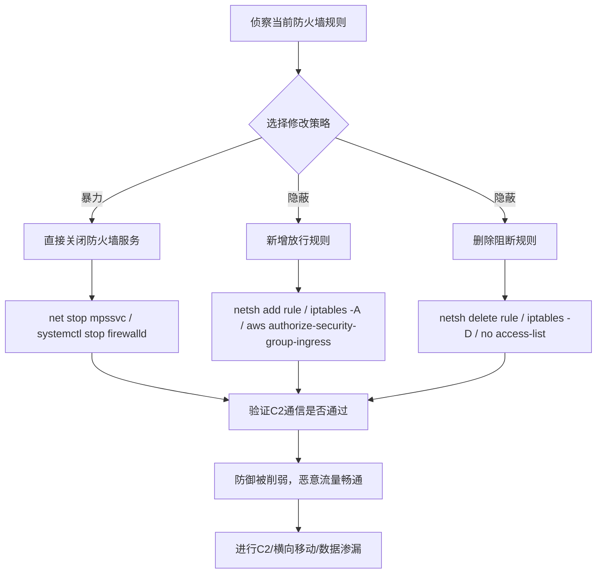

# 禁用或修改系统防火墙 (T1686)

> 想象一下：你的办公大楼装了一道电子门禁，所有进出人员都要刷卡验证。有一天，小偷直接把门禁系统的电源拔了，或者偷偷修改了门禁规则——把"非员工禁止入内"改成了"任何人随意进出"。攻击者对系统防火墙就是这么干的：防火墙是网络边界的"门禁"，控制什么流量能进出系统。攻击者要么直接关掉它，要么悄悄修改规则给自己开个"后门"通道，让恶意流量畅通无阻。

## 30秒速查卡

| 维度 | 你需要知道的 |
|------|--------------|
| 这是什么？ | 禁用、停止或修改系统/网络/云防火墙规则，让恶意流量绕过网络层防御 |
| 为什么危险？ | 防火墙一旦失效，C2通信、横向移动、数据窃取都不再被阻断，整个网络边界形同虚设 |
| 谁需要关心？ | 网络安全工程师、云安全运维、Windows/Linux系统管理员、SOC分析师 |
| 你的第一步防御 | 监控所有防火墙规则变更操作（netsh/iptables/AWS API），变更需走变更管理流程 |
| 如果只做一件事 | 监控`netsh firewall`、`netsh advfirewall`、`iptables`、`firewall-cmd`命令的执行 |

## 难度等级

⭐⭐ 中级：需要理解防火墙工作原理、各平台防火墙配置命令和云安全组模型

**前置知识要求**：
- 防火墙基础概念（包过滤、状态检测、规则匹配顺序）
- Windows防火墙、iptables/firewalld、云安全组的基本配置
- 网络协议（TCP/UDP/ICMP）和端口概念

## 前置知识检查

读这个文件之前，你需要知道：
- **什么是防火墙**：监控和控制进出网络流量的安全系统，基于预设规则允许或阻断数据包
- **什么是状态检测**：防火墙跟踪连接状态，区分新建连接和已建立连接的数据包
- **什么是云安全组**：云平台提供的虚拟防火墙，控制云实例的入站和出站流量
- **什么是ACL**：访问控制列表，网络设备上定义流量允许/拒绝规则的列表

## 技术描述

### 通俗解释

防火墙是系统的"网络门卫"——它检查每一个进出的数据包，根据规则决定放行还是拦截。攻击者禁用或修改防火墙有三种常见手法：一是直接关闭防火墙服务（`net stop mpssvc`、`systemctl stop firewalld`），让所有流量畅通无阻；二是修改防火墙规则，给自己开个"绿色通道"（如允许C2服务器的443端口入站）；三是删除关键阻断规则，让原本被拦截的恶意流量通过。在云环境中，攻击者会修改安全组规则开放端口；在网络设备上，攻击者修改ACL放行特定流量。这是ATT&CK v19.1从原T1562.004提升为父技术T1686后的完整技术族，下辖云防火墙、网络设备防火墙、Windows主机防火墙三个子技术。

### 过渡段

简单来说，防火墙就是网络的"安检口"。攻击者要么把安检员赶走（关闭防火墙）、要么买通安检员（修改规则）、要么在围墙上开个洞（删除规则）。禁用或修改系统防火墙是防御削弱战术中最直接破坏网络层防御的技术，几乎所有需要建立C2通信或横向移动的攻击都会涉及防火墙操纵。下面看看具体是怎么操作的。

### 技术原理

禁用或修改系统防火墙的工作流程：

1. **侦察当前规则**：攻击者先查看现有防火墙规则，了解哪些流量被拦截
2. **选择目标**：决定是禁用整个防火墙、修改特定规则，还是新增放行规则
3. **获取权限**：防火墙修改需要管理员/ root权限，或云平台的操作权限
4. **执行修改**：使用平台原生工具（netsh/iptables/firewall-cmd）或API修改配置
5. **验证生效**：测试C2通信或横向移动流量能否通过

### 各平台常见修改手法

| 平台 | 工具/方法 | 典型命令 | 攻击者修改 |
|------|-----------|----------|------------|
| Windows | netsh.exe | `netsh advfirewall set allprofiles state off` | 关闭所有防火墙配置文件 |
| Windows | netsh.exe | `netsh advfirewall firewall add rule name="backdoor" dir=in action=allow protocol=TCP localport=4444` | 添加放行后门端口的规则 |
| Windows | PowerShell | `Set-NetFirewallProfile -Profile Domain,Public,Private -Enabled False` | 通过PS禁用防火墙 |
| Windows | services.msc | 停止`MpsSvc`服务 | 停止Windows Defender防火墙服务 |
| Linux | iptables | `iptables -F` | 清空所有规则链 |
| Linux | iptables | `iptables -P INPUT ACCEPT` | 将默认入站策略改为允许 |
| Linux | firewall-cmd | `firewall-cmd --permanent --zone=public --add-port=4444/tcp` | 永久开放端口 |
| Linux | ufw | `ufw disable` | 禁用Ubuntu防火墙 |
| Cloud (AWS) | aws-cli | `aws ec2 authorize-security-group-ingress --group-id sg-xxx --port 4444` | 开放安全组端口 |
| Cloud (Azure) | az-cli | `az network nsg rule create -g RG --nsg-name NSG --name backdoor --destination-port-ranges 4444` | 添加NSG放行规则 |
| Network | 设备CLI | `no access-list 101` | 删除网络设备ACL |

### 用途和影响

- **命令与控制**：开放端口让C2 beacon回连，绕过出站过滤
- **横向移动**：开放SMB/RDP/WinRM端口，让横向移动流量通过
- **防御规避**：关闭防火墙日志记录，让恶意流量不被审计
- **数据渗漏**：修改出站规则允许大流量数据外传
- **持久化**：开放后门端口，保持长期访问通道

## 子技术列表

T1686是父技术，下辖3个子技术：

| 子技术ID | 名称 | 一句话理解 | 历史来源 |
|----------|------|-----------|----------|
| [T1686.001](./T1686/T1686.001-Cloud-Firewall.md) | 云防火墙 | 修改AWS/Azure/GCP安全组开放云实例端口 | 原T1562.007 |
| [T1686.002](./T1686/T1686.002-Network-Device-Firewall.md) | 网络设备防火墙 | 修改路由器/交换机ACL放行特定流量 | 原T1562.013 |
| [T1686.003](./T1686/T1686.003-Windows-Host-Firewall.md) | Windows主机防火墙 | 用netsh关闭或修改Windows Defender防火墙 | v19.1新增 |

## 攻击流程



### 步骤详解

1. **侦察**：用`netsh advfirewall show`、`iptables -L`、`aws ec2 describe-security-groups`查看当前规则
2. **选择**：根据目标决定是关停、新增规则还是删除规则
3. **获取权限**：确保有管理员/root/云操作权限
4. **修改**：执行平台对应的防火墙修改命令
5. **验证**：从C2服务器发起连接测试，确认流量能通过
6. **后续**：利用被削弱的防火墙进行C2通信、横向移动或数据渗漏

## 真实案例

### 案例1：BlackCat/ALPHV勒索软件关闭Windows防火墙

- **时间**：2022-2024年
- **目标**：全球医疗、制造、政府机构
- **攻击组织**：BlackCat/ALPHV（RaaS勒索软件，疑似俄罗斯背景）
- **手法**：BlackCat在加密前会系统性地关闭Windows防火墙，为后续的横向移动和C2通信扫清网络障碍。攻击者通过批处理脚本执行：`netsh advfirewall set allprofiles state off`直接关闭所有防火墙配置文件；`netsh advfirewall set allprofiles firewallpolicy blockinbound,allowoutbound`将入站策略改为阻断但出站全部允许（让C2回连不受影响）；同时执行`sc config mpssvc start= disabled`将防火墙服务设为禁用，防止系统重启后防火墙自动恢复。此外，BlackCat还会添加规则`netsh advfirewall firewall add rule name="C2" dir=out action=allow protocol=TCP remoteport=8443`专门为C2通信开放出站端口。这些修改让BlackCat的PsExec横向移动、Cobalt Strike beacon回连都不再被防火墙拦截。
- **影响**：感染数百家组织，赎金总额超过3亿美元
- **参考**：https://www.cisa.gov/news-events/cybersecurity-advisories/aa23-061a

### 案例2：Conti勒索软件修改云安全组开放端口

- **时间**：2021-2022年
- **目标**：云环境中的企业（AWS/Azure）
- **攻击组织**：Conti（RaaS勒索软件，疑似俄罗斯背景）
- **手法**：Conti团伙在攻击云环境时，会利用窃取的AWS IAM凭据修改安全组规则，为勒索软件的传播和C2通信开放端口。攻击者通过`aws ec2 authorize-security-group-ingress --group-id sg-1234567890 --protocol tcp --port 445 --cidr 0.0.0.0/0`将SMB端口445开放给整个互联网，让勒索软件可以通过SMB在内网间传播；通过`aws ec2 authorize-security-group-ingress --group-id sg-1234567890 --protocol tcp --port 3389 --cidr 0.0.0.0/0`开放RDP端口方便远程操控；同时还会修改出站规则`aws ec2 authorize-security-group-egress --group-id sg-1234567890 --protocol tcp --port 443 --cidr 0.0.0.0/0`确保C2通信能出站。修改完成后，Conti通过这些新开放端口横向移动并部署勒索软件。这些云API调用虽然被CloudTrail记录，但攻击者通常在加密前才执行，留给防御方的响应时间极短。
- **影响**：攻破上百家组织，造成数亿美元损失
- **参考**：https://www.cisa.gov/news-events/cybersecurity-advisories/aa21-265a

### 案例3：APT28修改网络设备ACL植入后门

- **时间**：2020-2023年
- **目标**：政府机构、外交组织
- **攻击组织**：APT28（Fancy Bear，俄罗斯GRU背景）
- **手法**：APT28在攻陷网络边界设备（Cisco路由器、Juniper防火墙）后，会修改设备上的ACL规则，为后续的C2通信和持久化访问开放隐蔽通道。攻击者通过设备的特权账号登录后，执行`configure terminal`进入配置模式，使用`no access-list 101 deny tcp any any eq 4444`删除原本阻断C2端口的规则，再使用`access-list 101 permit tcp any any eq 4444 established`添加放行规则。更隐蔽的是，APT28还会修改NAT规则`ip nat inside source static tcp 192.168.1.100 4444 interface GigabitEthernet0/1 443`将内部C2服务器的4444端口映射到外部443端口，伪装成正常HTTPS流量。这些修改被保存到startup-config，即使设备重启也会保留。由于网络设备的日志通常不被SIEM集中收集，这类修改往往数月才被发现。
- **影响**：在被感染网络中长期潜伏，窃取大量敏感数据
- **参考**：https://www.cisa.gov/news-events/cybersecurity-advisories/aa21-148a

## 红队视角

### 实战技巧

1. **新增规则比关闭更隐蔽**：完全关闭防火墙会触发告警，新增一条放行规则更难被发现
2. **保留出站允许**：将出站策略改为`allowoutbound`，确保C2通信不被阻断
3. **使用合法端口**：放行规则使用443/8080等常见端口，伪装成正常流量
4. **云环境用API**：通过`aws-cli`/`az-cli`修改安全组，比登录控制台更隐蔽
5. **组合使用**：关闭防火墙日志+修改规则，既放行流量又不留痕迹

### 常用工具

| 工具 | 用途 | 平台 | 说明 |
|------|------|------|------|
| netsh.exe | Windows防火墙配置 | Windows | 最常用，可禁用/添加/删除规则 |
| PowerShell | Set-NetFirewallProfile | Windows | 脚本化操作 |
| iptables | Linux防火墙配置 | Linux | 内核级包过滤规则 |
| firewall-cmd | firewalld配置 | Linux (RHEL/CentOS) | 持久化规则管理 |
| ufw | Ubuntu防火墙 | Linux (Ubuntu) | 简化配置工具 |
| aws-cli | AWS安全组 | Cloud | 修改EC2安全组规则 |
| az-cli | Azure NSG | Cloud | 修改网络安全组规则 |
| gcloud | GCP防火墙 | Cloud | 修改VPC防火墙规则 |

### 注意事项

- Windows 10/11的Tamper Protection会阻止部分netsh操作
- 完全关闭防火墙容易触发EDR告警，建议用规则修改
- 云环境的安全组修改会被CloudTrail/Activity Log记录
- 网络设备配置变更应被集中收集到SIEM
- 修改防火墙后立即测试连通性，避免规则失效

## 蓝队视角

### 检测要点

1. **防火墙服务监控**：监控mpssvc、firewalld服务的启停事件
2. **netsh/iptables命令监控**：监控这些工具的命令行参数
3. **规则变更审计**：启用防火墙规则变更审计（Windows事件ID 4944-4954）
4. **云API监控**：监控`authorize-security-group-ingress`等API调用
5. **网络设备配置变更**：收集网络设备的config-change日志

### 监控建议

- Windows：监控事件ID 4944（防火墙规则变更）、4947（规则删除）、4950（防火墙设置变更）
- Sysmon：监控Event ID 1，过滤Image为netsh.exe且CommandLine包含`advfirewall`
- Linux：审计iptables/firewall-cmd/ufw命令，配置auditd规则
- 云：启用AWS CloudTrail、Azure Activity Log，对安全组修改设置告警
- 网络：启用网络设备syslog，发送到SIEM分析

## 避坑指南

| 坑 | 后果 | 解决方法 |
|----|------|----------|
| 只监控netsh，忽略PowerShell | 漏报PS方式的防火墙修改 | 同时监控Set-NetFirewallProfile |
| 只看Windows，忽略云安全组 | 云环境防火墙修改漏报 | 监控CloudTrail/Activity Log |
| 网络设备日志未集中 | 网络设备ACL修改漏报 | 集中收集网络设备syslog |
| 关闭防火墙被自动恢复 | 误认为攻击失败 | 监控服务恢复后的二次关闭行为 |
| 忽略出站规则修改 | 漏报C2通信放行 | 同时监控入站和出站规则变更 |

## 检测建议

### 网络层

**用人话说**：防火墙修改是本地操作，但修改后会立即产生异常流量——关注防火墙规则变更后短时间内的新增网络连接，特别是非标准端口的通信。

监控指标：
- 防火墙规则变更后5分钟内的新增网络连接
- 非标准端口（4444、8443、1337等）的入站连接
- 大量出站流量到单一IP（可能是C2通信）

### 主机层

**用人话说**：监控netsh、iptables、firewall-cmd命令的执行和防火墙服务的状态变化——这是防火墙修改最直接的信号。

```event
事件ID 4944（Windows）：防火墙规则变更
事件ID 4947（Windows）：规则删除
事件ID 4950（Windows）：防火墙设置变更
```

```event
事件ID 1（Sysmon）：进程创建
Image: netsh.exe
关注CommandLine中的advfirewall、set allprofiles state off、add rule
```

### 应用层

**用人话说**：监控netsh、iptables命令和云API调用——这是攻击者修改防火墙最常用的方式。

```yaml
title: 检测通过netsh禁用Windows防火墙
detection:
    selection:
        EventID: 1
        Image|endswith: 'netsh.exe'
        CommandLine|contains:
            - 'advfirewall set allprofiles state off'
            - 'firewall set allprofiles state off'
            - 'set allprofiles firewallpolicy'
    condition: selection
level: critical
```

```yaml
title: 检测AWS安全组入站规则开放给整个互联网
detection:
    selection:
        eventName: 'AuthorizeSecurityGroupIngress'
        requestParameters.cidrIp: '0.0.0.0/0'
    condition: selection
source: aws-cloudtrail
level: high
```

## 缓解措施

### 高优先级

1. **启用防火墙规则审计**：开启Windows事件ID 4944-4954审计，Linux用auditd监控iptables
2. **集中收集云API日志**：所有AWS/Azure/GCP账号的CloudTrail/Activity Log集中到SIEM
3. **网络设备配置基线**：定期对比网络设备配置基线，发现未授权变更

### 中优先级

4. **部署EDR**：监控netsh/iptables命令执行
5. **云IAM最小权限**：限制安全组修改权限，使用IAM角色而非长期AK/SK
6. **变更管理流程**：所有防火墙变更必须走审批流程
7. **网络设备强认证**：网络设备启用AAA认证，避免弱口令

### 低优先级

8. **防火墙配置备份**：定期备份防火墙配置，便于恢复
9. **使用云安全态势管理（CSPM）**：自动检测过度开放的安全组规则
10. **部署NDR**：网络检测响应系统监控异常流量

## 动手实验

### 实验1：查看当前防火墙规则

```powershell
# Windows：查看所有防火墙配置文件状态
netsh advfirewall show allprofiles state

# 查看所有入站规则
netsh advfirewall firewall show rule name=all dir=in

# PowerShell方式
Get-NetFirewallProfile | Select-Object Name, Enabled
Get-NetFirewallRule | Where-Object {$_.Enabled -eq "True"} | Measure-Object
```

```bash
# Linux：查看iptables规则
sudo iptables -L -n -v

# 查看firewalld规则
sudo firewall-cmd --list-all

# 查看UFW状态
sudo ufw status verbose
```

```bash
# AWS：查看安全组规则
aws ec2 describe-security-groups --group-ids sg-1234567890

# Azure：查看NSG规则
az network nsg rule list --resource-group RG --nsg-name NSG -o table
```

**预期输出**：显示当前防火墙规则，与安全基线对比

### 实验2：监控防火墙修改（实验环境）

```powershell
# Windows：启用防火墙规则变更审计
auditpol /set /subcategory:"MPSSVC Rule-Level Policy Change" /success:enable /failure:enable
auditpol /set /subcategory:"Other Policy Change Events" /success:enable /failure:enable

# 查看防火墙变更事件
Get-WinEvent -LogName Security | Where-Object {$_.Id -in 4944,4947,4950,4954} | Select-Object -First 10
```

```bash
# Linux：用auditd监控iptables命令
auditctl -w /sbin/iptables -p x -k firewall_modification
auditctl -w /usr/sbin/firewall-cmd -p x -k firewall_modification

# 查看审计日志
ausearch -k firewall_modification | tail -20
```

**预期输出**：防火墙修改操作被记录在日志中

## 术语解释

| 术语 | 解释 |
|------|------|
| 防火墙 | 监控和控制进出网络流量的安全系统 |
| netsh | Windows网络配置命令行工具 |
| iptables | Linux内核级包过滤防火墙 |
| firewalld | RHEL/CentOS的动态防火墙管理工具 |
| 安全组 | 云平台提供的虚拟防火墙 |
| NSG | Azure网络安全组 |
| ACL | 访问控制列表，网络设备的流量规则 |
| MpsSvc | Windows Defender防火墙服务 |
| Tamper Protection | Windows防篡改保护功能 |
| CloudTrail | AWS API调用审计日志服务 |

## 参考资料

### 📚 深入了解
- [MITRE ATT&CK T1686](https://attack.mitre.org/techniques/T1686/) - 官方技术页面
- [Windows防火墙文档](https://docs.microsoft.com/en-us/windows/security/threat-protection/windows-firewall/windows-firewall-with-advanced-security) - 微软官方
- [iptables教程](https://wiki.archlinux.org/title/iptables) - Arch Wiki
- [AWS安全组](https://docs.aws.amazon.com/AWSEC2/latest/UserGuide/ec2-security-groups.html) - AWS官方

### 📰 真实攻击
- [CISA BlackCat通告](https://www.cisa.gov/news-events/cybersecurity-advisories/aa23-061a) - BlackCat关闭防火墙
- [CISA Conti通告](https://www.cisa.gov/news-events/cybersecurity-advisories/aa21-265a) - Conti修改云安全组
- [CISA APT28通告](https://www.cisa.gov/news-events/cybersecurity-advisories/aa21-148a) - APT28修改网络设备ACL

### 🔧 动手试试
- [Atomic Red Team T1686](https://github.com/redcanaryco/atomic-red-team) - 检测规则测试
- [Prowler](https://github.com/prowler-cloud/prowler) - AWS安全配置审计
- [auditd配置](https://github.com/Neo23x0/auditd) - Linux审计规则集

## 版本历史

| 版本 | 日期 | 变更 |
|------|------|------|
| 3.1 | 2026-07-23 | 初始版本，ATT&CK v19.1将原T1562.004提升为父技术T1686，下辖3个子技术 |
