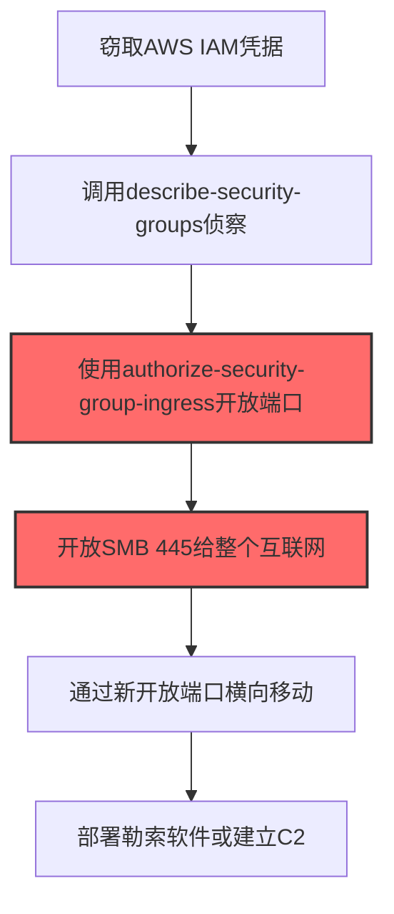
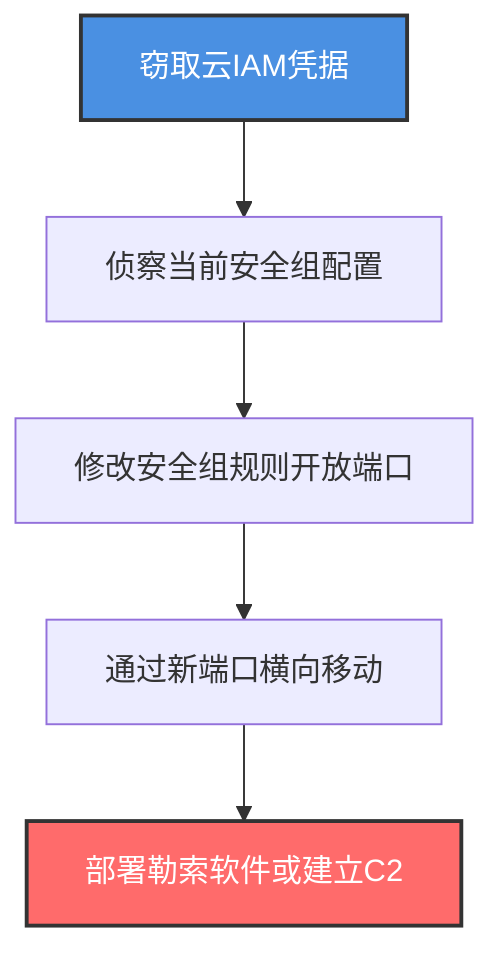

# 云防火墙 (T1686.001)

## 一句话通俗理解

> **使用aws-cli修改安全组开放云实例端口**

## 30秒速查卡

| 维度 | 你需要知道的 |
|------|-------------|
| 这是什么？ | 修改AWS安全组、Azure NSG、GCP防火墙规则，开放云实例端口供攻击者访问 |
| 为什么危险？ | 安全组规则变更后立即生效，攻击者可瞬间开放端口让C2/横向移动流量通过云边界 |
| 谁需要关心？ | 云安全运维、云架构师、SOC分析师、DevOps工程师 |
| 你的第一步防御 | 集中收集所有云账号的CloudTrail/Activity Log，监控安全组修改API |
| 如果只做一件事 | 监控对`0.0.0.0/0`开放端口的安全组修改，任何此类变更立即告警 |

## 难度等级

⭐⭐ 中级 - 需要理解云平台IAM模型、安全组规则、API调用方式

## 前置知识检查

**读这个文件需要什么？**

- [ ] AWS/Azure/GCP云平台基础操作
- [ ] 安全组（Security Group）/NSG概念
- [ ] IAM角色和权限模型
- [ ] 云API调用方式（aws-cli/az-cli/gcloud）

## 技术描述

**云防火墙**（T1686.001）是 **禁用或修改系统防火墙**（T1686）的一个具体变体，属于 **防御削弱** 阶段的攻击技术。该子技术前身为T1562.007，在ATT&CK v19.1中随父技术提升。

> 📚 **打个比方**：云安全组就像贴在云服务器门口的"出入名单"——名单上写了谁能进、谁能出。攻击者拿到云账号的钥匙后，直接改这个名单，把自己的IP加进去，或者干脆改成"所有人都能进"。改完后立即生效，原本被防火墙拦在外面的攻击者瞬间就能直连云服务器。

### 具体怎么理解？

攻击者在云环境中修改安全组规则，主要为了开放端口让C2通信、横向移动或数据渗漏流量通过云防火墙。与本地防火墙不同，云安全组规则通过API修改，一旦修改立即生效，且修改记录在CloudTrail中。攻击者通常在拿到IAM凭据后通过`aws-cli`等工具批量修改安全组规则。

### 为什么有效？

这种技术之所以有效，是因为：
1. **API驱动**：通过API修改无需登录控制台，可脚本化批量执行
2. **立即生效**：规则修改后秒级生效，无需重启服务
3. **权限门槛低**：拥有EC2修改权限的IAM角色即可操作
4. **审计滞后**：CloudTrail虽记录API调用，但攻击者通常在加密前才执行，留给防御方的时间极短

**过渡段：** 不要误以为云安全组是"配置一次永不变化"的——攻击者一旦拿到IAM凭据，几秒钟就能改掉所有规则。

## 真实攻击流程

### 典型场景

攻击者在 **防御削弱** 阶段使用云防火墙技术修改AWS安全组，以下是典型攻击步骤：



**步骤详解：**

1. **窃取AWS IAM凭据** - 通过凭据泄露、SSRF或钓鱼获取云账号AK/SK
2. **侦察安全组配置** - 调用`describe-security-groups`列出所有安全组规则
3. **修改安全组规则** - 调用`authorize-security-group-ingress`开放目标端口
4. **开放敏感端口** - 将SMB/RDP/WinRM端口开放给0.0.0.0/0
5. **利用开放端口** - 通过新开放端口进行横向移动或建立C2通道

## 攻击流程

### 典型攻击流程

窃取云IAM凭据 --> 侦察当前安全组配置 --> 修改安全组规则开放端口 --> 通过新端口横向移动 --> 部署勒索软件或建立C2



**步骤详解：**

1. **窃取云IAM凭据** - 攻击者通过SSRF漏洞、凭据泄露仓库或钓鱼获取云平台AK/SK
   - 通俗描述：就像偷到了云服务器的"管理员钥匙"
   - 技术细节：利用SSRF读取实例元数据`http://169.254.169.254/latest/meta-data/iam/security-credentials/`获取临时凭据，或从GitHub/GitLab泄露的配置文件中提取`AWS_ACCESS_KEY_ID`和`AWS_SECRET_ACCESS_KEY`，或通过钓鱼获取运维人员的控制台账号
   - 常用工具：pacu、ScoutSuite、CloudSploit、aws-cli

2. **侦察当前安全组配置** - 攻击者调用云API列出所有安全组及其规则，了解当前网络边界
   - 通俗描述：先看看现在的"出入名单"长什么样，找出最有利的修改点
   - 技术细节：执行`aws ec2 describe-security-groups --query 'SecurityGroups[*].[GroupName,GroupId,IpPermissions]'`枚举所有安全组规则，识别哪些端口被限制、哪些实例关联了哪些安全组，Azure使用`az network nsg list`，GCP使用`gcloud compute firewall-rules list`
   - 常用工具：aws-cli、az-cli、gcloud、pacu

3. **修改安全组规则开放端口** - 攻击者通过API修改安全组规则，开放横向移动或C2所需端口
   - 通俗描述：直接在"出入名单"上加上自己的名字，或者改成"所有人都能进"
   - 技术细节：执行`aws ec2 authorize-security-group-ingress --group-id sg-xxx --protocol tcp --port 445 --cidr 0.0.0.0/0`将SMB端口开放给整个互联网，`aws ec2 authorize-security-group-ingress --group-id sg-xxx --protocol tcp --port 3389 --cidr 0.0.0.0/0`开放RDP，Azure使用`az network nsg rule create`，GCP使用`gcloud compute firewall-rules create`
   - 常用工具：aws-cli、az-cli、gcloud、Terraform（用于批量修改）

4. **通过新端口横向移动** - 利用新开放端口进行内网横向移动，传播勒索软件或窃取数据
   - 通俗描述：以前被防火墙拦在门外的攻击者，现在直接走进来了
   - 技术细节：通过开放的SMB端口使用PsExec/psexec.py传播勒索软件，通过RDP端口远程登录部署后门，通过WinRM端口使用Invoke-Command执行命令
   - 常用工具：PsExec、CrackMapExec、Impacket套件、Cobalt Strike

5. **部署勒索软件或建立C2** - 在云实例上部署勒索软件加密数据，或建立持久C2通道
   - 通俗描述：完成攻击目标——要么加密勒索，要么长期潜伏
   - 技术细节：部署Conti/LockBit勒索软件加密云存储和实例磁盘，建立C2 beacon通过新开放端口回连，修改IAM角色权限实现持久化
   - 常用工具：Cobalt Strike、Conti加密器、LockBit加密器、Mimikatz

## 真实案例

### 案例1：Conti勒索软件修改AWS安全组开放SMB端口

- **时间**: 2021-2022年
- **目标**: 云环境中的企业（AWS环境）
- **攻击组织**: Conti（RaaS勒索软件，疑似俄罗斯背景）
- **手法**: Conti团伙在攻击AWS环境时，会利用窃取的IAM凭据通过`aws-cli`修改安全组规则，为勒索软件的SMB传播开放端口。攻击者执行`aws ec2 authorize-security-group-ingress --group-id sg-1234567890 --protocol tcp --port 445 --cidr 0.0.0.0/0`将SMB端口开放给整个互联网，让勒索软件可以通过SMB在内网间横向传播。同时开放RDP端口`--port 3389`和WinRM端口`--port 5985`方便远程操控。修改完成后，Conti通过这些新开放端口横向移动并部署勒索软件。这些云API调用虽然被CloudTrail记录，但攻击者通常在加密前才执行，留给防御方的响应时间极短。
- **影响**: 攻破上百家组织，造成数亿美元损失
- **参考链接**: https://www.cisa.gov/news-events/cybersecurity-advisories/aa21-265a

### 案例2：LockBit通过Azure NSG开放端口横向移动

- **时间**: 2022-2024年
- **目标**: Azure云环境中的企业
- **攻击组织**: LockBit（RaaS勒索软件）
- **手法**: LockBit团伙在攻陷Azure环境后，通过`az-cli`修改网络安全组（NSG）规则，为横向移动开放端口。攻击者执行`az network nsg rule create -g ResourceGroup --nsg-name NSG-Web --name backdoor-rule --priority 100 --source-address-prefixes 0.0.0.0/0 --destination-port-ranges 445 3389 5985 --access Allow --protocol Tcp`一次性开放SMB、RDP、WinRM端口给整个互联网。同时修改出站规则`az network nsg rule create --name allow-egress --destination-port-ranges 443 --source-address-prefixes VirtualNetwork --destination-address-prefixes 0.0.0.0/0`确保C2通信能出站。这些修改虽然被Azure Activity Log记录，但LockBit在加密前才执行，防御方往往来不及响应。
- **影响**: 全球范围内攻破上千家组织
- **参考链接**: https://www.cisa.gov/news-events/cybersecurity-advisories/aa23-165a

## 红队视角

> ⚠️ **免责声明**：以下内容仅用于合法的安全测试、渗透测试和教育目的。未经授权对他人系统进行测试是违法行为。

### 实战技巧

1. **优先使用API而非控制台**：通过`aws-cli`修改比登录控制台更隐蔽，且可脚本化
2. **一次性开放多端口**：用一条规则开放多个端口，减少API调用次数
3. **使用临时凭据**：通过实例元数据获取的临时凭据比长期AK/SK更难追踪
4. **配合SSRF利用**：先通过SSRF获取IAM凭据，再修改安全组
5. **加密前才修改**：延迟到加密前才修改安全组，减少防御方响应时间

### 常用工具

| 工具名称 | 用途 | 平台 | 链接 |
| -------- | ---- | ---- | ---- |
| aws-cli | AWS安全组修改 | Cloud | [AWS CLI](https://aws.amazon.com/cli/) |
| az-cli | Azure NSG修改 | Cloud | [Azure CLI](https://docs.microsoft.com/cli/azure/) |
| gcloud | GCP防火墙修改 | Cloud | [GCP CLI](https://cloud.google.com/sdk/gcloud) |
| pacu | AWS攻击框架 | Cloud | [pacu](https://github.com/RhinoSecurityLabs/pacu) |

### 注意事项

- 所有云API调用会被CloudTrail/Activity Log记录
- 使用临时凭据比长期凭据更难追踪
- 安全组修改立即生效，无法撤回
- 加密后才修改安全组会触发告警，需快速操作

## 蓝队视角

### 检测要点

1. **云API监控**：监控`authorize-security-group-ingress/egress`等API调用
2. **0.0.0.0/0告警**：任何对0.0.0.0/0开放的端口规则立即告警
3. **敏感端口开放**：监控445/3389/5985/22等敏感端口的开放
4. **非工作时间修改**：监控非工作时间的云配置变更
5. **CSPM工具**：部署云安全态势管理工具持续审计

### 监控建议

- AWS：启用CloudTrail日志，使用EventBridge对安全组修改设置实时告警
- Azure：启用Activity Log，配置Alert Rules
- GCP：启用Cloud Audit Logs，使用Cloud Monitoring告警
- 部署CSPM工具（如Prowler、Prisma Cloud）持续审计安全组配置
- 使用AWS Config规则检测开放给0.0.0.0/0的端口

## 避坑指南

只监控控制台登录而忽略API调用是常见盲区——攻击者通过`aws-cli`修改安全组不会触发控制台登录告警。

## 检测建议

### 检测思路

检测云防火墙修改的关键是监控云API调用和安全组规则变更。以下是三个层面的检测方法：

### 网络层检测

**方法**：监控云实例的网络流量异常

```bash
# 检测安全组修改后短时间内的新增网络连接
# 使用VPC Flow Logs分析
aws ec2 describe-flow-logs
```

### 主机层检测

**方法**：监控云实例上的异常端口监听

```bash
# Linux：检测新增监听端口
ss -tlnp | grep -E ':(445|3389|5985|4444) '

# Windows：检测新增监听端口
netstat -an | findstr "445 3389 5985 4444"
```

### 应用层检测

**用人话说**：攻击者用`aws-cli`或`az-cli`修改云安全组规则，开放端口让恶意流量通过。比如执行`aws ec2 authorize-security-group-ingress --cidr 0.0.0.0/0 --port 445`把SMB端口开放给整个互联网，让勒索软件能横向传播。如果发现安全组规则突然对0.0.0.0/0开放敏感端口，这就是攻击者在打开云防火墙后门。

**Sigma规则示例**：

```yaml
title: 检测AWS安全组入站规则开放给整个互联网
status: experimental
description: 检测可能的安全组规则修改，将端口开放给0.0.0.0/0
logsource:
    product: aws
    service: cloudtrail
detection:
    selection:
        eventName: 'AuthorizeSecurityGroupIngress'
        requestParameters|contains:
            - '0.0.0.0/0'
    condition: selection
level: high
tags:
    - attack.t1686
    - attack.t1686.001
```

```yaml
title: 检测Azure NSG规则创建
status: experimental
description: 检测Azure网络安全组规则创建
logsource:
    product: azure
    service: activitylogs
detection:
    selection:
        operationName: 'Microsoft.Network/networkSecurityGroups/securityRules/write'
    condition: selection
level: medium
tags:
    - attack.t1686
    - attack.t1686.001
```

## 缓解措施

### 优先级1：关键措施

**限制IAM权限**：使用最小权限原则，限制安全组修改权限

```bash
# IAM策略示例：只允许特定安全组的修改
{
    "Version": "2012-10-17",
    "Statement": [
        {
            "Effect": "Deny",
            "Action": "ec2:AuthorizeSecurityGroupIngress",
            "Resource": "*",
            "Condition": {
                "StringEquals": {
                    "aws:RequestedRegion": ["us-east-1"]
                }
            }
        }
    ]
}
```

### 优先级2：重要措施

**部署CSPM工具**：使用Prowler/Prisma Cloud持续审计安全组配置

### 优先级3：建议措施

**变更管理流程**：所有安全组变更必须走审批流程

## 动手实验

> ⚠️ **所有实验必须在隔离的实验云账号中进行**

### 实验1：理解基本原理（初级）

**目标**：理解云防火墙修改的工作原理

**步骤**：
1. 在隔离的AWS账号中创建EC2实例和安全组
2. 使用`aws-cli`查看当前安全组规则
3. 执行`authorize-security-group-ingress`开放端口
4. 从外部测试端口连通性

**学习要点**：理解安全组规则的工作机制

### 实验2：实际操作（中级）

**目标**：掌握云防火墙修改的检测方法

**步骤**：
1. 启用CloudTrail日志
2. 执行安全组修改操作
3. 在CloudTrail日志中查找对应事件
4. 配置EventBridge实时告警

**学习要点**：掌握云API审计和告警配置

### 实验3：防御验证（高级）

**目标**：验证CSPM工具的检测能力

**步骤**：
1. 部署Prowler扫描云账号
2. 创建违反基线的安全组规则
3. 验证Prowler告警
4. 配置自动修复

**学习要点**：理解CSPM工具的工作原理

## 术语解释

| 术语 | 通俗解释 |
|------|---------|
| **ATT&CK** | MITRE公司维护的攻击技术知识库 |
| **云防火墙** | T1686.001，云平台安全组/NSG修改技术 |
| **安全组** | AWS提供的虚拟防火墙，控制EC2实例流量 |
| **NSG** | Azure网络安全组，类似AWS安全组 |
| **CloudTrail** | AWS API调用审计日志服务 |
| **IAM** | 身份和访问管理，云平台权限模型 |
| **CSPM** | 云安全态势管理，持续审计云配置 |

## 被引用情况

以下父技术文档引用了本子技术：

- [T1686 - 禁用或修改系统防火墙](../T1686-Disable-or-Modify-System-Firewall.md)

## 参考资料

### 官方文档

- [MITRE ATT&CK - 云防火墙 (T1686.001)](https://attack.mitre.org/techniques/T1686/001/)
- [MITRE ATT&CK - 禁用或修改系统防火墙 (T1686)](https://attack.mitre.org/techniques/T1686/)

### 安全报告

- [CISA Conti通告](https://www.cisa.gov/news-events/cybersecurity-advisories/aa21-265a) - Conti修改AWS安全组
- [CISA LockBit通告](https://www.cisa.gov/news-events/cybersecurity-advisories/aa23-165a) - LockBit修改Azure NSG

### 工具与资源

- [Prowler](https://github.com/prowler-cloud/prowler) - AWS安全配置审计
- [pacu](https://github.com/RhinoSecurityLabs/pacu) - AWS攻击框架
- [AWS Config规则](https://docs.aws.amazon.com/config/) - 配置合规审计

### 学习资料

- [MITRE ATT&CK 知识库](https://attack.mitre.org/resources/) - ATT&CK 官方资源中心
