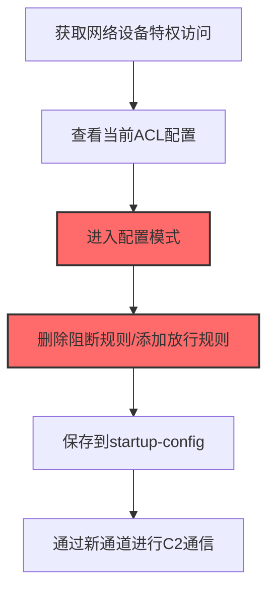
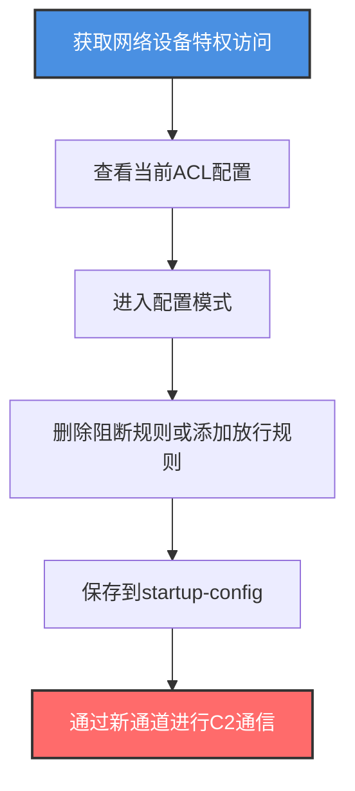

# 网络设备防火墙 (T1686.002)

## 一句话通俗理解

> **修改Cisco/Juniper路由器ACL放行攻击流量**

## 30秒速查卡

| 维度 | 你需要知道的 |
|------|-------------|
| 这是什么？ | 修改路由器、交换机、防火墙设备上的ACL规则，放行攻击者的流量通过网络边界 |
| 为什么危险？ | 网络设备是整个网络的中枢，ACL修改后影响所有经过设备的流量，且日志常被忽略 |
| 谁需要关心？ | 网络工程师、网络安全架构师、SOC分析师、IT运维 |
| 你的第一步防御 | 集中收集所有网络设备的syslog，对config-change事件实时告警 |
| 如果只做一件事 | 启用网络设备AAA认证，所有配置变更需通过TACACS+/RADIUS审计 |

## 难度等级

⭐⭐ 中级 - 需要理解网络设备CLI、ACL语法、路由协议

## 前置知识检查

**读这个文件需要什么？**

- [ ] 网络设备CLI操作（Cisco IOS、Juniper Junos）
- [ ] ACL（访问控制列表）语法和匹配逻辑
- [ ] 路由器和交换机的基础架构
- [ ] 网络设备认证（AAA、TACACS+、RADIUS）

## 技术描述

**网络设备防火墙**（T1686.002）是 **禁用或修改系统防火墙**（T1686）的一个具体变体，属于 **防御削弱** 阶段的攻击技术。该子技术前身为T1562.013，在ATT&CK v19.1中随父技术提升。

> 📚 **打个比方**：网络设备就像城市交通路口的红绿灯系统，ACL就是控制哪些车能走哪条路的规则。攻击者拿到交通指挥中心的权限后，直接改红绿灯规则——把"禁止驶入"改成"任意通行"，或者专门给自己的车开一条绿色通道。改完后所有经过这个路口的车流都按新规则走，原本被拦截的攻击流量瞬间畅通。

### 具体怎么理解？

攻击者攻陷网络边界设备（路由器、交换机、防火墙）后，会修改设备上的ACL规则，为后续的C2通信和持久化访问开放隐蔽通道。与主机防火墙不同，网络设备ACL影响所有经过设备的流量，且配置变更日志通常不被SIEM集中收集，是防御盲区。攻击者通常通过弱口令、默认凭据或漏洞获取设备特权访问，然后修改ACL规则。

### 为什么有效？

这种技术之所以有效，是因为：
1. **影响范围广**：网络设备ACL影响所有经过设备的流量，一处修改影响全网
2. **日志盲区**：网络设备syslog通常不被集中收集，修改行为难以被发现
3. **持久化保存**：修改保存到startup-config，设备重启后规则依然生效
4. **权限门槛适中**：获取enable/privileged模式后即可修改

**过渡段：** 不要误以为网络设备是"配置一次永不变动"的——攻击者一旦拿到特权账号，几条命令就能改掉整个网络的流量规则。

## 真实攻击流程

### 典型场景

攻击者在 **防御削弱** 阶段使用网络设备防火墙技术修改Cisco路由器ACL，以下是典型攻击步骤：



**步骤详解：**

1. **获取网络设备特权访问** - 通过弱口令、默认凭据或漏洞登录设备
2. **查看当前ACL配置** - 使用`show access-list`、`show running-config`查看规则
3. **进入配置模式** - 使用`configure terminal`进入全局配置模式
4. **修改ACL规则** - 使用`no access-list`删除规则或`access-list permit`添加规则
5. **保存配置** - 使用`write memory`保存到startup-config
6. **利用新通道** - 通过新开放的端口进行C2通信或数据渗漏

## 攻击流程

### 典型攻击流程

获取网络设备特权访问 --> 查看当前ACL配置 --> 进入配置模式 --> 删除阻断规则或添加放行规则 --> 保存到startup-config --> 通过新通道进行C2通信



**步骤详解：**

1. **获取网络设备特权访问** - 攻击者通过弱口令、默认凭据或漏洞获取网络设备的特权访问
   - 通俗描述：就像偷到了交通指挥中心的钥匙
   - 技术细节：利用CVE-2019-1653（Cisco RV320/RV325凭据泄露）、CVE-2023-20198（Cisco IOS XE Web UI权限提升）等漏洞，或使用默认凭据`admin/admin`、`cisco/cisco`，或通过暴力破解获取enable密码，进入特权模式后即可修改设备配置
   - 常用工具：Metasploit、hydra、Cisco批量扫描器、CVE利用POC

2. **查看当前ACL配置** - 攻击者查看当前ACL规则，了解哪些流量被拦截
   - 通俗描述：先看看现在的"红绿灯规则"长什么样
   - 技术细节：执行`show access-list`查看所有ACL规则，`show running-config | include access-list`查看配置中的ACL，`show ip interface`查看接口应用的ACL，识别哪些端口/IP被阻断
   - 常用工具：Cisco IOS CLI、Juniper Junos CLI、show命令

3. **进入配置模式** - 攻击者进入全局配置模式准备修改ACL
   - 通俗描述：拿到红绿灯控制台的修改权限
   - 技术细节：执行`enable`进入特权模式，`configure terminal`进入全局配置模式，Junos使用`edit`进入配置层次
   - 常用工具：设备CLI、SSH客户端

4. **删除阻断规则或添加放行规则** - 攻击者修改ACL规则，放行C2通信或横向移动流量
   - 通俗描述：把"禁止驶入"改成"任意通行"，或者专门给自己的车开一条绿色通道
   - 技术细节：执行`no access-list 101 deny tcp any any eq 4444`删除阻断C2端口的规则，`access-list 101 permit tcp any any eq 4444 established`添加放行规则，更隐蔽的是修改NAT规则`ip nat inside source static tcp 192.168.1.100 4444 interface GigabitEthernet0/1 443`将内部C2服务器端口映射到外部443端口伪装HTTPS流量
   - 常用工具：Cisco IOS CLI、Juniper Junos CLI

5. **保存到startup-config** - 攻击者将修改保存到启动配置，确保设备重启后规则依然生效
   - 通俗描述：把修改写到永久存储，下次重启也不会丢失
   - 技术细节：执行`write memory`或`copy running-config startup-config`保存配置，Junos使用`commit`保存，确保修改持久化
   - 常用工具：设备CLI

6. **通过新通道进行C2通信** - 攻击者通过新开放的端口建立C2通道或进行数据渗漏
   - 通俗描述：通过新开的"绿色通道"畅通无阻地进出
   - 技术细节：通过新开放的4444端口建立C2 beacon回连，通过NAT映射的443端口伪装HTTPS流量，绕过网络安全设备的检测
   - 常用工具：Cobalt Strike、Metasploit、自定义C2框架

## 真实案例

### 案例1：APT28修改Cisco路由器ACL建立C2通道

- **时间**: 2020-2023年
- **目标**: 政府机构、外交组织
- **攻击组织**: APT28（Fancy Bear，俄罗斯GRU背景）
- **手法**: APT28在攻陷网络边界Cisco路由器后，会修改设备上的ACL规则，为后续的C2通信和持久化访问开放隐蔽通道。攻击者通过设备的特权账号登录后，执行`configure terminal`进入配置模式，使用`no access-list 101 deny tcp any any eq 4444`删除原本阻断C2端口的规则，再使用`access-list 101 permit tcp any any eq 4444 established`添加放行规则。更隐蔽的是，APT28还会修改NAT规则`ip nat inside source static tcp 192.168.1.100 4444 interface GigabitEthernet0/1 443`将内部C2服务器的4444端口映射到外部443端口，伪装成正常HTTPS流量。这些修改被保存到startup-config，即使设备重启也会保留。由于网络设备的日志通常不被SIEM集中收集，这类修改往往数月才被发现。
- **影响**: 在被感染网络中长期潜伏，窃取大量敏感数据
- **参考链接**: https://www.cisa.gov/news-events/cybersecurity-advisories/aa21-148a

### 案例2：Sandworm利用Cisco IOS XE漏洞修改ACL

- **时间**: 2023年
- **目标**: 全球范围内的Cisco IOS XE设备
- **攻击组织**: Sandworm（俄罗斯GRU背景）
- **手法**: Sandworm利用CVE-2023-20198（Cisco IOS XE Web UI权限提升漏洞）攻陷了大量暴露在互联网上的Cisco设备。攻击者通过Web UI获取特权访问后，创建本地账户`cisco_tac_admin`，然后通过SSH登录设备修改ACL规则。攻击者执行`access-list 100 permit tcp any any eq 4444`开放C2端口，同时修改`ip access-group 100 in`将新ACL应用到外部接口，让C2通信能从外部访问内部网络。攻击者还修改了NAT规则将内部服务的端口映射到外部，建立持久化的后门通道。这些修改被保存到startup-config，并通过`no ip http server`关闭Web UI以隐藏入侵痕迹。
- **影响**: 全球数千台Cisco设备被攻陷
- **参考链接**: https://www.cisa.gov/news-events/cybersecurity-advisories/aa23-320a

## 红队视角

> ⚠️ **免责声明**：以下内容仅用于合法的安全测试、渗透测试和教育目的。未经授权对他人系统进行测试是违法行为。

### 实战技巧

1. **优先利用漏洞**：使用CVE-2023-20198等漏洞比暴力破解更隐蔽
2. **修改NAT而非ACL**：NAT规则修改更难被发现，且能伪装流量
3. **保留原有规则**：在原有ACL后追加规则而非替换，避免引起注意
4. **关闭Web UI**：修改完成后关闭Web UI隐藏入侵痕迹
5. **使用established关键字**：放行规则使用`established`只放行已建立连接，更隐蔽

### 常用工具

| 工具名称 | 用途 | 平台 | 链接 |
| -------- | ---- | ---- | ---- |
| Metasploit | 漏洞利用框架 | 全平台 | [Metasploit](https://www.metasploit.com/) |
| hydra | 暴力破解工具 | 全平台 | [hydra](https://github.com/vanhauser-thc/thc-hydra) |
| Cisco扫描器 | 设备发现和识别 | 网络 | [nmap](https://nmap.org/) |
| SolarWinds | 网络设备管理 | 全平台 | [SolarWinds](https://www.solarwinds.com/) |

### 注意事项

- 所有配置变更会被syslog记录（如果启用）
- 使用TACACS+/RADIUS认证的设备会记录所有命令
- 修改startup-config后设备重启规则依然生效
- 网络设备配置变更应被集中收集到SIEM
- 现代网络设备支持配置变更告警

## 蓝队视角

### 检测要点

1. **syslog集中收集**：将所有网络设备syslog发送到SIEM
2. **配置变更告警**：监控`%SYS-5-CONFIG_I`等配置变更事件
3. **AAA审计**：启用TACACS+/RADIUS命令审计
4. **配置基线对比**：定期对比设备配置基线
5. **登录异常监控**：监控非工作时间的设备登录

### 监控建议

- 启用网络设备syslog，发送到集中SIEM
- 部署TACACS+/RADIUS集中认证，记录所有命令
- 定期使用Rancid/oxidized备份设备配置，对比变更
- 监控`%SEC-6-IPACCESSLOGP`等ACL匹配日志
- 部署NDR（网络检测响应）监控异常流量

## 避坑指南

只监控设备登录而忽略配置变更是常见盲区——攻击者拿到合法凭据后修改ACL不会触发登录告警。

## 检测建议

### 检测思路

检测网络设备防火墙修改的关键是监控配置变更和ACL修改命令。以下是三个层面的检测方法：

### 网络层检测

**方法**：监控网络设备流量异常

```bash
# 检测设备配置变更后短时间内的新增网络连接
# 使用NetFlow/sFlow分析流量模式
show ip flow top-talkers
```

### 主机层检测

**方法**：监控网络设备配置变更日志

```bash
# Cisco：查看配置变更事件
show logging | include CONFIG

# 查看ACL匹配日志
show logging | include IPACCESSLOG

# 查看最近的登录记录
show logging | include LOGIN
```

### 应用层检测

**用人话说**：攻击者通过SSH或Console登录网络设备，执行`configure terminal`、`access-list permit`、`no access-list deny`等命令修改ACL规则，放行攻击流量。比如执行`access-list 101 permit tcp any any eq 4444`开放C2端口，或者`no access-list 101 deny tcp any any eq 4444`删除阻断规则。如果发现设备配置突然出现新的放行规则或阻断规则被删除，这就是攻击者在操纵网络设备防火墙。

**Sigma规则示例**：

```yaml
title: 检测Cisco设备ACL修改
status: experimental
description: 检测Cisco设备上的ACL修改命令
logsource:
    product: cisco
    service: syslog
detection:
    selection:
        message|contains:
            - 'access-list'
            - 'ip access-group'
            - 'ip nat'
    filter:
        message|contains:
            - 'show '
            - 'ping '
    condition: selection and not filter
level: medium
tags:
    - attack.t1686
    - attack.t1686.002
```

```yaml
title: 检测网络设备配置变更
status: experimental
description: 检测网络设备配置变更事件
logsource:
    product: network_device
    service: syslog
detection:
    selection:
        message|contains:
            - 'SYS-5-CONFIG_I'
            - 'SYS-5-CONFIG'
    condition: selection
level: low
tags:
    - attack.t1686
    - attack.t1686.002
```

## 缓解措施

### 优先级1：关键措施

**启用AAA认证**：使用TACACS+/RADIUS集中认证，记录所有命令

```bash
# Cisco AAA配置示例
aaa new-model
aaa authentication login default group tacacs+ local
aaa authorization exec default group tacacs+ local
aaa accounting commands 15 default start-stop group tacacs+
tacacs server TACACS-SERVER
 address ipv4 192.168.1.100
 key 7 EncryptedKey
```

### 优先级2：重要措施

**集中收集syslog**：将所有网络设备syslog发送到SIEM

### 优先级3：建议措施

**配置基线对比**：定期使用Rancid/oxidized备份并对比设备配置

## 动手实验

> ⚠️ **所有实验必须在隔离的实验网络设备上进行**

### 实验1：理解基本原理（初级）

**目标**：理解网络设备ACL修改的工作原理

**步骤**：
1. 在GNS3或EVE-NG中搭建Cisco路由器实验环境
2. 配置基础ACL规则阻断特定端口
3. 进入配置模式修改ACL
4. 测试流量是否按新规则通过

**学习要点**：理解ACL的工作机制和修改方法

### 实验2：实际操作（中级）

**目标**：掌握网络设备防火墙修改的检测方法

**步骤**：
1. 配置设备发送syslog到SIEM
2. 启用AAA命令审计
3. 执行ACL修改操作
4. 在SIEM中分析对应日志

**学习要点**：掌握设备日志分析和审计

### 实验3：防御验证（高级）

**目标**：验证配置基线对比工具

**步骤**：
1. 部署Rancid/oxidized备份设备配置
2. 修改设备配置
3. 验证Rancid能否检测到变更
4. 配置自动告警

**学习要点**：理解配置管理工具的工作原理

## 术语解释

| 术语 | 通俗解释 |
|------|---------|
| **ATT&CK** | MITRE公司维护的攻击技术知识库 |
| **网络设备防火墙** | T1686.002，网络设备ACL修改技术 |
| **ACL** | 访问控制列表，网络设备的流量规则 |
| **NAT** | 网络地址转换，将内部地址映射到外部 |
| **TACACS+** | 终端访问控制器访问控制系统+，网络设备认证协议 |
| **RADIUS** | 远程认证拨号用户服务，网络设备认证协议 |
| **startup-config** | 设备启动时加载的配置文件 |
| **running-config** | 设备当前运行的配置 |
| **enable模式** | Cisco设备的特权模式 |

## 被引用情况

以下父技术文档引用了本子技术：

- [T1686 - 禁用或修改系统防火墙](../T1686-Disable-or-Modify-System-Firewall.md)

## 参考资料

### 官方文档

- [MITRE ATT&CK - 网络设备防火墙 (T1686.002)](https://attack.mitre.org/techniques/T1686/002/)
- [MITRE ATT&CK - 禁用或修改系统防火墙 (T1686)](https://attack.mitre.org/techniques/T1686/)

### 安全报告

- [CISA APT28通告](https://www.cisa.gov/news-events/cybersecurity-advisories/aa21-148a) - APT28修改Cisco路由器ACL
- [CISA Cisco IOS XE通告](https://www.cisa.gov/news-events/cybersecurity-advisories/aa23-320a) - Sandworm利用Cisco漏洞

### 工具与资源

- [Rancid](https://www.shrubbery.net/rancid/) - 网络设备配置备份
- [oxidized](https://github.com/ytti/oxidized) - 现代网络设备配置管理
- [nmap](https://nmap.org/) - 网络设备发现

### 学习资料

- [MITRE ATT&CK 知识库](https://attack.mitre.org/resources/) - ATT&CK 官方资源中心
