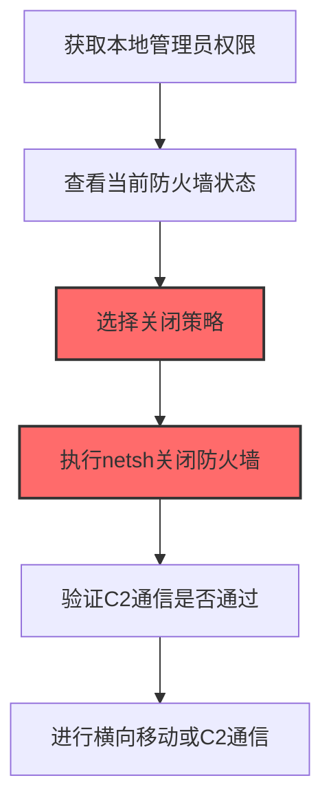
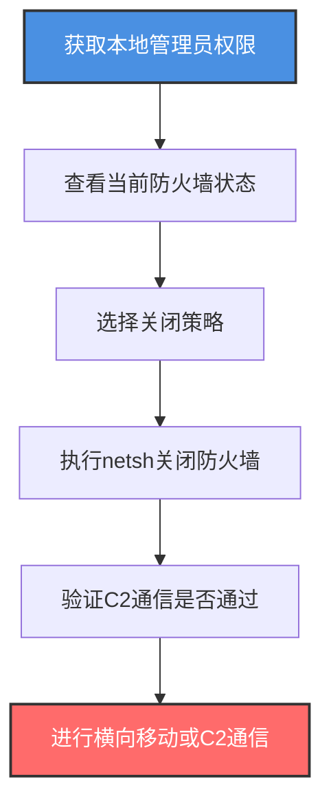

# Windows主机防火墙 (T1686.003)

## 一句话通俗理解

> **使用netsh关闭或修改Windows Defender防火墙**

## 30秒速查卡

| 维度 | 你需要知道的 |
|------|-------------|
| 这是什么？ | 使用netsh、PowerShell或服务管理工具关闭或修改Windows Defender防火墙规则 |
| 为什么危险？ | 防火墙关闭后C2通信、横向移动、数据渗漏都不再被阻断，整个Windows主机网络边界失效 |
| 谁需要关心？ | Windows系统管理员、终端安全团队、SOC分析师、IT运维 |
| 你的第一步防御 | 监控netsh advfirewall命令执行和Windows事件ID 4944-4954 |
| 如果只做一件事 | 监控`netsh advfirewall set allprofiles state off`命令的执行 |

## 难度等级

⭐⭐ 中级 - 需要理解Windows防火墙配置文件、netsh命令、组策略防火墙设置

## 前置知识检查

**读这个文件需要什么？**

- [ ] Windows防火墙基础（域/专用/公用配置文件）
- [ ] netsh命令行工具使用
- [ ] PowerShell防火墙管理命令
- [ ] Windows服务管理（MpsSvc服务）

## 技术描述

**Windows主机防火墙**（T1686.003）是 **禁用或修改系统防火墙**（T1686）的一个具体变体，属于 **防御削弱** 阶段的攻击技术。该子技术为ATT&CK v19.1新增，将原T1562.004中Windows特定部分独立为子技术。

> 📚 **打个比方**：Windows Defender防火墙就像贴在每台Windows电脑门口的"门卫"，检查每一个进出的网络数据包。攻击者拿到管理员权限后，直接命令门卫"下班"（关闭防火墙），或者修改门卫的规则手册——把"陌生人禁止入内"改成"任何人随意进出"，再给自己开个专用通道。改完后所有进出电脑的网络流量都不再被检查。

### 具体怎么理解？

攻击者在Windows主机上使用netsh、PowerShell或服务管理工具关闭或修改Windows Defender防火墙规则，主要为了开放端口让C2通信、横向移动或数据渗漏流量通过。Windows防火墙有三个配置文件（Domain、Private、Public），攻击者通常会同时关闭所有配置文件，或针对特定配置文件添加放行规则。

### 为什么有效？

这种技术之所以有效，是因为：
1. **命令简单**：`netsh advfirewall set allprofiles state off`一条命令即可关闭所有防火墙
2. **立即生效**：修改后立即生效，无需重启
3. **权限门槛低**：仅需本地管理员权限即可修改
4. **审计可绕过**：部分操作可通过PowerShell绕过传统netsh监控

**过渡段：** 不要误以为Windows防火墙是"系统自带就一定安全"的——攻击者一条netsh命令就能让它失效。

## 真实攻击流程

### 典型场景

攻击者在 **防御削弱** 阶段使用Windows主机防火墙技术关闭目标Windows主机的防火墙，以下是典型攻击步骤：



**步骤详解：**

1. **获取本地管理员权限** - 通过提权或凭据窃取获取管理员权限
2. **查看当前防火墙状态** - 使用`netsh advfirewall show allprofiles state`查看
3. **选择关闭策略** - 决定是完全关闭、添加放行规则还是修改默认策略
4. **执行netsh关闭防火墙** - 使用`netsh advfirewall set allprofiles state off`关闭
5. **验证C2通信** - 测试C2 beacon是否回连成功
6. **进行横向移动** - 利用关闭的防火墙进行SMB/RDP/WinRM横向移动

## 攻击流程

### 典型攻击流程

获取本地管理员权限 --> 查看当前防火墙状态 --> 选择关闭策略 --> 执行netsh关闭防火墙 --> 验证C2通信是否通过 --> 进行横向移动或C2通信



**步骤详解：**

1. **获取本地管理员权限** - 攻击者通过提权漏洞或凭据窃取获得本地管理员权限
   - 通俗描述：就像先拿到办公室管理员的钥匙，才能去改门卫的规则
   - 技术细节：利用UAC绕过（T1548.001）、内核提权漏洞（如PrintNightmare CVE-2021-34527）、或窃取的管理员凭据获得SYSTEM或Administrator权限，Windows防火墙修改需要管理员权限
   - 常用工具：Metasploit、Cobalt Strike、Mimikatz、JuicyPotato、RogueWinRM

2. **查看当前防火墙状态** - 攻击者查看当前防火墙配置文件状态和规则
   - 通俗描述：先看看现在的门卫规则长什么样
   - 技术细节：执行`netsh advfirewall show allprofiles state`查看三个配置文件的启用状态，`netsh advfirewall firewall show rule name=all`查看所有规则，`Get-NetFirewallProfile`通过PowerShell查看状态，识别哪些端口被限制
   - 常用工具：netsh.exe、PowerShell、Windows Defender防火墙控制台

3. **选择关闭策略** - 攻击者根据目标决定是完全关闭防火墙还是修改规则
   - 通俗描述：决定是让门卫直接下班，还是只给他改规则
   - 技术细节：完全关闭防火墙`netsh advfirewall set allprofiles state off`最直接但最易被发现，更隐蔽的是只添加放行规则`netsh advfirewall firewall add rule name="backdoor" dir=in action=allow protocol=TCP localport=4444`，或将入站策略改为`blockinbound,allowoutbound`保留出站允许
   - 常用工具：netsh.exe、PowerShell

4. **执行netsh关闭防火墙** - 攻击者执行命令关闭或修改防火墙
   - 通俗描述：让门卫下班或改他的规则手册
   - 技术细节：执行`netsh advfirewall set allprofiles state off`关闭所有配置文件防火墙，`netsh advfirewall set allprofiles firewallpolicy blockinbound,allowoutbound`保留出站允许确保C2通信，`sc config mpssvc start= disabled`将防火墙服务设为禁用防止重启后恢复，PowerShell方式`Set-NetFirewallProfile -Profile Domain,Public,Private -Enabled False`
   - 常用工具：netsh.exe、PowerShell、sc.exe

5. **验证C2通信是否通过** - 攻击者测试C2 beacon是否能回连
   - 通俗描述：测试新规则下能不能正常进出
   - 技术细节：从C2服务器发起反向连接测试，或让beacon尝试回连C2服务器，确认防火墙不再阻断流量
   - 常用工具：Cobalt Strike、Metasploit、nc（netcat）

6. **进行横向移动或C2通信** - 攻击者利用关闭的防火墙进行横向移动或C2通信
   - 通俗描述：通过没有门卫的大门畅通无阻地进出
   - 技术细节：通过SMB（445端口）使用PsExec横向移动，通过RDP（3389端口）远程登录，通过WinRM（5985端口）使用Invoke-Command执行命令，C2 beacon通过任意端口回连
   - 常用工具：PsExec、CrackMapExec、Impacket套件、Cobalt Strike

## 真实案例

### 案例1：BlackCat/ALPHV勒索软件关闭Windows防火墙

- **时间**: 2022-2024年
- **目标**: 全球医疗、制造、政府机构
- **攻击组织**: BlackCat/ALPHV（RaaS勒索软件，疑似俄罗斯背景）
- **手法**: BlackCat在加密前会系统性地关闭Windows防火墙，为后续的横向移动和C2通信扫清网络障碍。攻击者通过批处理脚本执行：`netsh advfirewall set allprofiles state off`直接关闭所有防火墙配置文件；`netsh advfirewall set allprofiles firewallpolicy blockinbound,allowoutbound`将入站策略改为阻断但出站全部允许（让C2回连不受影响）；同时执行`sc config mpssvc start= disabled`将防火墙服务设为禁用，防止系统重启后防火墙自动恢复。此外，BlackCat还会添加规则`netsh advfirewall firewall add rule name="C2" dir=out action=allow protocol=TCP remoteport=8443`专门为C2通信开放出站端口。这些修改让BlackCat的PsExec横向移动、Cobalt Strike beacon回连都不再被防火墙拦截。
- **影响**: 感染数百家组织，赎金总额超过3亿美元
- **参考链接**: https://www.cisa.gov/news-events/cybersecurity-advisories/aa23-061a

### 案例2：LockBit勒索软件通过PowerShell关闭防火墙

- **时间**: 2022-2024年
- **目标**: 全球各类组织
- **攻击组织**: LockBit（RaaS勒索软件）
- **手法**: LockBit团伙在攻击中使用PowerShell关闭Windows防火墙，相比netsh更难被传统监控发现。攻击者执行`Set-NetFirewallProfile -Profile Domain,Public,Private -Enabled False`通过PowerShell禁用所有防火墙配置文件；`Set-NetFirewallProfile -Profile Domain,Public,Private -DefaultInboundAction Allow`将默认入站策略改为允许；同时使用`Stop-Service -Name mpssvc -Force`停止防火墙服务。更隐蔽的是，LockBit还会通过修改注册表`HKLM\SYSTEM\CurrentControlSet\Services\SharedAccess\Parameters\FirewallPolicy\DomainProfile\EnableFirewall`为0来禁用防火墙，这种方式不会被传统netsh监控发现。这些修改让LockBit的横向移动和C2通信畅通无阻。
- **影响**: 全球范围内攻破上千家组织
- **参考链接**: https://www.cisa.gov/news-events/cybersecurity-advisories/aa23-165a

## 红队视角

> ⚠️ **免责声明**：以下内容仅用于合法的安全测试、渗透测试和教育目的。未经授权对他人系统进行测试是违法行为。

### 实战技巧

1. **新增规则比关闭更隐蔽**：完全关闭防火墙会触发告警，新增一条放行规则更难被发现
2. **保留出站允许**：将出站策略改为`allowoutbound`，确保C2通信不被阻断
3. **使用合法端口**：放行规则使用443/8080等常见端口，伪装成正常流量
4. **PowerShell比netsh隐蔽**：`Set-NetFirewallProfile`不容易被传统netsh监控发现
5. **禁用服务防恢复**：使用`sc config mpssvc start= disabled`防止重启后恢复

### 常用工具

| 工具名称 | 用途 | 平台 | 链接 |
| -------- | ---- | ---- | ---- |
| netsh.exe | 防火墙配置 | Windows | 系统自带 |
| PowerShell | Set-NetFirewallProfile | Windows | 系统自带 |
| sc.exe | 服务管理 | Windows | 系统自带 |
| reg.exe | 注册表修改 | Windows | 系统自带 |

### 注意事项

- Windows 10/11的Tamper Protection会阻止部分netsh操作
- 完全关闭防火墙容易触发EDR告警，建议用规则修改
- PowerShell防火墙命令需要管理员权限
- 修改注册表方式不会被传统netsh监控发现
- 修改后立即测试连通性，避免规则失效

## 蓝队视角

### 检测要点

1. **netsh命令监控**：监控netsh.exe的命令行参数，特别是`advfirewall`
2. **PowerShell监控**：监控`Set-NetFirewallProfile`、`Disable-NetFirewallRule`等命令
3. **事件ID 4944-4954**：监控防火墙规则变更事件
4. **服务状态监控**：监控MpsSvc服务的启停
5. **注册表监控**：监控FirewallPolicy下的键值修改

### 监控建议

- 启用Windows审计策略："MPSSVC Rule-Level Policy Change"
- 部署Sysmon监控Event ID 1，过滤Image为netsh.exe且CommandLine包含`advfirewall`
- 监控PowerShell事件ID 4104（Script Block Logging），过滤`NetFirewallProfile`
- 监控注册表`HKLM\SYSTEM\CurrentControlSet\Services\SharedAccess\Parameters\FirewallPolicy`的修改
- 使用EDR监控MpsSvc服务的异常停止

## 避坑指南

只监控netsh而忽略PowerShell是常见盲区——攻击者可以通过`Set-NetFirewallProfile`绕过传统netsh监控。

## 检测建议

### 检测思路

检测Windows主机防火墙修改的关键是监控netsh命令、PowerShell命令和服务状态变化。以下是三个层面的检测方法：

### 网络层检测

**方法**：监控防火墙修改后短时间内的新增网络连接

```bash
# 检测防火墙关闭后5分钟内的新增网络连接
# 使用Windows事件日志关联分析
Get-WinEvent -LogName Security | Where-Object {$_.Id -eq 5156} | Select-Object -First 10
```

### 主机层检测

**Windows事件ID**：
- 事件ID 4944：防火墙规则变更
- 事件ID 4947：规则删除
- 事件ID 4950：防火墙设置变更
- 事件ID 4954：组策略防火墙规则变更

```bash
# 查看防火墙变更事件
Get-WinEvent -LogName Security | Where-Object {$_.Id -in 4944,4947,4950,4954} | Select-Object -First 10
```

### 应用层检测

**用人话说**：攻击者用netsh或PowerShell关闭Windows防火墙，或修改防火墙规则开放端口。比如执行`netsh advfirewall set allprofiles state off`关闭所有防火墙，或`Set-NetFirewallProfile -Enabled False`通过PowerShell禁用防火墙。如果发现netsh.exe执行了`set allprofiles state off`或`add rule`命令，或者PowerShell执行了`Set-NetFirewallProfile`，这就是攻击者在操纵Windows防火墙。

**Sigma规则示例**：

```yaml
title: 检测通过netsh禁用Windows防火墙
status: experimental
description: 检测通过netsh关闭或修改Windows防火墙
logsource:
    category: process_creation
    product: windows
detection:
    selection:
        Image|endswith: '\netsh.exe'
        CommandLine|contains:
            - 'advfirewall set allprofiles state off'
            - 'firewall set allprofiles state off'
            - 'set allprofiles firewallpolicy'
            - 'firewall add rule'
            - 'firewall delete rule'
    condition: selection
level: high
tags:
    - attack.t1686
    - attack.t1686.003
```

```yaml
title: 检测通过PowerShell禁用防火墙
status: experimental
description: 检测通过PowerShell关闭Windows防火墙
logsource:
    product: windows
    service: powershell
detection:
    selection:
        EventID: 4104
        ScriptBlockText|contains:
            - 'Set-NetFirewallProfile'
            - 'Disable-NetFirewallRule'
            - 'Stop-Service -Name mpssvc'
    condition: selection
level: high
tags:
    - attack.t1686
    - attack.t1686.003
```

## 缓解措施

### 优先级1：关键措施

**启用防火墙审计**：开启Windows审计策略

```powershell
# 启用防火墙规则变更审计
auditpol /set /subcategory:"MPSSVC Rule-Level Policy Change" /success:enable /failure:enable
auditpol /set /subcategory:"Other Policy Change Events" /success:enable /failure:enable
```

### 优先级2：重要措施

**启用Tamper Protection**：Windows 10/11启用Defender防篡改保护

### 优先级3：建议措施

**部署Sysmon**：监控netsh和PowerShell防火墙命令

## 动手实验

> ⚠️ **所有实验必须在隔离的实验环境中进行**

### 实验1：理解基本原理（初级）

**目标**：理解Windows防火墙修改的工作原理

**步骤**：
1. 在隔离的Windows虚拟机中查看防火墙状态
2. 使用netsh关闭防火墙
3. 测试网络连通性变化
4. 恢复防火墙配置

**学习要点**：理解Windows防火墙的工作机制

### 实验2：实际操作（中级）

**目标**：掌握Windows防火墙修改的检测方法

**步骤**：
1. 启用Windows防火墙审计
2. 部署Sysmon监控netsh命令
3. 执行防火墙修改操作
4. 在事件日志中分析对应事件

**学习要点**：掌握事件日志分析和告警配置

### 实验3：防御验证（高级）

**目标**：验证Tamper Protection的防护能力

**步骤**：
1. 启用Windows 10/11的Tamper Protection
2. 尝试通过netsh关闭防火墙
3. 验证Tamper Protection是否阻止操作
4. 配置EDR告警规则

**学习要点**：理解Tamper Protection的工作原理

## 术语解释

| 术语 | 通俗解释 |
|------|---------|
| **ATT&CK** | MITRE公司维护的攻击技术知识库 |
| **Windows主机防火墙** | T1686.003，Windows Defender防火墙修改技术 |
| **netsh** | Windows网络配置命令行工具 |
| **MpsSvc** | Windows Defender防火墙服务 |
| **配置文件** | Windows防火墙的Domain/Private/Public三种配置 |
| **Tamper Protection** | Windows防篡改保护功能 |
| **C2** | 命令与控制，攻击者远程控制被入侵系统 |

## 被引用情况

以下父技术文档引用了本子技术：

- [T1686 - 禁用或修改系统防火墙](../T1686-Disable-or-Modify-System-Firewall.md)

## 参考资料

### 官方文档

- [MITRE ATT&CK - Windows主机防火墙 (T1686.003)](https://attack.mitre.org/techniques/T1686/003/)
- [MITRE ATT&CK - 禁用或修改系统防火墙 (T1686)](https://attack.mitre.org/techniques/T1686/)

### 安全报告

- [CISA BlackCat通告](https://www.cisa.gov/news-events/cybersecurity-advisories/aa23-061a) - BlackCat关闭Windows防火墙
- [CISA LockBit通告](https://www.cisa.gov/news-events/cybersecurity-advisories/aa23-165a) - LockBit通过PowerShell关闭防火墙

### 工具与资源

- [Sysmon配置](https://github.com/SwiftOnSecurity/sysmon-config) - 系统监控配置
- [Atomic Red Team](https://github.com/redcanaryco/atomic-red-team) - 检测规则测试
- [Windows防火墙文档](https://docs.microsoft.com/en-us/windows/security/threat-protection/windows-firewall/windows-firewall-with-advanced-security) - 微软官方

### 学习资料

- [MITRE ATT&CK 知识库](https://attack.mitre.org/resources/) - ATT&CK 官方资源中心
