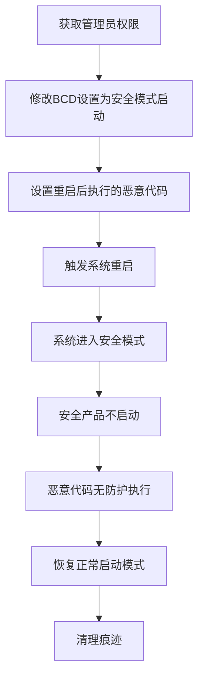

# 安全模式启动 (T1688)

> 想象一下：你公司大楼装了完整的安保系统——摄像头、门禁、报警器、保安巡逻。但大楼还有一个"维修入口"，从那里进去时，只有最基础的电力系统在工作，所有安保设备都关闭。攻击者偷偷把大楼的启动设置改成"下次从维修入口启动"，重启后所有安保设备形同虚设，他可以随心所欲地搬东西。Windows的安全模式就是这种"维修入口"——很多安全产品不会在安全模式下启动，攻击者利用这一点绕过所有终端防护。

## 30秒速查卡

| 维度 | 你需要知道的 |
|------|--------------|
| 这是什么？ | 修改Windows启动配置让系统重启进入安全模式，绕过不在安全模式下运行的安全产品 |
| 为什么危险？ | 安全模式下大部分EDR、AV、Defender不会启动，攻击者可以无防护地操作 |
| 谁需要关心？ | Windows系统管理员、终端安全团队、EDR运维工程师 |
| 你的第一步防御 | 监控bcdedit命令执行和系统启动配置变更，部署支持安全模式的安全产品 |
| 如果只做一件事 | 监控`bcdedit /set {current} safeboot`命令的执行 |

## 难度等级

⭐⭐ 中级：需要理解Windows启动过程、安全模式工作机制、安全产品启动时机

**前置知识要求**：
- Windows启动过程（BCD配置、引导加载器、内核加载）
- 安全模式的工作原理（最小驱动和服务集）
- 安全产品启动时机和服务依赖
- bcdedit命令行工具的使用

## 前置知识检查

读这个文件之前，你需要知道：
- **什么是安全模式**：Windows的故障排查启动模式，只加载最基本的驱动和服务
- **什么是BCD**：启动配置数据（Boot Configuration Data），Windows的启动配置存储
- **什么是bcdedit**：Windows自带的启动配置编辑命令行工具
- **安全产品启动时机**：大部分AV/EDR作为服务启动，安全模式下非必要服务不启动

## 技术描述

### 通俗解释

安全模式是Windows的"诊断模式"——它只加载最基本的驱动和服务，用于排查系统问题。但这个特性被攻击者利用了：很多安全产品（特别是第三方EDR）不会在安全模式下启动，因为它们依赖的驱动或服务在安全模式下不加载。攻击者通过修改BCD（启动配置数据）让系统下次重启进入安全模式，重启后所有这些安全产品都不会运行，攻击者可以无防护地进行勒索软件加密、凭据窃取、持久化植入等操作。这是ATT&CK v19.1从原T1562.009提升为父技术T1688后的完整技术。

### 过渡段

简单来说，安全模式就像大楼的"维修模式"——只保留最基础的电力和电梯，所有安保设备关闭。攻击者把大楼设置成下次启动进入"维修模式"，重启后安保全失效。安全模式启动是防御削弱战术中非常巧妙的技术——它不是直接关闭安全产品，而是利用系统本身的机制让安全产品"自己不启动"。下面看看具体是怎么操作的。

### 技术原理

安全模式启动的工作流程：

1. **修改BCD配置**：攻击者使用`bcdedit /set {current} safeboot minimal`设置下次启动进入安全模式
2. **触发重启**：使用`shutdown /r /t 0`立即重启系统
3. **安全模式启动**：系统重启后进入安全模式，只加载基本驱动和服务
4. **安全产品失效**：大部分EDR/AV服务不启动，终端防护失效
5. **执行恶意操作**：攻击者通过计划任务或Run键在重启后执行恶意代码

### 常见修改方法

| 命令 | 作用 | 说明 |
|------|------|------|
| `bcdedit /set {current} safeboot minimal` | 设置最小安全模式 | 最常用，只加载基本驱动 |
| `bcdedit /set {current} safeboot network` | 设置网络安全模式 | 加载网络驱动，方便C2通信 |
| `bcdedit /set {current} safebootalternateshell yes` | 使用备用shell | 启动到命令行而非Explorer |
| `bcdedit /set {current} safeboot dsrepair` | 设置DS修复模式 | 域控制器专用安全模式 |
| `shutdown /r /t 0 /f` | 立即强制重启 | 触发安全模式启动 |
| `msconfig` | 图形界面设置 | 通过系统配置工具设置 |

### 用途和影响

- **绕过EDR**：让大部分EDR产品不启动，无防护执行恶意操作
- **勒索软件加密**：在无防护状态下加密文件，AV无法拦截
- **凭据窃取**：安全模式下载入Mimikatz，无EDR检测
- **持久化植入**：安全模式下修改系统文件，植入后门
- **防御规避**：安全模式下安全日志记录减少

## 子技术列表

T1688是父技术，目前无子技术。但与以下技术密切相关：
- T1562 削弱防御（常通过安全模式启动实现）
- T1547.001 注册表运行键（在安全模式下通过Run键执行恶意代码）
- T1053 计划任务/作业（在安全模式下通过计划任务执行）
- T1529 系统关机/重启（触发安全模式启动）

## 攻击流程



### 步骤详解

1. **获取权限**：通过提权或凭据窃取获得本地管理员权限
2. **修改BCD**：使用`bcdedit /set {current} safeboot minimal`设置安全模式启动
3. **设置恶意代码**：通过Run键、计划任务或服务设置重启后执行的代码
4. **触发重启**：使用`shutdown /r /t 0`立即重启
5. **安全模式执行**：系统重启进入安全模式，恶意代码无防护执行
6. **恢复启动**：执行完成后恢复正常启动模式，清理痕迹

## 真实案例

### 案例1：BlackCat/ALPHV勒索软件通过安全模式绕过EDR

- **时间**：2022-2024年
- **目标**：全球医疗、制造、政府机构
- **攻击组织**：BlackCat/ALPHV（RaaS勒索软件，疑似俄罗斯背景）
- **手法**：BlackCat在加密前会系统性地让目标系统重启进入安全模式，绕过EDR防护。攻击者通过批处理脚本执行：`bcdedit /set {current} safeboot minimal`设置下次启动进入最小安全模式；`bcdedit /set {current} safebootalternateshell yes`设置使用备用shell（命令行）；通过注册表`HKLM\SOFTWARE\Microsoft\Windows\CurrentVersion\Run`添加加密器启动项，确保安全模式下自动执行；然后执行`shutdown /r /t 0 /f`强制重启。系统重启进入安全模式后，CrowdStrike、SentinelOne等EDR不会启动，BlackCat加密器无防护地加密所有文件。加密完成后，攻击者通过计划任务`bcdedit /deletevalue {current} safeboot`恢复正常启动模式，让系统重启回正常模式，此时EDR重新启动但为时已晚。这种技术让BlackCat成功绕过了多家知名EDR产品的防护。
- **影响**：感染数百家组织，赎金总额超过3亿美元
- **参考**：https://www.cisa.gov/news-events/cybersecurity-advisories/aa23-061a

### 案例2：AvosLocker勒索软件通过安全模式禁用Defender

- **时间**：2021-2023年
- **目标**：全球各类组织
- **攻击组织**：AvosLocker（RaaS勒索软件）
- **手法**：AvosLocker团伙在攻击中通过安全模式启动绕过Windows Defender和其他安全产品。攻击者执行`bcdedit /set {current} safeboot network`设置网络安全模式（保留网络驱动，方便C2通信）；通过`HKLM\SYSTEM\CurrentControlSet\Control\SafeBoot\Minimal`下的服务配置确保关键服务在安全模式下启动；通过`HKLM\SOFTWARE\Microsoft\Windows\CurrentVersion\RunOnce`添加加密器，确保安全模式下执行；执行`shutdown /r /t 5`5秒后重启。系统进入安全模式后，Defender的实时保护不会启动，AvosLocker加密器无防护地加密文件。加密完成后，攻击者通过预置的计划任务删除safeboot设置，让系统恢复正常启动。这种技术让AvosLocker成功绕过了Defender的实时保护和行为检测。
- **影响**：攻破上百家组织，造成数千万美元损失
- **参考**：https://www.cisa.gov/news-events/cybersecurity-advisories/aa22-040a

### 案例3：Conti勒索软件通过安全模式植入持久化

- **时间**：2020-2022年
- **目标**：全球各类组织
- **攻击组织**：Conti（RaaS勒索软件，疑似俄罗斯背景）
- **手法**：Conti团伙在攻击中通过安全模式启动绕过EDR，进行持久化植入和凭据窃取。攻击者执行`bcdedit /set {current} safeboot minimal`设置安全模式启动；通过`HKLM\SYSTEM\Setup`下的`CmdLine`键设置安全模式下执行的命令；执行`shutdown /r /t 0`重启。系统进入安全模式后，Conti的Payload无防护地执行：使用Mimikatz从LSASS内存提取凭据（安全模式下无EDR检测）；修改SAM数据库植入后门账户；替换关键系统DLL实现DLL劫持持久化；修改注册表启动项确保正常模式启动后后门持续运行。完成这些操作后，攻击者恢复正常启动模式，系统重启回正常模式时EDR重新启动，但后门已经植入。这种技术让Conti在被感染系统中长期潜伏而不被发现。
- **影响**：攻破上百家组织，造成数十亿美元损失
- **参考**：https://www.cisa.gov/news-events/cybersecurity-advisories/aa21-265a

## 红队视角

### 实战技巧

1. **网络安全模式比最小模式更实用**：`safeboot network`保留网络驱动，方便C2通信
2. **RunOnce比Run更隐蔽**：`HKLM\...\RunOnce`键在执行后自动删除，不留痕迹
3. **备用shell更灵活**：`safebootalternateshell yes`启动到命令行，方便脚本执行
4. **预置恢复正常模式**：通过计划任务在加密完成后自动恢复正常启动
5. **域控用dsrepair模式**：域控制器使用`safeboot dsrepair`进入DS修复模式

### 常用工具

| 工具 | 用途 | 说明 |
|------|------|------|
| bcdedit.exe | BCD配置编辑 | Windows自带，最常用 |
| msconfig.exe | 系统配置工具 | 图形界面设置安全模式 |
| shutdown.exe | 系统重启 | 触发安全模式启动 |
| reg.exe | 注册表修改 | 设置安全模式下执行的代码 |
| schtasks.exe | 计划任务 | 设置恢复正常启动的任务 |

### 注意事项

- 修改BCD需要管理员权限
- 安全模式启动会中断所有正在运行的服务
- 部分现代EDR支持安全模式下启动（如Microsoft Defender for Endpoint）
- 系统重启会触发用户感知，需要选择合适时机
- Windows 10/11的Tamper Protection可能阻止部分BCD修改

## 蓝队视角

### 检测要点

1. **bcdedit命令监控**：监控bcdedit.exe的命令行参数，特别是`safeboot`
2. **BCD配置变更**：监控BCD存储的修改
3. **安全模式启动事件**：监控Event ID 12（系统启动模式变更）
4. **Run/RunOnce键监控**：监控启动项的修改
5. **EDR服务状态**：监控EDR服务在安全模式下的启动状态

### 监控建议

- 部署Sysmon监控Event ID 1，过滤Image为bcdedit.exe且CommandLine包含`safeboot`
- 监控注册表`HKLM\SOFTWARE\Microsoft\Windows\CurrentVersion\Run`和`RunOnce`的修改
- 监控Windows事件ID 12（OS状态变更）和ID 13（OS环境变更）
- 部署支持安全模式启动的EDR（如Microsoft Defender for Endpoint）
- 监控非预期的系统重启事件

## 避坑指南

| 坑 | 后果 | 解决方法 |
|----|------|----------|
| 只监控bcdedit，忽略msconfig | 漏报图形界面设置 | 同时监控msconfig.exe的执行 |
| EDR不支持安全模式 | 安全模式下完全失明 | 部署支持安全模式的EDR |
| 忽略RunOnce键 | 漏报安全模式下执行的代码 | 监控Run和RunOnce键的修改 |
| 忽略系统重启事件 | 漏报安全模式启动 | 监控非预期的系统重启 |
| Tamper Protection未启用 | BCD修改不被阻止 | 启用Defender的Tamper Protection |

## 检测建议

### 网络层

**用人话说**：安全模式启动是本地操作，不直接产生网络流量。但安全模式启动后EDR失效，攻击者会立即进行C2通信——关注系统重启后的短时间内的新增网络连接。

监控指标：
- 系统重启后5分钟内的新增网络连接
- 非标准端口的出站连接
- 系统重启后立即发起的C2通信

### 主机层

**用人话说**：监控bcdedit命令执行和系统启动配置变更——这是安全模式启动最直接的信号。

```event
事件ID 1（Sysmon）：进程创建
Image: bcdedit.exe
关注CommandLine中的safeboot、safebootalternateshell
```

```event
事件ID 12（Windows）：系统启动模式变更
事件ID 13（Windows）：OS环境变更
```

### 应用层

**用人话说**：监控bcdedit命令和注册表启动项修改——这是攻击者设置安全模式启动最常用的方式。

```yaml
title: 检测通过bcdedit设置安全模式启动
detection:
    selection:
        EventID: 1
        Image|endswith: '\bcdedit.exe'
        CommandLine|contains:
            - 'safeboot'
            - 'safebootalternateshell'
    condition: selection
level: critical
```

```yaml
title: 检测安全模式启动项修改
detection:
    selection:
        EventID: 13
        TargetObject|contains:
            - 'Microsoft\Windows\CurrentVersion\Run'
            - 'Microsoft\Windows\CurrentVersion\RunOnce'
        EventType: 'SetValue'
    condition: selection
level: high
```

## 缓解措施

### 高优先级

1. **部署支持安全模式的EDR**：选择在安全模式下也能启动的EDR产品（如Microsoft Defender for Endpoint）
2. **启用Tamper Protection**：Windows 10/11启用Defender的防篡改保护
3. **监控bcdedit命令**：部署Sysmon监控bcdedit的执行

### 中优先级

4. **限制BCD修改权限**：通过组策略限制谁可以修改BCD
5. **监控启动项修改**：监控Run/RunOnce键的修改
6. **配置EDR告警**：对安全模式启动设置告警
7. **集中收集启动日志**：收集系统启动模式变更事件

### 低优先级

8. **配置启动密码**：设置BIOS/UEFI启动密码
9. **使用安全启动**：启用UEFI Secure Boot
10. **定期审计启动配置**：定期检查BCD配置是否被篡改

## 动手实验

### 实验1：查看当前BCD配置

```powershell
# 查看当前BCD配置
bcdedit /enum

# 查看当前启动配置
bcdedit /enum {current}

# 查看默认启动配置
bcdedit /enum {default}
```

**预期输出**：显示当前BCD配置，包括启动项、启动模式等

### 实验2：监控安全模式设置（实验环境）

```powershell
# 启用进程创建审计
auditpol /set /subcategory:"Process Creation" /success:enable

# 设置安全模式启动（实验环境，不要真的重启！）
bcdedit /set {current} safeboot minimal

# 查看安全日志中的bcdedit执行
Get-WinEvent -LogName Security | Where-Object {$_.Id -eq 4688} | Where-Object {$_.Message -match 'bcdedit'} | Select-Object -First 10

# 恢复正常启动模式
bcdedit /deletevalue {current} safeboot
```

**预期输出**：bcdedit命令执行被记录在安全日志中

### 实验3：检测安全模式启动

```powershell
# 查看系统启动模式变更事件
Get-WinEvent -LogName System | Where-Object {$_.Id -eq 12} | Select-Object -First 10

# 监控Run/RunOnce键的修改
Get-ItemProperty -Path "HKLM:\SOFTWARE\Microsoft\Windows\CurrentVersion\Run" | Format-List
Get-ItemProperty -Path "HKLM:\SOFTWARE\Microsoft\Windows\CurrentVersion\RunOnce" | Format-List
```

**预期输出**：显示系统启动模式变更事件和启动项配置

## 术语解释

| 术语 | 解释 |
|------|------|
| 安全模式 | Windows的故障排查启动模式，只加载基本驱动和服务 |
| BCD | 启动配置数据（Boot Configuration Data），Windows的启动配置存储 |
| bcdedit | Windows自带的启动配置编辑命令行工具 |
| Run键 | 注册表中`HKLM\...\Run`，启动时自动执行的程序 |
| RunOnce键 | 注册表中`HKLM\...\RunOnce`，启动时执行一次后自动删除 |
| Tamper Protection | Defender的防篡改保护功能 |
| SafeBoot | BCD中控制安全模式启动的设置项 |
| DS修复模式 | 域控制器的安全模式，用于修复Active Directory |

## 参考资料

### 📚 深入了解
- [MITRE ATT&CK T1688](https://attack.mitre.org/techniques/T1688/) - 官方技术页面
- [Windows安全模式](https://docs.microsoft.com/en-us/windows-hardware/drivers/install/determining-whether-the-operating-system-is-running-in-safe-mode) - 微软官方文档
- [BCD编辑](https://docs.microsoft.com/en-us/windows-hardware/drivers/devtest/bcdedit--set) - bcdedit命令参考

### 📰 真实攻击
- [CISA BlackCat通告](https://www.cisa.gov/news-events/cybersecurity-advisories/aa23-061a) - BlackCat通过安全模式绕过EDR
- [CISA AvosLocker通告](https://www.cisa.gov/news-events/cybersecurity-advisories/aa22-040a) - AvosLocker通过安全模式禁用Defender
- [CISA Conti通告](https://www.cisa.gov/news-events/cybersecurity-advisories/aa21-265a) - Conti通过安全模式植入持久化

### 🔧 动手试试
- [Sysmon配置](https://github.com/SwiftOnSecurity/sysmon-config) - 进程监控配置
- [Atomic Red Team T1688](https://github.com/redcanaryco/atomic-red-team) - 检测规则测试
- [Microsoft Defender for Endpoint](https://docs.microsoft.com/en-us/microsoft-365/security/defender-endpoint/) - 支持安全模式的EDR

## 版本历史

| 版本 | 日期 | 变更 |
|------|------|------|
| 3.1 | 2026-07-23 | 初始版本，ATT&CK v19.1将原T1562.009提升为父技术T1688 |
