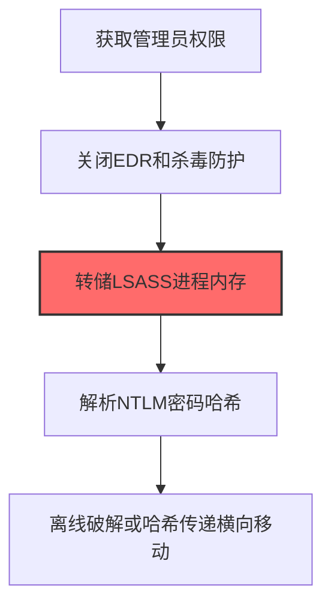
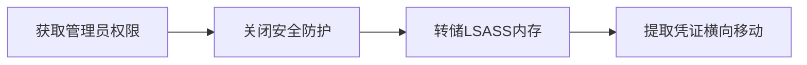

# LSASS内存转储 (T1003.001)

## 一句话通俗理解

> **从系统内存中提取正在使用的密码哈希**

## 30秒速查卡

| 维度 | 你需要知道的 |
|------|-------------|
| 这是什么？ | 攻击者把Windows系统中存储所有登录密码的那个进程（LSASS）的内存"拍快照"，然后从中提取密码哈希 |
| 为什么危险？ | LSASS里存着当前所有登录用户的NTLM哈希和Kerberos票据，拿到这些就能冒充任何人登录任何系统 |
| 谁需要关心？ | 域管理员、Windows安全工程师、SOC分析师 |
| 你的第一步防御 | 启用Windows Credential Guard，它能把LSASS中的凭证隔离到虚拟化安全环境中，让攻击者读不到 |
| 如果只做一件事 | 监控对 `lsass.exe` 进程的异常内存访问（Sysmon事件ID 10），任何非系统进程打开lsass都值得立即告警 |

## 难度等级

⭐⭐ 中级 - 需要一定的技术基础和经验

## 前置知识检查

**读这个文件需要什么？**

- [ ] Windows认证体系（NTLM/Kerberos/LSASS）
- [ ] 哈希基础（NTLM Hash/SHA）
- [ ] 网络认证协议（SMB/LDAP/Kerberos）

## 技术描述

**LSASS内存转储**（T1003.001）是 **操作系统凭证转储**（T1003）的一个具体变体，属于 **凭证访问** 阶段的攻击技术。

简单来说，就像从保险箱里翻出所有人的钥匙。

### 具体怎么理解？

从系统内存中提取正在使用的密码哈希

攻击者使用这种技术时，通常是在凭证访问阶段，想要达到特定的攻击目标。与父技术 T1003 相比，T1003.001 有自己独特的特点和使用场景。

### 为什么有效？

这种技术之所以有效，是因为：
1. **隐蔽性**：利用了正常系统功能或常见协议，不容易被发现
2. **技术门槛适中**：不需要特别高深的技术知识就能实施

**过渡段：** 不要误解凭证访问只是'窃取密码'——在现代企业中，凭证存在于内存、磁盘、网络流量等多个位置。
3. **广泛适用**：可以在多种环境和系统中使用

## 真实攻击流程

### 典型场景

攻击者在 **凭证访问** 阶段使用 LSASS内存转储 技术，以下是典型的攻击步骤：



**步骤详解：**

1. **获取管理员权限** - 通过漏洞利用或已有凭证获得目标主机的本地管理员权限，LSASS转储需要高权限才能访问进程内存
2. **关闭EDR和杀毒防护** - 禁用Windows Defender、CrowdStrike等安全防护，避免Procdump/Mimikatz等工具被拦截
3. **转储LSASS进程内存** - 使用Procdump、comsvcs.dll或Mimikatz将lsass.exe进程内存导出为dump文件，该进程中缓存了所有已登录用户的凭证
4. **解析NTLM密码哈希** - 从dump文件中解析出NTLM哈希、Kerberos票据等认证数据
5. **离线破解或哈希传递横向移动** - 使用Hashcat离线暴力破解明文密码，或直接利用NTLM哈希进行Pass-the-Hash攻击跳转到其他主机

## 攻击流程

```
获取管理员权限 --> 关闭安全防护 --> 转储LSASS内存 --> 提取凭证横向移动
```



**步骤详解：**
1. **获取管理员权限**
   - 通俗描述：攻击者通过漏洞利用或已有凭证获得目标主机的本地管理员权限
   - 技术细节：利用提权漏洞或使用已窃取的管理员账户登录，LSASS转储需要SeDebugPrivilege权限
   - 常用工具：Mimikatz、Cobalt Strike、已获取的管理员凭证
2. **关闭安全防护**
   - 通俗描述：禁用杀毒软件和EDR，避免转储工具被拦截
   - 技术细节：停止Windows Defender服务、卸载EDR传感器、添加排除项或使用直接系统调用绕过Hook
   - 常用工具：Defender Control、PCHunter、直接系统调用工具
3. **转储LSASS内存**
   - 通俗描述：把存储密码的系统进程内存"拍照"保存到文件
   - 技术细节：使用Procdump的-ma参数、comsvcs.dll的MiniDump函数或Mimikatz的sekurlsa::logonpasswords导出lsass.exe进程内存
   - 常用工具：Procdump、comsvcs.dll、Mimikatz、Dumpert、LSASSY
4. **提取凭证横向移动**
   - 通俗描述：从内存转储文件中解析出密码哈希，用于冒充其他用户登录
   - 技术细节：解析NTLM哈希和Kerberos票据，使用Pass-the-Hash或离线Hashcat破解明文密码
   - 常用工具：Mimikatz、Hashcat、pypykatz、Evil-WinRM

## 真实案例

### 案例1：APT29 -- SolarWinds供应链攻击中的LSASS转储（2020-2021）

- **时间**: 2020-2021年
- **目标**: 美国政府机构、SolarWinds客户（约18,000个组织）
- **攻击组织**: APT29（Cozy Bear，俄罗斯国家背景）
- **手法**: APT29在SolarWinds供应链攻击的后渗透阶段，使用Cobalt Strike Beacon内置的`procdump`功能转储LSASS进程内存，提取域内登录用户的NTLM哈希和Kerberos票据。他们还通过修改过的TEARDROP恶意加载器调用`comsvcs.dll`的MiniDump函数进行无文件LSASS转储，规避基于mimikatz二进制签名的检测
- **影响**: 获取大量域管理员凭证，实现从单点入侵到横向移动至多个联邦机构的扩展
- **参考链接**: [CISA AA21-071A](https://www.cisa.gov/news-events/cybersecurity-advisories/aa21-071a)

### 案例2：Conti勒索软件 -- LSASS转储作为勒索前置步骤（2021-2022）

- **时间**: 2021-2022年
- **目标**: 全球医疗、制造、政府机构（超1,000个受害组织）
- **攻击组织**: Conti勒索软件团伙
- **手法**: Conti运营团队在初始入侵后48小时内，统一使用`procdump.exe -ma lsass.exe`或`rundll32 comsvcs.dll,MiniDump`批量转储域内主机的LSASS内存，提取凭证后通过Pass-the-Hash在1小时内横移至域控制器。其泄露的操作手册明确要求操作员"先dump lsass再考虑下一步"
- **影响**: 平均勒索金额超过60万美元，2022年FBI确认攻击超1,000个组织
- **参考链接**: [Mandiant Conti报告](https://www.mandiant.com/resources/conti-ransomware)

### 案例3：FIN7零售餐饮业攻击中的LSASS转储（2015-2018）

- **时间**: 2015-2018年
- **目标**: 美国大型零售商、餐饮连锁店（如Sears、Arby's、Chili's等超过100家企业）
- **攻击组织**: FIN7（又称Carbanak Group、Anunak）
- **手法**: FIN7通过钓鱼邮件植入CARBANAK后门后，在受害网络内部使用定制版mimikatz的`sekurlsa::logonpasswords`命令转储LSASS内存，提取域内登录用户的NTLM哈希和明文凭证。他们特别针对POS管理服务器进行LSASS转储，获取能访问支付系统的服务账户凭证，从而横向移动到POS终端网络
- **影响**: 窃取超过1500万张信用卡数据，造成直接经济损失超过10亿美元。FIN7的运营模式高度专业化，拥有专门的渗透团队和LSASS转储自动化脚本
- **参考链接**: [US DOJ FIN7起诉书](https://www.justice.gov/opa/pr/three-members-notorious-international-cybercrime-group-fin7-cybercriminal-organization-charged)

## 红队视角

> ⚠️ **免责声明**：以下内容仅用于合法的安全测试、渗透测试和教育目的。未经授权对他人系统进行测试是违法行为。

### 实战技巧

1. **深入理解原理**：在实战应用前，充分理解LSASS内存转储的技术原理和适用场景
2. **环境适配**：根据目标系统的操作系统版本、安全配置等因素调整攻击策略
3. **组合使用**：将该技术与其他技术组合使用，构建完整的攻击链
4. **隐蔽性考虑**：注意操作痕迹的清理，避免被安全设备检测

### 常用工具

| 工具名称 | 用途 | 平台 | 链接 |
| -------- | ---- | ---- | ---- |
| Mimikatz | Windows凭证提取工具，支持LSASS内存解析 | Windows | [Mimikatz](https://github.com/gentilkiwi/mimikatz) |
| Procdump | Sysinternals进程转储工具，可导出lsass.dmp | Windows | [Procdump](https://docs.microsoft.com/en-us/sysinternals/downloads/procdump) |
| Dumpert | 直接系统调用LSASS转储工具，绕过EDR Hook | Windows | [Dumpert](https://github.com/outflanknl/Dumpert) |
| LSASSY | 反射式加载的LSASS转储工具，无文件落地 | Windows | [LSASSY](https://github.com/Hackndo/lsassy) |

### 注意事项

- 在授权的测试环境中使用这些技术
- 注意操作安全（OPSEC），避免被检测系统发现
- 使用匿名化技术和代理隐藏真实身份

## 蓝队视角

### 检测要点

1. **系统日志监控**：关注与LSASS内存转储相关的系统日志和审计记录
2. **异常行为检测**：监控系统中与该技术相关的异常进程、网络连接和文件操作
3. **工具特征识别**：识别攻击者可能使用的工具在系统中的运行特征

### 监控建议

- 部署端点检测和响应（EDR）系统，监控与LSASS内存转储相关的异常行为
- 配置SIEM规则，关联分析来自多个来源的告警
- 定期进行安全评估和渗透测试，验证检测规则的有效性

## 避坑指南

组织中最危险盲区：认为强密码就足够安全。

## 检测建议

### 检测思路

检测 LSASS内存转储 的关键是识别异常行为模式。以下是三个层面的检测方法：

### 网络层检测

**方法**：监控网络流量中的异常模式

```bash
# 检测异常的网络连接和数据传输
# 根据具体协议和端口设置检测规则
```

### 主机层检测

**Windows事件ID**：
- 事件ID 4688：进程创建（监控可疑进程）
- 事件ID 4104：PowerShell执行（监控可疑脚本）

**Linux日志**：
- /var/log/auth.log：认证日志
- /var/log/syslog：系统日志

```bash
# 检测异常进程和命令执行
grep -i "suspicious" /var/log/auth.log
```

### 应用层检测

**用人话说：** 这条规则在监控是否有可疑进程在读取系统内存。LSASS进程相当于Windows的"密码保险箱"，里面存着所有登录过这台电脑的人的密码哈希。正常情况下，只有系统自己会去读这个保险箱。如果发现某个陌生进程（比如powershell.exe、rundll32.exe）试图打开lsass.exe的内存，那就是攻击者在"撬保险箱"偷密码。

**Sigma规则示例**：

```yaml
title: 检测LSASS内存转储
status: experimental
description: 检测可能的LSASS内存转储活动
logsource:
    category: process_creation
    product: windows
detection:
    selection:
        EventID: 4688
    condition: selection
level: medium
tags:
    - attack.T1003001
```

## 缓解措施

### 优先级1：关键措施

**限制攻击面**：减少暴露的服务和端口，降低被利用的风险

```bash
# 防火墙规则示例：只允许必要的出站连接
iptables -A OUTPUT -p tcp --dport 443 -j ACCEPT  # 允许HTTPS
iptables -A OUTPUT -p tcp --dport 80 -j ACCEPT   # 允许HTTP
iptables -A OUTPUT -p tcp -j DROP                 # 阻止其他TCP
```

### 优先级2：重要措施

**加强监控**：部署EDR和SIEM系统，实时监控异常行为

### 优先级3：建议措施

**安全意识培训**：教育员工识别相关攻击手法

## 动手实验

> ⚠️ **所有实验必须在隔离的实验室环境中进行**

### 实验1：理解基本原理（初级）

**目标**：理解 LSASS内存转储 的工作原理

**步骤**：
1. 在隔离环境中搭建测试系统
2. 使用基础工具模拟攻击行为
3. 观察系统日志和网络流量

**学习要点**：理解该技术的核心机制

### 实验2：实际操作（中级）

**目标**：掌握 LSASS内存转储 的实际使用方法

**步骤**：
1. 使用专业工具进行攻击模拟
2. 尝试不同的绕过技术
3. 分析检测日志的特征

**学习要点**：掌握工具使用和日志分析

### 实验3：防御验证（高级）

**目标**：验证检测规则的有效性

**步骤**：
1. 部署检测规则
2. 执行攻击模拟
3. 验证检测告警是否触发

**学习要点**：理解攻防对抗的实际效果

## 术语解释

| 术语 | 通俗解释 |
|------|---------|
| **ATT&CK** | MITRE公司维护的攻击技术知识库，像一本"黑客手法百科全书" |
| **LSASS内存转储** | T1003.001，ATT&CK框架中定义的一种具体攻击技术 |
| **操作系统凭证转储** | T1003，LSASS内存转储所属的父技术类别 |
| **凭证访问** | 攻击链中的一个阶段，攻击者在这个阶段的目标 |
| **C2** | 命令与控制，攻击者用来远程控制被入侵系统的"遥控器" |
| **EDR** | 端点检测与响应，部署在电脑上的安全监控软件 |

## 被引用情况

以下父技术文档引用了本子技术：

- [T1003 - 操作系统凭证转储](../T1003-OS-Credential-Dumping.md)

## 认知偏误分析

### 锚定效应（Anchoring）

分析师在检测 LSASS 内存转储时，容易将检测锚定在 Mimikatz 这个工具上，认为只要监控 `mimikatz.exe` 或 `sekurlsa::logonpasswords` 就能捕获所有凭证窃取行为。实际上，攻击者已广泛使用 Procdump + Mimikatz 离线解析、`comsvcs.dll` 的 MiniDump 导出、甚至直接用 C 语言调用 `MiniDumpWriteDump` API 等方式转储 LSASS 内存，完全不使用 Mimikatz 二进制文件。锚定在单一工具上会导致大量绕过攻击被忽略。

### 可得性启发（Availability Heuristic）

由于 Mimikatz 是最著名的凭证窃取工具，且大量安全报告和分析文章都以 Mimikatz 为例讲解 LSASS 转储，分析师容易高估 Mimikatz 在实际攻击中的使用率。实际上，Mandiant 2024 年报告显示，越来越多的 APT 组织倾向于使用 Windows 内置工具（如 `comsvcs.dll`）或自定义工具来转储 LSASS，以规避基于签名的检测。过度关注 Mimikatz 签名会导致检测策略落后于攻击者的实际手法。

### 后见之明偏误（Hindsight Bias）

在分析 LSASS 内存转储攻击事件后，分析师容易认为"Credential Guard 应该早就部署了"、"LSASS 保护应该早就开启了"，低估了在企业环境中推广这些安全措施的难度。实际上，Credential Guard 需要虚拟化支持、UEFI 锁定和特定的 Windows 版本，许多组织在兼容性测试后才发现无法大规模部署。后见之明偏误可能导致安全团队对防御部署进度的评估过于乐观。

## 参考资料

### 📚 官方文档（深入了解）

- [MITRE ATT&CK - LSASS内存转储 (T1003.001)](https://attack.mitre.org/techniques/T1003/001/)
- [MITRE ATT&CK - 操作系统凭证转储 (T1003)](https://attack.mitre.org/techniques/T1003/)

### 📰 安全报告（真实攻击）

- [MITRE ATT&CK 官方文档](https://attack.mitre.org/) - ATT&CK 框架官方资源

### 🔧 工具与资源（动手试试）

- [Atomic Red Team](https://github.com/redcanaryco/atomic-red-team) - 检测规则测试框架
- [MITRE ATT&CK Navigator](https://mitre-attack.github.io/attack-navigator/) - ATT&CK 可视化工具

### 📚 学习资料（深入了解）

- [MITRE ATT&CK 知识库](https://attack.mitre.org/resources/) - ATT&CK 官方资源中心
