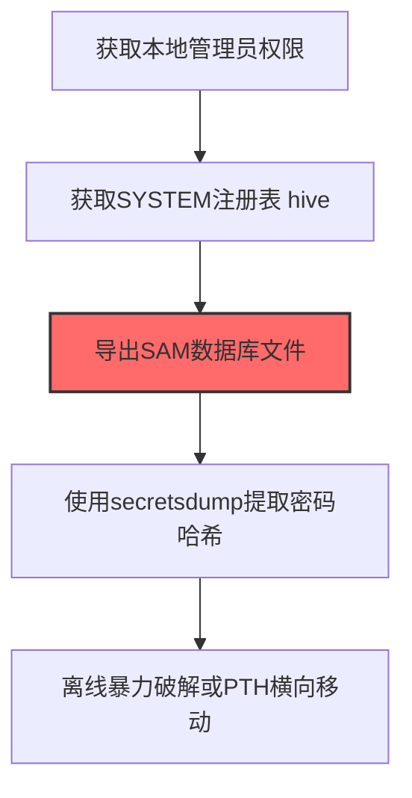
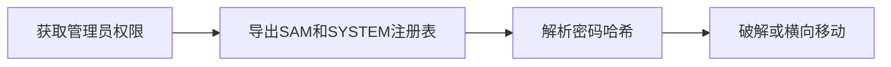

# SAM注册表 (T1003.002)

## 一句话通俗理解

> **从本地账户数据库中提取密码哈希**

## 30秒速查卡

| 维度 | 你需要知道的 |
|------|-------------|
| 这是什么？ | 从Windows本地账户数据库（SAM文件）中提取密码哈希 |
| 为什么危险？ | SAM文件存储了所有本地账户的密码哈希，拿到它就能离线破解所有本地用户的密码，而且不需要联网 |
| 谁需要关心？ | Windows系统管理员、SOC分析师 |
| 你的第一步防御 | 启用SAM文件的访问控制和审计，监控对SAM注册表键的异常读取 |
| 如果只做一件事 | 监控注册表HKLM\SAM的异常访问（Sysmon事件ID 12/13），非系统进程读取SAM立即告警 |

## 难度等级

⭐⭐ 中级 - 需要一定的技术基础和经验

## 前置知识检查

**读这个文件需要什么？**

- [ ] Windows认证体系（NTLM/Kerberos/LSASS）
- [ ] 哈希基础（NTLM Hash/SHA）
- [ ] 网络认证协议（SMB/LDAP/Kerberos）

## 技术描述

**SAM注册表**（T1003.002）是 **操作系统凭证转储**（T1003）的一个具体变体，属于 **凭证访问** 阶段的攻击技术。

简单来说，就像从保险箱里翻出所有人的钥匙。

### 具体怎么理解？

从本地账户数据库中提取密码哈希

攻击者使用这种技术时，通常是在凭证访问阶段，想要达到特定的攻击目标。与父技术 T1003 相比，T1003.002 有自己独特的特点和使用场景。

### 为什么有效？

这种技术之所以有效，是因为：
1. **隐蔽性**：利用了正常系统功能或常见协议，不容易被发现
2. **技术门槛适中**：不需要特别高深的技术知识就能实施

**过渡段：** 不要误解凭证访问只是'窃取密码'——在现代企业中，凭证存在于内存、磁盘、网络流量等多个位置。
3. **广泛适用**：可以在多种环境和系统中使用

## 真实攻击流程

### 典型场景

攻击者在 **凭证访问** 阶段使用 SAM注册表 技术，以下是典型的攻击步骤：



**步骤详解：**

1. **获取本地管理员权限** - 需要管理员或SYSTEM权限才能读取SAM注册表项，通常通过提权漏洞或已有高权限会话达成
2. **获取SYSTEM注册表 hive** - 通过reg save命令导出HKLM\SYSTEM注册表，因为SAM数据库的加密密钥存储在SYSTEM hive中
3. **导出SAM数据库文件** - 使用reg save命令导出HKLM\SAM数据库，其中存储了所有本地用户的密码哈希
4. **使用secretsdump提取密码哈希** - 使用Impacket的secretsdump.py或Mimikatz的lsadump::sam命令解析SAM文件，提取NTLM哈希
5. **离线暴力破解或PTH横向移动** - 用Hashcat破解哈希获取明文密码，或利用哈希进行Pass-the-Hash攻击

## 攻击流程

```
获取管理员权限 --> 导出SAM和SYSTEM注册表 --> 解析密码哈希 --> 破解或横向移动
```



**步骤详解：**
1. **获取管理员权限**
   - 通俗描述：攻击者获取目标主机的本地管理员或SYSTEM权限
   - 技术细节：通过提权漏洞或已有高权限会话获得访问能力，SAM注册表项受ACL保护仅SYSTEM可读
   - 常用工具：Mimikatz、Beacon、PrintNightmare提权漏洞
2. **导出SAM和SYSTEM注册表**
   - 通俗描述：把存密码的数据库和加密密钥一起"搬"出来
   - 技术细节：使用reg save命令导出HKLM\SAM和HKLM\SYSTEM两个hive，SYSTEM中存有解密SAM的BOOTKEY
   - 常用工具：reg.exe、regedit、PowerShell
3. **解析密码哈希**
   - 通俗描述：从导出的文件中提取出加密的密码哈希
   - 技术细节：使用Impacket secretsdump.py或Mimikatz lsadump::sam结合SYSTEM hive解密SAM数据库，提取NTLM哈希
   - 常用工具：secretsdump.py、Mimikatz、pypykatz
4. **破解或横向移动**
   - 通俗描述：把哈希破解成明文密码或直接用于冒充登录
   - 技术细节：用Hashcat模式1000进行NTLM离线破解，或利用哈希进行Pass-the-Hash跳转其他主机
   - 常用工具：Hashcat、John the Ripper、Evil-WinRM、CrackMapExec

## 真实案例

### 案例1：LockBit勒索软件 -- SAM转储作为内网横移起点（2022-2023）

- **时间**: 2022-2023年
- **目标**: 全球制造、医疗、教育机构（超过2,000个受害组织）
- **攻击组织**: LockBit勒索软件团伙
- **手法**: LockBit运营者在获得初始访问后，统一执行`reg save HKLM\SAM sam.hive`和`reg save HKLM\SYSTEM system.hive`两条命令，将SAM和SYSTEM注册表hive导出为文件，再通过Impacket secretsdump.py离线解析所有本地账户的NTLM哈希。这些哈希被用于Pass-the-Hash横向移动至域内其他使用相同本地管理员密码的主机
- **影响**: 据CISA报告，LockBit在2023年累计勒索超过9100万美元，SAM转储是其标准操作流程的固定步骤
- **参考链接**: [CISA LockBit Advisory](https://www.cisa.gov/news-events/cybersecurity-advisories/aa23-165a)

### 案例2：FIN7 -- 餐饮零售业定向攻击中的SAM提取（2017-2018）

- **时间**: 2017-2018年
- **目标**: 美国连锁餐厅、酒店、零售商（如Red Robin、Chipotle等）
- **攻击组织**: FIN7（Carbanak Group，俄罗斯背景）
- **手法**: FIN7通过钓鱼邮件投放含恶意宏的Word文档，入侵后使用自定义工具`carbanak.dll`调用Windows API `RegSaveKey`导出SAM和SYSTEM hive，绕过`reg.exe`命令行审计。提取的本地管理员哈希被用于横移至同网络段其他主机，最终植入POS机窃取支付卡数据
- **影响**: 窃取超过1500万张支付卡信息，造成损失超过10亿美元
- **参考链接**: [US DOJ FIN7起诉书](https://www.justice.gov/opa/pr/five-members-notorious-cybercriminal-group-fin7-custody-multiple-charges)

### 案例3：BlackByte勒索软件 -- 通过Exchange漏洞入侵后SAM转储横移内网（2021-2023）

- **时间**: 2021-2023年
- **目标**: 美国及全球制造、食品农业、金融、政府设施等关键基础设施 sector（CISA确认至少3个关键基础设施行业受害）
- **攻击组织**: BlackByte勒索软件团伙（RaaS模式运营）
- **手法**: BlackByte运营者通过已知Microsoft Exchange Server漏洞（如ProxyLogon）获得初始访问后，在提权阶段执行`reg save HKLM\SAM sam.hive`和`reg save HKLM\SYSTEM system.hive`导出SAM和SYSTEM注册表hive。随后使用Impacket secretsdump.py离线提取本地账户NTLM哈希，结合硬编码在勒索软件二进制中的多个域管理员凭证，通过PsExec在内网批量横移部署加密器
- **影响**: 据FBI和CISA联合报告，BlackByte自2021年11月起累计攻击多家美国及外国企业，Microsoft事件响应团队在2023年7月披露的一起案例中追踪到完整5天入侵链条
- **参考链接**: [CISA/FBI BlackByte联合安全公告 AA22-038A](https://www.cisa.gov/news-events/cybersecurity-advisories/aa22-038a)

## 红队视角

> ⚠️ **免责声明**：以下内容仅用于合法的安全测试、渗透测试和教育目的。未经授权对他人系统进行测试是违法行为。

### 实战技巧

1. **深入理解原理**：在实战应用前，充分理解SAM注册表的技术原理和适用场景
2. **环境适配**：根据目标系统的操作系统版本、安全配置等因素调整攻击策略
3. **组合使用**：将该技术与其他技术组合使用，构建完整的攻击链
4. **隐蔽性考虑**：注意操作痕迹的清理，避免被安全设备检测

### 常用工具

| 工具名称 | 用途 | 平台 | 链接 |
| -------- | ---- | ---- | ---- |
| reg.exe (reg save) | Windows内置命令，导出SAM和SYSTEM注册表hive | Windows | 系统自带 |
| Impacket secretsdump.py | 离线解析SAM hive，提取NTLM哈希 | 跨平台 | [GitHub](https://github.com/fortra/impacket) |
| Mimikatz (lsadump::sam) | 在线读取SAM并提取哈希，需要SYSTEM权限 | Windows | [GitHub](https://github.com/gentilkiwi/mimikatz) |
| pwdump | 经典SAM哈希提取工具，支持多种Windows版本 | Windows | [Pwdump7](http://www.foofus.net/~fizzgig/pwdump/) |

### 注意事项

- 在授权的测试环境中使用这些技术
- 注意操作安全（OPSEC），避免被检测系统发现
- 使用匿名化技术和代理隐藏真实身份

## 蓝队视角

### 检测要点

1. **系统日志监控**：关注与SAM注册表相关的系统日志和审计记录
2. **异常行为检测**：监控系统中与该技术相关的异常进程、网络连接和文件操作
3. **工具特征识别**：识别攻击者可能使用的工具在系统中的运行特征

### 监控建议

- 部署端点检测和响应（EDR）系统，监控与SAM注册表相关的异常行为
- 配置SIEM规则，关联分析来自多个来源的告警
- 定期进行安全评估和渗透测试，验证检测规则的有效性

## 避坑指南

组织中最危险盲区：认为强密码就足够安全。

## 检测建议

### 检测思路

检测 SAM注册表 的关键是识别异常行为模式。以下是三个层面的检测方法：

### 网络层检测

**方法**：监控网络流量中的异常模式

```bash
# 检测异常的网络连接和数据传输
# 根据具体协议和端口设置检测规则
```

### 主机层检测

**Windows事件ID**：
- 事件ID 4688：进程创建（监控可疑进程）
- 事件ID 4104：PowerShell执行（监控可疑脚本）

**Linux日志**：
- /var/log/auth.log：认证日志
- /var/log/syslog：系统日志

```bash
# 检测异常进程和命令执行
grep -i "suspicious" /var/log/auth.log
```

### 应用层检测

**用人话说：** 这条规则在监控是否有非系统进程在读取Windows的SAM数据库。SAM是Windows存储所有本地账户密码哈希的地方，正常情况下只有lsass.exe和系统进程会访问它。如果有陌生进程试图读取SAM，那就是攻击者在偷本地账户的密码哈希。

**Sigma规则示例**：

```yaml
title: 检测SAM注册表
status: experimental
description: 检测可能的SAM注册表活动
logsource:
    category: process_creation
    product: windows
detection:
    selection:
        EventID: 4688
    condition: selection
level: medium
tags:
    - attack.T1003002
```

## 缓解措施

### 优先级1：关键措施

**限制攻击面**：减少暴露的服务和端口，降低被利用的风险

```bash
# 防火墙规则示例：只允许必要的出站连接
iptables -A OUTPUT -p tcp --dport 443 -j ACCEPT  # 允许HTTPS
iptables -A OUTPUT -p tcp --dport 80 -j ACCEPT   # 允许HTTP
iptables -A OUTPUT -p tcp -j DROP                 # 阻止其他TCP
```

### 优先级2：重要措施

**加强监控**：部署EDR和SIEM系统，实时监控异常行为

### 优先级3：建议措施

**安全意识培训**：教育员工识别相关攻击手法

## 动手实验

> ⚠️ **所有实验必须在隔离的实验室环境中进行**

### 实验1：理解基本原理（初级）

**目标**：理解 SAM注册表 的工作原理

**步骤**：
1. 在隔离环境中搭建测试系统
2. 使用基础工具模拟攻击行为
3. 观察系统日志和网络流量

**学习要点**：理解该技术的核心机制

### 实验2：实际操作（中级）

**目标**：掌握 SAM注册表 的实际使用方法

**步骤**：
1. 使用专业工具进行攻击模拟
2. 尝试不同的绕过技术
3. 分析检测日志的特征

**学习要点**：掌握工具使用和日志分析

### 实验3：防御验证（高级）

**目标**：验证检测规则的有效性

**步骤**：
1. 部署检测规则
2. 执行攻击模拟
3. 验证检测告警是否触发

**学习要点**：理解攻防对抗的实际效果

## 术语解释

| 术语 | 通俗解释 |
|------|---------|
| **ATT&CK** | MITRE公司维护的攻击技术知识库，像一本"黑客手法百科全书" |
| **SAM注册表** | T1003.002，ATT&CK框架中定义的一种具体攻击技术 |
| **操作系统凭证转储** | T1003，SAM注册表所属的父技术类别 |
| **凭证访问** | 攻击链中的一个阶段，攻击者在这个阶段的目标 |
| **C2** | 命令与控制，攻击者用来远程控制被入侵系统的"遥控器" |
| **EDR** | 端点检测与响应，部署在电脑上的安全监控软件 |

## 被引用情况

以下父技术文档引用了本子技术：

- [T1003 - 操作系统凭证转储](../T1003-OS-Credential-Dumping.md)

## 参考资料

### 📚 官方文档（深入了解）

- [MITRE ATT&CK - SAM注册表 (T1003.002)](https://attack.mitre.org/techniques/T1003/002/)
- [MITRE ATT&CK - 操作系统凭证转储 (T1003)](https://attack.mitre.org/techniques/T1003/)

### 📰 安全报告（真实攻击）

- [MITRE ATT&CK 官方文档](https://attack.mitre.org/) - ATT&CK 框架官方资源

### 🔧 工具与资源（动手试试）

- [Atomic Red Team](https://github.com/redcanaryco/atomic-red-team) - 检测规则测试框架
- [MITRE ATT&CK Navigator](https://mitre-attack.github.io/attack-navigator/) - ATT&CK 可视化工具

### 📚 学习资料（深入了解）

- [MITRE ATT&CK 知识库](https://attack.mitre.org/resources/) - ATT&CK 官方资源中心
