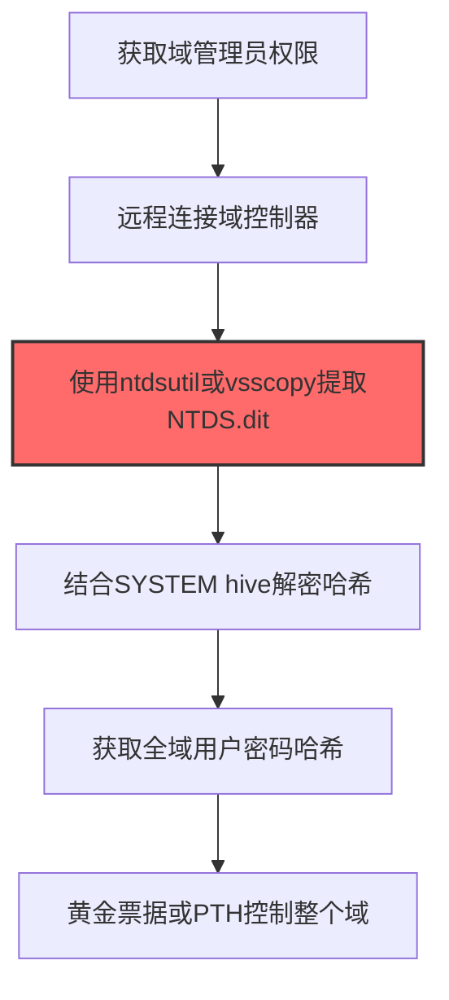

# NTDS数据库 (T1003.003)

## 一句话通俗理解

> **从域控制器中提取所有域用户的密码哈希**

## 30秒速查卡

| 维度 | 你需要知道的 |
|------|-------------|
| 这是什么？ | 从域控制器的NTDS.dit文件中提取所有域用户的密码哈希 |
| 为什么危险？ | NTDS.dit包含整个域的所有用户密码哈希，拿到它就等于控制了整个域，所有域用户任你冒充 |
| 谁需要关心？ | 域管理员、Active Directory安全工程师、SOC分析师 |
| 你的第一步防御 | 启用域控制器的Credential Guard，限制对NTDS.dit文件的直接访问 |
| 如果只做一件事 | 监控NTDS.dit文件的异常复制或访问（Sysmon事件ID 1），任何非lsass进程访问NTDS.dit立即告警 |

## 难度等级

⭐⭐ 中级 - 需要一定的技术基础和经验

## 前置知识检查

**读这个文件需要什么？**

- [ ] Windows认证体系（NTLM/Kerberos/LSASS）
- [ ] 哈希基础（NTLM Hash/SHA）
- [ ] 网络认证协议（SMB/LDAP/Kerberos）

## 技术描述

**NTDS数据库**（T1003.003）是 **操作系统凭证转储**（T1003）的一个具体变体，属于 **凭证访问** 阶段的攻击技术。

简单来说，就像从保险箱里翻出所有人的钥匙。

### 具体怎么理解？

从域控制器中提取所有域用户的密码哈希

攻击者使用这种技术时，通常是在凭证访问阶段，想要达到特定的攻击目标。与父技术 T1003 相比，T1003.003 有自己独特的特点和使用场景。

### 为什么有效？

这种技术之所以有效，是因为：
1. **隐蔽性**：利用了正常系统功能或常见协议，不容易被发现
2. **技术门槛适中**：不需要特别高深的技术知识就能实施

**过渡段：** 不要误解凭证访问只是'窃取密码'——在现代企业中，凭证存在于内存、磁盘、网络流量等多个位置。
3. **广泛适用**：可以在多种环境和系统中使用

## 真实攻击流程

### 典型场景

攻击者在 **凭证访问** 阶段使用 NTDS数据库 技术，以下是典型的攻击步骤：



**步骤详解：**

1. **获取域管理员权限** - 需要Domain Admin或Enterprise Admin权限才能访问域控制器上的NTDS.dit文件
2. **远程连接域控制器** - 通过RDP、WMI或PsExec远程登录到域控制器，或使用DCSync方式远程拉取
3. **使用ntdsutil或vsscopy提取NTDS.dit** - 利用ntdsutil的"IFM"功能或卷影副本(VSS)复制NTDS.dit数据库文件，该文件包含所有域用户的密码哈希
4. **结合SYSTEM hive解密哈希** - NTDS.dit中的哈希使用BOOTKEY加密，需要同时获取HKLM\SYSTEM注册表才能解密
5. **获取全域用户密码哈希** - 使用Impacket secretsdump或Mimikatz解析出所有域用户的NTLM哈希
6. **黄金票据或PTH控制整个域** - 利用获取的krbtgt哈希制作Golden Ticket，或用管理员哈希进行横向移动

## 攻击流程

```
获取域管权限 --> 连接域控 --> 提取NTDS.dit --> 解密全域哈希 --> 控制整个域
```


**步骤详解：**
1. **获取域管权限**
   - 通俗描述：攻击者获取Domain Admin或Enterprise Admin权限，这是访问域控NTDS.dit的前提
   - 技术细节：通过Kerberoasting、AS-REP Roasting或已有域凭证提权至域管
   - 常用工具：BloodHound、Rubeus、Mimikatz
2. **连接域控**
   - 通俗描述：远程登录到域控制器服务器
   - 技术细节：通过RDP、WMI、PsExec或WinRM远程连接到域控主机
   - 常用工具：PsExec、WinRM、Impacket psexec.py
3. **提取NTDS.dit**
   - 通俗描述：把存着所有域用户密码的数据库文件复制出来
   - 技术细节：利用ntdsutil的IFM功能或VSS卷影副本复制NTDS.dit数据库文件
   - 常用工具：ntdsutil.exe、vssadmin、diskshadow
4. **解密全域哈希**
   - 通俗描述：从数据库文件中解密出所有域用户的密码哈希
   - 技术细节：结合HKLM\SYSTEM注册表中的BOOTKEY解密NTDS.dit，提取所有用户的NTLM哈希
   - 常用工具：secretsdump.py、Mimikatz、ntds.dit解析工具
5. **控制整个域**
   - 通俗描述：用拿到的哈希伪造票据或直接横向移动，控制全域资源
   - 技术细节：利用krbtgt哈希铸造Golden Ticket，或用管理员哈希进行Pass-the-Hash
   - 常用工具：Mimikatz、Rubeus、Impacket

## 真实案例

### 案例1：APT29 -- SolarWinds攻击中通过ntdsutil提取NTDS.dit（2020）

- **时间**: 2020年
- **目标**: 美国财政部、商务部、国土安全部等多个联邦机构
- **攻击组织**: APT29（Nobelium / Cozy Bear，俄罗斯SVR背景）
- **手法**: APT29在攻陷SolarWinds Orion平台客户后，选择性地在少数高价值目标上执行`ntdsutil "ac i ntds" "ifm" "create full C:\temp" q q`命令，利用"安装介质"(IFM)功能创建包含NTDS.dit和SYSTEM hive的快照包。随后通过Cobalt Strike的upload/download通道将整个IFM包外传，离线使用secretsdump.py解析出全域用户哈希，包括krbtgt账户用于铸造Golden Ticket
- **影响**: 攻陷9个联邦机构及100家私营企业，整个AD域凭证暴露
- **参考链接**: [CISA AA21-071A SolarWinds](https://www.cisa.gov/news-events/cybersecurity-advisories/aa21-071a)

### 案例2：Royal勒索软件 -- 卷影副本方式批量提取NTDS.dit（2022-2023）

- **时间**: 2022-2023年
- **目标**: 美国医疗、制造、政府机构
- **攻击组织**: Royal勒索软件团伙（前BEC成员组成）
- **手法**: Royal运营者获取域管理员权限后，使用`vssadmin create shadow /for=C:`创建卷影副本，再通过`copy \\?\GLOBALROOT\Device\HarddiskVolumeShadowCopy1\Windows\NTDS\ntds.dit C:\temp\ntds.dit`从VSS快照中复制被锁定的NTDS.dit文件。同时复制SYSTEM hive，最后离线提取所有域用户哈希用于铸造Golden Ticket控制整个域
- **影响**: 多家医疗机构被迫停摆，CISA确认攻击超150个组织
- **参考链接**: [CISA Royal勒索软件报告](https://www.cisa.gov/news-events/cybersecurity-advisories/aa23-061a)

### 案例3：LockBit勒索软件 -- 通过ntdsutil批量提取域控NTDS.dit收割全域凭证（2022-2023）

- **时间**: 2022-2023年
- **目标**: 全球金融服务、医疗、制造、能源、政府及教育机构（自2020年起累计超过2000个受害组织）
- **攻击组织**: LockBit勒索软件团伙（LockBit 3.0 RaaS，全球最活跃勒索软件）
- **手法**: LockBit affiliates在获取域管理员权限后，使用`ntdsutil "ac i ntds" "ifm" "create full C:\temp" q q`命令通过IFM（安装介质）功能创建包含NTDS.dit和SYSTEM hive的快照包，或使用`vssadmin create shadow /for=C:`创建卷影副本后直接复制被锁定的NTDS.dit文件。提取的数据库通过secretsdump.py离线解析出全域用户NTLM哈希，用于铸造Golden Ticket和Pass-the-Hash横移至全部关键服务器
- **影响**: LockBit是2022年全球部署最广泛的勒索软件变种，CISA、FBI及多国网安机构联合确认其累计勒索金额超过9100万美元，NTDS转储是其标准操作流程的固定步骤
- **参考链接**: [CISA #StopRansomware: LockBit 3.0 公告 AA23-075A](https://www.cisa.gov/news-events/cybersecurity-advisories/aa23-075a)

## 红队视角

> ⚠️ **免责声明**：以下内容仅用于合法的安全测试、渗透测试和教育目的。未经授权对他人系统进行测试是违法行为。

### 实战技巧

1. **深入理解原理**：在实战应用前，充分理解NTDS数据库的技术原理和适用场景
2. **环境适配**：根据目标系统的操作系统版本、安全配置等因素调整攻击策略
3. **组合使用**：将该技术与其他技术组合使用，构建完整的攻击链
4. **隐蔽性考虑**：注意操作痕迹的清理，避免被安全设备检测

### 常用工具

| 工具名称 | 用途 | 平台 | 链接 |
| -------- | ---- | ---- | ---- |
| ntdsutil.exe | Windows内置工具，通过IFM功能创建含NTDS.dit的快照包 | Windows | 系统自带 |
| vssadmin / vsscopy | 创建卷影副本，绕过NTDS.dit文件锁 | Windows | 系统自带 |
| Impacket secretsdump.py | 离线解析NTDS.dit + SYSTEM hive，提取全域哈希 | 跨平台 | [GitHub](https://github.com/fortra/impacket) |
| Mimikatz (lsadump::dsmgml) | 在线读取NTDS.dit并提取哈希，需要DC本地权限 | Windows | [GitHub](https://github.com/gentilkiwi/mimikatz) |

### 注意事项

- 在授权的测试环境中使用这些技术
- 注意操作安全（OPSEC），避免被检测系统发现
- 使用匿名化技术和代理隐藏真实身份

## 蓝队视角

### 检测要点

1. **系统日志监控**：关注与NTDS数据库相关的系统日志和审计记录
2. **异常行为检测**：监控系统中与该技术相关的异常进程、网络连接和文件操作
3. **工具特征识别**：识别攻击者可能使用的工具在系统中的运行特征

### 监控建议

- 部署端点检测和响应（EDR）系统，监控与NTDS数据库相关的异常行为
- 配置SIEM规则，关联分析来自多个来源的告警
- 定期进行安全评估和渗透测试，验证检测规则的有效性

## 避坑指南

组织中最危险盲区：认为强密码就足够安全。

## 检测建议

### 检测思路

检测 NTDS数据库 的关键是识别异常行为模式。以下是三个层面的检测方法：

### 网络层检测

**方法**：监控网络流量中的异常模式

```bash
# 检测异常的网络连接和数据传输
# 根据具体协议和端口设置检测规则
```

### 主机层检测

**Windows事件ID**：
- 事件ID 4688：进程创建（监控可疑进程）
- 事件ID 4104：PowerShell执行（监控可疑脚本）

**Linux日志**：
- /var/log/auth.log：认证日志
- /var/log/syslog：系统日志

```bash
# 检测异常进程和命令执行
grep -i "suspicious" /var/log/auth.log
```

### 应用层检测

**用人话说：** 这条规则在监控是否有进程在访问域控制器的NTDS.dit数据库。NTDS.dit是Active Directory的'心脏'，里面存着整个域所有用户的密码哈希。正常情况下只有域控自己的lsass进程会读它。如果有陌生进程（比如powershell.exe）试图访问NTDS.dit，那就是攻击者在偷整个域的密码。

**Sigma规则示例**：

```yaml
title: 检测NTDS数据库
status: experimental
description: 检测可能的NTDS数据库活动
logsource:
    category: process_creation
    product: windows
detection:
    selection:
        EventID: 4688
    condition: selection
level: medium
tags:
    - attack.T1003003
```

## 缓解措施

### 优先级1：关键措施

**限制攻击面**：减少暴露的服务和端口，降低被利用的风险

```bash
# 防火墙规则示例：只允许必要的出站连接
iptables -A OUTPUT -p tcp --dport 443 -j ACCEPT  # 允许HTTPS
iptables -A OUTPUT -p tcp --dport 80 -j ACCEPT   # 允许HTTP
iptables -A OUTPUT -p tcp -j DROP                 # 阻止其他TCP
```

### 优先级2：重要措施

**加强监控**：部署EDR和SIEM系统，实时监控异常行为

### 优先级3：建议措施

**安全意识培训**：教育员工识别相关攻击手法

## 动手实验

> ⚠️ **所有实验必须在隔离的实验室环境中进行**

### 实验1：理解基本原理（初级）

**目标**：理解 NTDS数据库 的工作原理

**步骤**：
1. 在隔离环境中搭建测试系统
2. 使用基础工具模拟攻击行为
3. 观察系统日志和网络流量

**学习要点**：理解该技术的核心机制

### 实验2：实际操作（中级）

**目标**：掌握 NTDS数据库 的实际使用方法

**步骤**：
1. 使用专业工具进行攻击模拟
2. 尝试不同的绕过技术
3. 分析检测日志的特征

**学习要点**：掌握工具使用和日志分析

### 实验3：防御验证（高级）

**目标**：验证检测规则的有效性

**步骤**：
1. 部署检测规则
2. 执行攻击模拟
3. 验证检测告警是否触发

**学习要点**：理解攻防对抗的实际效果

## 术语解释

| 术语 | 通俗解释 |
|------|---------|
| **ATT&CK** | MITRE公司维护的攻击技术知识库，像一本"黑客手法百科全书" |
| **NTDS数据库** | T1003.003，ATT&CK框架中定义的一种具体攻击技术 |
| **操作系统凭证转储** | T1003，NTDS数据库所属的父技术类别 |
| **凭证访问** | 攻击链中的一个阶段，攻击者在这个阶段的目标 |
| **C2** | 命令与控制，攻击者用来远程控制被入侵系统的"遥控器" |
| **EDR** | 端点检测与响应，部署在电脑上的安全监控软件 |

## 被引用情况

以下父技术文档引用了本子技术：

- [T1003 - 操作系统凭证转储](../T1003-OS-Credential-Dumping.md)

## 参考资料

### 📚 官方文档（深入了解）

- [MITRE ATT&CK - NTDS数据库 (T1003.003)](https://attack.mitre.org/techniques/T1003/003/)
- [MITRE ATT&CK - 操作系统凭证转储 (T1003)](https://attack.mitre.org/techniques/T1003/)

### 📰 安全报告（真实攻击）

- [MITRE ATT&CK 官方文档](https://attack.mitre.org/) - ATT&CK 框架官方资源

### 🔧 工具与资源（动手试试）

- [Atomic Red Team](https://github.com/redcanaryco/atomic-red-team) - 检测规则测试框架
- [MITRE ATT&CK Navigator](https://mitre-attack.github.io/attack-navigator/) - ATT&CK 可视化工具

### 📚 学习资料（深入了解）

- [MITRE ATT&CK 知识库](https://attack.mitre.org/resources/) - ATT&CK 官方资源中心
