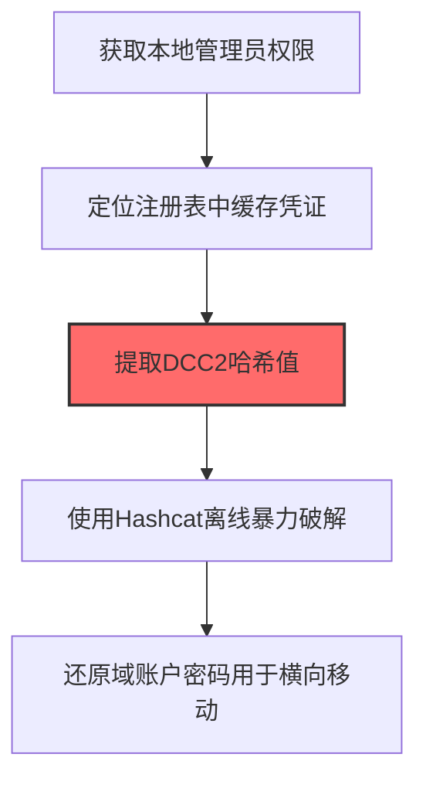

# 缓存域凭证 (T1003.005)

## 一句话通俗理解

> **提取缓存的域登录凭证**

## 30秒速查卡

| 维度 | 你需要知道的 |
|------|-------------|
| 这是什么？ | 提取Windows缓存的域登录凭证（DCC2哈希），用于离线破解 |
| 为什么危险？ | 即使断网也能用缓存凭证登录，而且这些凭证的哈希可以离线暴力破解，不需要连接域控 |
| 谁需要关心？ | 域管理员、Windows安全工程师、SOC分析师 |
| 你的第一步防御 | 限制可缓存的登录凭证数量，使用Credential Guard保护缓存凭证 |
| 如果只做一件事 | 监控对HKLM\SECURITY\Cache注册表键的异常读取（Sysmon事件ID 12/13），非系统进程访问立即告警 |

## 难度等级

⭐⭐ 中级 - 需要一定的技术基础和经验

## 前置知识检查

**读这个文件需要什么？**

- [ ] Windows认证体系（NTLM/Kerberos/LSASS）
- [ ] 哈希基础（NTLM Hash/SHA）
- [ ] 网络认证协议（SMB/LDAP/Kerberos）

## 技术描述

**缓存域凭证**（T1003.005）是 **操作系统凭证转储**（T1003）的一个具体变体，属于 **凭证访问** 阶段的攻击技术。

简单来说，就像从保险箱里翻出所有人的钥匙。

### 具体怎么理解？

提取缓存的域登录凭证

攻击者使用这种技术时，通常是在凭证访问阶段，想要达到特定的攻击目标。与父技术 T1003 相比，T1003.005 有自己独特的特点和使用场景。

### 为什么有效？

这种技术之所以有效，是因为：
1. **隐蔽性**：利用了正常系统功能或常见协议，不容易被发现
2. **技术门槛适中**：不需要特别高深的技术知识就能实施

**过渡段：** 不要误解凭证访问只是'窃取密码'——在现代企业中，凭证存在于内存、磁盘、网络流量等多个位置。
3. **广泛适用**：可以在多种环境和系统中使用

## 真实攻击流程

### 典型场景

攻击者在 **凭证访问** 阶段使用 缓存域凭证 技术，以下是典型的攻击步骤：



**步骤详解：**

1. **获取本地管理员权限** - 需要管理员权限才能读取注册表中存储的缓存域凭证数据
2. **定位注册表中缓存凭证** - 缓存凭证存储在HKLM\SECURITY\Cache注册表项下，Windows默认缓存最近10次域登录凭证
3. **提取DCC2哈希值** - 使用Mimikatz的lsadump::cache命令或RegExtract工具提取DCC2（Domain Cached Credentials version 2）哈希
4. **使用Hashcat离线暴力破解** - 使用Hashcat模式32800对DCC2哈希进行暴力破解或字典攻击，速度取决于密码复杂度
5. **还原域账户密码用于横向移动** - 破解出明文密码后，可用于域资源访问和横向移动

## 攻击流程

```
获取管理员权限 --> 定位缓存凭证 --> 提取DCC2哈希 --> 离线破解密码
```


**步骤详解：**
1. **获取管理员权限**
   - 通俗描述：攻击者获取目标主机的本地管理员权限以读取注册表中的缓存凭证
   - 技术细节：缓存域凭证存储在HKLM\SECURITY\Cache中，需要SYSTEM权限才能访问
   - 常用工具：提权漏洞、Mimikatz、已有管理员会话
2. **定位缓存凭证**
   - 通俗描述：找到Windows为方便离线登录而缓存的域用户凭证位置
   - 技术细节：定位HKLM\SECURITY\Cache注册表项，Windows默认缓存最近10次域登录的凭证
   - 常用工具：reg.exe、RegRippy
3. **提取DCC2哈希**
   - 通俗描述：把缓存凭证中的加密哈希值提取出来
   - 技术细节：使用Mimikatz的lsadump::cache命令提取DCC2（Domain Cached Credentials v2）哈希
   - 常用工具：Mimikatz、secretsdump.py、cache-credentials工具
4. **离线破解密码**
   - 通俗描述：用暴力破解工具把哈希还原成明文密码
   - 技术细节：使用Hashcat模式32800对DCC2哈希进行字典攻击或暴力破解，DCC2使用多次迭代加密破解较慢
   - 常用工具：Hashcat、John the Ripper

## 真实案例

### 案例1：APT28 -- 针对政府机构的缓存域凭证提取（2017-2018）

- **时间**: 2017-2018年
- **目标**: 欧洲多国政府机构、北约成员国国防部
- **攻击组织**: APT28（Fancy Bear / Sofacy，俄罗斯GRU背景）
- **手法**: APT28在通过Seduploader后门获得内网立足点后，使用自定义工具`cmd.exe /c reg save HKLM\SECURITY\CACHE cache.hive`导出缓存域凭证注册表hive，再通过Mimikatz的`lsadump::cache`提取DCC2哈希。这些哈希被用于离线暴力破解域用户密码，因为移动办公人员的笔记本经常断网，缓存凭证中包含高权限账户的DCC2哈希
- **影响**: 窃取多个欧洲国家外交官的域账户凭证，用于后续定向钓鱼和横向移动
- **参考链接**: [ESET Sedupt APT28报告](https://www.welivesecurity.com/2018/03/08/seduploader-analyzing-components-malware-toolkit/)

### 案例2：BlackCat/ALPHV勒索软件 -- 离线破解缓存凭证绕过MFA（2022-2023）

- **时间**: 2022-2023年
- **目标**: 全球医疗、教育、政府机构（超过500个受害组织）
- **攻击组织**: BlackCat/ALPHV勒索软件团伙
- **手法**: BlackCat运营者在获取端点本地管理员权限后，使用Impacket secretsdump.py的`-cached`参数批量提取域内Windows笔记本的缓存凭证。由于缓存凭证可离线破解，攻击者绕过了目标组织部署的MFA保护，用破解出的明文密码直接登录VPN和Exchange邮箱
- **影响**: 多家医疗机构被迫取消手术，累计勒索金额超过3亿美元
- **参考链接**: [FBI BlackCat Flash Report](https://www.ic3.gov/Media/News/Flash/2023/220222.pdf)

### 案例3：LockBit 3.0勒索软件 -- 离线破解缓存域凭证绕过MFA横移VPN（2022-2023）

- **时间**: 2022-2023年
- **目标**: 全球制造、医疗、教育、能源、政府机构（累计超过2000个受害组织）
- **攻击组织**: LockBit 3.0勒索软件团伙（全球最活跃RaaS）
- **手法**: LockBit 3.0 affiliates在获取端点本地管理员权限后，使用Impacket secretsdump.py的`-cached`参数批量提取域内Windows笔记本的缓存域凭证（DCC2哈希）。由于缓存凭证可离线破解，攻击者使用Hashcat模式32800对DCC2哈希进行字典攻击，破解出的明文密码被直接用于登录VPN和Exchange邮箱，绕过了目标组织部署的MFA保护。移动办公人员的笔记本因频繁断网而缓存了高权限账户的DCC2哈希，成为主要攻击目标
- **影响**: LockBit是2022-2023年全球部署最广泛的勒索软件变种，累计勒索超过9100万美元；FBI调查确认缓存凭证破解是其绕过MFA的标准手法之一
- **参考链接**: [CISA #StopRansomware: LockBit 3.0 公告 AA23-075A](https://www.cisa.gov/news-events/cybersecurity-advisories/aa23-075a)

## 红队视角

> ⚠️ **免责声明**：以下内容仅用于合法的安全测试、渗透测试和教育目的。未经授权对他人系统进行测试是违法行为。

### 实战技巧

1. **深入理解原理**：在实战应用前，充分理解缓存域凭证的技术原理和适用场景
2. **环境适配**：根据目标系统的操作系统版本、安全配置等因素调整攻击策略
3. **组合使用**：将该技术与其他技术组合使用，构建完整的攻击链
4. **隐蔽性考虑**：注意操作痕迹的清理，避免被安全设备检测

### 常用工具

| 工具名称 | 用途 | 平台 | 链接 |
| -------- | ---- | ---- | ---- |
| Mimikatz (lsadump::cache) | 在线读取缓存域凭证，提取DCC2哈希 | Windows | [GitHub](https://github.com/gentilkiwi/mimikatz) |
| reg.exe (reg save) | 导出HKLM\SECURITY\CACHE注册表hive用于离线解析 | Windows | 系统自带 |
| Impacket secretsdump.py (-cached) | Python实现，远程提取缓存域凭证 | 跨平台 | [GitHub](https://github.com/fortra/impacket) |
| CacheDump | 经典缓存凭证提取工具，将DCC2哈希转换为Hashcat可破解格式 | Windows | [CacheDump](http://www.foofus.net/~fizzgig/cachedump/) |

### 注意事项

- 在授权的测试环境中使用这些技术
- 注意操作安全（OPSEC），避免被检测系统发现
- 使用匿名化技术和代理隐藏真实身份

## 蓝队视角

### 检测要点

1. **系统日志监控**：关注与缓存域凭证相关的系统日志和审计记录
2. **异常行为检测**：监控系统中与该技术相关的异常进程、网络连接和文件操作
3. **工具特征识别**：识别攻击者可能使用的工具在系统中的运行特征

### 监控建议

- 部署端点检测和响应（EDR）系统，监控与缓存域凭证相关的异常行为
- 配置SIEM规则，关联分析来自多个来源的告警
- 定期进行安全评估和渗透测试，验证检测规则的有效性

## 避坑指南

组织中最危险盲区：认为强密码就足够安全。

## 检测建议

### 检测思路

检测 缓存域凭证 的关键是识别异常行为模式。以下是三个层面的检测方法：

### 网络层检测

**方法**：监控网络流量中的异常模式

```bash
# 检测异常的网络连接和数据传输
# 根据具体协议和端口设置检测规则
```

### 主机层检测

**Windows事件ID**：
- 事件ID 4688：进程创建（监控可疑进程）
- 事件ID 4104：PowerShell执行（监控可疑脚本）

**Linux日志**：
- /var/log/auth.log：认证日志
- /var/log/syslog：系统日志

```bash
# 检测异常进程和命令执行
grep -i "suspicious" /var/log/auth.log
```

### 应用层检测

**用人话说：** 这条规则在监控是否有进程在读取Windows缓存的域登录凭证。Windows会在本地缓存最近的域登录凭证，这样断网时也能登录。这个缓存存在注册表HKLM\SECURITY\Cache中。如果有陌生进程试图读取它，那就是攻击者在偷域凭证的离线副本。

**Sigma规则示例**：

```yaml
title: 检测缓存域凭证
status: experimental
description: 检测可能的缓存域凭证活动
logsource:
    category: process_creation
    product: windows
detection:
    selection:
        EventID: 4688
    condition: selection
level: medium
tags:
    - attack.T1003005
```

## 缓解措施

### 优先级1：关键措施

**限制攻击面**：减少暴露的服务和端口，降低被利用的风险

```bash
# 防火墙规则示例：只允许必要的出站连接
iptables -A OUTPUT -p tcp --dport 443 -j ACCEPT  # 允许HTTPS
iptables -A OUTPUT -p tcp --dport 80 -j ACCEPT   # 允许HTTP
iptables -A OUTPUT -p tcp -j DROP                 # 阻止其他TCP
```

### 优先级2：重要措施

**加强监控**：部署EDR和SIEM系统，实时监控异常行为

### 优先级3：建议措施

**安全意识培训**：教育员工识别相关攻击手法

## 动手实验

> ⚠️ **所有实验必须在隔离的实验室环境中进行**

### 实验1：理解基本原理（初级）

**目标**：理解 缓存域凭证 的工作原理

**步骤**：
1. 在隔离环境中搭建测试系统
2. 使用基础工具模拟攻击行为
3. 观察系统日志和网络流量

**学习要点**：理解该技术的核心机制

### 实验2：实际操作（中级）

**目标**：掌握 缓存域凭证 的实际使用方法

**步骤**：
1. 使用专业工具进行攻击模拟
2. 尝试不同的绕过技术
3. 分析检测日志的特征

**学习要点**：掌握工具使用和日志分析

### 实验3：防御验证（高级）

**目标**：验证检测规则的有效性

**步骤**：
1. 部署检测规则
2. 执行攻击模拟
3. 验证检测告警是否触发

**学习要点**：理解攻防对抗的实际效果

## 术语解释

| 术语 | 通俗解释 |
|------|---------|
| **ATT&CK** | MITRE公司维护的攻击技术知识库，像一本"黑客手法百科全书" |
| **缓存域凭证** | T1003.005，ATT&CK框架中定义的一种具体攻击技术 |
| **操作系统凭证转储** | T1003，缓存域凭证所属的父技术类别 |
| **凭证访问** | 攻击链中的一个阶段，攻击者在这个阶段的目标 |
| **C2** | 命令与控制，攻击者用来远程控制被入侵系统的"遥控器" |
| **EDR** | 端点检测与响应，部署在电脑上的安全监控软件 |

## 被引用情况

以下父技术文档引用了本子技术：

- [T1003 - 操作系统凭证转储](../T1003-OS-Credential-Dumping.md)

## 参考资料

### 📚 官方文档（深入了解）

- [MITRE ATT&CK - 缓存域凭证 (T1003.005)](https://attack.mitre.org/techniques/T1003/005/)
- [MITRE ATT&CK - 操作系统凭证转储 (T1003)](https://attack.mitre.org/techniques/T1003/)

### 📰 安全报告（真实攻击）

- [MITRE ATT&CK 官方文档](https://attack.mitre.org/) - ATT&CK 框架官方资源

### 🔧 工具与资源（动手试试）

- [Atomic Red Team](https://github.com/redcanaryco/atomic-red-team) - 检测规则测试框架
- [MITRE ATT&CK Navigator](https://mitre-attack.github.io/attack-navigator/) - ATT&CK 可视化工具

### 📚 学习资料（深入了解）

- [MITRE ATT&CK 知识库](https://attack.mitre.org/resources/) - ATT&CK 官方资源中心
