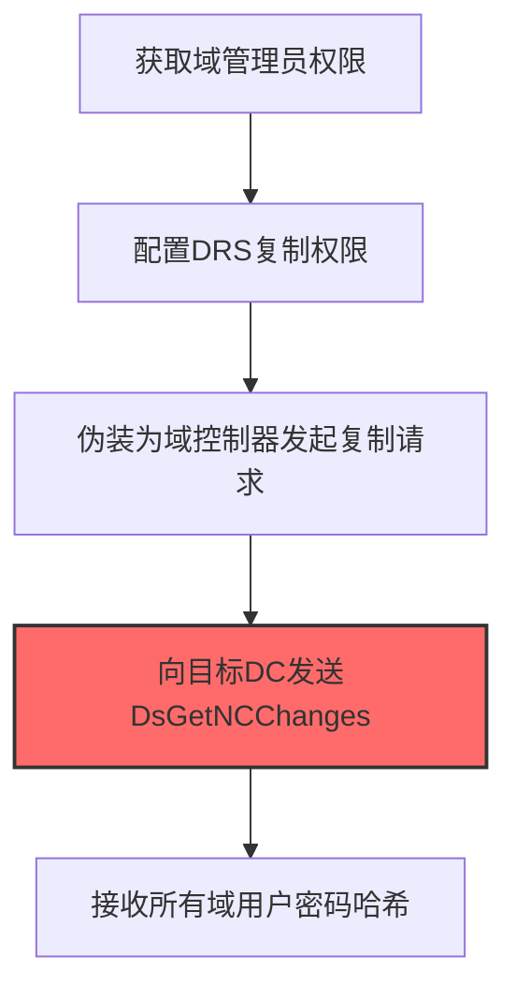

# DCSync (T1003.006)

## 一句话通俗理解

> **DCSync就是模拟域控制器"复制"所有域凭证。**

## 30秒速查卡

| 维度 | 你需要知道的 |
|------|-------------|
| 这是什么？ | 模拟域控制器的行为，通过DRS协议向域控请求复制所有用户的密码哈希 |
| 为什么危险？ | 不需要登录域控就能获取所有域用户的哈希，而且这种行为看起来像正常的域控同步流量，很难被发现 |
| 谁需要关心？ | 域管理员、Active Directory安全工程师、SOC分析师 |
| 你的第一步防御 | 部署域控审计策略，监控DRS-Replica-Add请求，限制哪些计算机可以执行DCSync操作 |
| 如果只做一件事 | 监控Windows事件ID 4662（Directory Service Access），关注对DS-Replication-Get-Changes-All权限的异常请求 |

## 难度等级

⭐⭐ 中级 - 需要一定的技术基础和实践经验

## 前置知识检查

**读这个文件需要什么？**

- [ ] Windows认证体系（NTLM/Kerberos/LSASS）
- [ ] 哈希基础（NTLM Hash/SHA）
- [ ] 网络认证协议（SMB/LDAP/Kerberos）

## 技术描述

**通俗解释：**

**过渡段：** 不要误解凭证访问只是'窃取密码'——在现代企业中，凭证存在于内存、磁盘、网络流量和云API等多个位置。攻击者关注的不是密码本身，而是'能用它做什么'：一个服务账号的哈希就能横向移动到数十台服务器，OAuth令牌可以访问整个SaaS租户的数据。
模拟域控制器"复制"所有域凭证

> 🔄 **打个比方**：就像从自来水主管道上接一根分水管——DCSync直接从域控制器复制密码数据，不需要登录目标机器。

**技术原理：**
T1003.006 是 操作系统凭证转储（T1003）的子技术，专注于DCSync这一特定方面。攻击者在凭证访问阶段，通过DCSync来获取目标系统或组织的相关信息，为后续攻击步骤做准备。

**用途与影响：**
- 为后续攻击提供关键信息支撑
- 提高攻击的成功率和精准度
- 降低攻击被发现的概率

## 真实攻击流程



**步骤详解：**

1. **获取域管理员权限** - 需要Domain Admin或具有DCReplication权限的账户，通常通过Kerberoasting或已有域凭证获取
2. **配置DRS复制权限** - 确保攻击账户具有Directory Replication Service (DRS)远程协议的复制权限，这是域控制器间同步凭证的标准机制
3. **伪装为域控制器发起复制请求** - 使用Impacket的secretsdump.py或Mimikatz的lsadump::dcsync命令，模拟一台域控制器发起DRS复制
4. **向目标DC发送DsGetNCChanges** - 通过MS-DRSR协议发送复制请求，要求域控制器返回指定命名上下文（域用户数据库）的变更数据
5. **接收所有域用户密码哈希** - 域控制器将所有用户的NTLM哈希通过正常AD复制协议返回给攻击者，无需登录DC即可获取全域凭证

## 攻击流程

```
获取复制权限 --> 伪装域控 --> 发送复制请求 --> 接收全域哈希
```


**步骤详解：**
1. **获取复制权限**
   - 通俗描述：攻击者获取具有域复制权限的账户，这是模拟域控的前提
   - 技术细节：需要Domain Admin或具有DCReplication权限（如DS-Replication-Get-Changes）的账户
   - 常用工具：BloodHound、PowerView、Rubeus
2. **伪装域控**
   - 通俗描述：攻击者把自己的机器"伪装"成一台域控制器
   - 技术细节：使用Impacket的secretsdump.py或Mimikatz的lsadump::dcsync命令，模拟域控制器发起DRS复制请求
   - 常用工具：Mimikatz、Impacket secretsdump.py
3. **发送复制请求**
   - 通俗描述：向真正的域控发请求，要求它把密码数据库"同步"过来
   - 技术细节：通过MS-DRSR协议发送DsGetNCChanges请求，要求域控返回域用户数据库的变更数据
   - 常用工具：Impacket、Mimikatz
4. **接收全域哈希**
   - 通俗描述：域控乖乖把所有用户的密码哈希发过来，全程不用登录域控
   - 技术细节：域控通过正常AD复制协议返回所有用户的NTLM哈希，不触发域控登录事件
   - 常用工具：Mimikatz、secretsdump.py

## 真实案例

### 案例1：APT29 -- SolarWinds供应链攻击中通过DCSync提取全域哈希（2020）

- **时间**: 2020年
- **目标**: 美国财政部、国务院、司法部等多个联邦机构
- **攻击组织**: APT29（Nobelium / Cozy Bear，俄罗斯SVR背景）
- **手法**: APT29在攻陷SolarWinds Orion平台的高价值客户后，使用Mimikatz的`lsadump::dcsync /domain:corp.local /user:krbtgt`命令模拟域控制器向真实DC发起MS-DRSR复制请求，远程提取krbtgt账户的NTLM哈希。利用krbtgt哈希铸造Golden Ticket后，攻击者以任意域管理员身份访问Exchange邮箱和文件服务器，全程不触发域控上的登录事件
- **影响**: 在9个联邦机构和100家企业中获取全域凭证，潜伏长达9个月未被发现
- **参考链接**: [CISA AA21-071A SolarWinds](https://www.cisa.gov/news-events/cybersecurity-advisories/aa21-071a)

### 案例2：Conti勒索软件 -- DCSync作为勒索前最后一步凭证收割（2021-2022）

- **时间**: 2021-2022年
- **目标**: 爱尔兰医疗服务（HSE）、美国Critical Infrastructure
- **攻击组织**: Conti勒索软件团伙
- **手法**: Conti运营者在攻陷一台拥有域复制权限的成员服务器后，使用Impacket的`secretsdump.py -just-dc`参数执行DCSync，一次性拉取整个域所有用户的NTLM哈希和Kerberos密钥。这些凭证被用于在2-4小时内横移至全部关键服务器，随后部署勒索加密器。泄露的Conti操作手册显示DCSync是其"收尾"标准步骤
- **影响**: 爱尔兰HSE系统瘫痪3个月，影响50万患者就诊；累计勒索金额超过27亿美元
- **参考链接**: [Mandiant Conti分析](https://www.mandiant.com/resources/conti-ransomware)

### 案例3：Volt Typhoon -- 利用LOTL技术执行DCSync长期潜伏美国关键基础设施（2021-2024）

- **时间**: 2021-2024年（CISA确认部分受害者环境中潜伏至少5年）
- **目标**: 美国关键基础设施（通信、能源、交通、水务），重点包括关岛及美国本土及海外领地
- **攻击组织**: Volt Typhoon（Vanguard Panda / BRONZE SILHOUETTE，中华人民共和国国家级APT组织）
- **手法**: Volt Typhoon几乎完全依赖"就地取材"（Living off the Land, LOTL）技术，在获取管理员凭证后使用Windows内置的`ntdsutil`和开源Impacket `secretsdump.py -just-dc`执行DCSync，通过MS-DRSR协议向域控制器请求复制全域用户密码哈希。提取的krbtgt哈希被用于铸造Golden Ticket维持长期持久化访问。攻击者通过SOHO路由器和VPN设备代理流量隐藏C2通道，将DCSync流量伪装成正常的域控复制行为
- **影响**: CISA、NSA、FBI联合确认Volt Typhoon成功渗透多个关键基础设施组织的IT环境，预置能力以在未来危机中破坏OT运营；这是已知潜伏时间最长的国家级APT活动之一
- **参考链接**: [CISA AA24-038A PRC国家级攻击者潜伏美国关键基础设施](https://www.cisa.gov/news-events/cybersecurity-advisories/aa24-038a)

## 红队视角

> ⚠️ **免责声明**：以下内容仅用于合法的安全测试、渗透测试和教育目的。未经授权对他人系统进行测试是违法行为。

### 实战技巧

1. **隐蔽优先**：在凭证访问阶段使用被动方式收集信息，避免触发安全告警
2. **信息验证**：对收集到的信息进行交叉验证，确保准确性和时效性
3. **工具选择**：根据目标环境选择合适的工具，避免使用已被广泛检测的工具
4. **OPSEC意识**：使用匿名网络、临时环境进行操作，防止溯源

### 常用工具

| 工具名称 | 用途 | 平台 | 链接 |
|---------|------|------|------|
| Mimikatz (lsadump::dcsync) | 经典DCSync实现，通过MS-DRSR协议远程提取域哈希 | Windows | [GitHub](https://github.com/gentilkiwi/mimikatz) |
| Impacket secretsdump.py (-just-dc) | Python实现DCSync，跨平台执行远程域凭证复制 | 跨平台 | [GitHub](https://github.com/fortra/impacket) |
| DSInternals (Get-ADReplAccount) | PowerShell模块，通过DRS协议提取指定用户哈希 | Windows | [GitHub](https://github.com/MichaelGrafnetter/DSInternals) |
| ntdsutil.exe | Windows内置，通过IFM功能创建包含NTDS.dit的快照（DCSync替代方式） | Windows | 系统自带 |

### 注意事项

- 仅在授权范围内使用DCSync技术
- 注意操作的隐蔽性，避免被蓝队发现
- 记录操作日志，用于后续分析和报告编写

## 蓝队视角

### 检测要点

1. **异常信息收集行为**：监控来自内部系统的异常数据查询和收集行为
2. **可疑工具使用**：检测与DCSync相关的工具在内部网络中的使用
3. **异常网络流量**：监控对外部信息收集平台的可疑网络连接
4. **权限异常**：关注非授权用户的信息收集和查询行为

### 监控建议

- 部署信息收集行为的检测规则
- 建立基准行为模型，及时发现异常
- 定期审计敏感信息的访问记录

## 避坑指南

组织中最危险盲区：认为强密码就足够安全。

## 检测建议

### 网络层检测

**检测方法：** 监控与DCSync相关的网络流量特征

**具体规则/命令示例：**

```bash
# 监控异常DNS查询
tcpdump -i eth0 port 53 | grep -E "可疑域名"
```

### 主机层检测

**Windows事件ID：**

- 事件ID 4688：可疑进程创建
- 事件ID 4104：PowerShell脚本块日志

**Linux日志：**

- 日志文件：`/var/log/syslog`
- 关键字段：可疑命令执行

**用人话说：** 这条规则在监控是否有非域控计算机在请求复制域用户的密码哈希。DCSync是攻击者模拟域控制器的行为，通过DRS协议向真正的域控请求'复制'所有用户的哈希。正常情况下只有域控制器之间才会做这种复制。如果有其他计算机发起复制请求，那就是攻击者在偷整个域的密码。

### 应用层检测

**Sigma规则示例：**

```yaml
title: Suspicious DCSync Activity
status: experimental
description: Detects potential DCSync behavior
logsource:
  category: process_creation
  product: windows
detection:
  selection:
    Image|endswith: '\\可疑工具.exe'
  condition: selection
level: medium
tags:
  - attack.T1003/006
```

## 缓解措施

### 优先级1：关键措施

**措施名称：** 敏感信息保护

**具体实施步骤：**

1. 识别和分类组织内的敏感信息
2. 对敏感信息实施访问控制和加密
3. 部署信息泄露防护（DLP）解决方案

### 优先级2：重要措施

**措施名称：** 员工安全意识培训

**具体实施步骤：**

1. 定期开展信息安全意识培训
2. 教育员工识别社交工程攻击
3. 建立信息报告和响应机制

### 优先级3：建议措施

**措施名称：** 安全配置加固

**具体实施步骤：**

1. 限制公开可访问的系统信息
2. 配置合适的日志记录和告警策略
3. 定期进行安全评估和渗透测试

## 动手实验

> ⚠️ **重要提示**：所有实验必须在隔离的实验室环境中进行，禁止对未授权的真实系统进行测试。

### 实验环境准备

**推荐靶场/实验平台：**

| 平台名称 | 类型 | 难度 | 链接 |
|---------|------|:----:|------|
| 本地虚拟机 | 虚拟环境 | 初级 | 本机搭建 |
| TryHackMe | 在线靶场 | 初级 | https://tryhackme.com |

**所需工具：**

- 根据具体技术需求准备相应工具

**环境搭建：**

```bash
# 准备隔离的实验环境
# 具体命令根据实验内容而定
```

### 实验1：基础实践（初级）

**实验目标：** 理解和练习DCSync的基本操作

**实验步骤：**

1. 在隔离环境中搭建实验系统
2. 按照技术描述执行基本操作
3. 观察和记录实验现象

**预期结果：** 成功完成DCSync的基本操作

**学习要点：** 理解DCSync的原理和操作方法

## 术语解释

| 术语 | 英文原名 | 通俗解释 |
|-----|---------|---------|
| DCSync | DCSync | DCSync的基本概念和操作方法 |
| 侦察 | Reconnaissance | 收集目标信息的过程，为后续攻击做准备 |
| OPSEC | Operational Security | 操作安全，保护行动信息不被对手发现 |

## 被引用情况

以下父技术文档引用了本子技术：

- [T1003 - 操作系统凭证转储](../T1003-OS-Credential-Dumping.md)

## 参考资料

### 📚 官方文档（深入了解）

- [MITRE ATT&CK - T1003](https://attack.mitre.org/techniques/T1003/)
- [MITRE ATT&CK - T1003.006](https://attack.mitre.org/techniques/T1003/006/)
- [MITRE ATT&CK - T1003.006 检测](https://attack.mitre.org/techniques/T1003/006/detections/)

### 📰 安全报告（真实攻击）

- [CISA Known Exploited Vulnerabilities](https://www.cisa.gov/known-exploited-vulnerabilities-catalog)
- [Microsoft Security Blog](https://www.microsoft.com/en-us/security/blog/)

### 学习资源

- [MITRE ATT&CK 官方文档](https://attack.mitre.org/)
- [ATT&CK STIX Data](https://github.com/mitre-attack/attack-stix-data)

