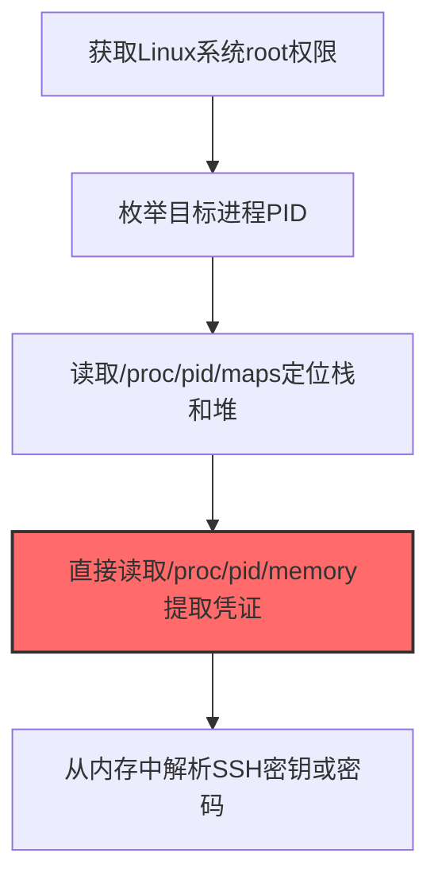

# /proc文件系统 (T1003.007)

## 一句话通俗理解

> **从Linux进程内存中提取凭证**

## 30秒速查卡

| 维度 | 你需要知道的 |
|------|-------------|
| 这是什么？ | 从Linux的/proc虚拟文件系统中读取进程内存，提取明文密码和密钥 |
| 为什么危险？ | /proc是Linux的'透明窗口'，几乎所有进程信息都暴露在这里，攻击者可以轻松读取其他进程的内存 |
| 谁需要关心？ | Linux系统管理员、SOC分析师、DevOps工程师 |
| 你的第一步防御 | 使用ptrace_scope限制进程调试权限，监控对/proc/[pid]/mem的异常读取 |
| 如果只做一件事 | 使用auditd监控对/proc/*/mem和/proc/*/cmdline的异常读取，特别是非root用户的访问 |

## 难度等级

⭐⭐ 中级 - 需要一定的技术基础和经验

## 前置知识检查

**读这个文件需要什么？**

- [ ] Windows认证体系（NTLM/Kerberos/LSASS）
- [ ] 哈希基础（NTLM Hash/SHA）
- [ ] 网络认证协议（SMB/LDAP/Kerberos）

## 技术描述

**/proc文件系统**（T1003.007）是 **操作系统凭证转储**（T1003）的一个具体变体，属于 **凭证访问** 阶段的攻击技术。

简单来说，就像从保险箱里翻出所有人的钥匙。

### 具体怎么理解？

从Linux进程内存中提取凭证

攻击者使用这种技术时，通常是在凭证访问阶段，想要达到特定的攻击目标。与父技术 T1003 相比，T1003.007 有自己独特的特点和使用场景。

### 为什么有效？

这种技术之所以有效，是因为：
1. **隐蔽性**：利用了正常系统功能或常见协议，不容易被发现
2. **技术门槛适中**：不需要特别高深的技术知识就能实施

**过渡段：** 不要误解凭证访问只是'窃取密码'——在现代企业中，凭证存在于内存、磁盘、网络流量等多个位置。
3. **广泛适用**：可以在多种环境和系统中使用

## 真实攻击流程

### 典型场景

攻击者在 **凭证访问** 阶段使用 /proc文件系统 技术，以下是典型的攻击步骤：



**步骤详解：**

1. **获取Linux系统root权限** - 需要root权限才能读取其他用户进程的/proc内存映射，普通用户只能读取自己的进程
2. **枚举目标进程PID** - 通过/proc目录或ps命令找到目标进程（如sshd、bash、MySQL），这些进程中可能缓存了认证凭证
3. **读取/proc/pid/maps定位栈和堆** - 分析进程的内存映射文件，定位存放凭证数据的栈和堆区域地址范围
4. **直接读取/proc/pid/memory提取凭证** - 使用dd或自定义脚本直接读取/proc/pid/mem文件中的内存内容，绕过进程自身保护
5. **从内存中解析SSH密钥或密码** - 在内存dump中搜索密码字符串、私钥片段或认证token

## 攻击流程

```
获取root权限 --> 枚举目标进程 --> 读取内存映射 --> 提取凭证数据
```


**步骤详解：**
1. **获取root权限**
   - 通俗描述：攻击者获取Linux系统的root权限，这是读取其他用户进程内存的前提
   - 技术细节：通过提权漏洞或已获取的root会话，普通用户只能读取自己进程的/proc内存
   - 常用工具：内核提权漏洞、sudo滥用、已有root会话
2. **枚举目标进程**
   - 通俗描述：找到可能存有密码的系统进程
   - 技术细节：通过/proc目录或ps命令找到sshd、bash、MySQL等可能缓存认证凭证的进程PID
   - 常用工具：ps、/proc/[pid]/cmdline、pgrep
3. **读取内存映射**
   - 通俗描述：查看目标进程的内存布局，找到存密码的区域
   - 技术细节：读取/proc/pid/maps定位存放凭证数据的栈和堆区域地址范围
   - 常用工具：cat、grep、自定义脚本
4. **提取凭证数据**
   - 通俗描述：直接从进程内存中"捞"出密码或密钥
   - 技术细节：使用dd或自定义脚本读取/proc/pid/mem文件，在内存dump中搜索密码字符串、私钥片段或认证token
   - 常用工具：dd、gdb、strings、自定义Python脚本

## 真实案例

### 案例1：TeamTNT -- 加密货币挖矿团伙读取/proc窃取云凭证（2020-2023）

- **时间**: 2020-2023年
- **目标**: 全球云服务器（AWS、Azure、阿里云），数千台Linux主机
- **攻击组织**: TeamTNT（加密货币挖矿团伙）
- **手法**: TeamTNT通过暴露的Docker API或misconfigured Redis入侵云Linux主机后，使用自定义脚本`cat /proc/*/cmdline | grep -i aws`扫描所有进程的命令行参数，定位运行中的AWS CLI进程。随后通过`dd if=/proc/<pid>/mem`读取该进程内存，提取AWS access key和secret key，用于横向扩展至受害者的其他云资源进行挖矿
- **影响**: 控制数万台云主机进行门罗币挖矿，造成受害企业超过50万美元云账单损失
- **参考链接**: [Aqua Security TeamTNT报告](https://www.aquasec.com/resources/blog/teamtnt-now-targets-aws-credentials/)

### 案例2：Rocke Group -- 通过/proc内存提取SSH私钥实现持久化（2018-2019）

- **时间**: 2018-2019年
- **目标**: 中国、美国云Linux服务器
- **攻击组织**: Rocke Group（加密货币挖矿组织，使用Godlua DDoS僵尸网络）
- **手法**: Rocke在通过Confluence/ColdFusion漏洞获得root权限后，使用`python3 -c "import os; fd=os.open('/proc/1/mem', os.O_RDONLY); os.lseek(fd, 0x7fff0000, 0); print(os.read(fd, 65536))"`读取sshd进程内存，从中提取已加载的SSH私钥片段。这些私钥被用于建立持久化访问通道，即使主漏洞被修复也能通过SSH重新进入
- **影响**: 控制超过3万台Linux服务器，部署挖矿和DDoS僵尸模块
- **参考链接**: [Talos Rocke Group分析](https://blog.talosintelligence.com/2018/12/rocke-changelog.html)

### 案例3：Kinsing -- 从/proc读取进程环境变量窃取云平台凭证（2020-2023）

- **时间**: 2020-2023年
- **目标**: 全球云Linux服务器（AWS EC2、Azure VM、GCP），容器化环境（Docker、Kubernetes）
- **攻击组织**: Kinsing（加密货币挖矿恶意软件，也称kdevtmpfsi）
- **手法**: Kinsing通过暴露的Docker API或misconfigured Redis入侵云Linux主机获得root权限后，使用自定义脚本扫描`/proc/*/environ`读取所有进程的环境变量，定位AWS CLI、Azure CLI等云SDK进程中的`AWS_ACCESS_KEY_ID`、`AWS_SECRET_ACCESS_KEY`等凭证变量。同时读取`/proc/*/cmdline`提取命令行参数中硬编码的token。Kinsing的rootkit组件还会遍历`/proc/`目录隐藏自身进程（kinsing、kdevtmpfsi），通过hooking readdir系统调用使`ls /proc`不显示恶意进程。窃取的云凭证被用于横向扩展至受害者其他云资源部署挖矿程序
- **影响**: 控制数万台云主机进行门罗币挖矿；2023年Aqua Nautilus首次发现Kinsing扩展至云平台凭证窃取，标志该组织从纯挖矿转向更广泛的数据窃取能力
- **参考链接**: [Aqua Security - Kinsing利用Looney Tunables漏洞窃取云凭证](https://www.aquasec.com/blog/loony-tunables-vulnerability-exploited-by-kinsing/)

## 红队视角

> ⚠️ **免责声明**：以下内容仅用于合法的安全测试、渗透测试和教育目的。未经授权对他人系统进行测试是违法行为。

### 实战技巧

1. **深入理解原理**：在实战应用前，充分理解/proc文件系统的技术原理和适用场景
2. **环境适配**：根据目标系统的操作系统版本、安全配置等因素调整攻击策略
3. **组合使用**：将该技术与其他技术组合使用，构建完整的攻击链
4. **隐蔽性考虑**：注意操作痕迹的清理，避免被安全设备检测

### 常用工具

| 工具名称 | 用途 | 平台 | 链接 |
| -------- | ---- | ---- | ---- |
| dd / gcore | 直接读取/proc/[pid]/mem或生成core dump提取进程内存 | Linux | 系统自带dd；gcore [GDB组件](https://www.gnu.org/software/gdb/) |
| LaZagne | 自动化凭证提取，支持从内存和配置文件中抓取SSH密钥、AWS密钥等 | Linux/macOS | [LaZagne](https://github.com/AlessandroZ/LaZagne) |
| process_vm_readv脚本 | 通过Linux系统调用跨进程读取/proc/[pid]/mem，绕过ptrace限制 | Linux | 自定义脚本 |
| Mimipenguin | 从当前Linux用户进程内存中提取明文密码，针对sshd/gnome-keyring等 | Linux | [mimipenguin](https://github.com/huntergregal/mimipenguin) |

### 注意事项

- 在授权的测试环境中使用这些技术
- 注意操作安全（OPSEC），避免被检测系统发现
- 使用匿名化技术和代理隐藏真实身份

## 蓝队视角

### 检测要点

1. **系统日志监控**：关注与/proc文件系统相关的系统日志和审计记录
2. **异常行为检测**：监控系统中与该技术相关的异常进程、网络连接和文件操作
3. **工具特征识别**：识别攻击者可能使用的工具在系统中的运行特征

### 监控建议

- 部署端点检测和响应（EDR）系统，监控与/proc文件系统相关的异常行为
- 配置SIEM规则，关联分析来自多个来源的告警
- 定期进行安全评估和渗透测试，验证检测规则的有效性

## 避坑指南

组织中最危险盲区：认为强密码就足够安全。

## 检测建议

### 检测思路

检测 /proc文件系统 的关键是识别异常行为模式。以下是三个层面的检测方法：

### 网络层检测

**方法**：监控网络流量中的异常模式

```bash
# 检测异常的网络连接和数据传输
# 根据具体协议和端口设置检测规则
```

### 主机层检测

**Windows事件ID**：
- 事件ID 4688：进程创建（监控可疑进程）
- 事件ID 4104：PowerShell执行（监控可疑脚本）

**Linux日志**：
- /var/log/auth.log：认证日志
- /var/log/syslog：系统日志

```bash
# 检测异常进程和命令执行
grep -i "suspicious" /var/log/auth.log
```

### 应用层检测

**用人话说：** 这条规则在监控是否有进程在读取其他进程的内存。Linux的/proc文件系统就像一个'透明窗口'，里面能看到所有进程的内存内容。正常情况下只有调试工具和系统进程会读其他进程的内存。如果有陌生进程读取其他进程的/proc/[pid]/mem，那很可能是在偷进程中的密码或密钥。

**Sigma规则示例**：

```yaml
title: 检测/proc文件系统
status: experimental
description: 检测可能的/proc文件系统活动
logsource:
    category: process_creation
    product: windows
detection:
    selection:
        EventID: 4688
    condition: selection
level: medium
tags:
    - attack.T1003007
```

## 缓解措施

### 优先级1：关键措施

**限制攻击面**：减少暴露的服务和端口，降低被利用的风险

```bash
# 防火墙规则示例：只允许必要的出站连接
iptables -A OUTPUT -p tcp --dport 443 -j ACCEPT  # 允许HTTPS
iptables -A OUTPUT -p tcp --dport 80 -j ACCEPT   # 允许HTTP
iptables -A OUTPUT -p tcp -j DROP                 # 阻止其他TCP
```

### 优先级2：重要措施

**加强监控**：部署EDR和SIEM系统，实时监控异常行为

### 优先级3：建议措施

**安全意识培训**：教育员工识别相关攻击手法

## 动手实验

> ⚠️ **所有实验必须在隔离的实验室环境中进行**

### 实验1：理解基本原理（初级）

**目标**：理解 /proc文件系统 的工作原理

**步骤**：
1. 在隔离环境中搭建测试系统
2. 使用基础工具模拟攻击行为
3. 观察系统日志和网络流量

**学习要点**：理解该技术的核心机制

### 实验2：实际操作（中级）

**目标**：掌握 /proc文件系统 的实际使用方法

**步骤**：
1. 使用专业工具进行攻击模拟
2. 尝试不同的绕过技术
3. 分析检测日志的特征

**学习要点**：掌握工具使用和日志分析

### 实验3：防御验证（高级）

**目标**：验证检测规则的有效性

**步骤**：
1. 部署检测规则
2. 执行攻击模拟
3. 验证检测告警是否触发

**学习要点**：理解攻防对抗的实际效果

## 术语解释

| 术语 | 通俗解释 |
|------|---------|
| **ATT&CK** | MITRE公司维护的攻击技术知识库，像一本"黑客手法百科全书" |
| **/proc文件系统** | T1003.007，ATT&CK框架中定义的一种具体攻击技术 |
| **操作系统凭证转储** | T1003，/proc文件系统所属的父技术类别 |
| **凭证访问** | 攻击链中的一个阶段，攻击者在这个阶段的目标 |
| **C2** | 命令与控制，攻击者用来远程控制被入侵系统的"遥控器" |
| **EDR** | 端点检测与响应，部署在电脑上的安全监控软件 |

## 被引用情况

以下父技术文档引用了本子技术：

- [T1003 - 操作系统凭证转储](../T1003-OS-Credential-Dumping.md)

## 参考资料

### 📚 官方文档（深入了解）

- [MITRE ATT&CK - /proc文件系统 (T1003.007)](https://attack.mitre.org/techniques/T1003/007/)
- [MITRE ATT&CK - 操作系统凭证转储 (T1003)](https://attack.mitre.org/techniques/T1003/)

### 📰 安全报告（真实攻击）

- [MITRE ATT&CK 官方文档](https://attack.mitre.org/) - ATT&CK 框架官方资源

### 🔧 工具与资源（动手试试）

- [Atomic Red Team](https://github.com/redcanaryco/atomic-red-team) - 检测规则测试框架
- [MITRE ATT&CK Navigator](https://mitre-attack.github.io/attack-navigator/) - ATT&CK 可视化工具

### 📚 学习资料（深入了解）

- [MITRE ATT&CK 知识库](https://attack.mitre.org/resources/) - ATT&CK 官方资源中心
