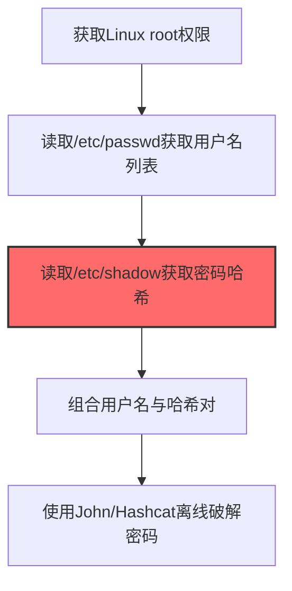
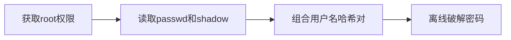

# /etc/passwd和/etc/shadow (T1003.008)

## 一句话通俗理解

> **读取Linux密码文件并离线破解**

## 30秒速查卡

| 维度 | 你需要知道的 |
|------|-------------|
| 这是什么？ | 读取Linux密码文件并离线破解用户密码 |
| 为什么危险？ | shadow文件存储了所有用户的密码哈希，读取后可以离线暴力破解，不需要再次登录系统 |
| 谁需要关心？ | Linux系统管理员、SOC分析师 |
| 你的第一步防御 | 确保shadow文件权限为640（root:shadow），监控对shadow文件的异常读取 |
| 如果只做一件事 | 使用auditd监控/etc/shadow文件的读取事件，非root用户读取立即告警 |

## 难度等级

⭐⭐ 中级 - 需要一定的技术基础和经验

## 前置知识检查

**读这个文件需要什么？**

- [ ] Windows认证体系（NTLM/Kerberos/LSASS）
- [ ] 哈希基础（NTLM Hash/SHA）
- [ ] 网络认证协议（SMB/LDAP/Kerberos）

## 技术描述

**/etc/passwd和/etc/shadow**（T1003.008）是 **操作系统凭证转储**（T1003）的一个具体变体，属于 **凭证访问** 阶段的攻击技术。

简单来说，就像从保险箱里翻出所有人的钥匙。

### 具体怎么理解？

读取Linux密码文件并离线破解

攻击者使用这种技术时，通常是在凭证访问阶段，想要达到特定的攻击目标。与父技术 T1003 相比，T1003.008 有自己独特的特点和使用场景。

### 为什么有效？

这种技术之所以有效，是因为：
1. **隐蔽性**：利用了正常系统功能或常见协议，不容易被发现
2. **技术门槛适中**：不需要特别高深的技术知识就能实施

**过渡段：** 不要误解凭证访问只是'窃取密码'——在现代企业中，凭证存在于内存、磁盘、网络流量等多个位置。
3. **广泛适用**：可以在多种环境和系统中使用

## 真实攻击流程

### 典型场景

攻击者在 **凭证访问** 阶段使用 /etc/passwd和/etc/shadow 技术，以下是典型的攻击步骤：



**步骤详解：**

1. **获取Linux root权限** - /etc/shadow文件仅root可读，攻击者需先通过提权或利用root权限进程获取访问能力
2. **读取/etc/passwd获取用户名列表** - /etc/passwd对所有用户可读，包含系统中所有账户名、UID、Shell配置等信息
3. **读取/etc/shadow获取密码哈希** - /etc/shadow存储了所有账户的密码哈希（SHA-512/ bcrypt格式），是离线破解的核心目标
4. **组合用户名与哈希对** - 将passwd中的用户名与shadow中的哈希对应起来，形成"用户名:哈希"格式的破解字典
5. **使用John/Hashcat离线破解密码** - 利用John the Ripper或Hashcat对哈希进行字典攻击、规则攻击或暴力破解

## 攻击流程

```
获取root权限 --> 读取passwd和shadow --> 组合用户名哈希对 --> 离线破解密码
```



**步骤详解：**
1. **获取root权限**
   - 通俗描述：攻击者获取Linux系统的root权限，因为密码哈希文件只有root能读
   - 技术细节：/etc/shadow文件仅root可读，需通过提权或利用root权限进程获取访问能力
   - 常用工具：内核提权漏洞、sudo滥用、SUID提权
2. **读取passwd和shadow**
   - 通俗描述：把存用户名的文件和存密码哈希的文件都读出来
   - 技术细节：/etc/passwd对所有用户可读（含用户名、UID、Shell），/etc/shadow仅root可读（含SHA-512/bcrypt哈希）
   - 常用工具：cat、cp、awk
3. **组合用户名哈希对**
   - 通俗描述：把用户名和对应的密码哈希配对起来
   - 技术细节：将passwd中的用户名与shadow中的哈希按UID对应，形成"用户名:哈希"格式的破解输入
   - 常用工具：unshadow命令、awk、自定义脚本
4. **离线破解密码**
   - 通俗描述：用破解工具把哈希还原成明文密码
   - 技术细节：利用John the Ripper或Hashcat对哈希进行字典攻击、规则攻击或暴力破解
   - 常用工具：John the Ripper、Hashcat

## 真实案例

### 案例1：Orangeworm -- 针对医疗行业的密码文件窃取（2018-2019）

- **时间**: 2018-2019年
- **目标**: 全球医疗行业（医院、医疗机构IT基础设施），主要位于北美和欧洲
- **攻击组织**: Orangeworm（针对医疗行业的APT组织，部署Kwampaints后门）
- **手法**: Orangeworm在通过SSH爆破或漏洞利用获得Linux服务器root权限后，使用自定义脚本批量读取`/etc/passwd`和`/etc/shadow`文件，通过SMB外传至C2服务器。随后使用John the Ripper对SHA-512哈希进行字典攻击，破解的密码被用于横向移动至PACS影像系统和医疗设备管理服务器
- **影响**: 持续潜伏医疗网络超过2年，窃取患者病历和医疗设备配置信息
- **参考链接**: [Symantec Orangeworm分析报告](https://www.symantec.com/blogs/threat-intelligence/orangeworm-targets-healthcare-us-europe)

### 案例2：TeamTNT -- 加密挖矿团伙读取/etc/shadow离线破解root密码（2021-2022）

- **时间**: 2021-2022年
- **目标**: 全球云Linux服务器（AWS EC2、Azure VM、阿里云ECS），数千台暴露Docker API的实例
- **攻击组织**: TeamTNT（加密货币挖矿团伙）
- **手法**: TeamTNT在通过Docker API逃逸获得root权限后，使用`cat /etc/shadow > /tmp/.shadow_backup`和`cp /etc/passwd /tmp/.passwd_backup`复制凭证文件，外传后使用Hashcat进行模式1800（sha512crypt）字典攻击。破解出的root密码被用于重新进入已加固的系统，绕过最初被修复的漏洞入口
- **影响**: 控制超过5万台云主机部署挖矿程序，导致受害企业累计超过200万美元云账单损失
- **参考链接**: [Aqua Security TeamTNT深度分析](https://www.aquasec.com/resources/blog/teamtnt-now-targets-aws-credentials/)

### 案例3：8220 Gang -- SSH爆破获取root后读取/etc/shadow离线破解横移（2017-2023）

- **时间**: 2017-2023年（持续活跃至今）
- **目标**: 全球云Linux主机（AWS、Azure、GCP、阿里云、腾讯云），主要针对Docker、Confluence、WebLogic、Redis等暴露服务
- **攻击组织**: 8220 Gang（8220挖矿团伙，因使用8220端口作为C2通信而得名）
- **手法**: 8220 Gang的感染脚本包含名为"Spirit"的SSH爆破模块，内置约450组硬编码凭证（root用户名+常见Linux设备默认密码组合）。通过SSH爆破获得root权限后，执行`cat /etc/passwd`和`cat /etc/shadow`复制凭证文件，外传至C2服务器后使用Hashcat模式1800（sha512crypt）进行离线字典攻击。破解出的密码被用于横向移动至同内网段使用相同密码的其他Linux主机，实现从单点入侵到大规模内网感染的扩散
- **影响**: SentinelOne 2022年7月报告确认8220 Gang僵尸网络已扩展至全球约30,000台感染主机，部署PwnRig矿机和Tsunami IRC僵尸网络；累计造成受害企业数百万美元云账单损失
- **参考链接**: [SentinelOne - 8220 Gang云僵尸网络扩展至3万台主机](https://www.sentinelone.com/blog/from-the-front-lines-8220-gang-massively-expands-cloud-botnet-to-30000-infected-hosts/)

## 红队视角

> ⚠️ **免责声明**：以下内容仅用于合法的安全测试、渗透测试和教育目的。未经授权对他人系统进行测试是违法行为。

### 实战技巧

1. **深入理解原理**：在实战应用前，充分理解/etc/passwd和/etc/shadow的技术原理和适用场景
2. **环境适配**：根据目标系统的操作系统版本、安全配置等因素调整攻击策略
3. **组合使用**：将该技术与其他技术组合使用，构建完整的攻击链
4. **隐蔽性考虑**：注意操作痕迹的清理，避免被安全设备检测

### 常用工具

| 工具名称 | 用途 | 平台 | 链接 |
| -------- | ---- | ---- | ---- |
| John the Ripper | 离线破解SHA-512/bcrypt哈希，对/etc/shadow进行字典攻击和规则攻击 | Linux/macOS | [John the Ripper](https://www.openwall.com/john/) |
| Hashcat | GPU加速哈希破解，支持模式1800(sha512crypt)等Linux shadow格式 | Linux/Windows | [Hashcat](https://hashcat.net/hashcat/) |
| unshadow | 将/etc/passwd和/etc/shadow合并为John可识别的单一文件 | Linux | John the Ripper自带工具 |
| cat / awk / grep | 组合shell命令快速提取用户名和哈希字段进行解析 | Linux | 系统自带命令 |

### 注意事项

- 在授权的测试环境中使用这些技术
- 注意操作安全（OPSEC），避免被检测系统发现
- 使用匿名化技术和代理隐藏真实身份

## 蓝队视角

### 检测要点

1. **系统日志监控**：关注与/etc/passwd和/etc/shadow相关的系统日志和审计记录
2. **异常行为检测**：监控系统中与该技术相关的异常进程、网络连接和文件操作
3. **工具特征识别**：识别攻击者可能使用的工具在系统中的运行特征

### 监控建议

- 部署端点检测和响应（EDR）系统，监控与/etc/passwd和/etc/shadow相关的异常行为
- 配置SIEM规则，关联分析来自多个来源的告警
- 定期进行安全评估和渗透测试，验证检测规则的有效性

## 避坑指南

组织中最危险盲区：认为强密码就足够安全。

## 检测建议

### 检测思路

检测 /etc/passwd和/etc/shadow 的关键是识别异常行为模式。以下是三个层面的检测方法：

### 网络层检测

**方法**：监控网络流量中的异常模式

```bash
# 检测异常的网络连接和数据传输
# 根据具体协议和端口设置检测规则
```

### 主机层检测

**Windows事件ID**：
- 事件ID 4688：进程创建（监控可疑进程）
- 事件ID 4104：PowerShell执行（监控可疑脚本）

**Linux日志**：
- /var/log/auth.log：认证日志
- /var/log/syslog：系统日志

```bash
# 检测异常进程和命令执行
grep -i "suspicious" /var/log/auth.log
```

### 应用层检测

**用人话说：** 这条规则在监控是否有非root用户在读取/etc/shadow文件。shadow文件存储了Linux系统所有用户的密码哈希，是Linux的'密码保险箱'。正常情况下只有root用户和一些系统服务会读它。如果有普通用户或陌生进程试图读取shadow文件，那就是攻击者在偷Linux用户的密码哈希。

**Sigma规则示例**：

```yaml
title: 检测/etc/passwd和/etc/shadow
status: experimental
description: 检测可能的/etc/passwd和/etc/shadow活动
logsource:
    category: process_creation
    product: windows
detection:
    selection:
        EventID: 4688
    condition: selection
level: medium
tags:
    - attack.T1003008
```

## 缓解措施

### 优先级1：关键措施

**限制攻击面**：减少暴露的服务和端口，降低被利用的风险

```bash
# 防火墙规则示例：只允许必要的出站连接
iptables -A OUTPUT -p tcp --dport 443 -j ACCEPT  # 允许HTTPS
iptables -A OUTPUT -p tcp --dport 80 -j ACCEPT   # 允许HTTP
iptables -A OUTPUT -p tcp -j DROP                 # 阻止其他TCP
```

### 优先级2：重要措施

**加强监控**：部署EDR和SIEM系统，实时监控异常行为

### 优先级3：建议措施

**安全意识培训**：教育员工识别相关攻击手法

## 动手实验

> ⚠️ **所有实验必须在隔离的实验室环境中进行**

### 实验1：理解基本原理（初级）

**目标**：理解 /etc/passwd和/etc/shadow 的工作原理

**步骤**：
1. 在隔离环境中搭建测试系统
2. 使用基础工具模拟攻击行为
3. 观察系统日志和网络流量

**学习要点**：理解该技术的核心机制

### 实验2：实际操作（中级）

**目标**：掌握 /etc/passwd和/etc/shadow 的实际使用方法

**步骤**：
1. 使用专业工具进行攻击模拟
2. 尝试不同的绕过技术
3. 分析检测日志的特征

**学习要点**：掌握工具使用和日志分析

### 实验3：防御验证（高级）

**目标**：验证检测规则的有效性

**步骤**：
1. 部署检测规则
2. 执行攻击模拟
3. 验证检测告警是否触发

**学习要点**：理解攻防对抗的实际效果

## 术语解释

| 术语 | 通俗解释 |
|------|---------|
| **ATT&CK** | MITRE公司维护的攻击技术知识库，像一本"黑客手法百科全书" |
| **/etc/passwd和/etc/shadow** | T1003.008，ATT&CK框架中定义的一种具体攻击技术 |
| **操作系统凭证转储** | T1003，/etc/passwd和/etc/shadow所属的父技术类别 |
| **凭证访问** | 攻击链中的一个阶段，攻击者在这个阶段的目标 |
| **C2** | 命令与控制，攻击者用来远程控制被入侵系统的"遥控器" |
| **EDR** | 端点检测与响应，部署在电脑上的安全监控软件 |

## 被引用情况

以下父技术文档引用了本子技术：

- [T1003 - 操作系统凭证转储](../T1003-OS-Credential-Dumping.md)

## 参考资料

### 📚 官方文档（深入了解）

- [MITRE ATT&CK - /etc/passwd和/etc/shadow (T1003.008)](https://attack.mitre.org/techniques/T1003/008/)
- [MITRE ATT&CK - 操作系统凭证转储 (T1003)](https://attack.mitre.org/techniques/T1003/)

### 📰 安全报告（真实攻击）

- [MITRE ATT&CK 官方文档](https://attack.mitre.org/) - ATT&CK 框架官方资源

### 🔧 工具与资源（动手试试）

- [Atomic Red Team](https://github.com/redcanaryco/atomic-red-team) - 检测规则测试框架
- [MITRE ATT&CK Navigator](https://mitre-attack.github.io/attack-navigator/) - ATT&CK 可视化工具

### 📚 学习资料（深入了解）

- [MITRE ATT&CK 知识库](https://attack.mitre.org/resources/) - ATT&CK 官方资源中心
