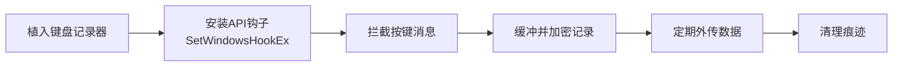

# 输入捕获 (T1056)

## 一句话通俗理解

> **像在键盘底下偷偷装了个摄像头，你敲的每一个字都被记录下来**

## 30秒速查卡

| 维度 | 你需要知道的 |
|------|-------------|
| 这是什么？ | 捕获用户键盘输入、鼠标操作或屏幕内容的技术 |
| 为什么危险？ | 能直接窃取密码、凭证、敏感对话等一切输入信息 |
| 谁需要关心？ | 所有用户、安全团队、系统管理员 |
| 你的第一步防御 | 部署EDR监控键盘记录相关的API调用 |
| 如果只做一件事 | 监控GetAsyncKeyState和SetWindowsHookEx API的异常调用 |

## 难度等级

⭐⭐ 中级 - 需要Windows API编程基础和C/C++知识

## 前置知识检查

**读这个文件需要什么？**

- [ ] Windows API基础（特别是用户输入相关API）
- [ ] C/C++编程基础
- [ ] DLL注入和钩子机制

## 技术描述

### 通俗解释

想象你坐在电脑前输入网银密码，攻击者在背后装了一个"隐形摄像头"，你敲的每个键都被悄悄记录下来，然后发送给攻击者。这就是输入捕获，俗称键盘记录。

### 过渡段

简单来说，操作系统为了让应用程序接收用户输入，提供了一系列API（如GetAsyncKeyState、SetWindowsHookEx）。这些API本是正常功能，但攻击者利用它们来拦截所有输入。

### 技术原理

输入捕获主要通过以下方式实现：
1. **API钩子**：使用SetWindowsHookEx安装全局键盘钩子（WH_KEYBOARD_LL），拦截所有按键消息
2. **轮询式记录**：使用GetAsyncKeyState或GetKeyState轮询每个虚拟键状态
3. **内核层记录**：通过内核驱动直接拦截I/O请求包（IRP）
4. **屏幕捕获**：定期截屏记录用户在屏幕上看到和操作的内容

### 用途与影响

输入捕获是凭证窃取的"瑞士军刀"，被广泛应用于APT攻击、银行木马和间谍软件中。不仅能捕获密码，还能捕获搜索内容、聊天记录、剪贴板数据等。

## 子技术列表

| 子技术ID | 名称 | 说明 |
|----------|------|------|
| T1056.001 | Keylogging | 键盘输入记录 |
| T1056.002 | GUI Input Capture | 图形界面输入捕获 |
| T1056.003 | Web Portal Capture | 网页表单输入捕获 |
| T1056.004 | Credential API Hooking | 凭证API钩子 |
| T1056.005 | Clipboard Data | 剪贴板数据捕获 |
| T1056.006 | Audio Capture | 音频输入捕获 |

## 攻击流程



### 步骤详解
1. 攻击者通过钓鱼或漏洞植入恶意软件
2. 调用SetWindowsHookEx安装WH_KEYBOARD_LL全局钩子
3. 每次按键触发钩子回调函数，记录键码和窗口标题
4. 数据缓冲到本地文件，定期加密
5. 通过HTTP/DNS等通道外传到C2服务器
6. 使用文件less技术驻留，避免被检测

## 真实案例

### 案例1：Lazarus Group键盘记录攻击（2022年）
- **时间**：2022年
- **目标**：加密货币公司员工
- **攻击组织**：Lazarus Group（朝鲜APT）
- **手法**：通过伪装成招聘信息的钓鱼文档植入AppleJeus木马，该木马内置键盘记录模块，使用GetAsyncKeyState轮询方式记录用户在加密货币交易所网站输入的账号密码和2FA验证码。记录数据通过HTTPS加密外传
- **影响**：窃取多个加密货币交易所账户凭证，造成数百万美元损失
- **参考链接**：FBI咨询报告

### 案例2：FIN7银行木马Carbanak（2017-2019年）
- **时间**：2017-2019年
- **目标**：金融机构
- **攻击组织**：FIN7（俄罗斯网络犯罪团伙）
- **手法**：通过定制化的键盘记录模块捕获银行柜员在SWIFT终端的输入，结合屏幕截图记录操作流程，在攻击者了解完整操作流程后发起 fraudulent转账
- **影响**：全球多家银行损失超过10亿美元
- **参考链接**：Europol联合报告

### 案例3：APT41使用的Winnti键盘记录（2020-2023年）
- **时间**：2020-2023年
- **目标**：游戏公司和科技公司
- **攻击组织**：APT41（中国背景APT）
- **手法**：在供应链攻击中植入Winnti后门，其包含内核级键盘记录模块，通过修改键盘驱动IRP处理函数来拦截输入，具有极强的隐蔽性
- **影响**：持续监控目标员工通信，窃取商业机密
- **参考链接**：Group-IB威胁情报报告

## 红队视角

### 实战技巧
- 使用WH_KEYBOARD_LL而非WH_KEYBOARD，前者不需要DLL注入
- 记录时附带窗口标题和进程名，方便区分不同应用输入
- 加入时间戳和按键间隔，帮助分析密码结构

### 常用工具
| 工具 | 类型 | 特点 |
|------|------|------|
| QuasarRAT | 远控工具 | 内置.NET键盘记录模块 |
| LaZagne | 凭证提取 | 可配合键盘记录使用 |
| keylogger.cpp | 开源代码 | C++原生键盘记录示例 |
| Win32 API | 系统API | SetWindowsHookEx直接调用 |

## 蓝队视角

### 检测要点
- 监控进程是否调用SetWindowsHookEx安装全局钩子
- 检测GetAsyncKeyState的高频轮询调用
- 监控异常的剪贴板读取操作（OpenClipboard+GetClipboardData）

### 监控建议
- 使用Sysmon Event ID 8（CreateRemoteThread）检测DLL注入
- 使用ETW（Event Tracing for Windows）监控API调用模式
- 部署EDR的API行为分析功能

## 避坑指南

- 不要只监控WH_KEYBOARD，攻击者越来越多使用LL版本
- 剪贴板监控和屏幕捕获也属于输入捕获，不要遗漏
- 内核级键盘记录器难以通过用户态检测发现，需结合内存扫描

## 检测建议

### 网络层
- 监控异常的DNS查询模式（键盘记录数据通过DNS隧道外传时查询频率极高）
- 检测到未知C2服务器的定期小数据包上传

### 主机层
- **用人话说**：Windows系统会记录哪些程序在"偷看"键盘输入，重点关注调用了SetWindowsHookEx的进程
```yaml
# Sysmon配置：检测全局键盘钩子安装
Event ID: 8  # CreateRemoteThread（钩子注入相关）
Event ID: 10  # ProcessAccess（读取其他进程内存）
```
- 关键事件ID：8（CreateRemoteThread）、10（ProcessAccess）

### 应用层
```yaml
# Sigma规则：检测可疑的键盘记录API调用
title: 检测可疑键盘记录行为
status: experimental
description: 检测进程安装全局键盘钩子或高频轮询按键状态
logsource:
    product: windows
    category: process_creation
detection:
    selection:
        CommandLine|contains:
            - 'SetWindowsHookEx'
            - 'GetAsyncKeyState'
            - 'GetKeyState'
    condition: selection
level: high
```

## 缓解措施

### 优先级1（必须实施）
- 部署EDR监控键盘记录相关API调用模式
- 使用Windows Defender Credential Guard保护凭据

### 优先级2（推荐实施）
- 启用Sysmon监控SetWindowsHookEx调用
- 限制非系统进程安装全局钩子

### 优先级3（长期规划）
- 使用虚拟键盘输入敏感信息（密码、2FA）
- 部署行为分析系统识别异常输入捕获模式

## 动手实验

### 实验1：使用Python实现简单键盘记录器
```bash
# 预期输出：记录按键并保存到keylog.txt
pip install pynput
python keylogger.py
# 输出示例：[2026-07-10 14:30:15] notepad.exe: h, e, l, l, o
```

### 实验2：使用Sysmon检测键盘记录行为
```bash
# 预期输出：Event ID 8显示可疑的CreateRemoteThread调用
sysmon -c sysmon-config.xml
# 在Event Viewer中检查Microsoft-Windows-Sysmon/Operational日志
```

## 术语解释

| 术语 | 说明 |
|------|------|
| SetWindowsHookEx | Windows API，用于安装钩子函数拦截系统消息 |
| WH_KEYBOARD_LL | 低级键盘钩子类型，不需要DLL注入 |
| GetAsyncKeyState | Windows API，获取按键的异步状态 |
| IRP | I/O Request Pack（I/O请求包），内核层数据传输单元 |
| DLL注入 | 将DLL加载到其他进程地址空间的技术 |

## 参考资料

### 📚 深入了解
- [MITRE ATT&CK T1056](https://attack.mitre.org/techniques/T1056/)
- [Microsoft SetWindowsHookEx文档](https://learn.microsoft.com/windows/win32/api/winuser/nf-winuser-setwindowshookexa)

### 📰 真实攻击
- [FBI Lazarus AppleJeus咨询报告](https://www.fbi.gov/news/press-releases)
- [Group-IB APT41报告](https://www.group-ib.com/)

### 🔧 动手试试
- [pynput Python键盘监听库](https://pynput.readthedocs.io/)
- [Sysmon配置指南](https://github.com/SwiftOnSecurity/sysmon-config)
